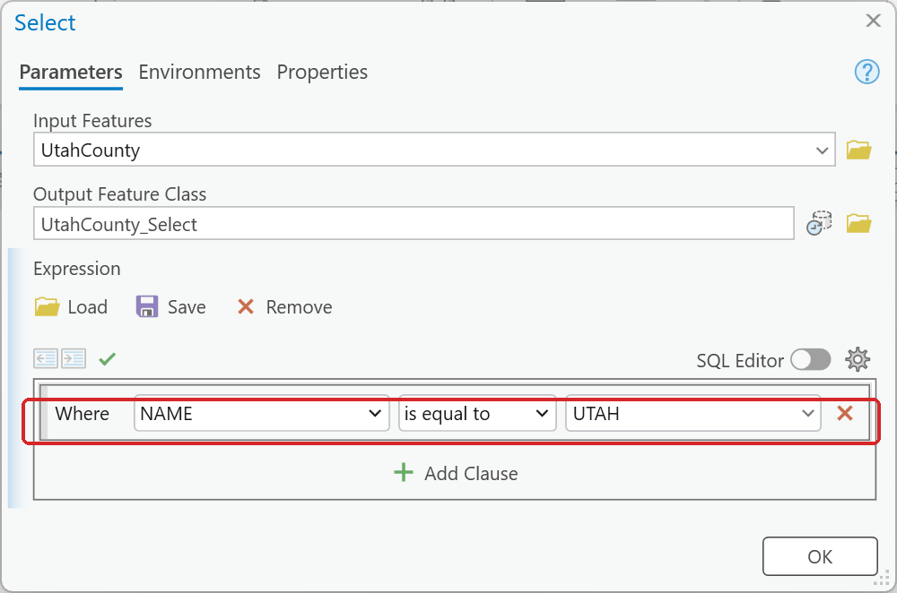
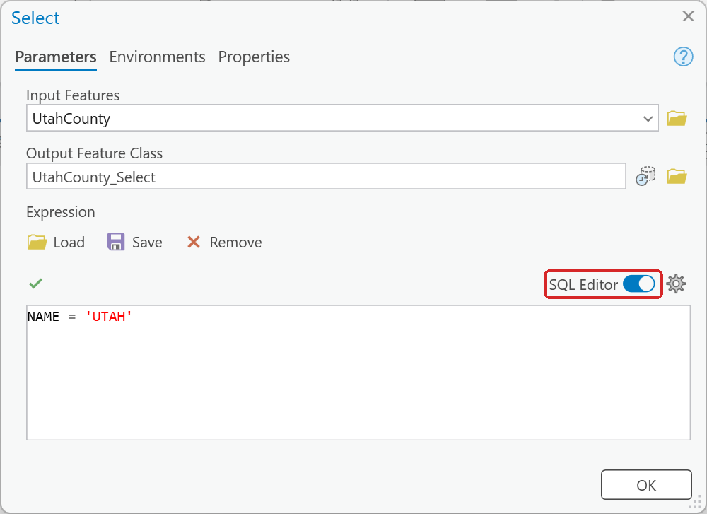
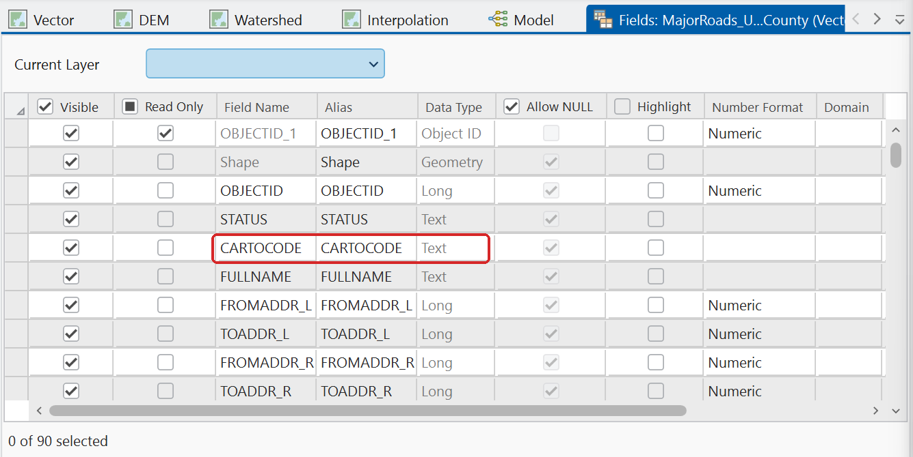
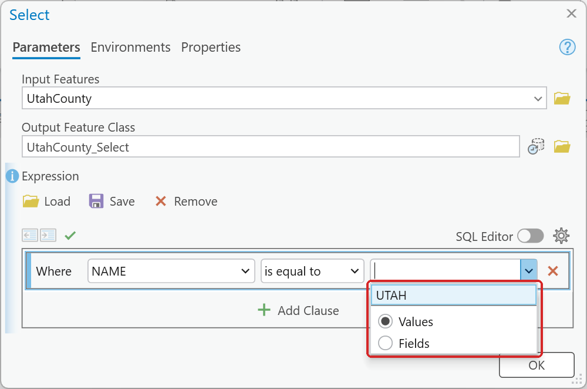

# Writing attribute expressions

The expression box has two modes, and the handouts sometimes mix up their wording:

- **Clause mode** (the default) builds `Where [field] [operator] [value]` from dropdowns. This is
  where a phrase like "NAME is Equal to UTAH" comes from.
- **SQL mode** — toggle **SQL Editor** — is where you type real SQL: `NAME = 'UTAH'`.

**Figure 1.** Clause mode: a field, an operator and a value, each picked from a list.

**Figure 2.** The same expression in SQL mode. Text values go in single quotes.

Things to know:

- **Text values need single quotes and are case sensitive.** `NAME = 'UTAH'` works;
  `NAME = 'Utah'` returns nothing. Numbers take no quotes: `DENSITY > 5000`. Validate the
  expression (the check mark above the box): with the wrong case it reads *The SQL expression is
  valid, but no records were returned* (see
  [Check what a tool actually produced](check-your-output.md)).
- **A coded field may be text even though its values look like numbers.** UGRC's road
  classification field `CARTOCODE` stores its codes as *strings*. `CARTOCODE = 1` fails;
  Lab 1's `CARTOCODE IN ('1','2','3','4','5')` works. (Code `'2'`, separated US highways, has no
  roads in Utah County; keeping it in makes the expression right for any county.) Check the field
  type before you write the expression:
  right-click the layer ▸ **Data Design** ▸ **Fields** and read the **Data Type** column.

    

    **Figure 3.** `CARTOCODE` is **Text**, though every value is a number.

- **The value box lists a field's values only for data that already exists.** When the input is a
  layer or dataset, the box offers a pick list, in ModelBuilder too (Figure 4). When the input is a
  model variable that an earlier tool creates, it cannot, because that tool has not run yet. You
  have to type the value, so a typo or wrong capitalization silently returns zero features.

    

    **Figure 4.** The pick list for an existing layer. Choosing from it avoids typos.

- **A field created by an upstream tool will not appear in a downstream tool's field list** until
  that upstream tool has actually run. Type the field name in by hand.
