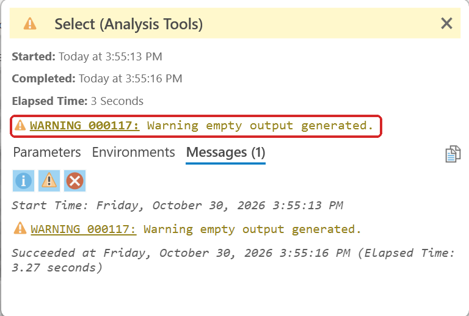
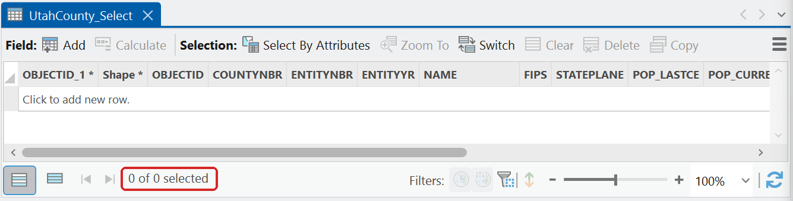

# Check what a tool actually produced

Never move to the next step on the strength of a green check mark.

A tool that selects nothing still "completes". Here is a Select on Utah County with the expression
`NAME = 'Utah'` (the field holds `UTAH`, in capitals):

**Figure 1.** The run "completed with warnings", in yellow, not red. The line under the expression
already said no records would be returned.

**Figure 2.** **View Details** names the problem: *WARNING 000117: Warning empty output generated.*

**Figure 3.** The output exists, has every field, and holds no features. The record count says so.

- **Open the attribute table and read the record count.** Does it make sense? If you selected one
  county and got 29, the expression did not take.
- **Watch the count across a step.** Intersecting a layer with a county boundary can return *more*
  features than you started with, because polygons that straddle the line get split, and because
  the two layers' boundaries never line up exactly. Those extra fragments carry the attributes of
  their parent feature, which can be misleading.
- **Look at the map.** Turn the layer on and see where it is. Most mistakes in this course are
  obvious the moment you look at the result instead of the message window.
- **Ask whether each criterion changed anything.** If applying a filter leaves the count and the
  area exactly as they were, that constraint did not bind. That is a legitimate and interesting
  result — say so in your report, and say how you know.
