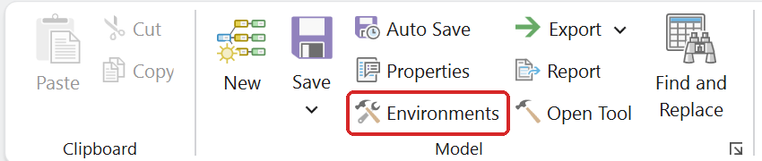
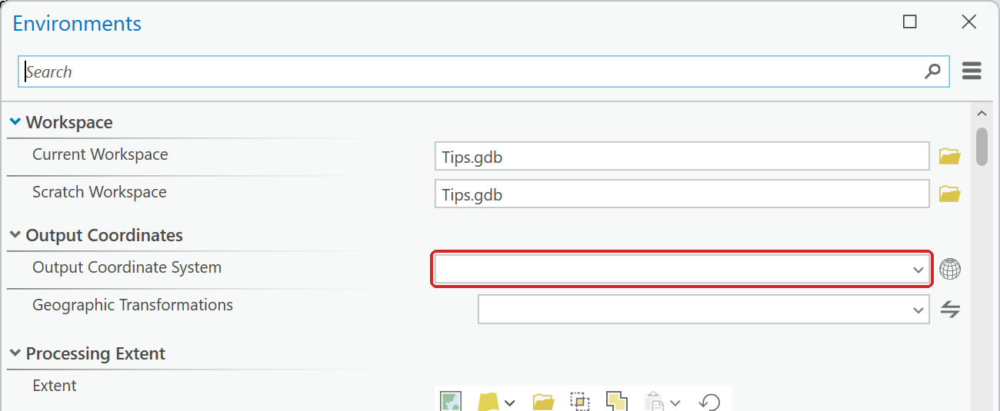
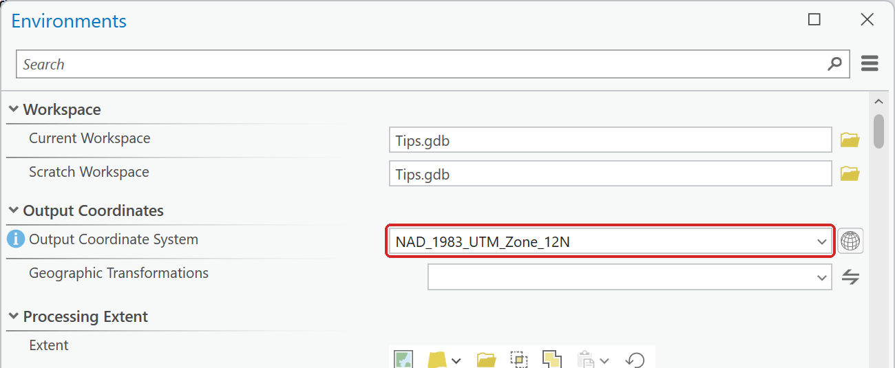

# Set the coordinate system before you measure

Any tool that measures distance or area — Buffer, and anything that reports area — gives wrong
answers if the data is still in geographic (latitude/longitude) coordinates. Degrees are not miles.

In ModelBuilder, click **Environments** on the **ModelBuilder** ribbon tab (in the *Model* group)
and set **Output Coordinate System**. For anywhere in Utah, use **NAD 1983 UTM zone 12N** — search
for it in the picker; note ArcGIS Pro spells "zone" with a lowercase z. All of Utah falls in UTM zone 12.

**Figure 1.** **Environments** on the ModelBuilder tab, in the *Model* group.

**Figure 2.** A new model's Output Coordinate System is empty. Click the globe button to its right.

**Figure 3.** Type the name in the search box, then check that **Horizontal** at the top reads
NAD 1983 UTM zone 12N before you click OK.

**Figure 4.** The environment set. Every tool in the model now writes its output in UTM zone 12N.

Sanity check: after you run a tool, Utah County should come out to about **2,141 square miles**.
Two ways it goes wrong, and they look different:

- **About 0.59** — your data is still in geographic coordinates and that is square *degrees*.
  Obviously wrong, easy to spot.
- **About 3,668** — your data is in **Web Mercator**, which is what several web downloads hand you
  by default. This is the dangerous one: it is in real units, it looks like a plausible county
  area, and it is 71% too big. Web Mercator distorts badly at Utah's latitude and must never be
  used for measurement.

If you get either number, the Output Coordinate System is not set. Do not carry on.

## Web Mercator stretches lengths too

Web Mercator inflates lengths as well as areas. In Lab 5, the NHD streams in the basin read about
**49 km** in Web Mercator instead of about **37 km**, too long by a third at Utah's latitude. Areas
stretch by about 1.73 here, so the 71% error above is not a fluke.

Many web services, including UGRC's, store their data in Web Mercator, and the measurement fields
that come with them are in the service's units:

- **A service's own `Shape__Area` or `Shape__Length` is in Web Mercator.** In Lab 12, UGRC's
  `Shape__Area` for Snowbird says 18.7 million square meters; the area in UTM is 10.781 km².
- **When you export service data, set the export tool's Environments ▸ Output Coordinate System**,
  so that the local copy's `Shape_Length` and `Shape_Area` are in real meters.
- **Measure after any Clip.** A length field that came with the data, such as the NHD's `LengthKM`,
  is the length of each whole line before the Clip cut it. Sum `Shape_Length` instead.
