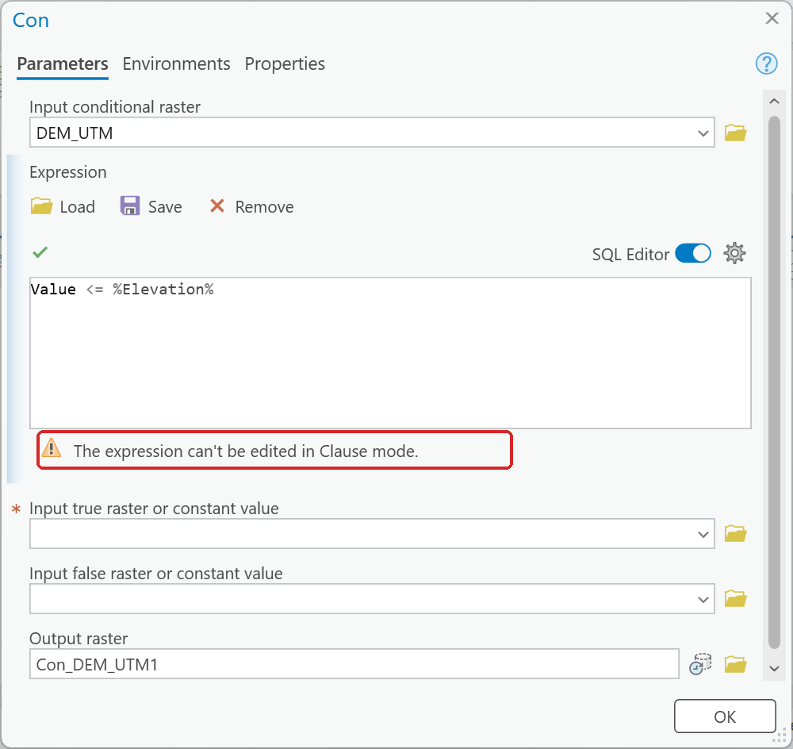
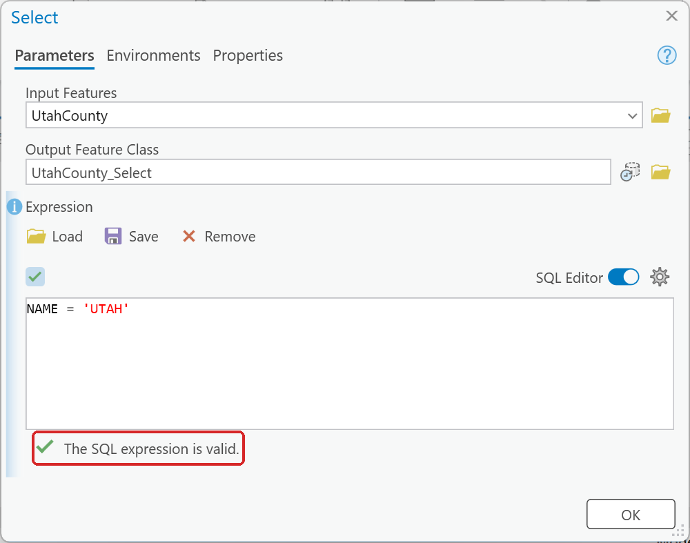

# Tool dialogs that change what you typed

Several tool dialogs quietly rewrite or clear a box after you fill it in. Nothing warns you, and
the tool still runs, so the first sign is an output with the wrong name or a result that ignored
your expression.

## Type the output name last, and read it before OK

Tool dialogs fill **Output raster** or **Output Feature Class** with a default name, such as
`RasterC_1`, `Extract_True1` or `Con_DEM_UTM1`, as soon as they have an input. During the lab runs,
**Raster Calculator**, **Extract by Mask**, **Project Raster** and **Select** also replaced a name
that had already been typed when an input changed or an expression was validated, once even a name
typed *after* the expression. Fill in everything else first, type the output name last, and
**read the name again before you click OK**.

<!-- 2026-10-30, ArcGIS Pro 3.7.0: five attempts to reproduce the overwrite (Raster Calculator in the
Geoprocessing pane and in ModelBuilder, an existing and a freshly added tool, the expression typed
and built from the Rasters list; Extract by Mask with the mask and the input changed) all kept the
typed name, so the page has no figure of it. The advice stands because it costs nothing. -->

## Leave the SQL Editor on

Once an expression is in the SQL Editor, leave it on. An expression that uses a model variable,
such as `Value <= %Elevation%` in Lab 6, cannot be shown as clauses. In ArcGIS Pro 3.7, Con
refuses to switch with the message below; in an earlier run of Lab 6, switching the editor off and
back on cleared the expression instead. Remember also that the **OK** button moves down when the
SQL Editor is on (see
[Defaults that give a confidently wrong answer](wrong-answer-defaults.md#3-clicking-run-with-a-tool-dialog-still-open)).

**Figure 1.** Switching the SQL Editor off with a model variable in the expression.

## A green check means the syntax is valid, nothing more

"The SQL expression is valid" tells you ArcGIS Pro can parse the expression. It does not tell you
the field holds the codes you think it does, or that the expression selects anything. Check the
record count of the output (see [Check what a tool actually produced](check-your-output.md)).

**Figure 2.** Click the check mark above the expression to validate it. This is the most it will
tell you.
