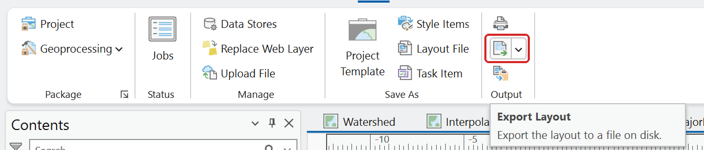
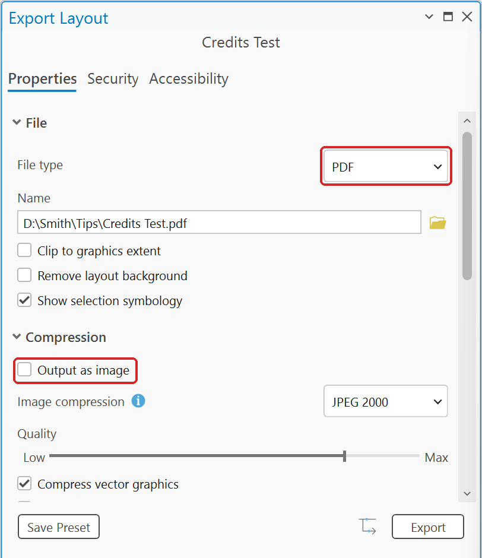
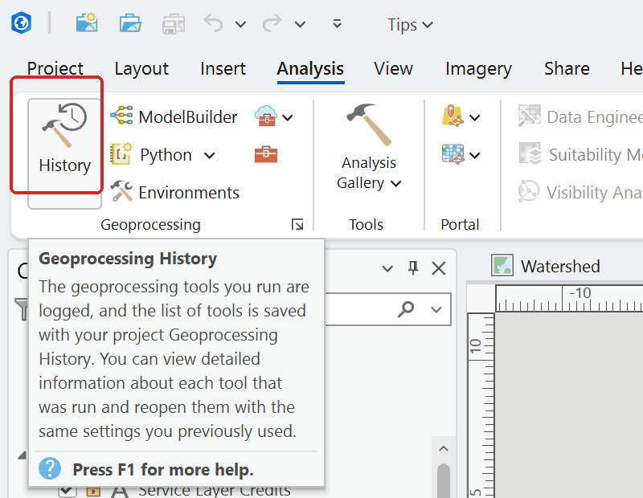

# Exporting maps and models for your report

Graders check how a figure was made, not only what it shows. Screen captures of maps and models
lose points in several rubrics.

## Maps: export the layout as a PDF

On the **Share** tab, click **Export Layout** and choose **PDF**, with the default vector settings.
Do not use **Print**, which makes a picture of the page.

When a lab asks for each map as its own PDF, the grader opens it in a reader and checks that the
title and legend text can be selected and that the features are drawn as lines and shapes, not
pixels. A map image pasted into a document, a screen capture, or anything an image generator
produced fails that check. Put the maps in your report as well, so it reads on its own.

**Figure 1.** On a high-resolution screen the Output group shows icons only. **Export Layout** is
the middle one; the printer above it is **Print Layout**.

**Figure 2.** File type **PDF**, and leave **Output as image** unchecked. Checking it turns the
whole page into a picture and fails the grader's check.

To check your own PDF, open it in a reader and drag across the title: if the words highlight, the
text is real text. In this course's test export of a six-frame layout, the title and the service
credits both came out as selectable text.

## Models: Export To Graphic

In ModelBuilder, click **Export** ▸ **Export To Graphic** and save the model as **SVG**. Every label
stays readable at full-page size, which a screen capture of the canvas does not. Click an empty part
of the canvas first, so that nothing is selected and the export has no selection outlines.

Use the **Export** menu, not the button's main face: clicking the main part of the button sends the
model to the Python window instead.

**Figure 3.** Click the small arrow on **Export**, then **Export To Graphic**.

**Figure 4.** The save dialog opens with SVG chosen. Keep it.

## Evidence that the model ran: Geoprocessing History

Some labs ask for proof that the model ran on your machine. On the **Analysis** tab, click
**History**. The pane lists every run from a tool dialog, newest first. Rest the pointer on an
entry to open its card, with the start and end times, the elapsed time and the parameters, and
capture the pane with the card open.

**Figure 5.** **History**, at the left end of the Analysis tab.

**Figure 6.** The History pane from a Lab 7 run, with one entry's card open. This is the capture a
lab asks for.
