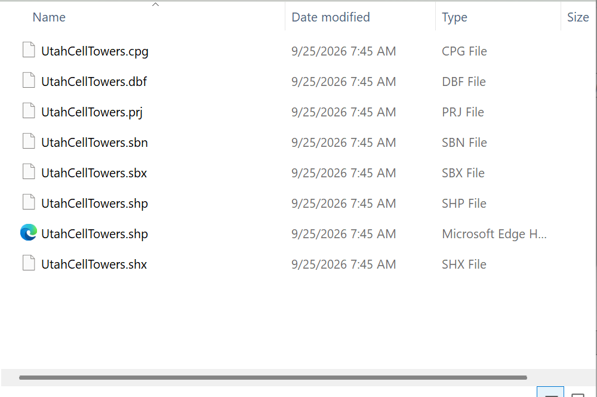

# Housekeeping

- **Do not rename or move files outside ArcGIS Pro.** A shapefile is five or more files that must
  stay together, and a project stores paths to its data. Use the Catalog pane to rename or move.

    

    **Figure 1.** One shapefile, eight files. The Catalog pane shows them as one item; rename or move
  it there, and ArcGIS Pro moves all eight.

- **Give outputs descriptive names.** `HighDensity_Tracts` tells a grader what it is;
  `Select_Output_3` does not. The same goes for the labels on tools in ModelBuilder — this is
  explicitly part of the rubric in several labs.

- **Statewide downloads are large.** Utah's statewide roads layer is over 400,000 features: about
  140 MB zipped and 600 MB unzipped. Download it once, keep it, and do not re-download it for each
  lab.
