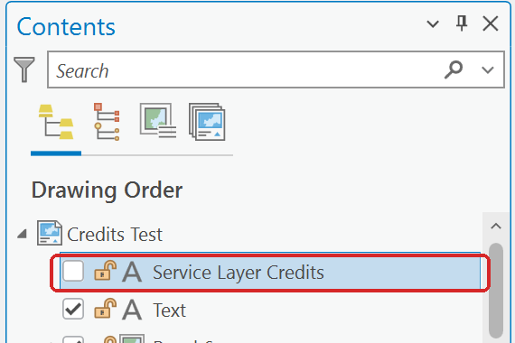

# Basemap credits cover a small map frame

## The problem

When a layout has several small map frames — the panels of a comparison sheet, an inset or a
locator map — the **service layer credits** in the corner of each frame can cover a large part of
it. These are the source credits ArcGIS Pro adds automatically for every web service in the map:
basemaps, imagery, and image services such as the elevation service in Lab 8. The text is the same
length whatever the size of the frame, so on a small frame it sits on top of the data, and on a
sheet of six frames the same line appears six times.

**Figure 1.** Six small frames over Esri imagery. Each frame repeats the same five lines of
credits on top of the data.

## The fix: move the credits out of the map frames

You cannot click the automatic credits and edit them, but you can replace them with one text
element that you control:

1. Open your layout.
2. On the **Insert** tab, in the **Graphics and Text** group, click **New Dynamic Text**.
3. Go to the **Layout** section and choose **Service Layer Credits**. The gallery is long; the
   drop-down at its top right (it reads **All**) jumps straight to **Layout**.
4. Click on the layout to place it.

**Figure 2.** New Dynamic Text, filtered to the **Layout** section.

Once that element exists, the credits stop drawing inside **every** map frame on the page, not
only the one nearest the element. The element lists the credits for every map frame on
the page, so one copy covers the whole sheet. Drag it to the margin or next to your text box, and
make the font small (6 to 7 points is fine) in the **Element** pane.

**Figure 3.** The same layout with one Service Layer Credits element in the margin at 6 points.

Leave the element on the layout. If you delete it, the automatic credits come back inside every
map frame.

## Hiding the credits, and when you may

If you would rather write the sources yourself, you can hide the element: find **Service Layer
Credits** in the layout's **Contents** pane and uncheck it. Do this **only if the same sources
appear somewhere else on the layout**, typed into your text box. Unchecked, the element hides
itself and the automatic credits stay out of the map frames, in the layout and in an exported PDF.

**Figure 4.** The element unchecked in the layout's **Contents** pane.

Esri's guidance is that the credits must appear **on or near the map** in anything printed, including
class work and research papers, not only in commercial products
([Esri: citing an ArcGIS Online basemap](https://support.esri.com/en-us/knowledge-base/what-is-the-correct-way-to-cite-an-arcgis-online-basema-000012040){ target="_blank" }).
Moving or consolidating the credits is fine. Removing them from the sheet is not, and the lab
rubrics ask for the data's source on the map in any case.

For example, a Lab 8 sheet can hide the dynamic credits and carry this line in its text box instead:

> Elevation: USGS 3D Elevation Program, 1/3 arc-second DEM, tile n41w112 (May 2026). Study area:
> drawn for CE 414.

If you also used a basemap, add its sources to that line — the **Credits** on the basemap's item
page give the wording, and so does the dynamic text element before you hide it.

<!-- 2026-10-30, ArcGIS Pro 3.7.0, Tips.aprx "Credits Test" layout (six frames over Imagery Hybrid):
checked by exporting after each step (tools/screenshots/tips_export_layout.py). Placing the element
cleared all six frames; deleting it brought the credits back in all six; unchecking it left the
frames clear in PNG and PDF exports (pdftotext finds no credit text). -->
