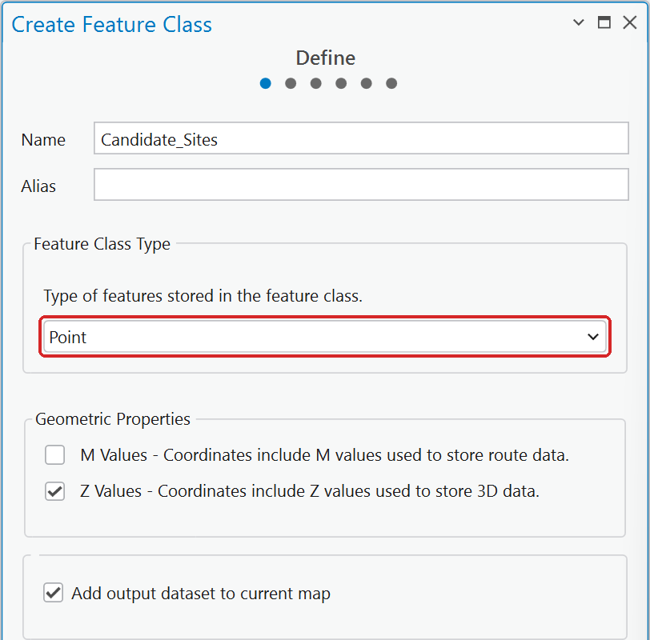
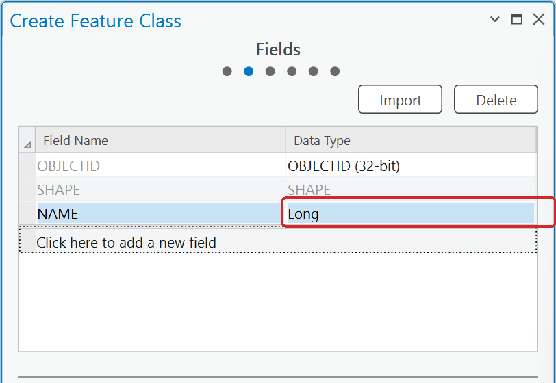
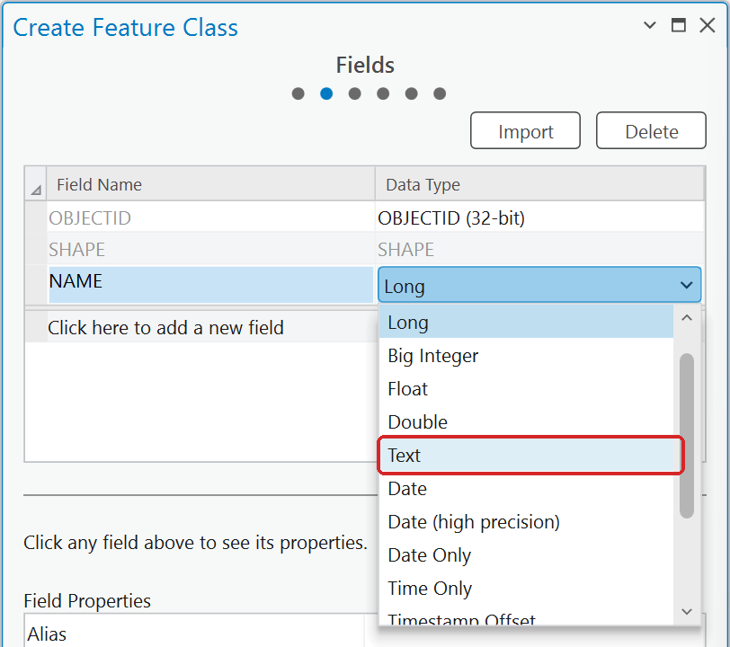
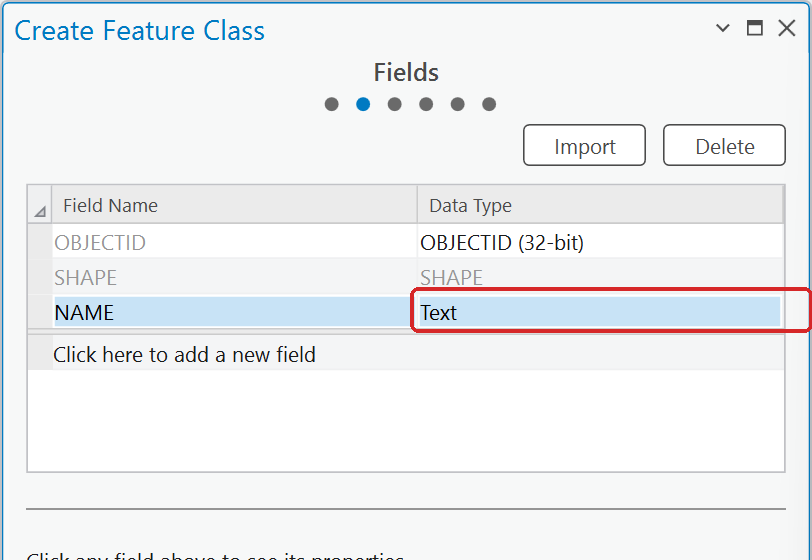
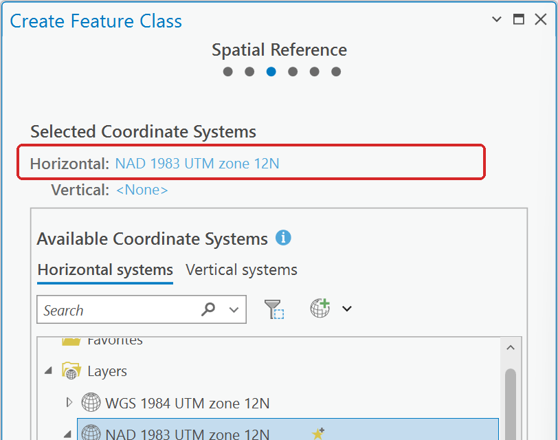
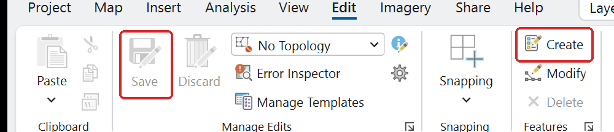

# Creating a point feature class

Several labs ask you to place your own points — candidate sites, existing stores, sample locations.

1. In the **Catalog** pane, expand **Databases**, right-click your project geodatabase
   (`Lab01.gdb`), and choose **New ▸ Feature Class**.

    

    **Figure 1.** Right-click the geodatabase ▸ **New** ▸ **Feature Class**.

2. Give it a name with no spaces, set **Feature Class Type** to **Point**, and click Next. The type
   opens at **Polygon**, so change it.

    

    **Figure 2.** Page 1 of the wizard. Leave the M and Z check boxes as they are.

3. Add any fields you want to record — a `NAME` text field is usually enough. Click **Click here to
   add a new field**, type the name, then set its **Data Type**: a new field comes in as **Long**,
   a whole number, which cannot hold a name.

    

    **Figure 3.** A new field arrives as **Long**.

    

    **Figure 4.** Click the Data Type cell twice to open the list, and choose **Text**.

    

    **Figure 5.** `NAME` is now a text field.

4. On the next page, check the coordinate system. It should be the one you are using for analysis
   (NAD 1983 UTM zone 12N). The wizard proposes the coordinate system of the layers in your map,
   so if the map is in something else, search for UTM zone 12N here. Then click **Finish**.

    

    **Figure 6.** Page 3: read the **Horizontal** line before you click Finish.

5. The empty layer is added to your map. On the **Edit** ribbon tab click **Create**, pick your new
   layer in the Create Features pane, and click on the map to place each point.

    

    **Figure 7.** **Create** opens the Create Features pane; **Save** writes your edits.

    

    **Figure 8.** Three points placed over imagery, with the Candidate_Sites template selected.

6. Click **Save** on the Edit tab when you are done. Edits are not written until you save.

Use a basemap or imagery to place points accurately, and zoom in — a point placed at the wrong
scale can be a quarter mile off.
