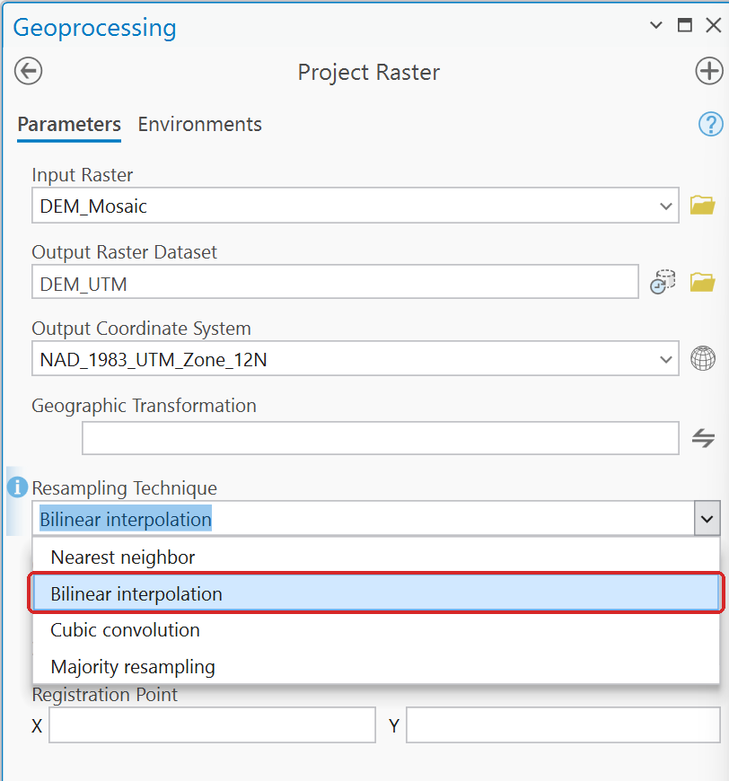
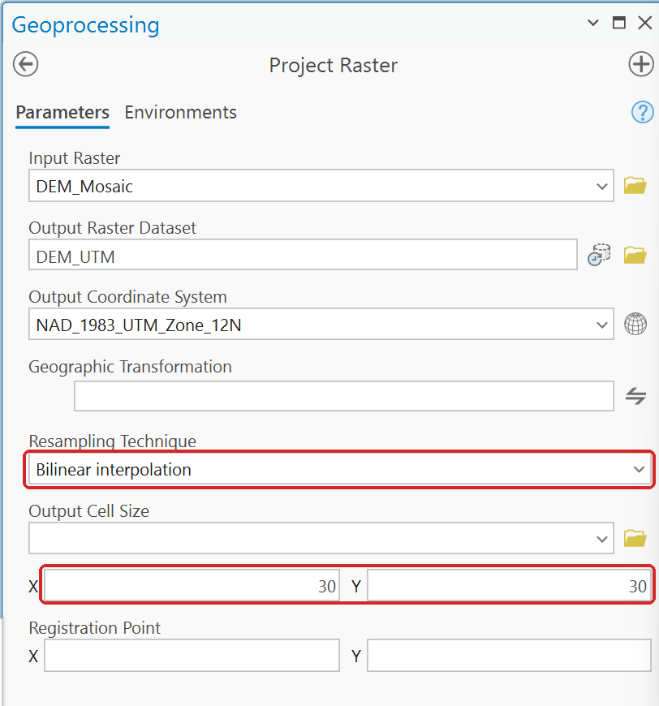
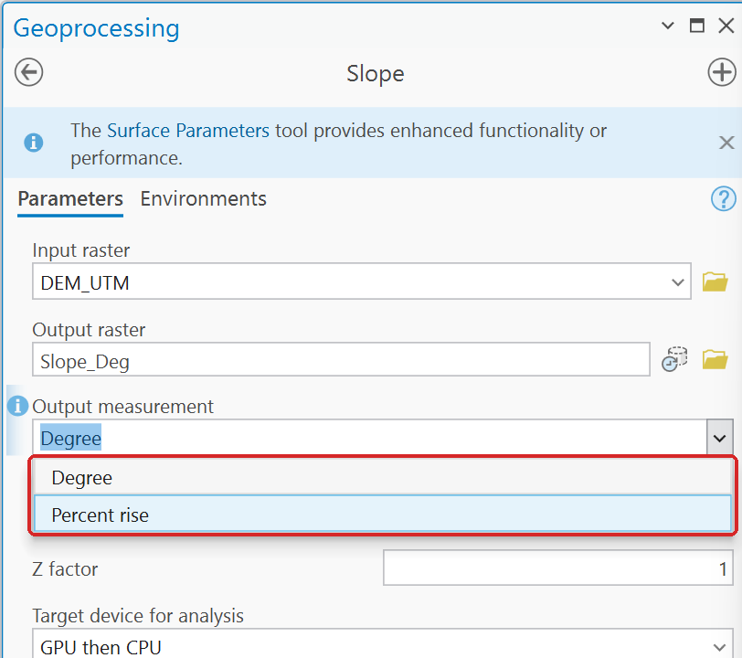

# Projecting a DEM

Most DEMs you download, including the USGS 3D Elevation Program's, come in geographic coordinates:
latitude and longitude. Project them before you compute slope, area, distance or volume.

## Geographic cells are not square

A one-arc-second cell is shorter east–west than north–south at Utah's latitude. In Lab 4 the
county mosaic's cells are about **24 m wide and 31 m tall**. Terrain tools that assume square cells
still run on such a raster, and give wrong answers quietly.

**Slope** is the example the labs measure. On the unprojected Little Cottonwood DEM in Lab 12, it
reports a mean slope of 24.3°, about 2.6° too gentle. Two or three degrees move a lot of terrain
across a classification break.

## Project Raster: three settings to check

Use **Project Raster** (Data Management Tools), and set these yourself rather than accepting what
the dialog proposes:

1. **Output Coordinate System**: NAD 1983 UTM zone 12N for anywhere in Utah.
2. **Resampling Technique**: **Bilinear interpolation** for elevation. The dialog opens at
   Nearest neighbor; in ArcGIS Pro 3.7 it switches to Bilinear by itself once a floating-point DEM
   is the input, but check it. Nearest copies the single nearest value and leaves small steps in the
   surface, which Slope reads as slope and which can become false pits. Use Nearest only for
   categories, such as land cover or a 1/0 result.
3. **Output Cell Size**: type a round number in **both X and Y**, such as `30` or `10`. The tool
   proposes a cell size of its own, never a round one: about 27.47 m for a mosaic of Lab 4's
   one-arc-second tiles, 24.05 × 30.96 in Lab 4's own steps, about 9.04 in Lab 12.

Before you project, look at what you have. A DEM in geographic coordinates reports its cell size
in degrees:

**Figure 1.** Properties ▸ Source ▸ Raster Information for an unprojected DEM. A cell size of
0.000278 is one arc-second, in degrees.

**Figure 2.** Project Raster's proposed cell size, 27.465 m. Do not accept it.

**Figure 3.** The Resampling Technique list. **Bilinear interpolation** for elevation.

**Figure 4.** Bilinear resampling and a round 30 m cell typed in both X and Y.

**Check the result:** open the output's **Properties** ▸ **Source** ▸ *Raster Information*. The
cell size should be the one you typed. A cell size such as 0.000278 (one arc-second) or 0.0000926
(1/3 arc-second) means you are looking at the unprojected DEM, in degrees.

**Figure 5.** The projected DEM: 30 × 30 m cells.

## Then check Slope's units

**Slope**'s **Output measurement** can be *Degree* or *Percent rise*, and the two are far apart: a
5 percent slope is only 2.9 degrees. Use the unit your criteria are written in. A maximum above 90
means the output is in percent rise.

**Figure 6.** Slope's two units. It opens at **Degree**.

## Mosaic first, without a cell size

If you mosaic several tiles before projecting, leave **Cellsize** empty in **Mosaic To New
Raster** and set the cell size in Project Raster. See
[Defaults that give a confidently wrong answer](wrong-answer-defaults.md#mosaic-pixel-type).
