# Make your raster symbology look good

ArcGIS Pro draws a new raster in gray, stretched between its own lowest and highest values. That is
fine for a first look and never right for a map you hand in. This page shows how to turn the gray
into something a reader understands at a glance: a terrain map, a set of maps that can be compared,
an error map, flow accumulation and flow direction. Every map below was made in ArcGIS Pro 3.7 from
the course's own data, and every setting is one you can make in the Symbology pane.

**Figure 1.** The Rock Canyon DEM (Lab 5) as ArcGIS Pro first draws it, and after the three steps
on this page: a color ramp, a hillshade, and a blend mode.

The recipe for a terrain map, in short:

1. Make a **hillshade** of the DEM.
2. Give the DEM a **stretched color ramp** made for elevation.
3. Put the hillshade **on top** and set its **Layer Blend** to **Multiply**, with some
   **Transparency**.

The sections below explain each step and what to change when the result looks wrong.

## Open the Symbology pane

Select the raster layer in the **Contents** pane, then either right-click it ▸ **Symbology**, or on
the **Raster Layer** ribbon tab click **Symbology**. The pane follows whichever layer is selected, so
check its title — *Symbology - DEM* — before you change anything.

**Primary symbology**, at the top, decides everything else:

| Primary symbology | Use it for | On this page |
| --- | --- | --- |
| **Stretch** | Continuous values you want as a smooth ramp: elevation, a surface, a hillshade | Terrain, Lab 8 surfaces |
| **Classify** | Continuous values you want in a few labeled bands: error, depth, slope classes, accumulation | Error maps, flow accumulation |
| **Unique Values** | Codes, where each value is a category: land cover, flow direction, a 1/0 result | Flow direction |
| **Discrete** | Many integer codes with no legend needed | — |

## Step 1 — Make a hillshade

A hillshade lights the DEM from one direction and records how bright each cell would be. It is
what makes terrain look like terrain.

Run **Hillshade** (Spatial Analyst Tools) on your DEM. The defaults — light from the northwest
(**Azimuth** 315) at 45° above the horizon (**Altitude** 45), **Z factor** 1 — are what readers
expect, because shadows that fall toward you make valleys look like ridges. Keep them.

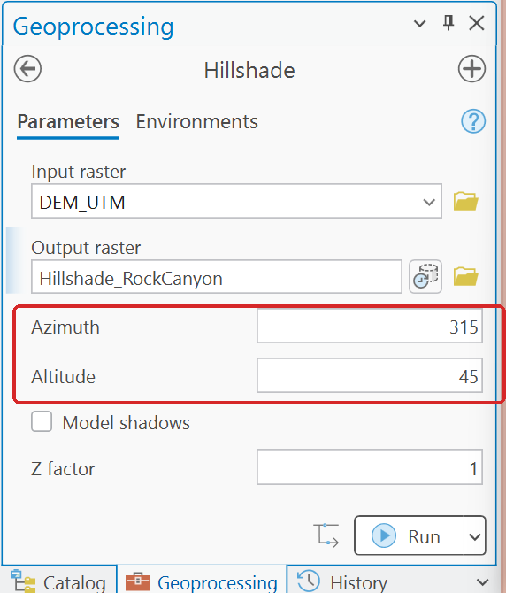

**Figure 2.** Hillshade with its defaults. The DEM must be projected first (see
[Projecting a DEM](projecting-dems.md)); on a DEM in degrees the hillshade comes out flat or
streaked.

> [!TIP]
> **Make a hillshade of each surface you map, not of the true DEM.** In Lab 8, a hillshade made from
> `True_DEM` puts the real mountain's ridges on top of every interpolated surface, so Thiessen, IDW
> and Kriging all look as detailed as the truth (Figure 11). A hillshade of each surface shows what
> that surface actually is.

## Step 2 — A stretched color ramp

Select the DEM and set **Primary symbology** to **Stretch**. Then:

- **Color scheme.** Click the ramp to open the list. Tick **Show names** at the bottom of the list,
  then choose one made for elevation: **Elevation #1** is the one used on this page. Avoid
  rainbow ramps (**Spectrum**) for anything continuous: their bright yellow and cyan bands make
  false edges.
- **Stretch type.** Leave it at **Percent Clip** for a DEM (see the next section for when not to).
- **Labels.** The two **Label** boxes are what the legend prints. Round them: `1,377 m` and
  `3,371 m`, not `1376.67` and `3370.6`.

**Figure 3.** The Symbology pane behind Figure 1's finished map.

## Step 3 — Put the hillshade on top, and blend it

There are two ways to combine a color ramp with a hillshade, and the second looks better:

- **Ramp over hillshade, partly transparent.** Hillshade at the bottom of the Contents pane, DEM
  above it with **Transparency** around 40–50 %. Easy, but the colors wash out to pastel.
- **Hillshade over ramp, blended.** DEM at the bottom, hillshade **above** it. Select the hillshade
  and, on the **Raster Layer** tab in the **Effects** group, set **Layer Blend** to **Multiply** and
  **Transparency** to about **35 %**. Multiply darkens the colors underneath where the hillshade is
  dark and leaves them alone where it is white, so the colors stay strong and the relief stays
  crisp. Use 0 % and the shadows go black; use 60 % and the relief fades.

**Figure 4.** No hillshade; the ramp 45 % transparent over the hillshade; the hillshade on top in
Multiply at 35 %.

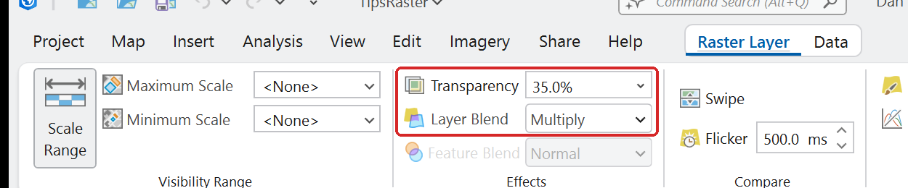

**Figure 5.** **Raster Layer** tab ▸ **Effects**: Transparency and Layer Blend, set on the
hillshade layer.

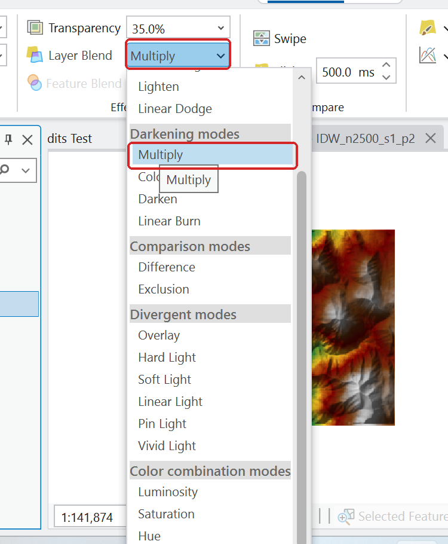

**Figure 6.** **Multiply** is under *Darkening modes*. **Overlay** and **Soft Light** also work on
a hillshade; try them if Multiply looks too dark on your data.

## Stretch types and statistics

The **Stretch type** decides how the values are spread along the color ramp.

**Figure 7.** The stretch types in ArcGIS Pro 3.7, each with its own one-line explanation.

On a smooth DEM the choice barely matters. On **skewed** data, where most cells are small and a few
are huge, it decides whether you see anything at all. Flow accumulation is the extreme case: half
of Rock Canyon's cells have 5 or fewer cells upstream, and the outlet has 430,024.

**Figure 8.** One flow accumulation raster, three stretch types. For data like this, use
**Classify** instead (see [Flow accumulation](#flow-accumulation) below).

- **Minimum Maximum** spreads the ramp evenly from the lowest to the highest value. Good when you set
  the ends yourself (see below); poor when a few extreme cells set them.
- **Percent Clip** (the default) ignores the lowest and highest 0.5 % of cells. Good for most DEMs.
- **Standard Deviation** spreads the ramp across a few standard deviations either side of the mean.
  Good for skewed data.
- **Histogram Equalize** gives each color the same number of cells. Dramatic, but the colors no
  longer mean even steps of elevation, so avoid it on any map with a legend.

The **Statistics** tab, below, decides which cells those statistics come from:

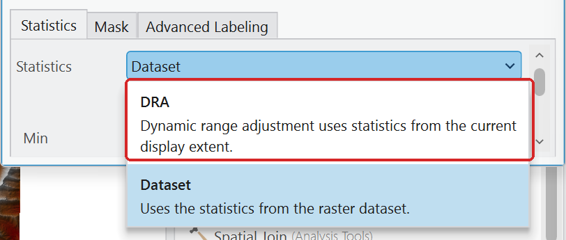

**Figure 9a.** **Dataset** uses the whole raster; **DRA** uses only what is on screen.

**Figure 9b.** Zoomed in on one valley floor. With **Dataset**, the whole view falls in one color of
a ramp that runs to the peaks. **DRA** stretches the ramp across just the view. Use DRA for a close-up
map; never use it for maps that must be compared, because each view gets its own colors.

## Maps that must be compared: one scale for all

Whenever two or more rasters sit side by side — Lab 8's three surfaces, its three error maps, a
before-and-after, a sensitivity run — they need **the same colors for the same values**. ArcGIS
Pro stretches each layer to its own range, so by default they do not.

**For a stretch,** set the same ends on every layer:

1. Set **Stretch type** to **Minimum Maximum**.
2. Tick **Edit min/max values** (it appears only with Minimum Maximum).
3. Type the same **Value** at each end on every layer, rounded to cover all of them: Lab 8's
   surfaces run from 1,368 to 2,887 m, so `1350` and `2900`.
4. Retype the **Label** boxes too. They do not follow the values, so the legend still shows each
   layer's own range until you change them (Figure 10 still reads 1368.74 and 2885.54).

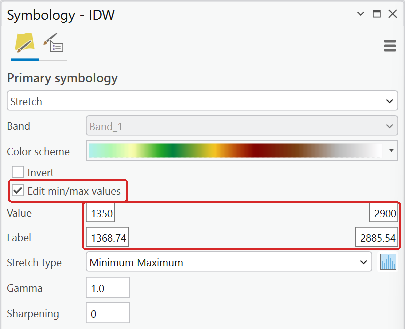

**Figure 10.** Fixed ends of 1,350 and 2,900 m. The labels still show this layer's own range;
retype them.

**For classes,** use **Classify** with **Manual Interval** and type the same breaks on every layer
(next section). Once one layer is right, copy its symbology to the others. Either select a layer
that still needs it and, in the Symbology pane's menu (☰), choose **Import from layer** and pick
the finished one; or right-click the finished layer ▸ **Copy**, then right-click each other layer ▸
**Paste Properties** (Ctrl+Shift+V).

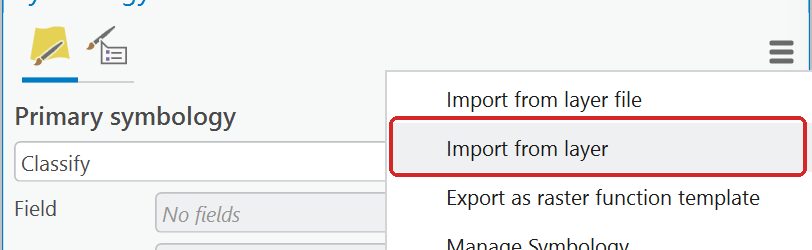

**Figure 10b.** **Import from layer** copies another layer's symbology onto the selected one.

**Figure 11.** Lab 8's three surfaces on the same 1,350–2,900 m stretch. Over the true DEM's
hillshade (top) they look alike, because the hillshade supplies detail none of them has. Over their
own hillshades (bottom) each method's character shows: Thiessen's facets, IDW's pits around the
points, Kriging's smoothness.

## Error maps: a diverging classification

An error map (surface minus truth, model minus observation, one run minus another) has a meaningful
**zero**, and the sign matters. That calls for:

- **Classify**, **Method: Manual Interval**, so you choose the breaks.
- **Symmetric breaks** around zero: −100, −50, −20, −5, 5, 20, 50, 100 m in Lab 8. The same breaks
  on every error map.
- A **diverging** pair of colors: one hue for too high, another for too low, darker for bigger.
- The middle class, within 5 m, as **no color** (or white), so the hillshade or the background shows
  through where the method got it right.

To set the classes: choose **Classify**, set **Method** to **Manual Interval** and **Classes** to the
number you need, then on the **Classes** tab type each **Upper value** and **Label**. Click a class's
color patch to select the row, click it again to open the color palette, and pick a color, or
**No color** at the top.

**Figure 12.** Lab 8's error classes. Red means the surface is too high, blue too low.

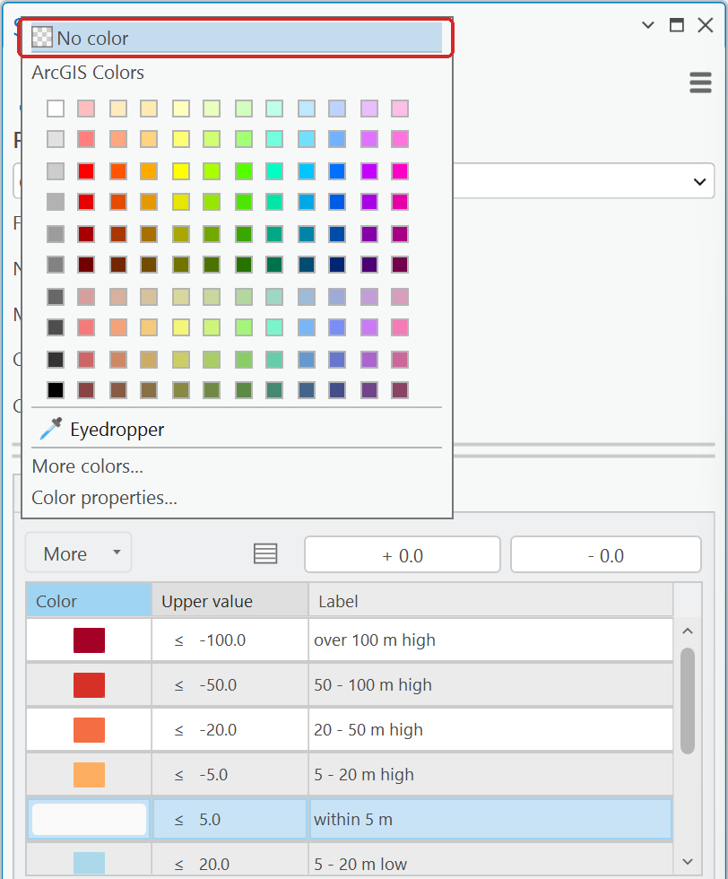

**Figure 13.** Click a class's color patch twice for the palette. **No color** is at the top.

**Figure 14.** Lab 8's three error maps (2,500 points). Top: each on its own stretch, as ArcGIS Pro
draws them; zero is a different color in each and the maps cannot be compared. Bottom: one set of
classes with the 5 m band left clear, so the order Thiessen, IDW, Kriging is plain at a glance.

## Flow accumulation

Flow accumulation counts the cells that drain through each cell. A few cells along the main channel
carry hundreds of thousands; most carry a handful. Any stretch is dominated by the channel and the
map comes out almost black (Figure 15, left). Classify it instead, with classes that grow by
**powers of 10**:

| Upper value | Label | Color |
| --- | --- | --- |
| 1,000 | fewer than 1,000 cells | **No color** |
| 10,000 | 1,000 – 10,000 | light blue |
| 100,000 | 10,000 – 100,000 | mid blue |
| the maximum | over 100,000 | dark blue |

Hiding the smallest class leaves only the drainage network, and a light hillshade underneath (the
hillshade alone, 45 % transparent) puts it in its landscape. With 10 m cells, 1,000 cells is
0.1 km²; pick the lowest break to match the stream threshold you use in the lab.

**Figure 15.** Flow accumulation as it arrives, and in four classes over a hillshade.

## Flow direction

Flow direction stores one of eight codes per cell — 1, 2, 4, 8, 16, 32, 64, 128 for E, SE, S, SW,
W, NW, N, NE — and ArcGIS Pro gives each a random **Unique Values** color. Recolor them so that the
colors run once around a color wheel in the same order as the directions: neighboring directions
then get neighboring colors, and a hillside that drains one way reads as one block.

1. **Primary symbology: Unique Values**, Field `Value`.
2. Double-click each **Label** and type the direction: `E`, `SE`, … `NE`.
3. Click each color patch and pick colors that run around the wheel: red, orange, yellow, green,
   teal, blue, purple, magenta.
4. Put a hillshade on top in **Multiply** (about 50 % transparent).

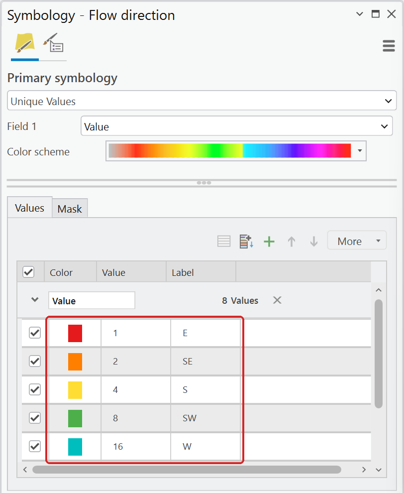

**Figure 16.** The eight codes labeled with their directions and colored around the wheel.

**Figure 17.** The same flow direction raster with random colors and with a color wheel. The two
sides of the canyon now read as two blocks draining toward the channel.

## Small things that make a big difference

- **Pixelated close-ups.** At large scales each cell draws as a square. For continuous data (a DEM,
  a surface, a hillshade) set **Resampling Type** to **Bilinear**: on the **Raster Layer** tab, it
  is the top icon in the right-hand column of the **Rendering** group (or type *Resampling* in the
  Command Search box). Keep **Nearest Neighbor** for codes and classes — flow direction, land
  cover, error classes — where blending neighbors would invent values that do not exist.

    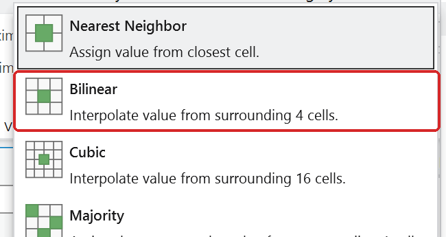

    **Figure 18.** Resampling Type changes only how the layer is drawn, never its values.

- **NoData.** Cells with no value draw as nothing by default, which is usually right. If the area
  outside your study area shows a color, those cells are zeros, not NoData (see
  [Working with rasters](rasters.md)).
- **Background value.** A clipped raster sometimes draws a black or white frame around the data:
  cells holding 0 (or some other fill value) rather than NoData. For a **Stretch** layer, on the
  Symbology pane's **Mask** tab, tick **Display background value**, type the fill value, and set its
  color to no color. Classify layers have only the **Nodata** color on that tab.

    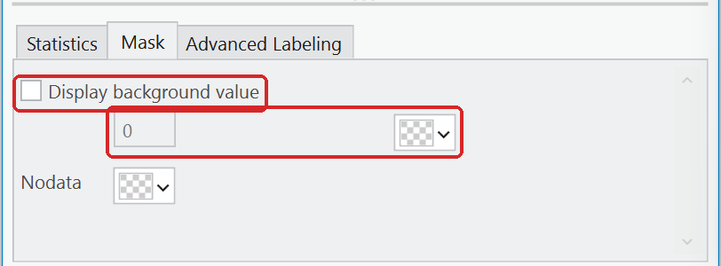

    **Figure 19.** The Mask tab of a Stretch layer.
- **Basemaps.** Turn the basemap off under a full-coverage raster: it is hidden anyway and still
  adds its credits. Over a partly transparent layer, a light basemap such as **Light Gray Canvas**
  competes least with the colors.
- **Legends.** Round the labels, add the units, and take the hillshade out of the legend: in the
  **layout's** Contents pane, expand **Legend** and uncheck **Hillshade**. The hillshade stays on the
  map; only its legend entry goes.

    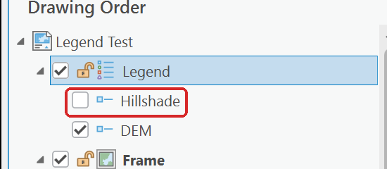

    **Figure 20.** Each layer in a legend has its own check box in the layout's Contents pane.
- **Same ramp, same meaning.** Use one ramp for one kind of quantity throughout a report: one
  elevation ramp, one diverging error ramp. A reader learns it once.

## See also

- [Working with rasters](rasters.md) — statistics, NoData, Reclassify.
- [Projecting a DEM](projecting-dems.md) — project before you make a hillshade.
- [Exporting maps and models for your report](exporting-deliverables.md) — export the layout as a
  PDF once the map looks right.
