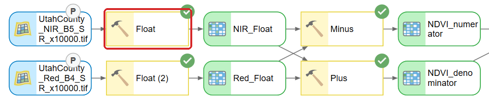
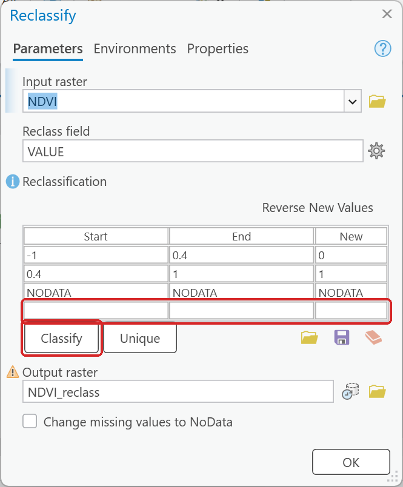
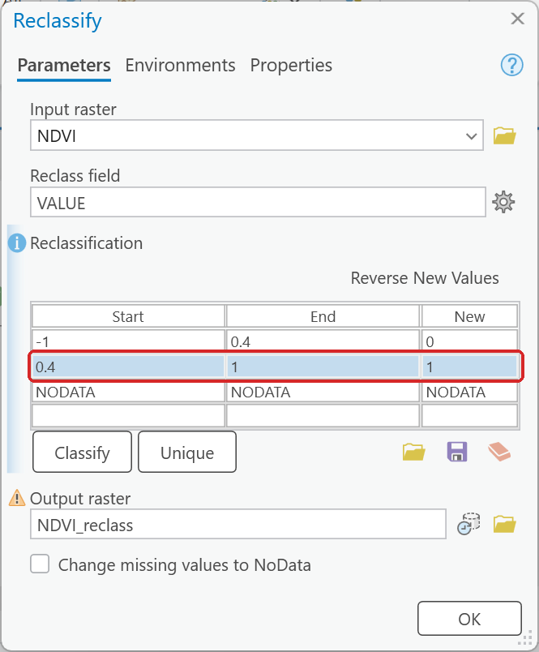
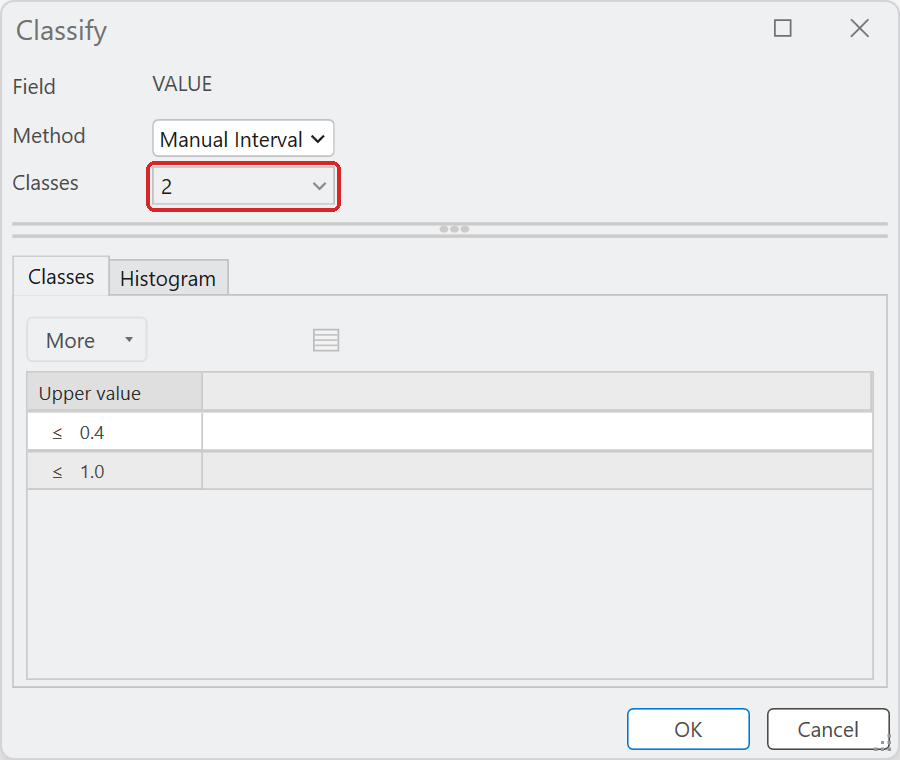
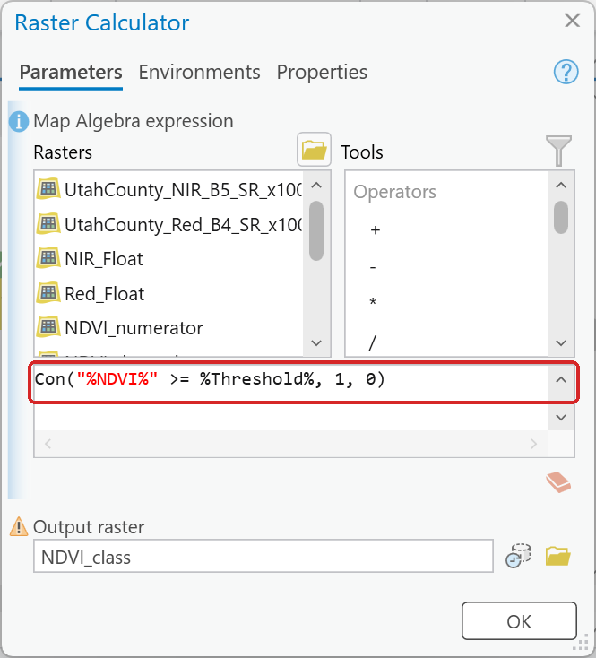

# Working with rasters

Checked in **ArcGIS Pro 3.7.1** during a full run of Lab 2.

- **Build pyramids and calculate statistics.** ArcGIS Pro asks once for every raster you add that
  has none, in a *Build Pyramids and Calculate Statistics* dialog. Leave both boxes checked and click
  **OK**. Without statistics it cannot stretch the display and the raster draws as a flat gray
  block. Tick *Always use this choice* if the prompt annoys you.
- **Integer in, integer out.** Minus, Plus and Divide of integer rasters give integer rasters.
  A ratio such as NDVI, which lives between −1 and 1, collapses to 0 and 1. Run **Float** on
  the inputs first. If a result has only two or three distinct values, this is why.

  

  **Figure 1.** Float on each band before Minus and Plus, so Divide works in decimals.
- **Environments decide what comes out.** Open **Environments** on the ModelBuilder ribbon before
  you build. *Output Coordinate System* left empty means "same as input"; set to a zone, it
  silently reprojects anything from another zone. *Cell Size* defaults to the coarsest input and
  *Extent* to the intersection of the inputs. Check the output cell count against what you
  expected — Lab 2 gives the numbers.
- **NoData is not zero.** A raster's NoData cells are skipped by every tool and every statistic;
  a zero is a real value that is counted. A clipped extract has NoData outside the study area.
  If a mean looks wrong, check which of the two you are looking at.
- **The Reclassify table has no Add or Delete buttons.** Typing in the empty last row adds a
  row. Clicking a row once selects it and the **Delete** key removes it; clicking a selected cell
  again edits it. The **Classify** button fills the table from a method and a class count — press
  **Tab**, not Enter, after typing the count, because Enter closes the dialog.

  

  **Figure 2.** The empty last row is where a new row goes. **Classify** fills the table for you.

  

  **Figure 3.** One click selects a row; the Delete key then removes it.

  

  **Figure 4.** The Classify dialog. Type the class count, then press **Tab**.
- **Running a model from its tool dialog deletes intermediate data.** Everything that is not a
  parameter is "intermediate" and is removed from the geodatabase when the tool finishes; the
  layer vanishes from the map. Make the oval a parameter for anything you want to keep, and do not
  click the canvas's **✗ Intermediate** button, which deletes them. See
  [Running a model from its tool dialog](running-models.md).
- **`%name%` in an expression is a model variable.** Raster Calculator expressions such as
  `Con("%NDVI%" >= %Threshold%, 1, 0)` pick up model variables by name and draw the connectors
  for you. It is the only way to put a plain number (a threshold, a distance) in the tool dialog
  when the tool itself has no parameter for it.

  

  **Figure 5.** `%NDVI%` is a raster variable and `%Threshold%` a number variable; both come from
  the model.
- **A tool dialog whose OK button does nothing** occasionally happens in ModelBuilder in ArcGIS Pro 3.7.
  Drag the dialog somewhere else on the screen and click OK again.
- **PNG for anything with text; JPEG for map views.** Screen captures of dialogs and models
  compress losslessly and stay readable; a captured map over a basemap is a photograph and is
  four to five times smaller as a JPEG.
