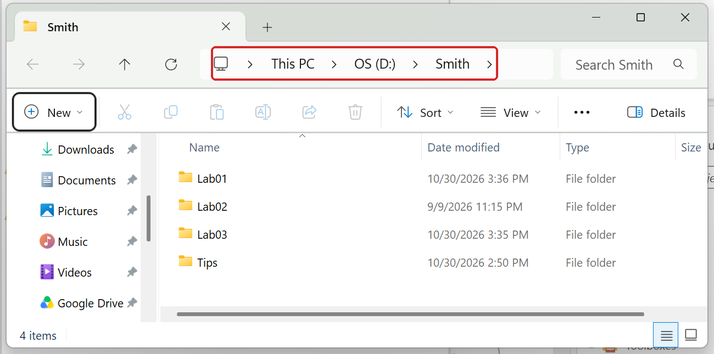
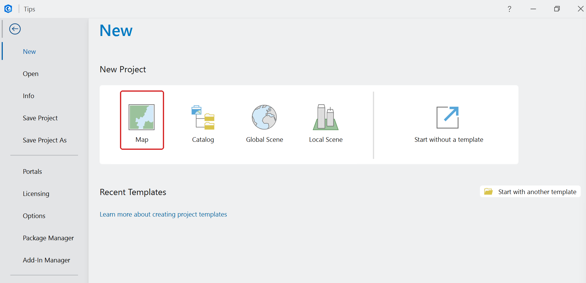
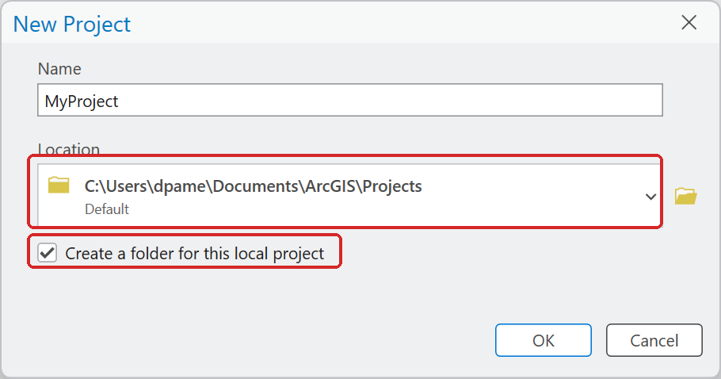
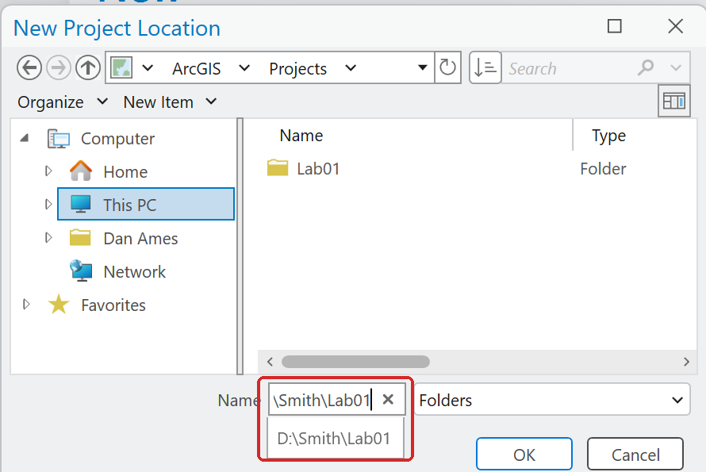
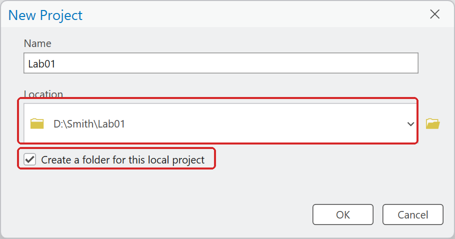
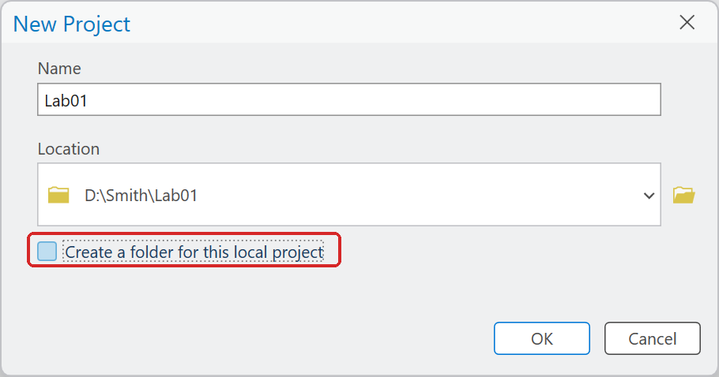

# Set up your workspace and project

On the lab machines, work on the **D: drive**. Not the C: drive, not the desktop, not a network
drive — and there are specific reasons for each:

- **C: is locked.** The lab administrators block writes to it because it holds the software
  installations and the system files. Anything you try to save there will fail, or vanish.
- **Network drives make ArcGIS Pro hang.** Your CAEDM home directory and similar network shares are
  writable, but ArcGIS Pro reads and writes very large files constantly, and doing that across a
  network connection is slow and will sometimes hang or crash ArcGIS Pro outright. Use them for backups,
  never as the place you work.
- **D: is local, fast and writable** — but it is shared with everyone who logs into that machine,
  and it may be wiped between semesters.

So:

1. **Make one folder for this class**, named after you, at the root of D:. For example
   `D:\Smith\`. Use your own name, not your instructor's.
2. **Make one folder per lab inside it**: `D:\Smith\Lab01\`, `D:\Smith\Lab02\`, and so on.
   Put the ArcGIS Pro project *and* the downloaded data for that lab in it.

    

    **Figure 1.** One folder per lab inside your own folder on D:.

3. **Back it up every time you leave the lab.** Copy your lab folder to the network or cloud
   storage of your choice — CAEDM, Google Drive, OneDrive or Box. Work that exists in only one
   place on a shared computer is work you are choosing to risk.

If you want your work to be portable between machines, a **high-speed USB 3.0 external drive** is
a legitimate alternative to D:. You can work directly off it — it is local to the machine while it
is plugged in — and take it with you. Still back it up.

> [!WARNING]
> **Never put a space in any folder or file name you create.** Use `D:\Smith\Lab01`, never
> `D:\John Smith\Lab 01`. Most tools in ArcGIS Pro 3.7 cope with spaces, but older tools, Python
> scripts and some outside programs do not, and the error message rarely tells you that the space
> is the problem. The same goes for the names you give output datasets: use
> `HighDensity_Tracts`, not `High Density Tracts`.

<!-- 2026-10-30, ArcGIS Pro 3.7.0: Slope wrote to D:\John Smith\Lab 01\slope.tif, to "slope out.tif"
and into "Lab 01.gdb", and Buffer wrote into "Lab 01.gdb", all without error. The rule stays as good
practice; the claim that raster tools fail was removed. -->

## Creating the project in the right place

On the **Project** tab, choose **New** and then **Map**:

**Figure 2.** Project ▸ New ▸ **Map**.

In **New Project**, two things trip up almost everyone:

- **The Location box does not accept a typed path.** Click the folder button to its right and use
  the browse dialog. In that dialog, the *Name* box at the bottom *does* accept a full typed path,
  so you can paste `D:\Smith\Lab01` there and click OK.
- **Uncheck "Create a folder for this local project"** if you have already made your `Lab01`
  folder. Leaving it checked gives you `D:\Smith\Lab01\Lab01`, which is not what you want.

**Figure 3.** New Project as it opens: a Location under your Windows profile on C:, and the folder
check box on. Clicking the Location box only offers recent folders; typing in it does nothing.

**Figure 4.** In the folder button's browse dialog, type or paste the path in **Name** and click OK.

**Figure 5.** Almost there. With the box still checked, this makes `D:\Smith\Lab01\Lab01`.

**Figure 6.** Ready: the box unchecked, so the project goes straight into `D:\Smith\Lab01`.
