# Defaults that give a confidently wrong answer

Every setting on this page produces output, reports success, and shows no error. They are the most
common causes of a lab that "ran fine" and still earns a poor grade. The first four come up in
Lab 1; the rest appear in the raster labs that follow.

When a dialog fills in a box for you, treat it as a guess and check it.

## 1. Buffer distances default to meters

The Buffer tool's Distance row has **two** boxes: a number and a unit. The unit reads *Unknown*
until you type a number, and then it silently sets itself to **Meters**. Type `2`, click OK, and
you have made a **two-meter** buffer instead of a two-mile one. Your radius is **1,609 times too
small** — that is just the number of meters in a mile. For a circular buffer the area comes out
about 2.6 million times too small; for a buffer around a long road it is nearer 1,600 times, since
a thin ribbon's area scales with the radius rather than its square.

**Figure 1.** Type `2` in Distance and the unit box fills in **Meters** by itself.

Always set the unit box yourself. There is no plain "Miles" option in ArcGIS Pro 3.7; choose
**Statute Miles**.

**Figure 2.** Open the unit list and choose **Statute Miles**. It sits below the metric units and
International Nautical Miles.

**Figure 2a.** The same store buffered by 2 Statute Miles (left) and 2 Meters (right). The 2 m
buffer covers 12.6 m²; the 2-mile one covers 12.57 square miles.

## 2. Add Field defaults to Long (32-bit integer)

If you are creating a field that will hold a calculated value with a decimal part — a density, a
ratio, an average — set **Field Type** to **Double (64-bit floating point)**. The default is Long,
which silently **rounds every value to a whole number** — a density of 8,539.51 is stored as 8,540.
(It rounds rather than truncating, so the loss is easy to miss when you skim the table.)

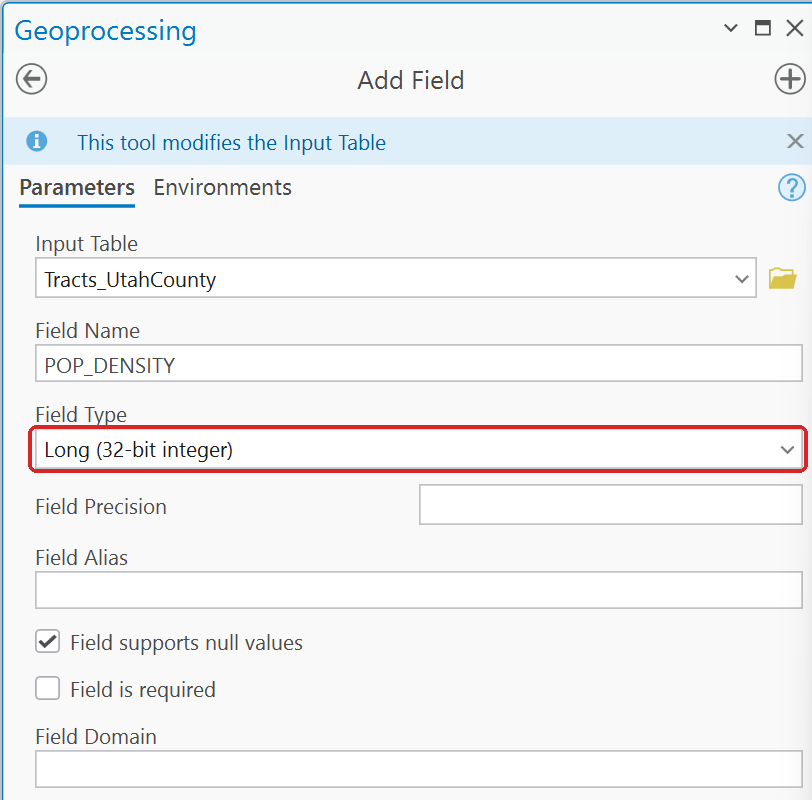

**Figure 3.** Add Field opens with Field Type at **Long (32-bit integer)**.

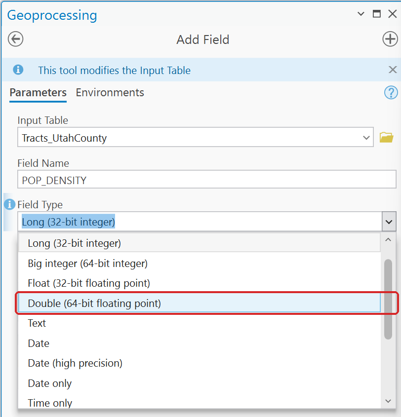

**Figure 4.** Choose **Double (64-bit floating point)** for anything with a decimal part.

**Figure 5.** The same density calculated into a Double field and a Long field. The Long column
keeps no decimals, and nothing on screen warns you.

Calculate Field can also create the field for you, if you type a new name in **Field Name**. Then
set its **Field Type** yourself: it opens at **Text**, and every later comparison or calculation
against a text field breaks.

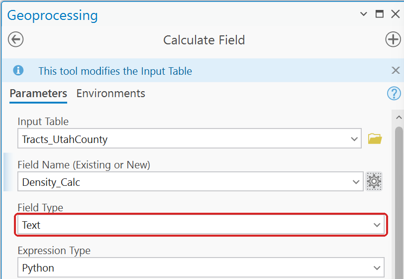

**Figure 6.** A new field name in Calculate Field gets Field Type **Text** unless you change it.

## 3. Clicking Run with a tool dialog still open

If a tool's dialog is open and you click **Run**, the model runs with whatever was last *committed*
— not what is on screen. A Select tool whose expression has not been committed selects *everything*
and reports success in about a second.

Click **OK** on the tool dialog first, every time. Watch out: the OK button **moves down** when you
switch on the SQL Editor, which is exactly when people miss it.

**Figure 7.** The same Select dialog with the SQL Editor off (left) and on (right). The OK button
moves down when the editor opens.

## 4. Buffer's Dissolve Type defaults to No Dissolve

Buffering 1,500 road segments with "No Dissolve" gives you 1,500 overlapping polygons, and anything
you intersect with them afterwards comes out as a mess of slivers. When you want a single zone,
set **Dissolve Type** to *Dissolve all output features into a single feature*.

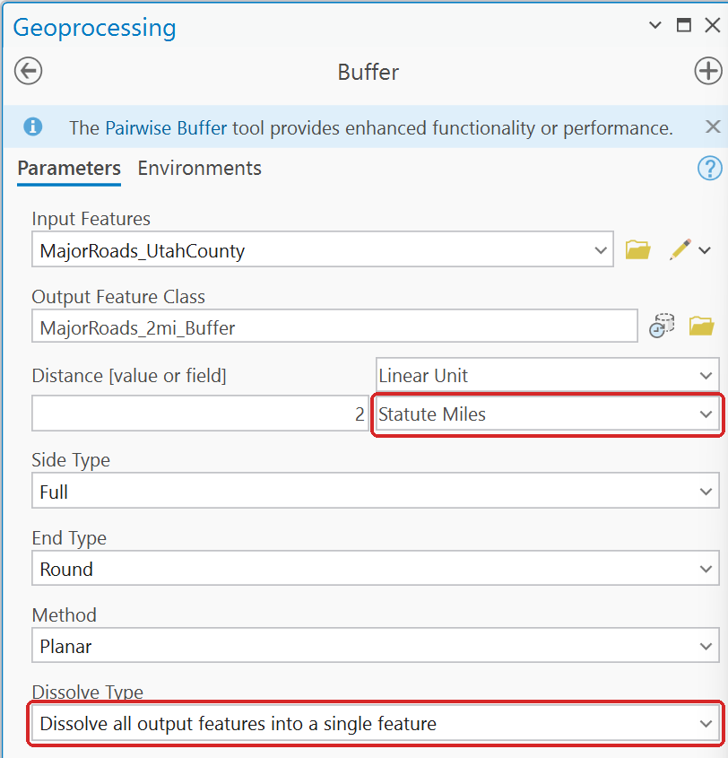

**Figure 8.** Buffer with both defaults fixed: **Statute Miles** and **Dissolve all output features
into a single feature**.

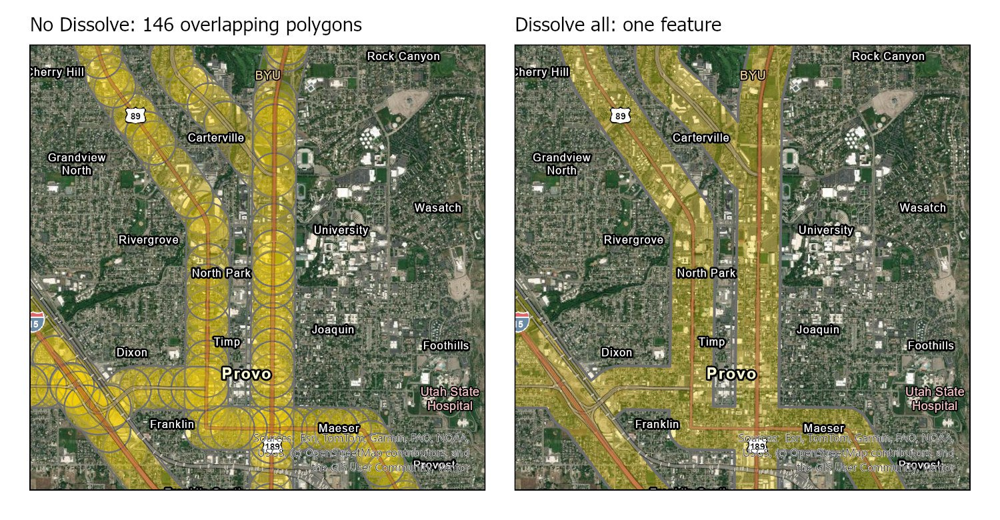

**Figure 8a.** 250 m buffers on the 146 major-road segments in central Provo: No Dissolve (left)
gives 146 overlapping polygons, Dissolve all (right) gives one.

## 5. Mosaic To New Raster defaults to 8 bit unsigned {#mosaic-pixel-type}

**Pixel Type** opens at *8 bit unsigned*, which holds only whole numbers from 0 to 255. Every
elevation in Utah is above that. Set it to **32 bit float** for a DEM.

**Figure 9.** Mosaic To New Raster opens at **8 bit unsigned**. Leave **Cellsize** empty, as here.

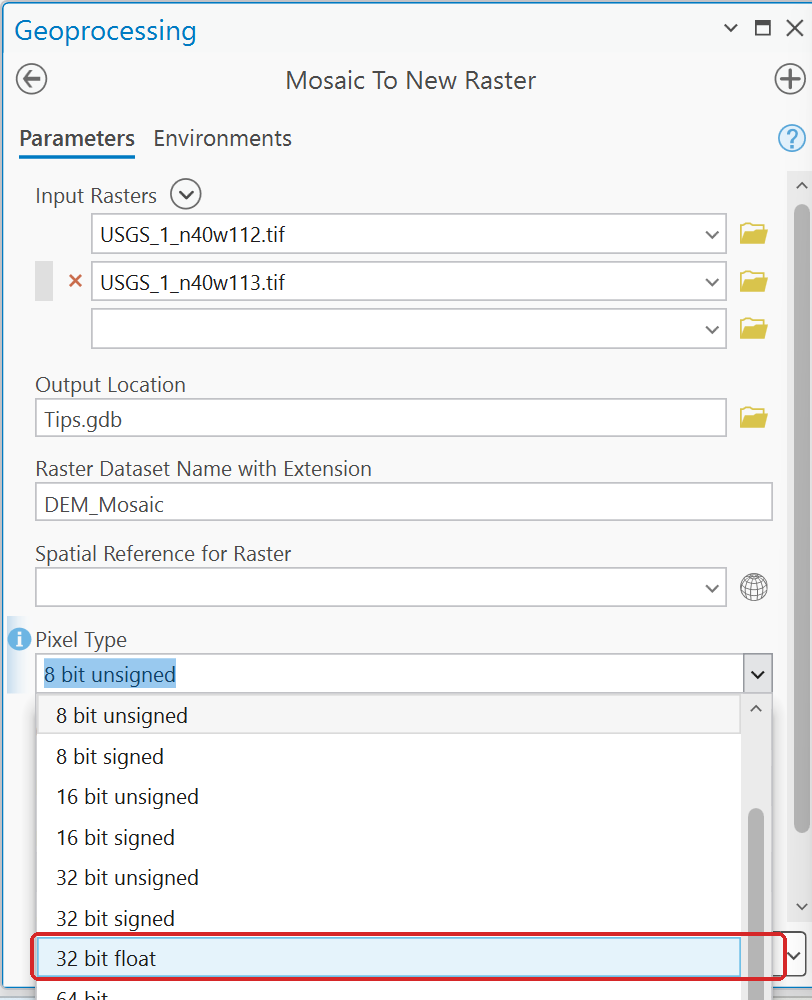

**Figure 10.** Choose **32 bit float** for elevations.

Leave **Cellsize** empty and set the cell size when you project the mosaic (see
[Projecting a DEM](projecting-dems.md)). In Lab 4, typing `30` there produced a raster of 15 billion
cells, almost all of them empty, and the tool ran for 38 minutes. Left empty, the same step takes
about 30 seconds.

## 6. Snap Pour Point's snap distance defaults to 0

At 0 the outlet stays on whatever cell you clicked. A click 30 or 40 m to the side of the channel,
which looks right on the imagery, lands on a hillside cell that drains only a few of its
neighbors. The watershed then comes out as a "basin" of a few cells to a few dozen, with no error.
Set a snap distance large enough to reach the channel (50 m in Lab 5) and check that the basin is
the size you expect. On the Rock Canyon DEM, outlets placed 30 to 40 m north or south of the
channel gave "basins" of 1 to 10 cells at a snap distance of 0, and the whole 25.2 km² basin at 50 m.

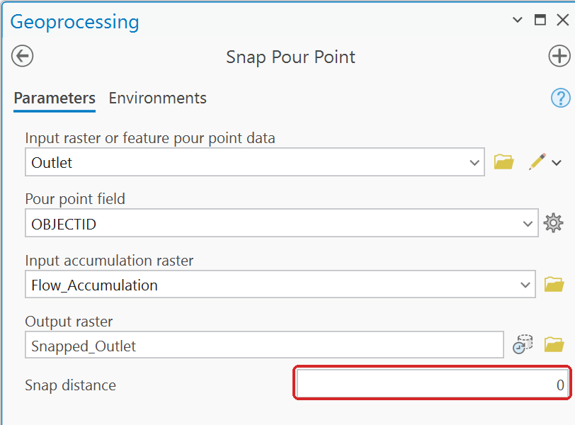

**Figure 11.** Snap Pour Point opens with **Snap distance** at 0.

**Figure 12.** A snap distance of 50 m, in the units of the accumulation raster.

**Figure 12a.** One outlet point 30 m north of the Rock Canyon channel. At a snap distance of 0 its
"watershed" is one 10 m cell; at 50 m it snaps to the channel and the basin is 25.2 km².

## 7. Raster to Polygon leaves "Create multipart features" off

In flow-direction rasters, some cells of one zone touch only corner to corner, and Raster to Polygon
treats a corner as a break. Left unchecked, Lab 5's 29 subwatersheds come out as about 61 polygons,
including slivers of one or two cells, and any count you report is wrong. Check **Create multipart
features** whenever one zone should be one feature.

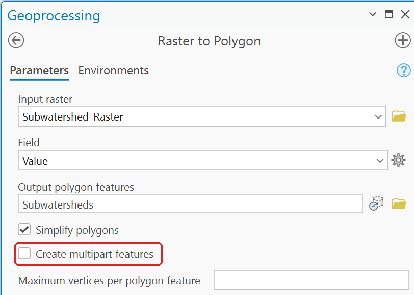

**Figure 13.** Raster to Polygon opens with **Create multipart features** unchecked.

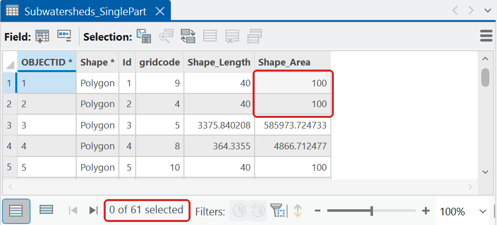

**Figure 14.** Left unchecked: **61** polygons for Rock Canyon's 29 subwatersheds. Rows 1, 2 and 5
are single 10 m cells (100 m²).

**Figure 15.** Check **Create multipart features**.

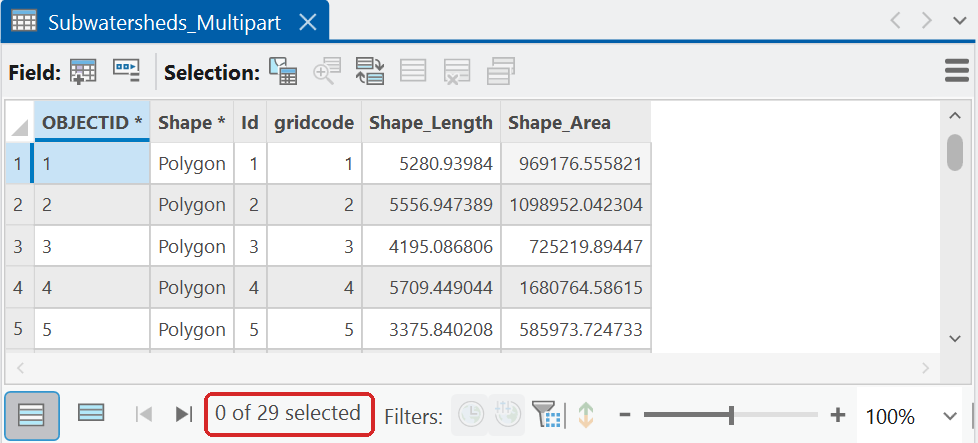

**Figure 16.** Checked: **29** polygons, one per subwatershed.

## 8. Thiessen polygons and Polygon to Raster drop your values

Two defaults in a row give a surface of ID numbers instead of measurements:

- **Create Thiessen Polygons** opens at **Output Fields: Only feature ID**, so the polygons carry
  none of the points' attributes. Choose **All fields**.
- **Polygon to Raster** fills **Value field** with `OBJECTID` by itself. Choose the field that holds
  the value you want, such as `RASTERVALU`.

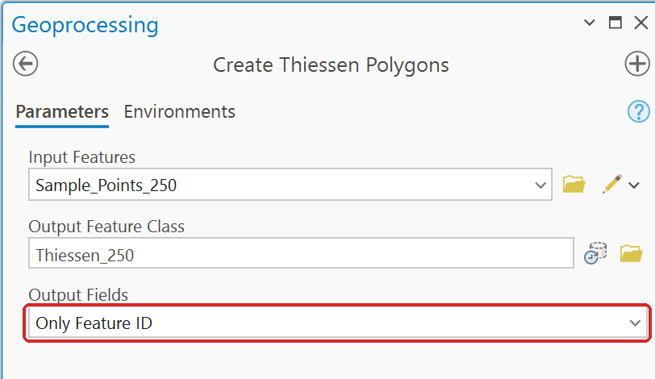

**Figure 17.** Create Thiessen Polygons opens at **Only Feature ID**.

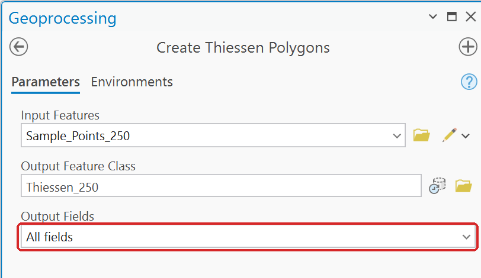

**Figure 18.** Choose **All fields** so the polygons carry the points' values.

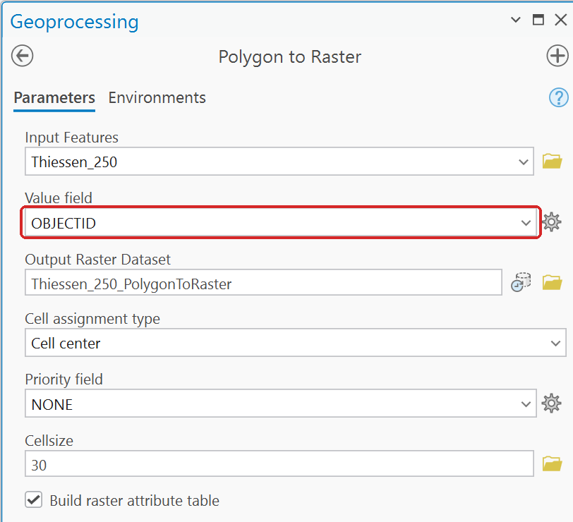

**Figure 19.** Polygon to Raster fills **Value field** with `OBJECTID` as soon as the input is set.

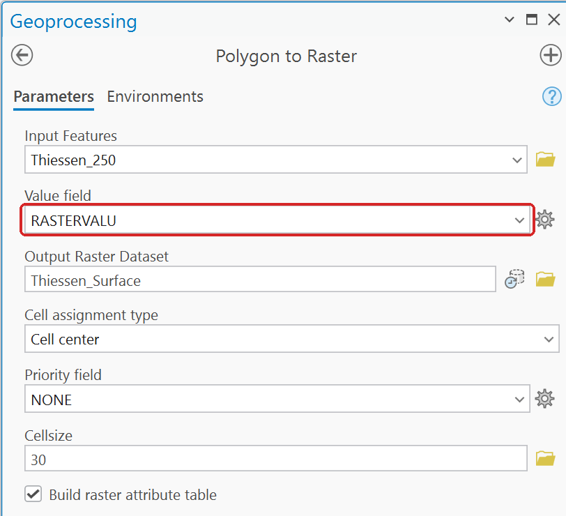

**Figure 20.** Pick the field that holds your measurement, here `RASTERVALU`.

## 9. Zonal Statistics opens at the wrong statistic

**Zonal Statistics** opens with **Statistics Type** at *Mean*, and **Zonal Statistics as Table**
opens at *All*. Pick the statistic the step asks for. A volume, for example, is a *Sum* (near the
bottom of the list). The **Zone field** fills in `OBJECTID` by itself; check that it is the field that
identifies your zones.

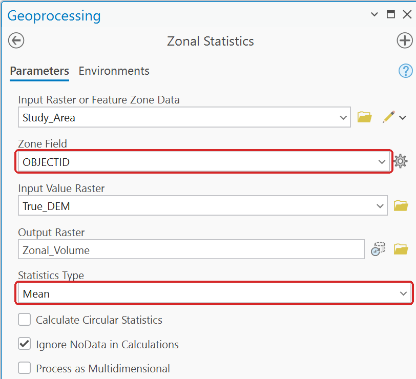

**Figure 21.** Zonal Statistics fills in **Zone Field** and opens **Statistics Type** at Mean.

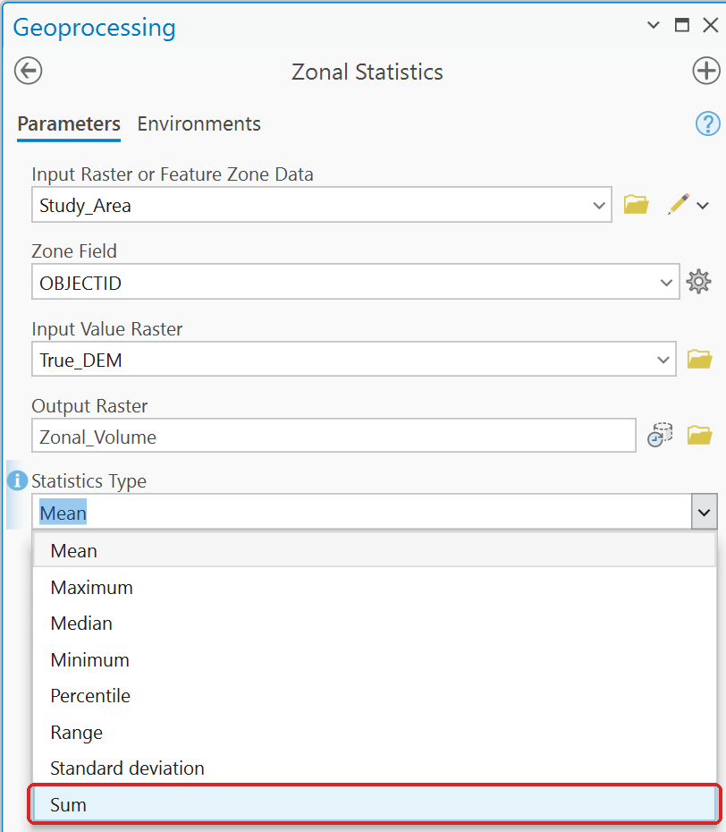

**Figure 22.** **Sum** is the last item in the list.

## 10. Kernel Density proposes a coarse cell and reads the radius in map units

As soon as the input is set, **Kernel Density** proposes a coarse output cell size (about 1,772 m in
Lab 4), and its **Search radius** is in the linear unit of the output
coordinate system, meters for UTM. Type both yourself. A radius typed as `20` meaning kilometers is
read as 20 meters, and the densities come out in the millions.

If the **Output Coordinate System** environment is not set and the points are in latitude and
longitude, as Lab 4's cell towers are, both are in **degrees**: the tool proposes a cell size of
0.0198.

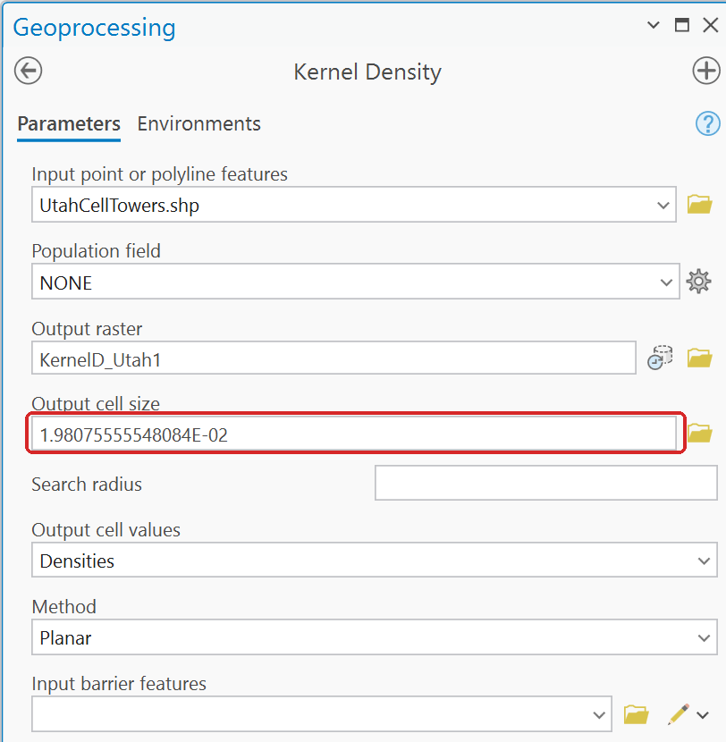

**Figure 23.** With no Output Coordinate System set, the proposed cell size is in degrees.

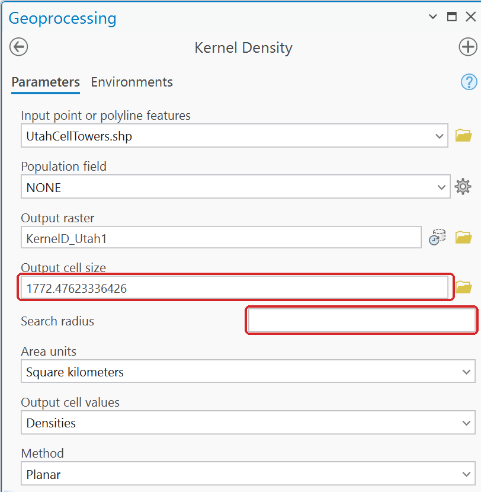

**Figure 24.** With UTM set, the tool proposes 1,772 m. Replace it, and type a **Search radius** in
meters.

