# Lab 6: Lake Depth Explorer

**Civil Engineering 414 — Engineering Applications of GIS**

Fall 2026 · Dr. Dan Ames

*Shorelines at Every Water Level — Looping in ModelBuilder, at Lake Powell*

<!-- **Revision notes.** Created September 8, 2026, as a placeholder for a new lab (no Word source).
Rewritten October 1, 2026, for Lake Powell from the instructor's Lab 6 package (built on the Mac,
CE414_Lab06_Package.zip): the student draft, the data package, and the check values. The analysis
was reproduced in arcpy on the Windows build machine (tools/lab06/run_model.py): every published
check value matches the package to 0.01 sq mi. The model was then built in the ArcGIS Pro 3.7.1
GUI on October 1-2, 2026 (C:\Ames\Lab06GUI\Lab06.aprx, model ShorelineLoop, at 175 % scaling):
it reproduced every check value exactly, every dialog on this page is a capture from that build,
and Figure C is its ModelBuilder export. See the migration notes at the bottom. -->

> [!TIP]
> **Start from the report template.** [`lab06-report-template.docx`](lab06-report-template.docx)
> has the title block, a section for every deliverable, the tables already set up with the columns
> the rubric asks for (including the table for your five personal levels), and the
> rubric at the end ready to fill in. Open it in Word or upload it to Google Docs, replace every
> gray italic prompt, and delete the prompts as you go. You are welcome to write your report any
> way you like — the template is a floor, not a ceiling — but if you use it and fill in every
> section, you will not have left a graded item out.

## Background

A reservoir is a valley with a dam across it, and the lake behind the dam is not one shape. It is a
different shape at every water-surface elevation. As the lake rises it spreads up side canyons and
across benches. As it drops it retreats to the old river channel, leaving boat ramps, marinas, and
water intakes stranded above the water line. Anyone who plans around a reservoir needs to know where
the shoreline will be at the elevation the lake is *going* to be, not where it is today: an engineer
sizing an intake, a park service deciding which ramp to extend, a houseboat owner deciding whether
to renew a slip.

Lake Powell is the clearest case in the country right now. It filled for the first time in 1980 and
reached its all-time high of **3,708.34 ft on July 14, 1983**. On **September 15, 2026** it set a
new record low of **3,516.62 ft**, below the April 2023 low of 3,519.92 ft — a drop of 192 feet from
the high. Over that range the lake lost more than half of its surface area, and one launch ramp
after another went dry.

The instructor built a web map that answers exactly this question for Lake Powell. Spend five
minutes with the [Lake Powell Depth Explorer](https://lakepowell.hydromap.com){ target="_blank" }
before reading further: drag the water level and watch the shoreline move. Every shoreline there is
the output of the same analysis you will build in this lab.

The analysis is simple. The lake bed is an elevation surface, and the shoreline at any water-surface
elevation is the line where that surface equals that elevation. Everything below is wet; everything
above is dry. What makes the problem interesting for a modeler is that nobody wants *one* shoreline.
They want a dozen, at regular intervals, from one run. Every lab so far built a model that runs once
and produces one answer. This lab builds a model that **loops**: it takes a list of water-surface
elevations, runs the same tools for each one, and collects the results into one dataset with the
elevation recorded on every shoreline. Once you have seen that pattern you will find it everywhere,
because most real analyses are one analysis repeated over a list of something.

Like every model, this one is only as good as the choices you make in it: which elevation surface,
in which vertical datum, at what cell size, over what range of elevations, and at what step. The
range and the step are the model's parameters, so in Step 7 the same model runs the whole lake from
dead pool up, and then five levels that are yours alone.

> [!IMPORTANT]
> **Your job — see the deliverables below.** Build one ModelBuilder model that loops over a list of
> water-surface elevations and produces a shoreline polygon for each, with the elevation stored as
> an attribute. Run it on Lake Powell twice, from dead pool to above full pool and at five levels
> of your own, and make a map of each run.

## Problem Statement

You are given one elevation surface for the Lake Powell basin. It merges the lake bed, mapped by a
boat-mounted multibeam sonar survey in 2017, with the land around it, mapped by airborne lidar and
older topography. Using that surface:

1. Build one ModelBuilder model that produces the shoreline of the lake at **every water-surface
   elevation in a list**, all in one polygon feature class, with the elevation of each stored in an
   `Elevation` field and its area in an `AreaSqMi` field.
2. Run it twice: once from **dead pool to above full pool, 3,370 to 3,710 ft at 10 ft**, and once
   at **five levels of your own**, worked out from your BYU ID.
3. Map both results: the nested shorelines of the whole lake, and your own five levels close up.

## Analysis Considerations

Every one of these is a decision somebody made, and every one of them can change the answer.

- **The elevation surface.** The USGS *One Meter Topobathymetric Digital Elevation Model for Lake
  Powell, 1947–2018*. It merges 2017 multibeam sonar, 2018 lidar, and older topography (some of it
  mapped before the dam closed in 1963) into one raster. Where the surveys meet there can be a
  seam. The original is 1 m and about 3 GB; you get a 30 m version in which each cell is the
  average of the 900 one-meter cells inside it.
- **The vertical datum and units.** The surface is in **meters above NAVD88**, the modern North
  American datum. Reclamation reports Lake Powell's level, and states every operating threshold, in
  **feet above NGVD29**, the older datum the dam was built on. At Lake Powell the two differ by
  2.91 ft. If the surface and your elevation list are in different units or datums, every shoreline
  is wrong by a constant, and nothing in ArcGIS Pro will tell you. Step 1 converts the surface so
  the two match.
- **The water-surface range and step.** The main run is 3,370–3,710 ft at 10 ft: from dead pool to
  just above full pool. **Full pool** is 3,700 ft; **minimum power pool**, below which the dam
  cannot generate electricity, is 3,490 ft; **dead pool**, below which no water can leave through
  the dam's outlets, is 3,370 ft; this fall's record low was 3,516.6 ft. The range and step are
  model parameters, so the same model runs your own five levels in Step 7.
- **Cell size.** A shoreline is only as fine as the surface's cells. A 30 m cell is wider than many
  of Lake Powell's side canyons, so narrow arms of the lake disappear or break apart at this
  resolution. A 10 m close-up of the south end of the lake is included so you can see the
  difference.
- **The coordinate system.** Area is reported for every shoreline, so the model must run in a
  projected coordinate system. The surface arrives in **NAD 1983 (2011) UTM zone 12N**, in meters,
  which is appropriate. Keep it.
- **What counts as the lake.** At any elevation some cells below the water surface lie in closed
  hollows that would never fill — potholes on the slickrock benches, pits in the surface. The
  analysis keeps only the water connected to the main pool at the dam. Step 4 is where that
  decision lives, and your report says what it excluded.

## Data

> [!IMPORTANT]
> **Set up your folder before you download anything.** On the lab machines, work on the **D:
> drive**: one folder for this class named after you, `D:\Smith\`, and one folder per lab inside
> it, `D:\Smith\Lab06\`. The **C: drive is locked**, and a **network drive** is slow enough to make
> ArcGIS Pro hang. **Never use a space** in a folder or file name you create — raster tools fail on
> them without saying why. **Back up your lab folder at the end of every session.** The full set of
> conventions is on the [ArcGIS Tips and Reminders](../../arcgis-tips/index.md){ target="_blank" } page.

- **Download:** [`lab06-powell-data.zip`](../../data/lab06-powell-data.zip) (5.3 MB). Unzip it into
  your Lab06 folder, and read `READ-ME-FIRST.txt`.

| File | What it is |
| --- | --- |
| `powell_tbdem_30m.tif` | The whole lake, 30 m cells, elevation in **meters NAVD88**. Your main input. |
| `powell_wahweap_10m.tif` | The south end of the lake — Glen Canyon Dam, Wahweap, Lone Rock, Antelope Point — at 10 m, **meters NAVD88**. Optional: run your five levels on it for a sharper close-up map. |
| `main_pool_seed.shp` | One point in the old river channel about 2.1 km upstream of Glen Canyon Dam, under water at every elevation in this lab. It is how your model knows which water is "the lake." |
| `powell_elevation_usbr.csv` | Reclamation's daily Lake Powell water-surface elevation, December 28, 1963 to September 30, 2026, in **feet NGVD29**. Recent values are provisional. |
| `READ-ME-FIRST.txt` | Sources, processing, datums, and the credit line for your maps. |

> [!TIP]
> **Check the data:** `powell_tbdem_30m.tif` is **4,340 columns × 4,331 rows of 30 m cells**, values
> **955.69 to 1,440.73** (meters), NAD 1983 (2011) UTM zone 12N, NoData −9999. Most of the grid is
> NoData: the surveyed area hugs the canyon. `powell_wahweap_10m.tif` is **1,701 × 1,878 cells of
> 10 m**, **954.77 to 1,318.34** m.

![Infographic: the six metadata questions — What, Where, When, Why, How and Who — answered for the Lake Powell surface: a topobathymetric DEM in meters above NAVD88, 30 m cells each the mean of 900 one-meter cells; the whole reservoir in NAD83(2011) UTM zone 12N, 4,340 by 4,331 cells; lake bed by multibeam sonar October 8 to November 15, 2017, dry shore by lidar April 2 to 3, 2018, gaps from maps surveyed 1947 to 1959, published June 3, 2020; made to support the USGS area-capacity tables for the reservoir with the Bureau of Reclamation; sonar, lidar and digitized old surveys mosaicked at 1 m along 5 m seamlines, with interpolated gaps; USGS EROS with Reclamation, public domain, not for navigation. A footer says that for shorelines the survey date matters most, and that the datum must be converted before Step 3.](images/lab06-surface-metadata.svg)

**Figure A.** The six metadata questions, applied to your surface. Confirm three of the values
yourself — in `READ-ME-FIRST.txt`, in the raster's properties in ArcGIS Pro, and in the
[USGS release](https://doi.org/10.5066/P9XX0J1Y){ target="_blank" } — and say in your report what
each one does to your result.

Basemaps and imagery come from ArcGIS Online; you do not download them.

## ModelBuilder Tools

New in this lab:

| Tool | What it does |
| --- | --- |
| { .tool-icon }<br>**For** (ModelBuilder ▸ Iterators) | The loop. Given a *From* value, a *To* value, and a *By* step, it runs everything downstream once per value and hands the current value to those tools as a variable. [Tool reference](https://pro.arcgis.com/en/pro-app/latest/tool-reference/modelbuilder-toolbox/for.htm){ target="_blank" } |
| 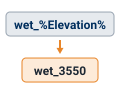{ .tool-icon }<br>**Inline variable substitution** | Writing `%Elevation%` in a tool's expression or output name inserts the current loop value, so each iteration computes and names its own result. [Help page](https://pro.arcgis.com/en/pro-app/latest/help/analysis/geoprocessing/modelbuilder/inline-variable-substitution.htm){ target="_blank" } |
| 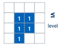{ .tool-icon }<br>**Con** (Spatial Analyst) | Cell-by-cell *if*: where the surface is at or below the current elevation, 1; elsewhere, NoData. The wet cells at one water level. [Tool reference](https://pro.arcgis.com/en/pro-app/latest/tool-reference/spatial-analyst/con-.htm){ target="_blank" } |
| 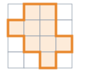{ .tool-icon }<br>**Raster to Polygon** (Conversion) | Turns the wet cells into polygons whose boundaries are shorelines. [Tool reference](https://pro.arcgis.com/en/pro-app/latest/tool-reference/conversion/raster-to-polygon.htm){ target="_blank" } |
| { .tool-icon }<br>**Select Layer By Location** (Data Management) | Keeps only the polygon that contains the seed point: the main pool. [Tool reference](https://pro.arcgis.com/en/pro-app/latest/tool-reference/data-management/select-layer-by-location.htm){ target="_blank" } |
| 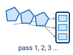{ .tool-icon }<br>**Collect Values** (ModelBuilder ▸ Utilities) | Gathers the output of every iteration into one growing list, which a tool such as Merge can take as a single input. [Tool reference](https://pro.arcgis.com/en/pro-app/latest/tool-reference/modelbuilder-toolbox/collect-values.htm){ target="_blank" } |
| 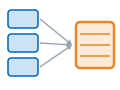{ .tool-icon }<br>**Merge** (Data Management) | Combines the collected shorelines into one feature class. [Tool reference](https://pro.arcgis.com/en/pro-app/latest/tool-reference/data-management/merge.htm){ target="_blank" } |

Tools you already know: **Raster Calculator**, **Copy Features**, **Calculate Field** (which can
add a new field as it fills it), and the environment settings from earlier labs.

## Example Model

![The finished ModelBuilder model, exported as a vector diagram, in four rows. Iterator: From Value, To Value and By Value, each marked P, into For, which outputs Elevation. Flood: Surface, marked P, and the true value 1 into Con, wet_%Elevation%, Raster to Polygon, wetpoly_%Elevation%, and Select Layer By Location (which also takes main_pool_seed), whose outputs are Main Pool, Output Layer Names and Count. Label: Main Pool into Copy Features, pool_%Elevation%, Calculate Field, Pool with Elevation, Calculate Field (2), Labeled Pool. Collect: Labeled Pool into Collect Values, Output Values (and a gray Output Table), Merge, Shorelines, marked P.](images/lab06-full-model.svg)

**Figure C.** The finished model, exported from ModelBuilder. This is a vector diagram — **click it
to open it full size**, where every label is readable. Its shape is the point of the lab: an
iterator that hands out one elevation at a time, a chain of tools that turns that elevation into one
labeled shoreline, and a collector that gathers the shorelines into one dataset. With an iterator in
a model, ModelBuilder runs *every* tool once per value, so even Merge runs 21 times; see Step 6. The five elements marked `P` are the model
parameters; they become the tool dialog of Step 6. `Output Layer Names`, `Count` and `Output
Table` are extra outputs the tools always draw; you do not use them. The oval under Surface is
Con's true value: typing `1` in the dialog draws it. The green `Elevation` oval has no arrows
because `%Elevation%` reaches the tools by name, not by a connector — do not try to connect it.

> [!NOTE]
> **Reading the model.** Questions that come up the first time anyone looks at Figure C:
>
> - **It looks like two models.** It is one. Nothing is drawn from `Elevation` to `Con` because
>   `%Elevation%` is written *inside* Con's expression and the output names; ModelBuilder draws a
>   connector only when a whole variable is plugged into a parameter. An iterator drives every tool
>   in the model whether a line is drawn or not. If you want the dependency visible, drag a
>   connector from `Elevation` to `Con` and choose **Precondition**: a dashed line, no change in
>   behavior.
> - **Why percent signs in a name?** An oval has a *label* (what you see) and a *value* (the path).
>   When you type `pool_%Elevation%` as an output name, the value is that path and the oval labels
>   itself with the file name part of it. At run time `%Elevation%` in a value is replaced by the
>   current value of the oval whose *label* is `Elevation`. Rename that oval and every reference
>   breaks; rename `pool_%Elevation%` to "Pool" and nothing breaks.
> - **Count** and **Output Layer Names** dangle off Select Layer By Location. They are derived
>   outputs nothing here needs. Count should read 1 on every pass: the seed touched one polygon.
> - **Two Calculate Fields** because each polygon needs two attributes from two places: the loop's
>   `Elevation`, and `AreaSqMi` from its own geometry. "Pool with Elevation" and "Labeled Pool" are
>   the same feature class as `pool_%Elevation%`, passed through with one more field each time.
> - **Collect Values** appends one *path* per pass; `Output Values` is that list (`pool_3370;
>   pool_3380; …`), and Merge reads it. `Output Table` is a receipt nobody reads.
> - **Merge runs every pass**, like every tool downstream of an iterator, and the last pass leaves
>   all the levels.
> - **For, not another iterator,** because the levels are an arithmetic sequence three numbers
>   describe. For counts; the other iterators read a list that already exists.

## Complete the Lab

For an advanced GIS student, the information up to this point is all you need to complete the
assignment. Feel free to try the analysis using only the information above. If you complete the lab
without the step-by-step instructions below, say so in your report.

## Step-by-Step Solution

> [!NOTE]
> **Test on a short loop first.** A full run takes about 4½ minutes, on either surface. While you
> are building and debugging, set the loop to a few levels — From `3500`, To `3520`, By `10` is
> three — and check the result before you run all 21. Real modelers work this way: get the logic
> right on a small piece, then scale up.

> [!NOTE]
> **Every model check value on this page** was measured on the files you download, with the steps below,
> both in ArcGIS Pro 3.7's arcpy and by running the model shown in the figures. Your numbers should
> match to the last digit shown.

### Step 0 — Set Up the Project

1. Create a new project in `D:\Smith\Lab06\` (with your own name). Choose the **Map** template;
   if you already made the folder, uncheck **Create a folder for this local project**.
2. Add both surfaces, the seed point, and an imagery or topographic basemap. When the **Build
   Pyramids and Calculate Statistics** dialog opens, click **OK**.
3. Confirm Spatial Analyst is licensed (**Project** ▸ **Licensing**).
4. On the **Analysis** tab click **ModelBuilder**. On the **ModelBuilder** tab click
   **Properties**, set **Name** to `ShorelineLoop` and **Label** to `Shoreline Loop`, and save.
5. On the **ModelBuilder** tab click **Environments**. Check that **Current Workspace** and
   **Scratch Workspace** are your project geodatabase, and leave everything else at its default.

> [!IMPORTANT]
> **Leave Cell Size and Processing Extent empty.** With only one raster going into Con, ArcGIS Pro
> uses that raster's own cells and extent. If you set Cell Size to the 30 m surface and later run
> the model on the 10 m close-up, every result comes out in 30 m cells, with no error to tell you.


**Figure 0.** ModelBuilder ▸ Environments: the two workspaces set, everything else left empty.

### Step 1 — Read the Surface, and Put It in Feet NGVD29

Look at the surface before you build anything: its value range, cell size, coordinate system, and
vertical units. Then open `powell_elevation_usbr.csv`. The surface reads about 955–1,441 and the lake
record reads about 3,500–3,700. They are not in the same units, and they are not in the same datum
either.

Convert the surface with **Raster Calculator** (from the Geoprocessing pane, not as a step in the model)
so it matches the Reclamation record:

```text
("powell_tbdem_30m.tif" / 0.3048) - 2.91
```

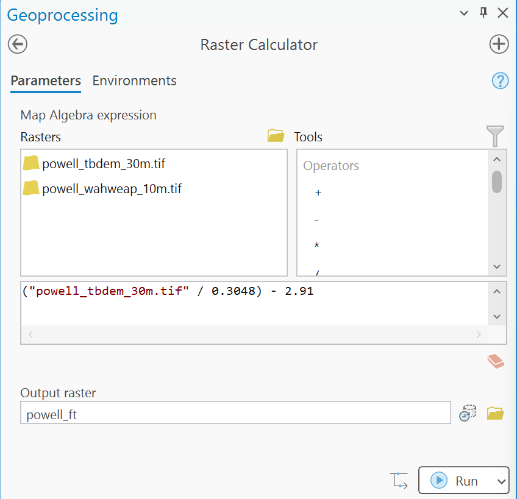

**Figure 1.** The conversion in Raster Calculator. Type the output name last: choosing a raster
or editing the expression can replace what you typed with a default name such as `RasterC_1`.

Save it as `powell_ft` in your project geodatabase. Do the same for the close-up and save it as
`wahweap_ft`. Dividing by 0.3048 converts meters to feet; subtracting 2.91 ft moves from NAVD88 to
NGVD29 at Lake Powell. The offset is from the USGS area–capacity report for the 2017 survey (Root
and Jones, 2022), and NOAA's VERTCON gives the same 2.9 ft at the dam.

> [!TIP]
> **Check the result:** `powell_ft` runs from **3,132.6 to 4,723.9** ft, and `wahweap_ft` from
> **3,129.5 to 4,322.4** ft. If your maximum is about 4,726.8, you forgot the datum shift. If it is
> about 1,441, you did not convert at all.

Find on the map the dam, the old river channel, Wahweap and Antelope Point, so you know the lake
before you flood it.

> [!WARNING]
> **The datum trap.** If you skip this step and run the loop in feet on the meters surface, Step 3
> runs without an error and floods everything at every elevation, because every cell (955–1,441) is
> below 3,500. A shoreline that does not move when the elevation changes is the giveaway.

### Step 2 — Add the Loop

1. On the **ModelBuilder** tab, in the **Insert** group, open **Iterators** and choose **For**.
2. Double-click **For** and set **From Value** `3500`, **To Value** `3700`, **By Value** `10`.
3. Right-click its green output, `Value`, choose **Rename**, and type `Elevation`.
4. Right-click **For** ▸ **Create Variable** ▸ **From Parameter** ▸ **From Value**. Do the same for
   **To Value** and **By Value**. Three blue ovals appear, one per setting.
5. Right-click each blue oval and choose **Parameter**: a `P` appears beside it, and the value can
   now be changed from the tool dialog without opening ModelBuilder.

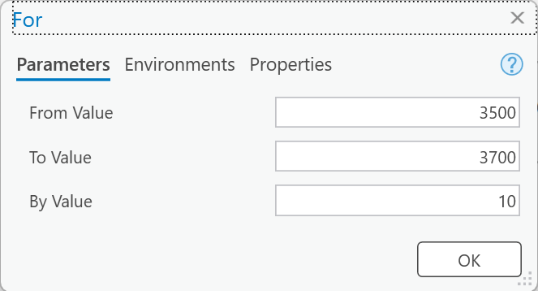

**Figure 2.** The For iterator. **To Value** is included: 3,500 to 3,700 by 10 is 21 levels.

> [!TIP]
> **Check the result:** the model runs **21** iterations — 3,500, 3,510, …, 3,700.

### Step 3 — Flood the Surface

Add **Con** (search for it in the Geoprocessing pane, right-click the Spatial Analyst result, and
choose **Add To Model**), and double-click it:

- **Input conditional raster**: `powell_ft`
- **Expression**: turn on **SQL Editor** and type `Value <= %Elevation%`
- **Input true raster or constant value**: `1`
- **Input false raster or constant value**: leave it **empty**, so dry cells are NoData
- **Output raster**: `wet_%Elevation%`

`%Elevation%` is the iterator's current value, so every iteration floods the surface to its own
level and writes its own raster: `wet_3500`, `wet_3510`, and so on.

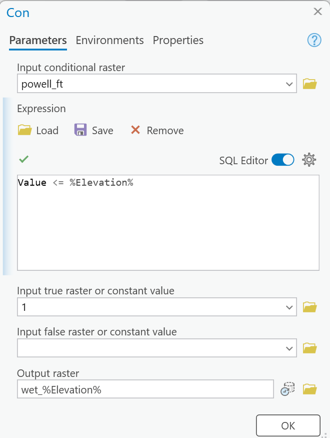

**Figure 3.** Con, with the expression typed in the SQL Editor.

> [!WARNING]
> **Do not switch the SQL Editor off** once the expression is in. In our test, switching it off and
> back on cleared the expression without a warning.

Then make the surface a parameter too, so Step 7 can switch it: right-click the blue `powell_ft`
oval, choose **Parameter**, and rename it `Surface`.

> [!TIP]
> **Check the result:** at 3,550 ft, **303,538** wet cells on the 30 m whole lake and **295,745**
> on the 10 m close-up. These count every wet cell anywhere, not just the lake.

### Step 4 — Keep the Main Pool

The flooded raster includes every cell below the elevation: potholes on benches far from the lake
that would never fill, and pieces of the lake that 30 m cells cut off where a canyon is narrower
than a cell. Keep only the water connected to the dam:

1. **Raster to Polygon** on the wet raster, with **Simplify polygons** unchecked (so the polygon
   follows the cells exactly and the area is exact; see the note below Figure 4a) and **Create
   multipart features** unchecked.
   Output `wetpoly_%Elevation%`.
2. **Select Layer By Location**: input `wetpoly_%Elevation%` (the model variable, straight from the
   list; no Make Feature Layer is needed), relationship **Intersect**, selecting features
   `main_pool_seed`. ModelBuilder names the selected layer after the first elevation, something
   like `wetpoly_3500_Layer`; rename that green oval `Main Pool` so the name does not mislead you.
3. **Copy Features**: input `Main Pool`, output `pool_%Elevation%`. Copy Features copies only the
   selected polygon.

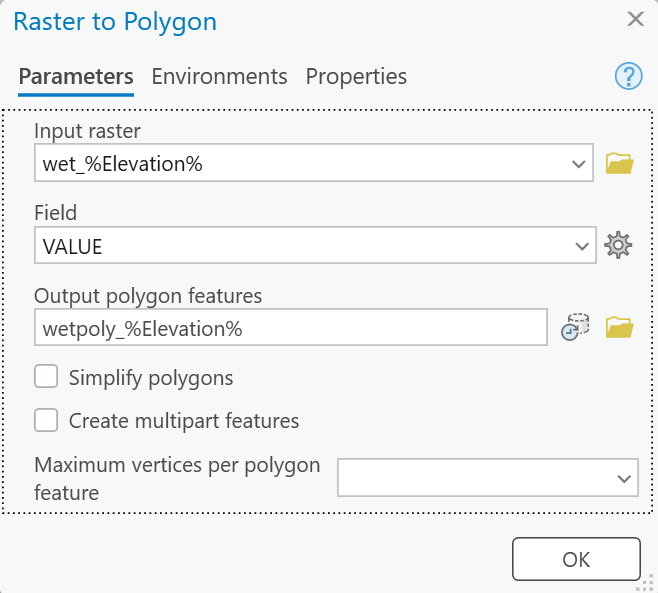

**Figure 4a.** Raster to Polygon, with both boxes unchecked.

> [!NOTE]
> **Why are my shorelines stair-stepped when my neighbor's are smooth?** It is the **Simplify
> polygons** box. Unchecked, each polygon edge runs along the cell edges, so every shoreline is a
> staircase of 30 m steps. Checked (the tool's default), ArcGIS Pro smooths the staircase into
> lines that cut across the corners of the cells, so the shoreline looks like a curve.
>
> - **Unchecked** keeps the most detail: the polygon is exactly the wet cells, and the area is the
>   cell count times the cell area. Every check value on this page was measured this way.
> - **Checked** usually makes the better-looking map, but the smoothed line no longer follows the
>   cells exactly, so the area comes out a little different from the cell count.
>
> Either is acceptable; choose the one you want. If you check it, your areas will not match the
> check values exactly. Say in your report which you used.

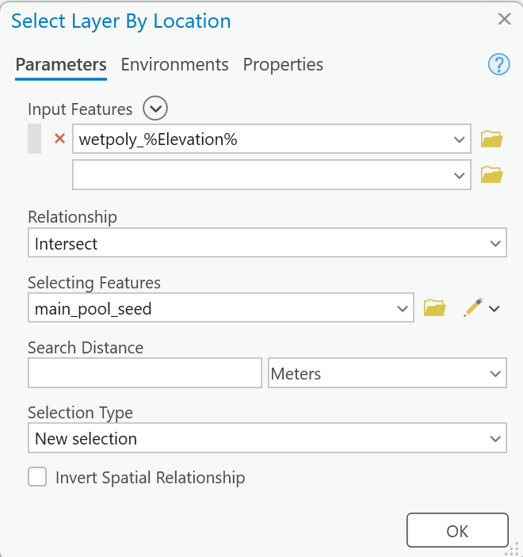

**Figure 4b.** Select Layer By Location keeps the polygon under the seed point.

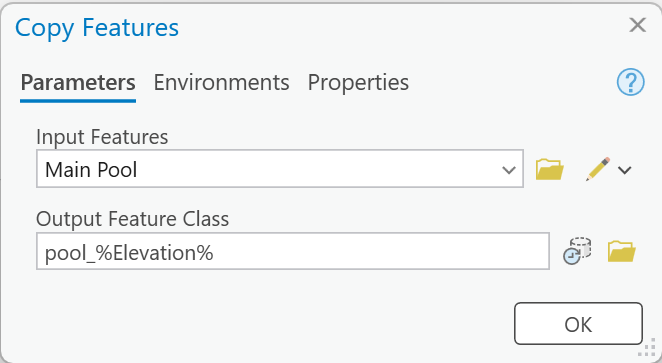

**Figure 4c.** Copy Features writes the selected polygon to its own feature class.

> [!TIP]
> **Check the result:** at 3,550 ft on the whole lake, Raster to Polygon makes **602** separate
> polygons, and the one you keep is **103.93 sq mi** (299,072 cells); Step 4 removed 4,466 cells,
> about 1.6 sq mi. What does that say about the other 601?

### Step 5 — Label the Shoreline

Two **Calculate Field** tools, one after the other. Calculate Field's **Field Name (Existing or
New)** box adds the field if it does not exist yet, so you do not need Add Field first.

1. **Calculate Field**: Input Table `pool_%Elevation%`, Field Name `Elevation`, Field Type **Long
   (32-bit integer)**, Expression Type Python, `Elevation =` `%Elevation%`.
2. **Calculate Field (2)**: Input Table the first one's output, Field Name `AreaSqMi`, Field Type
   **Double (64-bit floating point)**, `AreaSqMi =` `!shape.area@squaremiles!`.

Like Select Layer By Location, each Calculate Field draws a green output named after the first
elevation (`pool_3500`). Rename them `Pool with Elevation` and `Labeled Pool`. Every polygon that
leaves the loop now carries its elevation and its area.


**Figure 5a.** The first Calculate Field writes the loop value into a new Long field. The warning
icon beside Field Name appears because the field is not there yet; Calculate Field adds it when it
runs (hover over the icon to read the message).

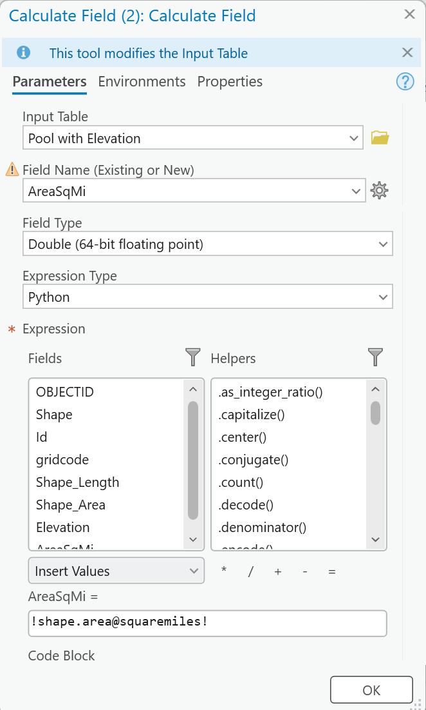

**Figure 5b.** The second computes the area in square miles from the polygon's geometry.

### Step 6 — Collect and Merge

1. On the **ModelBuilder** tab, open **Utilities** and choose **Collect Values**. Double-click it
   and set **Input Value** to `Labeled Pool`. Leave **Output Table** empty.
2. Add **Merge**. Its **Input Datasets** list does not offer Collect Values' output, so connect it
   on the canvas instead: drag from the green **Output Values** oval onto **Merge**, and choose
   **Input Datasets** from the menu that pops up.
3. Double-click **Merge** and set **Output Dataset** to `powell_shorelines_3500_3700_10`.
4. Right-click the green output oval, choose **Parameter**, and rename it `Shorelines`.
5. Save the model, click **Open Tool** on the **ModelBuilder** tab, and run the model from the tool
   dialog that opens in the Geoprocessing pane.

> [!NOTE]
> **Merge runs on every pass, not once at the end.** Once a model has an iterator, ModelBuilder runs
> every tool in it once per value. Each pass, Collect Values adds one more shoreline to its list and
> Merge rewrites `powell_shorelines_3500_3700_10` from the whole list so far; the last pass leaves all
> 21. That costs a few seconds a pass and gives the right answer. Esri's way to run a tool only once
> after a loop is to put the loop in a model of its own and use that model as a tool inside a second
> model ([Iterators for looping](https://pro.arcgis.com/en/pro-app/latest/help/analysis/geoprocessing/modelbuilder/iterators-for-looping.htm){ target="_blank" });
> you do not need that for this lab. Also from that page: a model can hold only **one** iterator.

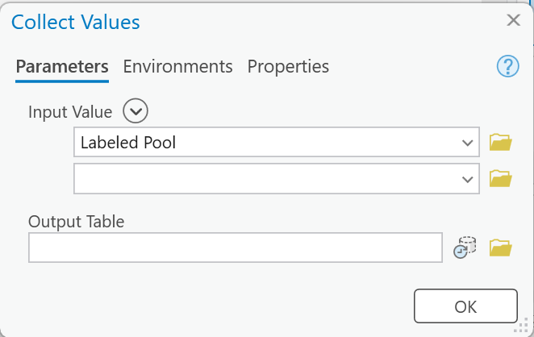

**Figure 6a.** Collect Values gathers one `Labeled Pool` from every iteration.

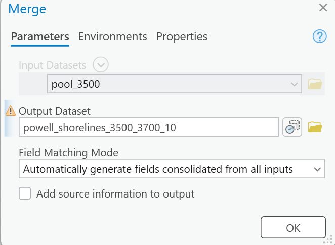

**Figure 6b.** Merge, fed by the connector from Collect Values. The grayed input only shows the
name of one iteration's output; at run time it receives all of them. The warning icon only says the output
already exists from an earlier run.

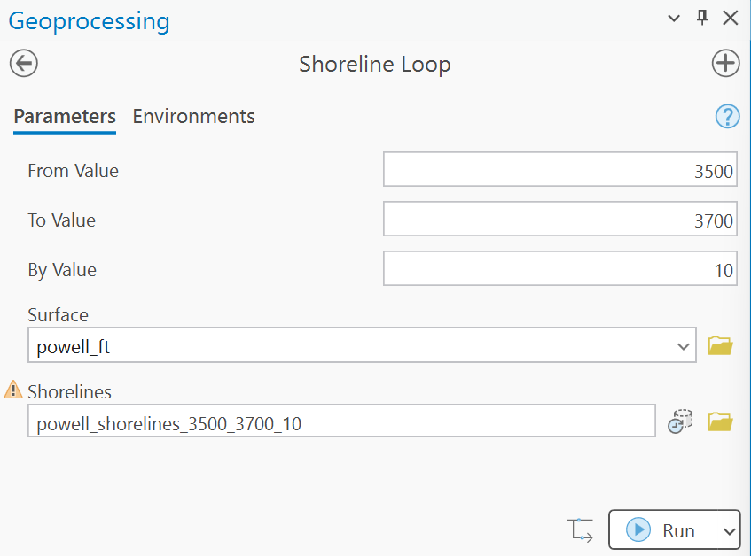

**Figure 6c.** The model as a tool: the five parameters marked `P` in Figure C.

> [!TIP]
> **Check the result:** one row per elevation, **21** rows. Selected areas:
>
> | Elevation (ft) | Your area (sq mi) | USGS published area (sq mi) |
> | --- | --- | --- |
> | 3,500 | 75.65 | 76.65 |
> | 3,550 | 103.93 | 105.02 |
> | 3,600 | 140.37 | 141.54 |
> | 3,650 | 192.05 | 193.52 |
> | 3,700 | 247.36 | 248.82 |
>
> The published areas are from the USGS area–capacity table for the 2017–18 survey (Root and
> Jones, 2022; the table itself is the
> [data release](https://doi.org/10.5066/P9O3IPG3){ target="_blank" }), converted from acres. Yours
> run 0.2 to 1.3 % below them at every level. Your report should say why — think about narrow canyon
> arms and 30 m cells, and about Step 4.

The whole run took about **4½ minutes** in our test (about 13 seconds a level); expect longer on
the lab machines.


**Figure 6d.** The default run on the 10 m close-up: 21 shorelines, the lowest (darkest) drawn on
top. The main pool there grows from 7.34 sq mi at 3,500 ft to 35.54 sq mi at 3,700 ft.

### Step 7 — Run It Twice

Once the three-level test in Step 6 checks out, run the finished model from its tool dialog twice.
Open it from the **Catalog** pane (Toolboxes ▸ Lab06.atbx ▸ Shoreline Loop) so the run goes through
the dialog and lands in your Geoprocessing History.

**Run 1 — dead pool to above full pool.** From Value **3370**, To Value **3710**, By Value **10**,
Surface `powell_ft`, Shorelines `powell_shorelines_3370_3710_10`. That is **35 levels**, from dead
pool, below which no water can leave the dam, past full pool at 3,700 ft to a level the dam has
never seen. Expect about eight minutes.

> [!TIP]
> **Check the result:** 35 rows in the attribute table. At **3,370 ft** the main pool is
> **28.19 sq mi**, about 11 % of the lake at full pool; at **3,500 ft** it is **75.65 sq mi**; at
> **3,700 ft**, **247.36 sq mi**. Look at how `AreaSqMi` grows from row to row: about half a square
> mile per foot near the bottom and more than a square mile per foot near the top. Glen Canyon is
> narrow at the bottom and wide at the top, and the table shows it.

**Run 2 — your own five levels.** Every student runs a different set, worked out from your **BYU ID
number**: the **nine-digit number printed on your BYU ID card**, such as `123456789`. It is **not
your NetID**, the user name of letters and numbers you use to sign in to BYU sites.

> **Your starting level E = 3,450 + 2 × (the last two digits of your BYU ID) ft NGVD29.**
> Run the model with From Value **E**, To Value **E + 40**, By Value **10**: five levels, E to
> E + 40. Name the output `powell_shorelines_mine_E`, with your E in place of E.
>
> - BYU ID `123456789`: last two digits **89**, E = 3,450 + 2 × 89 = **3,628 ft**, so From 3628,
>   To 3668, By 10.
> - BYU ID `987654302`: last two digits **02**, E = 3,450 + 4 = **3,454 ft**, so From 3454, To
>   3494, By 10.
>
> Every set lies between 3,450 and 3,688 ft, inside Run 1's range, which is the point: your five
> rows are a finer look at one stretch of the same curve. Open the attribute table: five rows.
> Copy its `Elevation`, `AreaSqMi` (to 0.01) and `Shape_Length` (in meters, as the table shows
> it) into your report, with your BYU ID's last two digits and your E. The grader checks every
> number against a run at your levels, so they have to come from your run, not from Run 1's table.

> [!IMPORTANT]
> **Give each run its own Shorelines name.** A run that keeps the old name overwrites the earlier
> one. Type the numbers into the name yourself: in our test, building the name from
> `%From Value%` and the other parameters wrote the right dataset but added the *previous* run's
> layer to the map.


**Figure 7.** A finished run from the tool dialog, here nine levels at a 25 ft step in a minute and
a half. Your runs look the same with your own values; Run 1 takes about five times as long.

> [!NOTE]
> **Optional, for the curious.** Run your five levels again on the 10 m close-up (set **Surface** to
> `wahweap_ft`, and give the output a new name) and compare the shoreline in one side canyon near
> Wahweap with the 30 m version. That is the cell-size question from the Analysis Considerations,
> answered with your own eyes, and it makes a sharper Map 2 if your levels fall inside the close-up.

### Step 8 — Symbolize the Shorelines

Every pool contains every pool below it, so the polygons sit on top of one another. With the
default symbology the biggest one covers the rest, and the map shows one patch of water. Two
settings fix that: a color for each level, and a drawing order that puts the small, low pools on
top. Do this for each run's layer:

1. Right-click the layer ▸ **Symbology**. Set **Primary symbology** to **Graduated Colors** and
   **Field** to `Elevation`.
2. Set **Classes** so each level gets its own color: 5 for your Run 2 layer, and as many as ArcGIS
   Pro allows for Run 1. If ArcGIS Pro will not go as high as 35, use fewer classes so that each
   color covers a band of levels, as in Figure 8.
3. Pick a **Color scheme** that runs from white or pale blue to dark blue. Better still, choose
   your own colors: the map is yours, and it does not have to match the examples. Whatever you
   choose, make the low levels the dark end, since that is the deep water. If the scheme runs the
   wrong way, reverse it.
4. Open the **Advanced symbology options** tab of the Symbology pane (verify the tab name in your
   version), expand **Feature drawing order**, check **Enable feature drawing order**, and choose
   `Elevation`. Then set the sort so the *highest* levels draw first and the lowest last. If you
   still see a single color, the sort is the wrong way round: reverse it.

> [!TIP]
> **Check the result:** you see nested rings of color, darkest in the old river channel and
> lightest along the outer shoreline, as in Figure 8. Use the same colors on both maps so that a
> level looks the same on Map 1 and Map 2.

## Deliverables

Make **two** professional map layouts, one per run:

1. **Map 1 — Run 1, the whole lake.** The 35 nested shorelines from dead pool to 3,710 ft,
   symbolized so a reader can tell low from high, with a legend, a few levels labeled on the map,
   and dead pool, full pool and this fall's record low (3,516.6 ft) pointed out.
2. **Map 2 — Run 2, your five levels.** Zoomed in to a part of the lake where your five shorelines
   are visibly different, symbolized the same way as Map 1, each level labeled. The title states
   your five levels.

Write a brief report (2 pages of text, plus your figures and maps) covering:

- a title block — assignment title, your name, the date and the course — and the name of your
  peer reviewer
- the requirements of the project and your approach to solving it
- **a description of your model** a reader could repeat from: the iterator and its three values,
  each tool inside the loop and its settings, how the results are collected, and every input,
  intermediate and output dataset with its type
- **one** full-page figure of your model — export it from ModelBuilder (**Export ▸ Export To
  Graphic**) rather than screen-capturing it — and **one** screen capture of its toolbox interface
  showing its parameters (at least From, To and By)
- **the three metadata values** for the surface — the survey date (2017 multibeam for the lake
  bed), the vertical datum (NAVD88, converted to NGVD29), and the cell size (30 m) — and what each
  one means for your result
- **Run 1**: a screen capture of the attribute table of `powell_shorelines_3370_3710_10` showing
  all 35 rows with `Elevation` and `AreaSqMi`, and two or three sentences on how the area grows per
  foot near dead pool compared with near full pool, and what the shape of Glen Canyon has to do
  with it
- **Run 2**: a table with your BYU ID's last two digits, your E, and the five rows of your run
  (`Elevation`, `AreaSqMi`, `Shape_Length`), and a sentence on where your five levels sit against
  this fall's record low and full pool
- **evidence that the model ran on your machine**: a screen capture of the **Geoprocessing History**
  pane (Analysis tab ▸ History) listing both runs with their dates and run times
- one line at the end saying what, if anything, you used AI for (see the note after the rubric)
- **a copy of the rubric below with your self-assessment filled in** — a score in every row,
  honestly arrived at. The grader will compare it with theirs.

**Upload three files**, not one: the report as a PDF, and **each map as its own PDF exported from the
ArcGIS Pro layout** (Share tab ▸ Export Layout ▸ PDF, with the default vector settings). The grader
opens the map PDFs in a reader and checks that the title and legend text can be selected and that the
shorelines are drawn as lines, not pixels. A map image pasted into a document, a screen capture, or
anything an image generator produced fails that check. Put the maps in the report too, so it reads on
its own.

> [!IMPORTANT]
> **Peer review before you submit.** Have another student in the class read your report against
> the rubric and give you feedback, then act on that feedback before the deadline. Name your
> reviewer in the report and say in a sentence what you changed because of them.

**Credit line for your maps:** Elevation: Poppenga, S.K., Danielson, J.J., and Tyler, D.J., 2020,
One Meter Topobathymetric Digital Elevation Model for Lake Powell, Arizona–Utah, 1947–2018, USGS
data release, doi:10.5066/P9XX0J1Y (resampled to 30 m, converted to ft NGVD29). Lake levels: U.S.
Bureau of Reclamation, Upper Colorado Region, Lake Powell (site 919).

## References

- Poppenga, S.K., Danielson, J.J., and Tyler, D.J. (2020). *One Meter Topobathymetric Digital
  Elevation Model for Lake Powell, Arizona–Utah, 1947–2018.* U.S. Geological Survey data release.
  [doi:10.5066/P9XX0J1Y](https://doi.org/10.5066/P9XX0J1Y){ target="_blank" }
- Root, J.C., and Jones, D.K. (2022). *Elevation-area-capacity relationships of Lake Powell in 2018
  and estimated loss of storage capacity since 1963.* U.S. Geological Survey Scientific
  Investigations Report 2022-5017.
  [doi:10.3133/sir20225017](https://doi.org/10.3133/sir20225017){ target="_blank" }
- U.S. Bureau of Reclamation, Upper Colorado Region. *Lake Powell (site 919) daily pool
  elevation.* [usbr.gov](https://www.usbr.gov/uc/water/hydrodata/reservoir_data/919/dashboard.html){ target="_blank" }
- National Park Service, Glen Canyon National Recreation Area. *Changing Lake Levels.*
  [nps.gov](https://www.nps.gov/glca/learn/changing-lake-levels.htm){ target="_blank" }
- Ames, D.P. *Lake Powell Depth Explorer.* [lakepowell.hydromap.com](https://lakepowell.hydromap.com){ target="_blank" }
- Esri. *An overview of the ModelBuilder toolbox*, ArcGIS Pro documentation,
  [pro.arcgis.com](https://pro.arcgis.com/en/pro-app/latest/tool-reference/modelbuilder-toolbox/an-overview-of-the-modelbuilder-toolbox.htm){ target="_blank" }.

## Example Maps

Two example layouts follow, one for each map the Deliverables ask for. They show the *design*: what
goes on the page and where. Every piece of wording on them is a bracketed placeholder on purpose. Your
title, subtitle and text box are yours to write, from your own runs, in your own words. A map that
carries these brackets, or a title lifted from anywhere else, is not finished.

![Example baseline layout: the whole lake on imagery with 21 nested shorelines in five classes of blue, darkest for the lowest levels, the main-pool seed point near the dam, a legend in feet NGVD29, a scale bar in miles, a north arrow, and a text box. The title, subtitle and text box are bracketed placeholders saying what belongs there: a title with the elevation range and step, a subtitle with the shoreline count and which pool was kept, and a text box with the result, author, date, projection and sources.](images/lab06-example-map-baseline.png)

**Figure 8.** A whole-lake map, with placeholder wording. Yours shows Run 1's 35 levels instead of
these 21. Two things to do better than this example: point out dead pool, full pool and the record
low, and label a few levels on the map itself so a reader does not have to match colors to the
legend.


**Figure 9.** The same design on a different run, here down to dead pool. Your Map 2 shows only your
five levels, zoomed in to where they differ, with each level labeled and your five levels in the
title.

## Rubric for the Lake Depth Explorer

Fifty points in five parts of ten. The bullets say what each part is worth, so you know exactly
what to submit.

This rubric is already laid out as a fillable table at the end of
[`lab06-report-template.docx`](lab06-report-template.docx), so you do not have to copy it
out of this page.

| Item | Points |
| --- | --- |
| **Write-up** (2 pages)<br>• Assignment title, your name, date and course; your peer reviewer named, with a sentence on what you changed because of them (1)<br>• The requirements of the project and your approach to solving it, in your own words (2)<br>• The three metadata values for the surface and what each means for your result (3)<br>• The two short observations: how area per foot changes from dead pool to full pool and why, and where your five levels sit against the record low and full pool (2)<br>• Organized writing, figures numbered and referred to, sources credited, rubric pasted with your self-assessment (2) | /10 |
| **ModelBuilder model** — correct and working<br>• The model runs end to end from its tool dialog, loops over the elevations, and produces one merged feature class with one labeled shoreline per elevation, and the History capture shows both runs (4)<br>• A full-page model figure exported from ModelBuilder, with the iterator, the loop, and the collector readable (2)<br>• A screen capture of the toolbox interface with the From, To and By parameters exposed (2)<br>• A description of the model a reader could repeat from, including how the loop value reaches the tools inside it (2) | /10 |
| **Run 1 and Run 2** (Step 7)<br>• Run 1's attribute table captured in full: 35 rows, and the areas at 3,370, 3,500 and 3,700 ft match the check values (4)<br>• Run 2's table: your BYU ID digits, your E, and five rows of elevation, area and shoreline length that match a run at your levels (4)<br>• Both Shorelines outputs named for their levels, as Step 7 asks (2) | /10 |
| **Map 1 — Run 1, the whole lake** (full page, 8.5 × 11, uploaded as a layout PDF)<br>• Title stating the elevation range and step (1)<br>• Neat line, north arrow and scale bar (1)<br>• Text box with author, date, map projection, and the surface's source, survey date and vertical datum (1)<br>• The 35 nested shorelines symbolized so low and high are readable, with a legend and a few levels labeled on the map (3)<br>• Dead pool, full pool and the record low pointed out (2)<br>• Basemap, scale and legibility appropriate to the lake (2) | /10 |
| **Map 2 — Run 2, your five levels** (full page, 8.5 × 11, uploaded as a layout PDF)<br>• Title stating your five levels (1)<br>• Neat line, north arrow and scale bar (1)<br>• Text box with author, date, map projection, and the surface's source, survey date and vertical datum (1)<br>• The five shorelines symbolized as on Map 1, with a legend, each level labeled (3)<br>• Zoomed to a part of the lake where the five levels are visibly different (2)<br>• Basemap, scale and legibility appropriate to the view (2) | /10 |
| **Total** | **/50** |

> [!NOTE]
> **Using AI on this lab.** Use AI freely to understand a tool, work out an error, or
> tighten your write-up, and add one line at the end of your report saying what you used it
> for. Do not take a field name, an expression, a coordinate system, or a number from it —
> those come from your own data, and the rubric asks you to defend every one. See the
> [AI Use Policy](../../policies/ai-policy.md) for the full policy.
>
> **What the grader verifies.** The model figure must be a ModelBuilder export; the maps must be
> ArcGIS Pro layout exports with selectable text; Run 2's numbers must match a run at your five
> levels; the History capture must show both runs. A figure or map that was generated,
> redrawn or "enhanced" by AI, or a number that could not have come from a run, scores zero for
> that part of the rubric, and the report goes to the instructor under the AI policy. You do the
> work in ArcGIS Pro yourself: AI may not run it for you.

<!-- Migration notes. NEW LAB, no Word source. Placeholder created 2026-09-08; rewritten 2026-10-01 for Lake Powell from CE414_Lab06_Package.zip (prepared on the Mac the same day: student draft, data package, instructor key, scripts; unpacked at C:\Ames\Lab06Pkg\). Lake decision (Dan, 2026-10-01): Lake Powell for the lab, Great Salt Lake in the Week 7 lecture.
DATA: docs/data/lab06-powell-data.zip (5,315,608 bytes; files at the zip root): powell_tbdem_30m.tif, powell_wahweap_10m.tif, main_pool_seed.shp, powell_elevation_usbr.csv, READ-ME-FIRST.txt. Rebuild scripts in tools/lab06/ (build_powell.py needs the Mac's 3 GB source DEM; build_gsl.py and build_reference.py as shipped).
VERIFIED IN ARCPY (ArcGIS Pro 3.7, 2026-10-01): raster properties as stated; seed at UTM 458,886 E 4,088,928 N on bed 973.62 m = 3,191.3 ft NGVD29; the package's verify_in_arcgis.py ran unchanged and reproduced instructor/powell_check_values.csv main_pool_sqmi_4conn and regions_4conn exactly at all 21 levels (so Raster to Polygon is 4-connected, as the key expected); tools/lab06/run_model.py runs: default 21 rows 87.8 s; 25 ft step 9 rows; 5 ft step 3,500-3,540 9 rows; 3,370-3,700 by 10 34 rows 143.7 s, 28.19 sq mi at 3,370; 10 m close-up 21 rows, 7.34-35.54 sq mi; wet cells at 3,550 ft 303,538 (30 m) and 295,745 (10 m). Converted surfaces 3,132.6-4,723.9 and 3,129.5-4,322.4 ft. Area per foot 0.539 (3,500-3,510) and 1.11 (3,690-3,700). SIR 2022-5017 authors confirmed on pubs.usgs.gov: Jonathan Casey Root and Daniel K. Jones. NOAA NCAT/VERTCON 3.0 at 36.94 N 111.48 W: NGVD29 to NAVD88 +0.885 m = 2.90 ft, consistent with the 2.91 ft in SIR 2022-5017.
VERIFIED IN THE GUI (ArcGIS Pro 3.7.1, 2026-10-01/02, C:\Ames\Lab06GUI\Lab06.aprx, model ShorelineLoop): ModelBuilder tab Insert group has Iterators ▸ For and Utilities ▸ Collect Values; For's labels are From Value / To Value / By Value and To is inclusive (21 levels); Create Variable ▸ From Parameter ▸ From/To/By Value; Con's Expression takes Value <= %Elevation% with SQL Editor on (switching it off and on cleared the expression); Select Layer By Location takes the Raster to Polygon output variable directly (its output layer is auto-named wetpoly_3500_Layer, renamed Main Pool); Calculate Field's "Field Name (Existing or New)" + Field Type replaces Add Field (the page used to say Add Field + Calculate Field); Merge's Input Datasets list does not offer Collect Values' output, connect by dragging; Merge executes on EVERY iteration (GpMessages for the 21-level run: 21 Merge executions; Esri: all tools in a model with an iterator iterate), final output correct, page now says so in Step 6; the For run on the 30 m surface reproduced all 21 areas, 602 polygons and 303,538 wet cells at 3,550 exactly (4 min 27 s from ModelBuilder); from the tool dialog, 25 ft step 9 rows in 1 min 30 s; 10 m close-up (Surface = wahweap_ft) 7.34 / 35.54 sq mi and 295,745 wet cells, 4 min 20 s. Environments: the page used to tell students to set Output Coordinate System, Cell Size and Extent to the input surface; with Cell Size = powell_ft a 10 m run would silently resample to 30 m, so Step 0 now sets only the workspaces (the 10 m run above was with the others empty). Inline %From Value%_%To Value%_%By Value% in the Merge output name wrote the right dataset but the tool added the previous run's layer (stale name) to the map, so Step 7 has students type each name. Run time on lab machines not yet measured.
FIGURES: Figure A (lab06-surface-metadata.svg) and the seven tool icons by tools/lab06/make_svgs.py, every metadata statement from the USGS FGDC metadata (ScienceBase 5c6c1e4be4b0fe48cb3e59e1, read 2026-10-02) or READ-ME-FIRST.txt. lab06-check-wahweap.jpg and the two example layouts by tools/lab06/build_figures.py (arcpy.mp, from run_model.py outputs). Dialog captures lab06-environments, -raster-calc, -for, -con, -raster-to-polygon, -select-by-location, -copy-features, -calc-elevation, -calc-area (both stitched from two scrolled grabs), -collect-values, -merge, -tool-dialog, -run-complete (.png) are screen grabs (tools/screenshots/cap.py) at 175 % from the 2026-10-01/02 session; Figure C (lab06-full-model.svg) is the model's Export To Graphic, laid out by hand in four rows. Originals in C:\Ames\Lab06GUI\caps.
PILOT (no-GUI, 2026-10-02, C:\Ames\Pilot06\PILOT-REPORT.md): a fresh agent read the page as a student and re-ran every number from the student zip in arcpy; every model value matched to the last digit (raster properties, converted ranges, wet cells, 602 polygons, 21 areas, 10 m areas, dead pool, run counts, rates, ramp toes). Fixed from its findings: the USGS published-area column was 77.0/248.7 at 3,500/3,700 and the range 0.4-1.8 %; the USGS data release (doi:10.5066/P9O3IPG3, Lake_Powell_2018_ElevAreaCap_interp.csv, NGVD29 column) gives 76.65, 105.02, 141.54, 193.52, 248.82 and our areas are 0.19-1.31 % below at all 21 levels; the ten-year range's high is 3,635.8 ft on 2017-07-11, not 3,610.9; feature digitizing moved into Step 1 with field types and which surface to sample; 'its elevation' vs 'goes dry between' defined; NPS cutoff sign explanation; run-time statements reconciled (4.5 min, 13 s a level); deliverable asks for the tool's parameters, not three; rubric sensitivity bullet now requires the baseline row and run time; Figure C caption explains the true-value oval and the unconnected Elevation oval; Figure 5a explains the warning icon; example maps renumbered 8 and 9, Map 1 text 75.7 and Map 2 title gains 'by 10 ft' (layouts rebuilt); zip READ-ME no longer calls the 10 m surface the quick one to debug on; report template rebuilt (NPS cutoff, surface sampled and run time columns, tool rows pre-filled). Open Tool on the ModelBuilder tab verified in the GUI build. GUI pilot by a person on a lab machine still owed.
TODO(instructor): (1) DONE 2026-10-02: GUI build, captures and Figure C; (2) DONE 2026-10-02: ramp toes (tools/lab06/ramp_toes.py; OSM ramp locations, Esri imagery, profiles of wahweap_ft): Wahweap Main ~3,548 (NPS 3,545), Stateline Auxiliary ~3,530 (NPS 3,515; rehabilitated 2021 and extended after the survey; it is OSM node 11882429534, NOT OSM way 'Stateline Launch Ramp'), Antelope Point ~3,580-3,590 (NPS 3,588; steep there); 30 m surface reads 6-13 ft low at the toes, so the page sends students to wahweap_ft; (3) DONE 2026-10-02: Figure A and tool icons; (4) DONE 2026-10-02: no-GUI pilot (see PILOT); (5) Learning Suite due date to October 17; (6) DONE 2026-10-02: report template rebuilt to the rewritten deliverables. -->
