# Lab 7: Flood Mapping with HAND

**Civil Engineering 414 — Engineering Applications of GIS**

Fall 2026 · Dr. Dan Ames

*How high a river rises, and what it reaches — the Provo River at Provo*

<!-- **Revision notes.** New lab, written October 9, 2026 (no Word source). It completes the water
labs: Lab 5 (where water goes), Lab 6 (how much a lake holds), Lab 7 (how far a river floods).
Plan, decisions and measurements: tools/lab07/PLAN.md. The instructor's decisions of October 9,
2026: Provo River at Provo (USGS 10163000); FEMA's published FIS flows as the design flows; h =
gage height - 3.20 ft, uncorrected; 5 m lidar package; personal flow Q = 900 + 12 x the last two
digits of the BYU ID number; buildings only; Iterate Field Values over the hosted stage table.
Every check value was measured from the hosted zip alone in ArcGIS Pro 3.7.1 arcpy
(tools/lab07/verify_package.py -> package_checks.json; personal.py -> personal_lookup.csv, kept in
the private ce414-private repo, grading-oracles/). GUI BUILD October 9, 2026, ArcGIS Pro 3.7.1 at
175 % (C:\Ames\Lab07HAND, set up by tools/lab07/gui_project.py): both models built by hand from this
page, run inside ModelBuilder, every check value of Steps 2-6 reproduced exactly; the dialog figures
and Figure C are from that session.
CUT TO LAB 6 SCALE, October 19, 2026 (instructor's decision after the Lab 5 and Lab 6 grading
reviews): the threshold sensitivity (three HAND Builder reruns, three Flood Loop reruns, CSI
reruns, sensitivity table and questions), the Pairwise Clip/Intersect skill-score computation, Join
Field, the 25-year verification row, the peaks file and the two-100-year-floods question, and the
0.47 m channel-offset deliverable were all removed. Step 1 is now the student's own flow. The lab is
two models run once each, three tool runs for the personal flood, two maps and a two-page report;
the rubric is Lab 6's (Write-up / Models / Runs / Map 1 / Map 2). The removed material and its
check values are kept in the migration notes at the bottom for a future offering. -->

> [!TIP]
> **Start from the report template.** [`lab07-report-template.docx`](lab07-report-template.docx)
> has the title block, a section for every deliverable, the tables already set up with the columns
> the rubric asks for, and the rubric at the end ready to fill in. Open it in Word or upload it to
> Google Docs, replace every gray italic prompt, and delete the prompts as you go. You are welcome
> to write your report any way you like — the template is a floor, not a ceiling — but if you use
> it and fill in every section, you will not have left a graded item out.

> [!NOTE]
> **This is a one-week lab**, assigned in Week 8 and due on Saturday of that week, the week of
> Midterm 1. Everything that takes preparation is done for you and hosted. What you do:
> build two short models and run each once (the first computes HAND, the second floods it five
> times), run five tools for a flood of your own, make two maps, and write two pages. Plan on two
> sittings: the models in one, the maps and the report in the other.

## Background

Lab 5 found where water goes. Lab 6 measured how much a lake holds at every level. This lab asks
the question every floodplain manager, insurer and city engineer asks of a river: **when the river
rises, how far does the water reach, and what is in the way?**

Answering that properly takes a hydraulic model — a river surveyed in cross-sections, the flow
pushed through them, the water surface computed at each. That is what the Federal Emergency
Management Agency (FEMA) paid for on the Provo River, and its new flood map took effect in June
2026. But a hydraulic model takes months for one river, and there are millions of miles of river.
Two shortcuts are used instead, and this week's lectures compare them:

- **The bathtub.** Pick one water-surface elevation and flood every cell below it. That works for a
  lake (Lab 6). On a river it fails, because a river's water surface slopes downhill with the river:
  the Provo falls about 110 m across this lab's study area.
- **HAND — Height Above Nearest Drainage** (Nobre and others, 2011). For every cell, follow the
  water downhill until it reaches a stream, and record how far *down* that was. A cell with a HAND of
  1.2 m sits 1.2 m above the stream it drains to, wherever on the river it is. Flood the river by a
  depth *h*, and every cell with HAND ≤ *h* is wet. One threshold maps a whole river, and the water
  surface follows the river down the valley. NOAA's Office of Water Prediction maps floods for the
  National Water Model this way ([NOAA-OWP inundation mapping](https://github.com/NOAA-OWP/inundation-mapping){ target="_blank" }).<!-- Link checked 2026-10-09 (HTTP 200): the repository describes its Height Above Nearest Drainage method for the U.S. National Water Model. -->

HAND is built from the tools you used in Lab 5 — Fill, Flow Direction, Flow Accumulation and a
stream threshold — plus one new tool, **Flow Distance**. The depth *h* comes from hydrology: a
flood flow, turned into a water level by the stream gage's rating curve.

![Two measured panels. Top: the Provo River's long profile, falling from about 1,477 m at the mouth of Provo Canyon to about 1,367 m at Utah Lake over 17.6 km. A thin blue band 1.53 m thick follows the river line the whole way: the HAND water surface. A dashed orange horizontal line at 1,372.04 m, the 100-year stage elevation at the gage, crosses the river at the gage, so a bathtub at that level covers only the lowest 4.8 km of the river. Bottom: FEMA cross-section C, 123 m long, just upstream of the gage: the ground, FEMA's 1% water surface at 1,373.49 m as a dashed green line, and blue bars where HAND floods at h = 1.53 m; HAND floods about 95 m of the section, FEMA about 105 m.](images/lab07-profile.svg)

**Figure B.** One flood, two models, measured on this lab's data. Top: a bathtub at the 100-year
stage elevation reaches only the river below the gage; HAND's water surface follows the river all
the way up. Bottom: across the river, HAND and FEMA's hydraulic model agree closely here — but not
everywhere, and Step 6 asks you to find a place where they disagree.

> [!IMPORTANT]
> **Your job — see the deliverables below.** Build a model that computes HAND for the Provo River,
> and a second model that floods it at FEMA's 10- to 500-year flows; count the buildings each flood
> reaches; compare your 100-year flood with FEMA's; and flood the river at a flow of your own.

## Problem Statement

The Provo River flows from the mouth of Provo Canyon through Provo to Utah Lake, past the USGS
stream gage **10163000, Provo River at Provo**. FEMA publishes flood flows for this reach. Using a
lidar elevation model, the gage's rating curve and those flows:

1. Compute the height of every cell above the river it drains to (HAND).
2. Turn FEMA's 10-, 25-, 50-, 100- and 500-year flows into flood depths at the gage, and map the
   land each flood would cover.
3. Count the buildings each flood reaches.
4. Compare your 100-year flood with FEMA's 1%-annual-chance floodplain, and find one place where
   they differ and say why.
5. Do the same for a flow of your own, from the rating table to the buildings it reaches.

## Analysis Considerations

Every one of these is a decision somebody made, and every one of them can change the answer.

- **The flows.** FEMA's Flood Insurance Study for Utah County (revised June 23, 2026) lists the
  Provo River's peak flows "3 miles above tie-in to Utah Lake": **1,475, 1,810, 2,065, 2,325 and
  2,935 ft³/s** for the 10-, 25-, 50-, 100- and 500-year floods (10, 4, 2, 1 and 0.2 % chance in any
  year). These are small floods for a 673 mi² basin, because the river is **regulated**: every one
  of the gage's 90 recorded annual peaks carries the USGS code for "affected by regulation or
  diversion" — dams and reservoirs upstream hold back the snowmelt.
- **From flow to water level.** A stream gage measures the **gage height**, the water level above
  a fixed point, and the USGS keeps a **rating** — a table of measured flow against gage height — to
  turn one into the other. We looked FEMA's flows up in that table for you; you look your own flow
  up in Step 1. The table stops at **8.00 ft and 2,150 ft³/s**; the 100- and 500-year flows are
  above it, so their gage heights come from extending the table's top segment along the same curve
  (the rating is a power law in the height above 3.20 ft, so the extension is straight on a log-log
  plot of flow against gage height minus 3.20 ft). That is a guess, and it is flagged in the stage
  table.
- **From water level to a HAND threshold.** HAND measures height above the stream, so the flood
  needs a *depth*. This lab uses the depth of water above the rating's **zero-flow level, 3.20 ft**:
  *h* = (gage height − 3.20 ft) × 0.3048, in meters. One depth is applied to the whole river, as if
  the 100-year flood were 1.53 m deep everywhere.
- **The elevation model.** **Hydro-flattened** lidar: the river is a flat water surface at whatever
  level it had the day the lidar was flown, not the channel bed. HAND is measured from that surface,
  while *h* is measured from the zero-flow level. They are not the same level, which is one reason
  HAND and FEMA will not agree everywhere (Step 6); this week's lectures take it up.
- **What counts as "the river."** A stream is a cell with more than a threshold number of cells
  draining through it, as in Lab 5: **2,000 cells** of 5 m, 0.05 km². Inside a city, that also makes
  streams of gutters and ditches, so the model keeps only stream cells within **30 m** of the
  mapped Provo River. The threshold is a model parameter, as in Lab 5; here it stays at 2,000.
- **What HAND cannot see.** Levees, bridges, culverts, the speed of the water, the channel's
  capacity. HAND knows only the ground and which way it slopes.
- **Cell size and coordinate system.** **5 m** cells, in **NAD 1983 UTM Zone 12N**, meters, so that
  areas are in square meters and every cell is the same size.

## Data

> [!IMPORTANT]
> **Set up your folder before you download anything.** On the lab machines, work on the **D:
> drive**: one folder for this class named after you, `D:\Smith\`, and one folder per lab inside
> it, `D:\Smith\Lab07\`. The **C: drive is locked**, and a **network drive** is slow enough to make
> ArcGIS Pro hang. **Never use a space** in a folder or file name you create — raster tools fail on
> them without saying why. **Back up your lab folder at the end of every session.** The full set of
> conventions is on the [ArcGIS Tips and Reminders](../../arcgis-tips.md){ target="_blank" } page.

- **Download:** [`lab07-provo-river-hand.zip`](../../data/lab07-provo-river-hand.zip) (12.4 MB).
  Unzip it into your Lab07 folder — the files are in a `lab07-provo-river-hand` folder inside it —
  and read `READ-ME-FIRST.txt`.

| Layer | What it is |
| --- | --- |
| `Provo_DEM.tif` | Bare-earth elevation, meters above NAVD 88, 5 m cells, from USGS 3D Elevation Program lidar |
| `ProvoData.gdb\Provo_River` | The Provo River from the National Hydrography Dataset, as served by the Utah Geospatial Resource Center (UGRC) |
| `ProvoData.gdb\Gage` | USGS stream gage 10163000, Provo River at Provo |
| `ProvoData.gdb\Stage_Table` | FEMA's five flood flows, each turned into a gage height and a HAND threshold (`H_M`, meters; `H_CM`, whole centimeters) |
| `ProvoData.gdb\Buildings` | Building footprints within 1 km of the river (UGRC, from Microsoft's computer-vision footprints) |
| `ProvoData.gdb\FEMA_Floodplain_1pct` | FEMA's riverine 1%-annual-chance flood zones (A, AE, AE floodway, AH) within 500 m of the river |
| `rating_10163000.csv` | The gage's rating: gage height (ft) and discharge (ft³/s), 3.42 to 8.00 ft |
| Monitoring location 10163000 | The gage's live page at the USGS — [waterdata.usgs.gov](https://waterdata.usgs.gov/monitoring-location/10163000/){ target="_blank" } |

The zip also holds three things the steps do not run a tool on: `Comparison_Area` (the 500 m band
along the river, minus FEMA's Utah Lake zones, inside which the agreement quoted in Step 6 was
measured), `FEMA_Cross_Sections` (FEMA's 43 surveyed sections, with the 1% water surface and the
streambed in feet NAVD 88) and `peaks_10163000.csv` (the gage's annual peak flows since 1903).
`Stage_Table` also carries `AEP_PCT` (the chance in any year) and `ELEV_M` (the water-surface
elevation at the gage), which the table below leaves out.

**What we already did for you.** Each of these would cost an evening and teach little that you have
not done before:

1. Read the elevation from the USGS 3DEP elevation service at 2 m, over an 8.6 × 10.6 km box from
   the mouth of Provo Canyon to Utah Lake, and resampled it to 5 m (bilinear). Nothing else: no
   filling, no smoothing.
2. Selected the Provo River from UGRC's NHD streams, the buildings within 1 km of it, and FEMA's
   riverine flood zones from FEMA's National Flood Hazard Layer.
3. Built the stage table. For each FEMA flow: the first row of the rating whose discharge is at
   least the flow gives the gage height; the gage height minus 3.20 ft, in meters, is `H_M`. You do
   the same lookup for your own flow in Step 1.

> [!TIP]
> **Check the data:** `Provo_DEM.tif` is **1,718 columns × 2,124 rows** of 5 m cells, **1,366.78 to
> 1,645.53** m, NAD 1983 UTM Zone 12N. `Buildings` has **11,122** footprints and `Stage_Table`
> **5** rows. `Provo_River` is one feature in two parts, **17.57 km** long.

| `RETURN_YR` | `Q_CFS` | `GAGE_HT_FT` | `H_M` | `H_CM` | `RATING` |
| --- | --- | --- | --- | --- | --- |
| 10 | 1,475 | 7.11 | 1.192 | 119 | within table |
| 25 | 1,810 | 7.58 | 1.335 | 134 | within table |
| 50 | 2,065 | 7.90 | 1.433 | 143 | within table |
| 100 | 2,325 | 8.21 | 1.527 | 153 | extrapolated |
| 500 | 2,935 | 8.89 | 1.733 | 173 | extrapolated |

The two extrapolated gage heights are shown rounded to 0.01 ft after *h* was computed from the
curve, which is why the 500-year row reads 1.733 m where the rounded gage height would give 1.734.
`H_CM`, the value the model uses, is 173 either way.

![Infographic: the six metadata questions — What, Where, When, Why, How and Who — answered for the lab's data. What: bare-earth elevation in meters above NAVD 88 on 5 m cells, and FEMA's peak flows turned into gage heights and h. Where: the Provo River from Provo Canyon's mouth to Utah Lake in NAD 1983 UTM 12N; gage 10163000 at 40.23926 N, 111.71119 W, datum 4,493.22 ft above NAVD 88. When: lidar from 3DEP projects flown 2013 to 2023, read October 8, 2026; rating 30.0 in force since April 26, 2023, provisional; FEMA flows and map effective June 23, 2026. Why: national best-available elevation, a gage to measure the river's flow, a FEMA study for flood insurance maps. How: hydro-flattened airborne lidar resampled from 2 m to 5 m; all 90 peaks coded 6, regulation or diversion. Who: USGS, FEMA and UGRC; public data. A footer warns that HAND is measured from the DEM's water surface while h is measured from the gage's zero-flow level.](images/lab07-metadata.svg)

**Figure A.** The six metadata questions, applied to this lab's data. Confirm three values yourself —
the gage datum (on the gage's [USGS page](https://waterdata.usgs.gov/monitoring-location/10163000/){ target="_blank" },
which tells you what to add to a gage height to get an elevation), the date of the rating, and the
effective date of FEMA's flood study — from the gage page and `READ-ME-FIRST.txt`, and say in your
report what each one does to your result.

## ModelBuilder Tools

New in this lab:

| Tool | What it does |
| --- | --- |
| 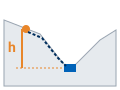{ .tool-icon } **Flow Distance** (Spatial Analyst) | For every cell, the distance along its flow path to the stream it drains to. With **Vertical**, the height above that stream: HAND. [Tool reference](https://pro.arcgis.com/en/pro-app/latest/tool-reference/spatial-analyst/flow-distance.htm){ target="_blank" } |
| 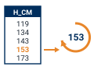{ .tool-icon } **Iterate Field Values** (ModelBuilder ▸ Iterators) | The loop, like Lab 6's For, but its values come from a field of a table: here, one HAND threshold per return period. [Tool reference](https://pro.arcgis.com/en/pro-app/latest/tool-reference/modelbuilder-toolbox/iterate-field-value.htm){ target="_blank" } |
| 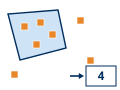{ .tool-icon } **Spatial Join** (Analysis) | Writes onto each feature what it touches: here, the number of buildings each flood reaches, in `Join_Count`. [Tool reference](https://pro.arcgis.com/en/pro-app/latest/tool-reference/analysis/spatial-join.htm){ target="_blank" } |

Tools you already know: **Fill**, **Flow Direction**, **Flow Accumulation** (Lab 5), **Raster
Calculator** with a model variable (Lab 5), **Buffer** and **Extract by Mask** (Lab 4), and the
loop pieces from Lab 6 — **Raster to Polygon**, **Calculate Field**, **Collect Values** and
**Merge**.

## Example Model

![The HAND Builder model, exported from ModelBuilder as a vector diagram. Top row: Provo_DEM.tif, marked P, into Fill, Filled_DEM, Flow Direction, which makes Flow_Direction and an unused Output drop raster. Flow_Direction feeds Flow Accumulation, which makes Flow_Accumulation; Raster Calculator takes Flow_Accumulation and Threshold, marked P, and makes Stream_Cells. Provo_River goes through Buffer to River_Corridor; Extract by Mask takes Stream_Cells and River_Corridor and makes River_Cells, marked P. Flow Distance takes River_Cells, Filled_DEM and Flow_Direction and makes HAND, marked P. Every tool and output carries a green check mark from a completed run.](images/lab07-model-hand.svg)

**Figure C.** The two models, exported from ModelBuilder (**Export** ▸ **Export To Graphic**) after
a run. The first computes HAND once; the second floods it once per row of the stage table. They are
two models because a model with an iterator runs *every* tool in it once per value (Lab 6, Step 6):
in one model, Fill, Flow Direction, Flow Accumulation and Flow Distance would all run five times.

## Complete the Lab

For an advanced GIS student, the information up to this point is all you need to complete the
assignment. Feel free to try the analysis using only the information above. If you complete the lab
without the step-by-step instructions below, say so in your report.

## Step-by-Step Solution

> [!NOTE]
> **Every check value on this page** was measured on the files you download, with the settings
> below, in ArcGIS Pro 3.7.1, and your numbers should match to the last digit shown. On a machine
> like the lab's, **HAND Builder** runs in about **40 seconds** and **Flood Loop** in under a
> minute, from the tool dialog or inside ModelBuilder; each of Step 7's tools takes a few seconds.
> Nothing in this lab is a long wait.

### Step 0 — Set Up the Project

1. Create a new project named `Lab07` in `D:\Smith\Lab07\` with the **Map** template; if you
   already made the folder, uncheck **Create a folder for this local project**. ArcGIS Pro makes
   `Lab07.gdb` and `Lab07.atbx` beside it. The downloaded data stay in their own geodatabase,
   `lab07-provo-river-hand\ProvoData.gdb`.
2. Add `Provo_DEM.tif` (click **OK** to build pyramids and statistics) and, from
   `ProvoData.gdb`, `Provo_River`, `Gage`, `Buildings`, `FEMA_Floodplain_1pct` and `Stage_Table`.
   Add an imagery basemap.
3. Confirm Spatial Analyst is licensed (**Project** ▸ **Licensing**).
4. On the **Analysis** tab click **ModelBuilder**. On the **ModelBuilder** tab click
   **Properties**, set **Name** to `HANDBuilder` and **Label** to `HAND Builder`, and save.
5. On the **ModelBuilder** tab click **Environments** and set:
    - **Current Workspace** and **Scratch Workspace**: your project geodatabase, `Lab07.gdb`
    - **Extent**: choose `Provo_DEM.tif` from the list of the map's layers
    - **Snap Raster**: `Provo_DEM.tif`
    - **Cell Size**: `Provo_DEM.tif` (or type 5)

**Figure 0.** ModelBuilder ▸ **Environments**. Choosing `Provo_DEM.tif` for the Extent fills in its
four edges; if **Output Coordinate System** comes filled in from an earlier project, clear it.

> [!WARNING]
> **Set the Extent.** Without it, Extract by Mask (Step 3) makes `River_Cells` only as large as the
> box around the river corridor, Flow Distance (Step 4) follows it, and HAND covers **695,974** cells
> instead of **697,608**: the edges of the valley drop out, with no error.

### Step 1 — Your Own Flow

Before any GIS, do the hydrology once, by hand, for a flood that is yours alone. This step uses
two sources, and they hold different things:

| Source | What it holds |
| --- | --- |
| `rating_10163000.csv` (open it in Excel) | Two columns, `gage_height_ft` and `discharge_cfs`, one row for every 0.01 ft from 3.42 to 8.00 ft. **No datum and no elevations.** |
| [The gage's USGS page](https://waterdata.usgs.gov/monitoring-location/10163000/){ target="_blank" } | The **gage datum**, under **Important information about this monitoring location** near the bottom of the page |

Three different heights come up at one gage, and it helps to keep them apart:

- **Gage height** is what the gage reads: feet above the gage's own zero, a reference point set
  low enough that readings stay positive. Every number in the CSV's first column is a gage height.
- **Gage datum**, **4,493.22 ft** above NAVD 88, is the elevation of that zero. Add it to a gage
  height to get the water surface's elevation above sea level: a gage height of 7.78 ft is a water
  surface at 4,501.00 ft NAVD 88.
- **Zero-flow level**, a gage height of **3.20 ft**, is where the water stands when the river
  stops flowing. Flood depth *h* is measured from here, because HAND is measured from the stream.

You **do not use the datum to compute *h***. *h* is the difference between two gage heights, so
the datum would cancel out. You look it up because it is one of the three metadata values your
report explains (Figure A): it is what ties the gage's readings to the DEM's elevations.

1. **Find the datum.** On the gage page, scroll to **Important information about this monitoring
   location**. It says to add **4,493.22 feet** to a gage height to get an elevation in NAVD 88.
   Check that it matches the `Gage` entry in `READ-ME-FIRST.txt` and write it in your report.
2. **Work out your design flow** from your **BYU ID number**: the **nine-digit number printed on
   your BYU ID card**, such as `123456789`. It is **not your NetID**, the user name of letters and
   numbers you chose and use to sign in to BYU sites.
3. **Look up your gage height** in `rating_10163000.csv` and compute *h*, as the box below shows.

> **Your design flow Q = 900 + 12 × (the last two digits of your BYU ID) ft³/s**
>
> Then find the first row of `rating_10163000.csv` whose discharge is **at least** Q, read its gage
> height, and compute *h* = (gage height − 3.20) × 0.3048 m, **to the millimeter**. That is how the
> stage table above was built for FEMA's flows.
>
> - BYU ID `123456789`: last two digits **89**, Q = 900 + 12 × 89 = **1,968** ft³/s → **7.78** ft →
>   *h* = 4.58 ft = **1.396** m.
> - BYU ID `987654302`: last two digits **02**, Q = 900 + 24 = **924** ft³/s → **6.24** ft →
>   *h* = 3.04 ft = **0.927** m.
>
> Every design flow is between 900 and 2,088 ft³/s, inside the rating table, so no extrapolation is
> needed. Write your BYU ID's last two digits, Q, the gage height and *h* in your report: the grader
> checks them against a run at your flow. If you would rather not use your ID digits, email the
> instructor for a number of your own; a flood at someone else's number cannot be checked.

**Figure 1.** The rating turns a flow into a gage height. FEMA's 100- and 500-year flows are above
the top of the published table; every design flow is below it.

> [!TIP]
> **Check the result:** for the example ID ending 89, the row at 7.77 ft is **1,964.76 ft³/s** —
> just short of 1,968 — so the answer is the next row, **7.78 ft** (1,972.66 ft³/s), and
> *h* = (7.78 − 3.20) × 0.3048 = **1.396 m**. Your own *h* goes into Step 7; for now, write it down.

### Step 2 — Condition the Surface

In the **HAND Builder** model, as in Lab 5:

1. **Fill**: input `Provo_DEM.tif`, output `Filled_DEM`. Right-click the `Provo_DEM.tif` oval ▸
   **Parameter**.
2. **Flow Direction**: input `Filled_DEM`, **Flow direction type** **D8**, output
   `Flow_Direction`.

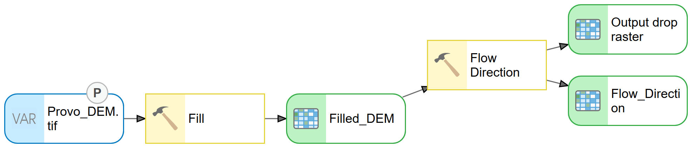{ style="width: 658px" }

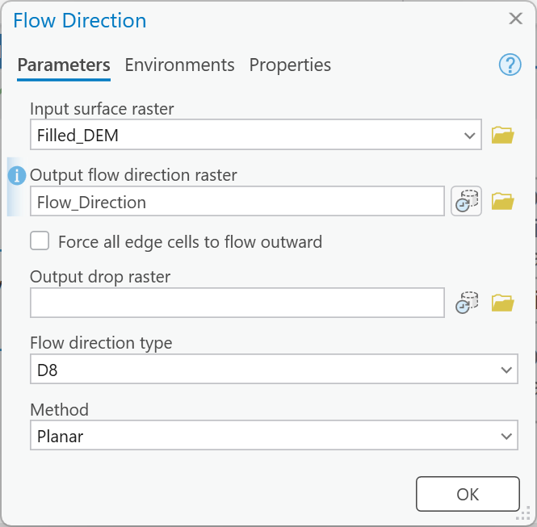

**Figure 2.** Step 2's part of the model (top), and Flow Direction at its defaults: **Force all edge cells to flow outward** unchecked,
**D8**, **Planar**.

> [!TIP]
> **Check the result:** `Filled_DEM` runs from **1,366.92 to 1,645.53** m. Fill raised **489,125**
> cells (12.23 km² of the box), by up to **8.47** m: the city is full of hollows — underpasses,
> basins, low yards — that the bare-earth surface shows as pits. `Flow_Direction` holds only the
> eight D8 codes, 1 to 128.

### Step 3 — Find the River

1. **Flow Accumulation**: input `Flow_Direction`, output `Flow_Accumulation` (accumulation data
   type Float).
2. On the **ModelBuilder** tab click **Variable**, type `Long`, and click OK. Right-click the new
   oval ▸ **Rename** ▸ `Threshold`, double-click it and type `2000`, and right-click it ▸
   **Parameter** (the same steps as Lab 5's Step 12).
3. **Raster Calculator**: `Con("%Flow_Accumulation%" > %Threshold%, 1)`, output `Stream_Cells`.
   With no third argument, every cell that is not a stream is **NoData**.
4. **Buffer**: input `Provo_River` (from `ProvoData.gdb`), distance **30 Meters**,
   **Dissolve Type** **Dissolve all output features into a single feature**, output `River_Corridor`.
5. **Extract by Mask**: input raster `Stream_Cells`, mask `River_Corridor`, output `River_Cells`.
   Make `River_Cells` a parameter, so that a run from the tool dialog keeps it.

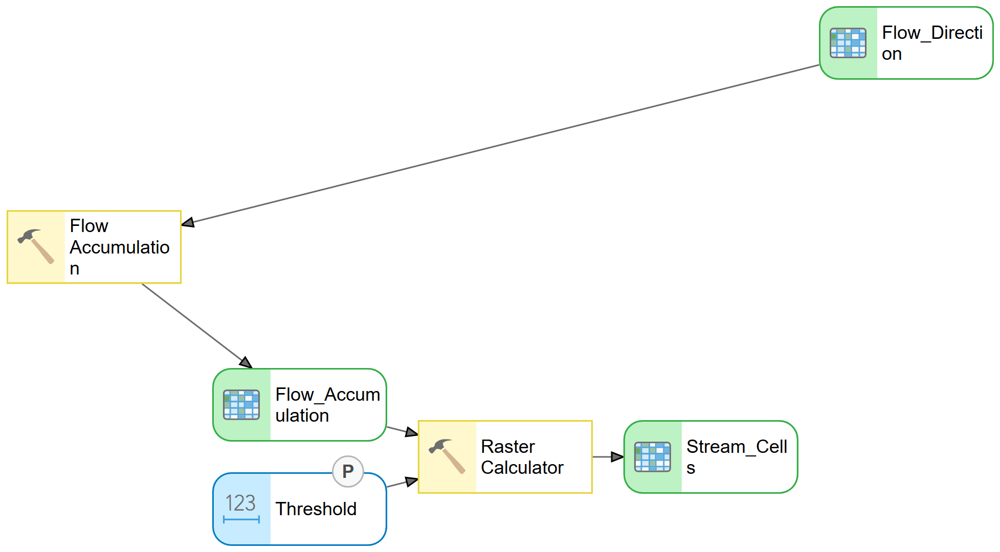{ style="width: 652px" }

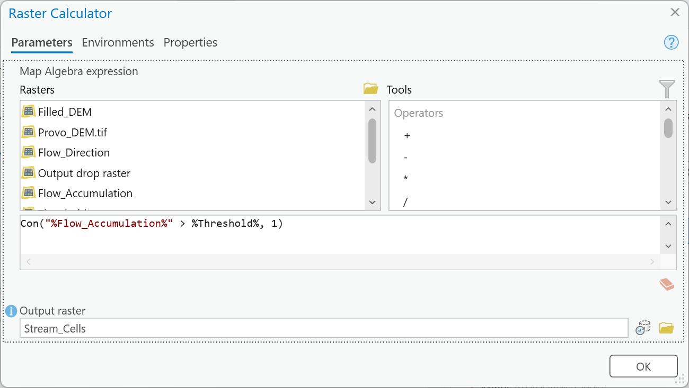

**Figure 3a.** The stream threshold: its part of the model (top) and the Raster Calculator dialog. Double-click `Flow_Accumulation` in the **Rasters** list to put
`"%Flow_Accumulation%"` in the expression, and type `%Threshold%` yourself.

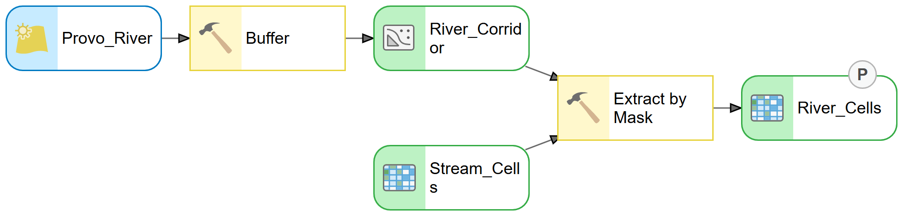{ style="width: 658px" }

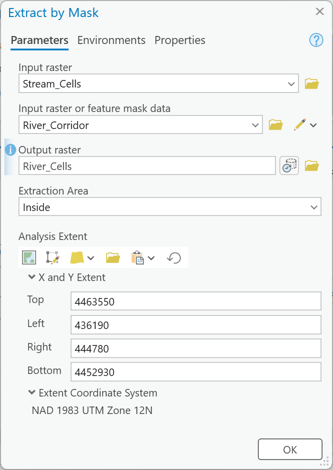

**Figure 3b.** The river corridor and Extract by Mask (top), and the Extract by Mask dialog. With the Extent environment set, **Analysis Extent** fills in with
the DEM's edges, not the corridor's.

> [!TIP]
> **Check the result:** `Flow_Accumulation` reaches **1,050,227** cells. `Stream_Cells` has
> **74,866** cells; `River_Cells` **3,191**.

> [!WARNING]
> **Do not skip the corridor.** Every one of the 74,866 stream cells — street gutters, ditches,
> canals — would become "a river" for Step 4, and the 100-year flood would cover **47.9 km²**
> instead of 1.57. The threshold alone cannot tell the Provo River from a gutter: inside this box,
> the river carries water from 673 square miles upstream that the DEM never sees.

### Step 4 — Height Above Drainage

Add **Flow Distance** (Spatial Analyst):

- **Input stream raster**: `River_Cells`
- **Input surface raster**: `Filled_DEM`
- **Input flow direction raster**: `Flow_Direction`
- **Distance type**: **Vertical**
- **Input flow direction type**: **D8**
- **Statistics type**: **Minimum**
- **Output raster**: `HAND`

Make `HAND` a parameter. Save the model and run it inside ModelBuilder. When ArcGIS Pro asks whether
to build pyramids for `HAND`, click **Yes**.

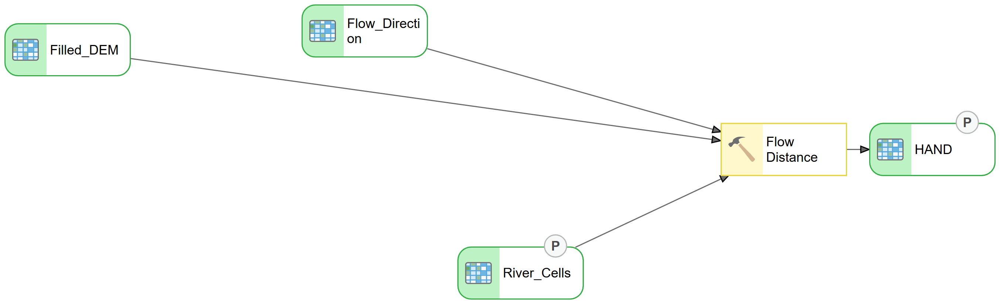{ style="width: 902px" }

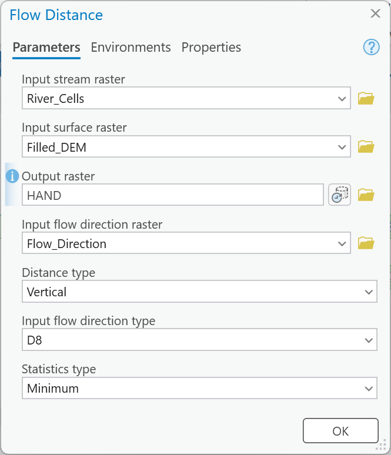

**Figure 4.** Flow Distance takes three earlier outputs (top). **Vertical**, **D8** and **Minimum** are the defaults; the flow
direction raster is not, so choose `Flow_Direction`.

> [!TIP]
> **Check the result:** `HAND` has values on **697,608** cells, from **0 to 197.95** m (mean
> **23.54**). The rest is NoData: those cells drain somewhere other than the Provo River — to Utah
> Lake, to a canal, or out of the box.

> [!WARNING]
> **Use the filled surface.** With `Provo_DEM.tif` as the surface instead of `Filled_DEM`, HAND has
> **6,141 negative** cells (down to −1.92 m): the flow path climbs out of a pit the raw surface
> still has. Flow Distance also runs without a flow direction raster (it derives its own D8); give it
> yours anyway, so that the model says what it does.

### Step 5 — Flood Every Return Period

A second model, so that the loop does not rerun Steps 2–4 five times.

1. In the **Catalog** pane, right-click `Lab07.atbx` ▸ **New** ▸ **Model**. In **Properties** set
   **Name** `FloodLoop` and **Label** `Flood Loop`. Set the same environments as in Step 0.
2. On the **ModelBuilder** tab, in the **Insert** group, click **Iterators** ▸ **Iterate Field
   Values**. Double-click it: **Input Table** `Stage_Table` (the downloaded one), **Field** `H_CM`.
   Leave **Data Type** at **String**. Its green output is `Value`, the threshold in centimeters for
   one row at a time.

    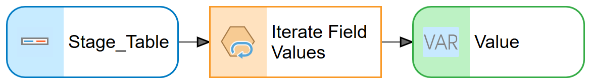{ style="width: 390px" }

    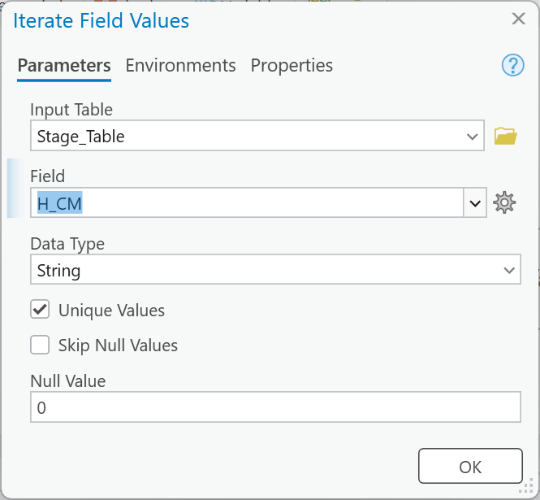

    **Figure 5a.** The loop (top) and Iterate Field Values: one pass per `H_CM` in the stage table.

3. Add `HAND` to the map from your project geodatabase. **Raster Calculator**: double-click `HAND`
   in the **Rasters** list (it goes in as `"HAND"`), then type the rest:
   `Con("HAND" <= %Value% / 100, 1)`. Output `flood_%Value%`. ModelBuilder adds a `HAND` oval;
   right-click it ▸ **Parameter**. `%Value%` is replaced by each row's number before the expression
   runs, so the first pass computes `Con("HAND" <= 119 / 100, 1)` and writes `flood_119`.

    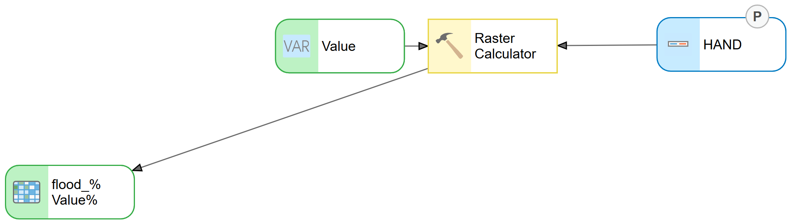{ style="width: 694px" }

    

    **Figure 5b.** One flood per pass: `Value` and `HAND` in, `flood_%Value%` out. Type the output name last.

4. **Raster to Polygon**: input `flood_%Value%`, **Simplify polygons** unchecked, **Create
   multipart features** checked, output `floodpoly_%Value%`. Each flood becomes one row.

    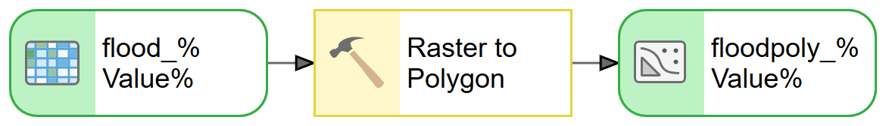{ style="width: 390px" }

    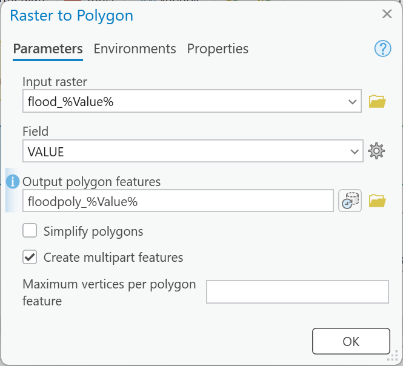

    **Figure 5c.** Raster to Polygon in the model (top) and its dialog, unsimplified and multipart.

5. **Calculate Field**: input `floodpoly_%Value%`, **Field Name** `H_CM` (a new field), **Field
   Type** **Long (32-bit integer)**, `H_CM =` `%Value%`. Its output oval is labeled
   `floodpoly_String`; that is only ModelBuilder's name for it.

    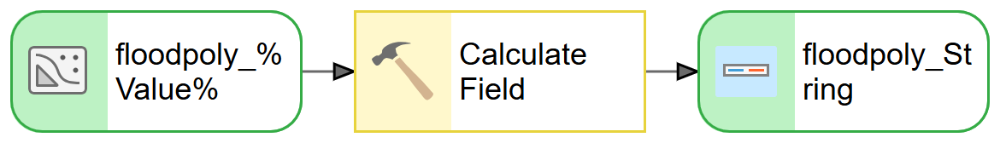{ style="width: 390px" }

    **Figure 5d.** Calculate Field stamps each pass's `H_CM` on its polygon.

6. **Collect Values** (ModelBuilder tab ▸ **Insert** group ▸ **Utilities** ▸ **Collect Values**):
   **Input Value** `floodpoly_String`. Add **Merge** and drag from Collect Values' **Output Values**
   onto Merge, choosing **Input Datasets**, as in Lab 6. Output `Floods`; make `Floods` a parameter.

    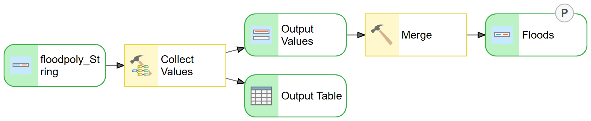{ style="width: 658px" }

    

    **Figure 5e.** Merge, fed by Collect Values (top), so it runs once, after the last pass.

7. **Save, then run the model from its tool dialog**: in the **Catalog** pane, open
   `Lab07.atbx` and double-click **Flood Loop**. The dialog shows `HAND` and `Floods` as its
   parameters; leave them and click **Run**. A run from the dialog lands in your **Geoprocessing
   History** (**Analysis** tab ▸ **History**), which your report captures in Step 7.

<!-- GUI build 2026-10-09 (Pro 3.7.1): (1) Iterate Field Values is under ModelBuilder tab > Insert group > Iterators; output named Value, Data Type String by default, Null Value auto-filled 0. (2) Double-clicking a map layer in Raster Calculator's Rasters list inserts "HAND" (layer name), not "%HAND%"; the run gave exactly the check cells (51,474 ... 68,538), so %Value% / 100 works with the String type. (3) Running Flood Loop from its tool dialog on HAND x 2 (C:\Ames\Lab07HAND\ParamTest.gdb) gave exactly the HAND x 2 cell counts, so "HAND" follows the parameter and a dialog run works. (4) Calculate Field's derived output is auto-named floodpoly_String. (5) Collect Values is under Insert > Utilities and shows two outputs, Output Values and a gray Output Table. (6) A SQL where clause "Value * 100 <= 153" in Con fails in arcpy (ERROR 010416), which is why the page uses Raster Calculator. Run: 43 s inside ModelBuilder. A dialog run deletes the loop's non-parameter intermediates (the last flood_ and floodpoly_); Floods stays. -->

> [!TIP]
> **Check the result:** `Floods` has **5** rows.
>
> | `H_CM` | Wet cells | Area (km²) |
> | --- | --- | --- |
> | 119 | 51,474 | 1.2869 |
> | 134 | 56,420 | 1.4105 |
> | 143 | 59,332 | 1.4833 |
> | 153 | 62,693 | 1.5673 |
> | 173 | 68,538 | 1.7135 |
>
> Area is the wet cells × 25 m², exactly, because the polygons are not simplified. The **Wet cells**
> column is only here to help you check your results; **you do not need to compute it** or put it in
> your report. If you want to, add a Long field to `Floods` and calculate it as `!Shape_Area! / 25`;
> if your areas match, your cell counts do too. If you have only
> one row, Merge ran outside the loop; if you have many rows per value, **Create multipart
> features** was unchecked. Match each `H_CM` to its return period and flow in the stage table
> above; the flood with `H_CM` 153 is the 100-year flood.

> [!NOTE]
> **Why centimeters?** A name such as `flood_1.53` is not allowed in a geodatabase, so the loop
> iterates over whole centimeters and divides by 100 in the expression. Every threshold is rounded
> to the centimeter; the stage table's `H_M` keeps the millimeters.

### Step 6 — Count and Compare

Run this from the Geoprocessing pane, not in a model.

**Spatial Join**: **Target Features** `Floods`, **Join Features** `Buildings` (leave **Join Count
Field Name** at `Join_Count`), **Output Feature Class** `Floods_Buildings`, **Join Operation**
**Join one to one**, **Keep all target features** checked, **Match Option** **Intersect**.
`Join_Count` is the number of buildings each flood touches.

**Figure 6.** Spatial Join: one row per flood, with the number of buildings it touches. The columns
after `Join_Count` and `H_CM` come from one of the buildings and mean nothing here.

> [!TIP]
> **Check the result:**
>
> | Return period | Flow (ft³/s) | `H_CM` | Area (km²) | Buildings (`Join_Count`) |
> | --- | --- | --- | --- | --- |
> | 10-year | 1,475 | 119 | 1.2869 | 319 |
> | 25-year | 1,810 | 134 | 1.4105 | 356 |
> | 50-year | 2,065 | 143 | 1.4833 | 388 |
> | 100-year | 2,325 | 153 | 1.5673 | 413 |
> | 500-year | 2,935 | 173 | 1.7135 | 451 |

**Now compare the 100-year flood with FEMA's.** Put `FEMA_Floodplain_1pct` (symbolized by
`FLD_ZONE`, as an outline) over the `H_CM` = 153 row of `Floods` (select that row in the attribute
table, or turn the other four off with a definition query), and look along the whole river.
We measured the agreement for you, inside the 500 m comparison area: FEMA maps **1.3429 km²**, HAND
**1.2801 km²**, and they overlap on **0.7361 km²**. In the scores this week's lecture uses, that is
a **hit rate of 0.548** (the share of FEMA's floodplain HAND also floods), a **false-alarm ratio of
0.425** (the share of HAND's flood FEMA does not map) and a **critical success index, CSI, of
0.390** (1 would be perfect agreement). Your report says in one or two sentences what those three
numbers mean about the two maps.

The disagreement is not spread evenly. Your report names **one place** where HAND and FEMA disagree,
with its coordinates, a cropped figure, and the reason. Two kinds of place to look for:

- A floodplain FEMA maps that **leaves the river** — HAND can only flood land that drains *to* the
  river.
- HAND flooding **behind raised banks** where FEMA keeps the water in the channel — HAND does not
  know a bank is there if water would drain around it.

> [!NOTE]
> Figure B (bottom) shows one place where they agree: at FEMA section C, just upstream of the gage,
> HAND floods about 95 m of the 123 m section and FEMA's water surface covers about 105 m.

### Step 7 — Your Own Flood

Flood the river at the *h* you worked out in Step 1, with a few tools from the Geoprocessing pane:

1. **Raster Calculator**: `Con("HAND" <= 1.396, 1)`, with your own *h* in place of 1.396, output
   `flood_mine`.
2. **Raster to Polygon**: input `flood_mine`, **Simplify polygons** unchecked, **Create multipart
   features** checked, output `floodpoly_mine`.
3. **Spatial Join**: target `floodpoly_mine`, join features `Buildings`, output `Mine_Buildings`,
   with the settings of Step 6. Open its attribute table: one row, with `Shape_Area` (the flood's
   area in square meters) and `Join_Count` (the buildings it touches).
4. **The buildings themselves**, for Map 2: **Select Layer By Location** with **Input Features**
   `Buildings`, **Relationship** **Intersect**, **Selecting Features** `floodpoly_mine` (its result
   reports the **Count**, the same number as `Join_Count`), then **Export Features** with **Input
   Features** `Buildings` (the switch **Use the selected records** is on) and **Output Feature
   Class** `Mine_Reached`. Clear the selection afterwards (**Map** tab ▸ **Clear**).

> [!TIP]
> **Check the result:** with the example *h* of 1.396 m, `flood_mine` has **58,193** cells (its
> attribute table's `Count`), `floodpoly_mine` is **1.4548** km² and **376** buildings are reached;
> with 0.927 m, **1.0799** km² and **258** buildings. Your own numbers are between those of the FEMA
> floods on either side of your flow, or below the 10-year flood if your flow is under 1,475 ft³/s
> (IDs ending in 00 to 47).

Then open **Analysis** tab ▸ **History**. The pane lists every run from a tool dialog, newest
first; resting the pointer on an entry opens its card with the start and end times, the elapsed
time and the parameters. **Capture the pane** with the Flood Loop card open, as in Figure 7, for
your report. The History pane is how the grader knows the runs happened on your machine.

**Figure 7.** The History pane after Steps 5 to 7, with the Flood Loop card open. Yours lists the
same six runs with your own times. The paths start with `C:\` because this was captured on an
instructor machine; yours start with `D:\`.

## Deliverables

Make **two** professional map layouts (letter size), each exported from ArcGIS Pro as its own PDF:

1. **Map 1 — the five FEMA floods.** The 10- to 500-year floods nested and symbolized so each return
   period is readable, with a legend and the return periods labeled on the map (or in a close-up
   where they can be told apart); FEMA's 1% floodplain as an outline; the river and the gage; an
   imagery basemap; a title, neat line, north arrow and scale bar; and a text box with your name,
   the date, the map projection, and the sources and dates of the elevation, the flows and the FEMA
   map.
2. **Map 2 — your own flood.** The flood at your design flow, symbolized with a legend, the
   buildings it reaches highlighted and their count on the map; the river; the gage, in the main
   frame or in a small locator inset that shows the whole reach with the main frame's extent
   outlined; the main frame zoomed to where the flood reaches buildings (an inset alone does not
   count); an imagery
   basemap; a title stating your flow and *h*, a neat line, north arrow and scale bar; and a text
   box with your name, the date, the map projection, and the sources and dates.

Write a brief report (2 pages of text, plus your figures and maps) covering:

- a title block — assignment title, your name, the date and the course — and the name of your
  peer reviewer, with a sentence on what you changed because of them
- the requirements of the project and your approach to solving it
- **a description of both models** a reader could repeat from: each tool and its settings, every
  input, intermediate and output dataset with its type, and how the loop's value reaches the
  Raster Calculator expression
- **one** full-page figure of the two models, exported from ModelBuilder (**Export ▸ Export To
  Graphic**), and **one** screen capture of each model's tool dialog with its parameters (the
  threshold, `HAND` and `Floods`; double-click a model in `Lab07.atbx` in the Catalog pane to open
  its dialog), with the check values of Steps 3 and 4 (`River_Cells` and the HAND range) in the text
- **the three metadata values** — the gage datum, the date of the rating, and the effective date
  of FEMA's flood study — and what each means for your result
- **the five floods**: a capture of the `Floods_Buildings` attribute table, and the five areas and
  building counts in a table with their return periods and flows
- **HAND against FEMA**: one or two sentences on what the hit rate, false-alarm ratio and CSI say
  about the two maps, and **one place where they disagree**, with coordinates, a cropped figure and
  the reason
- **your own flood**: your BYU ID's last two digits, Q, the rating row you used, *h*, the flood's
  area and the buildings it reaches, in one table
- **evidence that the models ran on your machine**: the capture of the **Geoprocessing History**
  pane from Step 7, listing the Flood Loop run and the Step 7 tools, with the Flood Loop card open
- figures numbered and referred to in the text, and every source credited
- one line at the end saying what you used AI for, if anything (see the note under the rubric)
- **a copy of the rubric below with your self-assessment filled in** — a score in every row,
  honestly arrived at. The grader will compare it with theirs.

**Upload four files**, not one: the report as a PDF, **each map as its own PDF exported from the
ArcGIS Pro layout** (**Share** tab ▸ **Export Layout** ▸ PDF, with the default vector settings — not
**Print**, which makes a picture of the page), and your project's toolbox, `Lab07.atbx`, from your
project folder. The grader opens the map PDFs in a reader and checks that the title and legend text
can be selected and the floods are drawn as shapes, not pixels, and opens the toolbox to read your
models. Put the maps in the report too, so it reads on its own.

> [!NOTE]
> **Make it yours.** Everyone works from the same data, so the five floods will match a classmate's;
> the choices should not. Your map layouts, your color ramps and symbology, the labels you give your
> models' elements, the place you pick in Step 6 and the wording of your report are your own work.
> Submissions whose layouts, labels or symbology match another student's too closely are flagged
> for follow-up.

> [!IMPORTANT]
> **Peer review before you submit.** Have another student in the class read your report against
> the rubric and give you feedback, then act on that feedback before the deadline. Name your
> reviewer in the report, paste their peer-review stamp, and say in a sentence what you changed
> because of them.

**Credit line for your maps:** Elevation: USGS 3D Elevation Program lidar (read October 2026,
5 m). Flows and floodplain: FEMA Flood Insurance Study and National Flood Hazard Layer, Utah County
(effective June 23, 2026). Gage and rating: USGS 10163000. River and buildings: Utah Geospatial
Resource Center.

## References

Federal Emergency Management Agency (2026). *Flood Insurance Study, Utah County, Utah, and
Incorporated Areas*, volume 49049CV001B, revised June 23, 2026. Table 9, Summary of Discharges.
[FEMA Flood Map Service Center](https://msc.fema.gov/portal/downloadProduct?productTypeID=FINAL_PRODUCT&productSubTypeID=FIS_REPORT&productID=49049CV001B){ target="_blank" }.

Federal Emergency Management Agency. National Flood Hazard Layer (map service).
[hazards.fema.gov](https://hazards.fema.gov/arcgis/rest/services/public/NFHL/MapServer){ target="_blank" }.

Nobre, A.D., Cuartas, L.A., Hodnett, M., Rennó, C.D., Rodrigues, G., Silveira, A., Waterloo, M., and
Saleska, S. (2011). Height Above the Nearest Drainage — a hydrologically relevant new terrain model.
*Journal of Hydrology* 404, 13–29.
[doi:10.1016/j.jhydrol.2011.03.051](https://doi.org/10.1016/j.jhydrol.2011.03.051){ target="_blank" }.

U.S. Geological Survey. Monitoring location 10163000, Provo River at Provo, UT: rating 30.0.
[waterdata.usgs.gov](https://waterdata.usgs.gov/monitoring-location/10163000/){ target="_blank" }.

U.S. Geological Survey, Water Science School. *How Streamflow is Measured.*
[usgs.gov](https://www.usgs.gov/special-topics/water-science-school/science/how-streamflow-measured){ target="_blank" }.

U.S. Geological Survey, 3D Elevation Program. 3DEP Elevation image service.
[elevation.nationalmap.gov](https://elevation.nationalmap.gov/arcgis/rest/services/3DEPElevation/ImageServer){ target="_blank" }.

Utah Geospatial Resource Center. *NHD Streams* and *Building Footprints*.
[gis.utah.gov — NHD streams](https://gis.utah.gov/products/sgid/water/nhd-streams/){ target="_blank" };
[gis.utah.gov — building footprints](https://gis.utah.gov/products/sgid/location/building-footprints/){ target="_blank" }.

Esri. *Flow Distance*, *Iterate Field Values* and *Spatial Join*, ArcGIS Pro tool reference (linked
in the tools table above).

<!-- LINK CHECK (curl -L, 2026-10-09; re-checked 2026-10-19 for the links kept): 200 doi:10.1016/j.jhydrol.2011.03.051; 200 waterdata.usgs.gov/monitoring-location/10163000/; 200 msc.fema.gov FIS 49049CV001B download; 200 hazards.fema.gov NFHL MapServer; 200 usgs.gov how-streamflow-measured; 200 elevation.nationalmap.gov 3DEP ImageServer; 200 gis.utah.gov nhd-streams and building-footprints; 200 pro.arcgis.com flow-distance, iterate-field-value, spatial-join; 200 github.com NOAA-OWP/inundation-mapping; ../../arcgis-tips.md, ../../policies/ai-policy.md and ../../data/lab07-provo-river-hand.zip checked by mkdocs build --strict. Removed with the October 19 cut: doi:10.3133/tm4B5 (Bulletin 17C), join-field, pairwise-clip, pairwise-intersect. -->

## Example Maps

Two example layouts follow, one for each map the Deliverables ask for. They show the *design*: what
goes on the page and where. Every piece of wording on them is a bracketed placeholder on purpose.
Your title, subtitle and text box are yours to write, from your own runs, in your own words. A map
that carries these brackets, or a title lifted from anywhere else, is not finished.

**Figure 8.** The design for Map 1, with placeholder wording. Do better than this example: at the
scale of the whole study area the floods are thin, so label the return periods on the map, or add a
close-up where a reader can see them nest.

**Figure 9.** The design for Map 2, with placeholder wording. Your main frame should be zoomed to
where your flood reaches buildings; this example keeps the whole reach in the main frame and shows
the close-up as an inset, which is the weaker choice. At every design flow the flood reaches
buildings right beside the gage, so a main frame that takes in both the gage and the largest
cluster of reached buildings is possible. If you zoom in tighter than that, show the gage in a
locator inset instead.

<!-- Oct 25, 2026: a student asked before the deadline whether Map 2 could drop the gage when the
main frame is zoomed to the buildings. Locator-inset option added. Checked with the package data
(tools/lab07 HAND, last two digits 00, 50, 99): the nearest reached building is 42 m from the gage
and 61 to 102 reached buildings lie within 1 km of it; the densest 1 km box of reached buildings is
centered 1.7 to 2.0 km east of the gage. -->

## Rubric for Flood Mapping with HAND

Fifty points in five parts of ten. The bullets say what each part is worth, so you know exactly
what to submit.

This rubric is already laid out as a fillable table at the end of
[`lab07-report-template.docx`](lab07-report-template.docx), so you do not have to copy it out of
this page.

| Item | Points |
| --- | --- |
| **Write-up** (2 pages) • Assignment title, your name, date and course; your peer reviewer named, with a sentence on what you changed because of them (1) • The requirements of the project and your approach to solving it, in your own words (2) • The three metadata values — gage datum, rating date, FEMA effective date — and what each means for your result (2) • HAND against FEMA: what the hit rate, false-alarm ratio and CSI say about the two maps, and one place where they disagree, with coordinates, a cropped figure and the reason (3) • Organized writing, figures numbered and referred to, sources credited, rubric pasted with your self-assessment (2) | /10 |
| **ModelBuilder models** — correct and working • Both models built as described: HAND Builder's river cells and HAND range match the check values, and Flood Loop produces one merged feature class with five labeled floods whose areas match (4) • A full-page figure of both models exported from ModelBuilder, all tools and datasets readable (2) • Screen captures of both tool dialogs with the threshold, HAND and the floods exposed as parameters (2) • A description of both models a reader could repeat from, including how the loop's value reaches the expression (2) | /10 |
| **Runs** (Steps 6 and 7) • The `Floods_Buildings` table captured, and the five areas and building counts in a table with their return periods and flows, matching the check values (3) • Your own flood: your BYU ID's last two digits, Q, the rating row, *h*, and the flood's area and building count, matching a run at your flow (4) • The Geoprocessing History capture listing the Flood Loop run and the Step 7 tools, with the Flood Loop card open (3) | /10 |
| **Map 1 — the five FEMA floods** (full page, 8.5 × 11, uploaded as a layout PDF) • Title stating what the map shows (1) • Neat line, north arrow and scale bar (1) • Text box with author, date, map projection, and the sources and dates of the elevation, flows and FEMA map (1) • The five floods nested and symbolized so each return period is readable, with a legend and the return periods labeled (3) • FEMA's 1% floodplain outlined, the river and the gage shown (2) • Basemap, scale and legibility appropriate to the river (2) | /10 |
| **Map 2 — your own flood** (full page, 8.5 × 11, uploaded as a layout PDF) • Title stating your flow and *h* (1) • Neat line, north arrow and scale bar (1) • Text box with author, date, map projection, and the sources and dates (1) • Your flood symbolized with a legend, the river shown, and the gage shown in the main frame or a locator inset (2) • The buildings it reaches highlighted, with their count on the map (3) • Main frame zoomed to where the flood reaches buildings; basemap and legibility (2) | /10 |
| **Total** | **/50** |

> [!NOTE]
> **Using AI on this lab.** Use AI freely to understand a tool, work out an error, or
> tighten your write-up, and add one line at the end of your report saying what you used it
> for. Do not take a field name, an expression, a coordinate system, or a number from it —
> those come from your own data, and the rubric asks you to defend every one. AI may do the
> clerical work, such as moving your own numbers into a table or laying out the model table from
> your own export, but every value must come from your own attribute tables and you check each
> one. See the [AI Use Policy](../../policies/ai-policy.md) for the full policy.
>
> **What the grader verifies.** The model figure must be a ModelBuilder export; the maps must be
> ArcGIS Pro layout exports with selectable text; your own flood's *h*, area and building count must
> match a run at your flow; the History capture must show the runs; the toolbox must hold the two
> models the report describes. A figure or map that was generated, redrawn or "enhanced" by AI, or a
> number that could not have come from a run, scores zero for that part of the rubric, and the
> report goes to the instructor under the AI policy. You do the work in ArcGIS Pro yourself: AI may
> not run it for you.

<!-- Migration notes (new lab, 2026-10-09; cut to Lab 6 scale 2026-10-19).
SOURCE: none (new lab). Lineage: student final projects 2021 (Logan, Flow Distance, single stage), 2024 (Utah County flood-prone areas), 2025 (Mapping Flood Intervals with HAND: gage -> peak statistics -> rating -> stage -> HAND extents per return period). Plan: tools/lab07/PLAN.md.
ARCGIS PRO: 3.7.1 arcpy, then the GUI build of 2026-10-09 (see the comment under Step 5 and FIGURES below). tools/lab07/verify_package.py extracts docs/data/lab07-provo-river-hand.zip and runs the page's path with the page's settings; probe_student_path.py tested the no-Extent trap (695,974 vs 697,608 HAND cells), the SQL where-clause failure (ERROR 010416 for 'Value * 100 <= 153'), multipart Raster to Polygon (1 row, area = cells x 25 exactly) and Spatial Join = Select Layer By Location count (413 at 100-yr). gotchas.py: stream raster with 0 off-stream inside the corridor gives the same HAND; no flow direction raster gives the same HAND; raw DEM surface 6,141 negative cells, min -1.92 m; no corridor 47.94 km2 at h 1.53 (41.74 at 1.19).
DATA: docs/data/lab07-provo-river-hand.zip, 12,411,788 bytes, built by tools/lab07/make_extract.py (5 m) from fetch_dem.py (3DEP ImageServer exportImage at 2 m, 30 tiles, Oct 8 2026) and fetch_vectors.py (UGRC UtahStreamsNHD, Buildings; NFHL layers 28 and 14, DFIRM 49049C, Oct 8 2026). Stage table: stage_table.py (design = FEMA FIS 49049CV001B Table 9, read from the page image; rating 30.0; first row >= Q; h = (GH - 3.20) ft x 0.3048; H_CM = round(h x 100)). The zip was not rebuilt for the October 19 cut: Comparison_Area, FEMA_Cross_Sections and peaks_10163000.csv stay in it, listed on the page as unused.
VERIFIED NUMBERS (package_checks.json): DEM 1,718 x 2,124, 1,366.78-1,645.53; Fill 1,366.92-1,645.53, 489,125 cells raised (12.228 km2), max 8.47 m; Flow_Accumulation max 1,050,227; Stream_Cells 74,866; River_Cells 3,191; HAND 697,608 cells, 0-197.95, mean 23.54; floods (cells, km2, buildings): 119 51,474 1.2869 319; 134 56,420 1.4105 356; 143 59,332 1.4833 388; 153 62,693 1.5673 413; 173 68,538 1.7135 451; 100-yr FEMA 1.3429, HAND in comparison 1.2801, overlap 0.7361, hit 0.548, FAR 0.425, CSI 0.390 (now stated as data on the page, not computed by the student). Personal (personal.py, mm h): 100 distinct h and areas, 74 distinct building counts; 89 -> 1,968 cfs, 7.78 ft (rating rows 7.77 ft = 1,964.76, 7.78 ft = 1,972.66), 1.396 m, 58,193 cells, 1.4548 km2, 376; 02 -> 924, 6.24, 0.927, 1.0799 km2, 258.
REMOVED 2026-10-19 (kept here for a future offering): the 25-year verification row (1,810 -> 7.57 ft = 1,809.84 just short -> 7.58 ft = 1,817.45; elevation 4,500.80 ft = 1,371.844 m; h 1.335 m, H_CM 134); the two-100-year-floods question (LP3 by method of moments, post-Jordanelle WY1993-2024 n=32 Q100 3,111; all systematic WY1934-2024 n=89 Q100 2,827; FEMA 2,325; Jordanelle completion date was never verified against Reclamation); Join Field (RETURN_YR, Q_CFS onto Floods by H_CM; its capture lab07-floods-buildings-table.png and icon-join-field.svg deleted); the Pairwise Clip / Pairwise Intersect skill-score computation (HAND100_Compare, Overlap100; with the whole flood instead of the clipped one FAR would be 0.530 and CSI 0.339); the second 'where HAND is wrong' place and the 0.47 m channel-offset discussion (DEM channel minus FEMA bed median 0.47 m, 0.10-1.44, at 42 sections); the threshold sensitivity: runs at 400 / 1,000 / 4,000 / 8,000 gave River_Cells 3,513 / 3,307 / 3,110 / 2,912; 10-yr km2/bldg 1.5235/387, 1.4163/370, 1.1825/301, 0.7684/169; 100-yr km2/bldg/CSI 1.8591/497/0.377, 1.7326/474/0.387, 1.4389/397/0.394, 0.9739/257/0.325; at 8,000 the upper river is no longer a stream. The dialog-run deletion warning (a tool-dialog run deletes every non-parameter intermediate) went with Step 7's reruns.
OTHER MEASURED FACTS (PLAN.md, xs_check.py, profile.py): FEMA 1% depth above streambed median 1.80 m (1.49-2.07); section C: HAND wet 95 m, FEMA 105 m of 123 m; the river long profile 1,476.98 -> 1,367.05 m over 17.57 km; 100-yr stage elevation 1,372.04 m reaches the lowest 4.8 km; the D8 path from the highest river cell leaves the river at 40.23923 N, 111.68941 W (441,358 E, 4,454,538 N) and exits the box's south edge.
PILOT (no-GUI, 2026-10-09, C:\Ames\Pilot07\PILOT_NOTES.md): every check value on the page reproduced from the zip with arcpy (about 40, no mismatch). Fixed from its findings: the Extent warning names Extract by Mask; the downloaded geodatabase renamed ProvoData.gdb (both were Lab07.gdb); Provo_River described as one feature in two parts; Q2's 'below the 10-year' case (IDs ending 00-47) is now the Step 7 TIP's last sentence. Pilot measured section C HAND 96 m (page 95) and the bathtub's river length 4.6 km (page 4.8), both method-dependent. The cut page has not been re-piloted; every number it keeps is from the same package_checks.json.
FIGURES: Figures A, B and 1 and the three tool icons by tools/lab07/make_svgs.py. Dialog captures lab07-environments (composed from two grabs), -flow-direction, -rc-streams, -extract-mask, -flow-distance, -iterate-field-values, -flood-calc, -raster-to-polygon, -merge, -spatial-join (stitched from two scrolled grabs of the Geoprocessing pane) (.png) are screen grabs (tools/screenshots/) at 175 % from the 2026-10-09 session; Figure C (lab07-model-hand.svg, lab07-model-floodloop.svg) is each model's Export To Graphic after a run, laid out by hand. Originals in C:\Ames\Lab07HAND\caps. GUI checks: Spatial Join 3.7.1 takes a list of Join Features, each with a Join Count Field Name; Flow Distance's label is Input flow direction type. Step 6 floods and building counts reproduced exactly in the GUI (319/356/388/413/451). GUI SESSION 2026-10-19 (Pro 3.7.1 at 175 %, C:\Ames\Lab07HAND): Flood Loop run from its tool dialog (47 s; the HAND parameter had to be re-pointed at Lab07.gdb\HAND because HAND was not in the map, which a student following Step 5 will have), then Step 7's Raster Calculator (3 s), Raster to Polygon (2 s), Spatial Join (2 s), Select Layer By Location (Count 376) and Export Features (Mine_Reached), all with the page's names; lab07-history.png is the History pane with the Flood Loop card open (cap.py full-screen grab cropped; the taskbar strip under the pane painted with the pane background). Completed-run popups for Flood Loop and Select Layer By Location are in caps\ (not on the page). Step 7 item 4 (Select Layer By Location + Export Features) was added that day after the re-pilot found that Map 2's highlighted buildings had no step producing them.
RE-PILOT (no-GUI, 2026-10-19, C:\Ames\Pilot07b\PILOT_REPORT.md, propy.bat): all 38 check values on the cut page reproduced from the zip to the last digit, rubric sums checked, template rubric matches the page, Week 8 page and the Thursday slide agree with the page. Text fixes made from it: Step 7's reached-buildings step; River_Cells and the HAND range named in the deliverables; the HAND Builder dialog capture says how to open the dialog; the H_CM = 153 selection explained; Comparison_Area described as where the Step 6 agreement was measured; Stage_Table's AEP_PCT and ELEV_M named; the 'introduced Tuesday' wording dropped (the Thursday deck carries Lab 7); two speaker notes in slides/week-08/hand.md updated (rating lookup is the student's own flow; the stream definition is settled in Lab 7).
Example maps (Figures 8 and 9): tools/lab07/build_figures.py, arcpy.mp from the GUI build's Lab07.gdb (HAND, Floods) and ProvoData.gdb, rebuilt 2026-10-19 with bracketed placeholder wording (Lab 5 and 6 pattern) and without the buildings and close-up on Map 1; the legend labels still carry measured numbers (areas, 376 buildings for the example ID ending 89).
PILOT 2 (no-GUI, 2026-10-20, C:\Ames\Pilot07b\PILOT_NOTES.md, propy.bat, on the page after b3e1f87): 44 of 46 numbers reproduced to the digit from the zip; the two others are Figure B's sampling-dependent section C widths (97/107 m vs 95/105) and bathtub reach (4.6 vs 4.8 km), now written as "about". Fixed from it: the one-week note said three Step 7 tools (five since the reached-buildings step); the template's HAND Against FEMA section had no prose prompt (prose: true in make_lab_report_template.js); the stage table's 500-yr H_M 1.733 vs the rounded-gage-height 1.734 now explained under the table; the peer-review box asks for the stamp the template asks for; Figure 7's caption explains the C:\ paths. Not changed: the lidar 2013-2023 line in Figure A (from 3DEP project metadata, not in the package); HAND Builder's dialog also exposes Provo_DEM.tif and River_Cells.
RUN TIMES (2026-10-20, this machine, a lab-machine equivalent, ArcGIS Pro 3.7.1): both models run from Lab07.atbx through arcpy (tools in C:\Ames\Lab07Time\time_models.py, outputs to Time.gdb): HAND Builder 40.5 s, Flood Loop 35.2 s (47 s from the tool dialog in the Figure 7 session); Step 7 tools (time_tools.py): Raster Calculator 3.3 s, Raster to Polygon 1.0 s, Spatial Join 0.9 s, Select Layer By Location 0.6 s, Export Features 0.7 s. Every check value reproduced exactly in those runs (3,191 river cells; HAND 0-197.95 mean 23.54; five areas; 58,193 / 1.4548 / 376). Running the .atbx models outside the project needs layers named Provo_DEM.tif, Provo_River and Stage_Table (the model's environments and inputs were picked from the map). -->

