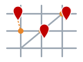
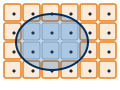
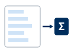

---
search:
  exclude: true
---

# DRAFT — Lab 12: Fire Response Coverage, a Network Analysis

**Civil Engineering 414 — Engineering Applications of GIS**

Fall 2026 · Dr. Dan Ames

*Who in Utah County lives more than four minutes' drive from a fire station, and how much does that answer depend on how you measure distance*

<!-- **Revision notes.** New lab, drafted October 10, 2026 from `tools/lab12/PLAN.md` (nine
decisions accepted by the instructor the same day). Every number on this page is from
`tools/lab12/check_values.json` (`run_model.py`, ArcGIS Pro 3.7.1), measured on the hosted package.
Figures 0-8 and Figure C are owed to the GUI build (TODO(capture) comments mark each one); Figures
A, B, 9 and 10 are generated (`make_svgs.py`, `figure_b.py`, `build_figures.py`). -->

> [!TIP]
> **Start from the report template.** [`lab12-report-template.docx`](lab12-report-template.docx)
> has the title block, a section for every deliverable, the tables already set up with the columns
> the rubric asks for, and the rubric at the end ready to fill in. You are welcome to write your
> report any way you like — the template is a floor, not a ceiling — but if you use it and fill in
> every section, you will not have left a graded item out.

> [!NOTE]
> **This is a one-week lab**, due Saturday of Week 14, the week Midterm 2 is open. Everything that
> takes preparation is done for you and hosted, including the road network: you build one model,
> run it six times, and make two maps.

## Background

When a fire is reported, the question that matters is not how far away the nearest engine is but
how long it takes to arrive. The standard that career fire departments in the United States are
measured against, NFPA 1710, sets a **travel time** for the first engine of **240 seconds**, four
minutes, at 90 percent of incidents, and 480 seconds for the full first alarm (NFPA, 2020). Travel
time is the part of the response the road network controls: it starts when the engine leaves the
station and ends when it arrives, and it does not include the dispatch or the turnout.
<!-- VERIFY against the current edition of NFPA 1710 (secondary sources read October 9, 2026 agree on
240 s / 480 s travel time at the 90th percentile); the reference links NFPA's own page. -->

Four minutes of driving is not a circle on a map. An engine follows streets, stops where the street
stops, cannot cross a lake or a freeway without an interchange, and covers a mile of arterial in a
fraction of the time it takes to wind through a subdivision. The area a station can reach in four
minutes is an irregular shape that follows the roads, and the people inside it are the people its
engines can reach in time. The way to find that shape is **network analysis**: distance measured
along a **network** of connected road segments, each with a cost in minutes, rather than across
the map.

This is the third way this course has measured distance, and the three belong side by side:

| Lab | Distance | How it is measured | What it ignores |
| --- | --- | --- | --- |
| Lab 1 | **Straight-line** | a buffer around the roads and the stores | that nobody travels in a straight line |
| Lab 11 | **Cost distance** | accumulated across a raster of cell costs, in any direction | that travel in a vehicle happens on roads |
| Lab 12 | **Network distance** | along the road segments, each costed in minutes, through the junctions that join them | everything off the road network |

Each is right for its question. A power line crosses country, so Lab 11's cost surface fits it. A
fire engine does not, so this lab puts the engines on the roads, and in Step 6 it measures the same
four minutes as a straight-line buffer, the way Lab 1 would have, to see how far wrong that is.

The road network you will use was built by the Utah Geospatial Resource Center from its statewide
roads layer. Every segment carries UGRC's estimate of the minutes it takes to drive, in each
direction, from the posted speed limit and the road class, with surface-street times multiplied by
1.5 for signals and congestion. That estimate is a model too: it is "typical network travel, and
not the expedited travel of emergency response vehicles" (UGRC, 2022), so the four-minute area it
draws is an engine driving like everyone else. Step 9 asks what that leaves out.

**Figure B.** The study area. Utah County's 42 fire stations, its road network, and where its
659,399 residents were counted in 2020. Most people live within a few kilometers of a station; the
question is how many live within four minutes.

> [!IMPORTANT]
> **Your job — see the deliverables below.** Build one ModelBuilder model that draws the area
> within a chosen number of minutes of the fire stations along the road network, counts the people
> in the Census blocks outside it, and draws the same reach as a straight-line buffer for comparison;
> run it at four minutes and at your own personal cutoff; test how much the answer depends on the
> cutoff; and make two maps.

## Problem Statement

Utah County's fire departments operate 42 stations, from Lehi to Santaquin and from Cedar Fort to
the mouth of Provo Canyon. Using UGRC's road network for the county, the station locations and the
2020 Census blocks:

1. Find the area that an engine can reach within **four minutes** of driving from the nearest
   station, along the roads.
2. Count the residents who live in Census blocks whose center is outside that area, and say what
   share of the county that is.
3. Measure the same four minutes as a **straight-line distance** instead, and compare the two
   answers.
4. Re-run the model with the cutoff changed, and say how much the answer depends on the standard.

## Analysis Considerations

Every one of these is a decision somebody made, and every one of them can change the answer.

- **The network is UGRC's, clipped to Utah County.** It holds **41,460** road segments joined at
  **33,872** junctions, and two costs: **TravelMinutes**, the default, and **Length** in meters.
  TravelMinutes is UGRC's estimate for typical traffic. Nothing in it is yours to edit; the
  decisions below are.
- **Four minutes, from the facilities outward.** The cutoff is NFPA 1710's first-engine travel time.
  The service area is drawn **away from** the stations (the direction an engine drives), not toward
  them. The cutoff is a **model parameter**, and Step 9 changes it.
- **One-way streets are a penalty, not a wall.** In UGRC's network the wrong direction on a one-way
  segment costs 100 times the right direction (**590** segments in the county are one-way). An engine
  with its lights on may legally drive against a one-way street; a 100-times penalty says "almost
  never", which is one defensible way to model it.
- **People are counted by block center.** A Census block is "covered" when its center point falls
  inside the service area, and every one of its residents counts as covered; otherwise none of them
  do. Blocks are small in the cities (most are a few hundred meters across) and huge in the
  mountains, where almost nobody lives, so the rule is fair where it matters. **2,125** of the
  county's **10,092** blocks have no residents at all.
- **Residents, where they slept on April 1, 2020.** The Census counts people at home. The daytime
  population of a block, where people work or study, is not in the data.
- **The straight-line comparison uses the speed limit.** Four minutes at **35 mph** is 2.33 miles,
  **3.75 km**: the distance a Lab 1 style buffer would use for the same standard. It, too, is a
  parameter.
- **Dissolved rings, standard detail.** The service areas from all 42 stations are **dissolved** into
  one shape per cutoff, so that a block near two stations is not counted twice, and drawn as
  **rings** when more than one cutoff is given (0–4 minutes, 4–8 minutes). **Standard** polygon
  detail is the default and is what every check value on this page was measured with.
- **What the model ignores.** Turnout time and dispatch; the speed an engine actually drives;
  which stations are staffed around the clock; whether a station has an engine or only an
  ambulance (**34** of the 42 are marked `EMS` = Y, **3** N, and five say nothing); traffic by time of
  day; and any station opened since the layer's 2022 update. Your report says what each would
  change.

## Data

> [!IMPORTANT]
> **Set up your folder before you download anything.** On the lab machines, work on the **D:
> drive**: one folder for this class named after you, `D:\Smith\`, and one folder per lab inside
> it, `D:\Smith\Lab12\`. The **C: drive is locked**, and a **network drive** is slow enough to make
> ArcGIS Pro hang. **Never use a space** in a folder or file name you create. **Back up your lab
> folder at the end of every session.** The full set of conventions is on the
> [ArcGIS Tips and Reminders](../../arcgis-tips.md){ target="_blank" } page.

- **Download:** [`lab12-fire-response.zip`](../../data/lab12-fire-response.zip) (20.6 MB). Unzip it
  into your Lab12 folder — the files are in a `lab12-fire-response` folder inside it — and read
  `READ-ME-FIRST.txt`.
- **Utah County boundary:** <https://opendata.gis.utah.gov/datasets/utah-county-boundaries/explore>
    - The one layer you fetch yourself, as in Lab 1: on the *Explore* page click **Download** (the
      cloud icon) and take the **Shapefile**, then select Utah County and export it to your project
      geodatabase as `Utah_County`. Nothing in the model depends on it; it is the frame of your maps
      and the layer whose **About** page you will read for the metadata questions.

Everything else is a prepared extract for Utah County, stored in NAD 1983 UTM Zone 12N:

| Layer | What it is | Where it comes from |
| --- | --- | --- |
| `FireResponse.gdb\Network\Utah_County_Roads_ND` | A **network dataset**, already built: the roads joined at their junctions, with the costs `TravelMinutes` and `Length` | UGRC [Utah Street Network](https://gis.utah.gov/data/transportation/street-network-analysis/){ target="_blank" }, the state's prebuilt network, clipped to the county and rebuilt from UGRC's own network template |
| `FireResponse.gdb\Network\Roads` | The network's 41,460 road segments, with `FULLNAME`, `CARTOCODE`, `ONEWAY`, `SPEED_LMT`, `F_T_IMP_MIN` and `T_F_IMP_MIN` (UGRC's minutes in each direction) | UGRC [Road Centerlines](https://gis.utah.gov/products/sgid/transportation/road-centerlines/){ target="_blank" }, through the network above |
| `FireResponse.gdb\Fire_Stations` | 42 points, with `NAME`, `ADDRESS`, `CITY` and `EMS` | UGRC [Fire Stations](https://gis.utah.gov/products/sgid/society/fire-stations/){ target="_blank" } (`COUNTY` = UTAH) |
| `FireResponse.gdb\Census_Blocks` | 10,092 polygons, with `GEOID20`, `PP_TOTAL` (people), `HU_TOTAL` (housing units), `ALAND20` | UGRC [CensusBlocks2020](https://services1.arcgis.com/99lidPhWCzftIe9K/ArcGIS/rest/services/CensusBlocks2020/FeatureServer/0){ target="_blank" } (`COUNTYFP20` = 049), the 2020 Census counts |
| `Utah_County` | The county boundary | **You download it**, above |

**What we already did for you.** Read each layer from its UGRC service on October 10, 2026, kept the
fields the lab uses plus `UGRC_OID` (the feature's object ID in the UGRC service), exported the road
segments with Utah County on either side, and rebuilt the network dataset from UGRC's template so its
cost definition is UGRC's, unchanged. Field values were not changed, and nothing was filtered: every
station and every block in the county is here.

> [!TIP]
> **Check the data:** in `FireResponse.gdb`, `Roads` **41,460** features and
> `Utah_County_Roads_ND_Junctions` **33,872**; `Fire_Stations` **42**; `Census_Blocks` **10,092**,
> and the sum of `PP_TOTAL` (right-click the field ▸ **Statistics**) is **659,399**.

![Infographic titled "Reading the metadata: the six questions from CCE 114", six cards answered for this lab's data. What: a road network of segments joined at junctions, each with minutes to drive it (41,460 edges); 42 fire stations; 10,092 Census blocks with the 2020 count of people, PP_TOTAL. Where: Utah County only, NAD 1983 UTM zone 12N, meters, every layer; the services themselves serve Web Mercator. When: roads updated through September 23, 2026; stations "Last Update: September 22, 2022" (the service re-saved March 2026); blocks: Census Day, April 1, 2020; four different dates. Why: roads for cartography and address location and UDOT's linear referencing, "a network analysis dataset can also be derived"; stations "to show the locations"; blocks: no why. How: minutes "estimated from the CARTOCODE field and the SPEED_LMT field", surface streets times 1.5, "typical network travel, and not the expedited travel of emergency response vehicles". Who: the Utah Geospatial Resource Center (roads, the network, stations); the U.S. Census Bureau (blocks, published by UGRC); public data under CC BY. An orange footer: the stations layer says Last Update September 22, 2022 and the blocks layer has no description at all; a station opened since 2022 is not in your model, and a block's people are where they slept on April 1, 2020; say what each does to your count and which you would fix first.](images/lab12-metadata.svg)

**Figure A.** The six metadata questions, applied to this lab's data. Confirm three values yourself
and copy them into your report: the **"Last Update"** date in the description of the
[FireStations service layer](https://services1.arcgis.com/99lidPhWCzftIe9K/ArcGIS/rest/services/FireStations/FeatureServer/0){ target="_blank" };
what UGRC says its travel minutes were **estimated from**, on the
[Utah Street Network page](https://gis.utah.gov/data/transportation/street-network-analysis/){ target="_blank" };
and what the [CensusBlocks2020 service layer](https://services1.arcgis.com/99lidPhWCzftIe9K/ArcGIS/rest/services/CensusBlocks2020/FeatureServer/0){ target="_blank" }'s
description says (look for it). Say what each one means for your count of people outside four
minutes.

## ModelBuilder Tools

New in this lab, all from the **Network Analyst** toolbox unless marked:

| Tool | What it does |
| --- | --- |
| { .tool-icon } **Make Service Area Analysis Layer** | Creates an empty **analysis layer** on a network dataset: a group layer with sublayers for Facilities, Polygons and Lines, and the settings of the analysis (the cutoffs, the travel direction, how the polygons are drawn). It computes nothing yet. [Tool reference](https://pro.arcgis.com/en/pro-app/latest/tool-reference/network-analyst/make-service-area-analysis-layer.htm){ target="_blank" } |
| { .tool-icon } **Add Locations** | Loads features into one sublayer of an analysis layer, here the fire stations into **Facilities**, and snaps each to the nearest street within the search tolerance. [Tool reference](https://pro.arcgis.com/en/pro-app/latest/tool-reference/network-analyst/add-locations.htm){ target="_blank" } |
| { .tool-icon } **Solve** | Runs the analysis layer: walks the network outward from every facility until the cutoff and fills in the Polygons sublayer. [Tool reference](https://pro.arcgis.com/en/pro-app/latest/tool-reference/network-analyst/solve.htm){ target="_blank" } |
| { .tool-icon } **Select Layer By Location** (Data Management) | Selects features of one layer by where they sit relative to another: here, the blocks whose **center** is inside the service area, **inverted** to keep the ones outside. [Tool reference](https://pro.arcgis.com/en/pro-app/latest/tool-reference/data-management/select-layer-by-location.htm){ target="_blank" } |
| { .tool-icon } **Summary Statistics** (Analysis) | Writes one table row with statistics of a field over the features it is given: the **sum** of `PP_TOTAL` over the unserved blocks, and their count. [Tool reference](https://pro.arcgis.com/en/pro-app/latest/tool-reference/analysis/summary-statistics.htm){ target="_blank" } |

Also used: **Select Data** (ModelBuilder), which pulls one sublayer, the Polygons, out of the
analysis layer so the next tool can read it ([tool reference](https://pro.arcgis.com/en/pro-app/latest/tool-reference/modelbuilder-toolbox/select-data.htm){ target="_blank" });
**Copy Features** (Data Management), which writes a layer or a selection to a feature class; and
**Buffer** (Lab 1).

## Example Model

<!-- TODO(capture): Figure C, the finished model exported from ModelBuilder after the GUI build
(images/lab12-model.svg): Utah_County_Roads_ND and Cutoff_Minutes (P) into Make Service Area Analysis
Layer; Fire_Stations into Add Locations; Solve; Select Data (Polygons); Copy Features -> Served_Area (P);
Census_Blocks into Select Layer By Location with Served_Area, inverted; Copy Features -> Unserved_Blocks
(P); Summary Statistics -> Unserved_Population (P); Fire_Stations and Buffer_Distance (P) into Buffer ->
Crow_Area (P); the same Select Layer By Location / Copy Features / Summary Statistics on Crow_Area ->
Crow_Unserved (P), Crow_Population (P). -->

**Figure C.** The finished model, exported from ModelBuilder — **click it to open it full size**.
The network and the stations in; one service area, one buffer; two counts of people out. The elements
marked `P` are the model parameters — the cutoff in minutes, the buffer distance and the outputs you
keep — and they become the tool dialog of Step 8.

## Complete the Lab

For an advanced GIS student, the information up to this point is all you need to complete the
assignment. Feel free to try the analysis using only the information above. If you complete the lab
without the step-by-step instructions below, say so in your report.

## Step-by-Step Solution

> [!NOTE]
> **Build it once, build it to be changed.** The steps walk through the model at four minutes.
> Step 9 re-runs the same model six times with the cutoff changed, so give every dataset a readable
> name as you go.

> [!NOTE]
> **Every check value on this page** was measured on the files you download, with the settings
> below, in ArcGIS Pro 3.7.1. Your numbers should match to the last digit shown. The screenshots
> were captured in the same version and may differ slightly from yours.

### Step 0 — Set Up the Project

1. Create a new project named `Lab12` in `D:\Smith\Lab12\` with the **Map** template; if you already
   made the folder, uncheck **Create a folder for this local project**. ArcGIS Pro makes `Lab12.gdb`
   and `Lab12.atbx` beside it. The downloaded data stay in their own geodatabase,
   `lab12-fire-response\FireResponse.gdb`.
2. Confirm **Network Analyst** is licensed (**Project** ▸ **Licensing** ▸ **Esri Extensions**). The
   Network Analyst tools stay gray without it.
3. In the **Catalog** pane, add a folder connection to your Lab12 folder, open `FireResponse.gdb`,
   and add `Fire_Stations`, `Census_Blocks` and, from the `Network` feature dataset, the network
   dataset `Utah_County_Roads_ND` (it draws its edges and junctions as a group layer). Add
   `Utah_County` from your own geodatabase and an imagery basemap.
4. On the **Analysis** tab click **ModelBuilder**. On the **ModelBuilder** tab click
   **Properties**, set **Name** to `FireResponseCoverage` and **Label** to `Fire Response Coverage`,
   and save.
5. On the **ModelBuilder** tab click **Environments** and set **Current Workspace** and **Scratch
   Workspace** to your project geodatabase, `Lab12.gdb`, and **Output Coordinate System** to NAD 1983
   UTM Zone 12N (the same as every layer in the package). No raster environments this time: nothing
   in this lab is a raster.

<!-- TODO(capture): Figure 0, the model's Environments dialog with Current and Scratch Workspace Lab12.gdb
and Output Coordinate System NAD_1983_UTM_Zone_12N (images/lab12-environments.png). -->

**Figure 0.** ModelBuilder ▸ **Environments**. Two workspaces and a coordinate system are all this
model needs.

> [!TIP]
> **Check the result:** the network's group layer lists `Roads` (**41,460** features) and
> `Utah_County_Roads_ND_Junctions` (**33,872**); `Fire_Stations` has **42** rows and
> `Census_Blocks` **10,092**. If the network dataset will not add, or adds without its edges, Network
> Analyst is not licensed on this machine.

### Step 1 — Look at the Network

Before you use the network, see what it is made of.

1. In the **Catalog** pane, right-click `Utah_County_Roads_ND` ▸ **Properties**. Under **Source
   Settings** the network has one edge source, `Roads`, and under **Travel Attributes** ▸ **Costs**
   two costs, `TravelMinutes` (the default, in minutes) and `Length` (meters). Open `TravelMinutes`'s
   evaluators: along a segment's digitized direction it reads the field `F_T_IMP_MIN`, against it
   `T_F_IMP_MIN`.
2. Open the `Roads` attribute table and **Select By Attributes** with `ONEWAY IN ('1', '2')`: these
   are the one-way segments. Find the longest `I-15 NB FWY` segment among them (sort by
   `Shape_Length`) and compare its `F_T_IMP_MIN` with its `T_F_IMP_MIN`.

<!-- TODO(capture): Figure 1, the network dataset Properties dialog open at Travel Attributes > Costs
showing TravelMinutes and Length, or the TravelMinutes evaluators (images/lab12-network-properties.png). -->

**Figure 1.** The network dataset's properties: one edge source, two costs, and the fields the
minutes come from.

> [!TIP]
> **Check the result:** **590** segments are one-way. The longest one-way `I-15 NB FWY` segment is
> **4,418.5 m** long with a posted **65** mph: `F_T_IMP_MIN` **3.0419** minutes along it, and
> `T_F_IMP_MIN` **304.1884** against it, exactly **100** times more. That ratio is UGRC's one-way
> rule, and it is a cost, not a prohibition.

> [!NOTE]
> **Why minutes, not meters.** A network can carry any cost. Length makes the nearest station the
> one fewest meters away by road; minutes make it the one an engine reaches first, which is what a
> response standard measures. Both are in this network; the lab uses minutes. The Week 14 Tuesday
> lecture walks through how UGRC built the network: sources, connectivity, elevation, attributes
> and evaluators, the decisions you are being spared.

### Step 2 — Make the Service Area Layer

Add **Make Service Area Analysis Layer** to the model:

- **Input Analysis Network**: `Utah_County_Roads_ND`
- **Output Network Analysis Layer**: `Service Area`
- **Travel Mode**: leave as it is <!-- VERIFY in the GUI build: the network ships without named travel modes, so the dropdown may show the cost attributes; record what it shows -->
- **Travel Direction**: **Away from facilities**
- **Cutoffs**: `4`
- **Time of Day**: empty
- **Output Geometry** ▸ **Polygon Detail**: **Standard**; **Geometry at Overlaps**: **Dissolve**;
  **Geometry at Cutoffs**: **Rings**

Leave everything else at its default.

<!-- TODO(capture): Figure 2, the Make Service Area Analysis Layer dialog from ModelBuilder with the
settings above (images/lab12-make-service-area.png). -->

**Figure 2.** The analysis layer: four minutes, outward, one dissolved shape per cutoff.

> [!TIP]
> **Check the result:** nothing is computed yet. Run the tool from the model and a group layer
> named **Service Area** appears in the Contents pane with **Facilities**, **Polygons** and **Lines**
> (and more) under it, all empty.

### Step 3 — Add the Stations

Add **Add Locations**:

- **Input Network Analysis Layer**: `Service Area` (the output of Step 2)
- **Sub Layer**: **Facilities**
- **Input Locations**: `Fire_Stations`
- **Search Tolerance**: `5000 Meters` (the default) — how far a station may sit from the nearest
  street and still be snapped to it

Leave the field mappings and the rest at their defaults.

<!-- TODO(capture): Figure 3, the Add Locations dialog (images/lab12-add-locations.png). -->

**Figure 3.** The 42 stations become the analysis layer's facilities, each snapped to a street.

> [!TIP]
> **Check the result:** run the model so far and open the **Facilities** sublayer's table: **42**
> rows, every one with `Status` **OK** (0). A station with `Status` "Not located" sits farther from a
> street than the tolerance; none of these do.

### Step 4 — Solve and Export

1. Add **Solve** with the `Service Area` layer as its **Input Network Analysis Layer**. Its output is
   the same layer, now with polygons in it.
2. Add **Select Data** (search for it; it is in the ModelBuilder toolbox) with the solved layer as
   its **Input Data Element** and **Polygons** as the **Child Data Element**.
3. Add **Copy Features** with that Polygons element as its input and `Served_Area` as the output
   feature class. The analysis layer lives only in the map; the copy is the feature class your maps
   and the next step use.
4. Run the model inside ModelBuilder (**Run** on the ModelBuilder tab). The solve takes about ten
   seconds.

<!-- TODO(capture): Figure 4, the Solve / Select Data / Copy Features chain on the ModelBuilder canvas
after a run, or the Select Data dialog with Polygons chosen (images/lab12-select-data.png). -->

**Figure 4.** Solve fills the analysis layer; Select Data takes its Polygons out; Copy Features
keeps them.

> [!TIP]
> **Check the result:** `Served_Area` is **1** feature (all 42 stations' areas dissolved together,
> a multipart polygon) with `FromBreak` 0, `ToBreak` 4 and `Shape_Area` **194,850,000 m²**, that is
> **194.85 km²**. For your first map you will want two rings: change **Cutoffs** to `4 8`, run again,
> and `Served_Area` has **2** features, **194.85 km²** (0–4 minutes) and **363.13 km²** (4–8 minutes).
> Set it back to `4` before Step 5, or your counts will be for eight minutes.

### Step 5 — Count the People Outside

1. Add **Select Layer By Location**:
    - **Input Features**: `Census_Blocks`
    - **Relationship**: **Have their center in**
    - **Selecting Features**: `Served_Area`
    - **Selection type**: **New selection**
    - **Invert spatial relationship**: **checked** — keep the blocks whose center is *outside*
2. Add **Copy Features** with the selected blocks as input and `Unserved_Blocks` as output.
3. Add **Summary Statistics** with `Unserved_Blocks` as the **Input Table**, output
   `Unserved_Population`, and two **Statistics Fields**: `PP_TOTAL` **Sum** and `GEOID20` **Count**.

A block is one shape with one number of residents. "Center in" asks where that shape's center point
falls, which is the same rule for a small city block and a hundred-square-kilometer mountain block;
Step 9 asks you whether that is fair.

<!-- TODO(capture): Figure 5, the Select Layer By Location dialog with Have their center in, Served_Area
and Invert checked (images/lab12-select-by-location.png). -->

**Figure 5.** Have their center in, inverted: the blocks outside four minutes.

> [!TIP]
> **Check the result:** `Unserved_Blocks` has **6,341** features. `Unserved_Population` is one row:
> `SUM_PP_TOTAL` **379,054** and `COUNT_GEOID20` **6,341**. That is **57.5 %** of the county's
> 659,399 residents more than four minutes' drive from a station, by UGRC's typical-traffic minutes.
> A sum near 280,000 means the box was not inverted (you counted the people *inside*); a sum of
> 659,399 means the selection was empty and Copy Features copied every block.

### Step 6 — Compare the Straight Line

Now measure the same four minutes the way Lab 1 would have.

1. Add **Buffer** with `Fire_Stations` as input, **Distance** `3.75 Kilometers`, **Dissolve Type**
   **Dissolve all output features into a single feature**, and output `Crow_Area`. (3.75 km is four
   minutes at 35 mph, a typical arterial speed limit: 35 × 4 ÷ 60 = 2.33 miles.)
2. Add a second **Select Layer By Location** on `Census_Blocks`, **Have their center in**
   `Crow_Area`, **inverted**; a **Copy Features** to `Crow_Unserved`; and a **Summary Statistics** to
   `Crow_Population` with the same two statistics.

Use a second `Census_Blocks` element on the canvas for this branch (drag the layer in again), so
the two selections do not fight over one layer.

<!-- TODO(capture): Figure 6, the Buffer dialog with 3.75 Kilometers and Dissolve all (images/lab12-buffer.png). -->

**Figure 6.** The crow's four minutes: 3.75 km, dissolved.

> [!TIP]
> **Check the result:** `Crow_Area` is **1** feature of **1,070.61 km²**, five and a half times the
> network's 194.85 km². `Crow_Population`: `SUM_PP_TOTAL` **23,203**, `COUNT_GEOID20` **1,365**: the
> buffer says **3.5 %** of the county is beyond four minutes; the roads say 57.5 %. Both are "four
> minutes". Map 2 is about why they differ.

### Step 7 — Set Model Parameters

Step 9 runs the model six times, so make the two numbers you will change, and everything you will
keep, parameters.

1. Right-click **Make Service Area Analysis Layer** ▸ **Create Variable** ▸ **From Parameter** ▸
   **Cutoffs**. Rename the new oval `Cutoff_Minutes` and right-click it ▸ **Parameter**.
2. Right-click **Buffer** ▸ **Create Variable** ▸ **From Parameter** ▸ **Distance [value or
   field]**. Rename it `Buffer_Distance` and make it a parameter.
3. Make the six outputs parameters too: `Served_Area`, `Unserved_Blocks`, `Unserved_Population`,
   `Crow_Area`, `Crow_Unserved` and `Crow_Population`. (A run from the tool dialog deletes every
   dataset that is not a parameter; Labs 5, 7 and 11 learned this.)
4. Save the model, then **Export** ▸ **Export To Graphic** as SVG, full page: that is the model
   figure your report needs.

<!-- TODO(capture): Figure 7, the Create Variable > From Parameter > Cutoffs context menu on the Make
Service Area Analysis Layer tool (images/lab12-create-variable-cutoffs.png). -->

**Figure 7.** The cutoff becomes a variable, and then a parameter.

> [!TIP]
> **Check the result:** a `P` beside eight elements: the two numbers and the six outputs. Figure C
> above shows where they sit.

### Step 8 — Run the Tool

1. Save, and close the model's tab. In the **Catalog** pane, open `Lab12.atbx` and double-click
   **Fire Response Coverage**: it opens as a tool in the Geoprocessing pane.
2. Run it once at the defaults, `4` and `3.75 Kilometers`, with new output names — `Served_Area_Base`,
   `Unserved_Blocks_Base`, `Unserved_Population_Base`, `Crow_Area_Base`, `Crow_Unserved_Base`,
   `Crow_Population_Base` — and check the two sums.
3. **Then run it at your own cutoff.** Every student runs a different cutoff, worked out from your
   **BYU ID number**: the **nine-digit number printed on your BYU ID card**, such as `123456789`. It
   is **not your NetID**, the user name of letters and numbers you chose and use to sign in to BYU
   sites.

> **Your Cutoff_Minutes = 4 + 0.04 × (the last two digits of your BYU ID)**, from 4.00 to 7.96
> minutes.
>
> - BYU ID `123456789`: last two digits **89**, cutoff = 4 + 0.04 × 89 = **7.56** minutes: served area
>   **519.07 km²**, **2,537** blocks and **90,929** people outside (**13.8 %**).
> - BYU ID `987654302`: last two digits **02**, cutoff = 4 + 0.04 × 2 = **4.08** minutes: served area
>   **201.50 km²**, **6,247** blocks and **370,716** people outside (**56.2 %**).
>
> Write your BYU ID's last two digits and your cutoff in your report: the grader checks your
> numbers against them. Name the outputs `_Mine`.

<!-- Personal lookup for every ending 00-99: ce414-private/grading-oracles/lab12_personal_lookup.csv (tools/lab12/run_model.py personal; private repo). -->

<!-- TODO(capture): Figure 8, the Fire Response Coverage tool in the Geoprocessing pane with Cutoff_Minutes
4, Buffer_Distance 3.75 Kilometers and the six outputs named _Base (images/lab12-tool-dialog.png). -->

**Figure 8.** The model as a tool. Give every output a new name for each run.

> [!WARNING]
> **A run from the tool dialog deletes everything that is not a parameter**, including the
> `Service Area` analysis layer's contents from the run inside ModelBuilder. For your maps use the
> `_Base` and `_Mine` outputs, which are parameters and survive, together with the downloaded
> `Fire_Stations` and `Census_Blocks` layers.

> [!TIP]
> **Check the result:** at the defaults, the dialog run reproduces Steps 4 to 6 exactly: **194.85 km²**,
> **379,054** people outside, **23,203** outside the buffer. If it does not, a parameter was left at
> a value from testing, or a `_Base` output name points at an old dataset.

### Step 9 — Test the Standard

Four minutes is *a* standard, not *the* answer. The share of the county outside it is whatever four
minutes of UGRC's typical-traffic minutes says, and nobody decided that the right number for Utah
County is four. Before you report a share, find out how much it depends on the cutoff.

**Run the model from its tool dialog at least five more times**, each with new output names that say
what changed (`Served_Area_C2`, `Unserved_Blocks_C2`, `Unserved_Population_C2`, and so on):

| Run | Cutoff_Minutes | Buffer_Distance |
| --- | --- | --- |
| Baseline (Step 8) | 4 | 3.75 km |
| `C2` | **2** | 3.75 km |
| `C6` | **6** | 3.75 km |
| `C8` | **8** | 3.75 km |
| Mine (Step 8) | **your cutoff** | 3.75 km |
| `B2_5` | 4 | **2.5 km** |
| Your choice | ? | ? |

For the last run, choose something deliberately and say why: a cutoff of 10 or 12 to see when the
share stops falling, a buffer that gives the same share as the network's four minutes, or a cutoff
between 4 and yours.

Record **all of it in one table**: for the baseline and every run, the cutoff, the buffer distance,
the served area in km², the number of blocks outside, the people outside, and the share of the
county's 659,399 residents that is.

Then answer, in your report:

1. **How does the share outside respond to the standard?** Plot people outside against the cutoff
   from your table, or read it off. Between which two cutoffs does it fall fastest, and what does
   that say about where Utah County's stations are?
2. **Why do the buffer and the network disagree, and where?** Put `Crow_Area_Base` over
   `Served_Area_Base`. Name **two places** on your map, with coordinates and a cropped figure each,
   where the buffer counts people the roads do not reach in four minutes, and say what the roads do
   there: a lake, a freeway with no interchange, a canyon, a subdivision with one way in.
3. **What does the model leave out?** UGRC's minutes are for typical traffic, not an engine running
   with lights and siren; the stations layer is dated 2022; people are counted where they sleep; a
   block is covered or not by its center point. Say what each would do to your share, which way, and
   what data you would add to fix the one that matters most.

Your second map shows the buffer and the network area together, with the blocks the buffer claims
and the network does not; say on the map what changed and what it costs in people.

> [!TIP]
> Look at where the four-minute area is. It is a string of small shapes around the stations, and
> the stations are in the cities. One cutoff of a few minutes more takes in whole cities; a few more
> after that takes in almost nobody, because almost nobody is left. The buffer, meanwhile, covers
> the lake.

## Deliverables

Make **two** professional map layouts (letter size):

1. **Fire response coverage** — the 0–4 and 4–8 minute service areas (the `4 8` run of Step 4, or a
   dialog run with `4 8` as the cutoffs), the blocks outside four minutes, and the 42 stations, over
   the county boundary and an imagery basemap, with a legend; the headline numbers (people outside,
   share of the county) on the map; a title, neat line, north arrow and scale bar; and a text box
   with your name, the date, the map projection, and the sources and dates of the data.
2. **Straight line versus network** — `Crow_Area_Base` and `Served_Area_Base` together, each
   distinguishable in the legend, with the blocks the buffer counts as covered that the network does
   not (select them: `Unserved_Blocks_Base` whose center is in `Crow_Area_Base`), the stations, the
   county and an imagery basemap; a title, neat line, north arrow and scale bar; and a text box
   with your name, the date, the projection and the sources. The title and text box say what
   changed from Map 1 and give both populations.

Write a brief report (2–3 pages of text, plus your figures and maps) covering:

- a title block — assignment title, your name, the date and the course — and the name of your
  peer reviewer, with a sentence on what you changed because of them
- the requirements of the project and your approach to solving it
- **a description of your model** a reader could repeat from: each tool and its settings (the
  cutoff, the travel direction, the polygon options, the search tolerance, the selection
  relationship and its inversion, the buffer distance and dissolve), and every input, intermediate
  and output dataset with its type
- **one** full-page figure of your model, exported from ModelBuilder (**Export ▸ Export To
  Graphic**), and **one** screen capture of its tool dialog with the cutoff and the buffer distance
  exposed as parameters; and **upload your project's toolbox** (`Lab12.atbx`, in your project
  folder) with the report — the grader opens it to read your model
- **the three metadata values** — the stations' "Last Update" date, what UGRC's minutes were
  estimated from, and what the blocks layer's description says — and what each means for your count
- your **check values** from Steps 0 to 6: the four layer counts, the one-way count, the served
  area, the people and blocks outside at four minutes, and the buffer's area and people outside
- **where the straight line is wrong**: two places on **your** map, each with coordinates, a cropped
  figure and the reason
- your **sensitivity table** from Step 9, with your BYU ID's last two digits and your cutoff, and
  your answers to its three questions
- figures numbered and referred to in the text, and every source credited
- one line at the end saying what you used AI for, if anything (see the note under the rubric)
- **a copy of the rubric below with your self-assessment filled in** — a score in every row,
  honestly arrived at. The grader will compare it with theirs.

> [!NOTE]
> **Make it yours.** Everyone works from the same data, so the numbers will match a classmate's at
> the defaults; the choices should not. Your map layouts, your colors and symbology, the labels you
> give your model's elements, your own-choice run, the places you pick where the buffer is wrong and
> the wording of your report are your own work. Submissions whose layouts, labels or symbology match
> another student's too closely are flagged for follow-up.

> [!IMPORTANT]
> **Peer review before you submit.** Have another student in the class read your report against
> the rubric and give you feedback, then act on that feedback before the deadline. Name your
> reviewer in the report and say in a sentence what you changed because of them.

**Credit line for your maps:** Road network: Utah Geospatial Resource Center (UGRC) Utah Street
Network, roads through September 2026; travel minutes are UGRC's estimate for typical traffic. Fire
stations: UGRC, last update September 2022. Population: 2020 Census blocks, U.S. Census Bureau via
UGRC. Imagery: Esri.

## References

National Fire Protection Association (2020). *NFPA 1710: Standard for the Organization and Deployment
of Fire Suppression Operations, Emergency Medical Operations, and Special Operations to the Public by
Career Fire Departments.* Quincy, Massachusetts: NFPA.
[nfpa.org](https://www.nfpa.org/codes-and-standards/nfpa-1710-standard-development/1710){ target="_blank" }.

Esri. *Service area analysis layer*, ArcGIS Pro help; *Make Service Area Analysis Layer*, *Add
Locations* and *Solve*, ArcGIS Pro tool reference.
[Service area analysis](https://pro.arcgis.com/en/pro-app/latest/help/analysis/networks/service-area-analysis-layer.htm){ target="_blank" };
[Make Service Area Analysis Layer](https://pro.arcgis.com/en/pro-app/latest/tool-reference/network-analyst/make-service-area-analysis-layer.htm){ target="_blank" };
[Add Locations](https://pro.arcgis.com/en/pro-app/latest/tool-reference/network-analyst/add-locations.htm){ target="_blank" };
[Solve](https://pro.arcgis.com/en/pro-app/latest/tool-reference/network-analyst/solve.htm){ target="_blank" }.

Utah Geospatial Resource Center. *Utah Street Network Dataset*, *Fire Stations*, *Road Centerlines* and
*CensusBlocks2020*.
[Utah Street Network](https://gis.utah.gov/data/transportation/street-network-analysis/){ target="_blank" };
[Fire Stations](https://gis.utah.gov/products/sgid/society/fire-stations/){ target="_blank" };
[Road Centerlines](https://gis.utah.gov/products/sgid/transportation/road-centerlines/){ target="_blank" };
[CensusBlocks2020 service](https://services1.arcgis.com/99lidPhWCzftIe9K/ArcGIS/rest/services/CensusBlocks2020/FeatureServer/0){ target="_blank" }.

Utah Geospatial Resource Center (2022). *Fire Station Travel Times* (feature service; the note that its
travel times are "based on typical network travel, and not the expedited travel of emergency
response vehicles").
[Fire Station Travel Times](https://services1.arcgis.com/99lidPhWCzftIe9K/ArcGIS/rest/services/Fire_Station_Travel_Times/FeatureServer){ target="_blank" }.

U.S. Census Bureau. *2020 Census.*
[census.gov](https://www.census.gov/programs-surveys/decennial-census/decade/2020/2020-census-main.html){ target="_blank" }.

<!-- LINK CHECK (curl -L, 2026-10-10): 200 opendata.gis.utah.gov utah-county-boundaries/explore; 200 gis.utah.gov fire-stations, street-network-analysis, road-centerlines; 200 services1.arcgis.com FireStations/0, CensusBlocks2020/0, Fire_Station_Travel_Times; 200 pro.arcgis.com service-area-analysis-layer, make-service-area-analysis-layer, add-locations, solve, select-layer-by-location, summary-statistics, select-data; 200 nfpa.org 1710; 200 census.gov 2020-census-main. No UGRC product page exists for CensusBlocks2020 (gis.utah.gov/products/sgid/demographic/census-blocks-2020/ is 404), so the service layer is linked. ../../arcgis-tips.md, ../../policies/ai-policy.md and ../../data/lab12-fire-response.zip checked by mkdocs build --strict. -->

## Example Maps

**Figure 9.** The baseline map. Do better than this example: label the cities, and say on the map
which ones the four-minute area leaves out.

**Figure 10.** The comparison map. They are examples, not templates: your maps carry your name and
show your own runs.

## Rubric for Fire Response Coverage

Fifty points in five parts of ten. The bullets say what each part is worth, so you know exactly
what to submit.

| Item | Points |
| --- | --- |
| **Write-up** (2–3 pages) • Assignment title, your name, date and course; your peer reviewer named, with a sentence on what you changed because of them (1) • The requirements of the project and your approach to solving it, in your own words (2) • The three metadata values — the stations' "Last Update" date, what UGRC's minutes were estimated from, what the blocks layer's description says — and what each means for your count (2) • Your check values from Steps 0 to 6: the layer counts, the one-way count, the served area, the people and blocks outside at four minutes, the buffer's area and people (1) • Where the straight line is wrong: two places on your map, each with coordinates, a cropped figure and the reason (3) • Organized writing, figures numbered and referred to, sources credited, rubric pasted with your self-assessment (1) | /10 |
| **ModelBuilder model** — correct and working • The model runs from its tool dialog and, at the defaults, matches the check values: 194.85 km² served, 379,054 people outside, 23,203 outside the buffer (4) • A full-page model figure exported from ModelBuilder, all tools and datasets readable (2) • A screen capture of the tool dialog with the cutoff and the buffer distance exposed as parameters, and `Lab12.atbx` uploaded (2) • A description of the model a reader could repeat from, with every tool's settings and every dataset (2) | /10 |
| **Map 1 — fire response coverage** • Title, neat line, north arrow and scale bar (1) • Text box with author, date, map projection, and the sources and dates of the data (1) • The 0–4 and 4–8 minute areas and the blocks outside four minutes symbolized, with a legend (2) • The stations, the county and the cities readable against the basemap (2) • The headline numbers on the map: people outside four minutes and the share of the county (2) • Imagery basemap, scale and legibility appropriate to the county (2) | /10 |
| **Map 2 — straight line versus network** • Title, neat line, north arrow and scale bar (1) • Text box with author, date, map projection, and the sources and dates (1) • The buffer and the network area both shown and distinguishable in the legend (2) • The blocks the buffer counts as covered that the network does not, highlighted (2) • Title and text box say what changed from Map 1 and give both populations (2) • Imagery basemap, scale and legibility (2) | /10 |
| **Sensitivity** (Step 9) • One table with the baseline and at least five runs — including your BYU ID's last two digits and cutoff — giving the cutoff, the buffer distance, the served area, the blocks and people outside and the share (4) • How the share responds to the standard, and between which cutoffs it falls fastest (2) • Why and where the buffer and the network disagree, with two places named (2) • What the model leaves out, which way each would move your share, and what data would fix the one that matters most (2) | /10 |
| **Total** | **/50** |

> [!NOTE]
> **Using AI on this lab.** Use AI freely to understand a tool, work out an error, or
> tighten your write-up, and add one line at the end of your report saying what you used it
> for. Do not take a field name, an expression, a coordinate system, or a number from it —
> those come from your own data, and the rubric asks you to defend every one. See the
> [AI Use Policy](../../policies/ai-policy.md) for the full policy.

<!-- Migration notes (new lab, drafted 2026-10-10).
SOURCE: none; written from tools/lab12/PLAN.md (fire response coverage with Service Area, UGRC's prebuilt network, block centroids, cutoff minutes as the personal number, all 42 stations, no optional extra, 50 points, NFPA 1710 with a verify caveat), the nine decisions accepted by the instructor on October 10, 2026.
ARCGIS PRO: 3.7.1, arcpy only so far (tools/lab12/run_model.py on the hosted zip, extracted to C:\Ames\Lab12\ref; check_values.json). Geoprocessing tools, not arcpy.nax, so every default is the dialog's. GUI BUILD: owed (every TODO(capture) above; Figure C; the Travel Mode dropdown's wording on a network with no travel modes; Select Data's labels; whether Create Variable > From Parameter lists "Cutoffs").
DATA PACKAGE: docs/data/lab12-fire-response.zip, 20,622,692 bytes (20.6 MB), built by tools/lab12/make_package.py on 2026-10-10: UGRC Utah Street Network (UtahRoadsNetworkAnalysis.gdb, 414,082 edges statewide, roads updated through 2026-09-23) exported where COUNTY_L or COUNTY_R = '49049' (41,460 edges, NETSUBTYPE kept for the template's connectivity) and rebuilt with CreateNetworkDatasetFromTemplate + BuildNetwork from UGRC's own template (tools/lab12/ugrc_network_template.xml, renamed Utah_County_Roads_ND; 33,872 junctions); FireStations COUNTY = 'UTAH' (42); CensusBlocks2020 COUNTYFP20 = '049' (10,092; PP_TOTAL sum 659,399; UR20 is blank for every block and was dropped). The network has no travel modes (arcpy.nax.ReplaceNetworkTravelModes fails without a message on the clipped copy; the GP tool runs on the default cost); add "Driving Time" in the GUI build if the dialog is confusing without it. No turns, no elevation model.
VERIFIED NUMBERS (check_values.json): one-way 590; I-15 NB FWY longest one-way segment 4,418.5 m, SPEED_LMT 65, F_T 3.0419 / T_F 304.1884 (x100.0); 7,465.4 km of road; stations EMS Y 34, N 3, blank 5; blocks with PP_TOTAL = 0: 2,125; baseline cutoff 4: 42 located, 194.85 km2 (1 feature), Unserved 6,341 blocks, 379,054 people, 57.5 %; rings 4 8: 194.85 + 363.13 km2; crow 3.75 km: 1,070.61 km2, 1,365 blocks, 23,203 people, 3.5 %; examples 89 -> 7.56 min: 519.07 km2, 2,537 blocks, 90,929 people, 13.8 %; 02 -> 4.08 min: 201.50 km2, 6,247 blocks, 370,716, 56.2 %. Block centers by HAVE_THEIR_CENTER_IN (the feasibility run used Feature To Point INSIDE and got 374,769; the page uses the tool the students use).
SENSITIVITY (do NOT publish; check_values.json "sensitivity"): cutoff 2: 52.36 km2, 584,055 (88.6 %), 8,887 blocks; 6: 380.26, 184,415 (28.0 %), 3,819; 8: 557.47, 68,819 (10.4 %), 2,237; 10: 677.11, 27,748 (4.2 %), 1,639; 12: 795.44, 20,014 (3.0 %), 1,387. Buffers 1.5 km: 270.70 km2, 327,547 (49.7 %), 5,800; 2: 440.77, 195,950 (29.7 %), 4,070; 2.5: 620.32, 101,602 (15.4 %), 2,795; 3: 801.57, 49,295 (7.5 %), 2,007; 5: 1,492.06, 7,442 (1.1 %), 922. Crow-only (buffer covers, network does not, at the defaults): 4,976 blocks, 355,851 people (build_figures.py). The cutoff moves the share from 88.6 % to 3.0 %; the personal range 4.00-7.96 spans 57.5 % to about 10 %.
FIGURES: Figure A (lab12-metadata.svg) and the five icons by tools/lab12/make_svgs.py from READ-ME-FIRST.txt and the UGRC descriptions read 2026-10-10; Figure B (lab12-study-area.png) by figure_b.py from the package and the live county boundary; Figures 9-10 by build_figures.py (arcpy.mp, from the reference run). Figures 0-8 and C: owed to the GUI build.
REFERENCES: NFPA 1710 240 s / 480 s travel time at 90 % from secondary sources (Fire Engineering, DC FEMS, a North Davis fire agenda quoting 5.2.4.1.1); VERIFY the current edition. UGRC Fire_Station_Travel_Times service description quoted verbatim.
TODO(instructor): 1. Learning Suite due date (Saturday of Week 14, 11:59 pm), link to the page and the template, multiple uploads for the .atbx. 2. docs/policies/grading.md "Labs 1 to 12, 600". 3. GUI pilot by a student at a lab machine; confirm the lab machines' ArcGIS Pro version opens a 3.7-built network dataset. -->
