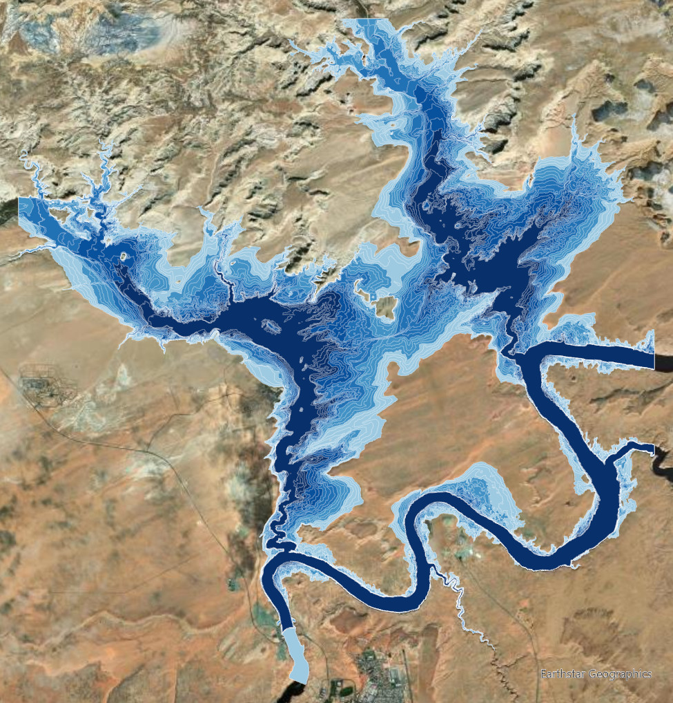
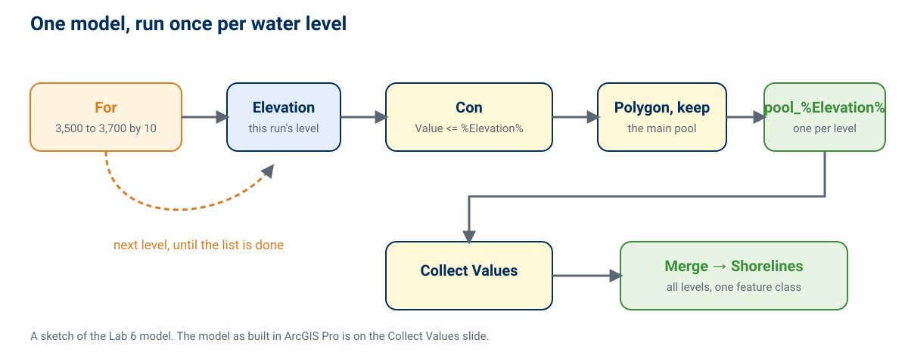
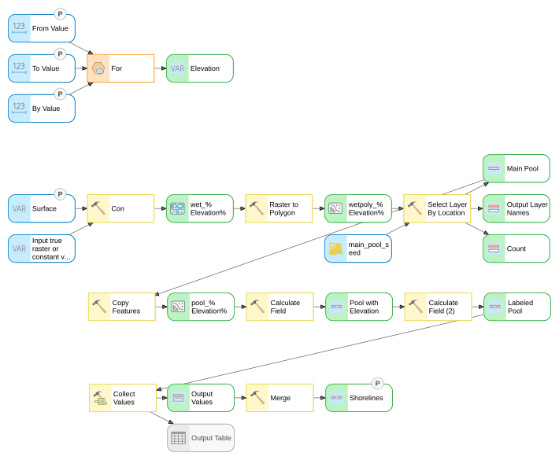
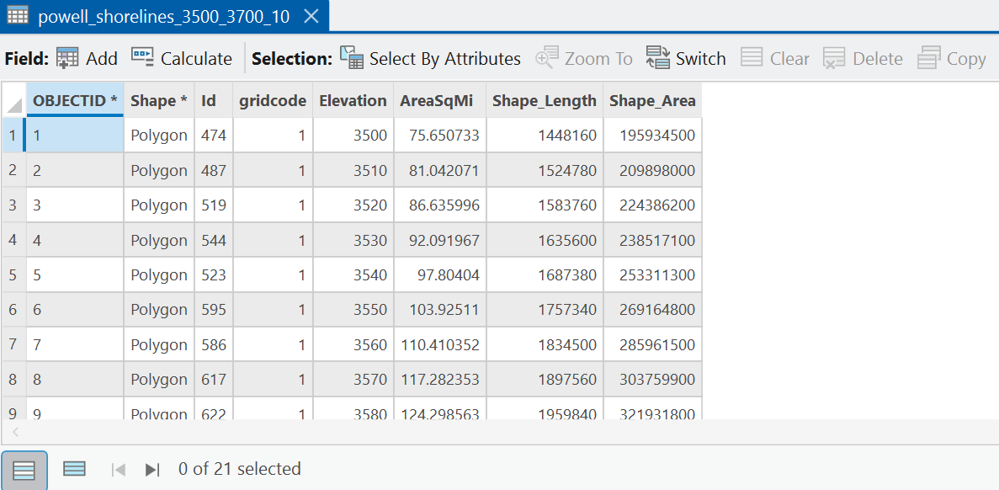
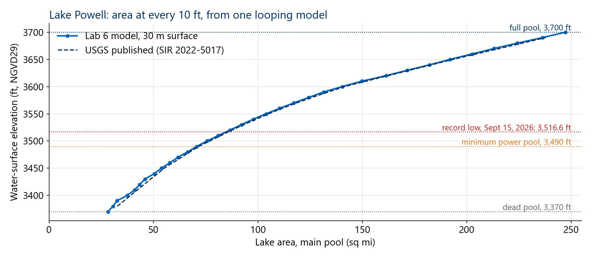
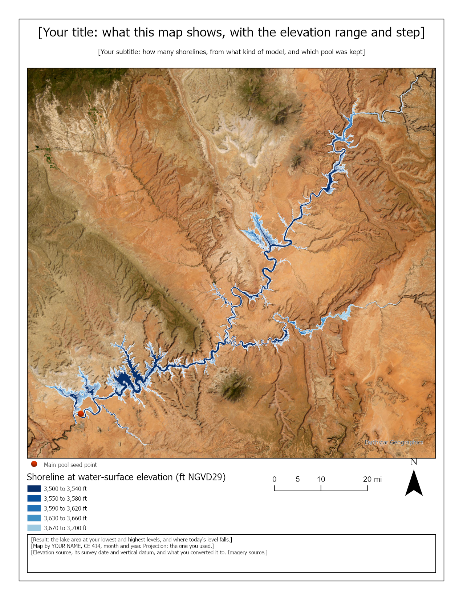

<!-- _class: lead -->
<!-- _paginate: skip -->

# Lake Depth Explorer

## Part B — Looping in ModelBuilder, and Lab 6 at Lake Powell

CE 414 Engineering Applications of GIS
Civil & Construction Engineering
Brigham Young University
Dr. Dan Ames

<!-- Thursday of Week 7. Tuesday gave the lake, its bathymetry, the datum, and the elevation-area-volume table. Today: a ModelBuilder model that runs once per water level instead of once, and Lab 6, which uses it on Lake Powell. The lab is Lake Powell, not the Great Salt Lake: Powell is one connected pool behind a dam, so the main-pool step works cleanly; the Great Salt Lake's railroad causeway splits it in two below about 4,200 ft. The title image is the Lab 6 default run on the 10 m Wahweap close-up: 21 shorelines, 3,500 to 3,700 ft. Slides marked "ArcGIS Pro screenshot to come" are placeholders: they are captured from the real Lab 6 model once the DEM extract is built. Until then, demo live. -->

<!-- stamp:begin -->
<!-- _footer: 'CE 414 · Week 7 — Lake Depth ExplorerLast Updated: 2026-10-14© 2026 Daniel P. Ames · <a href="https://creativecommons.org/licenses/by/4.0/">CC BY 4.0</a>' -->
<!-- stamp:end -->

---

<!-- _footer: "" -->

<!-- Announcement: BYU Student Innovator of the Year. Students compete for a share of $50k in prizes to develop their ideas. Apply by November 1 at sioy.byu.edu (redirects to engineering.byu.edu/sioy). The QR code on the flyer goes to the same page. -->

---

# Today's Goals

By the end of class you should be able to:

- Read every oval and loose end in the Lab 6 model and say what it is for
- Run the model from its **tool dialog** at any range and step
- Run it at **your own five levels**, worked out from your BYU ID
- Say exactly what the **Lab 6** report and its two maps contain

---

# Reading the Model: Labels, Values and the Missing Line

- **One model, not two.** No line runs from `Elevation` to `Con` because `%Elevation%` sits *inside* Con's text. An iterator drives every tool, drawn or not
- An oval has a **label** (what you see) and a **value** (the path). `%name%` in a value is filled from the oval whose *label* is `name`
- **For counts; the other iterators read** a list that already exists

<!-- From Tuesday's build questions. The top block and the bottom block look like two models because ModelBuilder draws a connector only when a whole variable is plugged into a parameter; a %Elevation% inside an expression or an output name is a hidden reference. The demo copy has a dashed precondition line from Elevation to Con to make the dependency visible; it changes nothing about how the model runs. Rename the For output away from "Elevation" and every %Elevation% stops resolving; rename pool_%Elevation% to "Pool" and nothing breaks, because the label was never what the tool used. -->

---

# Reading the Model: Loose Ends and the Loop

- **Count** and **Output Layer Names** dangle: derived outputs we do not use. Count should read **1** every pass
- **Two Calculate Fields:** the loop's `Elevation`, then `AreaSqMi` from the geometry
- **Collect Values** appends one *path* per pass; **Output Values** is the list; **Output Table** is a receipt
- **Merge** runs every pass; the last pass leaves all the levels
- **main_pool_seed** answers "which puddle is the lake"

<!-- Count = 1 is the check that the seed touched exactly one polygon; 0 means the seed went dry and that level writes an empty feature class. Output Values holds paths, not data: after pass 3 it reads pool_3370; pool_3380; pool_3390. Merge takes that list through its Input Datasets parameter (drag a connector from Output Values and choose Input Datasets; the dropdown will not offer it). The seed sits on the lake bed about 2 km above the dam at roughly 3,191 ft, under water at every level in the lab; Con floods several hundred closed hollows per level (460 to 810 polygons at the personal-run levels), and Select Layer By Location keeps the one that touches the seed. This is why Powell and not the Great Salt Lake: the causeway splits that lake below about 4,200 ft. -->

---

# What One Run Gives You

- **Shorelines** — one polygon per level, each with its **Elevation** and its **AreaSqMi**: 21 rows at the default range

<!-- The attribute table of powell_shorelines_3500_3700_10 from the GUI-built model (October 2, 2026): 75.65 sq mi at 3,500 ft, 103.93 at 3,550, the same as the arcpy run on the slide after next. A full run took about 4.5 minutes in ModelBuilder on the build machine. -->

---

# Lab 6 at a Glance: One Model, Two Runs

- **Run 1:** From **3370**, To **3710**, By **10** — dead pool to above full pool, **35 levels**, about eight minutes
- **Run 2:** your own **five levels** from your BYU ID
- **Two maps:** the whole lake from Run 1; your five levels close up from Run 2
- **Report:** the model, three metadata values, both runs' tables, History capture, two short observations

[Lab 6 — Lake Depth Explorer](https://byu-hydroinformatics.github.io/ce414-gis-applications/assignments/lab-06/)

<!-- Simplified October 13, 2026: no shore features, no range-and-step experiments, no checks against named points. Two runs of the same model and a map of each. The map is the default run on the 10 m Wahweap close-up. Debug on a three-level loop (Step 6) before Run 1; a full 35-level run takes about eight minutes in ModelBuilder. Tuesday's datum lesson comes back here: skip Step 1 and every cell (955-1,441) is below 3,370, so the whole surface floods at every level. -->

---

# Run 1: Dead Pool to Above Full Pool

- **3,370 ft** dead pool: **28.19 sq mi**, 11 % of the lake · **3,500 ft**: 75.65 · **3,700 ft** full pool: **247.36**
- Row by row: about **half a square mile per foot** at the bottom, **more than one** near the top. Glen Canyon is narrow below, wide above

<!-- Blue: the model run in arcpy on the 30 m surface, 3,370 to 3,700 ft by 10 (tools/lab06). Dashed: the USGS published areas from the area-capacity data release behind SIR 2022-5017 (doi:10.5066/P9O3IPG3). Check values: 75.65 sq mi at 3,500 ft (USGS 76.65), 140.37 at 3,600 (141.54), 247.36 at 3,700 (248.82); 1.3-6.8 % low from 3,490 down to 3,370 where the pool is mostly narrow canyon. The model runs low because 30 m cells drop narrow canyon arms and Step 4 drops arms the coarse cells disconnect. The lab asks for the three check values and a two-sentence observation on area per foot, nothing more. -->

---

# Run 2: Your Five Levels

- **E = 3,450 + 2 × (last two digits of your BYU ID)** — the nine-digit number on the card, not your NetID
- Run From **E**, To **E + 40**, By **10** → five levels; name it `powell_shorelines_mine_E`
- Report the five rows: **Elevation**, **AreaSqMi**, **Shape_Length** — from *your* run; they are checked against a run at your levels
- ID ending **89** → E = 3,628: 3628 to 3668 · ending **02** → E = 3,454: 3454 to 3494

<!-- Every set lies between 3,450 and 3,688 ft, inside Run 1's range: five rows that are a finer look at one stretch of the same curve. The grader has the areas and shoreline lengths for all 100 possible sets; the shoreline length is the number that cannot be interpolated from any published table, which is why it is asked for. Map 2 is these five levels zoomed to a part of the lake where they visibly differ, each level labeled. -->

---

# Lab 6: What the Grader Verifies

- **Run 2's five rows** match a run at your levels
- **Model figure** exported from **ModelBuilder**, not a screen capture
- **Three files:** the report + **each map as an ArcGIS Pro layout PDF**, vector, text selectable
- **Proof it ran:** a **Geoprocessing History** capture showing both runs
- **The example maps' words are brackets** on purpose; yours are yours
- An AI-made figure or map, or a number no run produced: **zero** for that part, and an AI-policy referral

<!-- Why: Lab 5 showed three ways AI stands in for the work. Published check values make an invented number look real; the example map is a reference image an image generator can repaint; and nothing in a report proves ArcGIS Pro ran. A layout PDF is vector: selectable text, real geometry, an ArcGIS Pro producer string. History is cheap to capture and hard to fake. The AI policy is unchanged: use AI to understand a tool, fix an error, or tighten writing; not to run the lab, make the figures, or supply the numbers. -->

---

<!-- _class: activity -->

# In Class Activity — Run It Live

- Open your model from the **Catalog** pane and run it at **three levels** around this fall's record low: From 3510, To 3530, By 10
- Open the output's **attribute table**: three rows, `Elevation` and `AreaSqMi` filled in
- Screen-capture the map with the three shorelines for Learning Suite

<!-- Students built the model after Tuesday (Steps 0-6). Three levels of the full model run in well under a minute on either surface. If a model is not finished, pair up. Without the Select Layer By Location step the polygons include every pothole below the level: show Count on the demo copy. Data: the Lab 6 package, docs/data/lab06-powell-data.zip. TODO(instructor): create the matching Learning Suite activity. -->

---

<!-- _class: activity -->

# Before You Leave

**Quiz: Lake Depth Explorer.** Five questions on iterators and %Value%. **Scan the code**, or open the link under it.

- Not graded, though similar questions may appear on the midterm
- Note the critical output-name question: if you get it wrong, outputs are overwritten

**Before next class**

- **[Lab 6](https://byu-hydroinformatics.github.io/ce414-gis-applications/assignments/lab-06/)** due **Saturday, October 17**
- Next week: **flood mapping** for Lab 7, and **Midterm 1** in the Testing Center ([study guide](https://byu-hydroinformatics.github.io/ce414-gis-applications/study-guides/midterm-1/))
- Office hours: [calendly.com/dan-ames/office-hours](https://calendly.com/dan-ames/office-hours)

byu-hydroinformatics.github.io/ce414-gis-applications/quizzes/iterators/

<!-- Quiz and "before next class" share one closing slide (October 15, 2026) so students read both while packing up. Four minutes, in pairs, then a show of hands on the output-name item. If the room has no signal, put the URL on the board. -->

<!-- Week 7 decks drafted October 1, 2026; Thursday reworked the same night for Lab 6 at Lake Powell (lecture stays on the Great Salt Lake). Powell figures: tools/week07_powell_figures.py and tools/lab06/build_figures.py. Figures: tools/week07_figures.py (USGS gage, USGS EAV table, hydromap shorelines, HydroShare cross-section, ArcGIS Pro maps) and tools/week07_diagrams_svg.py (drawn diagrams and the screenshot placeholders, lb-todo-*.svg). The Thursday deck's lb-todo-*.svg placeholders were replaced on October 2, 2026 with captures from the Lab 6 GUI build (lb-iterators-menu, lb-for-dialog, lb-con-dialog, lb-full-model, lb-run-result; originals in C:\Ames\Lab06GUI\caps); lb-todo-dem.svg on the Tuesday deck is still a placeholder. -->
