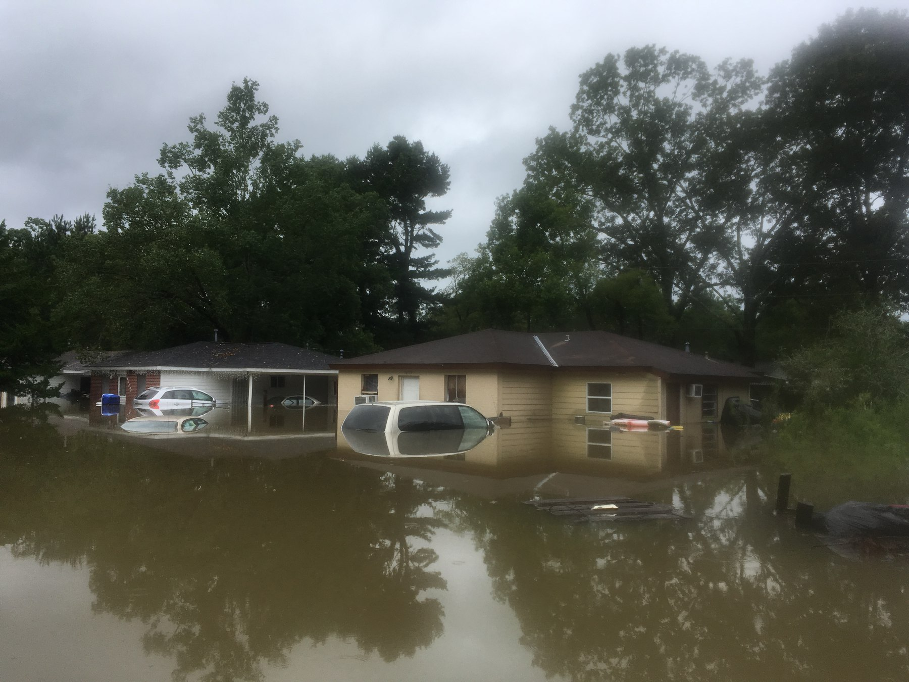
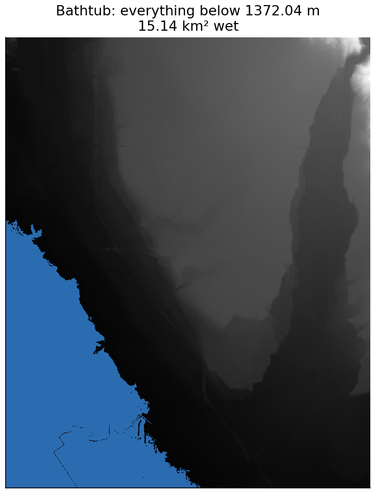
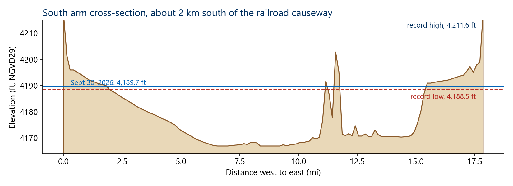
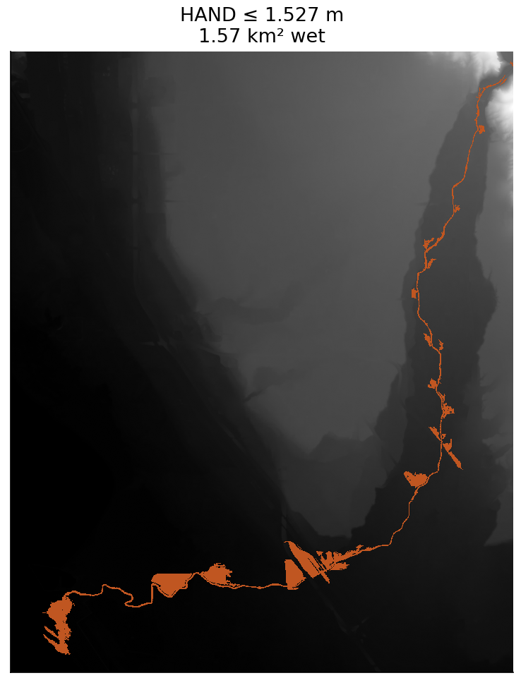
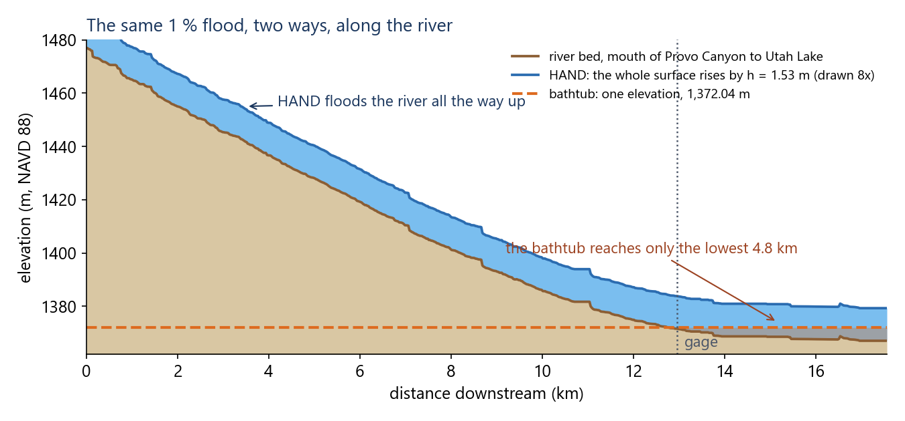
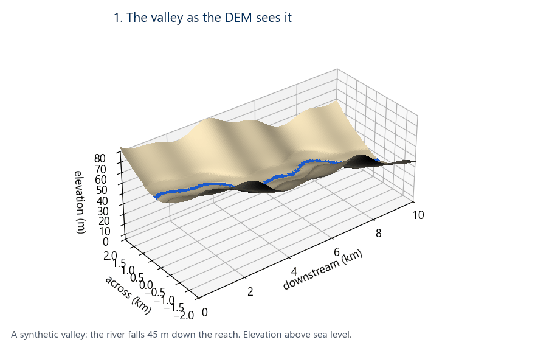
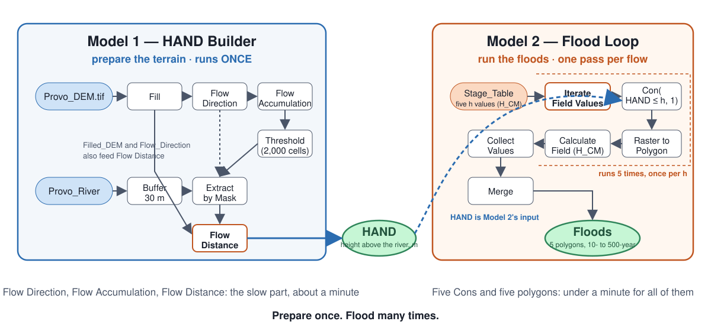
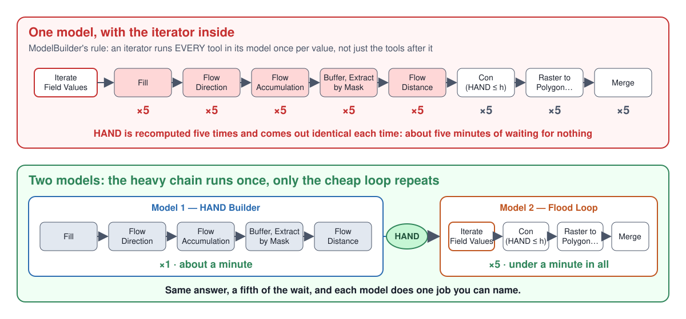
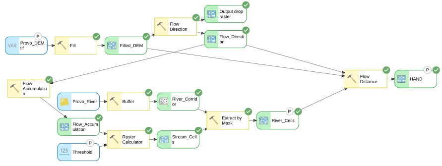
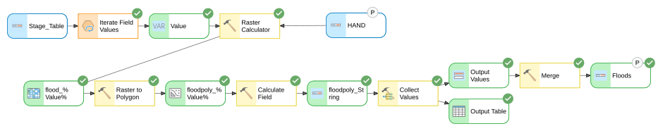

<!-- _class: lead -->
<!-- _paginate: skip -->

# Flood Mapping

## Part A — From a Flow to a Flooded Map: Bathtub and Inundation Models

CE 414 Engineering Applications of GIS
Civil & Construction Engineering
Brigham Young University
Dr. Dan Ames

<!-- Tuesday of Week 8, the third of the water weeks: Lab 5 found where the water goes, Lab 6 measured how much a lake holds, and this week asks how high a river rises and what it covers. Today is the hydrology and the simplest flood model; Thursday is HAND and the rest of Lab 7. Lab 7 opens today and is due Saturday: its Step 1, each student's own flow turned into a gage height and h from the rating, needs only today's material, so point them at it before Thursday. Midterm 1 is open in the Testing Center all week. The title image is three of FEMA's own cross-sections of the Provo River in Provo, with the 1% water surface over the lidar ground. -->

<!-- stamp:begin -->
<!-- _footer: 'CE 414 · Week 8 — Flood Mapping, Part ALast Updated: 2026-10-19© 2026 Daniel P. Ames · <a href="https://creativecommons.org/licenses/by/4.0/">CC BY 4.0</a>' -->
<!-- stamp:end -->

---

# Today's Goals

By the end of class you should be able to:

**Two hydrology ideas**

- Say what a **100-year flood** is, and what it is not
- Say what a **FEMA flood map** claims, and how FEMA makes one

**The rest is GIS and data analysis**

- Turn a gage's **record** into a flow, a **water level** and a **depth**
- Draw a **bathtub** flood map with one Con, and say when it is the right model
- Say why **Lab 7 is two models**, and what passes between them

<!-- Photo: a flooded neighborhood near the confluence of the Comite and Amite Rivers, Denham Springs, Louisiana, August 13, 2016 (U.S. Geological Survey, public domain). The split in the goals is deliberate: students have said the course leans on hydrology, so name the two hydrology ideas (a return period and what FEMA asserts) and show that everything else today is data handling and map making. Each of the five is a slide or two. -->

---

<!-- _class: lead -->

# Part 1 — Flood Maps, and How Big a Flood Is

---

# FEMA's Flood Maps Are GIS

- Since the 1970s FEMA has mapped flood hazard for the **National Flood Insurance Program**: the **Flood Insurance Rate Map**, FIRM
- Paper panels, then digital **DFIRM** databases, now the **National Flood Hazard Layer**: a live GIS service
- Every zone is a **return period**: **AE** is the 1%-annual-chance (100-year) floodplain; shaded X the 0.2%
- Utah County's new map: effective **June 23, 2026**. Lab 7's FEMA layer is cut from it

<!-- The image is a scanned paper FIRM panel (Library of Congress, public domain), the kind of sheet a lender or city planner read by hand before the maps went digital. Congress created the NFIP in 1968 and required countywide FIRMs in 1973; FEMA took the program over in 1979, prototyped a digital FIRM in the 1990s and converted the paper inventory from 2005 on (Map Modernization); the NFHL is the live product and is what the Lab 7 package queried for FEMA_Floodplain_1pct and FEMA_Cross_Sections. The point for a GIS class: a flood map is a polygon layer with a zone attribute, and every zone boundary is a claim about a return period. Which raises the question the next slides answer: what is a return period, and where does the number come from? -->

---

# What a Gage Measures

- A **stream gage** measures **stage**, the water level, about every **15 minutes**
- The reading goes by **satellite telemetry** to a USGS database the same hour; you can watch it live
- Stage becomes **flow** through a rating curve (Part 2); flows become **daily means** and, once a year, the **annual peak**
- **Provo River at Provo**, USGS 10163000: record since **1903**

<!-- Photo: a USGS streamgage on the South Fork of the Ogden River near Huntsville, Utah, one of 25 Utah gages that have run for a century (USGS, public domain). The shelter houses the stage sensor, the data logger and the antenna. Most USGS gages record stage every 15 minutes and transmit hourly through the GOES satellite system to NWIS; the Lab 7 page links the live page for 10163000. What a gage does NOT measure directly is flow: that is the rating, next part. The annual peak series is the one number a year that flood frequency is built from, next slide. -->

---

# One Number a Year

- From every year's record, keep the **largest flow**: the **annual peak**
- **Provo River at Provo**: **90** annual peaks, 1903 to 2024
- The record: **2,520 ft³/s** in 1952
- Every peak is flagged **regulated**: dams upstream shape every flood

<!-- Real NWIS peak series (code 6 on every peak: discharge affected by regulation or diversion). The gaps are years with no record. Point at 1983 and 1952: two years above FEMA's 1% flow, which is the next slide's puzzle. Data: the Lab 7 package, peaks_10163000.csv; figure from tools/week08_flood_figures.py. -->

---

# A 100-Year Flood Is a Probability

- **1% chance every year**, not "once a century" — FEMA says **1% annual chance**
- Over a 30-year mortgage: 1 − 0.99³⁰ ≈ **26%** chance of at least one
- FEMA's flows for this reach: **1,475 · 1,810 · 2,065 · 2,325 · 2,935 ft³/s** for 10%, 4%, 2%, 1%, 0.2%

<!-- Blue: the 90 annual peaks ranked and plotted at (n+1)/rank, the simplest empirical return period. Orange: FEMA's published flows for the Provo River "3 miles above tie-in to Utah Lake", Utah County Flood Insurance Study, Table 9 (49049CV001B): the five flows Lab 7 floods. Ask the room why two measured years sit above FEMA's 1% flow. Answers worth hearing: short records, regulation, a fitted distribution versus the raw ranks. A simple Log-Pearson III fit to this gage's own peaks since 1993 gives about 3,111 ft³/s for the 1% flow (tools/lab07, labeled a teaching approximation, not Bulletin 17C), 34% above FEMA's; two defensible "100-year floods" can differ that much. This is for class discussion only: Lab 7 uses FEMA's flows and does not ask it. -->

---

# A Pair of Sixes

* 

* **What is the chance of rolling a pair of sixes?**
* **Will it happen every 36 rolls?**
* **Can it happen twice in a row?**
* A 100-year flood is a pair of sixes on a **100-sided** die: **1 in 100**, every year, with no memory of last year

<!-- Each line appears on a click (press the right arrow). Let them answer before the next one. One in 36, about 2.8%. No: 36 rolls give about a 64% chance of at least one pair of sixes (1 − (35/36)^36), and many sets of 36 rolls have none. Yes: twice in a row is 1 in 1,296, rare but ordinary, and the second roll does not know about the first. Then the bridge: a 1% annual-chance flood is the same kind of statement, which is why Provo can have 1952 and 1983 in one lifetime and why a 30-year mortgage carries a 26% chance of seeing one. Dice drawn for this deck. -->

---

---

<!-- _class: lead -->

# Part 2 — From a Flow to a Water Level

---

# The River's Ruler

- A **staff gage** is a ruler fixed in the river; the gage's sensor reads the same number automatically
- The reading has three names that mean one thing: **stage** = **gage height** = **water level**
- What we want has three names too: **flow** = **discharge** = **Q**, in ft³/s
- A ruler gives you the first. How do you get the second?

<!-- Photo: a USGS staff gage, public domain (credit in the closing note). Say the synonyms out loud and write them on the board in two columns; the USGS pages, FEMA's study and the Lab 7 page use all six words, and students lose the thread when "stage" on one page becomes "gage height" on the next. The staff is graduated in hundredths of a foot; the electronic sensor in the shelter from the previous slide records the same quantity every 15 minutes and is checked against the staff on every visit. -->

---

# Same Reading, Two Rivers

* Both rulers read **4 ft**
* **What is the difference between the two streams?**
* The **channel**: its **cross-sectional area** sets how much water a 4-ft stage carries
* So each gage has its own **stage → discharge** relationship, measured in the field: the **rating curve**

<!-- Click through the lines. Let them answer the question before the third line appears: the answer is the size and shape of the channel, which a hydrologist summarizes as the cross-sectional area (and the velocity, which also grows with the river). Discharge is area times mean velocity; the USGS measures both by wading or from a bridge, many times across the range of stages, and fits the stage-discharge curve through those measurements. That curve is the rating, next slide. Diagram drawn for this deck; the flows are deliberately qualitative. -->

---

# The Rating Curve

- Each gage's own **stage → flow** curve, fitted through years of field measurements
- Provo's current rating: **3.42 to 8.00 ft**, **6.8 to 2,150 ft³/s**
- Read it backwards for a flood: **flow → stage**
- FEMA's **1% and 0.2% flows are off the top** of the rating: those stages are **extrapolations**

<!-- The USGS current rating for 10163000 (459 rows; the Lab 7 package, rating_10163000.csv). The dotted lines are FEMA's five flows; the 1% and 0.2% fall in the gray band beyond the last row, so Lab 7's stage table marks them extrapolated. Every student's own Lab 7 flow (900 to 2,088 ft³/s) is inside the table. A rating is built from field measurements, and floods are the hardest flows to measure, so the top of every rating is its least certain part. -->

---

# From Flow Back to Depth

- Every day the gage goes **stage → flow**
- For a flood we go the other way: a design **flow → stage → depth** above the river
- Provo's 1% flow, **2,325 ft³/s**, reaches **8.21 ft** on the ruler: a depth of **1.53 m**
- Then every cell with **HAND ≤ depth** is wet (Part 4). One flow in, one map out

<!-- Keep this one simple. The one subtlety is the 3.20 ft: a staff gage's zero is set below the bed so readings never go negative, so the depth of water above the river is the stage minus the reading the gage would show at zero flow (3.20 ft at Provo, from the rating's offset). Lab 7's stage table does this for FEMA's five flows and Step 1 has each student do it once for their own flow: h = (gage height − 3.20) × 0.3048 m. Not on the slide, for the curious: adding the gage datum (4,493.22 ft NAVD 88) to a stage gives a water-surface elevation, which is what the bathtub two slides on and FEMA's water surfaces use; Lab 7's metadata question asks students to find that datum on the gage page. Diagram drawn for this deck. -->

---

<!-- _class: lead -->

# Part 3 — Two Ways to Draw the Flood

---

# The Bathtub Model

- Pick **one water elevation**; every cell **below** it is wet
- Right for **lakes and coasts**: a lake's surface really is flat. Lab 6's Lake Powell shorelines were bathtubs
- One **Con** on the DEM: `Con("DEM" <= 1372.04, 1)`
- Raise the line a foot and the water spreads across whatever floor is a foot higher

<!-- Top right: every cell of the Lab 7 DEM at or below 1,372.04 m NAVD 88, the 1% water elevation at the Provo gage, ELEV_M in the Lab 7 Stage_Table: (4,493.22 + 8.21 ft) × 0.3048 (FEMA's 2,325 ft³/s, gage height 8.21 ft, extrapolated above the rating; tools/week08_flood_figures.py). Bottom right: the Great Salt Lake south-arm cross-section from last week, now filled to the September 30, 2026 level, with one more foot drawn above it: a flat line across a bowl, and the flat floor is why one foot of lake covers so much ground. That is the bathtub, and for a lake it is exactly right (Lab 6 at Lake Powell). Figure: tools/week08_profile_figure.py from last week's cross-section data. -->

---

# A River Is Not a Bathtub

- A river's surface **slopes downhill** with the water: the Provo drops **110 m** across the study area
- One flat elevation **drowns the lowland** by Utah Lake, **15.1 km²**, and **never reaches** the river above the gage
- What we want: the **whole water surface rises by h**, up and down a river that is itself changing elevation
- Measure every cell's **height above the river it drains to**, and a flood is "everything within h": that is **HAND**, next

<!-- Top right: HAND at the same 1% depth, 1.57 km², following the river to the canyon mouth (tools/week08_flood_figures.py). Bottom right: the river's long profile from the Lab 7 DEM (tools/lab07/profile.json, 1,477 to 1,367 m over 17.6 km). The dashed line is the bathtub at 1,372.04 m: it covers only the lowest 4.8 km, below the gage, and the big blue area on the left of the bathtub map is Utah Lake lowland, not river flood. The blue band is the HAND idea: the water surface raised by h everywhere along a sloping river; it is drawn eight times the real 1.53 m so that it shows at this scale. Ask: why not just pick a higher bathtub elevation to reach upstream? Because then the downstream end is under tens of meters of water. Part 4 builds the band from the DEM. -->

---

<!-- _class: lead -->

# Part 4 — HAND, and the Lab 7 Model

---

# Elevation Is Measured From the Wrong Place

- A flood cares how high you are **above the river**, not above **sea level**
- **HAND**: Height Above Nearest Drainage — the drop from a cell to the stream cell it **drains to**
- Every river cell has **HAND = 0**

<!-- The two cells make the point: A is far higher above sea level than B, yet both sit just above their own river. On a bathtub map B floods first; on a HAND map they flood together at the same depth. Diagram drawn for this deck, not to scale. -->

---

# Pull the River Down to Zero

- Take the terrain and its river, and **pull the river down to zero** everywhere
- The land goes with it: each cell is lowered by the elevation of **the river cell it drains to**
- What is left is **HAND**: a flat river, and every cell's **height above it**
- Now the bathtub works: **fill the flattened valley to h**, and the whole river floods at once

<!-- The animation loops: (1) a synthetic valley with a river falling 45 m down the reach, (2) the river pulled down to zero and the land with it, (3) the result, HAND, and (4) a flat water surface rising through it to h = 3 m. It is an equation, not a place: a straight valley where every cell drains straight across to the river, so HAND is simply elevation minus the bed elevation at the same distance downstream. On a real DEM the "river cell it drains to" comes from D8 flow direction, which is what Flow Distance follows, and that is the next two slides. This is the whole idea of the lab in one picture: Model 1 does the pulling down; Model 2 does the filling. tools/week08_hand_flatten_gif.py. -->

---
# HAND on the Provo River

- Left: elevation, **1,367 to 1,646 m**: a ramp toward the mountains
- Right: **HAND**, 0 to 198 m: the floodplain shows up as a **ribbon** along the river
- About **11%** of the cells are within **2 m** of the river

<!-- The Lab 7 package's HAND raster (697,608 cells). White cells do not drain to the mapped Provo River inside the study area, so they have no HAND; that is correct, not a bug, and students will see it. Elevation range from the filled DEM. Numbers: tools/week08_flood_numbers.json. -->

---
# How It Is Computed

- **Fill → Flow Direction → Flow Accumulation → streams**: Lab 5, then a **30 m river corridor**
- **Flow Distance**, distance type **Vertical**: HAND, down the path the water takes

<!-- The figure is Lab 7's HAND Builder model, exported from ModelBuilder after a run in the October 9, 2026 GUI build (the lab page's Figure C, lab07-model-hand.svg). Flow Distance (Spatial Analyst) with Vertical distance and D8 is HAND; checked in ArcGIS Pro 3.7.1's arcpy for the Lab 7 study (tools/lab07/PLAN.md). Two traps the study measured: running on the unfilled DEM leaves thousands of negative HAND cells, and defining "stream" as every cell above an accumulation threshold, with no river corridor, makes every gully a river (next slide). -->

---
# Prepare Once, Flood Many Times

- **Model 1, HAND Builder**: Lab 5's chain plus **Flow Distance** → one raster, **HAND**
- **Model 2, Flood Loop**: an **iterator** over the stage table floods that raster **once per flow**
- Model 1 is **data preparation**; Model 2 is the **experiment**
- The only thing that passes between them is **HAND**

<!-- The shape of the lab in one picture. Model 1 is the terrain work students already know from Lab 5 (Fill, Flow Direction, Flow Accumulation, a stream threshold), with one new tool, Flow Distance, which measures each cell's height above the river it drains to. It is run once and its product is the HAND raster. Model 2 takes HAND as an input parameter and, for each row of the stage table (the five FEMA flows turned into depths, H_CM in centimeters), runs Con("HAND" <= h, 1), turns the wet cells into a polygon, stamps the depth on it, and merges the five into one Floods layer. Students build both in Lab 7; the page's Steps 2 to 4 are Model 1, Step 5 is Model 2. Thursday goes deeper into how HAND is measured and how good it is. -->

---

# Why Not One Model?

- The rule: an iterator reruns **every tool in its model**, not just the ones after it
- One model → the whole HAND chain runs **five times** for **one** answer
- Two models → the slow chain runs **once**; only the cheap loop repeats

<!-- Lab 6 got away with one model because nothing upstream of its loop was expensive: its Merge ran on every pass, and the page said so and shrugged. Here the HAND chain is about a minute on a laptop, so five copies of it is five minutes of waiting for an identical raster each time, and longer on the lab machines. Esri's own guidance for this case is the one on the slide: put the loop in its own model. The more advanced form of the same idea is to drop Flood Loop into HAND Builder as a tool, so the outer model has no iterator and runs everything once; mention it, and that it is not required this week. Ask: which tools in Lab 7's chain would you least like to run five times? -->

---

# How the Two Models Connect

**HAND Builder** builds the pulled-down terrain. `HAND` is marked **P**: the product, a **raster** of 5 m cells holding each cell's **height above the river, in meters**. Nothing else leaves the model.

**Flood Loop** runs that raster through the loop. `HAND` is marked **P** here too: the input. The five depths are **not** parameters: **Iterate Field Values** reads them from the stage table, one row per return period. `Floods`, marked **P**, is the product: one polygon per depth.

- Unlike Lab 6's **For** loop, with From, To and By as parameters, this loop is **table-driven**: to flood at other depths, edit the table

<!-- Both exports are from the lab's GUI build, the same figures as the page's Figure C. The point to make: a model parameter is how a model talks to the outside. In Model 1 the P on HAND means "keep this and hand it out"; in Model 2 the P on HAND means "ask for this when I start". The Floods oval is Model 2's P, its product. HAND's data type matters for the report: a floating-point raster, 5 m cells, meters above the river, 697,608 cells with a value (the rest NoData, cells that do not drain to the mapped river). The depths come from Stage_Table's H_CM field (119, 134, 143, 153, 173 cm), so unlike Lab 6 there are no From/To/By parameters; a student who wants different depths edits or replaces the table (Lab 7's Step 7 floods the personal depth with a single Con instead). When students open Flood Loop from the Catalog pane, the dialog asks for HAND and Floods, nothing else; if HAND is not a layer in their map the box shows a red error, and the fix is to browse to Lab07.gdb\HAND. The run takes about 47 seconds from the dialog and is the one the History capture must show. -->

---
# One Threshold Floods the River

- From Part 2: flow → **gage height** → **depth h** above the river
- Flooded = **every cell with HAND ≤ h**: `Con("HAND" <= h, 1)`
- A different h for each **return period**: one **iterator**, as in Lab 6

<!-- The figure is the Flood Loop model's Raster Calculator in ArcGIS Pro (Lab 7, Figure 5b): Iterate Field Values hands each row's H_CM to %Value%, so the expression reads Con("HAND" <= %Value% / 100, 1) and each pass writes flood_%Value%. Centimeters because a name such as flood_1.53 is not allowed in a geodatabase. The stage table in Lab 7 does the flow-to-h step for FEMA's five flows (10%, 4%, 2%, 1% and 0.2%); students do the same lookup by hand for their own flow in Step 1. Raster to Polygon then gives an area and a polygon, and Spatial Join counts the buildings it touches. -->

---
# Lab 7 at a Glance

- **The reach**: the Provo River, **5 m lidar**, prepared for you
- **Two models, run once each**: **HAND**, then an **iterator** → five floods
- **The answer**: flooded area and **buildings**, for FEMA's flows and **your own**
- **The check**: your 1% flood against **FEMA's**: where they differ, and why

[Lab 7 — Flood Mapping with HAND](https://byu-hydroinformatics.github.io/ce414-gis-applications/assignments/lab-07/)

<!-- The figure is the lab page's example layout for Map 1 (Figure 8), made with arcpy.mp from the GUI build's Floods: the five floods nested, FEMA's 1% outline, the gage. Its wording is bracketed placeholders on purpose; point out that the floods are thin at this scale, which is why the rubric wants the return periods labeled or a close-up. One-week lab during Midterm 1 week, so the data come prepared: DEM, river line, buildings, FEMA floodplain and the stage table are in the package. Two models: one builds HAND, one loops Iterate Field Values over the stage table (an iterator reruns every tool in its model). Each runs once; then three tools from the Geoprocessing pane flood the river at the student's own flow. No threshold reruns and no skill-score computation: the hit rate, false-alarm ratio and CSI are given on the page as data, and the report explains them and finds one place where HAND and FEMA disagree. Check values on the page: river 3,191 cells, HAND 697,608 cells; floods from 1.29 km² and 319 buildings (10-yr) to 1.57 km² and 413 buildings (100-yr). Deliverables: two layout PDFs, a two-page report, the .atbx, a History capture. -->

---
# Your Own Flow

> **Your flow = 900 + 12 × (last two digits of your BYU ID) ft³/s**

- BYU ID `123456789` → **89** → 900 + 12 × 89 = **1,968 ft³/s**
- The **nine-digit number on your BYU ID card**, not your NetID
- Every personal flow is **inside the rating**: no extrapolation
- At 1,968 ft³/s: **7.78 ft**, *h* = **1.396 m**, **376 buildings** (right)

<!-- The figure is the lab page's example layout for Map 2 (Figure 9), drawn at the example ID's flow: 1,968 ft³/s, 7.78 ft, h = 1.396 m, 1.4548 km², 376 buildings, the lab's Step 7 check values. Its main frame shows the whole reach with a close-up inset, which the lab calls the weaker choice: the student's main frame should be zoomed to the buildings. Range 900 to 2,088 ft³/s, all below the rating's top row of 2,150 ft³/s. The grader looks up each student's h, area and building count (ce414-private/grading-oracles/lab07_personal_lookup.csv). -->

---

<!-- _class: activity -->

# Final Thoughts

**Quiz: How Big, How High?** Five questions on return periods, rating curves, depth and bathtubs. **Scan the code**, or open the link under it.

- Not graded, nothing recorded: a quick check that today's material made sense
- Most people miss the mortgage question

**Before next class**

- **Midterm 1** — in the Testing Center, open through **Thursday 9:00 pm**
- **Lab 7 — Flood Mapping with HAND** — due **Saturday 11:59 pm**: do **Step 1**, your own flow from the rating, now — [Lab 7](https://byu-hydroinformatics.github.io/ce414-gis-applications/assignments/lab-07/)
- Look up a stream gage near your home on the USGS map: what is its largest flow on record?
- Office hours: [calendly.com/dan-ames/office-hours](https://calendly.com/dan-ames/office-hours)

byu-hydroinformatics.github.io/ce414-gis-applications/quizzes/floods/

<!-- Four minutes, in pairs. If the room has no signal, put the URL on the board. -->

<!-- Deck written October 9, 2026, for the restructured Week 8 (tools/build_schedule.py). Figures: tools/week08_flood_figures.py (peaks, frequency, rating, FEMA sections, HAND map) and the drawn diagram fl-hand-schematic.svg (fl-gage-datum.svg was retired October 19, 2026, with the gage-height-versus-depth slide; fl-two-channels.svg and fl-flow-to-depth.svg, drawn the same day, replace it). Part 4 (three slides on the two-model design) added October 19, 2026, after the Lab 7 cut: fl-two-models.svg and fl-why-two-models.svg are hand-drawn; fl-model-hand.svg and fl-model-floodloop.svg are copies of the Lab 7 page's Figure C exports (docs/assignments/lab-07/images/lab07-model-*.svg). Timings in the notes: HAND chain about a minute on a laptop (lab page), Flood Loop 47 s from its dialog (GUI session of October 19). Opening slides revised October 19, 2026, at the instructor's request: goals split into hydrology and GIS, a FEMA-maps slide and a gage slide added, a dice slide after the probability slide (fl-dice.svg drawn). Photos, all public domain, downscaled and stripped of EXIF: fl-flood-photo.jpg, USGS "Flooded Neighborhood in Denham Springs" (Office of Communications, August 13, 2016, usgs.gov/media/images/flooded-neighborhood-denham-springs); fl-gage-photo.jpg, USGS "Utah Gauge Celebrates 100 Years of Monitoring Streamflow", South Fork Ogden River near Huntsville, station 10137500 (March 16, 2021, usgs.gov/media/images/utah-gauge-celebrates-100-years-monitoring-streamflow); fl-firm-paper.jpg, FEMA Flood Insurance Rate Map and street index, Borough of Carteret, New Jersey, panel 340257 0005 B, revised April 15, 1992, Library of Congress G3814.C3G475 1992 .U5 via Wikimedia Commons, cropped to the map, legend and title block; fl-staff-gage.jpg, USGS "USGS staff gage measuring the height of the water in the Carson River" near Brunswick Canyon, Nevada (USGS Nevada Water Science Center, February 11, 2017, usgs.gov/media/images/usgs-staff-gage-measuring-height-water-carson-river). Later the same day: the ruler, two-rivers and flow-to-depth slides (fl-two-channels.svg, fl-flow-to-depth.svg drawn; the gage-height-versus-depth slide and fl-gage-datum.svg retired); the bathtub and river slides gained diagrams under the maps (fl-bathtub-map.png and fl-hand-map-panel.png are crops of fl-bathtub-vs-hand.png, fl-river-profile.png is from tools/week08_profile_figure.py and tools/lab07/profile.json, fl-lake-bathtub.png is last week's Great Salt Lake south-arm cross-section, slides/week-07/images/lb-cross-section.png, unchanged because its source data lived in a scratch folder that is gone); the whole Lab 7 model moved here from the Thursday deck (Elevation Is Measured From the Wrong Place, HAND on the Provo River, How It Is Computed, One Threshold Floods the River, Lab 7 at a Glance, Your Own Flow), and the FEMA hydraulics slide moved the other way as Thursday's methods ladder; fl-two-models.svg is now drawn by tools/week08_two_models_svg.py with the lab pages' tool icons inlined. -->
