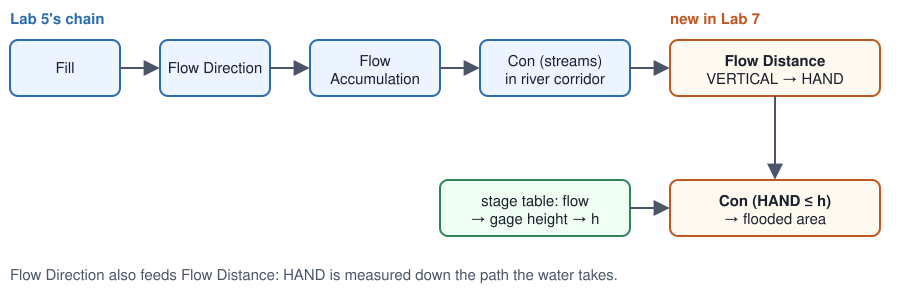
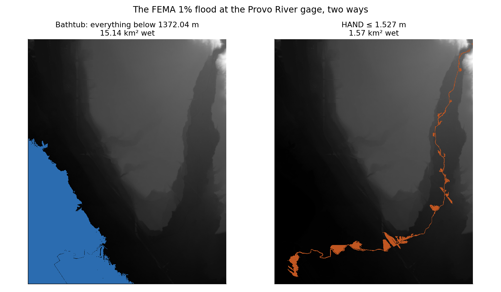
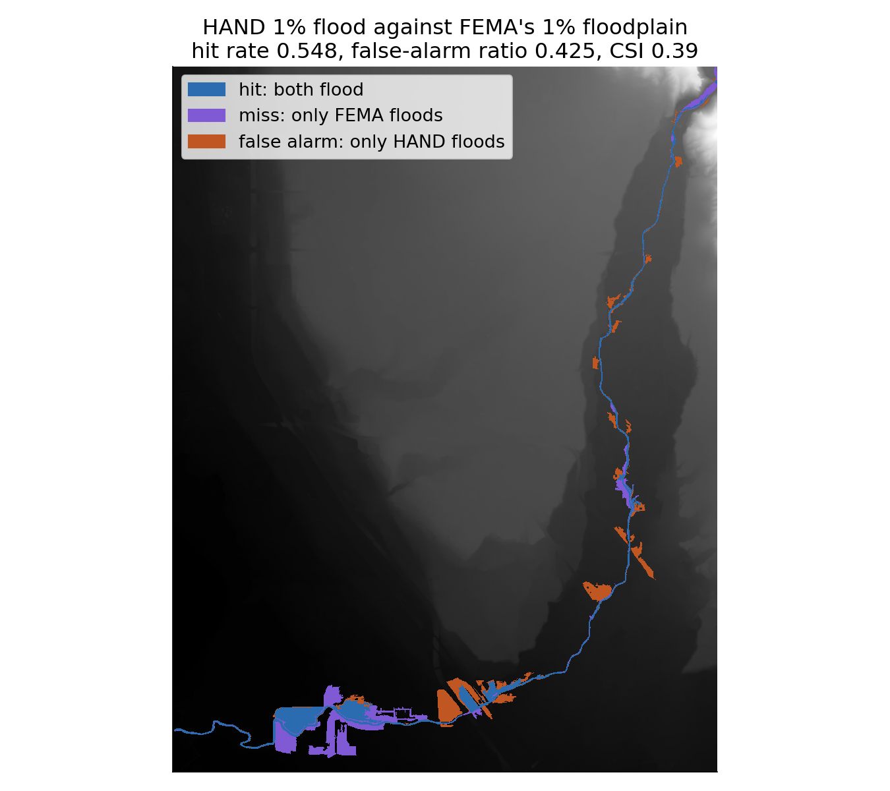
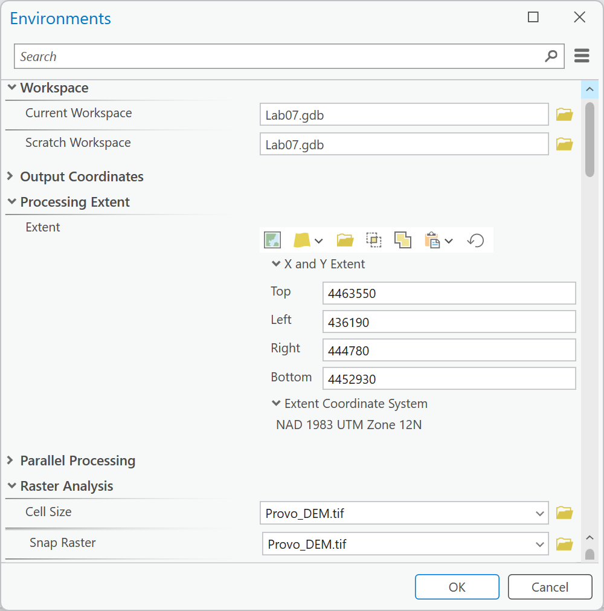
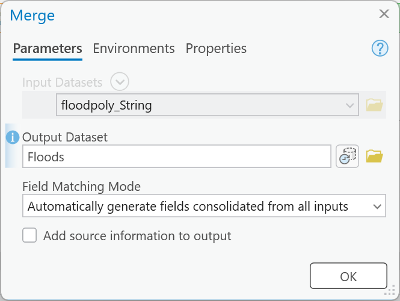

<!-- _class: lead -->
<!-- _paginate: skip -->

# Flood Mapping

## Part B — Flood Frequency, FEMA's Maps, Other Methods, and Lab 7 in ModelBuilder

CE 414 Engineering Applications of GIS
Civil & Construction Engineering
Brigham Young University
Dr. Dan Ames

<!-- Thursday of Week 8. Tuesday ended on the bathtub's failure on a river and FEMA's expensive fix. Today: a terrain-only model that floods a whole river with one number, built from Lab 5's own chain plus one tool, and Lab 7, which does it on the Provo River and checks the answer against FEMA's new map. -->

<!-- stamp:begin -->
<!-- _footer: 'CE 414 · Week 8 — Flood Mapping, Part BLast Updated: 2026-10-19© 2026 Daniel P. Ames · <a href="https://creativecommons.org/licenses/by/4.0/">CC BY 4.0</a>' -->
<!-- stamp:end -->

---

# Today's Goals

By the end of class you should be able to:

- Say what a **100-year flood** is, and what a **FEMA flood map** claims
- Turn a gage's **reading** into a **flow**, and a flood flow back into a **depth**
- Score a flood map against another: **hit rate, false alarms, CSI**, and say where **HAND breaks**
- Place HAND among the **ways to draw a flood**, from a bathtub to 2-D hydraulics
- Build Lab 7's two models **without the traps**

<!-- Tuesday taught HAND and the model and started the lab; today is the rest of the hydrology, how good the cheap method is and what the expensive ones add, and the ModelBuilder details students hit between now and Saturday. Midterm 1 closes tonight. -->

---

<!-- _class: lead -->

# Part 1 — How Big Is the Flood?

---

# One Number a Year

- From every year's record, keep the **largest flow**: the **annual peak**
- **Provo River at Provo**: **90** annual peaks, 1903 to 2024
- The record: **2,520 ft³/s** in 1952
- Every peak is flagged **regulated**: dams upstream shape every flood

<!-- Real NWIS peak series (code 6 on every peak: discharge affected by regulation or diversion). The gaps are years with no record. Point at 1983 and 1952: two years above FEMA's 1% flow, which is the next slide's puzzle. Data: the Lab 7 package, peaks_10163000.csv; figure from tools/week08_flood_figures.py. -->

---

# A 100-Year Flood Is a Probability

- **1% chance every year**, not "once a century" — FEMA says **1% annual chance**
- Over a 30-year mortgage: 1 − 0.99³⁰ ≈ **26%** chance of at least one
- FEMA's flows for this reach: **1,475 · 1,810 · 2,065 · 2,325 · 2,935 ft³/s** for 10%, 4%, 2%, 1%, 0.2%

<!-- Blue: the 90 annual peaks ranked and plotted at (n+1)/rank, the simplest empirical return period. Orange: FEMA's published flows for the Provo River "3 miles above tie-in to Utah Lake", Utah County Flood Insurance Study, Table 9 (49049CV001B): the five flows Lab 7 floods. Ask the room why two measured years sit above FEMA's 1% flow. Answers worth hearing: short records, regulation, a fitted distribution versus the raw ranks. A simple Log-Pearson III fit to this gage's own peaks since 1993 gives about 3,111 ft³/s for the 1% flow (tools/lab07, labeled a teaching approximation, not Bulletin 17C), 34% above FEMA's; two defensible "100-year floods" can differ that much. This is for class discussion only: Lab 7 uses FEMA's flows and does not ask it. -->

---

# A Pair of Sixes

* 

* **What is the chance of rolling a pair of sixes?**
* **Will it happen every 36 rolls?**
* **Can it happen twice in a row?**
* A 100-year flood is a pair of sixes on a **100-sided** die: **1 in 100**, every year, with no memory of last year

<!-- Each line appears on a click (press the right arrow). Let them answer before the next one. One in 36, about 2.8%. No: 36 rolls give about a 64% chance of at least one pair of sixes (1 − (35/36)^36), and many sets of 36 rolls have none. Yes: twice in a row is 1 in 1,296, rare but ordinary, and the second roll does not know about the first. Then the bridge: a 1% annual-chance flood is the same kind of statement, which is why Provo can have 1952 and 1983 in one lifetime and why a 30-year mortgage carries a 26% chance of seeing one. Dice drawn for this deck. -->

---

# FEMA's Flood Maps Are GIS

- Since the 1970s FEMA has mapped flood hazard for the **National Flood Insurance Program**: the **Flood Insurance Rate Map**, FIRM
- Paper panels, then digital **DFIRM** databases, now the **National Flood Hazard Layer**: a live GIS service
- Every zone is a **return period**: **AE** is the 1%-annual-chance (100-year) floodplain; shaded X the 0.2%
- Utah County's new map: effective **June 23, 2026**. Lab 7's FEMA layer is cut from it

<!-- The image is a scanned paper FIRM panel (Library of Congress, public domain), the kind of sheet a lender or city planner read by hand before the maps went digital. Congress created the NFIP in 1968 and required countywide FIRMs in 1973; FEMA took the program over in 1979, prototyped a digital FIRM in the 1990s and converted the paper inventory from 2005 on (Map Modernization); the NFHL is the live product and is what the Lab 7 package queried for FEMA_Floodplain_1pct and FEMA_Cross_Sections. The point for a GIS class: a flood map is a polygon layer with a zone attribute, and every zone boundary is a claim about a return period. Which raises the question the next slides answer: what is a return period, and where does the number come from? -->

---

<!-- _class: lead -->

# Part 2 — From a Gage to a Depth

---

# What a Gage Measures

- A **stream gage** measures **stage**, the water level, about every **15 minutes**
- The reading goes by **satellite telemetry** to a USGS database the same hour; you can watch it live
- Stage becomes **flow** through a rating curve (Part 2); flows become **daily means** and, once a year, the **annual peak**
- **Provo River at Provo**, USGS 10163000: record since **1903**

<!-- Photo: a USGS streamgage on the South Fork of the Ogden River near Huntsville, Utah, one of 25 Utah gages that have run for a century (USGS, public domain). The shelter houses the stage sensor, the data logger and the antenna. Most USGS gages record stage every 15 minutes and transmit hourly through the GOES satellite system to NWIS; the Lab 7 page links the live page for 10163000. What a gage does NOT measure directly is flow: that is the rating, next part. The annual peak series is the one number a year that flood frequency is built from, next slide. -->

---

# The River's Ruler

- A **staff gage** is a ruler fixed in the river; the gage's sensor reads the same number automatically
- The reading has three names that mean one thing: **stage** = **gage height** = **water level**
- What we want has three names too: **flow** = **discharge** = **Q**, in ft³/s
- A ruler gives you the first. How do you get the second?

<!-- Photo: a USGS staff gage, public domain (credit in the closing note). Say the synonyms out loud and write them on the board in two columns; the USGS pages, FEMA's study and the Lab 7 page use all six words, and students lose the thread when "stage" on one page becomes "gage height" on the next. The staff is graduated in hundredths of a foot; the electronic sensor in the shelter from the previous slide records the same quantity every 15 minutes and is checked against the staff on every visit. -->

---

# Same Reading, Two Rivers

* Both rulers read **4 ft**
* **What is the difference between the two streams?**
* The **channel**: its **cross-sectional area** sets how much water a 4-ft stage carries
* So each gage has its own **stage → discharge** relationship, measured in the field: the **rating curve**

<!-- Click through the lines. Let them answer the question before the third line appears: the answer is the size and shape of the channel, which a hydrologist summarizes as the cross-sectional area (and the velocity, which also grows with the river). Discharge is area times mean velocity; the USGS measures both by wading or from a bridge, many times across the range of stages, and fits the stage-discharge curve through those measurements. That curve is the rating, next slide. Diagram drawn for this deck; the flows are deliberately qualitative. -->

---

# The Rating Curve

- Each gage's own **stage → flow** curve, fitted through years of field measurements
- Provo's current rating: **3.42 to 8.00 ft**, **6.8 to 2,150 ft³/s**
- Read it backwards for a flood: **flow → stage**
- FEMA's **1% and 0.2% flows are off the top** of the rating: those stages are **extrapolations**

<!-- The USGS current rating for 10163000 (459 rows; the Lab 7 package, rating_10163000.csv). The dotted lines are FEMA's five flows; the 1% and 0.2% fall in the gray band beyond the last row, so Lab 7's stage table marks them extrapolated. Every student's own Lab 7 flow (900 to 2,088 ft³/s) is inside the table. A rating is built from field measurements, and floods are the hardest flows to measure, so the top of every rating is its least certain part. -->

---

# From Flow Back to Depth

- Every day the gage goes **stage → flow**
- For a flood we go the other way: a design **flow → stage → depth** above the river
- Provo's 1% flow, **2,325 ft³/s**, reaches **8.21 ft** on the ruler: a depth of **1.53 m**
- Tuesday's HAND: every cell with **HAND ≤ depth** is wet. One flow in, one map out

<!-- Keep this one simple. The one subtlety is the 3.20 ft: a staff gage's zero is set below the bed so readings never go negative, so the depth of water above the river is the stage minus the reading the gage would show at zero flow (3.20 ft at Provo, from the rating's offset). Lab 7's stage table does this for FEMA's five flows and Step 1 has each student do it once for their own flow: h = (gage height − 3.20) × 0.3048 m. Not on the slide, for the curious: adding the gage datum (4,493.22 ft NAVD 88) to a stage gives a water-surface elevation, which is what the bathtub two slides on and FEMA's water surfaces use; Lab 7's metadata question asks students to find that datum on the gage page. Diagram drawn for this deck. -->

---

<!-- _class: lead -->

# Part 3 — How Good Is HAND?

---

# Fast, Simple, Approximate

- **Fast**: one raster, one threshold per flood; NOAA runs it for the **whole country**
- **Simple**: a **DEM** and **flow direction**, nothing else
- **Approximate**: one depth **everywhere**; no velocity, bridges or backwater

* Does a real flood rise the same depth at the canyon mouth and at Utah Lake?
* When would you still pay for a hydraulic model?

<!-- Suggested answers. (1) No. FEMA's own 1% flood on the Provo River sits 1.5 to 2.1 m above the streambed across its cross-sections in the Lab 7 area (the methods slide, later today); a steep reach runs shallower and faster, a bridge or a narrow channel backs the water up behind it, and HAND gives every one of them the same h. The figure shows both; it is a diagram, not to scale. (2) When a decision rides on the exact line: a flood insurance map, a bridge or levee design, a building at the edge of the floodplain. HAND is for a first look, a whole region at once, or a forecast that has to be ready in minutes, which is why NOAA's Office of Water Prediction runs it for the National Water Model. -->

---

# Bathtub and HAND, Same Depth

- **Bathtub**: drowns the lowland by the lake, never climbs the river
- **HAND**: follows the river to the top of the study area
- At the 1% level: bathtub **15.1 km²**, HAND **1.57 km²**

<!-- Same figure as Tuesday, now read from the right: HAND's water surface follows the river up to the mouth of Provo Canyon, where the bathtub never reaches. -->

---

# How Good Is It?

- **Hit rate**: of FEMA's floodplain, how much did we flood?
- **False-alarm ratio**: of our flood, how much is FEMA dry?
- **CSI** = hits ÷ (hits + misses + false alarms)
- Lab 7 at the 1% flow: hit rate **0.548**, false alarms **0.425**, CSI **0.39**

<!-- Official values: the Lab 7 page's Step 6 check (tools/lab07/package_checks.json, polygon overlay inside Comparison_Area). The map's colors come from a raster tally of the same comparison. The feasibility study found CSI 0.39 to 0.40 for any h from 1.0 to 1.75 m: the agreement is limited by the terrain method, not by the hydrology. -->

---

# Where HAND Breaks

- **Levees and confined channels**: HAND floods ground the river cannot reach
- **Split flow**: water leaving one river for another path is invisible to D8
- **Lidar can't see under water**: the channel bottom sits about **0.5 m** above FEMA's streambed
- No bridges, no roughness, no flow: **terrain only**

<!-- The study found HAND flooding beside the confined upper reach and missing FEMA's overflow zone that leaves the river southward below the gage; the lidar channel sits about 0.47 m above FEMA's bed (Section T on the figure shows it). HAND's strength is scale: NOAA's Office of Water Prediction maps floods for the National Water Model with HAND: https://github.com/NOAA-OWP/inundation-mapping (checked October 9, 2026). -->

---
# An Even More Accurate, and Costly, Method

Three ways to draw a flood, in order of cost:

* **Bathtub**: one elevation, one Con. Right for a lake
* **HAND**: one depth above the river, from a DEM and flow direction. Lab 7; NOAA runs it nationwide
* **1-D hydraulics** (HEC-RAS): the water surface computed section by section from **cross-sections**, roughness and bridges. FEMA's **AE zone**: **43 sections** in the Lab 7 reach, a median 1% depth of **1.8 m**. Months per river
* **2-D hydraulics** (HEC-RAS 2D, Delft3D): a **mesh** over the whole floodplain, **depth and velocity** in every cell as the flood rises and falls. Days of computing per event

* 

<!-- Click through the ladder. Top right: FEMA NFHL cross-section lines for Utah County (effective June 23, 2026; WSEL_REG and STRMBED_EL, converted from feet NAVD 88), sampled against the Lab 7 5 m lidar DEM; the median and range are over the 42 sections with a riverine 1% water surface (one, near Utah Lake, carries -8888 because the lake controls it); depths 1.5 to 2.1 m. Section T shows the lidar channel bottom sitting above FEMA's streambed, the "lidar can't see under water" point from the previous slide. The last click brings up a 2-D model result: particle traces over a depth layer from the HEC-RAS 2D User's Manual (U.S. Army Corps of Engineers, public domain). The ladder is accuracy against cost: a bathtub is a minute, HAND an hour, a 1-D FEMA study months and a 2-D model days of computer time per flood; each step buys physics the one below leaves out (slope, then velocity and storage, then two-dimensional flow across the floodplain). Ask which one a city should use to decide where to sandbag tonight, and which one to decide where to let a developer build. -->
---

<!-- _class: lead -->

# Part 4 — Building Lab 7 in ModelBuilder

---

# Set the Extent, or Lose the Valley Edges

- HAND Builder's **Environments**: workspaces, then **Extent**, **Snap Raster** and **Cell Size**, all from the DEM
- No Extent → HAND covers **695,974** cells instead of **697,608**, with no error
- Flow Distance on the **raw** DEM → **6,141 negative** cells. Use `Filled_DEM`
- No 30 m corridor → every gutter is a river, and the 1% flood is **47.9 km²**, not 1.57

<!-- All three are measured traps from the Lab 7 page (Steps 0, 3 and 4): the no-Extent count, the negative HAND cells on the unfilled surface, and the corridor. The capture is the lab's Figure 0. The Extent one is the nastiest because nothing fails; the student just gets a smaller HAND and areas that do not match the check values. -->

---

# The Loop's Value Is Text

- **Iterate Field Values** over `Stage_Table`, field `H_CM`; leave **Data Type** at **String**
- The green `Value` is one depth in **centimeters**: 119, 134, 143, 153, 173
- Raster Calculator divides it back: `Con("HAND" <= %Value% / 100, 1)`, output `flood_%Value%`
- Why centimeters: `flood_1.53` is not a legal geodatabase name; `flood_153` is

<!-- The lab's Figure 5a and the Step 5 note. %Value% is replaced by the row's text before the expression runs, so the first pass is literally Con("HAND" <= 119 / 100, 1). Double-clicking the HAND layer in the Rasters list inserts "HAND" by layer name, and that still follows the model's HAND parameter when the model is run as a tool (checked in the GUI build). A SQL-style where clause on Value fails here (ERROR 010416), which is why the page uses Raster Calculator and not Con's own expression box. -->

---

# Collect, Then Merge

- **Raster to Polygon**: Simplify polygons **off**, Create multipart features **on**: one row per flood, area exactly cells × 25 m²
- **Calculate Field** stamps `H_CM` on each polygon, so the merged rows can be told apart
- **Collect Values** gathers one polygon per pass; drag its **Output Values** onto **Merge**
- `Floods` should have **5 rows**. One row: Merge ran outside the loop. Dozens: multipart was off

<!-- Lab 7 Figures 5c and 5d and the Step 5 check. Merge's Input Datasets box shows one grayed name because it is fed by the connector, not the list; that is normal. The check table on the page gives the five areas (1.2869 to 1.7135 km²) and cell counts; areas come out exact because the polygons are not simplified. -->

---

# Run It From the Dialog, and Prove It

- Run **Flood Loop** from its **dialog** (Catalog pane): that is the run History records
- Red error on `HAND`? Not a layer in your map: **browse** to `Lab07.gdb\HAND`
- **Capture the History pane** with the Flood Loop card open
- Models: **Export To Graphic**. Maps: **Export Layout** PDFs, not Print. Upload `Lab07.atbx`

<!-- Lab 7 Figure 7, from the October 19 GUI session: the History list with the Flood Loop card open (47 seconds from the dialog). The HAND error is what you see when the model is opened as a tool before HAND is in the map; a student following Step 5 in order will have added it. Print to PDF makes a 600 dpi picture of the page and fails the grader's selectable-text check, as several Lab 6 submissions found. The toolbox upload lets the grader open both models. -->

---

<!-- _class: lead -->

# Part 5 — Lab 7, Due Saturday

---

# Lab 7 at a Glance

- **The reach**: the Provo River, **5 m lidar**, prepared for you
- **Two models, run once each**: **HAND**, then an **iterator** → five floods
- **The answer**: flooded area and **buildings**, for FEMA's flows and **your own**
- **The check**: your 1% flood against **FEMA's**: where they differ, and why

[Lab 7 — Flood Mapping with HAND](https://byu-hydroinformatics.github.io/ce414-gis-applications/assignments/lab-07/)

<!-- The figure is the lab page's example layout for Map 1 (Figure 8), made with arcpy.mp from the GUI build's Floods: the five floods nested, FEMA's 1% outline, the gage. Its wording is bracketed placeholders on purpose; point out that the floods are thin at this scale, which is why the rubric wants the return periods labeled or a close-up. One-week lab during Midterm 1 week, so the data come prepared: DEM, river line, buildings, FEMA floodplain and the stage table are in the package. Two models: one builds HAND, one loops Iterate Field Values over the stage table (an iterator reruns every tool in its model). Each runs once; then three tools from the Geoprocessing pane flood the river at the student's own flow. No threshold reruns and no skill-score computation: the hit rate, false-alarm ratio and CSI are given on the page as data, and the report explains them and finds one place where HAND and FEMA disagree. Check values on the page: river 3,191 cells, HAND 697,608 cells; floods from 1.29 km² and 319 buildings (10-yr) to 1.57 km² and 413 buildings (100-yr). Deliverables: two layout PDFs, a two-page report, the .atbx, a History capture. -->

---

<!-- _class: activity -->

# Final Thoughts

**Quiz: How Big, How High?** Five questions on return periods, rating curves, depth and bathtubs.

- Not graded, nothing recorded: a quick check that today's material made sense
- Most people miss the mortgage question

**Before next class**

- **Midterm 1** closes **tonight, 9:00 pm** (late fee from 2:00 pm)
- **Lab 7 — Flood Mapping with HAND** — due **Saturday 11:59 pm**
- Next week: **interpolation**, and Lab 8
- Office hours: [calendly.com/dan-ames/office-hours](https://calendly.com/dan-ames/office-hours)

byu-hydroinformatics.github.io/ce414-gis-applications/quizzes/floods/

<!-- Four minutes, in pairs. If the room has no signal, put the URL on the board. -->

<!-- Deck written October 9, 2026. Figures: tools/week08_flood_figures.py and three drawn diagrams, plus four copied from the Lab 7 page on October 19, 2026 (fl-hand-model.svg = lab07-model-hand.svg, fl-flood-calc.png = lab07-flood-calc.png, fl-example-map-floods.png and fl-example-map-own.png = lab07-example-map-baseline/-design.png; refresh the copies if the lab's figures change); numbers from the Lab 7 package (tools/lab07/package_checks.json). Edited October 19, 2026: the model slides (HAND on the Provo River, How It Is Computed, One Threshold Floods the River, Your Own Flow) moved to the Tuesday deck so Tuesday teaches the whole Lab 7 model; the methods ladder slide was added after Where HAND Breaks from Tuesday's old FEMA hydraulics slide. fl-2d-hydraulics.png is Figure 6-15 of the HEC-RAS 2D User's Manual, particle tracing over a depth layer (U.S. Army Corps of Engineers Hydrologic Engineering Center, public domain; hec.usace.army.mil/confluence/rasdocs/r2dum, Viewing 2D output, Plotting Velocity), unchanged. Later the same evening the decks were reorganized: the HAND grid slides and the stream-definition slide moved to Tuesday, the flood-frequency and FEMA-maps slides came here, Part 3 (four ModelBuilder tips slides: fl-environments.png, fl-iterate-dialog.png, fl-merge-dialog.png, fl-history.png are copies of the Lab 7 page's Figures 0, 5a, 5d and 7) was added, and the closing quizzes swapped. Then the gage-to-depth slides (What a Gage Measures, The River's Ruler, Same Reading Two Rivers, The Rating Curve, From Flow Back to Depth) moved here from Tuesday as Part 2. -->
