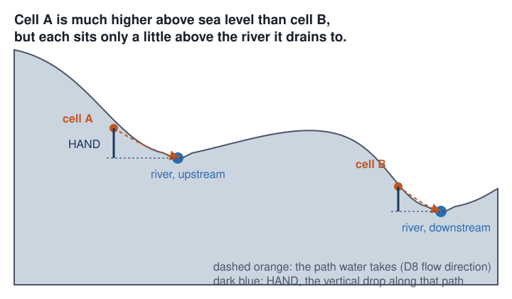
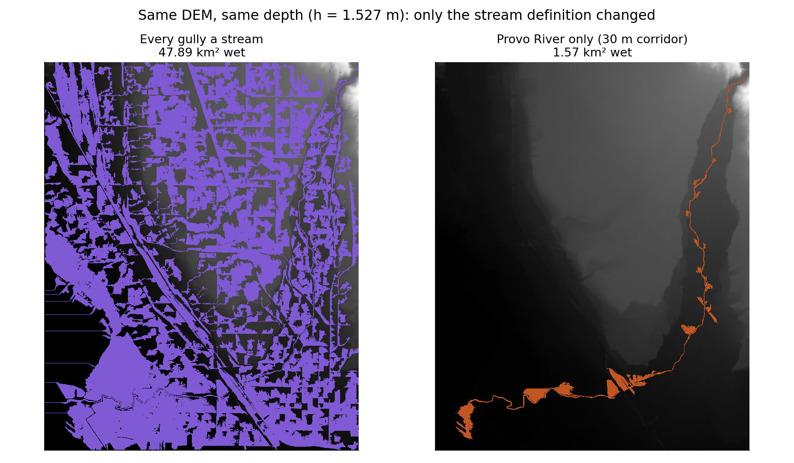
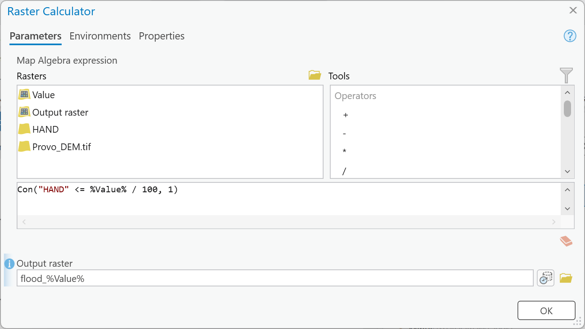
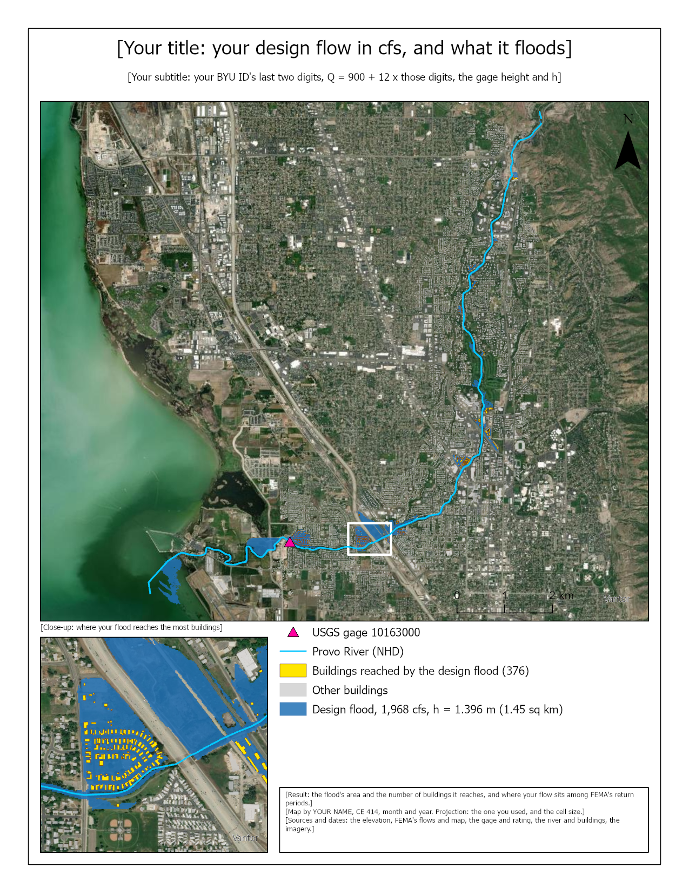

<!-- _class: lead -->
<!-- _paginate: skip -->

# Flood Mapping

## Part B — HAND, and Lab 7 on the Provo River

CE 414 Engineering Applications of GIS
Civil & Construction Engineering
Brigham Young University
Dr. Dan Ames

<!-- Thursday of Week 8. Tuesday ended on the bathtub's failure on a river and FEMA's expensive fix. Today: a terrain-only model that floods a whole river with one number, built from Lab 5's own chain plus one tool, and Lab 7, which does it on the Provo River and checks the answer against FEMA's new map. -->

<!-- stamp:begin -->
<!-- _footer: 'CE 414 · Week 8 — Flood Mapping, Part BLast Updated: 2026-10-19© 2026 Daniel P. Ames · <a href="https://creativecommons.org/licenses/by/4.0/">CC BY 4.0</a>' -->
<!-- stamp:end -->

---

# Today's Goals

By the end of class you should be able to:

- Say what **HAND** measures, why it beats elevation for floods, and what it leaves out
- Build it from a DEM: **Lab 5's chain + Flow Distance**
- Turn a flood depth into a **flood map** with one threshold
- Score a flood map against another: **hit rate, false alarms, CSI**
- Say what **Lab 7** asks for, and how you will know you are right

---

<!-- _class: lead -->

# Part 1 — Height Above What?

---

# Elevation Is Measured From the Wrong Place

- A flood cares how high you are **above the river**, not above **sea level**
- **HAND**: Height Above Nearest Drainage — the drop from a cell to the stream cell it **drains to**
- Every river cell has **HAND = 0**

<!-- The two cells make the point: A is far higher above sea level than B, yet both sit just above their own river. On a bathtub map B floods first; on a HAND map they flood together at the same depth. Diagram drawn for this deck, not to scale. -->

---

# Where Does the Water Go?

- A small valley: each number is a cell's **elevation**, and the **blue** cells are the river

* Where does each cell's water reach the river?
* Follow **D8** downhill, cell by cell, as in Lab 5. The river cell it reaches is its **nearest drain**
* Near the bend, a path runs diagonally to a river cell in **another row**: the drain is wherever the water goes

<!-- generated: tools/week08_hand_grid.py (elev) -->
<svg xmlns="http://www.w3.org/2000/svg" viewBox="0 0 520 568" width="546" height="596" font-family="Helvetica,Arial,sans-serif"><defs><marker id="hgA-ah" viewBox="0 0 10 10" refX="6" refY="5" markerWidth="4.5" markerHeight="4.5" orient="auto"><path d="M0,0 L10,5 L0,10 z" fill="#4a5568"/></marker><marker id="hgA-ao" viewBox="0 0 10 10" refX="6" refY="5" markerWidth="3.6" markerHeight="3.6" orient="auto"><path d="M0,0 L10,5 L0,10 z" fill="#e8792b"/></marker></defs><text x="10" y="22" font-size="14" fill="#4a5568">elevation (m) of each cell</text><text x="510" y="22" font-size="14" fill="#1f5fa8" font-weight="700" text-anchor="end">river flows south ↓</text><rect x="10" y="34" width="50" height="50" fill="#d3bb95" stroke="#ffffff" stroke-width="1.5"/><text x="35" y="60" font-size="15" font-weight="400" text-anchor="middle" fill="#22262e">25.8</text><rect x="60" y="34" width="50" height="50" fill="#d7c5a1" stroke="#ffffff" stroke-width="1.5"/><text x="85" y="60" font-size="15" font-weight="400" text-anchor="middle" fill="#22262e">24.8</text><rect x="110" y="34" width="50" height="50" fill="#dbcead" stroke="#ffffff" stroke-width="1.5"/><text x="135" y="60" font-size="15" font-weight="400" text-anchor="middle" fill="#22262e">23.8</text><rect x="160" y="34" width="50" height="50" fill="#dfd8ba" stroke="#ffffff" stroke-width="1.5"/><text x="185" y="60" font-size="15" font-weight="400" text-anchor="middle" fill="#22262e">22.8</text><rect x="210" y="34" width="50" height="50" fill="#1f5fa8" stroke="#ffffff" stroke-width="1.5"/><text x="235" y="60" font-size="15" font-weight="700" text-anchor="middle" fill="#ffffff">21.8</text><rect x="260" y="34" width="50" height="50" fill="#e0dcc0" stroke="#ffffff" stroke-width="1.5"/><text x="285" y="60" font-size="15" font-weight="400" text-anchor="middle" fill="#22262e">22.3</text><rect x="310" y="34" width="50" height="50" fill="#dfd8ba" stroke="#ffffff" stroke-width="1.5"/><text x="335" y="60" font-size="15" font-weight="400" text-anchor="middle" fill="#22262e">22.8</text><rect x="360" y="34" width="50" height="50" fill="#dbcead" stroke="#ffffff" stroke-width="1.5"/><text x="385" y="60" font-size="15" font-weight="400" text-anchor="middle" fill="#22262e">23.8</text><rect x="410" y="34" width="50" height="50" fill="#d5c09b" stroke="#ffffff" stroke-width="1.5"/><text x="435" y="60" font-size="15" font-weight="400" text-anchor="middle" fill="#22262e">25.3</text><rect x="460" y="34" width="50" height="50" fill="#d0b288" stroke="#ffffff" stroke-width="1.5"/><text x="485" y="60" font-size="15" font-weight="400" text-anchor="middle" fill="#22262e">26.8</text><rect x="10" y="84" width="50" height="50" fill="#d4bd97" stroke="#ffffff" stroke-width="1.5"/><text x="35" y="110" font-size="15" font-weight="400" text-anchor="middle" fill="#22262e">25.6</text><rect x="60" y="84" width="50" height="50" fill="#d8c7a3" stroke="#ffffff" stroke-width="1.5"/><text x="85" y="110" font-size="15" font-weight="400" text-anchor="middle" fill="#22262e">24.6</text><rect x="110" y="84" width="50" height="50" fill="#dcd0b0" stroke="#ffffff" stroke-width="1.5"/><text x="135" y="110" font-size="15" font-weight="400" text-anchor="middle" fill="#22262e">23.6</text><rect x="160" y="84" width="50" height="50" fill="#dfd9bc" stroke="#ffffff" stroke-width="1.5"/><text x="185" y="110" font-size="15" font-weight="400" text-anchor="middle" fill="#22262e">22.6</text><rect x="210" y="84" width="50" height="50" fill="#1f5fa8" stroke="#ffffff" stroke-width="1.5"/><text x="235" y="110" font-size="15" font-weight="700" text-anchor="middle" fill="#ffffff">21.6</text><rect x="260" y="84" width="50" height="50" fill="#e1dec2" stroke="#ffffff" stroke-width="1.5"/><text x="285" y="110" font-size="15" font-weight="400" text-anchor="middle" fill="#22262e">22.1</text><rect x="310" y="84" width="50" height="50" fill="#dfd9bc" stroke="#ffffff" stroke-width="1.5"/><text x="335" y="110" font-size="15" font-weight="400" text-anchor="middle" fill="#22262e">22.6</text><rect x="360" y="84" width="50" height="50" fill="#dcd0b0" stroke="#ffffff" stroke-width="1.5"/><text x="385" y="110" font-size="15" font-weight="400" text-anchor="middle" fill="#22262e">23.6</text><rect x="410" y="84" width="50" height="50" fill="#d6c29d" stroke="#ffffff" stroke-width="1.5"/><text x="435" y="110" font-size="15" font-weight="400" text-anchor="middle" fill="#22262e">25.1</text><rect x="460" y="84" width="50" height="50" fill="#d0b48b" stroke="#ffffff" stroke-width="1.5"/><text x="485" y="110" font-size="15" font-weight="400" text-anchor="middle" fill="#22262e">26.6</text><rect x="10" y="134" width="50" height="50" fill="#d5bf9a" stroke="#ffffff" stroke-width="1.5"/><text x="35" y="160" font-size="15" font-weight="400" text-anchor="middle" fill="#22262e">25.4</text><rect x="60" y="134" width="50" height="50" fill="#d9c9a6" stroke="#ffffff" stroke-width="1.5"/><text x="85" y="160" font-size="15" font-weight="400" text-anchor="middle" fill="#22262e">24.4</text><rect x="110" y="134" width="50" height="50" fill="#dcd2b2" stroke="#ffffff" stroke-width="1.5"/><text x="135" y="160" font-size="15" font-weight="400" text-anchor="middle" fill="#22262e">23.4</text><rect x="160" y="134" width="50" height="50" fill="#e0dbbf" stroke="#ffffff" stroke-width="1.5"/><text x="185" y="160" font-size="15" font-weight="400" text-anchor="middle" fill="#22262e">22.4</text><rect x="210" y="134" width="50" height="50" fill="#1f5fa8" stroke="#ffffff" stroke-width="1.5"/><text x="235" y="160" font-size="15" font-weight="700" text-anchor="middle" fill="#ffffff">21.4</text><rect x="260" y="134" width="50" height="50" fill="#e2e0c5" stroke="#ffffff" stroke-width="1.5"/><text x="285" y="160" font-size="15" font-weight="400" text-anchor="middle" fill="#22262e">21.9</text><rect x="310" y="134" width="50" height="50" fill="#e0dbbf" stroke="#ffffff" stroke-width="1.5"/><text x="335" y="160" font-size="15" font-weight="400" text-anchor="middle" fill="#22262e">22.4</text><rect x="360" y="134" width="50" height="50" fill="#dcd2b2" stroke="#ffffff" stroke-width="1.5"/><text x="385" y="160" font-size="15" font-weight="400" text-anchor="middle" fill="#22262e">23.4</text><rect x="410" y="134" width="50" height="50" fill="#d7c4a0" stroke="#ffffff" stroke-width="1.5"/><text x="435" y="160" font-size="15" font-weight="400" text-anchor="middle" fill="#22262e">24.9</text><rect x="460" y="134" width="50" height="50" fill="#d1b68d" stroke="#ffffff" stroke-width="1.5"/><text x="485" y="160" font-size="15" font-weight="400" text-anchor="middle" fill="#22262e">26.4</text><rect x="10" y="184" width="50" height="50" fill="#d6c19c" stroke="#ffffff" stroke-width="1.5"/><text x="35" y="210" font-size="15" font-weight="400" text-anchor="middle" fill="#22262e">25.2</text><rect x="60" y="184" width="50" height="50" fill="#d9caa8" stroke="#ffffff" stroke-width="1.5"/><text x="85" y="210" font-size="15" font-weight="400" text-anchor="middle" fill="#22262e">24.2</text><rect x="110" y="184" width="50" height="50" fill="#ddd4b5" stroke="#ffffff" stroke-width="1.5"/><text x="135" y="210" font-size="15" font-weight="400" text-anchor="middle" fill="#22262e">23.2</text><rect x="160" y="184" width="50" height="50" fill="#e1ddc1" stroke="#ffffff" stroke-width="1.5"/><text x="185" y="210" font-size="15" font-weight="400" text-anchor="middle" fill="#22262e">22.2</text><rect x="210" y="184" width="50" height="50" fill="#1f5fa8" stroke="#ffffff" stroke-width="1.5"/><text x="235" y="210" font-size="15" font-weight="700" text-anchor="middle" fill="#ffffff">21.2</text><rect x="260" y="184" width="50" height="50" fill="#e3e2c7" stroke="#ffffff" stroke-width="1.5"/><text x="285" y="210" font-size="15" font-weight="400" text-anchor="middle" fill="#22262e">21.7</text><rect x="310" y="184" width="50" height="50" fill="#e1ddc1" stroke="#ffffff" stroke-width="1.5"/><text x="335" y="210" font-size="15" font-weight="400" text-anchor="middle" fill="#22262e">22.2</text><rect x="360" y="184" width="50" height="50" fill="#ddd4b5" stroke="#ffffff" stroke-width="1.5"/><text x="385" y="210" font-size="15" font-weight="400" text-anchor="middle" fill="#22262e">23.2</text><rect x="410" y="184" width="50" height="50" fill="#d8c6a2" stroke="#ffffff" stroke-width="1.5"/><text x="435" y="210" font-size="15" font-weight="400" text-anchor="middle" fill="#22262e">24.7</text><rect x="460" y="184" width="50" height="50" fill="#d2b890" stroke="#ffffff" stroke-width="1.5"/><text x="485" y="210" font-size="15" font-weight="400" text-anchor="middle" fill="#22262e">26.2</text><rect x="10" y="234" width="50" height="50" fill="#d3b992" stroke="#ffffff" stroke-width="1.5"/><text x="35" y="260" font-size="15" font-weight="400" text-anchor="middle" fill="#22262e">26.0</text><rect x="60" y="234" width="50" height="50" fill="#d6c39f" stroke="#ffffff" stroke-width="1.5"/><text x="85" y="260" font-size="15" font-weight="400" text-anchor="middle" fill="#22262e">25.0</text><rect x="110" y="234" width="50" height="50" fill="#daccab" stroke="#ffffff" stroke-width="1.5"/><text x="135" y="260" font-size="15" font-weight="400" text-anchor="middle" fill="#22262e">24.0</text><rect x="160" y="234" width="50" height="50" fill="#ded6b7" stroke="#ffffff" stroke-width="1.5"/><text x="185" y="260" font-size="15" font-weight="400" text-anchor="middle" fill="#22262e">23.0</text><rect x="210" y="234" width="50" height="50" fill="#e2dfc3" stroke="#ffffff" stroke-width="1.5"/><text x="235" y="260" font-size="15" font-weight="400" text-anchor="middle" fill="#22262e">22.0</text><rect x="260" y="234" width="50" height="50" fill="#1f5fa8" stroke="#ffffff" stroke-width="1.5"/><text x="285" y="260" font-size="15" font-weight="700" text-anchor="middle" fill="#ffffff">21.0</text><rect x="310" y="234" width="50" height="50" fill="#e3e4ca" stroke="#ffffff" stroke-width="1.5"/><text x="335" y="260" font-size="15" font-weight="400" text-anchor="middle" fill="#22262e">21.5</text><rect x="360" y="234" width="50" height="50" fill="#e2dfc3" stroke="#ffffff" stroke-width="1.5"/><text x="385" y="260" font-size="15" font-weight="400" text-anchor="middle" fill="#22262e">22.0</text><rect x="410" y="234" width="50" height="50" fill="#ded6b7" stroke="#ffffff" stroke-width="1.5"/><text x="435" y="260" font-size="15" font-weight="400" text-anchor="middle" fill="#22262e">23.0</text><rect x="460" y="234" width="50" height="50" fill="#d8c8a5" stroke="#ffffff" stroke-width="1.5"/><text x="485" y="260" font-size="15" font-weight="400" text-anchor="middle" fill="#22262e">24.5</text><rect x="10" y="284" width="50" height="50" fill="#d3bb95" stroke="#ffffff" stroke-width="1.5"/><text x="35" y="310" font-size="15" font-weight="400" text-anchor="middle" fill="#22262e">25.8</text><rect x="60" y="284" width="50" height="50" fill="#d7c5a1" stroke="#ffffff" stroke-width="1.5"/><text x="85" y="310" font-size="15" font-weight="400" text-anchor="middle" fill="#22262e">24.8</text><rect x="110" y="284" width="50" height="50" fill="#dbcead" stroke="#ffffff" stroke-width="1.5"/><text x="135" y="310" font-size="15" font-weight="400" text-anchor="middle" fill="#22262e">23.8</text><rect x="160" y="284" width="50" height="50" fill="#dfd8ba" stroke="#ffffff" stroke-width="1.5"/><text x="185" y="310" font-size="15" font-weight="400" text-anchor="middle" fill="#22262e">22.8</text><rect x="210" y="284" width="50" height="50" fill="#e2e1c6" stroke="#ffffff" stroke-width="1.5"/><text x="235" y="310" font-size="15" font-weight="400" text-anchor="middle" fill="#22262e">21.8</text><rect x="260" y="284" width="50" height="50" fill="#1f5fa8" stroke="#ffffff" stroke-width="1.5"/><text x="285" y="310" font-size="15" font-weight="700" text-anchor="middle" fill="#ffffff">20.8</text><rect x="310" y="284" width="50" height="50" fill="#e4e6cc" stroke="#ffffff" stroke-width="1.5"/><text x="335" y="310" font-size="15" font-weight="400" text-anchor="middle" fill="#22262e">21.3</text><rect x="360" y="284" width="50" height="50" fill="#e2e1c6" stroke="#ffffff" stroke-width="1.5"/><text x="385" y="310" font-size="15" font-weight="400" text-anchor="middle" fill="#22262e">21.8</text><rect x="410" y="284" width="50" height="50" fill="#dfd8ba" stroke="#ffffff" stroke-width="1.5"/><text x="435" y="310" font-size="15" font-weight="400" text-anchor="middle" fill="#22262e">22.8</text><rect x="460" y="284" width="50" height="50" fill="#d9c9a7" stroke="#ffffff" stroke-width="1.5"/><text x="485" y="310" font-size="15" font-weight="400" text-anchor="middle" fill="#22262e">24.3</text><rect x="10" y="334" width="50" height="50" fill="#d4bd97" stroke="#ffffff" stroke-width="1.5"/><text x="35" y="360" font-size="15" font-weight="400" text-anchor="middle" fill="#22262e">25.6</text><rect x="60" y="334" width="50" height="50" fill="#d8c7a3" stroke="#ffffff" stroke-width="1.5"/><text x="85" y="360" font-size="15" font-weight="400" text-anchor="middle" fill="#22262e">24.6</text><rect x="110" y="334" width="50" height="50" fill="#dcd0b0" stroke="#ffffff" stroke-width="1.5"/><text x="135" y="360" font-size="15" font-weight="400" text-anchor="middle" fill="#22262e">23.6</text><rect x="160" y="334" width="50" height="50" fill="#dfd9bc" stroke="#ffffff" stroke-width="1.5"/><text x="185" y="360" font-size="15" font-weight="400" text-anchor="middle" fill="#22262e">22.6</text><rect x="210" y="334" width="50" height="50" fill="#e3e3c8" stroke="#ffffff" stroke-width="1.5"/><text x="235" y="360" font-size="15" font-weight="400" text-anchor="middle" fill="#22262e">21.6</text><rect x="260" y="334" width="50" height="50" fill="#1f5fa8" stroke="#ffffff" stroke-width="1.5"/><text x="285" y="360" font-size="15" font-weight="700" text-anchor="middle" fill="#ffffff">20.6</text><rect x="310" y="334" width="50" height="50" fill="#e5e8ce" stroke="#ffffff" stroke-width="1.5"/><text x="335" y="360" font-size="15" font-weight="400" text-anchor="middle" fill="#22262e">21.1</text><rect x="360" y="334" width="50" height="50" fill="#e3e3c8" stroke="#ffffff" stroke-width="1.5"/><text x="385" y="360" font-size="15" font-weight="400" text-anchor="middle" fill="#22262e">21.6</text><rect x="410" y="334" width="50" height="50" fill="#dfd9bc" stroke="#ffffff" stroke-width="1.5"/><text x="435" y="360" font-size="15" font-weight="400" text-anchor="middle" fill="#22262e">22.6</text><rect x="460" y="334" width="50" height="50" fill="#dacbaa" stroke="#ffffff" stroke-width="1.5"/><text x="485" y="360" font-size="15" font-weight="400" text-anchor="middle" fill="#22262e">24.1</text><rect x="10" y="384" width="50" height="50" fill="#d5bf9a" stroke="#ffffff" stroke-width="1.5"/><text x="35" y="410" font-size="15" font-weight="400" text-anchor="middle" fill="#22262e">25.4</text><rect x="60" y="384" width="50" height="50" fill="#d9c9a6" stroke="#ffffff" stroke-width="1.5"/><text x="85" y="410" font-size="15" font-weight="400" text-anchor="middle" fill="#22262e">24.4</text><rect x="110" y="384" width="50" height="50" fill="#dcd2b2" stroke="#ffffff" stroke-width="1.5"/><text x="135" y="410" font-size="15" font-weight="400" text-anchor="middle" fill="#22262e">23.4</text><rect x="160" y="384" width="50" height="50" fill="#e0dbbf" stroke="#ffffff" stroke-width="1.5"/><text x="185" y="410" font-size="15" font-weight="400" text-anchor="middle" fill="#22262e">22.4</text><rect x="210" y="384" width="50" height="50" fill="#e4e5cb" stroke="#ffffff" stroke-width="1.5"/><text x="235" y="410" font-size="15" font-weight="400" text-anchor="middle" fill="#22262e">21.4</text><rect x="260" y="384" width="50" height="50" fill="#1f5fa8" stroke="#ffffff" stroke-width="1.5"/><text x="285" y="410" font-size="15" font-weight="700" text-anchor="middle" fill="#ffffff">20.4</text><rect x="310" y="384" width="50" height="50" fill="#e6ead1" stroke="#ffffff" stroke-width="1.5"/><text x="335" y="410" font-size="15" font-weight="400" text-anchor="middle" fill="#22262e">20.9</text><rect x="360" y="384" width="50" height="50" fill="#e4e5cb" stroke="#ffffff" stroke-width="1.5"/><text x="385" y="410" font-size="15" font-weight="400" text-anchor="middle" fill="#22262e">21.4</text><rect x="410" y="384" width="50" height="50" fill="#e0dbbf" stroke="#ffffff" stroke-width="1.5"/><text x="435" y="410" font-size="15" font-weight="400" text-anchor="middle" fill="#22262e">22.4</text><rect x="460" y="384" width="50" height="50" fill="#dbcdac" stroke="#ffffff" stroke-width="1.5"/><text x="485" y="410" font-size="15" font-weight="400" text-anchor="middle" fill="#22262e">23.9</text><rect x="10" y="434" width="50" height="50" fill="#d6c19c" stroke="#ffffff" stroke-width="1.5"/><text x="35" y="460" font-size="15" font-weight="400" text-anchor="middle" fill="#22262e">25.2</text><rect x="60" y="434" width="50" height="50" fill="#d9caa8" stroke="#ffffff" stroke-width="1.5"/><text x="85" y="460" font-size="15" font-weight="400" text-anchor="middle" fill="#22262e">24.2</text><rect x="110" y="434" width="50" height="50" fill="#ddd4b5" stroke="#ffffff" stroke-width="1.5"/><text x="135" y="460" font-size="15" font-weight="400" text-anchor="middle" fill="#22262e">23.2</text><rect x="160" y="434" width="50" height="50" fill="#e1ddc1" stroke="#ffffff" stroke-width="1.5"/><text x="185" y="460" font-size="15" font-weight="400" text-anchor="middle" fill="#22262e">22.2</text><rect x="210" y="434" width="50" height="50" fill="#e5e7cd" stroke="#ffffff" stroke-width="1.5"/><text x="235" y="460" font-size="15" font-weight="400" text-anchor="middle" fill="#22262e">21.2</text><rect x="260" y="434" width="50" height="50" fill="#1f5fa8" stroke="#ffffff" stroke-width="1.5"/><text x="285" y="460" font-size="15" font-weight="700" text-anchor="middle" fill="#ffffff">20.2</text><rect x="310" y="434" width="50" height="50" fill="#e6ebd3" stroke="#ffffff" stroke-width="1.5"/><text x="335" y="460" font-size="15" font-weight="400" text-anchor="middle" fill="#22262e">20.7</text><rect x="360" y="434" width="50" height="50" fill="#e5e7cd" stroke="#ffffff" stroke-width="1.5"/><text x="385" y="460" font-size="15" font-weight="400" text-anchor="middle" fill="#22262e">21.2</text><rect x="410" y="434" width="50" height="50" fill="#e1ddc1" stroke="#ffffff" stroke-width="1.5"/><text x="435" y="460" font-size="15" font-weight="400" text-anchor="middle" fill="#22262e">22.2</text><rect x="460" y="434" width="50" height="50" fill="#dbcfaf" stroke="#ffffff" stroke-width="1.5"/><text x="485" y="460" font-size="15" font-weight="400" text-anchor="middle" fill="#22262e">23.7</text><rect x="10" y="484" width="50" height="50" fill="#d6c39f" stroke="#ffffff" stroke-width="1.5"/><text x="35" y="510" font-size="15" font-weight="400" text-anchor="middle" fill="#22262e">25.0</text><rect x="60" y="484" width="50" height="50" fill="#daccab" stroke="#ffffff" stroke-width="1.5"/><text x="85" y="510" font-size="15" font-weight="400" text-anchor="middle" fill="#22262e">24.0</text><rect x="110" y="484" width="50" height="50" fill="#ded6b7" stroke="#ffffff" stroke-width="1.5"/><text x="135" y="510" font-size="15" font-weight="400" text-anchor="middle" fill="#22262e">23.0</text><rect x="160" y="484" width="50" height="50" fill="#e2dfc3" stroke="#ffffff" stroke-width="1.5"/><text x="185" y="510" font-size="15" font-weight="400" text-anchor="middle" fill="#22262e">22.0</text><rect x="210" y="484" width="50" height="50" fill="#e5e9d0" stroke="#ffffff" stroke-width="1.5"/><text x="235" y="510" font-size="15" font-weight="400" text-anchor="middle" fill="#22262e">21.0</text><rect x="260" y="484" width="50" height="50" fill="#1f5fa8" stroke="#ffffff" stroke-width="1.5"/><text x="285" y="510" font-size="15" font-weight="700" text-anchor="middle" fill="#ffffff">20.0</text><rect x="310" y="484" width="50" height="50" fill="#e7edd6" stroke="#ffffff" stroke-width="1.5"/><text x="335" y="510" font-size="15" font-weight="400" text-anchor="middle" fill="#22262e">20.5</text><rect x="360" y="484" width="50" height="50" fill="#e5e9d0" stroke="#ffffff" stroke-width="1.5"/><text x="385" y="510" font-size="15" font-weight="400" text-anchor="middle" fill="#22262e">21.0</text><rect x="410" y="484" width="50" height="50" fill="#e2dfc3" stroke="#ffffff" stroke-width="1.5"/><text x="435" y="510" font-size="15" font-weight="400" text-anchor="middle" fill="#22262e">22.0</text><rect x="460" y="484" width="50" height="50" fill="#dcd1b1" stroke="#ffffff" stroke-width="1.5"/><text x="485" y="510" font-size="15" font-weight="400" text-anchor="middle" fill="#22262e">23.5</text><g class="hgA-arrows hgA-fade"><line x1="47.0" y1="72.0" x2="70.0" y2="72.0" stroke="#4a5568" stroke-width="2.2" stroke-linecap="round" marker-end="url(#hgA-ah)"/><line x1="97.0" y1="72.0" x2="120.0" y2="72.0" stroke="#4a5568" stroke-width="2.2" stroke-linecap="round" marker-end="url(#hgA-ah)"/><line x1="147.0" y1="72.0" x2="170.0" y2="72.0" stroke="#4a5568" stroke-width="2.2" stroke-linecap="round" marker-end="url(#hgA-ah)"/><line x1="197.0" y1="72.0" x2="220.0" y2="72.0" stroke="#4a5568" stroke-width="2.2" stroke-linecap="round" marker-end="url(#hgA-ah)"/><line x1="273.0" y1="72.0" x2="250.0" y2="72.0" stroke="#4a5568" stroke-width="2.2" stroke-linecap="round" marker-end="url(#hgA-ah)"/><line x1="323.0" y1="72.0" x2="300.0" y2="72.0" stroke="#4a5568" stroke-width="2.2" stroke-linecap="round" marker-end="url(#hgA-ah)"/><line x1="373.0" y1="72.0" x2="350.0" y2="72.0" stroke="#4a5568" stroke-width="2.2" stroke-linecap="round" marker-end="url(#hgA-ah)"/><line x1="423.0" y1="72.0" x2="400.0" y2="72.0" stroke="#4a5568" stroke-width="2.2" stroke-linecap="round" marker-end="url(#hgA-ah)"/><line x1="473.0" y1="72.0" x2="450.0" y2="72.0" stroke="#4a5568" stroke-width="2.2" stroke-linecap="round" marker-end="url(#hgA-ah)"/><line x1="47.0" y1="122.0" x2="70.0" y2="122.0" stroke="#4a5568" stroke-width="2.2" stroke-linecap="round" marker-end="url(#hgA-ah)"/><line x1="97.0" y1="122.0" x2="120.0" y2="122.0" stroke="#4a5568" stroke-width="2.2" stroke-linecap="round" marker-end="url(#hgA-ah)"/><line x1="147.0" y1="122.0" x2="170.0" y2="122.0" stroke="#4a5568" stroke-width="2.2" stroke-linecap="round" marker-end="url(#hgA-ah)"/><line x1="197.0" y1="122.0" x2="220.0" y2="122.0" stroke="#4a5568" stroke-width="2.2" stroke-linecap="round" marker-end="url(#hgA-ah)"/><line x1="273.0" y1="122.0" x2="250.0" y2="122.0" stroke="#4a5568" stroke-width="2.2" stroke-linecap="round" marker-end="url(#hgA-ah)"/><line x1="323.0" y1="122.0" x2="300.0" y2="122.0" stroke="#4a5568" stroke-width="2.2" stroke-linecap="round" marker-end="url(#hgA-ah)"/><line x1="373.0" y1="122.0" x2="350.0" y2="122.0" stroke="#4a5568" stroke-width="2.2" stroke-linecap="round" marker-end="url(#hgA-ah)"/><line x1="423.0" y1="122.0" x2="400.0" y2="122.0" stroke="#4a5568" stroke-width="2.2" stroke-linecap="round" marker-end="url(#hgA-ah)"/><line x1="473.0" y1="122.0" x2="450.0" y2="122.0" stroke="#4a5568" stroke-width="2.2" stroke-linecap="round" marker-end="url(#hgA-ah)"/><line x1="47.0" y1="172.0" x2="70.0" y2="172.0" stroke="#4a5568" stroke-width="2.2" stroke-linecap="round" marker-end="url(#hgA-ah)"/><line x1="97.0" y1="172.0" x2="120.0" y2="172.0" stroke="#4a5568" stroke-width="2.2" stroke-linecap="round" marker-end="url(#hgA-ah)"/><line x1="147.0" y1="172.0" x2="170.0" y2="172.0" stroke="#4a5568" stroke-width="2.2" stroke-linecap="round" marker-end="url(#hgA-ah)"/><line x1="197.0" y1="172.0" x2="220.0" y2="172.0" stroke="#4a5568" stroke-width="2.2" stroke-linecap="round" marker-end="url(#hgA-ah)"/><line x1="273.0" y1="172.0" x2="250.0" y2="172.0" stroke="#4a5568" stroke-width="2.2" stroke-linecap="round" marker-end="url(#hgA-ah)"/><line x1="323.0" y1="172.0" x2="300.0" y2="172.0" stroke="#4a5568" stroke-width="2.2" stroke-linecap="round" marker-end="url(#hgA-ah)"/><line x1="373.0" y1="172.0" x2="350.0" y2="172.0" stroke="#4a5568" stroke-width="2.2" stroke-linecap="round" marker-end="url(#hgA-ah)"/><line x1="423.0" y1="172.0" x2="400.0" y2="172.0" stroke="#4a5568" stroke-width="2.2" stroke-linecap="round" marker-end="url(#hgA-ah)"/><line x1="473.0" y1="172.0" x2="450.0" y2="172.0" stroke="#4a5568" stroke-width="2.2" stroke-linecap="round" marker-end="url(#hgA-ah)"/><line x1="47.0" y1="222.0" x2="70.0" y2="222.0" stroke="#4a5568" stroke-width="2.2" stroke-linecap="round" marker-end="url(#hgA-ah)"/><line x1="97.0" y1="222.0" x2="120.0" y2="222.0" stroke="#4a5568" stroke-width="2.2" stroke-linecap="round" marker-end="url(#hgA-ah)"/><line x1="147.0" y1="222.0" x2="170.0" y2="222.0" stroke="#4a5568" stroke-width="2.2" stroke-linecap="round" marker-end="url(#hgA-ah)"/><line x1="197.0" y1="222.0" x2="220.0" y2="222.0" stroke="#4a5568" stroke-width="2.2" stroke-linecap="round" marker-end="url(#hgA-ah)"/><line x1="285.0" y1="227.0" x2="285.0" y2="242.0" stroke="#4a5568" stroke-width="2.2" stroke-linecap="round" marker-end="url(#hgA-ah)"/><line x1="317.0" y1="227.0" x2="302.0" y2="242.0" stroke="#4a5568" stroke-width="2.2" stroke-linecap="round" marker-end="url(#hgA-ah)"/><line x1="367.0" y1="227.0" x2="352.0" y2="242.0" stroke="#4a5568" stroke-width="2.2" stroke-linecap="round" marker-end="url(#hgA-ah)"/><line x1="417.0" y1="227.0" x2="402.0" y2="242.0" stroke="#4a5568" stroke-width="2.2" stroke-linecap="round" marker-end="url(#hgA-ah)"/><line x1="467.0" y1="227.0" x2="452.0" y2="242.0" stroke="#4a5568" stroke-width="2.2" stroke-linecap="round" marker-end="url(#hgA-ah)"/><line x1="53.0" y1="241.0" x2="68.0" y2="226.0" stroke="#4a5568" stroke-width="2.2" stroke-linecap="round" marker-end="url(#hgA-ah)"/><line x1="103.0" y1="241.0" x2="118.0" y2="226.0" stroke="#4a5568" stroke-width="2.2" stroke-linecap="round" marker-end="url(#hgA-ah)"/><line x1="153.0" y1="241.0" x2="168.0" y2="226.0" stroke="#4a5568" stroke-width="2.2" stroke-linecap="round" marker-end="url(#hgA-ah)"/><line x1="203.0" y1="241.0" x2="218.0" y2="226.0" stroke="#4a5568" stroke-width="2.2" stroke-linecap="round" marker-end="url(#hgA-ah)"/><line x1="247.0" y1="272.0" x2="270.0" y2="272.0" stroke="#4a5568" stroke-width="2.2" stroke-linecap="round" marker-end="url(#hgA-ah)"/><line x1="323.0" y1="272.0" x2="300.0" y2="272.0" stroke="#4a5568" stroke-width="2.2" stroke-linecap="round" marker-end="url(#hgA-ah)"/><line x1="373.0" y1="272.0" x2="350.0" y2="272.0" stroke="#4a5568" stroke-width="2.2" stroke-linecap="round" marker-end="url(#hgA-ah)"/><line x1="423.0" y1="272.0" x2="400.0" y2="272.0" stroke="#4a5568" stroke-width="2.2" stroke-linecap="round" marker-end="url(#hgA-ah)"/><line x1="473.0" y1="272.0" x2="450.0" y2="272.0" stroke="#4a5568" stroke-width="2.2" stroke-linecap="round" marker-end="url(#hgA-ah)"/><line x1="47.0" y1="322.0" x2="70.0" y2="322.0" stroke="#4a5568" stroke-width="2.2" stroke-linecap="round" marker-end="url(#hgA-ah)"/><line x1="97.0" y1="322.0" x2="120.0" y2="322.0" stroke="#4a5568" stroke-width="2.2" stroke-linecap="round" marker-end="url(#hgA-ah)"/><line x1="147.0" y1="322.0" x2="170.0" y2="322.0" stroke="#4a5568" stroke-width="2.2" stroke-linecap="round" marker-end="url(#hgA-ah)"/><line x1="197.0" y1="322.0" x2="220.0" y2="322.0" stroke="#4a5568" stroke-width="2.2" stroke-linecap="round" marker-end="url(#hgA-ah)"/><line x1="247.0" y1="322.0" x2="270.0" y2="322.0" stroke="#4a5568" stroke-width="2.2" stroke-linecap="round" marker-end="url(#hgA-ah)"/><line x1="323.0" y1="322.0" x2="300.0" y2="322.0" stroke="#4a5568" stroke-width="2.2" stroke-linecap="round" marker-end="url(#hgA-ah)"/><line x1="373.0" y1="322.0" x2="350.0" y2="322.0" stroke="#4a5568" stroke-width="2.2" stroke-linecap="round" marker-end="url(#hgA-ah)"/><line x1="423.0" y1="322.0" x2="400.0" y2="322.0" stroke="#4a5568" stroke-width="2.2" stroke-linecap="round" marker-end="url(#hgA-ah)"/><line x1="473.0" y1="322.0" x2="450.0" y2="322.0" stroke="#4a5568" stroke-width="2.2" stroke-linecap="round" marker-end="url(#hgA-ah)"/><line x1="47.0" y1="372.0" x2="70.0" y2="372.0" stroke="#4a5568" stroke-width="2.2" stroke-linecap="round" marker-end="url(#hgA-ah)"/><line x1="97.0" y1="372.0" x2="120.0" y2="372.0" stroke="#4a5568" stroke-width="2.2" stroke-linecap="round" marker-end="url(#hgA-ah)"/><line x1="147.0" y1="372.0" x2="170.0" y2="372.0" stroke="#4a5568" stroke-width="2.2" stroke-linecap="round" marker-end="url(#hgA-ah)"/><line x1="197.0" y1="372.0" x2="220.0" y2="372.0" stroke="#4a5568" stroke-width="2.2" stroke-linecap="round" marker-end="url(#hgA-ah)"/><line x1="247.0" y1="372.0" x2="270.0" y2="372.0" stroke="#4a5568" stroke-width="2.2" stroke-linecap="round" marker-end="url(#hgA-ah)"/><line x1="323.0" y1="372.0" x2="300.0" y2="372.0" stroke="#4a5568" stroke-width="2.2" stroke-linecap="round" marker-end="url(#hgA-ah)"/><line x1="373.0" y1="372.0" x2="350.0" y2="372.0" stroke="#4a5568" stroke-width="2.2" stroke-linecap="round" marker-end="url(#hgA-ah)"/><line x1="423.0" y1="372.0" x2="400.0" y2="372.0" stroke="#4a5568" stroke-width="2.2" stroke-linecap="round" marker-end="url(#hgA-ah)"/><line x1="473.0" y1="372.0" x2="450.0" y2="372.0" stroke="#4a5568" stroke-width="2.2" stroke-linecap="round" marker-end="url(#hgA-ah)"/><line x1="47.0" y1="422.0" x2="70.0" y2="422.0" stroke="#4a5568" stroke-width="2.2" stroke-linecap="round" marker-end="url(#hgA-ah)"/><line x1="97.0" y1="422.0" x2="120.0" y2="422.0" stroke="#4a5568" stroke-width="2.2" stroke-linecap="round" marker-end="url(#hgA-ah)"/><line x1="147.0" y1="422.0" x2="170.0" y2="422.0" stroke="#4a5568" stroke-width="2.2" stroke-linecap="round" marker-end="url(#hgA-ah)"/><line x1="197.0" y1="422.0" x2="220.0" y2="422.0" stroke="#4a5568" stroke-width="2.2" stroke-linecap="round" marker-end="url(#hgA-ah)"/><line x1="247.0" y1="422.0" x2="270.0" y2="422.0" stroke="#4a5568" stroke-width="2.2" stroke-linecap="round" marker-end="url(#hgA-ah)"/><line x1="323.0" y1="422.0" x2="300.0" y2="422.0" stroke="#4a5568" stroke-width="2.2" stroke-linecap="round" marker-end="url(#hgA-ah)"/><line x1="373.0" y1="422.0" x2="350.0" y2="422.0" stroke="#4a5568" stroke-width="2.2" stroke-linecap="round" marker-end="url(#hgA-ah)"/><line x1="423.0" y1="422.0" x2="400.0" y2="422.0" stroke="#4a5568" stroke-width="2.2" stroke-linecap="round" marker-end="url(#hgA-ah)"/><line x1="473.0" y1="422.0" x2="450.0" y2="422.0" stroke="#4a5568" stroke-width="2.2" stroke-linecap="round" marker-end="url(#hgA-ah)"/><line x1="47.0" y1="472.0" x2="70.0" y2="472.0" stroke="#4a5568" stroke-width="2.2" stroke-linecap="round" marker-end="url(#hgA-ah)"/><line x1="97.0" y1="472.0" x2="120.0" y2="472.0" stroke="#4a5568" stroke-width="2.2" stroke-linecap="round" marker-end="url(#hgA-ah)"/><line x1="147.0" y1="472.0" x2="170.0" y2="472.0" stroke="#4a5568" stroke-width="2.2" stroke-linecap="round" marker-end="url(#hgA-ah)"/><line x1="197.0" y1="472.0" x2="220.0" y2="472.0" stroke="#4a5568" stroke-width="2.2" stroke-linecap="round" marker-end="url(#hgA-ah)"/><line x1="247.0" y1="472.0" x2="270.0" y2="472.0" stroke="#4a5568" stroke-width="2.2" stroke-linecap="round" marker-end="url(#hgA-ah)"/><line x1="323.0" y1="472.0" x2="300.0" y2="472.0" stroke="#4a5568" stroke-width="2.2" stroke-linecap="round" marker-end="url(#hgA-ah)"/><line x1="373.0" y1="472.0" x2="350.0" y2="472.0" stroke="#4a5568" stroke-width="2.2" stroke-linecap="round" marker-end="url(#hgA-ah)"/><line x1="423.0" y1="472.0" x2="400.0" y2="472.0" stroke="#4a5568" stroke-width="2.2" stroke-linecap="round" marker-end="url(#hgA-ah)"/><line x1="473.0" y1="472.0" x2="450.0" y2="472.0" stroke="#4a5568" stroke-width="2.2" stroke-linecap="round" marker-end="url(#hgA-ah)"/><line x1="47.0" y1="522.0" x2="70.0" y2="522.0" stroke="#4a5568" stroke-width="2.2" stroke-linecap="round" marker-end="url(#hgA-ah)"/><line x1="97.0" y1="522.0" x2="120.0" y2="522.0" stroke="#4a5568" stroke-width="2.2" stroke-linecap="round" marker-end="url(#hgA-ah)"/><line x1="147.0" y1="522.0" x2="170.0" y2="522.0" stroke="#4a5568" stroke-width="2.2" stroke-linecap="round" marker-end="url(#hgA-ah)"/><line x1="197.0" y1="522.0" x2="220.0" y2="522.0" stroke="#4a5568" stroke-width="2.2" stroke-linecap="round" marker-end="url(#hgA-ah)"/><line x1="247.0" y1="522.0" x2="270.0" y2="522.0" stroke="#4a5568" stroke-width="2.2" stroke-linecap="round" marker-end="url(#hgA-ah)"/><line x1="323.0" y1="522.0" x2="300.0" y2="522.0" stroke="#4a5568" stroke-width="2.2" stroke-linecap="round" marker-end="url(#hgA-ah)"/><line x1="373.0" y1="522.0" x2="350.0" y2="522.0" stroke="#4a5568" stroke-width="2.2" stroke-linecap="round" marker-end="url(#hgA-ah)"/><line x1="423.0" y1="522.0" x2="400.0" y2="522.0" stroke="#4a5568" stroke-width="2.2" stroke-linecap="round" marker-end="url(#hgA-ah)"/><line x1="473.0" y1="522.0" x2="450.0" y2="522.0" stroke="#4a5568" stroke-width="2.2" stroke-linecap="round" marker-end="url(#hgA-ah)"/></g><g class="hgA-bend hgA-fade"><rect x="312.5" y="186.5" width="45" height="45" fill="none" stroke="#e8792b" stroke-width="4" rx="4"/><line x1="317.0" y1="227.0" x2="302.0" y2="242.0" stroke="#e8792b" stroke-width="4.5" stroke-linecap="round" marker-end="url(#hgA-ao)"/><rect x="262.5" y="236.5" width="45" height="45" fill="none" stroke="#ffd21f" stroke-width="4" rx="4"/><rect x="112.5" y="236.5" width="45" height="45" fill="none" stroke="#e8792b" stroke-width="4" rx="4"/><line x1="153.0" y1="241.0" x2="168.0" y2="226.0" stroke="#e8792b" stroke-width="4.5" stroke-linecap="round" marker-end="url(#hgA-ao)"/><line x1="197.0" y1="222.0" x2="220.0" y2="222.0" stroke="#e8792b" stroke-width="4.5" stroke-linecap="round" marker-end="url(#hgA-ao)"/><rect x="212.5" y="186.5" width="45" height="45" fill="none" stroke="#ffd21f" stroke-width="4" rx="4"/></g><text x="10" y="558" font-size="13" fill="#4a5568">A made-up valley, 1 cell = 1 unit; D8 flow directions computed, not drawn by hand</text></svg>

<!-- A made-up 10 x 10 valley, built and checked by tools/week08_hand_grid.py: the river drops 0.2 m per row; the land rises 1 m per cell to the west, and to the east a low terrace (0.5 m, 1.0 m) sits beside the river before the wall. Flow directions are real D8, steepest drop with diagonals divided by the square root of 2, so every arrow is what Flow Direction would give. Press 1: the question. Ask the room before pressing again. Press 2: every cell's D8 arrow; follow any one to the river by eye. Press 3: two cells near the bend (orange rings) whose water runs diagonally to a river cell in the next row up or down (yellow rings): the drain is not chosen by the cell, the water picks it. That is what "nearest drainage" means in HAND: nearest along the flow path. -->

---

# Height Above Nearest Drainage

- The same valley and the same paths

* The two ringed cells: which is **higher**? Which floods **first**?
* **HAND** = a cell's elevation − its drain's elevation. River cells are **0**
* Top: **22.8 m**, HAND **1.0**. Bottom: **22.0 m**, HAND **2.0**. The lower cell sits higher above **its** river, so the top one floods first

<!-- generated: tools/week08_hand_grid.py (hand) -->
<svg xmlns="http://www.w3.org/2000/svg" viewBox="0 0 520 568" width="546" height="596" font-family="Helvetica,Arial,sans-serif"><defs><marker id="hgB-ah" viewBox="0 0 10 10" refX="6" refY="5" markerWidth="4.5" markerHeight="4.5" orient="auto"><path d="M0,0 L10,5 L0,10 z" fill="#4a5568"/></marker><marker id="hgB-ao" viewBox="0 0 10 10" refX="6" refY="5" markerWidth="3.6" markerHeight="3.6" orient="auto"><path d="M0,0 L10,5 L0,10 z" fill="#e8792b"/></marker></defs><text x="10" y="22" font-size="14" fill="#4a5568">elevation (m), then HAND (m)</text><text x="510" y="22" font-size="14" fill="#1f5fa8" font-weight="700" text-anchor="end">river flows south ↓</text><rect class="hgB-elev hgB-fade" x="10" y="34" width="50" height="50" fill="#d3bb95" stroke="#ffffff" stroke-width="1.5"/><rect class="hgB-hand hgB-fade" x="10" y="34" width="50" height="50" fill="#d8c6a3" stroke="#ffffff" stroke-width="1.5"/><text class="hgB-elev hgB-fade" x="35" y="60" font-size="15" font-weight="400" text-anchor="middle" fill="#22262e">25.8</text><text class="hgB-hand hgB-fade" x="35" y="60" font-size="17" font-weight="700" text-anchor="middle" fill="#22262e">4.0</text><rect class="hgB-elev hgB-fade" x="60" y="34" width="50" height="50" fill="#d7c5a1" stroke="#ffffff" stroke-width="1.5"/><rect class="hgB-hand hgB-fade" x="60" y="34" width="50" height="50" fill="#dcd1b1" stroke="#ffffff" stroke-width="1.5"/><text class="hgB-elev hgB-fade" x="85" y="60" font-size="15" font-weight="400" text-anchor="middle" fill="#22262e">24.8</text><text class="hgB-hand hgB-fade" x="85" y="60" font-size="17" font-weight="700" text-anchor="middle" fill="#22262e">3.0</text><rect class="hgB-elev hgB-fade" x="110" y="34" width="50" height="50" fill="#dbcead" stroke="#ffffff" stroke-width="1.5"/><rect class="hgB-hand hgB-fade" x="110" y="34" width="50" height="50" fill="#e0dcbf" stroke="#ffffff" stroke-width="1.5"/><text class="hgB-elev hgB-fade" x="135" y="60" font-size="15" font-weight="400" text-anchor="middle" fill="#22262e">23.8</text><text class="hgB-hand hgB-fade" x="135" y="60" font-size="17" font-weight="700" text-anchor="middle" fill="#22262e">2.0</text><rect class="hgB-elev hgB-fade" x="160" y="34" width="50" height="50" fill="#dfd8ba" stroke="#ffffff" stroke-width="1.5"/><rect class="hgB-hand hgB-fade" x="160" y="34" width="50" height="50" fill="#e5e7ce" stroke="#ffffff" stroke-width="1.5"/><text class="hgB-elev hgB-fade" x="185" y="60" font-size="15" font-weight="400" text-anchor="middle" fill="#22262e">22.8</text><text class="hgB-hand hgB-fade" x="185" y="60" font-size="17" font-weight="700" text-anchor="middle" fill="#22262e">1.0</text><rect class="hgB-elev hgB-fade" x="210" y="34" width="50" height="50" fill="#1f5fa8" stroke="#ffffff" stroke-width="1.5"/><rect class="hgB-hand hgB-fade" x="210" y="34" width="50" height="50" fill="#1f5fa8" stroke="#ffffff" stroke-width="1.5"/><text class="hgB-elev hgB-fade" x="235" y="60" font-size="15" font-weight="700" text-anchor="middle" fill="#ffffff">21.8</text><text class="hgB-hand hgB-fade" x="235" y="60" font-size="17" font-weight="700" text-anchor="middle" fill="#ffffff">0</text><rect class="hgB-elev hgB-fade" x="260" y="34" width="50" height="50" fill="#e0dcc0" stroke="#ffffff" stroke-width="1.5"/><rect class="hgB-hand hgB-fade" x="260" y="34" width="50" height="50" fill="#e7ecd5" stroke="#ffffff" stroke-width="1.5"/><text class="hgB-elev hgB-fade" x="285" y="60" font-size="15" font-weight="400" text-anchor="middle" fill="#22262e">22.3</text><text class="hgB-hand hgB-fade" x="285" y="60" font-size="17" font-weight="700" text-anchor="middle" fill="#22262e">0.5</text><rect class="hgB-elev hgB-fade" x="310" y="34" width="50" height="50" fill="#dfd8ba" stroke="#ffffff" stroke-width="1.5"/><rect class="hgB-hand hgB-fade" x="310" y="34" width="50" height="50" fill="#e5e7ce" stroke="#ffffff" stroke-width="1.5"/><text class="hgB-elev hgB-fade" x="335" y="60" font-size="15" font-weight="400" text-anchor="middle" fill="#22262e">22.8</text><text class="hgB-hand hgB-fade" x="335" y="60" font-size="17" font-weight="700" text-anchor="middle" fill="#22262e">1.0</text><rect class="hgB-elev hgB-fade" x="360" y="34" width="50" height="50" fill="#dbcead" stroke="#ffffff" stroke-width="1.5"/><rect class="hgB-hand hgB-fade" x="360" y="34" width="50" height="50" fill="#e0dcbf" stroke="#ffffff" stroke-width="1.5"/><text class="hgB-elev hgB-fade" x="385" y="60" font-size="15" font-weight="400" text-anchor="middle" fill="#22262e">23.8</text><text class="hgB-hand hgB-fade" x="385" y="60" font-size="17" font-weight="700" text-anchor="middle" fill="#22262e">2.0</text><rect class="hgB-elev hgB-fade" x="410" y="34" width="50" height="50" fill="#d5c09b" stroke="#ffffff" stroke-width="1.5"/><rect class="hgB-hand hgB-fade" x="410" y="34" width="50" height="50" fill="#daccaa" stroke="#ffffff" stroke-width="1.5"/><text class="hgB-elev hgB-fade" x="435" y="60" font-size="15" font-weight="400" text-anchor="middle" fill="#22262e">25.3</text><text class="hgB-hand hgB-fade" x="435" y="60" font-size="17" font-weight="700" text-anchor="middle" fill="#22262e">3.5</text><rect class="hgB-elev hgB-fade" x="460" y="34" width="50" height="50" fill="#d0b288" stroke="#ffffff" stroke-width="1.5"/><rect class="hgB-hand hgB-fade" x="460" y="34" width="50" height="50" fill="#d3bb94" stroke="#ffffff" stroke-width="1.5"/><text class="hgB-elev hgB-fade" x="485" y="60" font-size="15" font-weight="400" text-anchor="middle" fill="#22262e">26.8</text><text class="hgB-hand hgB-fade" x="485" y="60" font-size="17" font-weight="700" text-anchor="middle" fill="#22262e">5.0</text><rect class="hgB-elev hgB-fade" x="10" y="84" width="50" height="50" fill="#d4bd97" stroke="#ffffff" stroke-width="1.5"/><rect class="hgB-hand hgB-fade" x="10" y="84" width="50" height="50" fill="#d8c6a3" stroke="#ffffff" stroke-width="1.5"/><text class="hgB-elev hgB-fade" x="35" y="110" font-size="15" font-weight="400" text-anchor="middle" fill="#22262e">25.6</text><text class="hgB-hand hgB-fade" x="35" y="110" font-size="17" font-weight="700" text-anchor="middle" fill="#22262e">4.0</text><rect class="hgB-elev hgB-fade" x="60" y="84" width="50" height="50" fill="#d8c7a3" stroke="#ffffff" stroke-width="1.5"/><rect class="hgB-hand hgB-fade" x="60" y="84" width="50" height="50" fill="#dcd1b1" stroke="#ffffff" stroke-width="1.5"/><text class="hgB-elev hgB-fade" x="85" y="110" font-size="15" font-weight="400" text-anchor="middle" fill="#22262e">24.6</text><text class="hgB-hand hgB-fade" x="85" y="110" font-size="17" font-weight="700" text-anchor="middle" fill="#22262e">3.0</text><rect class="hgB-elev hgB-fade" x="110" y="84" width="50" height="50" fill="#dcd0b0" stroke="#ffffff" stroke-width="1.5"/><rect class="hgB-hand hgB-fade" x="110" y="84" width="50" height="50" fill="#e0dcbf" stroke="#ffffff" stroke-width="1.5"/><text class="hgB-elev hgB-fade" x="135" y="110" font-size="15" font-weight="400" text-anchor="middle" fill="#22262e">23.6</text><text class="hgB-hand hgB-fade" x="135" y="110" font-size="17" font-weight="700" text-anchor="middle" fill="#22262e">2.0</text><rect class="hgB-elev hgB-fade" x="160" y="84" width="50" height="50" fill="#dfd9bc" stroke="#ffffff" stroke-width="1.5"/><rect class="hgB-hand hgB-fade" x="160" y="84" width="50" height="50" fill="#e5e7ce" stroke="#ffffff" stroke-width="1.5"/><text class="hgB-elev hgB-fade" x="185" y="110" font-size="15" font-weight="400" text-anchor="middle" fill="#22262e">22.6</text><text class="hgB-hand hgB-fade" x="185" y="110" font-size="17" font-weight="700" text-anchor="middle" fill="#22262e">1.0</text><rect class="hgB-elev hgB-fade" x="210" y="84" width="50" height="50" fill="#1f5fa8" stroke="#ffffff" stroke-width="1.5"/><rect class="hgB-hand hgB-fade" x="210" y="84" width="50" height="50" fill="#1f5fa8" stroke="#ffffff" stroke-width="1.5"/><text class="hgB-elev hgB-fade" x="235" y="110" font-size="15" font-weight="700" text-anchor="middle" fill="#ffffff">21.6</text><text class="hgB-hand hgB-fade" x="235" y="110" font-size="17" font-weight="700" text-anchor="middle" fill="#ffffff">0</text><rect class="hgB-elev hgB-fade" x="260" y="84" width="50" height="50" fill="#e1dec2" stroke="#ffffff" stroke-width="1.5"/><rect class="hgB-hand hgB-fade" x="260" y="84" width="50" height="50" fill="#e7ecd5" stroke="#ffffff" stroke-width="1.5"/><text class="hgB-elev hgB-fade" x="285" y="110" font-size="15" font-weight="400" text-anchor="middle" fill="#22262e">22.1</text><text class="hgB-hand hgB-fade" x="285" y="110" font-size="17" font-weight="700" text-anchor="middle" fill="#22262e">0.5</text><rect class="hgB-elev hgB-fade" x="310" y="84" width="50" height="50" fill="#dfd9bc" stroke="#ffffff" stroke-width="1.5"/><rect class="hgB-hand hgB-fade" x="310" y="84" width="50" height="50" fill="#e5e7ce" stroke="#ffffff" stroke-width="1.5"/><text class="hgB-elev hgB-fade" x="335" y="110" font-size="15" font-weight="400" text-anchor="middle" fill="#22262e">22.6</text><text class="hgB-hand hgB-fade" x="335" y="110" font-size="17" font-weight="700" text-anchor="middle" fill="#22262e">1.0</text><rect class="hgB-elev hgB-fade" x="360" y="84" width="50" height="50" fill="#dcd0b0" stroke="#ffffff" stroke-width="1.5"/><rect class="hgB-hand hgB-fade" x="360" y="84" width="50" height="50" fill="#e0dcbf" stroke="#ffffff" stroke-width="1.5"/><text class="hgB-elev hgB-fade" x="385" y="110" font-size="15" font-weight="400" text-anchor="middle" fill="#22262e">23.6</text><text class="hgB-hand hgB-fade" x="385" y="110" font-size="17" font-weight="700" text-anchor="middle" fill="#22262e">2.0</text><rect class="hgB-elev hgB-fade" x="410" y="84" width="50" height="50" fill="#d6c29d" stroke="#ffffff" stroke-width="1.5"/><rect class="hgB-hand hgB-fade" x="410" y="84" width="50" height="50" fill="#daccaa" stroke="#ffffff" stroke-width="1.5"/><text class="hgB-elev hgB-fade" x="435" y="110" font-size="15" font-weight="400" text-anchor="middle" fill="#22262e">25.1</text><text class="hgB-hand hgB-fade" x="435" y="110" font-size="17" font-weight="700" text-anchor="middle" fill="#22262e">3.5</text><rect class="hgB-elev hgB-fade" x="460" y="84" width="50" height="50" fill="#d0b48b" stroke="#ffffff" stroke-width="1.5"/><rect class="hgB-hand hgB-fade" x="460" y="84" width="50" height="50" fill="#d3bb94" stroke="#ffffff" stroke-width="1.5"/><text class="hgB-elev hgB-fade" x="485" y="110" font-size="15" font-weight="400" text-anchor="middle" fill="#22262e">26.6</text><text class="hgB-hand hgB-fade" x="485" y="110" font-size="17" font-weight="700" text-anchor="middle" fill="#22262e">5.0</text><rect class="hgB-elev hgB-fade" x="10" y="134" width="50" height="50" fill="#d5bf9a" stroke="#ffffff" stroke-width="1.5"/><rect class="hgB-hand hgB-fade" x="10" y="134" width="50" height="50" fill="#d8c6a3" stroke="#ffffff" stroke-width="1.5"/><text class="hgB-elev hgB-fade" x="35" y="160" font-size="15" font-weight="400" text-anchor="middle" fill="#22262e">25.4</text><text class="hgB-hand hgB-fade" x="35" y="160" font-size="17" font-weight="700" text-anchor="middle" fill="#22262e">4.0</text><rect class="hgB-elev hgB-fade" x="60" y="134" width="50" height="50" fill="#d9c9a6" stroke="#ffffff" stroke-width="1.5"/><rect class="hgB-hand hgB-fade" x="60" y="134" width="50" height="50" fill="#dcd1b1" stroke="#ffffff" stroke-width="1.5"/><text class="hgB-elev hgB-fade" x="85" y="160" font-size="15" font-weight="400" text-anchor="middle" fill="#22262e">24.4</text><text class="hgB-hand hgB-fade" x="85" y="160" font-size="17" font-weight="700" text-anchor="middle" fill="#22262e">3.0</text><rect class="hgB-elev hgB-fade" x="110" y="134" width="50" height="50" fill="#dcd2b2" stroke="#ffffff" stroke-width="1.5"/><rect class="hgB-hand hgB-fade" x="110" y="134" width="50" height="50" fill="#e0dcbf" stroke="#ffffff" stroke-width="1.5"/><text class="hgB-elev hgB-fade" x="135" y="160" font-size="15" font-weight="400" text-anchor="middle" fill="#22262e">23.4</text><text class="hgB-hand hgB-fade" x="135" y="160" font-size="17" font-weight="700" text-anchor="middle" fill="#22262e">2.0</text><rect class="hgB-elev hgB-fade" x="160" y="134" width="50" height="50" fill="#e0dbbf" stroke="#ffffff" stroke-width="1.5"/><rect class="hgB-hand hgB-fade" x="160" y="134" width="50" height="50" fill="#e5e7ce" stroke="#ffffff" stroke-width="1.5"/><text class="hgB-elev hgB-fade" x="185" y="160" font-size="15" font-weight="400" text-anchor="middle" fill="#22262e">22.4</text><text class="hgB-hand hgB-fade" x="185" y="160" font-size="17" font-weight="700" text-anchor="middle" fill="#22262e">1.0</text><rect class="hgB-elev hgB-fade" x="210" y="134" width="50" height="50" fill="#1f5fa8" stroke="#ffffff" stroke-width="1.5"/><rect class="hgB-hand hgB-fade" x="210" y="134" width="50" height="50" fill="#1f5fa8" stroke="#ffffff" stroke-width="1.5"/><text class="hgB-elev hgB-fade" x="235" y="160" font-size="15" font-weight="700" text-anchor="middle" fill="#ffffff">21.4</text><text class="hgB-hand hgB-fade" x="235" y="160" font-size="17" font-weight="700" text-anchor="middle" fill="#ffffff">0</text><rect class="hgB-elev hgB-fade" x="260" y="134" width="50" height="50" fill="#e2e0c5" stroke="#ffffff" stroke-width="1.5"/><rect class="hgB-hand hgB-fade" x="260" y="134" width="50" height="50" fill="#e7ecd5" stroke="#ffffff" stroke-width="1.5"/><text class="hgB-elev hgB-fade" x="285" y="160" font-size="15" font-weight="400" text-anchor="middle" fill="#22262e">21.9</text><text class="hgB-hand hgB-fade" x="285" y="160" font-size="17" font-weight="700" text-anchor="middle" fill="#22262e">0.5</text><rect class="hgB-elev hgB-fade" x="310" y="134" width="50" height="50" fill="#e0dbbf" stroke="#ffffff" stroke-width="1.5"/><rect class="hgB-hand hgB-fade" x="310" y="134" width="50" height="50" fill="#e5e7ce" stroke="#ffffff" stroke-width="1.5"/><text class="hgB-elev hgB-fade" x="335" y="160" font-size="15" font-weight="400" text-anchor="middle" fill="#22262e">22.4</text><text class="hgB-hand hgB-fade" x="335" y="160" font-size="17" font-weight="700" text-anchor="middle" fill="#22262e">1.0</text><rect class="hgB-elev hgB-fade" x="360" y="134" width="50" height="50" fill="#dcd2b2" stroke="#ffffff" stroke-width="1.5"/><rect class="hgB-hand hgB-fade" x="360" y="134" width="50" height="50" fill="#e0dcbf" stroke="#ffffff" stroke-width="1.5"/><text class="hgB-elev hgB-fade" x="385" y="160" font-size="15" font-weight="400" text-anchor="middle" fill="#22262e">23.4</text><text class="hgB-hand hgB-fade" x="385" y="160" font-size="17" font-weight="700" text-anchor="middle" fill="#22262e">2.0</text><rect class="hgB-elev hgB-fade" x="410" y="134" width="50" height="50" fill="#d7c4a0" stroke="#ffffff" stroke-width="1.5"/><rect class="hgB-hand hgB-fade" x="410" y="134" width="50" height="50" fill="#daccaa" stroke="#ffffff" stroke-width="1.5"/><text class="hgB-elev hgB-fade" x="435" y="160" font-size="15" font-weight="400" text-anchor="middle" fill="#22262e">24.9</text><text class="hgB-hand hgB-fade" x="435" y="160" font-size="17" font-weight="700" text-anchor="middle" fill="#22262e">3.5</text><rect class="hgB-elev hgB-fade" x="460" y="134" width="50" height="50" fill="#d1b68d" stroke="#ffffff" stroke-width="1.5"/><rect class="hgB-hand hgB-fade" x="460" y="134" width="50" height="50" fill="#d3bb94" stroke="#ffffff" stroke-width="1.5"/><text class="hgB-elev hgB-fade" x="485" y="160" font-size="15" font-weight="400" text-anchor="middle" fill="#22262e">26.4</text><text class="hgB-hand hgB-fade" x="485" y="160" font-size="17" font-weight="700" text-anchor="middle" fill="#22262e">5.0</text><rect class="hgB-elev hgB-fade" x="10" y="184" width="50" height="50" fill="#d6c19c" stroke="#ffffff" stroke-width="1.5"/><rect class="hgB-hand hgB-fade" x="10" y="184" width="50" height="50" fill="#d8c6a3" stroke="#ffffff" stroke-width="1.5"/><text class="hgB-elev hgB-fade" x="35" y="210" font-size="15" font-weight="400" text-anchor="middle" fill="#22262e">25.2</text><text class="hgB-hand hgB-fade" x="35" y="210" font-size="17" font-weight="700" text-anchor="middle" fill="#22262e">4.0</text><rect class="hgB-elev hgB-fade" x="60" y="184" width="50" height="50" fill="#d9caa8" stroke="#ffffff" stroke-width="1.5"/><rect class="hgB-hand hgB-fade" x="60" y="184" width="50" height="50" fill="#dcd1b1" stroke="#ffffff" stroke-width="1.5"/><text class="hgB-elev hgB-fade" x="85" y="210" font-size="15" font-weight="400" text-anchor="middle" fill="#22262e">24.2</text><text class="hgB-hand hgB-fade" x="85" y="210" font-size="17" font-weight="700" text-anchor="middle" fill="#22262e">3.0</text><rect class="hgB-elev hgB-fade" x="110" y="184" width="50" height="50" fill="#ddd4b5" stroke="#ffffff" stroke-width="1.5"/><rect class="hgB-hand hgB-fade" x="110" y="184" width="50" height="50" fill="#e0dcbf" stroke="#ffffff" stroke-width="1.5"/><text class="hgB-elev hgB-fade" x="135" y="210" font-size="15" font-weight="400" text-anchor="middle" fill="#22262e">23.2</text><text class="hgB-hand hgB-fade" x="135" y="210" font-size="17" font-weight="700" text-anchor="middle" fill="#22262e">2.0</text><rect class="hgB-elev hgB-fade" x="160" y="184" width="50" height="50" fill="#e1ddc1" stroke="#ffffff" stroke-width="1.5"/><rect class="hgB-hand hgB-fade" x="160" y="184" width="50" height="50" fill="#e5e7ce" stroke="#ffffff" stroke-width="1.5"/><text class="hgB-elev hgB-fade" x="185" y="210" font-size="15" font-weight="400" text-anchor="middle" fill="#22262e">22.2</text><text class="hgB-hand hgB-fade" x="185" y="210" font-size="17" font-weight="700" text-anchor="middle" fill="#22262e">1.0</text><rect class="hgB-elev hgB-fade" x="210" y="184" width="50" height="50" fill="#1f5fa8" stroke="#ffffff" stroke-width="1.5"/><rect class="hgB-hand hgB-fade" x="210" y="184" width="50" height="50" fill="#1f5fa8" stroke="#ffffff" stroke-width="1.5"/><text class="hgB-elev hgB-fade" x="235" y="210" font-size="15" font-weight="700" text-anchor="middle" fill="#ffffff">21.2</text><text class="hgB-hand hgB-fade" x="235" y="210" font-size="17" font-weight="700" text-anchor="middle" fill="#ffffff">0</text><rect class="hgB-elev hgB-fade" x="260" y="184" width="50" height="50" fill="#e3e2c7" stroke="#ffffff" stroke-width="1.5"/><rect class="hgB-hand hgB-fade" x="260" y="184" width="50" height="50" fill="#e6ead2" stroke="#ffffff" stroke-width="1.5"/><text class="hgB-elev hgB-fade" x="285" y="210" font-size="15" font-weight="400" text-anchor="middle" fill="#22262e">21.7</text><text class="hgB-hand hgB-fade" x="285" y="210" font-size="17" font-weight="700" text-anchor="middle" fill="#22262e">0.7</text><rect class="hgB-elev hgB-fade" x="310" y="184" width="50" height="50" fill="#e1ddc1" stroke="#ffffff" stroke-width="1.5"/><rect class="hgB-hand hgB-fade" x="310" y="184" width="50" height="50" fill="#e4e5cb" stroke="#ffffff" stroke-width="1.5"/><text class="hgB-elev hgB-fade" x="335" y="210" font-size="15" font-weight="400" text-anchor="middle" fill="#22262e">22.2</text><text class="hgB-hand hgB-fade" x="335" y="210" font-size="17" font-weight="700" text-anchor="middle" fill="#22262e">1.2</text><rect class="hgB-elev hgB-fade" x="360" y="184" width="50" height="50" fill="#ddd4b5" stroke="#ffffff" stroke-width="1.5"/><rect class="hgB-hand hgB-fade" x="360" y="184" width="50" height="50" fill="#dfdabc" stroke="#ffffff" stroke-width="1.5"/><text class="hgB-elev hgB-fade" x="385" y="210" font-size="15" font-weight="400" text-anchor="middle" fill="#22262e">23.2</text><text class="hgB-hand hgB-fade" x="385" y="210" font-size="17" font-weight="700" text-anchor="middle" fill="#22262e">2.2</text><rect class="hgB-elev hgB-fade" x="410" y="184" width="50" height="50" fill="#d8c6a2" stroke="#ffffff" stroke-width="1.5"/><rect class="hgB-hand hgB-fade" x="410" y="184" width="50" height="50" fill="#d9c9a7" stroke="#ffffff" stroke-width="1.5"/><text class="hgB-elev hgB-fade" x="435" y="210" font-size="15" font-weight="400" text-anchor="middle" fill="#22262e">24.7</text><text class="hgB-hand hgB-fade" x="435" y="210" font-size="17" font-weight="700" text-anchor="middle" fill="#22262e">3.7</text><rect class="hgB-elev hgB-fade" x="460" y="184" width="50" height="50" fill="#d2b890" stroke="#ffffff" stroke-width="1.5"/><rect class="hgB-hand hgB-fade" x="460" y="184" width="50" height="50" fill="#d2b991" stroke="#ffffff" stroke-width="1.5"/><text class="hgB-elev hgB-fade" x="485" y="210" font-size="15" font-weight="400" text-anchor="middle" fill="#22262e">26.2</text><text class="hgB-hand hgB-fade" x="485" y="210" font-size="17" font-weight="700" text-anchor="middle" fill="#22262e">5.2</text><rect class="hgB-elev hgB-fade" x="10" y="234" width="50" height="50" fill="#d3b992" stroke="#ffffff" stroke-width="1.5"/><rect class="hgB-hand hgB-fade" x="10" y="234" width="50" height="50" fill="#d4bd97" stroke="#ffffff" stroke-width="1.5"/><text class="hgB-elev hgB-fade" x="35" y="260" font-size="15" font-weight="400" text-anchor="middle" fill="#22262e">26.0</text><text class="hgB-hand hgB-fade" x="35" y="260" font-size="17" font-weight="700" text-anchor="middle" fill="#22262e">4.8</text><rect class="hgB-elev hgB-fade" x="60" y="234" width="50" height="50" fill="#d6c39f" stroke="#ffffff" stroke-width="1.5"/><rect class="hgB-hand hgB-fade" x="60" y="234" width="50" height="50" fill="#d9c8a6" stroke="#ffffff" stroke-width="1.5"/><text class="hgB-elev hgB-fade" x="85" y="260" font-size="15" font-weight="400" text-anchor="middle" fill="#22262e">25.0</text><text class="hgB-hand hgB-fade" x="85" y="260" font-size="17" font-weight="700" text-anchor="middle" fill="#22262e">3.8</text><rect class="hgB-elev hgB-fade" x="110" y="234" width="50" height="50" fill="#daccab" stroke="#ffffff" stroke-width="1.5"/><rect class="hgB-hand hgB-fade" x="110" y="234" width="50" height="50" fill="#ddd3b4" stroke="#ffffff" stroke-width="1.5"/><text class="hgB-elev hgB-fade" x="135" y="260" font-size="15" font-weight="400" text-anchor="middle" fill="#22262e">24.0</text><text class="hgB-hand hgB-fade" x="135" y="260" font-size="17" font-weight="700" text-anchor="middle" fill="#22262e">2.8</text><rect class="hgB-elev hgB-fade" x="160" y="234" width="50" height="50" fill="#ded6b7" stroke="#ffffff" stroke-width="1.5"/><rect class="hgB-hand hgB-fade" x="160" y="234" width="50" height="50" fill="#e1dec2" stroke="#ffffff" stroke-width="1.5"/><text class="hgB-elev hgB-fade" x="185" y="260" font-size="15" font-weight="400" text-anchor="middle" fill="#22262e">23.0</text><text class="hgB-hand hgB-fade" x="185" y="260" font-size="17" font-weight="700" text-anchor="middle" fill="#22262e">1.8</text><rect class="hgB-elev hgB-fade" x="210" y="234" width="50" height="50" fill="#e2dfc3" stroke="#ffffff" stroke-width="1.5"/><rect class="hgB-hand hgB-fade" x="210" y="234" width="50" height="50" fill="#e5e7ce" stroke="#ffffff" stroke-width="1.5"/><text class="hgB-elev hgB-fade" x="235" y="260" font-size="15" font-weight="400" text-anchor="middle" fill="#22262e">22.0</text><text class="hgB-hand hgB-fade" x="235" y="260" font-size="17" font-weight="700" text-anchor="middle" fill="#22262e">1.0</text><rect class="hgB-elev hgB-fade" x="260" y="234" width="50" height="50" fill="#1f5fa8" stroke="#ffffff" stroke-width="1.5"/><rect class="hgB-hand hgB-fade" x="260" y="234" width="50" height="50" fill="#1f5fa8" stroke="#ffffff" stroke-width="1.5"/><text class="hgB-elev hgB-fade" x="285" y="260" font-size="15" font-weight="700" text-anchor="middle" fill="#ffffff">21.0</text><text class="hgB-hand hgB-fade" x="285" y="260" font-size="17" font-weight="700" text-anchor="middle" fill="#ffffff">0</text><rect class="hgB-elev hgB-fade" x="310" y="234" width="50" height="50" fill="#e3e4ca" stroke="#ffffff" stroke-width="1.5"/><rect class="hgB-hand hgB-fade" x="310" y="234" width="50" height="50" fill="#e7ecd5" stroke="#ffffff" stroke-width="1.5"/><text class="hgB-elev hgB-fade" x="335" y="260" font-size="15" font-weight="400" text-anchor="middle" fill="#22262e">21.5</text><text class="hgB-hand hgB-fade" x="335" y="260" font-size="17" font-weight="700" text-anchor="middle" fill="#22262e">0.5</text><rect class="hgB-elev hgB-fade" x="360" y="234" width="50" height="50" fill="#e2dfc3" stroke="#ffffff" stroke-width="1.5"/><rect class="hgB-hand hgB-fade" x="360" y="234" width="50" height="50" fill="#e5e7ce" stroke="#ffffff" stroke-width="1.5"/><text class="hgB-elev hgB-fade" x="385" y="260" font-size="15" font-weight="400" text-anchor="middle" fill="#22262e">22.0</text><text class="hgB-hand hgB-fade" x="385" y="260" font-size="17" font-weight="700" text-anchor="middle" fill="#22262e">1.0</text><rect class="hgB-elev hgB-fade" x="410" y="234" width="50" height="50" fill="#ded6b7" stroke="#ffffff" stroke-width="1.5"/><rect class="hgB-hand hgB-fade" x="410" y="234" width="50" height="50" fill="#e0dcbf" stroke="#ffffff" stroke-width="1.5"/><text class="hgB-elev hgB-fade" x="435" y="260" font-size="15" font-weight="400" text-anchor="middle" fill="#22262e">23.0</text><text class="hgB-hand hgB-fade" x="435" y="260" font-size="17" font-weight="700" text-anchor="middle" fill="#22262e">2.0</text><rect class="hgB-elev hgB-fade" x="460" y="234" width="50" height="50" fill="#d8c8a5" stroke="#ffffff" stroke-width="1.5"/><rect class="hgB-hand hgB-fade" x="460" y="234" width="50" height="50" fill="#daccaa" stroke="#ffffff" stroke-width="1.5"/><text class="hgB-elev hgB-fade" x="485" y="260" font-size="15" font-weight="400" text-anchor="middle" fill="#22262e">24.5</text><text class="hgB-hand hgB-fade" x="485" y="260" font-size="17" font-weight="700" text-anchor="middle" fill="#22262e">3.5</text><rect class="hgB-elev hgB-fade" x="10" y="284" width="50" height="50" fill="#d3bb95" stroke="#ffffff" stroke-width="1.5"/><rect class="hgB-hand hgB-fade" x="10" y="284" width="50" height="50" fill="#d3bb94" stroke="#ffffff" stroke-width="1.5"/><text class="hgB-elev hgB-fade" x="35" y="310" font-size="15" font-weight="400" text-anchor="middle" fill="#22262e">25.8</text><text class="hgB-hand hgB-fade" x="35" y="310" font-size="17" font-weight="700" text-anchor="middle" fill="#22262e">5.0</text><rect class="hgB-elev hgB-fade" x="60" y="284" width="50" height="50" fill="#d7c5a1" stroke="#ffffff" stroke-width="1.5"/><rect class="hgB-hand hgB-fade" x="60" y="284" width="50" height="50" fill="#d8c6a3" stroke="#ffffff" stroke-width="1.5"/><text class="hgB-elev hgB-fade" x="85" y="310" font-size="15" font-weight="400" text-anchor="middle" fill="#22262e">24.8</text><text class="hgB-hand hgB-fade" x="85" y="310" font-size="17" font-weight="700" text-anchor="middle" fill="#22262e">4.0</text><rect class="hgB-elev hgB-fade" x="110" y="284" width="50" height="50" fill="#dbcead" stroke="#ffffff" stroke-width="1.5"/><rect class="hgB-hand hgB-fade" x="110" y="284" width="50" height="50" fill="#dcd1b1" stroke="#ffffff" stroke-width="1.5"/><text class="hgB-elev hgB-fade" x="135" y="310" font-size="15" font-weight="400" text-anchor="middle" fill="#22262e">23.8</text><text class="hgB-hand hgB-fade" x="135" y="310" font-size="17" font-weight="700" text-anchor="middle" fill="#22262e">3.0</text><rect class="hgB-elev hgB-fade" x="160" y="284" width="50" height="50" fill="#dfd8ba" stroke="#ffffff" stroke-width="1.5"/><rect class="hgB-hand hgB-fade" x="160" y="284" width="50" height="50" fill="#e0dcbf" stroke="#ffffff" stroke-width="1.5"/><text class="hgB-elev hgB-fade" x="185" y="310" font-size="15" font-weight="400" text-anchor="middle" fill="#22262e">22.8</text><text class="hgB-hand hgB-fade" x="185" y="310" font-size="17" font-weight="700" text-anchor="middle" fill="#22262e">2.0</text><rect class="hgB-elev hgB-fade" x="210" y="284" width="50" height="50" fill="#e2e1c6" stroke="#ffffff" stroke-width="1.5"/><rect class="hgB-hand hgB-fade" x="210" y="284" width="50" height="50" fill="#e5e7ce" stroke="#ffffff" stroke-width="1.5"/><text class="hgB-elev hgB-fade" x="235" y="310" font-size="15" font-weight="400" text-anchor="middle" fill="#22262e">21.8</text><text class="hgB-hand hgB-fade" x="235" y="310" font-size="17" font-weight="700" text-anchor="middle" fill="#22262e">1.0</text><rect class="hgB-elev hgB-fade" x="260" y="284" width="50" height="50" fill="#1f5fa8" stroke="#ffffff" stroke-width="1.5"/><rect class="hgB-hand hgB-fade" x="260" y="284" width="50" height="50" fill="#1f5fa8" stroke="#ffffff" stroke-width="1.5"/><text class="hgB-elev hgB-fade" x="285" y="310" font-size="15" font-weight="700" text-anchor="middle" fill="#ffffff">20.8</text><text class="hgB-hand hgB-fade" x="285" y="310" font-size="17" font-weight="700" text-anchor="middle" fill="#ffffff">0</text><rect class="hgB-elev hgB-fade" x="310" y="284" width="50" height="50" fill="#e4e6cc" stroke="#ffffff" stroke-width="1.5"/><rect class="hgB-hand hgB-fade" x="310" y="284" width="50" height="50" fill="#e7ecd5" stroke="#ffffff" stroke-width="1.5"/><text class="hgB-elev hgB-fade" x="335" y="310" font-size="15" font-weight="400" text-anchor="middle" fill="#22262e">21.3</text><text class="hgB-hand hgB-fade" x="335" y="310" font-size="17" font-weight="700" text-anchor="middle" fill="#22262e">0.5</text><rect class="hgB-elev hgB-fade" x="360" y="284" width="50" height="50" fill="#e2e1c6" stroke="#ffffff" stroke-width="1.5"/><rect class="hgB-hand hgB-fade" x="360" y="284" width="50" height="50" fill="#e5e7ce" stroke="#ffffff" stroke-width="1.5"/><text class="hgB-elev hgB-fade" x="385" y="310" font-size="15" font-weight="400" text-anchor="middle" fill="#22262e">21.8</text><text class="hgB-hand hgB-fade" x="385" y="310" font-size="17" font-weight="700" text-anchor="middle" fill="#22262e">1.0</text><rect class="hgB-elev hgB-fade" x="410" y="284" width="50" height="50" fill="#dfd8ba" stroke="#ffffff" stroke-width="1.5"/><rect class="hgB-hand hgB-fade" x="410" y="284" width="50" height="50" fill="#e0dcbf" stroke="#ffffff" stroke-width="1.5"/><text class="hgB-elev hgB-fade" x="435" y="310" font-size="15" font-weight="400" text-anchor="middle" fill="#22262e">22.8</text><text class="hgB-hand hgB-fade" x="435" y="310" font-size="17" font-weight="700" text-anchor="middle" fill="#22262e">2.0</text><rect class="hgB-elev hgB-fade" x="460" y="284" width="50" height="50" fill="#d9c9a7" stroke="#ffffff" stroke-width="1.5"/><rect class="hgB-hand hgB-fade" x="460" y="284" width="50" height="50" fill="#daccaa" stroke="#ffffff" stroke-width="1.5"/><text class="hgB-elev hgB-fade" x="485" y="310" font-size="15" font-weight="400" text-anchor="middle" fill="#22262e">24.3</text><text class="hgB-hand hgB-fade" x="485" y="310" font-size="17" font-weight="700" text-anchor="middle" fill="#22262e">3.5</text><rect class="hgB-elev hgB-fade" x="10" y="334" width="50" height="50" fill="#d4bd97" stroke="#ffffff" stroke-width="1.5"/><rect class="hgB-hand hgB-fade" x="10" y="334" width="50" height="50" fill="#d3bb94" stroke="#ffffff" stroke-width="1.5"/><text class="hgB-elev hgB-fade" x="35" y="360" font-size="15" font-weight="400" text-anchor="middle" fill="#22262e">25.6</text><text class="hgB-hand hgB-fade" x="35" y="360" font-size="17" font-weight="700" text-anchor="middle" fill="#22262e">5.0</text><rect class="hgB-elev hgB-fade" x="60" y="334" width="50" height="50" fill="#d8c7a3" stroke="#ffffff" stroke-width="1.5"/><rect class="hgB-hand hgB-fade" x="60" y="334" width="50" height="50" fill="#d8c6a3" stroke="#ffffff" stroke-width="1.5"/><text class="hgB-elev hgB-fade" x="85" y="360" font-size="15" font-weight="400" text-anchor="middle" fill="#22262e">24.6</text><text class="hgB-hand hgB-fade" x="85" y="360" font-size="17" font-weight="700" text-anchor="middle" fill="#22262e">4.0</text><rect class="hgB-elev hgB-fade" x="110" y="334" width="50" height="50" fill="#dcd0b0" stroke="#ffffff" stroke-width="1.5"/><rect class="hgB-hand hgB-fade" x="110" y="334" width="50" height="50" fill="#dcd1b1" stroke="#ffffff" stroke-width="1.5"/><text class="hgB-elev hgB-fade" x="135" y="360" font-size="15" font-weight="400" text-anchor="middle" fill="#22262e">23.6</text><text class="hgB-hand hgB-fade" x="135" y="360" font-size="17" font-weight="700" text-anchor="middle" fill="#22262e">3.0</text><rect class="hgB-elev hgB-fade" x="160" y="334" width="50" height="50" fill="#dfd9bc" stroke="#ffffff" stroke-width="1.5"/><rect class="hgB-hand hgB-fade" x="160" y="334" width="50" height="50" fill="#e0dcbf" stroke="#ffffff" stroke-width="1.5"/><text class="hgB-elev hgB-fade" x="185" y="360" font-size="15" font-weight="400" text-anchor="middle" fill="#22262e">22.6</text><text class="hgB-hand hgB-fade" x="185" y="360" font-size="17" font-weight="700" text-anchor="middle" fill="#22262e">2.0</text><rect class="hgB-elev hgB-fade" x="210" y="334" width="50" height="50" fill="#e3e3c8" stroke="#ffffff" stroke-width="1.5"/><rect class="hgB-hand hgB-fade" x="210" y="334" width="50" height="50" fill="#e5e7ce" stroke="#ffffff" stroke-width="1.5"/><text class="hgB-elev hgB-fade" x="235" y="360" font-size="15" font-weight="400" text-anchor="middle" fill="#22262e">21.6</text><text class="hgB-hand hgB-fade" x="235" y="360" font-size="17" font-weight="700" text-anchor="middle" fill="#22262e">1.0</text><rect class="hgB-elev hgB-fade" x="260" y="334" width="50" height="50" fill="#1f5fa8" stroke="#ffffff" stroke-width="1.5"/><rect class="hgB-hand hgB-fade" x="260" y="334" width="50" height="50" fill="#1f5fa8" stroke="#ffffff" stroke-width="1.5"/><text class="hgB-elev hgB-fade" x="285" y="360" font-size="15" font-weight="700" text-anchor="middle" fill="#ffffff">20.6</text><text class="hgB-hand hgB-fade" x="285" y="360" font-size="17" font-weight="700" text-anchor="middle" fill="#ffffff">0</text><rect class="hgB-elev hgB-fade" x="310" y="334" width="50" height="50" fill="#e5e8ce" stroke="#ffffff" stroke-width="1.5"/><rect class="hgB-hand hgB-fade" x="310" y="334" width="50" height="50" fill="#e7ecd5" stroke="#ffffff" stroke-width="1.5"/><text class="hgB-elev hgB-fade" x="335" y="360" font-size="15" font-weight="400" text-anchor="middle" fill="#22262e">21.1</text><text class="hgB-hand hgB-fade" x="335" y="360" font-size="17" font-weight="700" text-anchor="middle" fill="#22262e">0.5</text><rect class="hgB-elev hgB-fade" x="360" y="334" width="50" height="50" fill="#e3e3c8" stroke="#ffffff" stroke-width="1.5"/><rect class="hgB-hand hgB-fade" x="360" y="334" width="50" height="50" fill="#e5e7ce" stroke="#ffffff" stroke-width="1.5"/><text class="hgB-elev hgB-fade" x="385" y="360" font-size="15" font-weight="400" text-anchor="middle" fill="#22262e">21.6</text><text class="hgB-hand hgB-fade" x="385" y="360" font-size="17" font-weight="700" text-anchor="middle" fill="#22262e">1.0</text><rect class="hgB-elev hgB-fade" x="410" y="334" width="50" height="50" fill="#dfd9bc" stroke="#ffffff" stroke-width="1.5"/><rect class="hgB-hand hgB-fade" x="410" y="334" width="50" height="50" fill="#e0dcbf" stroke="#ffffff" stroke-width="1.5"/><text class="hgB-elev hgB-fade" x="435" y="360" font-size="15" font-weight="400" text-anchor="middle" fill="#22262e">22.6</text><text class="hgB-hand hgB-fade" x="435" y="360" font-size="17" font-weight="700" text-anchor="middle" fill="#22262e">2.0</text><rect class="hgB-elev hgB-fade" x="460" y="334" width="50" height="50" fill="#dacbaa" stroke="#ffffff" stroke-width="1.5"/><rect class="hgB-hand hgB-fade" x="460" y="334" width="50" height="50" fill="#daccaa" stroke="#ffffff" stroke-width="1.5"/><text class="hgB-elev hgB-fade" x="485" y="360" font-size="15" font-weight="400" text-anchor="middle" fill="#22262e">24.1</text><text class="hgB-hand hgB-fade" x="485" y="360" font-size="17" font-weight="700" text-anchor="middle" fill="#22262e">3.5</text><rect class="hgB-elev hgB-fade" x="10" y="384" width="50" height="50" fill="#d5bf9a" stroke="#ffffff" stroke-width="1.5"/><rect class="hgB-hand hgB-fade" x="10" y="384" width="50" height="50" fill="#d3bb94" stroke="#ffffff" stroke-width="1.5"/><text class="hgB-elev hgB-fade" x="35" y="410" font-size="15" font-weight="400" text-anchor="middle" fill="#22262e">25.4</text><text class="hgB-hand hgB-fade" x="35" y="410" font-size="17" font-weight="700" text-anchor="middle" fill="#22262e">5.0</text><rect class="hgB-elev hgB-fade" x="60" y="384" width="50" height="50" fill="#d9c9a6" stroke="#ffffff" stroke-width="1.5"/><rect class="hgB-hand hgB-fade" x="60" y="384" width="50" height="50" fill="#d8c6a3" stroke="#ffffff" stroke-width="1.5"/><text class="hgB-elev hgB-fade" x="85" y="410" font-size="15" font-weight="400" text-anchor="middle" fill="#22262e">24.4</text><text class="hgB-hand hgB-fade" x="85" y="410" font-size="17" font-weight="700" text-anchor="middle" fill="#22262e">4.0</text><rect class="hgB-elev hgB-fade" x="110" y="384" width="50" height="50" fill="#dcd2b2" stroke="#ffffff" stroke-width="1.5"/><rect class="hgB-hand hgB-fade" x="110" y="384" width="50" height="50" fill="#dcd1b1" stroke="#ffffff" stroke-width="1.5"/><text class="hgB-elev hgB-fade" x="135" y="410" font-size="15" font-weight="400" text-anchor="middle" fill="#22262e">23.4</text><text class="hgB-hand hgB-fade" x="135" y="410" font-size="17" font-weight="700" text-anchor="middle" fill="#22262e">3.0</text><rect class="hgB-elev hgB-fade" x="160" y="384" width="50" height="50" fill="#e0dbbf" stroke="#ffffff" stroke-width="1.5"/><rect class="hgB-hand hgB-fade" x="160" y="384" width="50" height="50" fill="#e0dcbf" stroke="#ffffff" stroke-width="1.5"/><text class="hgB-elev hgB-fade" x="185" y="410" font-size="15" font-weight="400" text-anchor="middle" fill="#22262e">22.4</text><text class="hgB-hand hgB-fade" x="185" y="410" font-size="17" font-weight="700" text-anchor="middle" fill="#22262e">2.0</text><rect class="hgB-elev hgB-fade" x="210" y="384" width="50" height="50" fill="#e4e5cb" stroke="#ffffff" stroke-width="1.5"/><rect class="hgB-hand hgB-fade" x="210" y="384" width="50" height="50" fill="#e5e7ce" stroke="#ffffff" stroke-width="1.5"/><text class="hgB-elev hgB-fade" x="235" y="410" font-size="15" font-weight="400" text-anchor="middle" fill="#22262e">21.4</text><text class="hgB-hand hgB-fade" x="235" y="410" font-size="17" font-weight="700" text-anchor="middle" fill="#22262e">1.0</text><rect class="hgB-elev hgB-fade" x="260" y="384" width="50" height="50" fill="#1f5fa8" stroke="#ffffff" stroke-width="1.5"/><rect class="hgB-hand hgB-fade" x="260" y="384" width="50" height="50" fill="#1f5fa8" stroke="#ffffff" stroke-width="1.5"/><text class="hgB-elev hgB-fade" x="285" y="410" font-size="15" font-weight="700" text-anchor="middle" fill="#ffffff">20.4</text><text class="hgB-hand hgB-fade" x="285" y="410" font-size="17" font-weight="700" text-anchor="middle" fill="#ffffff">0</text><rect class="hgB-elev hgB-fade" x="310" y="384" width="50" height="50" fill="#e6ead1" stroke="#ffffff" stroke-width="1.5"/><rect class="hgB-hand hgB-fade" x="310" y="384" width="50" height="50" fill="#e7ecd5" stroke="#ffffff" stroke-width="1.5"/><text class="hgB-elev hgB-fade" x="335" y="410" font-size="15" font-weight="400" text-anchor="middle" fill="#22262e">20.9</text><text class="hgB-hand hgB-fade" x="335" y="410" font-size="17" font-weight="700" text-anchor="middle" fill="#22262e">0.5</text><rect class="hgB-elev hgB-fade" x="360" y="384" width="50" height="50" fill="#e4e5cb" stroke="#ffffff" stroke-width="1.5"/><rect class="hgB-hand hgB-fade" x="360" y="384" width="50" height="50" fill="#e5e7ce" stroke="#ffffff" stroke-width="1.5"/><text class="hgB-elev hgB-fade" x="385" y="410" font-size="15" font-weight="400" text-anchor="middle" fill="#22262e">21.4</text><text class="hgB-hand hgB-fade" x="385" y="410" font-size="17" font-weight="700" text-anchor="middle" fill="#22262e">1.0</text><rect class="hgB-elev hgB-fade" x="410" y="384" width="50" height="50" fill="#e0dbbf" stroke="#ffffff" stroke-width="1.5"/><rect class="hgB-hand hgB-fade" x="410" y="384" width="50" height="50" fill="#e0dcbf" stroke="#ffffff" stroke-width="1.5"/><text class="hgB-elev hgB-fade" x="435" y="410" font-size="15" font-weight="400" text-anchor="middle" fill="#22262e">22.4</text><text class="hgB-hand hgB-fade" x="435" y="410" font-size="17" font-weight="700" text-anchor="middle" fill="#22262e">2.0</text><rect class="hgB-elev hgB-fade" x="460" y="384" width="50" height="50" fill="#dbcdac" stroke="#ffffff" stroke-width="1.5"/><rect class="hgB-hand hgB-fade" x="460" y="384" width="50" height="50" fill="#daccaa" stroke="#ffffff" stroke-width="1.5"/><text class="hgB-elev hgB-fade" x="485" y="410" font-size="15" font-weight="400" text-anchor="middle" fill="#22262e">23.9</text><text class="hgB-hand hgB-fade" x="485" y="410" font-size="17" font-weight="700" text-anchor="middle" fill="#22262e">3.5</text><rect class="hgB-elev hgB-fade" x="10" y="434" width="50" height="50" fill="#d6c19c" stroke="#ffffff" stroke-width="1.5"/><rect class="hgB-hand hgB-fade" x="10" y="434" width="50" height="50" fill="#d3bb94" stroke="#ffffff" stroke-width="1.5"/><text class="hgB-elev hgB-fade" x="35" y="460" font-size="15" font-weight="400" text-anchor="middle" fill="#22262e">25.2</text><text class="hgB-hand hgB-fade" x="35" y="460" font-size="17" font-weight="700" text-anchor="middle" fill="#22262e">5.0</text><rect class="hgB-elev hgB-fade" x="60" y="434" width="50" height="50" fill="#d9caa8" stroke="#ffffff" stroke-width="1.5"/><rect class="hgB-hand hgB-fade" x="60" y="434" width="50" height="50" fill="#d8c6a3" stroke="#ffffff" stroke-width="1.5"/><text class="hgB-elev hgB-fade" x="85" y="460" font-size="15" font-weight="400" text-anchor="middle" fill="#22262e">24.2</text><text class="hgB-hand hgB-fade" x="85" y="460" font-size="17" font-weight="700" text-anchor="middle" fill="#22262e">4.0</text><rect class="hgB-elev hgB-fade" x="110" y="434" width="50" height="50" fill="#ddd4b5" stroke="#ffffff" stroke-width="1.5"/><rect class="hgB-hand hgB-fade" x="110" y="434" width="50" height="50" fill="#dcd1b1" stroke="#ffffff" stroke-width="1.5"/><text class="hgB-elev hgB-fade" x="135" y="460" font-size="15" font-weight="400" text-anchor="middle" fill="#22262e">23.2</text><text class="hgB-hand hgB-fade" x="135" y="460" font-size="17" font-weight="700" text-anchor="middle" fill="#22262e">3.0</text><rect class="hgB-elev hgB-fade" x="160" y="434" width="50" height="50" fill="#e1ddc1" stroke="#ffffff" stroke-width="1.5"/><rect class="hgB-hand hgB-fade" x="160" y="434" width="50" height="50" fill="#e0dcbf" stroke="#ffffff" stroke-width="1.5"/><text class="hgB-elev hgB-fade" x="185" y="460" font-size="15" font-weight="400" text-anchor="middle" fill="#22262e">22.2</text><text class="hgB-hand hgB-fade" x="185" y="460" font-size="17" font-weight="700" text-anchor="middle" fill="#22262e">2.0</text><rect class="hgB-elev hgB-fade" x="210" y="434" width="50" height="50" fill="#e5e7cd" stroke="#ffffff" stroke-width="1.5"/><rect class="hgB-hand hgB-fade" x="210" y="434" width="50" height="50" fill="#e5e7ce" stroke="#ffffff" stroke-width="1.5"/><text class="hgB-elev hgB-fade" x="235" y="460" font-size="15" font-weight="400" text-anchor="middle" fill="#22262e">21.2</text><text class="hgB-hand hgB-fade" x="235" y="460" font-size="17" font-weight="700" text-anchor="middle" fill="#22262e">1.0</text><rect class="hgB-elev hgB-fade" x="260" y="434" width="50" height="50" fill="#1f5fa8" stroke="#ffffff" stroke-width="1.5"/><rect class="hgB-hand hgB-fade" x="260" y="434" width="50" height="50" fill="#1f5fa8" stroke="#ffffff" stroke-width="1.5"/><text class="hgB-elev hgB-fade" x="285" y="460" font-size="15" font-weight="700" text-anchor="middle" fill="#ffffff">20.2</text><text class="hgB-hand hgB-fade" x="285" y="460" font-size="17" font-weight="700" text-anchor="middle" fill="#ffffff">0</text><rect class="hgB-elev hgB-fade" x="310" y="434" width="50" height="50" fill="#e6ebd3" stroke="#ffffff" stroke-width="1.5"/><rect class="hgB-hand hgB-fade" x="310" y="434" width="50" height="50" fill="#e7ecd5" stroke="#ffffff" stroke-width="1.5"/><text class="hgB-elev hgB-fade" x="335" y="460" font-size="15" font-weight="400" text-anchor="middle" fill="#22262e">20.7</text><text class="hgB-hand hgB-fade" x="335" y="460" font-size="17" font-weight="700" text-anchor="middle" fill="#22262e">0.5</text><rect class="hgB-elev hgB-fade" x="360" y="434" width="50" height="50" fill="#e5e7cd" stroke="#ffffff" stroke-width="1.5"/><rect class="hgB-hand hgB-fade" x="360" y="434" width="50" height="50" fill="#e5e7ce" stroke="#ffffff" stroke-width="1.5"/><text class="hgB-elev hgB-fade" x="385" y="460" font-size="15" font-weight="400" text-anchor="middle" fill="#22262e">21.2</text><text class="hgB-hand hgB-fade" x="385" y="460" font-size="17" font-weight="700" text-anchor="middle" fill="#22262e">1.0</text><rect class="hgB-elev hgB-fade" x="410" y="434" width="50" height="50" fill="#e1ddc1" stroke="#ffffff" stroke-width="1.5"/><rect class="hgB-hand hgB-fade" x="410" y="434" width="50" height="50" fill="#e0dcbf" stroke="#ffffff" stroke-width="1.5"/><text class="hgB-elev hgB-fade" x="435" y="460" font-size="15" font-weight="400" text-anchor="middle" fill="#22262e">22.2</text><text class="hgB-hand hgB-fade" x="435" y="460" font-size="17" font-weight="700" text-anchor="middle" fill="#22262e">2.0</text><rect class="hgB-elev hgB-fade" x="460" y="434" width="50" height="50" fill="#dbcfaf" stroke="#ffffff" stroke-width="1.5"/><rect class="hgB-hand hgB-fade" x="460" y="434" width="50" height="50" fill="#daccaa" stroke="#ffffff" stroke-width="1.5"/><text class="hgB-elev hgB-fade" x="485" y="460" font-size="15" font-weight="400" text-anchor="middle" fill="#22262e">23.7</text><text class="hgB-hand hgB-fade" x="485" y="460" font-size="17" font-weight="700" text-anchor="middle" fill="#22262e">3.5</text><rect class="hgB-elev hgB-fade" x="10" y="484" width="50" height="50" fill="#d6c39f" stroke="#ffffff" stroke-width="1.5"/><rect class="hgB-hand hgB-fade" x="10" y="484" width="50" height="50" fill="#d3bb94" stroke="#ffffff" stroke-width="1.5"/><text class="hgB-elev hgB-fade" x="35" y="510" font-size="15" font-weight="400" text-anchor="middle" fill="#22262e">25.0</text><text class="hgB-hand hgB-fade" x="35" y="510" font-size="17" font-weight="700" text-anchor="middle" fill="#22262e">5.0</text><rect class="hgB-elev hgB-fade" x="60" y="484" width="50" height="50" fill="#daccab" stroke="#ffffff" stroke-width="1.5"/><rect class="hgB-hand hgB-fade" x="60" y="484" width="50" height="50" fill="#d8c6a3" stroke="#ffffff" stroke-width="1.5"/><text class="hgB-elev hgB-fade" x="85" y="510" font-size="15" font-weight="400" text-anchor="middle" fill="#22262e">24.0</text><text class="hgB-hand hgB-fade" x="85" y="510" font-size="17" font-weight="700" text-anchor="middle" fill="#22262e">4.0</text><rect class="hgB-elev hgB-fade" x="110" y="484" width="50" height="50" fill="#ded6b7" stroke="#ffffff" stroke-width="1.5"/><rect class="hgB-hand hgB-fade" x="110" y="484" width="50" height="50" fill="#dcd1b1" stroke="#ffffff" stroke-width="1.5"/><text class="hgB-elev hgB-fade" x="135" y="510" font-size="15" font-weight="400" text-anchor="middle" fill="#22262e">23.0</text><text class="hgB-hand hgB-fade" x="135" y="510" font-size="17" font-weight="700" text-anchor="middle" fill="#22262e">3.0</text><rect class="hgB-elev hgB-fade" x="160" y="484" width="50" height="50" fill="#e2dfc3" stroke="#ffffff" stroke-width="1.5"/><rect class="hgB-hand hgB-fade" x="160" y="484" width="50" height="50" fill="#e0dcbf" stroke="#ffffff" stroke-width="1.5"/><text class="hgB-elev hgB-fade" x="185" y="510" font-size="15" font-weight="400" text-anchor="middle" fill="#22262e">22.0</text><text class="hgB-hand hgB-fade" x="185" y="510" font-size="17" font-weight="700" text-anchor="middle" fill="#22262e">2.0</text><rect class="hgB-elev hgB-fade" x="210" y="484" width="50" height="50" fill="#e5e9d0" stroke="#ffffff" stroke-width="1.5"/><rect class="hgB-hand hgB-fade" x="210" y="484" width="50" height="50" fill="#e5e7ce" stroke="#ffffff" stroke-width="1.5"/><text class="hgB-elev hgB-fade" x="235" y="510" font-size="15" font-weight="400" text-anchor="middle" fill="#22262e">21.0</text><text class="hgB-hand hgB-fade" x="235" y="510" font-size="17" font-weight="700" text-anchor="middle" fill="#22262e">1.0</text><rect class="hgB-elev hgB-fade" x="260" y="484" width="50" height="50" fill="#1f5fa8" stroke="#ffffff" stroke-width="1.5"/><rect class="hgB-hand hgB-fade" x="260" y="484" width="50" height="50" fill="#1f5fa8" stroke="#ffffff" stroke-width="1.5"/><text class="hgB-elev hgB-fade" x="285" y="510" font-size="15" font-weight="700" text-anchor="middle" fill="#ffffff">20.0</text><text class="hgB-hand hgB-fade" x="285" y="510" font-size="17" font-weight="700" text-anchor="middle" fill="#ffffff">0</text><rect class="hgB-elev hgB-fade" x="310" y="484" width="50" height="50" fill="#e7edd6" stroke="#ffffff" stroke-width="1.5"/><rect class="hgB-hand hgB-fade" x="310" y="484" width="50" height="50" fill="#e7ecd5" stroke="#ffffff" stroke-width="1.5"/><text class="hgB-elev hgB-fade" x="335" y="510" font-size="15" font-weight="400" text-anchor="middle" fill="#22262e">20.5</text><text class="hgB-hand hgB-fade" x="335" y="510" font-size="17" font-weight="700" text-anchor="middle" fill="#22262e">0.5</text><rect class="hgB-elev hgB-fade" x="360" y="484" width="50" height="50" fill="#e5e9d0" stroke="#ffffff" stroke-width="1.5"/><rect class="hgB-hand hgB-fade" x="360" y="484" width="50" height="50" fill="#e5e7ce" stroke="#ffffff" stroke-width="1.5"/><text class="hgB-elev hgB-fade" x="385" y="510" font-size="15" font-weight="400" text-anchor="middle" fill="#22262e">21.0</text><text class="hgB-hand hgB-fade" x="385" y="510" font-size="17" font-weight="700" text-anchor="middle" fill="#22262e">1.0</text><rect class="hgB-elev hgB-fade" x="410" y="484" width="50" height="50" fill="#e2dfc3" stroke="#ffffff" stroke-width="1.5"/><rect class="hgB-hand hgB-fade" x="410" y="484" width="50" height="50" fill="#e0dcbf" stroke="#ffffff" stroke-width="1.5"/><text class="hgB-elev hgB-fade" x="435" y="510" font-size="15" font-weight="400" text-anchor="middle" fill="#22262e">22.0</text><text class="hgB-hand hgB-fade" x="435" y="510" font-size="17" font-weight="700" text-anchor="middle" fill="#22262e">2.0</text><rect class="hgB-elev hgB-fade" x="460" y="484" width="50" height="50" fill="#dcd1b1" stroke="#ffffff" stroke-width="1.5"/><rect class="hgB-hand hgB-fade" x="460" y="484" width="50" height="50" fill="#daccaa" stroke="#ffffff" stroke-width="1.5"/><text class="hgB-elev hgB-fade" x="485" y="510" font-size="15" font-weight="400" text-anchor="middle" fill="#22262e">23.5</text><text class="hgB-hand hgB-fade" x="485" y="510" font-size="17" font-weight="700" text-anchor="middle" fill="#22262e">3.5</text><g opacity=".35"><g class=""><line x1="47.0" y1="72.0" x2="70.0" y2="72.0" stroke="#4a5568" stroke-width="2.2" stroke-linecap="round" marker-end="url(#hgB-ah)"/><line x1="97.0" y1="72.0" x2="120.0" y2="72.0" stroke="#4a5568" stroke-width="2.2" stroke-linecap="round" marker-end="url(#hgB-ah)"/><line x1="147.0" y1="72.0" x2="170.0" y2="72.0" stroke="#4a5568" stroke-width="2.2" stroke-linecap="round" marker-end="url(#hgB-ah)"/><line x1="197.0" y1="72.0" x2="220.0" y2="72.0" stroke="#4a5568" stroke-width="2.2" stroke-linecap="round" marker-end="url(#hgB-ah)"/><line x1="273.0" y1="72.0" x2="250.0" y2="72.0" stroke="#4a5568" stroke-width="2.2" stroke-linecap="round" marker-end="url(#hgB-ah)"/><line x1="323.0" y1="72.0" x2="300.0" y2="72.0" stroke="#4a5568" stroke-width="2.2" stroke-linecap="round" marker-end="url(#hgB-ah)"/><line x1="373.0" y1="72.0" x2="350.0" y2="72.0" stroke="#4a5568" stroke-width="2.2" stroke-linecap="round" marker-end="url(#hgB-ah)"/><line x1="423.0" y1="72.0" x2="400.0" y2="72.0" stroke="#4a5568" stroke-width="2.2" stroke-linecap="round" marker-end="url(#hgB-ah)"/><line x1="473.0" y1="72.0" x2="450.0" y2="72.0" stroke="#4a5568" stroke-width="2.2" stroke-linecap="round" marker-end="url(#hgB-ah)"/><line x1="47.0" y1="122.0" x2="70.0" y2="122.0" stroke="#4a5568" stroke-width="2.2" stroke-linecap="round" marker-end="url(#hgB-ah)"/><line x1="97.0" y1="122.0" x2="120.0" y2="122.0" stroke="#4a5568" stroke-width="2.2" stroke-linecap="round" marker-end="url(#hgB-ah)"/><line x1="147.0" y1="122.0" x2="170.0" y2="122.0" stroke="#4a5568" stroke-width="2.2" stroke-linecap="round" marker-end="url(#hgB-ah)"/><line x1="197.0" y1="122.0" x2="220.0" y2="122.0" stroke="#4a5568" stroke-width="2.2" stroke-linecap="round" marker-end="url(#hgB-ah)"/><line x1="273.0" y1="122.0" x2="250.0" y2="122.0" stroke="#4a5568" stroke-width="2.2" stroke-linecap="round" marker-end="url(#hgB-ah)"/><line x1="323.0" y1="122.0" x2="300.0" y2="122.0" stroke="#4a5568" stroke-width="2.2" stroke-linecap="round" marker-end="url(#hgB-ah)"/><line x1="373.0" y1="122.0" x2="350.0" y2="122.0" stroke="#4a5568" stroke-width="2.2" stroke-linecap="round" marker-end="url(#hgB-ah)"/><line x1="423.0" y1="122.0" x2="400.0" y2="122.0" stroke="#4a5568" stroke-width="2.2" stroke-linecap="round" marker-end="url(#hgB-ah)"/><line x1="473.0" y1="122.0" x2="450.0" y2="122.0" stroke="#4a5568" stroke-width="2.2" stroke-linecap="round" marker-end="url(#hgB-ah)"/><line x1="47.0" y1="172.0" x2="70.0" y2="172.0" stroke="#4a5568" stroke-width="2.2" stroke-linecap="round" marker-end="url(#hgB-ah)"/><line x1="97.0" y1="172.0" x2="120.0" y2="172.0" stroke="#4a5568" stroke-width="2.2" stroke-linecap="round" marker-end="url(#hgB-ah)"/><line x1="147.0" y1="172.0" x2="170.0" y2="172.0" stroke="#4a5568" stroke-width="2.2" stroke-linecap="round" marker-end="url(#hgB-ah)"/><line x1="197.0" y1="172.0" x2="220.0" y2="172.0" stroke="#4a5568" stroke-width="2.2" stroke-linecap="round" marker-end="url(#hgB-ah)"/><line x1="273.0" y1="172.0" x2="250.0" y2="172.0" stroke="#4a5568" stroke-width="2.2" stroke-linecap="round" marker-end="url(#hgB-ah)"/><line x1="323.0" y1="172.0" x2="300.0" y2="172.0" stroke="#4a5568" stroke-width="2.2" stroke-linecap="round" marker-end="url(#hgB-ah)"/><line x1="373.0" y1="172.0" x2="350.0" y2="172.0" stroke="#4a5568" stroke-width="2.2" stroke-linecap="round" marker-end="url(#hgB-ah)"/><line x1="423.0" y1="172.0" x2="400.0" y2="172.0" stroke="#4a5568" stroke-width="2.2" stroke-linecap="round" marker-end="url(#hgB-ah)"/><line x1="473.0" y1="172.0" x2="450.0" y2="172.0" stroke="#4a5568" stroke-width="2.2" stroke-linecap="round" marker-end="url(#hgB-ah)"/><line x1="47.0" y1="222.0" x2="70.0" y2="222.0" stroke="#4a5568" stroke-width="2.2" stroke-linecap="round" marker-end="url(#hgB-ah)"/><line x1="97.0" y1="222.0" x2="120.0" y2="222.0" stroke="#4a5568" stroke-width="2.2" stroke-linecap="round" marker-end="url(#hgB-ah)"/><line x1="147.0" y1="222.0" x2="170.0" y2="222.0" stroke="#4a5568" stroke-width="2.2" stroke-linecap="round" marker-end="url(#hgB-ah)"/><line x1="197.0" y1="222.0" x2="220.0" y2="222.0" stroke="#4a5568" stroke-width="2.2" stroke-linecap="round" marker-end="url(#hgB-ah)"/><line x1="285.0" y1="227.0" x2="285.0" y2="242.0" stroke="#4a5568" stroke-width="2.2" stroke-linecap="round" marker-end="url(#hgB-ah)"/><line x1="317.0" y1="227.0" x2="302.0" y2="242.0" stroke="#4a5568" stroke-width="2.2" stroke-linecap="round" marker-end="url(#hgB-ah)"/><line x1="367.0" y1="227.0" x2="352.0" y2="242.0" stroke="#4a5568" stroke-width="2.2" stroke-linecap="round" marker-end="url(#hgB-ah)"/><line x1="417.0" y1="227.0" x2="402.0" y2="242.0" stroke="#4a5568" stroke-width="2.2" stroke-linecap="round" marker-end="url(#hgB-ah)"/><line x1="467.0" y1="227.0" x2="452.0" y2="242.0" stroke="#4a5568" stroke-width="2.2" stroke-linecap="round" marker-end="url(#hgB-ah)"/><line x1="53.0" y1="241.0" x2="68.0" y2="226.0" stroke="#4a5568" stroke-width="2.2" stroke-linecap="round" marker-end="url(#hgB-ah)"/><line x1="103.0" y1="241.0" x2="118.0" y2="226.0" stroke="#4a5568" stroke-width="2.2" stroke-linecap="round" marker-end="url(#hgB-ah)"/><line x1="153.0" y1="241.0" x2="168.0" y2="226.0" stroke="#4a5568" stroke-width="2.2" stroke-linecap="round" marker-end="url(#hgB-ah)"/><line x1="203.0" y1="241.0" x2="218.0" y2="226.0" stroke="#4a5568" stroke-width="2.2" stroke-linecap="round" marker-end="url(#hgB-ah)"/><line x1="247.0" y1="272.0" x2="270.0" y2="272.0" stroke="#4a5568" stroke-width="2.2" stroke-linecap="round" marker-end="url(#hgB-ah)"/><line x1="323.0" y1="272.0" x2="300.0" y2="272.0" stroke="#4a5568" stroke-width="2.2" stroke-linecap="round" marker-end="url(#hgB-ah)"/><line x1="373.0" y1="272.0" x2="350.0" y2="272.0" stroke="#4a5568" stroke-width="2.2" stroke-linecap="round" marker-end="url(#hgB-ah)"/><line x1="423.0" y1="272.0" x2="400.0" y2="272.0" stroke="#4a5568" stroke-width="2.2" stroke-linecap="round" marker-end="url(#hgB-ah)"/><line x1="473.0" y1="272.0" x2="450.0" y2="272.0" stroke="#4a5568" stroke-width="2.2" stroke-linecap="round" marker-end="url(#hgB-ah)"/><line x1="47.0" y1="322.0" x2="70.0" y2="322.0" stroke="#4a5568" stroke-width="2.2" stroke-linecap="round" marker-end="url(#hgB-ah)"/><line x1="97.0" y1="322.0" x2="120.0" y2="322.0" stroke="#4a5568" stroke-width="2.2" stroke-linecap="round" marker-end="url(#hgB-ah)"/><line x1="147.0" y1="322.0" x2="170.0" y2="322.0" stroke="#4a5568" stroke-width="2.2" stroke-linecap="round" marker-end="url(#hgB-ah)"/><line x1="197.0" y1="322.0" x2="220.0" y2="322.0" stroke="#4a5568" stroke-width="2.2" stroke-linecap="round" marker-end="url(#hgB-ah)"/><line x1="247.0" y1="322.0" x2="270.0" y2="322.0" stroke="#4a5568" stroke-width="2.2" stroke-linecap="round" marker-end="url(#hgB-ah)"/><line x1="323.0" y1="322.0" x2="300.0" y2="322.0" stroke="#4a5568" stroke-width="2.2" stroke-linecap="round" marker-end="url(#hgB-ah)"/><line x1="373.0" y1="322.0" x2="350.0" y2="322.0" stroke="#4a5568" stroke-width="2.2" stroke-linecap="round" marker-end="url(#hgB-ah)"/><line x1="423.0" y1="322.0" x2="400.0" y2="322.0" stroke="#4a5568" stroke-width="2.2" stroke-linecap="round" marker-end="url(#hgB-ah)"/><line x1="473.0" y1="322.0" x2="450.0" y2="322.0" stroke="#4a5568" stroke-width="2.2" stroke-linecap="round" marker-end="url(#hgB-ah)"/><line x1="47.0" y1="372.0" x2="70.0" y2="372.0" stroke="#4a5568" stroke-width="2.2" stroke-linecap="round" marker-end="url(#hgB-ah)"/><line x1="97.0" y1="372.0" x2="120.0" y2="372.0" stroke="#4a5568" stroke-width="2.2" stroke-linecap="round" marker-end="url(#hgB-ah)"/><line x1="147.0" y1="372.0" x2="170.0" y2="372.0" stroke="#4a5568" stroke-width="2.2" stroke-linecap="round" marker-end="url(#hgB-ah)"/><line x1="197.0" y1="372.0" x2="220.0" y2="372.0" stroke="#4a5568" stroke-width="2.2" stroke-linecap="round" marker-end="url(#hgB-ah)"/><line x1="247.0" y1="372.0" x2="270.0" y2="372.0" stroke="#4a5568" stroke-width="2.2" stroke-linecap="round" marker-end="url(#hgB-ah)"/><line x1="323.0" y1="372.0" x2="300.0" y2="372.0" stroke="#4a5568" stroke-width="2.2" stroke-linecap="round" marker-end="url(#hgB-ah)"/><line x1="373.0" y1="372.0" x2="350.0" y2="372.0" stroke="#4a5568" stroke-width="2.2" stroke-linecap="round" marker-end="url(#hgB-ah)"/><line x1="423.0" y1="372.0" x2="400.0" y2="372.0" stroke="#4a5568" stroke-width="2.2" stroke-linecap="round" marker-end="url(#hgB-ah)"/><line x1="473.0" y1="372.0" x2="450.0" y2="372.0" stroke="#4a5568" stroke-width="2.2" stroke-linecap="round" marker-end="url(#hgB-ah)"/><line x1="47.0" y1="422.0" x2="70.0" y2="422.0" stroke="#4a5568" stroke-width="2.2" stroke-linecap="round" marker-end="url(#hgB-ah)"/><line x1="97.0" y1="422.0" x2="120.0" y2="422.0" stroke="#4a5568" stroke-width="2.2" stroke-linecap="round" marker-end="url(#hgB-ah)"/><line x1="147.0" y1="422.0" x2="170.0" y2="422.0" stroke="#4a5568" stroke-width="2.2" stroke-linecap="round" marker-end="url(#hgB-ah)"/><line x1="197.0" y1="422.0" x2="220.0" y2="422.0" stroke="#4a5568" stroke-width="2.2" stroke-linecap="round" marker-end="url(#hgB-ah)"/><line x1="247.0" y1="422.0" x2="270.0" y2="422.0" stroke="#4a5568" stroke-width="2.2" stroke-linecap="round" marker-end="url(#hgB-ah)"/><line x1="323.0" y1="422.0" x2="300.0" y2="422.0" stroke="#4a5568" stroke-width="2.2" stroke-linecap="round" marker-end="url(#hgB-ah)"/><line x1="373.0" y1="422.0" x2="350.0" y2="422.0" stroke="#4a5568" stroke-width="2.2" stroke-linecap="round" marker-end="url(#hgB-ah)"/><line x1="423.0" y1="422.0" x2="400.0" y2="422.0" stroke="#4a5568" stroke-width="2.2" stroke-linecap="round" marker-end="url(#hgB-ah)"/><line x1="473.0" y1="422.0" x2="450.0" y2="422.0" stroke="#4a5568" stroke-width="2.2" stroke-linecap="round" marker-end="url(#hgB-ah)"/><line x1="47.0" y1="472.0" x2="70.0" y2="472.0" stroke="#4a5568" stroke-width="2.2" stroke-linecap="round" marker-end="url(#hgB-ah)"/><line x1="97.0" y1="472.0" x2="120.0" y2="472.0" stroke="#4a5568" stroke-width="2.2" stroke-linecap="round" marker-end="url(#hgB-ah)"/><line x1="147.0" y1="472.0" x2="170.0" y2="472.0" stroke="#4a5568" stroke-width="2.2" stroke-linecap="round" marker-end="url(#hgB-ah)"/><line x1="197.0" y1="472.0" x2="220.0" y2="472.0" stroke="#4a5568" stroke-width="2.2" stroke-linecap="round" marker-end="url(#hgB-ah)"/><line x1="247.0" y1="472.0" x2="270.0" y2="472.0" stroke="#4a5568" stroke-width="2.2" stroke-linecap="round" marker-end="url(#hgB-ah)"/><line x1="323.0" y1="472.0" x2="300.0" y2="472.0" stroke="#4a5568" stroke-width="2.2" stroke-linecap="round" marker-end="url(#hgB-ah)"/><line x1="373.0" y1="472.0" x2="350.0" y2="472.0" stroke="#4a5568" stroke-width="2.2" stroke-linecap="round" marker-end="url(#hgB-ah)"/><line x1="423.0" y1="472.0" x2="400.0" y2="472.0" stroke="#4a5568" stroke-width="2.2" stroke-linecap="round" marker-end="url(#hgB-ah)"/><line x1="473.0" y1="472.0" x2="450.0" y2="472.0" stroke="#4a5568" stroke-width="2.2" stroke-linecap="round" marker-end="url(#hgB-ah)"/><line x1="47.0" y1="522.0" x2="70.0" y2="522.0" stroke="#4a5568" stroke-width="2.2" stroke-linecap="round" marker-end="url(#hgB-ah)"/><line x1="97.0" y1="522.0" x2="120.0" y2="522.0" stroke="#4a5568" stroke-width="2.2" stroke-linecap="round" marker-end="url(#hgB-ah)"/><line x1="147.0" y1="522.0" x2="170.0" y2="522.0" stroke="#4a5568" stroke-width="2.2" stroke-linecap="round" marker-end="url(#hgB-ah)"/><line x1="197.0" y1="522.0" x2="220.0" y2="522.0" stroke="#4a5568" stroke-width="2.2" stroke-linecap="round" marker-end="url(#hgB-ah)"/><line x1="247.0" y1="522.0" x2="270.0" y2="522.0" stroke="#4a5568" stroke-width="2.2" stroke-linecap="round" marker-end="url(#hgB-ah)"/><line x1="323.0" y1="522.0" x2="300.0" y2="522.0" stroke="#4a5568" stroke-width="2.2" stroke-linecap="round" marker-end="url(#hgB-ah)"/><line x1="373.0" y1="522.0" x2="350.0" y2="522.0" stroke="#4a5568" stroke-width="2.2" stroke-linecap="round" marker-end="url(#hgB-ah)"/><line x1="423.0" y1="522.0" x2="400.0" y2="522.0" stroke="#4a5568" stroke-width="2.2" stroke-linecap="round" marker-end="url(#hgB-ah)"/><line x1="473.0" y1="522.0" x2="450.0" y2="522.0" stroke="#4a5568" stroke-width="2.2" stroke-linecap="round" marker-end="url(#hgB-ah)"/></g></g><g class="hgB-pair hgB-fade"><rect x="162.5" y="36.5" width="45" height="45" fill="none" stroke="#e8792b" stroke-width="4" rx="4"/><rect x="412.5" y="486.5" width="45" height="45" fill="none" stroke="#e8792b" stroke-width="4" rx="4"/></g><text x="10" y="558" font-size="13" fill="#4a5568">HAND = elevation − the elevation of the river cell it drains to</text></svg>

<!-- Press 1 rings two cells while the elevations still show, and asks. Most of the room will say the bottom one floods first, because it is lower: that is the bathtub answer, so let them commit to it. Press 2 fades every elevation into its HAND: subtract the elevation of the river cell its path ends on (tools/week08_hand_grid.json has every value). Do one out loud: the top-left cell is 25.8 m and drains to the river cell at 21.8 m, so HAND is 4.0. Press 3 gives the answer. The top cell, 22.8 m, is 1.0 m above its river; the bottom one, 22.0 m, is 2.0 m above its river, which is lower down the valley. A bathtub at 22.5 m would flood the bottom cell and leave the top one dry; HAND floods the top one first. That is the whole idea of the method, and it is Tuesday's bathtub failure fixed. The bend cells come out at odd values (0.7, 1.2, 1.8, 2.8) because they drain to a river cell in another row. -->

---

# The River Rises

- Flooded = every cell with **HAND ≤ h**, wherever it is on the river

* The river rises **1 m**: which cells flood?
* HAND ≤ 1.0: **29** of 90 land cells
* It rises **2 m**?
* HAND ≤ 2.0: **49** cells
* It rises **3 m**?
* HAND ≤ 3.0: **60** cells

<!-- generated: tools/week08_hand_grid.py (flood) -->
<svg xmlns="http://www.w3.org/2000/svg" viewBox="0 0 520 568" width="546" height="596" font-family="Helvetica,Arial,sans-serif"><defs><marker id="hgC-ah" viewBox="0 0 10 10" refX="6" refY="5" markerWidth="4.5" markerHeight="4.5" orient="auto"><path d="M0,0 L10,5 L0,10 z" fill="#4a5568"/></marker><marker id="hgC-ao" viewBox="0 0 10 10" refX="6" refY="5" markerWidth="3.6" markerHeight="3.6" orient="auto"><path d="M0,0 L10,5 L0,10 z" fill="#e8792b"/></marker></defs><text x="10" y="22" font-size="14" fill="#4a5568">HAND (m); the river rises by h</text><text x="510" y="22" font-size="14" fill="#1f5fa8" font-weight="700" text-anchor="end">river flows south ↓</text><rect x="10" y="34" width="50" height="50" fill="#d8c6a3" stroke="#ffffff" stroke-width="1.5"/><rect x="60" y="34" width="50" height="50" fill="#dcd1b1" stroke="#ffffff" stroke-width="1.5"/><rect x="110" y="34" width="50" height="50" fill="#e0dcbf" stroke="#ffffff" stroke-width="1.5"/><rect x="160" y="34" width="50" height="50" fill="#e5e7ce" stroke="#ffffff" stroke-width="1.5"/><rect x="210" y="34" width="50" height="50" fill="#1f5fa8" stroke="#ffffff" stroke-width="1.5"/><rect x="260" y="34" width="50" height="50" fill="#e7ecd5" stroke="#ffffff" stroke-width="1.5"/><rect x="310" y="34" width="50" height="50" fill="#e5e7ce" stroke="#ffffff" stroke-width="1.5"/><rect x="360" y="34" width="50" height="50" fill="#e0dcbf" stroke="#ffffff" stroke-width="1.5"/><rect x="410" y="34" width="50" height="50" fill="#daccaa" stroke="#ffffff" stroke-width="1.5"/><rect x="460" y="34" width="50" height="50" fill="#d3bb94" stroke="#ffffff" stroke-width="1.5"/><rect x="10" y="84" width="50" height="50" fill="#d8c6a3" stroke="#ffffff" stroke-width="1.5"/><rect x="60" y="84" width="50" height="50" fill="#dcd1b1" stroke="#ffffff" stroke-width="1.5"/><rect x="110" y="84" width="50" height="50" fill="#e0dcbf" stroke="#ffffff" stroke-width="1.5"/><rect x="160" y="84" width="50" height="50" fill="#e5e7ce" stroke="#ffffff" stroke-width="1.5"/><rect x="210" y="84" width="50" height="50" fill="#1f5fa8" stroke="#ffffff" stroke-width="1.5"/><rect x="260" y="84" width="50" height="50" fill="#e7ecd5" stroke="#ffffff" stroke-width="1.5"/><rect x="310" y="84" width="50" height="50" fill="#e5e7ce" stroke="#ffffff" stroke-width="1.5"/><rect x="360" y="84" width="50" height="50" fill="#e0dcbf" stroke="#ffffff" stroke-width="1.5"/><rect x="410" y="84" width="50" height="50" fill="#daccaa" stroke="#ffffff" stroke-width="1.5"/><rect x="460" y="84" width="50" height="50" fill="#d3bb94" stroke="#ffffff" stroke-width="1.5"/><rect x="10" y="134" width="50" height="50" fill="#d8c6a3" stroke="#ffffff" stroke-width="1.5"/><rect x="60" y="134" width="50" height="50" fill="#dcd1b1" stroke="#ffffff" stroke-width="1.5"/><rect x="110" y="134" width="50" height="50" fill="#e0dcbf" stroke="#ffffff" stroke-width="1.5"/><rect x="160" y="134" width="50" height="50" fill="#e5e7ce" stroke="#ffffff" stroke-width="1.5"/><rect x="210" y="134" width="50" height="50" fill="#1f5fa8" stroke="#ffffff" stroke-width="1.5"/><rect x="260" y="134" width="50" height="50" fill="#e7ecd5" stroke="#ffffff" stroke-width="1.5"/><rect x="310" y="134" width="50" height="50" fill="#e5e7ce" stroke="#ffffff" stroke-width="1.5"/><rect x="360" y="134" width="50" height="50" fill="#e0dcbf" stroke="#ffffff" stroke-width="1.5"/><rect x="410" y="134" width="50" height="50" fill="#daccaa" stroke="#ffffff" stroke-width="1.5"/><rect x="460" y="134" width="50" height="50" fill="#d3bb94" stroke="#ffffff" stroke-width="1.5"/><rect x="10" y="184" width="50" height="50" fill="#d8c6a3" stroke="#ffffff" stroke-width="1.5"/><rect x="60" y="184" width="50" height="50" fill="#dcd1b1" stroke="#ffffff" stroke-width="1.5"/><rect x="110" y="184" width="50" height="50" fill="#e0dcbf" stroke="#ffffff" stroke-width="1.5"/><rect x="160" y="184" width="50" height="50" fill="#e5e7ce" stroke="#ffffff" stroke-width="1.5"/><rect x="210" y="184" width="50" height="50" fill="#1f5fa8" stroke="#ffffff" stroke-width="1.5"/><rect x="260" y="184" width="50" height="50" fill="#e6ead2" stroke="#ffffff" stroke-width="1.5"/><rect x="310" y="184" width="50" height="50" fill="#e4e5cb" stroke="#ffffff" stroke-width="1.5"/><rect x="360" y="184" width="50" height="50" fill="#dfdabc" stroke="#ffffff" stroke-width="1.5"/><rect x="410" y="184" width="50" height="50" fill="#d9c9a7" stroke="#ffffff" stroke-width="1.5"/><rect x="460" y="184" width="50" height="50" fill="#d2b991" stroke="#ffffff" stroke-width="1.5"/><rect x="10" y="234" width="50" height="50" fill="#d4bd97" stroke="#ffffff" stroke-width="1.5"/><rect x="60" y="234" width="50" height="50" fill="#d9c8a6" stroke="#ffffff" stroke-width="1.5"/><rect x="110" y="234" width="50" height="50" fill="#ddd3b4" stroke="#ffffff" stroke-width="1.5"/><rect x="160" y="234" width="50" height="50" fill="#e1dec2" stroke="#ffffff" stroke-width="1.5"/><rect x="210" y="234" width="50" height="50" fill="#e5e7ce" stroke="#ffffff" stroke-width="1.5"/><rect x="260" y="234" width="50" height="50" fill="#1f5fa8" stroke="#ffffff" stroke-width="1.5"/><rect x="310" y="234" width="50" height="50" fill="#e7ecd5" stroke="#ffffff" stroke-width="1.5"/><rect x="360" y="234" width="50" height="50" fill="#e5e7ce" stroke="#ffffff" stroke-width="1.5"/><rect x="410" y="234" width="50" height="50" fill="#e0dcbf" stroke="#ffffff" stroke-width="1.5"/><rect x="460" y="234" width="50" height="50" fill="#daccaa" stroke="#ffffff" stroke-width="1.5"/><rect x="10" y="284" width="50" height="50" fill="#d3bb94" stroke="#ffffff" stroke-width="1.5"/><rect x="60" y="284" width="50" height="50" fill="#d8c6a3" stroke="#ffffff" stroke-width="1.5"/><rect x="110" y="284" width="50" height="50" fill="#dcd1b1" stroke="#ffffff" stroke-width="1.5"/><rect x="160" y="284" width="50" height="50" fill="#e0dcbf" stroke="#ffffff" stroke-width="1.5"/><rect x="210" y="284" width="50" height="50" fill="#e5e7ce" stroke="#ffffff" stroke-width="1.5"/><rect x="260" y="284" width="50" height="50" fill="#1f5fa8" stroke="#ffffff" stroke-width="1.5"/><rect x="310" y="284" width="50" height="50" fill="#e7ecd5" stroke="#ffffff" stroke-width="1.5"/><rect x="360" y="284" width="50" height="50" fill="#e5e7ce" stroke="#ffffff" stroke-width="1.5"/><rect x="410" y="284" width="50" height="50" fill="#e0dcbf" stroke="#ffffff" stroke-width="1.5"/><rect x="460" y="284" width="50" height="50" fill="#daccaa" stroke="#ffffff" stroke-width="1.5"/><rect x="10" y="334" width="50" height="50" fill="#d3bb94" stroke="#ffffff" stroke-width="1.5"/><rect x="60" y="334" width="50" height="50" fill="#d8c6a3" stroke="#ffffff" stroke-width="1.5"/><rect x="110" y="334" width="50" height="50" fill="#dcd1b1" stroke="#ffffff" stroke-width="1.5"/><rect x="160" y="334" width="50" height="50" fill="#e0dcbf" stroke="#ffffff" stroke-width="1.5"/><rect x="210" y="334" width="50" height="50" fill="#e5e7ce" stroke="#ffffff" stroke-width="1.5"/><rect x="260" y="334" width="50" height="50" fill="#1f5fa8" stroke="#ffffff" stroke-width="1.5"/><rect x="310" y="334" width="50" height="50" fill="#e7ecd5" stroke="#ffffff" stroke-width="1.5"/><rect x="360" y="334" width="50" height="50" fill="#e5e7ce" stroke="#ffffff" stroke-width="1.5"/><rect x="410" y="334" width="50" height="50" fill="#e0dcbf" stroke="#ffffff" stroke-width="1.5"/><rect x="460" y="334" width="50" height="50" fill="#daccaa" stroke="#ffffff" stroke-width="1.5"/><rect x="10" y="384" width="50" height="50" fill="#d3bb94" stroke="#ffffff" stroke-width="1.5"/><rect x="60" y="384" width="50" height="50" fill="#d8c6a3" stroke="#ffffff" stroke-width="1.5"/><rect x="110" y="384" width="50" height="50" fill="#dcd1b1" stroke="#ffffff" stroke-width="1.5"/><rect x="160" y="384" width="50" height="50" fill="#e0dcbf" stroke="#ffffff" stroke-width="1.5"/><rect x="210" y="384" width="50" height="50" fill="#e5e7ce" stroke="#ffffff" stroke-width="1.5"/><rect x="260" y="384" width="50" height="50" fill="#1f5fa8" stroke="#ffffff" stroke-width="1.5"/><rect x="310" y="384" width="50" height="50" fill="#e7ecd5" stroke="#ffffff" stroke-width="1.5"/><rect x="360" y="384" width="50" height="50" fill="#e5e7ce" stroke="#ffffff" stroke-width="1.5"/><rect x="410" y="384" width="50" height="50" fill="#e0dcbf" stroke="#ffffff" stroke-width="1.5"/><rect x="460" y="384" width="50" height="50" fill="#daccaa" stroke="#ffffff" stroke-width="1.5"/><rect x="10" y="434" width="50" height="50" fill="#d3bb94" stroke="#ffffff" stroke-width="1.5"/><rect x="60" y="434" width="50" height="50" fill="#d8c6a3" stroke="#ffffff" stroke-width="1.5"/><rect x="110" y="434" width="50" height="50" fill="#dcd1b1" stroke="#ffffff" stroke-width="1.5"/><rect x="160" y="434" width="50" height="50" fill="#e0dcbf" stroke="#ffffff" stroke-width="1.5"/><rect x="210" y="434" width="50" height="50" fill="#e5e7ce" stroke="#ffffff" stroke-width="1.5"/><rect x="260" y="434" width="50" height="50" fill="#1f5fa8" stroke="#ffffff" stroke-width="1.5"/><rect x="310" y="434" width="50" height="50" fill="#e7ecd5" stroke="#ffffff" stroke-width="1.5"/><rect x="360" y="434" width="50" height="50" fill="#e5e7ce" stroke="#ffffff" stroke-width="1.5"/><rect x="410" y="434" width="50" height="50" fill="#e0dcbf" stroke="#ffffff" stroke-width="1.5"/><rect x="460" y="434" width="50" height="50" fill="#daccaa" stroke="#ffffff" stroke-width="1.5"/><rect x="10" y="484" width="50" height="50" fill="#d3bb94" stroke="#ffffff" stroke-width="1.5"/><rect x="60" y="484" width="50" height="50" fill="#d8c6a3" stroke="#ffffff" stroke-width="1.5"/><rect x="110" y="484" width="50" height="50" fill="#dcd1b1" stroke="#ffffff" stroke-width="1.5"/><rect x="160" y="484" width="50" height="50" fill="#e0dcbf" stroke="#ffffff" stroke-width="1.5"/><rect x="210" y="484" width="50" height="50" fill="#e5e7ce" stroke="#ffffff" stroke-width="1.5"/><rect x="260" y="484" width="50" height="50" fill="#1f5fa8" stroke="#ffffff" stroke-width="1.5"/><rect x="310" y="484" width="50" height="50" fill="#e7ecd5" stroke="#ffffff" stroke-width="1.5"/><rect x="360" y="484" width="50" height="50" fill="#e5e7ce" stroke="#ffffff" stroke-width="1.5"/><rect x="410" y="484" width="50" height="50" fill="#e0dcbf" stroke="#ffffff" stroke-width="1.5"/><rect x="460" y="484" width="50" height="50" fill="#daccaa" stroke="#ffffff" stroke-width="1.5"/><g class="hgC-w1 hgC-fade"><rect x="160" y="34" width="50" height="50" fill="#3f84cc" stroke="#ffffff" stroke-width="1.5"/><rect x="260" y="34" width="50" height="50" fill="#3f84cc" stroke="#ffffff" stroke-width="1.5"/><rect x="310" y="34" width="50" height="50" fill="#3f84cc" stroke="#ffffff" stroke-width="1.5"/><rect x="160" y="84" width="50" height="50" fill="#3f84cc" stroke="#ffffff" stroke-width="1.5"/><rect x="260" y="84" width="50" height="50" fill="#3f84cc" stroke="#ffffff" stroke-width="1.5"/><rect x="310" y="84" width="50" height="50" fill="#3f84cc" stroke="#ffffff" stroke-width="1.5"/><rect x="160" y="134" width="50" height="50" fill="#3f84cc" stroke="#ffffff" stroke-width="1.5"/><rect x="260" y="134" width="50" height="50" fill="#3f84cc" stroke="#ffffff" stroke-width="1.5"/><rect x="310" y="134" width="50" height="50" fill="#3f84cc" stroke="#ffffff" stroke-width="1.5"/><rect x="160" y="184" width="50" height="50" fill="#3f84cc" stroke="#ffffff" stroke-width="1.5"/><rect x="260" y="184" width="50" height="50" fill="#3f84cc" stroke="#ffffff" stroke-width="1.5"/><rect x="210" y="234" width="50" height="50" fill="#3f84cc" stroke="#ffffff" stroke-width="1.5"/><rect x="310" y="234" width="50" height="50" fill="#3f84cc" stroke="#ffffff" stroke-width="1.5"/><rect x="360" y="234" width="50" height="50" fill="#3f84cc" stroke="#ffffff" stroke-width="1.5"/><rect x="210" y="284" width="50" height="50" fill="#3f84cc" stroke="#ffffff" stroke-width="1.5"/><rect x="310" y="284" width="50" height="50" fill="#3f84cc" stroke="#ffffff" stroke-width="1.5"/><rect x="360" y="284" width="50" height="50" fill="#3f84cc" stroke="#ffffff" stroke-width="1.5"/><rect x="210" y="334" width="50" height="50" fill="#3f84cc" stroke="#ffffff" stroke-width="1.5"/><rect x="310" y="334" width="50" height="50" fill="#3f84cc" stroke="#ffffff" stroke-width="1.5"/><rect x="360" y="334" width="50" height="50" fill="#3f84cc" stroke="#ffffff" stroke-width="1.5"/><rect x="210" y="384" width="50" height="50" fill="#3f84cc" stroke="#ffffff" stroke-width="1.5"/><rect x="310" y="384" width="50" height="50" fill="#3f84cc" stroke="#ffffff" stroke-width="1.5"/><rect x="360" y="384" width="50" height="50" fill="#3f84cc" stroke="#ffffff" stroke-width="1.5"/><rect x="210" y="434" width="50" height="50" fill="#3f84cc" stroke="#ffffff" stroke-width="1.5"/><rect x="310" y="434" width="50" height="50" fill="#3f84cc" stroke="#ffffff" stroke-width="1.5"/><rect x="360" y="434" width="50" height="50" fill="#3f84cc" stroke="#ffffff" stroke-width="1.5"/><rect x="210" y="484" width="50" height="50" fill="#3f84cc" stroke="#ffffff" stroke-width="1.5"/><rect x="310" y="484" width="50" height="50" fill="#3f84cc" stroke="#ffffff" stroke-width="1.5"/><rect x="360" y="484" width="50" height="50" fill="#3f84cc" stroke="#ffffff" stroke-width="1.5"/></g><g class="hgC-w2 hgC-fade"><rect x="110" y="34" width="50" height="50" fill="#7fb2e3" stroke="#ffffff" stroke-width="1.5"/><rect x="360" y="34" width="50" height="50" fill="#7fb2e3" stroke="#ffffff" stroke-width="1.5"/><rect x="110" y="84" width="50" height="50" fill="#7fb2e3" stroke="#ffffff" stroke-width="1.5"/><rect x="360" y="84" width="50" height="50" fill="#7fb2e3" stroke="#ffffff" stroke-width="1.5"/><rect x="110" y="134" width="50" height="50" fill="#7fb2e3" stroke="#ffffff" stroke-width="1.5"/><rect x="360" y="134" width="50" height="50" fill="#7fb2e3" stroke="#ffffff" stroke-width="1.5"/><rect x="110" y="184" width="50" height="50" fill="#7fb2e3" stroke="#ffffff" stroke-width="1.5"/><rect x="310" y="184" width="50" height="50" fill="#7fb2e3" stroke="#ffffff" stroke-width="1.5"/><rect x="160" y="234" width="50" height="50" fill="#7fb2e3" stroke="#ffffff" stroke-width="1.5"/><rect x="410" y="234" width="50" height="50" fill="#7fb2e3" stroke="#ffffff" stroke-width="1.5"/><rect x="160" y="284" width="50" height="50" fill="#7fb2e3" stroke="#ffffff" stroke-width="1.5"/><rect x="410" y="284" width="50" height="50" fill="#7fb2e3" stroke="#ffffff" stroke-width="1.5"/><rect x="160" y="334" width="50" height="50" fill="#7fb2e3" stroke="#ffffff" stroke-width="1.5"/><rect x="410" y="334" width="50" height="50" fill="#7fb2e3" stroke="#ffffff" stroke-width="1.5"/><rect x="160" y="384" width="50" height="50" fill="#7fb2e3" stroke="#ffffff" stroke-width="1.5"/><rect x="410" y="384" width="50" height="50" fill="#7fb2e3" stroke="#ffffff" stroke-width="1.5"/><rect x="160" y="434" width="50" height="50" fill="#7fb2e3" stroke="#ffffff" stroke-width="1.5"/><rect x="410" y="434" width="50" height="50" fill="#7fb2e3" stroke="#ffffff" stroke-width="1.5"/><rect x="160" y="484" width="50" height="50" fill="#7fb2e3" stroke="#ffffff" stroke-width="1.5"/><rect x="410" y="484" width="50" height="50" fill="#7fb2e3" stroke="#ffffff" stroke-width="1.5"/></g><g class="hgC-w3 hgC-fade"><rect x="60" y="34" width="50" height="50" fill="#bcd7f1" stroke="#ffffff" stroke-width="1.5"/><rect x="60" y="84" width="50" height="50" fill="#bcd7f1" stroke="#ffffff" stroke-width="1.5"/><rect x="60" y="134" width="50" height="50" fill="#bcd7f1" stroke="#ffffff" stroke-width="1.5"/><rect x="60" y="184" width="50" height="50" fill="#bcd7f1" stroke="#ffffff" stroke-width="1.5"/><rect x="360" y="184" width="50" height="50" fill="#bcd7f1" stroke="#ffffff" stroke-width="1.5"/><rect x="110" y="234" width="50" height="50" fill="#bcd7f1" stroke="#ffffff" stroke-width="1.5"/><rect x="110" y="284" width="50" height="50" fill="#bcd7f1" stroke="#ffffff" stroke-width="1.5"/><rect x="110" y="334" width="50" height="50" fill="#bcd7f1" stroke="#ffffff" stroke-width="1.5"/><rect x="110" y="384" width="50" height="50" fill="#bcd7f1" stroke="#ffffff" stroke-width="1.5"/><rect x="110" y="434" width="50" height="50" fill="#bcd7f1" stroke="#ffffff" stroke-width="1.5"/><rect x="110" y="484" width="50" height="50" fill="#bcd7f1" stroke="#ffffff" stroke-width="1.5"/></g><text x="35" y="65" font-size="17" font-weight="700" text-anchor="middle" fill="#22262e">4.0</text><text x="85" y="65" font-size="17" font-weight="700" text-anchor="middle" fill="#22262e">3.0</text><text x="135" y="65" font-size="17" font-weight="700" text-anchor="middle" fill="#22262e">2.0</text><text x="185" y="65" font-size="17" font-weight="700" text-anchor="middle" fill="#22262e">1.0</text><text x="235" y="65" font-size="17" font-weight="700" text-anchor="middle" fill="#ffffff">0</text><text x="285" y="65" font-size="17" font-weight="700" text-anchor="middle" fill="#22262e">0.5</text><text x="335" y="65" font-size="17" font-weight="700" text-anchor="middle" fill="#22262e">1.0</text><text x="385" y="65" font-size="17" font-weight="700" text-anchor="middle" fill="#22262e">2.0</text><text x="435" y="65" font-size="17" font-weight="700" text-anchor="middle" fill="#22262e">3.5</text><text x="485" y="65" font-size="17" font-weight="700" text-anchor="middle" fill="#22262e">5.0</text><text x="35" y="115" font-size="17" font-weight="700" text-anchor="middle" fill="#22262e">4.0</text><text x="85" y="115" font-size="17" font-weight="700" text-anchor="middle" fill="#22262e">3.0</text><text x="135" y="115" font-size="17" font-weight="700" text-anchor="middle" fill="#22262e">2.0</text><text x="185" y="115" font-size="17" font-weight="700" text-anchor="middle" fill="#22262e">1.0</text><text x="235" y="115" font-size="17" font-weight="700" text-anchor="middle" fill="#ffffff">0</text><text x="285" y="115" font-size="17" font-weight="700" text-anchor="middle" fill="#22262e">0.5</text><text x="335" y="115" font-size="17" font-weight="700" text-anchor="middle" fill="#22262e">1.0</text><text x="385" y="115" font-size="17" font-weight="700" text-anchor="middle" fill="#22262e">2.0</text><text x="435" y="115" font-size="17" font-weight="700" text-anchor="middle" fill="#22262e">3.5</text><text x="485" y="115" font-size="17" font-weight="700" text-anchor="middle" fill="#22262e">5.0</text><text x="35" y="165" font-size="17" font-weight="700" text-anchor="middle" fill="#22262e">4.0</text><text x="85" y="165" font-size="17" font-weight="700" text-anchor="middle" fill="#22262e">3.0</text><text x="135" y="165" font-size="17" font-weight="700" text-anchor="middle" fill="#22262e">2.0</text><text x="185" y="165" font-size="17" font-weight="700" text-anchor="middle" fill="#22262e">1.0</text><text x="235" y="165" font-size="17" font-weight="700" text-anchor="middle" fill="#ffffff">0</text><text x="285" y="165" font-size="17" font-weight="700" text-anchor="middle" fill="#22262e">0.5</text><text x="335" y="165" font-size="17" font-weight="700" text-anchor="middle" fill="#22262e">1.0</text><text x="385" y="165" font-size="17" font-weight="700" text-anchor="middle" fill="#22262e">2.0</text><text x="435" y="165" font-size="17" font-weight="700" text-anchor="middle" fill="#22262e">3.5</text><text x="485" y="165" font-size="17" font-weight="700" text-anchor="middle" fill="#22262e">5.0</text><text x="35" y="215" font-size="17" font-weight="700" text-anchor="middle" fill="#22262e">4.0</text><text x="85" y="215" font-size="17" font-weight="700" text-anchor="middle" fill="#22262e">3.0</text><text x="135" y="215" font-size="17" font-weight="700" text-anchor="middle" fill="#22262e">2.0</text><text x="185" y="215" font-size="17" font-weight="700" text-anchor="middle" fill="#22262e">1.0</text><text x="235" y="215" font-size="17" font-weight="700" text-anchor="middle" fill="#ffffff">0</text><text x="285" y="215" font-size="17" font-weight="700" text-anchor="middle" fill="#22262e">0.7</text><text x="335" y="215" font-size="17" font-weight="700" text-anchor="middle" fill="#22262e">1.2</text><text x="385" y="215" font-size="17" font-weight="700" text-anchor="middle" fill="#22262e">2.2</text><text x="435" y="215" font-size="17" font-weight="700" text-anchor="middle" fill="#22262e">3.7</text><text x="485" y="215" font-size="17" font-weight="700" text-anchor="middle" fill="#22262e">5.2</text><text x="35" y="265" font-size="17" font-weight="700" text-anchor="middle" fill="#22262e">4.8</text><text x="85" y="265" font-size="17" font-weight="700" text-anchor="middle" fill="#22262e">3.8</text><text x="135" y="265" font-size="17" font-weight="700" text-anchor="middle" fill="#22262e">2.8</text><text x="185" y="265" font-size="17" font-weight="700" text-anchor="middle" fill="#22262e">1.8</text><text x="235" y="265" font-size="17" font-weight="700" text-anchor="middle" fill="#22262e">1.0</text><text x="285" y="265" font-size="17" font-weight="700" text-anchor="middle" fill="#ffffff">0</text><text x="335" y="265" font-size="17" font-weight="700" text-anchor="middle" fill="#22262e">0.5</text><text x="385" y="265" font-size="17" font-weight="700" text-anchor="middle" fill="#22262e">1.0</text><text x="435" y="265" font-size="17" font-weight="700" text-anchor="middle" fill="#22262e">2.0</text><text x="485" y="265" font-size="17" font-weight="700" text-anchor="middle" fill="#22262e">3.5</text><text x="35" y="315" font-size="17" font-weight="700" text-anchor="middle" fill="#22262e">5.0</text><text x="85" y="315" font-size="17" font-weight="700" text-anchor="middle" fill="#22262e">4.0</text><text x="135" y="315" font-size="17" font-weight="700" text-anchor="middle" fill="#22262e">3.0</text><text x="185" y="315" font-size="17" font-weight="700" text-anchor="middle" fill="#22262e">2.0</text><text x="235" y="315" font-size="17" font-weight="700" text-anchor="middle" fill="#22262e">1.0</text><text x="285" y="315" font-size="17" font-weight="700" text-anchor="middle" fill="#ffffff">0</text><text x="335" y="315" font-size="17" font-weight="700" text-anchor="middle" fill="#22262e">0.5</text><text x="385" y="315" font-size="17" font-weight="700" text-anchor="middle" fill="#22262e">1.0</text><text x="435" y="315" font-size="17" font-weight="700" text-anchor="middle" fill="#22262e">2.0</text><text x="485" y="315" font-size="17" font-weight="700" text-anchor="middle" fill="#22262e">3.5</text><text x="35" y="365" font-size="17" font-weight="700" text-anchor="middle" fill="#22262e">5.0</text><text x="85" y="365" font-size="17" font-weight="700" text-anchor="middle" fill="#22262e">4.0</text><text x="135" y="365" font-size="17" font-weight="700" text-anchor="middle" fill="#22262e">3.0</text><text x="185" y="365" font-size="17" font-weight="700" text-anchor="middle" fill="#22262e">2.0</text><text x="235" y="365" font-size="17" font-weight="700" text-anchor="middle" fill="#22262e">1.0</text><text x="285" y="365" font-size="17" font-weight="700" text-anchor="middle" fill="#ffffff">0</text><text x="335" y="365" font-size="17" font-weight="700" text-anchor="middle" fill="#22262e">0.5</text><text x="385" y="365" font-size="17" font-weight="700" text-anchor="middle" fill="#22262e">1.0</text><text x="435" y="365" font-size="17" font-weight="700" text-anchor="middle" fill="#22262e">2.0</text><text x="485" y="365" font-size="17" font-weight="700" text-anchor="middle" fill="#22262e">3.5</text><text x="35" y="415" font-size="17" font-weight="700" text-anchor="middle" fill="#22262e">5.0</text><text x="85" y="415" font-size="17" font-weight="700" text-anchor="middle" fill="#22262e">4.0</text><text x="135" y="415" font-size="17" font-weight="700" text-anchor="middle" fill="#22262e">3.0</text><text x="185" y="415" font-size="17" font-weight="700" text-anchor="middle" fill="#22262e">2.0</text><text x="235" y="415" font-size="17" font-weight="700" text-anchor="middle" fill="#22262e">1.0</text><text x="285" y="415" font-size="17" font-weight="700" text-anchor="middle" fill="#ffffff">0</text><text x="335" y="415" font-size="17" font-weight="700" text-anchor="middle" fill="#22262e">0.5</text><text x="385" y="415" font-size="17" font-weight="700" text-anchor="middle" fill="#22262e">1.0</text><text x="435" y="415" font-size="17" font-weight="700" text-anchor="middle" fill="#22262e">2.0</text><text x="485" y="415" font-size="17" font-weight="700" text-anchor="middle" fill="#22262e">3.5</text><text x="35" y="465" font-size="17" font-weight="700" text-anchor="middle" fill="#22262e">5.0</text><text x="85" y="465" font-size="17" font-weight="700" text-anchor="middle" fill="#22262e">4.0</text><text x="135" y="465" font-size="17" font-weight="700" text-anchor="middle" fill="#22262e">3.0</text><text x="185" y="465" font-size="17" font-weight="700" text-anchor="middle" fill="#22262e">2.0</text><text x="235" y="465" font-size="17" font-weight="700" text-anchor="middle" fill="#22262e">1.0</text><text x="285" y="465" font-size="17" font-weight="700" text-anchor="middle" fill="#ffffff">0</text><text x="335" y="465" font-size="17" font-weight="700" text-anchor="middle" fill="#22262e">0.5</text><text x="385" y="465" font-size="17" font-weight="700" text-anchor="middle" fill="#22262e">1.0</text><text x="435" y="465" font-size="17" font-weight="700" text-anchor="middle" fill="#22262e">2.0</text><text x="485" y="465" font-size="17" font-weight="700" text-anchor="middle" fill="#22262e">3.5</text><text x="35" y="515" font-size="17" font-weight="700" text-anchor="middle" fill="#22262e">5.0</text><text x="85" y="515" font-size="17" font-weight="700" text-anchor="middle" fill="#22262e">4.0</text><text x="135" y="515" font-size="17" font-weight="700" text-anchor="middle" fill="#22262e">3.0</text><text x="185" y="515" font-size="17" font-weight="700" text-anchor="middle" fill="#22262e">2.0</text><text x="235" y="515" font-size="17" font-weight="700" text-anchor="middle" fill="#22262e">1.0</text><text x="285" y="515" font-size="17" font-weight="700" text-anchor="middle" fill="#ffffff">0</text><text x="335" y="515" font-size="17" font-weight="700" text-anchor="middle" fill="#22262e">0.5</text><text x="385" y="515" font-size="17" font-weight="700" text-anchor="middle" fill="#22262e">1.0</text><text x="435" y="515" font-size="17" font-weight="700" text-anchor="middle" fill="#22262e">2.0</text><text x="485" y="515" font-size="17" font-weight="700" text-anchor="middle" fill="#22262e">3.5</text><text x="10" y="558" font-size="13" fill="#4a5568">Flooded: every cell with HAND ≤ h. Darker blue floods first.</text></svg>

<!-- Six presses: a question, then its flood. Ask each one before the reveal and let the room point. At 1 m the low east terrace floods two cells wide (HAND 0.5 and 1.0) while the steeper west side floods one; the bend cells at 1.2 stay dry until 2 m. Each level keeps everything the lower one flooded: the floods nest, as Lab 7's five floods do. The same rule floods the whole river, top to bottom, with one number: that is why it scales. Then ask what could be wrong with it: next slide. Counts from tools/week08_hand_grid.json. -->

---

# Fast, Simple, Approximate

- **Fast**: one raster, one threshold per flood; NOAA runs it for the **whole country**
- **Simple**: a **DEM** and **flow direction**, nothing else
- **Approximate**: one depth **everywhere**; no velocity, bridges or backwater

* Does a real flood rise the same depth at the canyon mouth and at Utah Lake?
* When would you still pay for a hydraulic model?

<!-- Suggested answers. (1) No. FEMA's own 1% flood on the Provo River sits 1.5 to 2.1 m above the streambed across its cross-sections in the Lab 7 area (Tuesday's FEMA slide); a steep reach runs shallower and faster, a bridge or a narrow channel backs the water up behind it, and HAND gives every one of them the same h. The figure shows both; it is a diagram, not to scale. (2) When a decision rides on the exact line: a flood insurance map, a bridge or levee design, a building at the edge of the floodplain. HAND is for a first look, a whole region at once, or a forecast that has to be ready in minutes, which is why NOAA's Office of Water Prediction runs it for the National Water Model. -->

---

# HAND on the Provo River

- Left: elevation, **1,367 to 1,646 m**: a ramp toward the mountains
- Right: **HAND**, 0 to 198 m: the floodplain shows up as a **ribbon** along the river
- About **11%** of the cells are within **2 m** of the river

<!-- The Lab 7 package's HAND raster (697,608 cells). White cells do not drain to the mapped Provo River inside the study area, so they have no HAND; that is correct, not a bug, and students will see it. Elevation range from the filled DEM. Numbers: tools/week08_flood_numbers.json. -->

---

# How It Is Computed

- **Fill → Flow Direction → Flow Accumulation → streams**: Lab 5, then a **30 m river corridor**
- **Flow Distance**, distance type **Vertical**: HAND, down the path the water takes

<!-- The figure is Lab 7's HAND Builder model, exported from ModelBuilder after a run in the October 9, 2026 GUI build (the lab page's Figure C, lab07-model-hand.svg). Flow Distance (Spatial Analyst) with Vertical distance and D8 is HAND; checked in ArcGIS Pro 3.7.1's arcpy for the Lab 7 study (tools/lab07/PLAN.md). Two traps the study measured: running on the unfilled DEM leaves thousands of negative HAND cells, and defining "stream" as every cell above an accumulation threshold, with no river corridor, makes every gully a river (next slide). -->

---

# The Stream Is the Big Choice

- HAND is measured to **whatever you call a stream**
- Every gully a stream → the 1% flood covers **47.9 km²**
- Only the **Provo River** (a 30 m corridor) → **1.57 km²**
- Same terrain, same depth: the **definition** did that

<!-- Both panels at the Lab 7 1% depth, h = 1.527 m, on the package's filled DEM: left, HAND measured to every cell above the 2,000-cell accumulation threshold; right, only stream cells within 30 m of the mapped Provo River (the lab's model). In a city the threshold also makes streams of gutters and ditches. Lab 7 keeps the threshold at 2,000 cells and the 30 m corridor; Lab 5 was where the threshold itself was varied. Figure and areas: tools/week08_flood_figures.py; 1.57 km² is the lab page's check value (1.5673). -->

---

<!-- _class: lead -->

# Part 2 — From a Depth to a Flood

---

# One Threshold Floods the River

- From Tuesday: flow → **gage height** → **depth h** above the river
- Flooded = **every cell with HAND ≤ h**: `Con("HAND" <= h, 1)`
- A different h for each **return period**: one **iterator**, as in Lab 6

<!-- The figure is the Flood Loop model's Raster Calculator in ArcGIS Pro (Lab 7, Figure 5b): Iterate Field Values hands each row's H_CM to %Value%, so the expression reads Con("HAND" <= %Value% / 100, 1) and each pass writes flood_%Value%. Centimeters because a name such as flood_1.53 is not allowed in a geodatabase. The stage table in Lab 7 does the flow-to-h step for FEMA's five flows (10%, 4%, 2%, 1% and 0.2%); students do the same lookup by hand for their own flow in Step 1. Raster to Polygon then gives an area and a polygon, and Spatial Join counts the buildings it touches. -->

---

# Bathtub and HAND, Same Depth

- **Bathtub**: drowns the lowland by the lake, never climbs the river
- **HAND**: follows the river to the top of the study area
- At the 1% level: bathtub **15.1 km²**, HAND **1.57 km²**

<!-- Same figure as Tuesday, now read from the right: HAND's water surface follows the river up to the mouth of Provo Canyon, where the bathtub never reaches. -->

---

# How Good Is It?

- **Hit rate**: of FEMA's floodplain, how much did we flood?
- **False-alarm ratio**: of our flood, how much is FEMA dry?
- **CSI** = hits ÷ (hits + misses + false alarms)
- Lab 7 at the 1% flow: hit rate **0.548**, false alarms **0.425**, CSI **0.39**

<!-- Official values: the Lab 7 page's Step 6 check (tools/lab07/package_checks.json, polygon overlay inside Comparison_Area). The map's colors come from a raster tally of the same comparison. The feasibility study found CSI 0.39 to 0.40 for any h from 1.0 to 1.75 m: the agreement is limited by the terrain method, not by the hydrology. -->

---

# Where HAND Breaks

- **Levees and confined channels**: HAND floods ground the river cannot reach
- **Split flow**: water leaving one river for another path is invisible to D8
- **Lidar can't see under water**: the channel bottom sits about **0.5 m** above FEMA's streambed
- No bridges, no roughness, no flow: **terrain only**

<!-- The study found HAND flooding beside the confined upper reach and missing FEMA's overflow zone that leaves the river southward below the gage; the lidar channel sits about 0.47 m above FEMA's bed (Section T on the figure shows it). HAND's strength is scale: NOAA's Office of Water Prediction maps floods for the National Water Model with HAND: https://github.com/NOAA-OWP/inundation-mapping (checked October 9, 2026). -->

---

<!-- _class: lead -->

# Part 3 — Lab 7, Flood Mapping with HAND

---

# Lab 7 at a Glance

- **The reach**: the Provo River, **5 m lidar**, prepared for you
- **Two models, run once each**: **HAND**, then an **iterator** → five floods
- **The answer**: flooded area and **buildings**, for FEMA's flows and **your own**
- **The check**: your 1% flood against **FEMA's**: where they differ, and why

[Lab 7 — Flood Mapping with HAND](https://byu-hydroinformatics.github.io/ce414-gis-applications/assignments/lab-07/)

<!-- The figure is the lab page's example layout for Map 1 (Figure 8), made with arcpy.mp from the GUI build's Floods: the five floods nested, FEMA's 1% outline, the gage. Its wording is bracketed placeholders on purpose; point out that the floods are thin at this scale, which is why the rubric wants the return periods labeled or a close-up. One-week lab during Midterm 1 week, so the data come prepared: DEM, river line, buildings, FEMA floodplain and the stage table are in the package. Two models: one builds HAND, one loops Iterate Field Values over the stage table (an iterator reruns every tool in its model). Each runs once; then three tools from the Geoprocessing pane flood the river at the student's own flow. No threshold reruns and no skill-score computation: the hit rate, false-alarm ratio and CSI are given on the page as data, and the report explains them and finds one place where HAND and FEMA disagree. Check values on the page: river 3,191 cells, HAND 697,608 cells; floods from 1.29 km² and 319 buildings (10-yr) to 1.57 km² and 413 buildings (100-yr). Deliverables: two layout PDFs, a two-page report, the .atbx, a History capture. -->

---

# Your Own Flow

> **Your flow = 900 + 12 × (last two digits of your BYU ID) ft³/s**

- BYU ID `123456789` → **89** → 900 + 12 × 89 = **1,968 ft³/s**
- The **nine-digit number on your BYU ID card**, not your NetID
- Every personal flow is **inside the rating**: no extrapolation
- At 1,968 ft³/s: **7.78 ft**, *h* = **1.396 m**, **376 buildings** (right)

<!-- The figure is the lab page's example layout for Map 2 (Figure 9), drawn at the example ID's flow: 1,968 ft³/s, 7.78 ft, h = 1.396 m, 1.4548 km², 376 buildings, the lab's Step 7 check values. Its main frame shows the whole reach with a close-up inset, which the lab calls the weaker choice: the student's main frame should be zoomed to the buildings. Range 900 to 2,088 ft³/s, all below the rating's top row of 2,150 ft³/s. The grader looks up each student's h, area and building count (ce414-private/grading-oracles/lab07_personal_lookup.csv). -->

---

<!-- _class: activity -->

# Final Thoughts

**Quiz: Height Above What?** Six questions on HAND, flooding a grid by HAND, stream definitions and scoring a flood map. **Scan the code**, or open the link under it.

- Not graded, nothing recorded: a quick check that today's material made sense
- Lab 7's river corridor is the stream definition, settled for you; Lab 5 was where you varied it

**Before next class**

- **Midterm 1** closes **tonight, 9:00 pm** (late fee from 2:00 pm)
- **Lab 7 — Flood Mapping with HAND** — due **Saturday 11:59 pm**
- Next week: **interpolation**, and Lab 8
- Office hours: [calendly.com/dan-ames/office-hours](https://calendly.com/dan-ames/office-hours)

byu-hydroinformatics.github.io/ce414-gis-applications/quizzes/hand/

<!-- Four minutes, in pairs. If the room has no signal, put the URL on the board. -->

<!-- Deck written October 9, 2026. Figures: tools/week08_flood_figures.py and three drawn diagrams, plus four copied from the Lab 7 page on October 19, 2026 (fl-hand-model.svg = lab07-model-hand.svg, fl-flood-calc.png = lab07-flood-calc.png, fl-example-map-floods.png and fl-example-map-own.png = lab07-example-map-baseline/-design.png; refresh the copies if the lab's figures change); numbers from the Lab 7 package (tools/lab07/package_checks.json). -->
