<!-- _class: lead -->
<!-- _paginate: skip -->

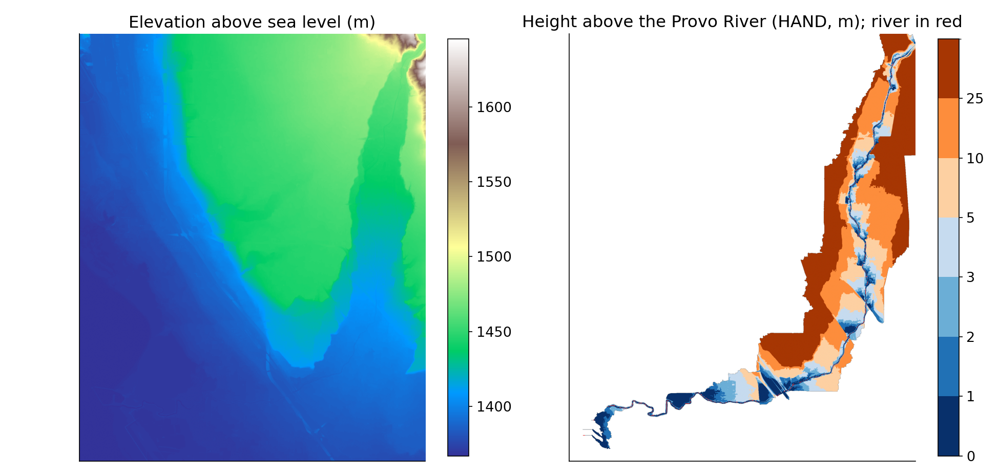

# Flood Mapping

## Part B — Measuring Flow, Flood Frequency, FEMA's Maps, How Good HAND Is, and Lab 7 Tips

CE 414 Engineering Applications of GIS
Civil & Construction Engineering
Brigham Young University
Dr. Dan Ames

<!-- Thursday of Week 8. Tuesday taught HAND and Lab 7's two models. Today is the rest of the hydrology (how a gage measures a river, what a 100-year flood is, what a FEMA map claims), how good HAND is against FEMA's map, and the ModelBuilder details students run into between now and Saturday. -->

<!-- stamp:begin -->
<!-- _footer: 'CE 414 · Week 8 — Flood Mapping, Part BLast Updated: 2026-10-28© 2026 Daniel P. Ames · <a href="https://creativecommons.org/licenses/by/4.0/">CC BY 4.0</a>' -->
<!-- stamp:end -->

---

# Today's Goals

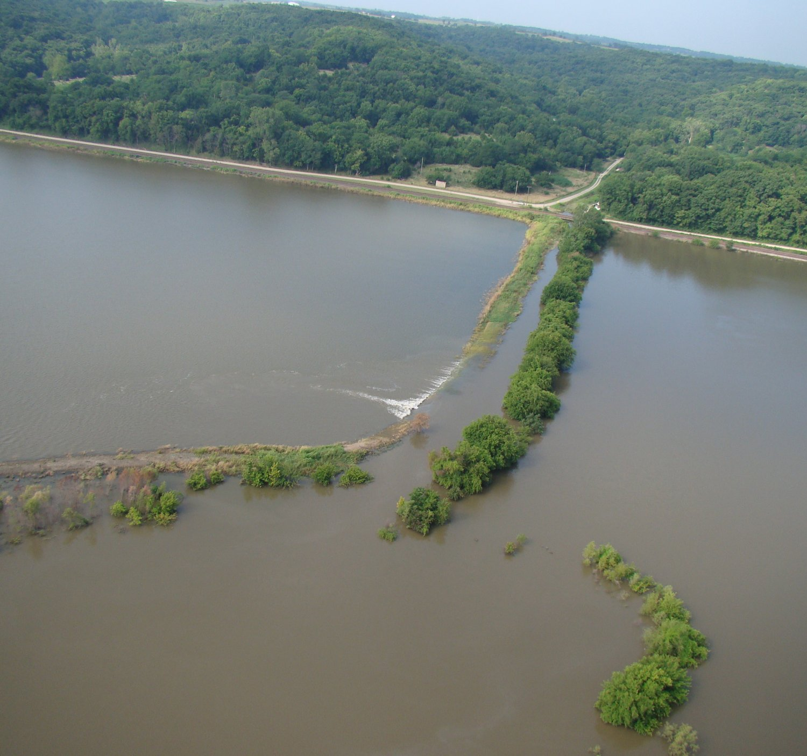

By the end of class you should be able to:

**Hydrology concepts**

- Say how a gage's **reading** becomes a **flow**, and how a flood flow becomes a **depth**
- Say what a **100-year flood** is, and what a **FEMA flood map** claims

**GIS concepts**

- Score one flood map against another with **hit rate, false alarms, and CSI**
- Place HAND among the **ways to draw a flood**, from a bathtub to 2-D hydraulics
- Build Lab 7's two models **without the common mistakes**

<!-- Photo: the Missouri River overtopping the upstream end of the Henry Pohl levee (Grape-Bollin-Swartz levee system) during the 2011 Missouri River flood, July 17, 2011, aerial view (U.S. Army Corps of Engineers, Kansas City District; public domain, via Wikimedia Commons, File:Missouri_River_Aerial_Photos_7_17_11_(5951537868).jpg). The goals are split the same way as Tuesday's: two hydrology ideas, and the rest is GIS. Tuesday taught HAND and the model; today is the rest of the hydrology, how good the cheap method is and what the expensive ones add, and the ModelBuilder details for Lab 7. Midterm 1 closes tonight. -->

---

<!-- _class: lead -->

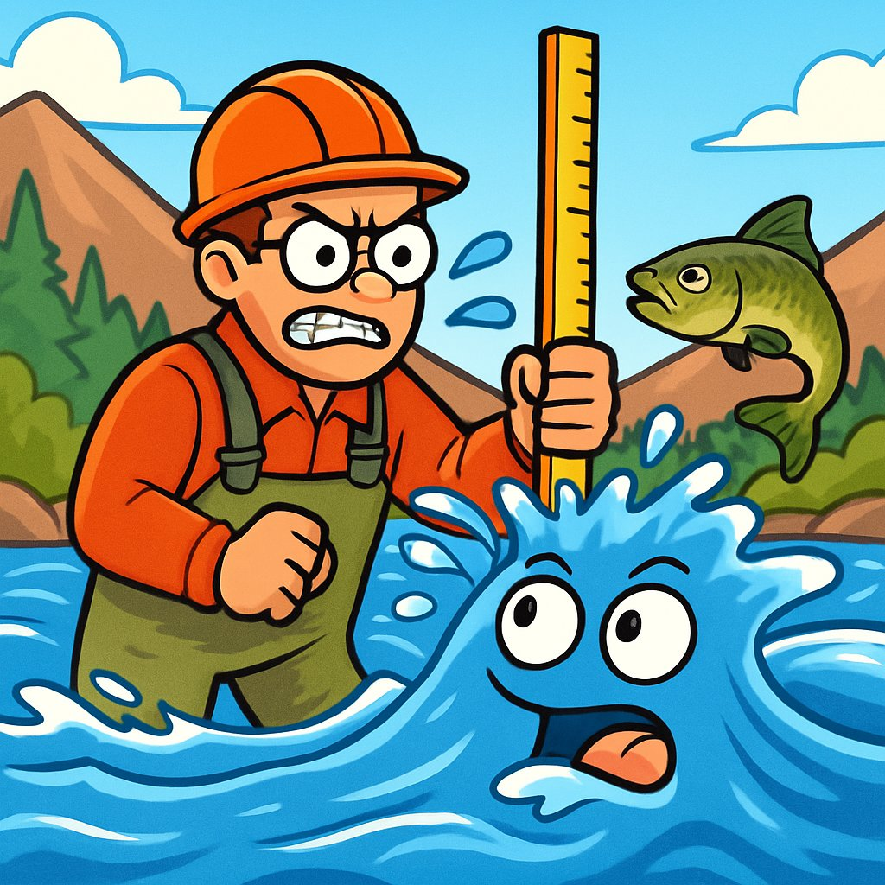

# Part 1 — Measuring Flow in Rivers

---

# What a Gage Measures

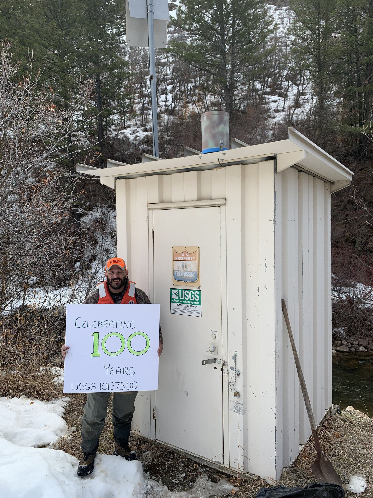

- A **stream gage** measures **stage**, the water level, about every **15 minutes**
- The reading goes by **satellite** to a USGS database the same hour; you can watch it live
- Stage becomes **flow** through a **rating curve** (three slides on)
- **Provo River at Provo**, USGS 10163000: record since **1903**

<!-- Photo: a USGS streamgage on the South Fork of the Ogden River near Huntsville, Utah, one of 25 Utah gages that have run for a century (USGS, public domain). The shelter houses the stage sensor, the data logger and the antenna. Most USGS gages record stage every 15 minutes and transmit hourly through the GOES satellite system to NWIS; the Lab 7 page links the live page for 10163000. What a gage does not measure directly is flow: that is the rating curve. Once a year the largest flow becomes the annual peak, the series Part 2 builds flood frequency from. -->

---

# The River's Ruler

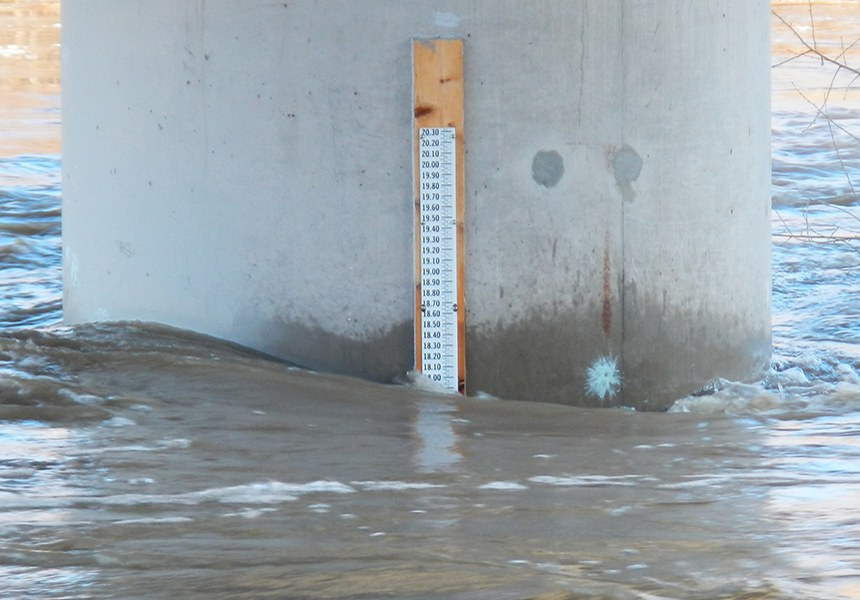

- A **staff gage** is a ruler fixed in the river; the gage's sensor reads the same number automatically
- The reading has three names for one thing: **stage** = **gage height** = **water level**
- What we want also has three names: **flow** = **discharge** = **Q**, in ft³/s
- A ruler gives you the first. How do you get the second?

<!-- Photo: a USGS staff gage, public domain (credit in the closing note). Say the synonyms out loud and write them on the board in two columns; the USGS pages, FEMA's study and the Lab 7 page use all six words, and students lose the thread when "stage" on one page becomes "gage height" on the next. The staff is graduated in hundredths of a foot; the electronic sensor in the shelter from the previous slide records the same quantity every 15 minutes and is checked against the staff on every visit. -->

---

# Same Reading, Two Rivers

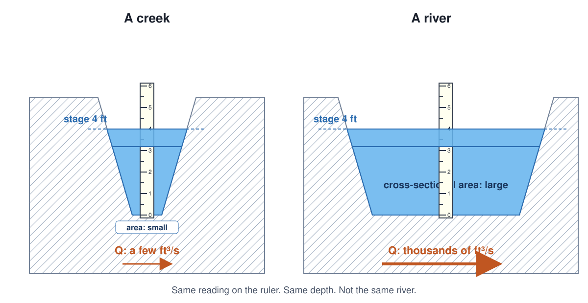

* Both rulers read **4 ft**
* **What is the difference between the two streams?**
* The **channel**: its **cross-sectional area** sets how much water a 4-ft stage carries
* So each gage has its own **stage → discharge** relationship, measured in the field: the **rating curve**

<!-- Click through the lines. Let them answer the question before the third line appears: the answer is the size of the channel, which a hydrologist summarizes as the cross-sectional area (and the velocity, which also grows with the river). Discharge is area times mean velocity; the USGS measures both by wading or from a bridge, many times across the range of stages, and fits the stage-discharge curve through those measurements. That curve is the rating, next slide. Diagram drawn for this deck; the flows are deliberately qualitative. -->

---

# The Rating Curve

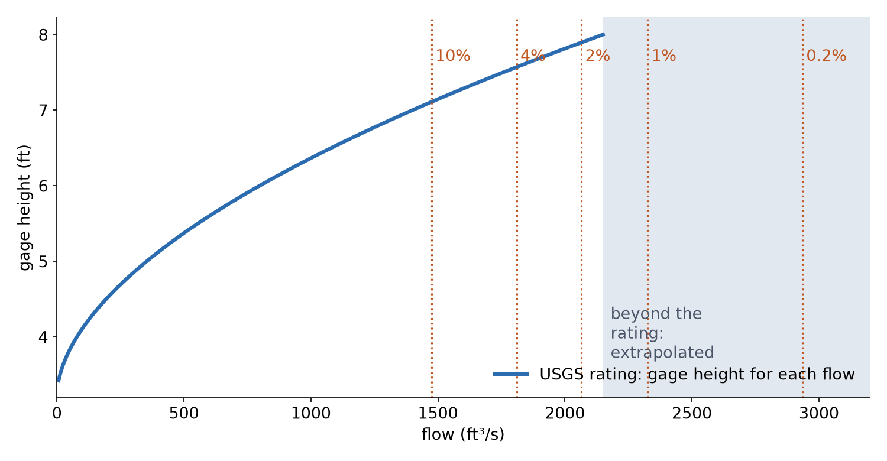

- Each gage's own **stage → flow** curve, fitted through years of field measurements
- Provo's current rating: **3.42 to 8.00 ft**, **6.8 to 2,150 ft³/s**
- For a flood, read it backwards: **flow → stage**
- FEMA's two largest design flows are **off the top** of the rating: those stages are **extrapolations**

FEMA, the Federal Emergency Management Agency, sets the design flows. We come back to FEMA and its maps in Part 2.

<!-- The USGS current rating for 10163000 (459 rows; the Lab 7 package, rating_10163000.csv). The dotted lines are FEMA's five design flows; the 1% and 0.2% annual-chance flows (the 100-year and 500-year floods, defined in Part 2) fall in the gray band beyond the last row, so Lab 7's stage table marks them extrapolated. Every student's own Lab 7 flow (900 to 2,088 ft³/s) is inside the table. A rating is built from field measurements, and floods are the hardest flows to measure, so the top of every rating is its least certain part. -->

---

# From Flow Back to Depth

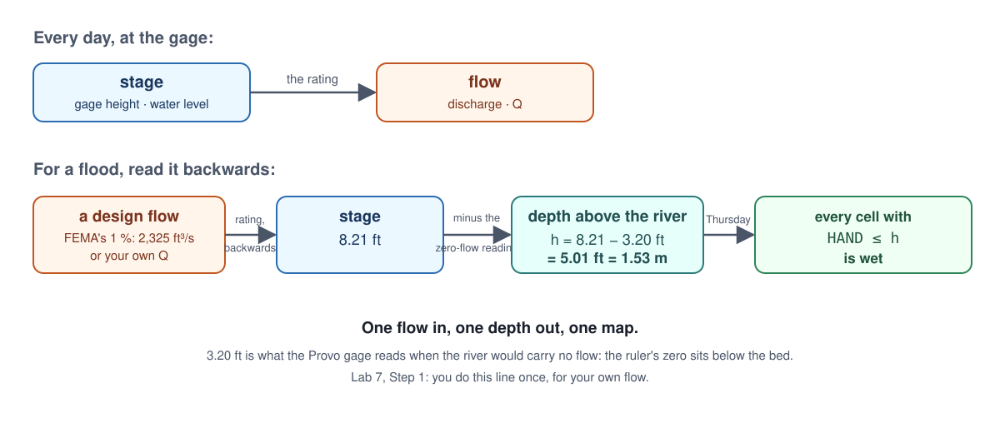

- Every day the gage goes **stage → flow**
- For a flood we go the other way: a design **flow → stage → depth** above the river
- FEMA's 100-year flow, **2,325 ft³/s**, reads **8.21 ft** on the ruler: a depth of **1.53 m**
- Tuesday's HAND: every cell with **HAND ≤ depth** is wet

<!-- Keep this one simple. The one subtlety is the 3.20 ft: a staff gage's zero is set below the bed so readings never go negative, so the depth of water above the river is the stage minus the reading the gage would show at zero flow (3.20 ft at Provo, from the rating's offset). Lab 7's stage table does this for FEMA's five flows and Step 1 has each student do it once for their own flow: h = (gage height − 3.20) × 0.3048 m. The "100-year flow" is defined properly in Part 2; for now it is FEMA's big design flood. Not on the slide, for the curious: adding the gage datum (4,493.22 ft NAVD 88) to a stage gives a water-surface elevation, which is what the bathtub uses; Lab 7's metadata question asks students to find that datum on the gage page. Diagram drawn for this deck. -->

---

<!-- _class: lead -->

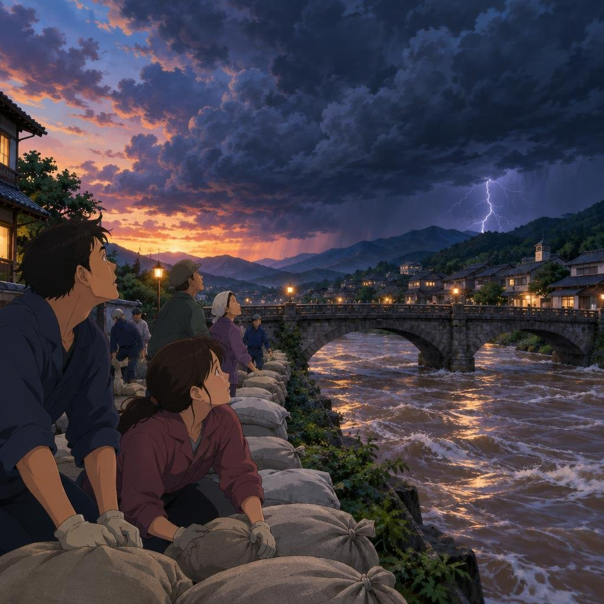

# Part 2 — How Big Is the Flood?

---

# One Number Per Year

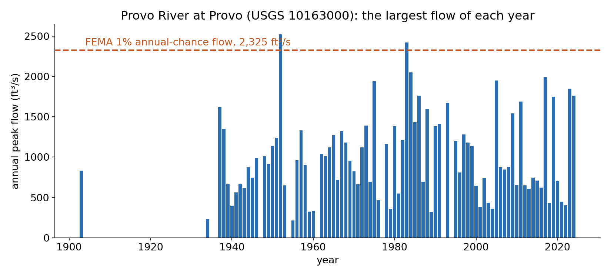

- Each year, keep the **largest flow**: the **annual peak**
- **Provo River at Provo**: **90** annual peaks, 1903 to 2024
- The record: **2,520 ft³/s** in 1952

<!-- Real NWIS peak series. The gaps are years with no record. Point at 1983 and 1952: two years above FEMA's 100-year flow, which is the next slide's puzzle. Every peak at this gage carries USGS code 6 (affected by regulation or diversion: Jordanelle and Deer Creek dams are upstream); that matters to a hydrologist fitting a frequency curve but not to Lab 7, so it is left off the slide. Data: the Lab 7 package, peaks_10163000.csv; figure from tools/week08_flood_figures.py. -->

---

# A 100-Year Flood Is a Probability

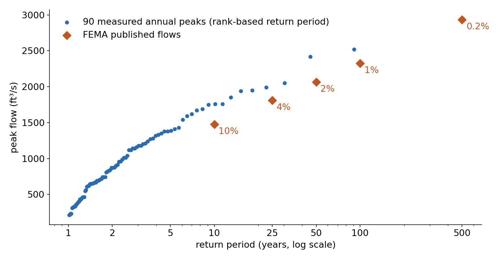

- **1% chance every year**, not "once a century." FEMA says **1% annual chance**
- 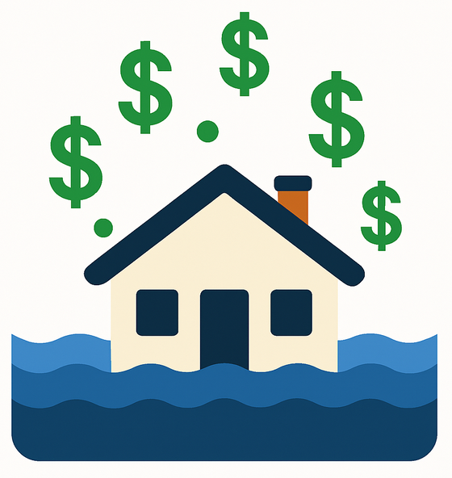Own a house beside the river for 30 years: 1 − 0.99³⁰ ≈ **26%** chance of at least one
- FEMA's flows here: **1,475 · 1,810 · 2,065 · 2,325 · 2,935 ft³/s** for the 10-, 25-, 50-, 100-, and 500-year floods

<!-- Blue: the 90 annual peaks ranked and plotted at (n+1)/rank, the simplest empirical return period. Orange: FEMA's published flows for the Provo River "3 miles above tie-in to Utah Lake", Utah County Flood Insurance Study, Table 9 (49049CV001B): the five flows Lab 7 floods (10%, 4%, 2%, 1% and 0.2% annual chance). The 30 years is the length of a typical home mortgage, which is why lenders require flood insurance inside FEMA's 1% floodplain; the icon is a reminder that the 26% is about money and houses. Ask the room why two measured years sit above FEMA's 100-year flow. Answers worth hearing: short records, dams upstream, a fitted distribution versus the raw ranks. A simple Log-Pearson III fit to this gage's own peaks since 1993 gives about 3,111 ft³/s for the 1% flow (tools/lab07, labeled a teaching approximation, not Bulletin 17C), 34% above FEMA's; two defensible "100-year floods" can differ that much. Class discussion only: Lab 7 uses FEMA's flows and does not ask it. Icon generated with OpenAI gpt-image-1 for this deck. -->

---

# Consider Rolling Double Sixes

* **What is the chance of rolling double sixes?**
* **Will it happen once every 36 rolls?**
* **Can it happen twice in a row?**
* A 100-year flood is double sixes on a **100-sided** die: **1 in 100**, every year, with no memory of last year
* 
"Gambling is built on the desire to obtain something for nothing."
President D. Todd Christofferson, "O Be Wise," October 2026 General Conference. Photo © Intellectual Reserve, Inc.

<!-- Each line appears on a click (press the right arrow). Let them answer before the next one. One in 36, about 2.8%. No: 36 rolls give about a 64% chance of at least one double six (1 − (35/36)^36), and many sets of 36 rolls have none. Yes: twice in a row is 1 in 1,296, rare but ordinary, and the second roll does not know about the first. Then the bridge: a 1% annual-chance flood is the same kind of statement, which is why Provo can have 1952 and 1983 in one lifetime. The last click brings up the meme: we roll dice in class, but we do not bet on them. Quote verified word for word on the talk page: President D. Todd Christofferson, Second Counselor in the First Presidency, "O Be Wise," Saturday morning session, October 3, 2026 (churchofjesuschrist.org/study/general-conference/2026/10/19christofferson); the whole talk is about gambling, including sports betting and prediction markets. Photo: the talk page's own image, unaltered (© Intellectual Reserve, Inc.; used small, with credit, for nonprofit teaching). Dice photo generated with OpenAI gpt-image-1 for this deck. -->

---

# FEMA's Flood Maps Are GIS

- **FEMA**, the **Federal Emergency Management Agency**, maps flood hazard for the **National Flood Insurance Program**: the **Flood Insurance Rate Map**, or FIRM
- Paper panels, then digital **DFIRM** databases, now the **National Flood Hazard Layer**: a live GIS service
- Every zone is a **return period**: **AE** is the 100-year floodplain; shaded X the 500-year
- Utah County's new map took effect **June 23, 2026**. Lab 7's FEMA layer is cut from it

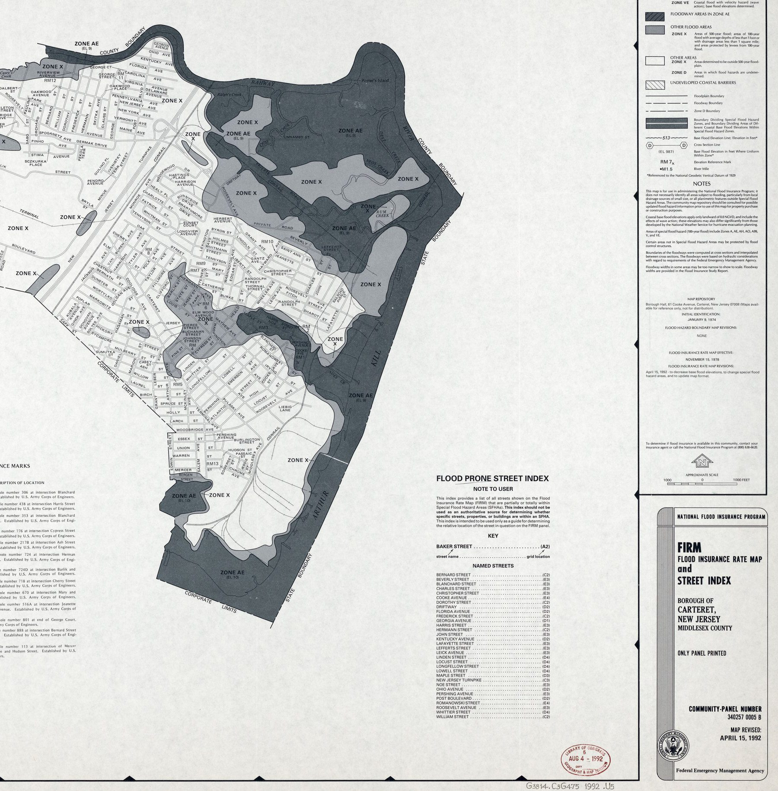

A paper FIRM: Carteret, New Jersey, revised April 15, 1992

<!-- The image is a scanned paper FIRM panel (Library of Congress, Geography and Map Division, call number G3814.C3G475 1992 .U5; public domain), the kind of sheet a lender or city planner read by hand before the maps went digital. The title block on the sheet gives the place and date (Borough of Carteret, Middlesex County, New Jersey; community-panel 340257 0005 B); the initial FIRM for Carteret took effect November 15, 1978, and this revision on April 15, 1992. Congress created the NFIP in 1968 and required countywide FIRMs in 1973; FEMA took the program over in 1979, prototyped a digital FIRM in the 1990s and converted the paper inventory from 2005 on (Map Modernization); the NFHL is the live product and is what the Lab 7 package queried for FEMA_Floodplain_1pct and FEMA_Cross_Sections. The point for a GIS class: a flood map is a polygon layer with a zone attribute, and every zone boundary is a claim about a return period. -->

---

<!-- _class: lead -->

# Part 3 — How Good Is HAND?

---

# Fast, Simple, Approximate

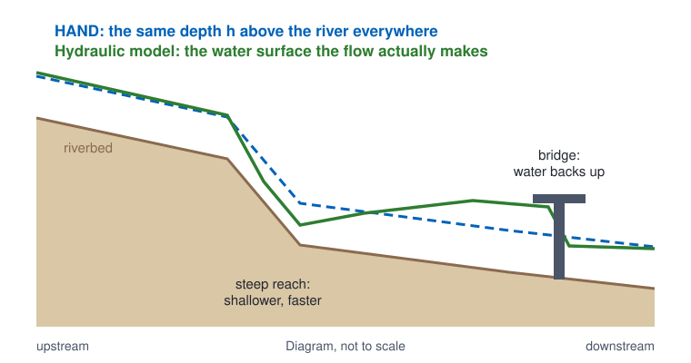

- **Fast**: one raster, one threshold per flood; NOAA runs it for the **whole country**
- **Simple**: a **DEM** and **flow direction**, nothing else
- **Approximate**: one depth **everywhere**; no bridges, levees, or backwater, and water that **splits off** to another path is invisible to D8

* Does a real flood rise the same depth at the canyon mouth and at Utah Lake?
* When would you still pay for a hydraulic model?

<!-- Suggested answers. (1) No. FEMA's own 100-year flood on the Provo River sits 1.5 to 2.1 m above the streambed across its cross-sections in the Lab 7 area; a steep reach runs shallower and faster, a bridge or a narrow channel backs the water up behind it, and HAND gives every one of them the same h. The figure shows both; it is a diagram, not to scale. (2) When a decision rides on the exact line: a flood insurance map, a bridge or levee design, a building at the edge of the floodplain. HAND is for a first look, a whole region at once, or a forecast that has to be ready in minutes, which is why NOAA's Office of Water Prediction runs it for the National Water Model (github.com/NOAA-OWP/inundation-mapping, checked October 9, 2026). Where it breaks in Lab 7: HAND floods ground beside the confined upper reach that the river cannot reach, it misses FEMA's overflow zone that leaves the river southward below the gage (split flow: D8 sends every cell to one river), and lidar cannot see under water, so the channel bottom sits about 0.47 m above FEMA's streambed. -->

---

# Bathtub and HAND, Same Depth

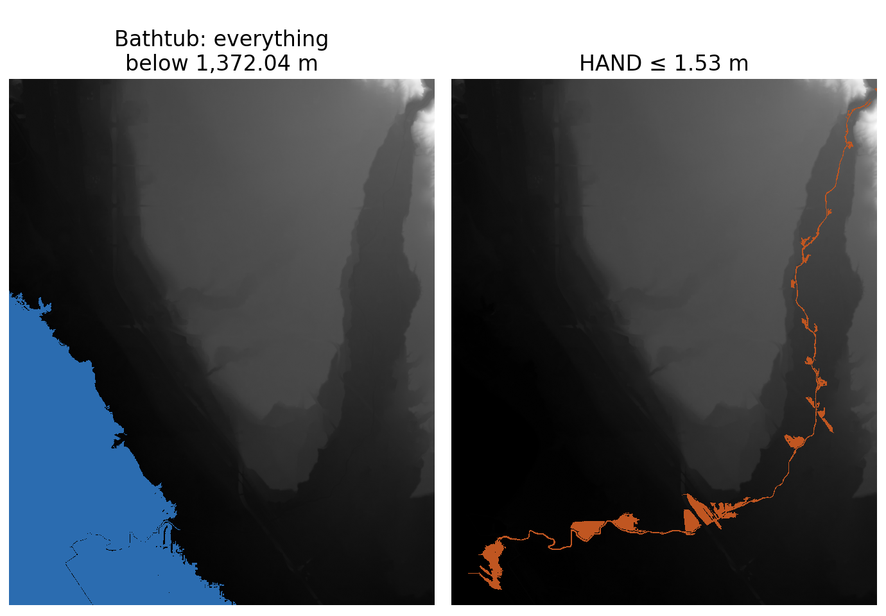

- **Bathtub**: floods the low ground by the lake, but never goes up the river
- **HAND**: follows the river to the top of the study area
- At the 100-year flood: bathtub **15.1 km²**, HAND **1.57 km²**

<!-- Same comparison as Tuesday, now read from the right: HAND's water surface follows the river up to the mouth of Provo Canyon, where the bathtub never reaches. Figure: tools/week08_partb_figures.py, the Lab 7 package's Filled_DEM and HAND. -->

---

# How Good Is It?

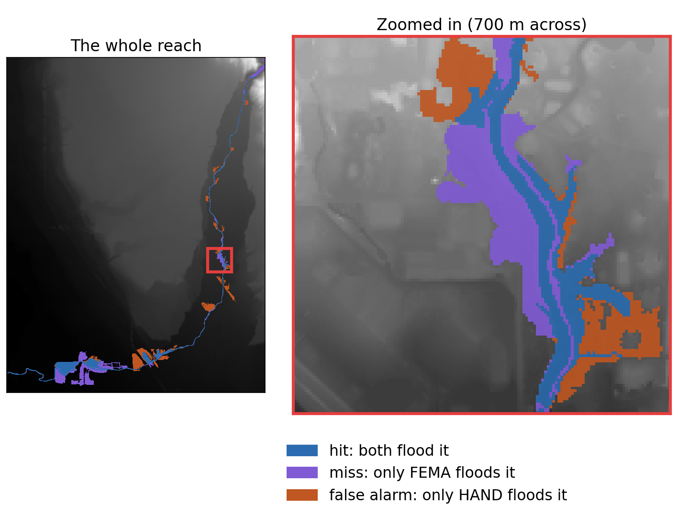

Lay HAND's 100-year flood over FEMA's and sort every cell:

- **Hit rate**: of the ground FEMA floods, the share HAND also floods. **0.548** means HAND finds about half of FEMA's floodplain
- **False-alarm ratio**: of the ground HAND floods, the share FEMA leaves dry: **0.425**
- **CSI** = hits ÷ (hits + misses + false alarms): **0.39**, where 1 is perfect

In Lab 7 these are **given to you**. Your report says what they mean and finds **one place** the maps disagree.

<!-- The zoom (red box) was picked by the figure script as the 700 m square where all three classes are well represented: blue cells are hits, purple are misses (FEMA floods, HAND does not), orange are false alarms (HAND floods, FEMA does not). Walk through the zoom first, then the definitions: count the blue against the blue plus purple for the hit rate. Official values: the Lab 7 page's Step 6 (tools/lab07/package_checks.json, polygon overlay inside Comparison_Area: FEMA 1.3429 km², HAND 1.2801 km², overlap 0.7361 km²); the raster tally in the figure differs in the third decimal. Students do not compute the scores in Lab 7; the page gives them, and the report explains them and finds one disagreement with a cropped figure. The feasibility study found CSI 0.39 to 0.40 for any h from 1.0 to 1.75 m: the agreement is limited by the terrain method, not by the hydrology. -->

---

# An Even More Accurate, and Costly, Method

Four ways to draw a flood, cheapest first:

* **Bathtub**: one water elevation. Right for a lake
* **HAND**: one depth above the river. Lab 7
* **1-D hydraulics** (HEC-RAS): a water surface at each **cross-section**. FEMA's map; months per river
* **2-D hydraulics**: **depth and velocity** in every cell of a mesh. Days of computing per flood

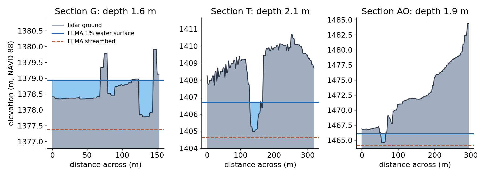

* 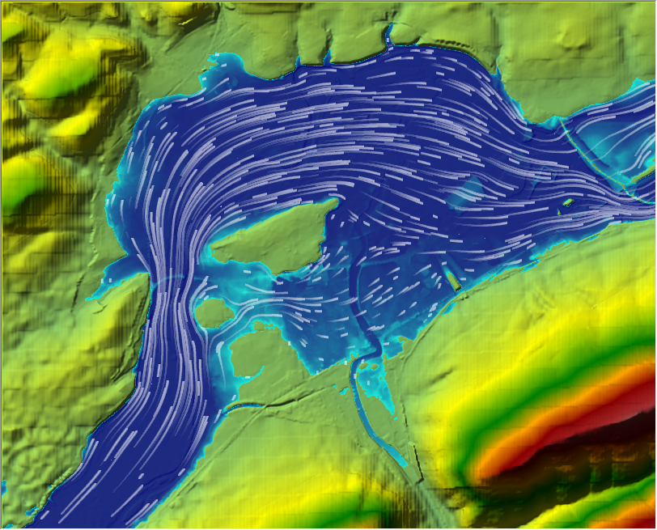

<!-- Click through the ladder. Top right: FEMA NFHL cross-section lines for Utah County (effective June 23, 2026; WSEL_REG and STRMBED_EL, converted from feet NAVD 88), sampled against the Lab 7 5 m lidar DEM: 43 sections in the Lab 7 reach, a median 100-year depth of 1.8 m over the 42 with a riverine water surface (one, near Utah Lake, carries -8888 because the lake controls it); depths 1.5 to 2.1 m. Section T shows the lidar channel bottom sitting above FEMA's streambed (lidar cannot see under water). HEC-RAS 1-D computes the water surface section by section from the cross-sections, roughness and bridges. The last click brings up a 2-D model result: particle traces over a depth layer from the HEC-RAS 2D User's Manual (U.S. Army Corps of Engineers, public domain); HEC-RAS 2D and Delft3D are common 2-D models. The ladder is accuracy against cost: a bathtub is a minute, HAND an hour, a 1-D FEMA study months and a 2-D model days of computer time per flood; each step adds physics the one below leaves out (slope, then velocity and storage, then two-dimensional flow across the floodplain). Ask which one a city should use to decide where to sandbag tonight, and which one to decide where to let a developer build. -->

---

<!-- _class: lead -->

# Part 4 — Final Tips for Lab 7 in ModelBuilder

---

# Set the Extent, or Lose the Valley Edges

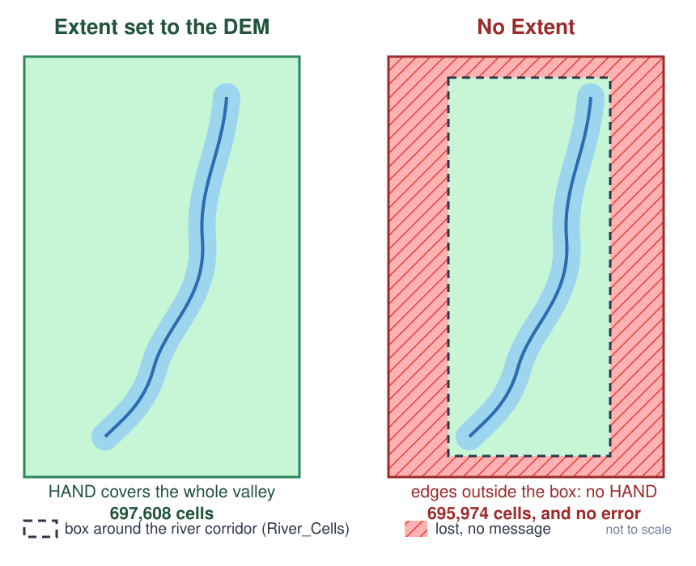

- In HAND Builder's **Environments**, set **Extent**, **Snap Raster**, and **Cell Size** from the DEM
- No Extent: HAND stops at the **box around the river**
- **695,974** cells instead of **697,608**, and **no error**
- Also: Flow Distance on `Filled_DEM`, and keep the **30 m corridor**

<!-- The Lab 7 page's Step 0 warning and Figure 0 (the Environments dialog with the Extent taken from Provo_DEM.tif). The diagram is a schematic, not to scale: the real loss is 1,634 cells at the edges of the valley. This one is the hardest to catch because nothing fails; the student just gets a smaller HAND and areas that do not match the check values. The other two traps, measured on the Lab 7 page (Steps 3 and 4): Flow Distance on the raw DEM gives 6,141 negative HAND cells; without the 30 m river corridor every gully is a river and the 100-year flood covers 47.9 km², not 1.57. -->

---

# Why We Convert to Centimeters

Errors Likely!

- `flood_1.53` is not a legal geodatabase name; `flood_153` is
- So `Stage_Table` stores each depth in **centimeters**, `H_CM`: 119, 134, 143, 153, 173
- **Iterate Field Values** over `H_CM`; leave **Data Type** at **String**
- Raster Calculator turns it back into meters: `Con("HAND" <= %Value% / 100, 1)`, output `flood_%Value%`

<!-- The lab's Figure 5a and the Step 5 note. %Value% is replaced by the row's text before the expression runs, so the first pass is literally Con("HAND" <= 119 / 100, 1). The badge is there because this is where most Lab 7 runs fail: change the Data Type, use meters in the output name, or type the expression into Con's own box, and the loop stops. Double-clicking the HAND layer in the Rasters list inserts "HAND" by layer name, and that still follows the model's HAND parameter when the model is run as a tool (checked in the GUI build). A SQL-style where clause on Value fails here (ERROR 010416), which is why the page uses Raster Calculator and not Con's own expression box. -->

---

# Collect, Then Merge

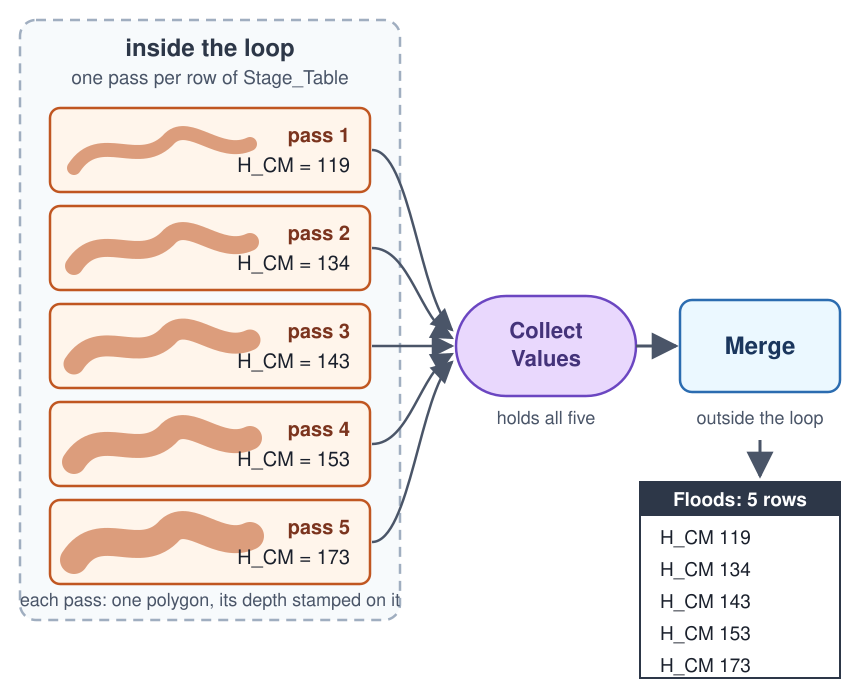

- **Raster to Polygon**: Simplify polygons **off**, Create multipart features **on**: one polygon per flood
- **Calculate Field** stamps `H_CM` on each polygon, so the five can be told apart
- **Collect Values** holds the five; **Merge**, outside the loop, stacks them into `Floods`
- `Floods` should have **5 rows**. One row: Merge ran inside the loop. Dozens: multipart was off

<!-- Lab 7 Figures 5c and 5d and the Step 5 check. In the model, drag Collect Values' Output Values onto Merge; Merge's Input Datasets box then shows one grayed name because it is fed by the connector, not the list, and that is normal. The check table on the page gives the five areas (1.2869 to 1.7135 km²) and cell counts; areas come out exact (cells × 25 m²) because the polygons are not simplified. Diagram drawn for this deck. -->

---

# Run It From the Dialog and Show That It Works

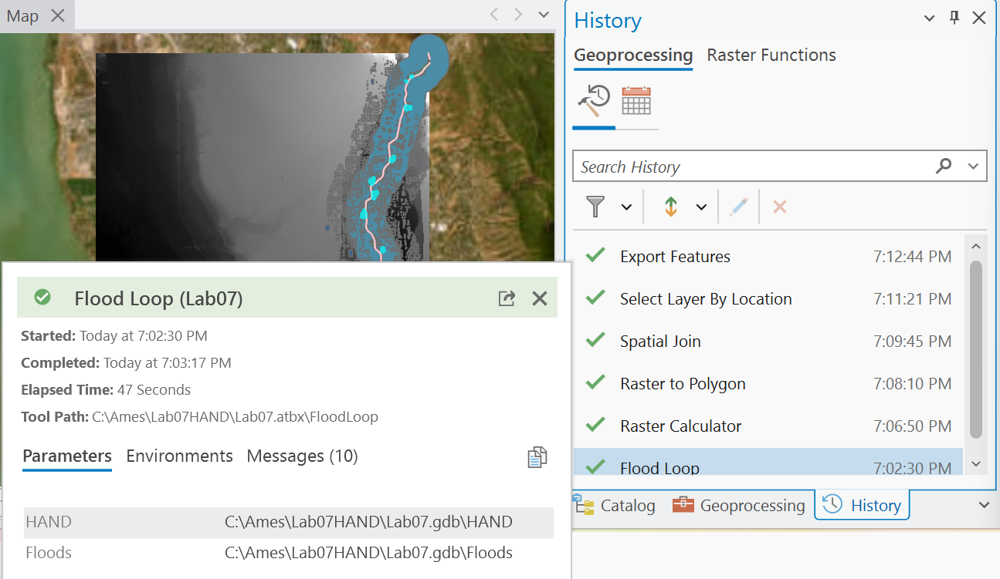

- Run **Flood Loop** from its **dialog** (Catalog pane): that is the run History records
- Red error on `HAND`? It is not a layer in your map: **browse** to `Lab07.gdb\HAND`
- **Capture the History pane** with the Flood Loop card open
- Models: **Export To Graphic**. Maps: **Export Layout** PDFs, not Print. Upload `Lab07.atbx`

<!-- Lab 7 Figure 7, from the October 19 GUI session: the History list with the Flood Loop card open (47 seconds from the dialog). The HAND error is what you see when the model is opened as a tool before HAND is in the map; a student following Step 5 in order will have added it. Print to PDF makes a 600 dpi picture of the page and fails the grader's selectable-text check, as several Lab 6 submissions found. The toolbox upload lets the grader open both models. -->

---

<!-- _class: lead -->

# Part 5 — Lab 7, Due Saturday

---

# Lab 7 at a Glance

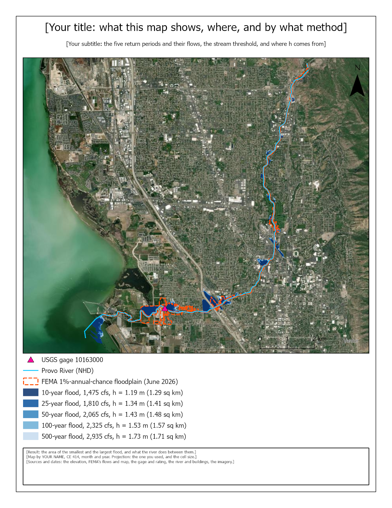

- **The reach**: the Provo River, **5 m lidar**, prepared for you
- **Two models, run once each**: **HAND**, then an **iterator** → five floods
- **The answer**: flooded area and **buildings**, for FEMA's flows and **your own**
- **The check**: your 100-year flood against **FEMA's**: where they differ, and why

[Lab 7 — Flood Mapping with HAND](https://byu-hydroinformatics.github.io/ce414-gis-applications/assignments/lab-07/)

<!-- The figure is the lab page's example layout for Map 1 (Figure 8), made with arcpy.mp from the GUI build's Floods: the five floods nested, FEMA's 1% outline, the gage. Its wording is bracketed placeholders on purpose; point out that the floods are thin at this scale, which is why the rubric wants the return periods labeled or a close-up. One-week lab during Midterm 1 week, so the data come prepared: DEM, river line, buildings, FEMA floodplain and the stage table are in the package. Two models: one builds HAND, one loops Iterate Field Values over the stage table (an iterator reruns every tool in its model). Each runs once; then three tools from the Geoprocessing pane flood the river at the student's own flow. No threshold reruns and no skill-score computation: the hit rate, false-alarm ratio and CSI are given on the page as data, and the report explains them and finds one place where HAND and FEMA disagree. Check values on the page: river 3,191 cells, HAND 697,608 cells; floods from 1.29 km² and 319 buildings (10-yr) to 1.57 km² and 413 buildings (100-yr). Deliverables: two layout PDFs, a two-page report, the .atbx, a History capture. -->

---

<!-- _class: activity -->

# Final Thoughts

**Quiz: How Big, How High?** Six questions: the rating curve, the 100-year flood, how good HAND is, and the Lab 7 tools.

- A quick check that today's material made sense
- The last two questions come back in Lab 7, Step 5

**Before next class**

- **Midterm 1** closes **tonight, 9:00 pm** (late fee from 2:00 pm)
- **Lab 7 — Flood Mapping with HAND** — due **Saturday 11:59 pm**
- Next week: **interpolation**, and Lab 8
- Office hours: [calendly.com/dan-ames/office-hours](https://calendly.com/dan-ames/office-hours)

byu-hydroinformatics.github.io/ce414-gis-applications/quizzes/floods/

<!-- Four minutes, in pairs. If the room has no signal, put the URL on the board. -->

<!-- Deck written October 9, 2026. Figures: tools/week08_flood_figures.py and tools/week08_partb_figures.py, drawn diagrams, and four copied from the Lab 7 page on October 19, 2026 (fl-hand-model.svg = lab07-model-hand.svg, fl-flood-calc.png = lab07-flood-calc.png, fl-example-map-floods.png and fl-example-map-own.png = lab07-example-map-baseline/-design.png; refresh the copies if the lab's figures change); numbers from the Lab 7 package (tools/lab07/package_checks.json). fl-2d-hydraulics.png is Figure 6-15 of the HEC-RAS 2D User's Manual, particle tracing over a depth layer (U.S. Army Corps of Engineers Hydrologic Engineering Center, public domain; hec.usace.army.mil/confluence/rasdocs/r2dum, Viewing 2D output, Plotting Velocity), unchanged. fl-iterate-dialog.png and fl-history.png are copies of the Lab 7 page's Figures 5a and 7. Edited October 19, 2026 (Tuesday and Thursday decks reorganized). Revised October 21, 2026, for the Thursday class: the gage-to-depth part ("Measuring Flow in Rivers") moved ahead of flood frequency and FEMA; the goals split into hydrology and GIS concepts over a new photo; the regulation bullet dropped from the annual-peak slide; a flooded-house icon on the probability slide; a dice photo and the "O Be Wise" meme on the dice slide; FEMA spelled out and the paper FIRM labeled; larger figures for flow-to-depth, bathtub against HAND, and the FEMA comparison (with a zoomed panel); "Where HAND Breaks" removed (its points are now in the Approximate bullet and the notes of Fast, Simple, Approximate); the methods ladder shortened; wireframes for the Extent trap and for Collect Values and Merge; the centimeters slide retitled with a warning badge. -->
