<!-- _class: lead -->
<!-- _paginate: skip -->

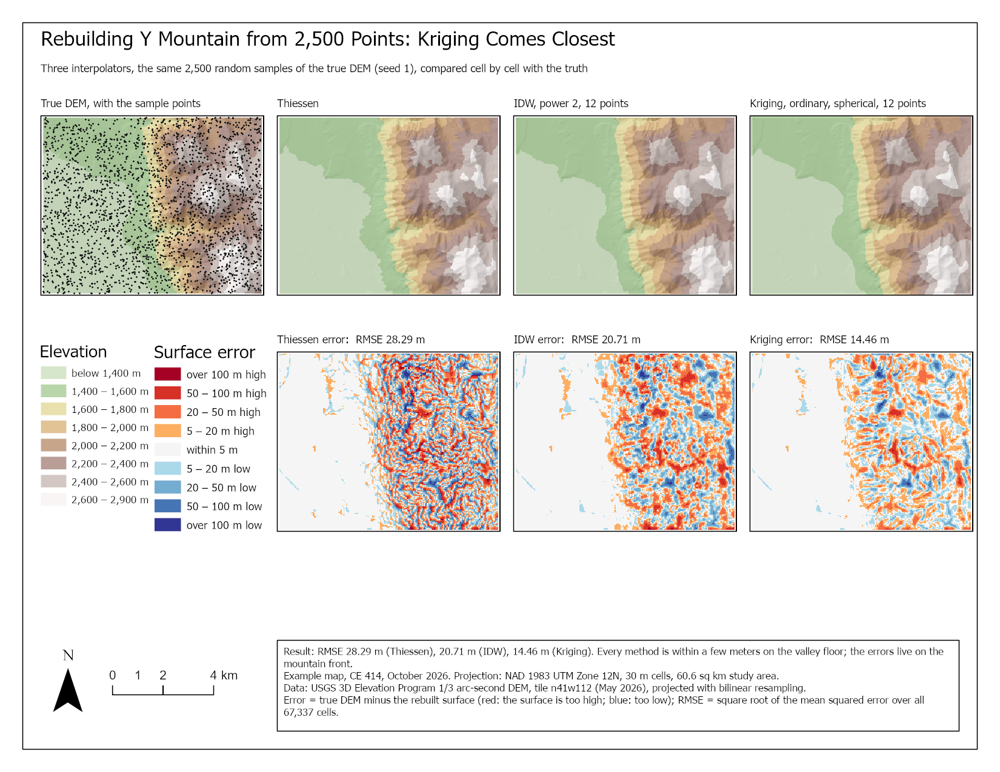

# Kriging and Interpolation Error

## Which Surface to Trust — and Lab 8

CE 414 Engineering Applications of GIS
Civil & Construction Engineering
Brigham Young University
Dr. Dan Ames

<!-- Thursday of Week 9. Tuesday built surfaces with weights from a rule you choose: Thiessen and IDW. Today starts with kriging, which takes its weights from the data, then asks how wrong each surface is and which one to trust. Then Lab 8, which does exactly this on Y Mountain with all three methods. The title image is the Lab 8 example baseline sheet: the true DEM and three rebuilds from the same 2,500 points, with their error maps underneath. -->

<!-- stamp:begin -->
<!-- _footer: 'CE 414 · Week 9 — Kriging and Interpolation ErrorLast Updated: 2026-10-28© 2026 Daniel P. Ames · <a href="https://creativecommons.org/licenses/by/4.0/">CC BY 4.0</a>' -->
<!-- stamp:end -->

---

# Today's Goals

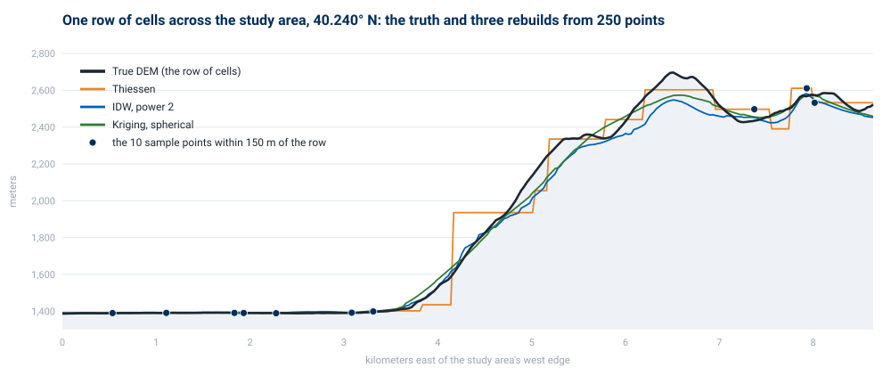

By the end of class you should be able to:

- Say why **closer** points count more, and what the **nugget**, **range** and **sill** do to a kriged surface
- Compute an **error raster** and say what its **sign** means
- Reduce the error to one number, the **RMSE**, and compute it in ArcGIS Pro
- Say which surface to **trust**, and why the answer **depends**
- Say what **Lab 8** asks for, and how you will know you are right

<!-- The profile on the right is one row of cells across the Lab 8 study area: the truth and the three rebuilds from 250 points. Thiessen steps, IDW sags, kriging smooths the peak off. The second half of today is a way of putting a number on the gaps between those lines. Testing whether a ranking survives a change is Lab 8 Step 8; Part 4 previews it. -->

---
<!-- _class: lead -->

# Part 1 — Kriging

## Closer in space, closer in value

<!-- Tuesday's methods weight points by a rule you choose: nearest only, or 1/d^n. Kriging first measures how similarity fades with distance, from the samples themselves, and takes its weights from that. Part 1 was rebuilt October 26, 2026 for students who will run the tool rather than compute kriging by hand: Tuesday's Provo worksheet, a neighbor test, the curve in plain words, then what each setting does. The lag-distance, autocorrelation, semivariance-equation and decomposition slides were cut. October 28, 2026: two more neighbor tests (no pattern, a regional trend), a slide that builds the semivariogram one bin at a time with its equation, and the fit split onto its own slide. -->

---

# Remember Provo?

- On Tuesday you trusted **American Fork** most: it is 19 km from Provo, and Moab and Cedar City are over 250 km away
- **IDW** turned that instinct into a fixed rule: weight = 1/d²
- **Kriging** asks the data instead: *how much* more alike are closer places?

* Closer in space, closer in value: kriging measures how much

<!-- Start from what every student did on Tuesday's worksheet. Ask who weighted American Fork most and why. That instinct, nearby places are more alike, is the whole idea of kriging; the only new question is how much more alike, and kriging answers it from the data rather than from a rule like 1/d^2. One click brings up the one-line summary. The map and distances are Tuesday's (tools/week09_tuesday_figures.py). -->

---

# The Neighbor Test

Every <strong>pair</strong> of stations we already know is a test: how <strong>far apart</strong> are they, and how <strong>different</strong>?

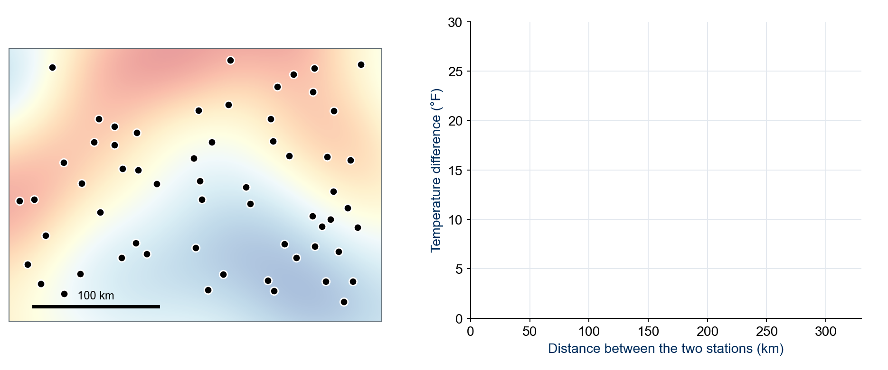

* 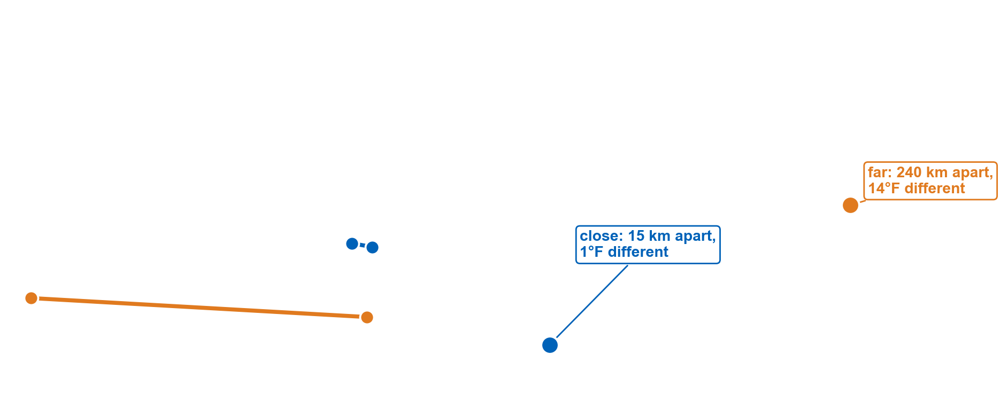
* 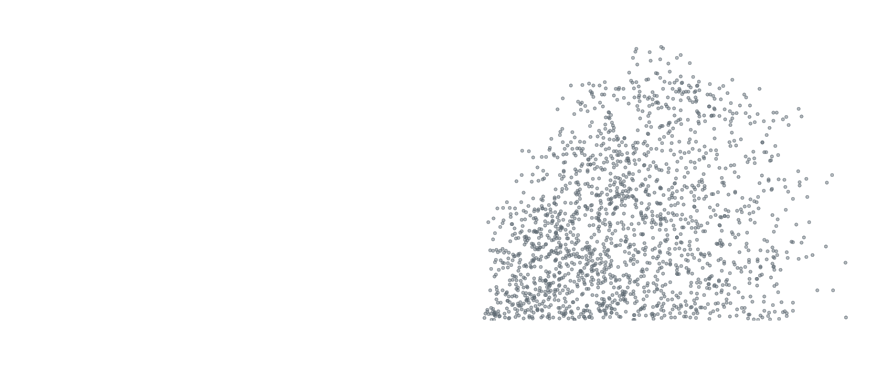

<!-- Two clicks. First one close pair and one far pair, on the map and as two dots: 15 km apart and about 1 degree different; 240 km apart and about 14 degrees. Second click: every pair of the 60 stations, 1,770 of them. Close pairs sit near the bottom (alike); far pairs scatter high (anything goes). That pattern is what kriging measures. The temperatures are made up: a smooth afternoon field plus a little instrument noise (tools/week09_kriging_story_figures.py). -->

---

# The Neighbor Test: No Pattern

The same 60 stations, but now every reading is <strong>independent</strong> of its neighbors: no pattern at all

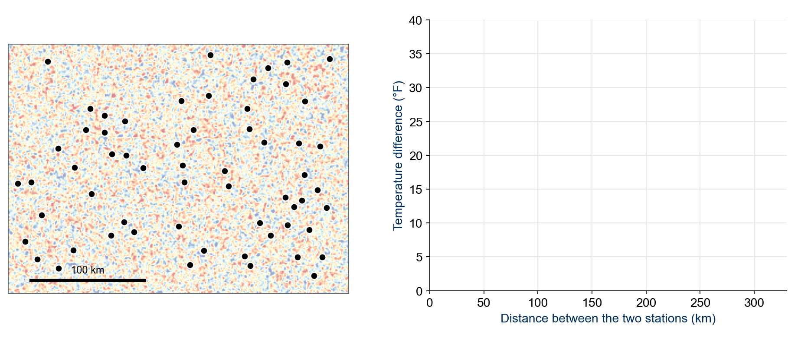

* 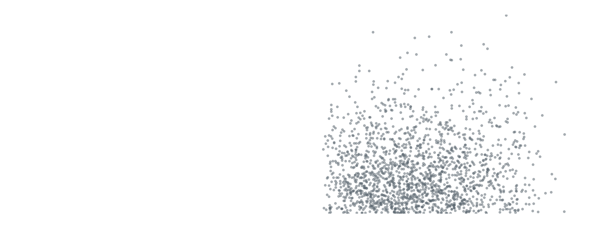
* Close pairs differ as much as far pairs: a neighbor tells you <strong>nothing</strong>, and kriging can do no better than the <strong>average</strong>

<!-- Two clicks: the cloud, then the takeaway. Same station locations as the last slide, but each reading is drawn independently (white noise plus the same small instrument error), so a station 15 km away is no more like Provo than one 250 km away. Ask before the first click what the cloud will look like. The cloud is flat: no bottom-left corner of alike close pairs. A semivariogram of this would be all nugget, and kriging with it puts the average everywhere; Part 3 shows a real mountain that the automatic fit mistook for exactly this. Note the y axis here runs to 40, not 30, so all the points fit. Made up; tools/week09_kriging_story_figures.py. -->

---

# The Neighbor Test: A Regional Trend

The same stations again, now on a <strong>regional trend</strong>: warm in the west, cooler to the east

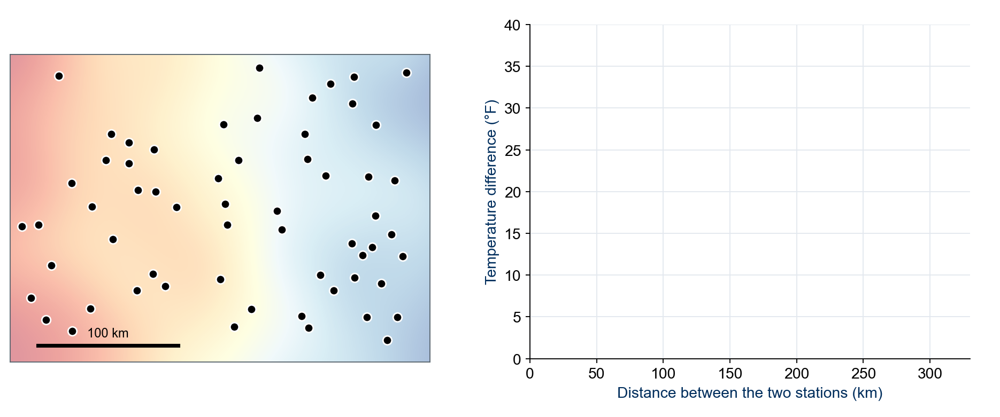

* 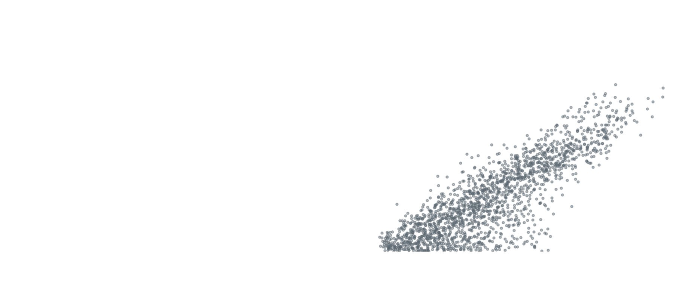
* The difference keeps <strong>growing</strong> with distance and never levels off: no sill. Fit the <strong>trend</strong> first (Tuesday's trend surface), or use kriging that includes one

<!-- Two clicks again. A steady west-to-east drop of about 0.09 degrees F per km plus a little smooth wiggle. Close pairs are alike, as in the first test, but far pairs never stop getting more different, so the cloud is a wedge rather than a curve that levels off. Pairs lined up north-south stay alike even when far apart, which is why the bottom of the wedge stays near zero. Kriging assumes the differences level off at a sill; a trend like this breaks that, so either take the trend out first with Tuesday's trend surface and krige what is left, or use Universal kriging, which fits the trend inside kriging. Three clouds, three stories: smooth field (levels off), no pattern (flat), trend (keeps rising). Made up; tools/week09_kriging_story_figures.py. -->

---

# Build the Semivariogram, One Bin at a Time

$$
\gamma(h) = \frac{1}{2\,N(h)} \sum_{N(h)\ \text{pairs}} \left(z_i - z_j\right)^2
$$

Take every <strong>pair</strong> about <em>h</em> apart, square each pair's difference, average them, and halve it: one dot on the graph per <strong>20 km bin</strong>

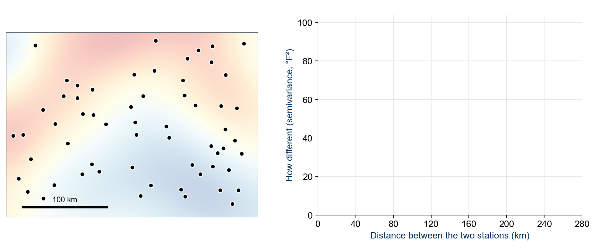

* 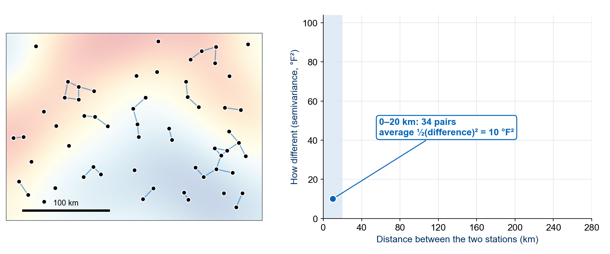
* 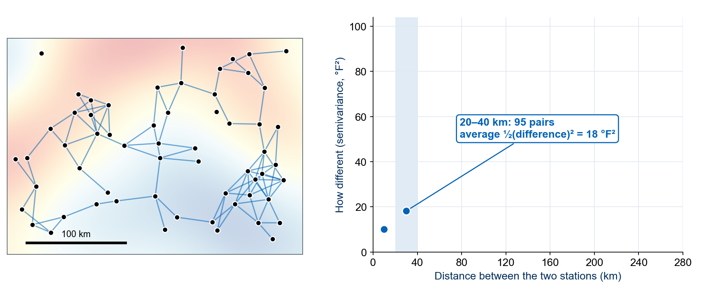
* 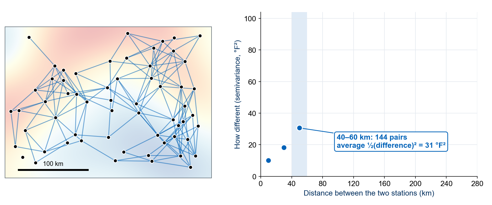
* 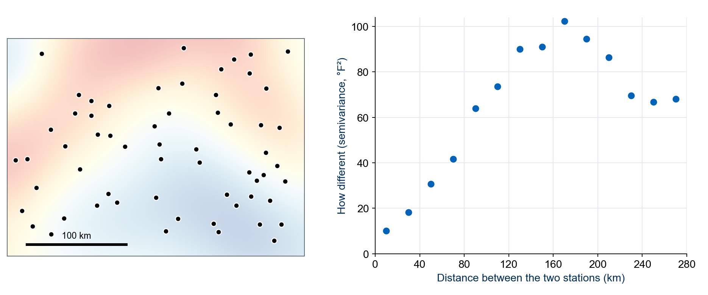

<!-- Four clicks, one bin at a time, then the rest. Click 1: every pair of stations less than 20 km apart is drawn on the map (only a few dozen; they are the close neighbors), and their average half-squared difference becomes the first dot. Click 2: the pairs 20 to 40 km apart, a longer web of lines, and a dot a little higher. Click 3: 40 to 60 km. Click 4: the same thing done for every 20 km bin out to 280 km: the dots rise and level off. N(h) is the number of pairs in the bin, z_i and z_j the two stations' readings. The one-half is why it is called the semi-variance; it makes the far-apart level (the sill) equal the variance of the readings. The bin width is ArcGIS Pro's Lag size. 20 km bins rather than 10 km because 60 stations give too few pairs closer than 10 km for a steady average. Students never compute this by hand; the tool does it. Same made-up stations as the neighbor test (tools/week09_kriging_story_figures.py). -->

---

# Fit a Model to the Dots

Now we have the dots. Many **kriging models** have been developed; pick one and **fit** it to the dots, and the tool reads three numbers off the curve. The last click shows three of the shapes.

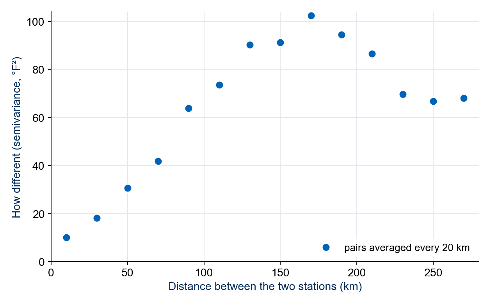

* 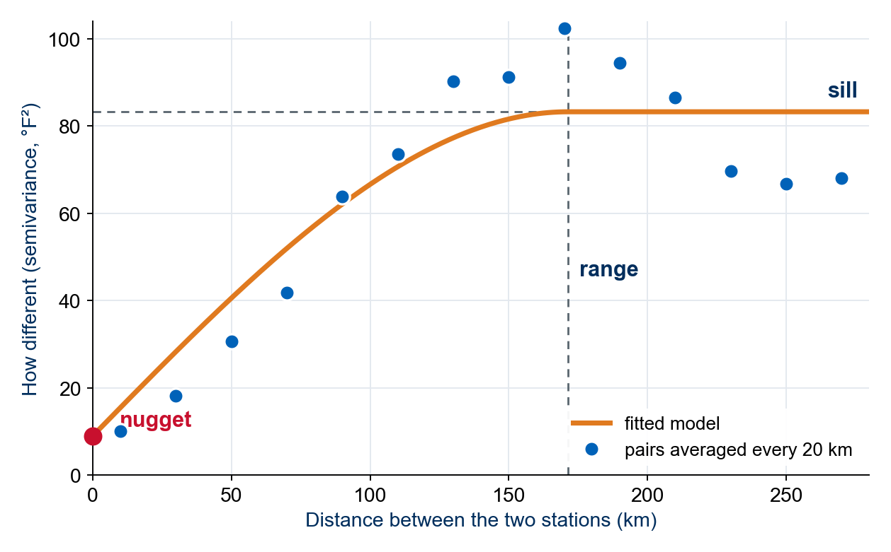The fitted model, in <strong style="color:#e07a1f">orange</strong>: here a spherical one

* <strong>Nugget:</strong> two thermometers a step apart still disagree a little
* <strong>Range:</strong> how far away a station still tells you something
* <strong>Sill:</strong> how different far-apart places typically get
* Past the range, what does Moab tell you about Provo?
* No more than the state's average does

* 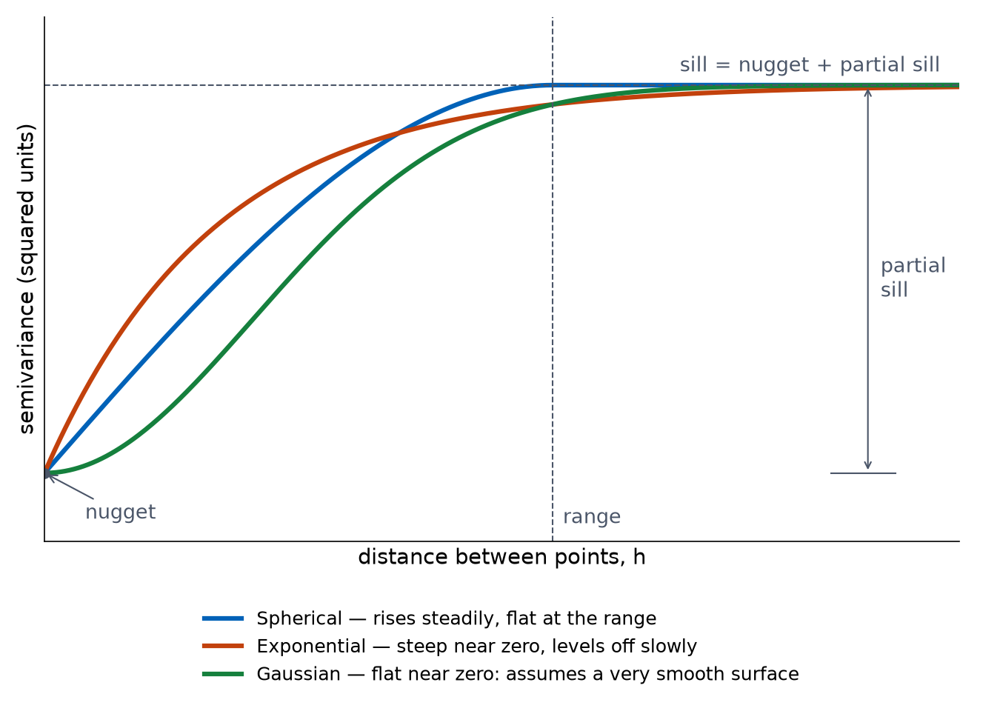Lab 8 runs <strong>all three</strong> models on Y Mountain

<!-- Seven clicks: the fitted model, then nugget, range, sill, a question and its answer, and last the three model shapes Lab 8 offers with the Lab 8 banner. No need to go into how the fit is done: there are many model shapes, the tool fits one to the dots, and it appears in orange. The tool never asks students to compute this; it fits the curve and reports these three numbers, and they are exactly the Major range, Partial sill (sill minus nugget) and Nugget boxes in the Kriging dialog, which Lab 8 leaves empty so the tool fits them. Nugget: instrument error or variation closer than any two stations. Range: past it, a station is no more use for Provo than the regional average. Sill: the typical difference between far-apart places. Here the made-up stations give a nugget of 9 degrees F squared (the noise put into the readings), a sill of about 83 and a range of about 170 km. Last click, the three models (merged here October 28, 2026 from their own slide): same nugget, sill and range, different shape near zero. Spherical rises steadily and is flat past the range; exponential is steepest at first, so neighbors lose their likeness fastest; Gaussian is flat at first and assumes a very smooth surface. Drawn from the formulas ArcGIS Pro's Kriging documents (tools/week09_semivariogram_models.py); the exponential and Gaussian only approach the sill, so their range is the distance where they reach 95 % of it. The shape near zero matters most, because the nearest samples carry most of the weight. Do not give the class Lab 8's results; the Gaussian run's error map is one of the lab's questions. -->

---

# Under the Hood: How Kriging Gets Its Weights

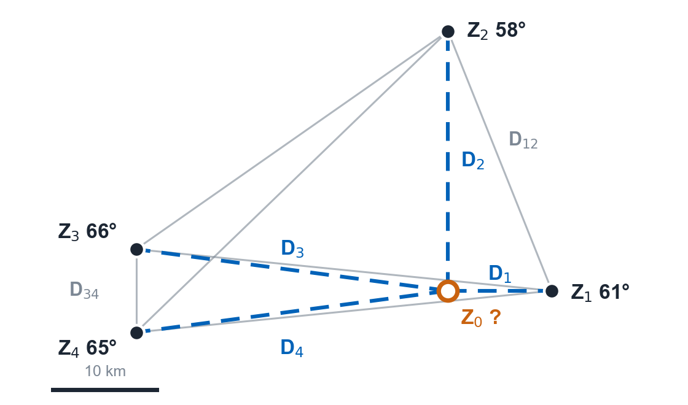
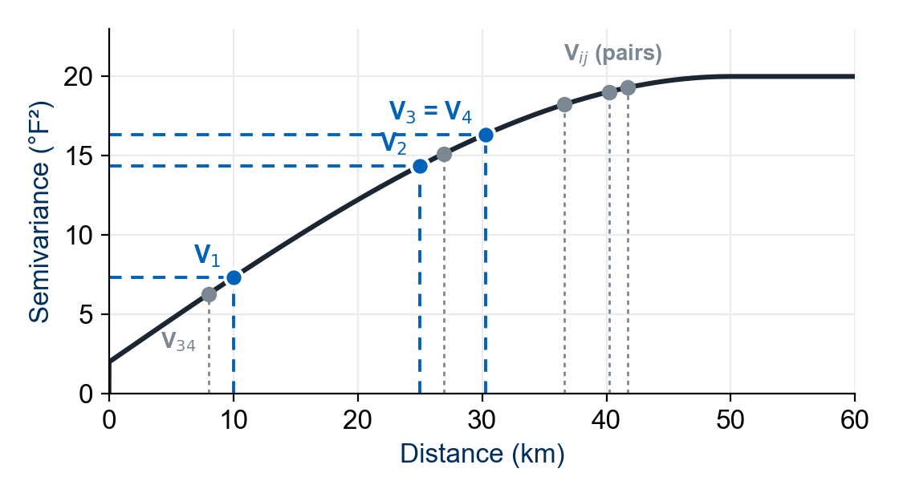

- The weights are **not read straight off the curve**. Read it at two kinds of distance:
  - Z₀ to each sample: how far off each sample is likely to be (V₁…V₄)
  - sample to sample: how much the samples **repeat** each other (V₁₂…V₃₄)
- Put them in one small **system of equations** and solve for the weights λ, which add up to 1
- Then Z₀ is a **weighted average**, just like IDW. Clustered samples share their weight; IDW never sees that
- ArcGIS Pro does this for **every cell**, with its 12 nearest points
- **Read more:** [How Kriging Gets Its Weights](https://byu-hydroinformatics.github.io/ce414-gis-applications/explainers/kriging-weights/), the full example worked by hand

<table class="kw-mx" aria-label="The kriging system">
<tr><td class="br" rowspan="5">[</td><td class="d0">0</td><td class="gij">V₁₂</td><td class="gij">V₁₃</td><td class="gij">V₁₄</td><td class="one">1</td><td class="br" rowspan="5">]</td><td class="br" rowspan="5">[</td><td class="lam">λ₁</td><td class="br" rowspan="5">]</td><td class="op" rowspan="5">=</td><td class="br" rowspan="5">[</td><td class="v">V₁</td><td class="br" rowspan="5">]</td></tr>
<tr><td class="gij">V₁₂</td><td class="d0">0</td><td class="gij">V₂₃</td><td class="gij">V₂₄</td><td class="one">1</td><td class="lam">λ₂</td><td class="v">V₂</td></tr>
<tr><td class="gij">V₁₃</td><td class="gij">V₂₃</td><td class="d0">0</td><td class="gij">V₃₄</td><td class="one">1</td><td class="lam">λ₃</td><td class="v">V₃</td></tr>
<tr><td class="gij">V₁₄</td><td class="gij">V₂₄</td><td class="gij">V₃₄</td><td class="d0">0</td><td class="one">1</td><td class="lam">λ₄</td><td class="v">V₄</td></tr>
<tr><td class="one">1</td><td class="one">1</td><td class="one">1</td><td class="one">1</td><td class="one">0</td><td class="lam">m</td><td class="v">1</td></tr>
</table>

Z₀ = λ₁Z₁ + λ₂Z₂ + λ₃Z₃ + λ₄Z₄

Here: λ = 0.63, 0.16, 0.10, 0.12, so Z₀ = **61.5 °F**

<!-- A one-slide primer on what the Kriging tool does with the fitted curve, added October 28, 2026 in place of the separate three-models slide (those models are now the last click of Fit a Model to the Dots). Students often assume the weights are read straight off the semivariogram. They are not: the curve is read at two kinds of distance, from the unknown point to each sample (blue, V1 to V4: how far off each sample is likely to be) and between every pair of samples (gray, the six Vij: how much the samples repeat each other). Those ten numbers fill a 5 x 5 system: the gray block is sample-to-sample, the blue column is target-to-sample, and the last row forces the weights to add to 1; m is a Lagrange multiplier that makes that rule fit. Solve it and you have the weights; Z0 is then the same weighted average as IDW. The example is made up (spherical model, nugget 2, sill 20, range 50 km): weights 0.625, 0.157, 0.095 and 0.122, Z0 = 61.49 F, and an expected error of about 3.3 F. Z3 and Z4 are the same distance from Z0 but get different weights because Z3 is closer to Z2 and repeats some of what Z2 says; IDW gives them the same weight. Students do not need to solve this by hand; the link goes to the full worked page (docs/explainers/kriging-weights/index.html), and the figures are from tools/week09_kriging_weights_figures.py. -->
---

# Same Points, Different Settings

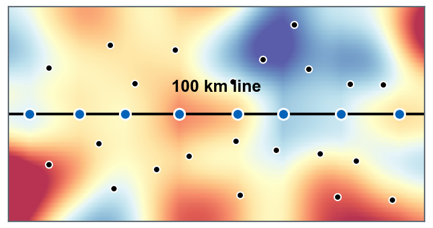
The truth (right) and <strong>30 thermometers</strong>. Each line graph is a <strong>cross section</strong> of the kriged map beside it, along the <strong>100 km line</strong>

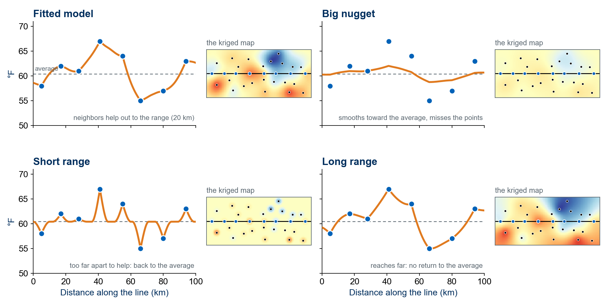

<!-- The inset at upper right is the made-up truth: a temperature map, a straight 100 km line across it with 8 thermometers on it (blue), and 22 more scattered off the line (black). Every panel krigs all 30 points in two dimensions; the line graph is that kriged map read along the line (a cross section) and the small map beside it is the whole surface, so each setting shows both ways. Point at the maps after each line graph: fitted model, a believable heat map; big nugget, nearly one flat color; short range, a yellow sheet with a small bull's-eye on each thermometer; long range, broad smooth blobs. Redrawn October 28, 2026 with the maps; before that the panels were one-dimensional kriging of the 8 points alone. Fitted model: each point's influence reaches out to the range and fades. Big nugget: the model says even neighbors barely agree, so the surface smooths toward the average and misses the points (Thursday's flat kriging panel later is the extreme case). Short range: the points are farther apart than the range, so between them the estimate falls back to the average. Long range: every point reaches far, so the curve runs straight between points and never returns to the average. Ask before revealing each caption which panel is which. Made-up values; ordinary kriging of the smooth signal (tools/week09_kriging_story_figures.py). -->

---

# Kriged Result

Like IDW, a <strong>weighted average</strong> of nearby points, but the <strong>variogram</strong> sets the weights, not a fixed 1/dn

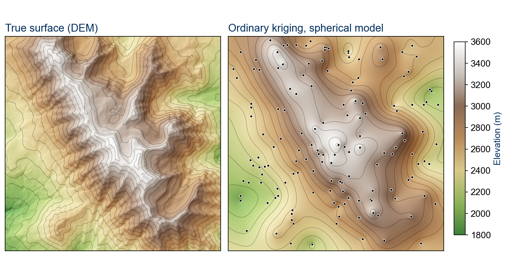

* This looks better than Tuesday's methods. Why doesn't it give back the <strong>full terrain</strong> of the mountain?
* Because you can't <strong>fabricate data</strong>. Between the samples, kriging only has a weighted average of the points it was given.
* A <strong>generative AI</strong> model could invent ridges and canyons that look more real, but it still could not give back <em>this</em> mountain without many more points.

<!-- Three clicks: the question (let the room answer before the next click), the answer, then the generative-AI point. Every method today only rearranges the 150 measured elevations; none of them can know about a canyon that no sample fell in, so the ridges and gullies between samples are gone. A generative model trained on many DEMs could fill in plausible-looking terrain texture, but it would be invented texture, not Mount Timpanogos's actual ridges; only more measurements bring those back. The true DEM on the left, the kriged surface from Tuesday's 150 samples on the right (ordinary kriging, the spherical model on the previous slides). Compare it against Tuesday's IDW panels: the bull's-eyes are gone, because the weights now reflect how quickly elevation actually decorrelates with distance instead of a fixed 1/d^n rule. Against the whole DEM it scores 86 m RMSE, IDW 110 m. The line above the figure is the sentence the quiz asks about; it came from the "From Variogram to Surface" slide, merged here October 26, 2026 along with the variogram and 3D kriging slides. -->

---

# Kriging in ArcGIS Pro

- **Spatial Analyst ▸ Kriging**, method **Ordinary**
- Leave the model's numbers empty and the tool **fits** them to your points
- A default is not always right: Part 3 shows one that fails

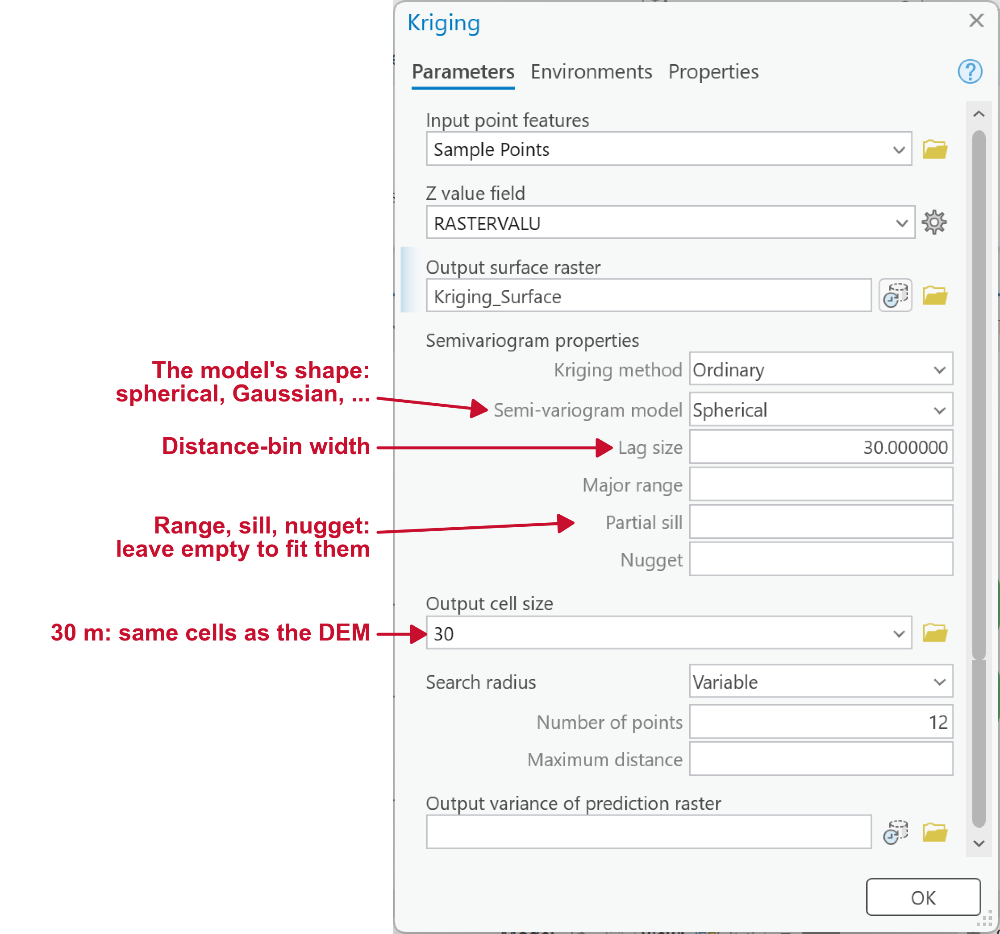

<!-- The capture is the Kriging tool inside the Lab 8 model, ArcGIS Pro 3.7.1, with Lag size 30 filled in from the 30 m cell size. Ordinary kriging assumes an unknown but constant mean; Universal adds a trend, Tuesday's trend surface inside kriging. In Lab 8 the default lag works: 2,500 points over 60 km2 give many close pairs. In an earlier ArcGIS Pro test on Little Cottonwood Canyon (150 points over a canyon) the same kind of default fitted a model that was almost all nugget and lost to every method but the trend; a 300 m lag won. Today's six-methods slide shows the same failure on the Timpanogos samples with an automatic fit. After a run the dialog can show the fitted range and sill, which is why the lab says to empty them before the next run. -->

---

<!-- _class: lead -->

# Part 2 — How Wrong Is the Surface?

## When you have the truth

---

# Error = Truth − Surface

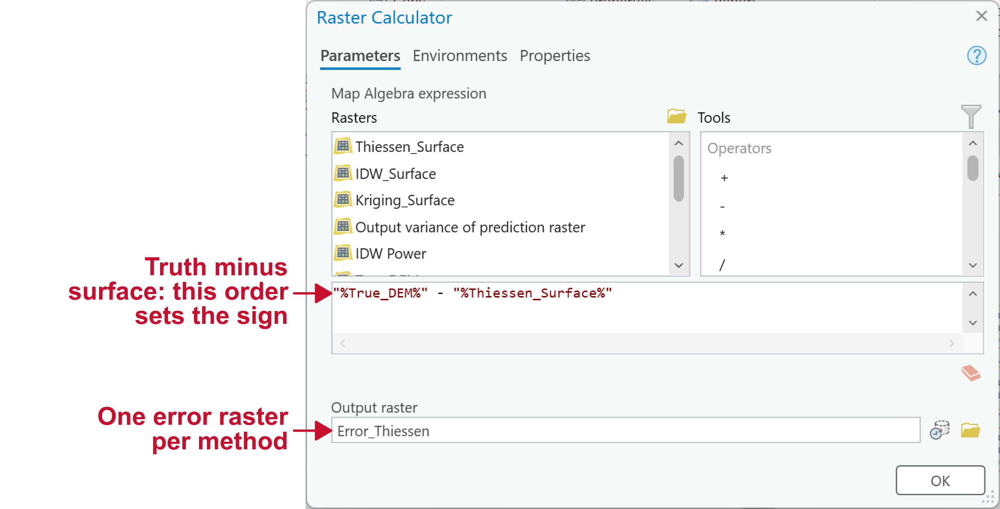

- Subtract, cell by cell, in **Raster Calculator**: the **map algebra** of Week 3
- **Positive:** the surface is too **low**; **negative:** too **high**
- In **meters**; map it on a **diverging** scale centered on zero

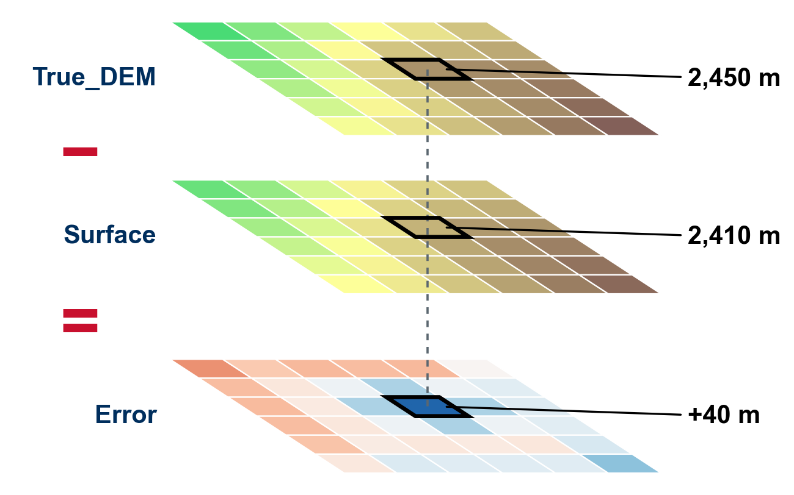

* <strong>A cell reads +40 m. Too high or too low?</strong>
* Too <strong>low</strong>: the truth is 40 m above the surface there

<!-- The diagram is the whole idea: two rasters on the same grid, one above the other, and subtraction one cell at a time, exactly the local map algebra from the Week 3 raster-analysis decks (NDVI was the same kind of cell-by-cell arithmetic). The picked cell reads 2,450 m in the truth and 2,410 m in the surface, so its error is +40 m: blue, too low (made-up values, tools/week09_map_algebra_figure.py). The capture is the Lab 8 Step 6 Raster Calculator, inside ModelBuilder: "%True_DEM%" - "%Thiessen_Surface%". The order matters only for the sign, but say it out loud and keep it fixed: if one student subtracts the other way, every color on their map flips and their "too high" ridges become "too low". Lab 8 uses truth minus surface throughout. Two clicks: the +40 question and its answer. The worksheet callout was dropped October 28, 2026: there is no worksheet on Thursday. -->

---

# Where the Error Lives

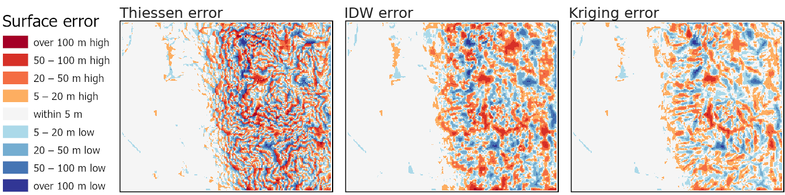

* **Why is the valley floor nearly white?**
* It is flat: any nearby sample is close when the ground does not change. The error is on the **mountain front**
* Thiessen's error is **finest-grained**: every polygon edge is a step
* Which of these maps has the <strong>least error</strong>, and how can we <strong>calculate</strong> it?

<!-- The three error maps from the Lab 8 example baseline (2,500 points, default parameters). Red is where the surface is too high, blue too low. Four clicks: the question (ask the room before the next click), the answer, the Thiessen point, then the lead-in to RMSE: let them guess which map is best by eye, then say that eyeballing three maps of 67,337 cells is not a measurement, and the next slide turns each map into one number. The valley floor is within 5 m for every method because it is flat: any method that returns a nearby sample's value is close when the ground does not change. The error is a map of where the ground changes faster than the samples are spaced. Lab 8 asks each student to find their best method's single worst cell and explain the ground there. -->

---

# One Number: Root Mean Squared Error (RMSE)

$$
\text{RMSE} = \sqrt{\frac{1}{n}\sum_{i=1}^{n}\left(z_i - \hat{z}_i\right)^2}
$$

- **Square** each error, so highs and lows both count
- Take the **mean** over every cell
- Take the **square root**, so the answer is back in **meters**

Every <strong>gap</strong> between the black truth and a colored rebuild is one cell's error; RMSE is the typical size of those gaps, in meters

* The three error maps from the last slide, each as one number:Thiessen<b>28.29 m</b>IDW, power 2<b>20.71 m</b>Kriging<b>14.46 m</b>

<!-- One click: the answer to the last slide's question, the three error maps as one number each (the Lab 8 example baseline, 2,500 points, default parameters; the lab's check values). Kriging wins here, and the next slide shows how the number is computed in ArcGIS Pro. z is the truth, z-hat the surface, n the number of cells. Squaring does two things: it stops positive and negative errors canceling, and it weights big errors heavily, so a surface with a few 100 m misses scores worse than one with many 5 m misses. The profile is one row of cells across the Lab 8 study area (the same one as on Today's Goals): every vertical gap between the black truth and one of the colored rebuilds is one cell's error, and RMSE rolls all 67,337 of those gaps into one number per method. Common slip: the root of the mean, not the mean of the roots, and not the root of the sum. The "What RMSE Hides" slide that followed was cut October 28, 2026 to keep RMSE something students want to use; its profile figure moved here. -->

---

# RMSE in ArcGIS Pro: Four Steps

ArcGIS Pro has <strong>no single RMSE tool</strong>. Chain four steps, each one a tool you already know (click through the dialogs):

<b>1 · Error</b>Raster Calculator · <code>True_DEM − Surface</code>

<b>2 · Square</b>Raster Calculator · <code>Square(Error)</code>

<b>3 · Mean</b>Zonal Statistics as Table · one zone, statistic <strong>Mean</strong>

<b>4 · Square root</b>Calculate Field · <code>math.sqrt(!MEAN!)</code>

- The formula read **inside out**
- Lab 8's model chains all four for **each method**
- **COUNT** in the table is the cells averaged: **67,337**

* 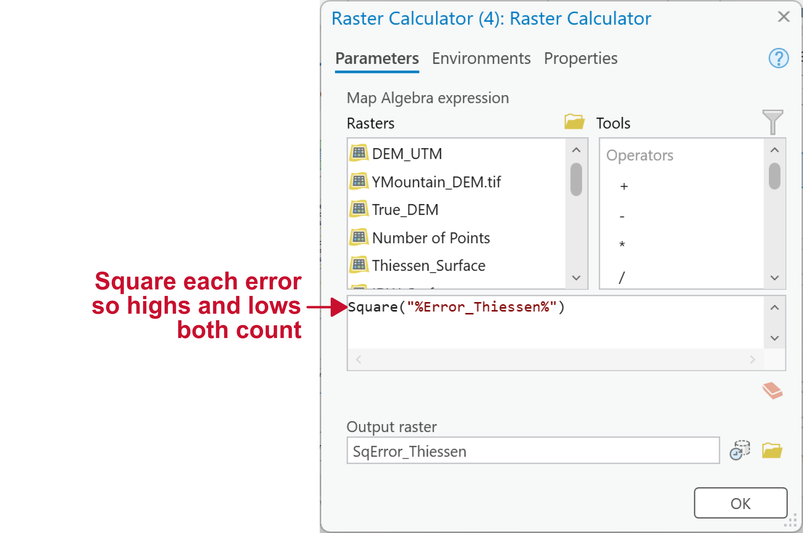
* 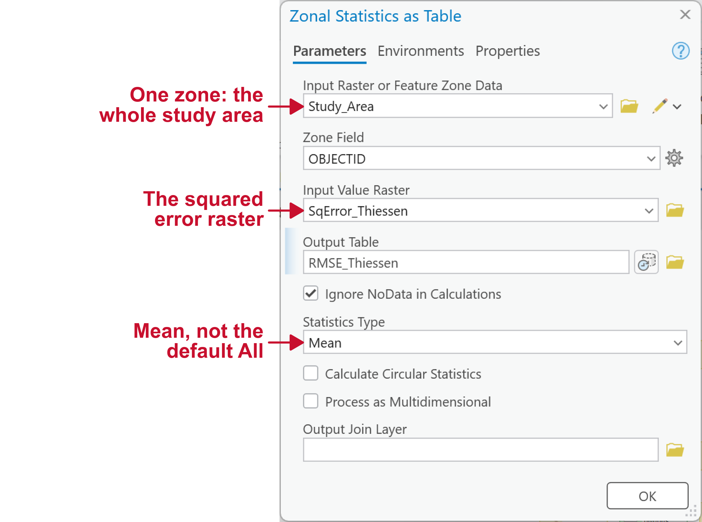
* 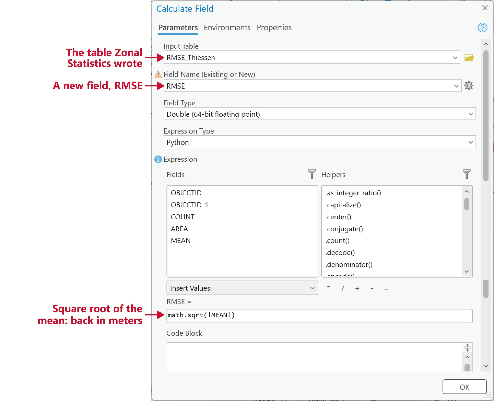

<!-- Three clicks: the dialog for step 1 is up when the slide opens, and each click replaces it with the next step's dialog and moves the highlight down the flow (all four are Lab 8 Step 6 and 7 captures). There is no RMSE tool in ArcGIS Pro, so the four boxes are the whole recipe, and each one is a tool students have already run: Raster Calculator twice (Week 3's map algebra), Zonal Statistics as Table, and Calculate Field. Read the formula on the last slide from the inside out and it is the same four steps: the difference, the square, the mean, the root. The table is Lab 8 Step 7's output for one method: COUNT 67,337 cells and AREA 60,603,300 square meters, both on the lab page as check values. If COUNT comes out smaller, the surfaces did not cover the whole study area (the Extent environment is the usual cause), and the RMSE is quietly computed on fewer cells. Zonal Statistics as Table opens with the statistic set to All; Mean is the one the RMSE needs. The step-2 capture (ie-rc-square-callouts.png) was on the RMSE slide until October 28, 2026. -->

---

<!-- _class: lead -->

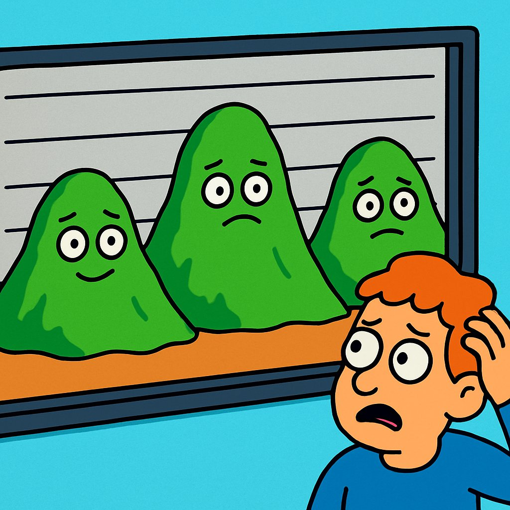

# Part 3 — Which One to Trust?

## Same points, different surfaces

---

<!-- _class: quiz -->

# Which Method Is Best and Why?

Discuss with your neighbor

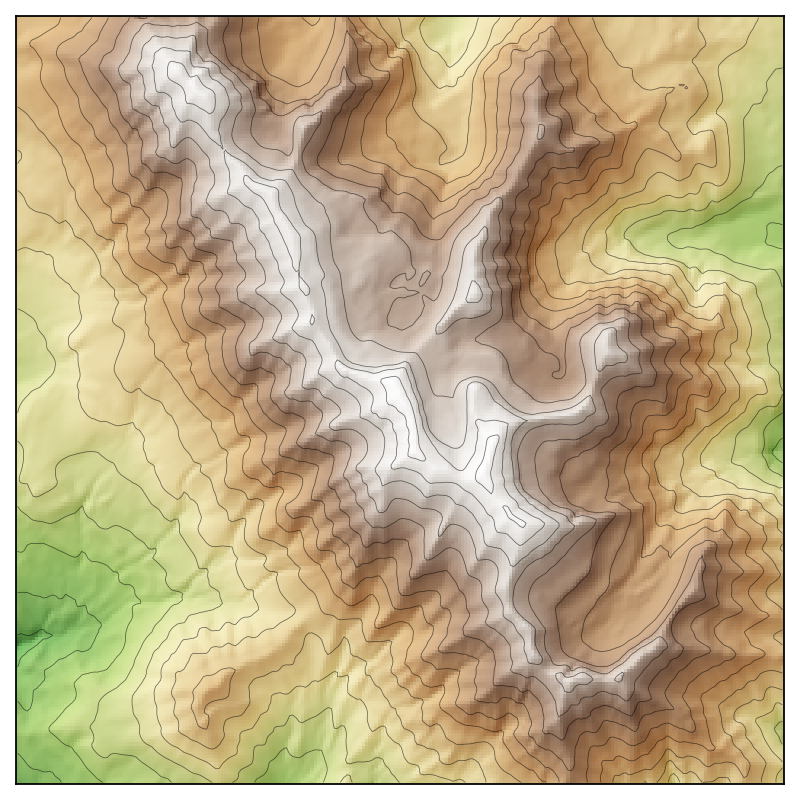
<strong>The truth</strong>, which a real project never gets to see

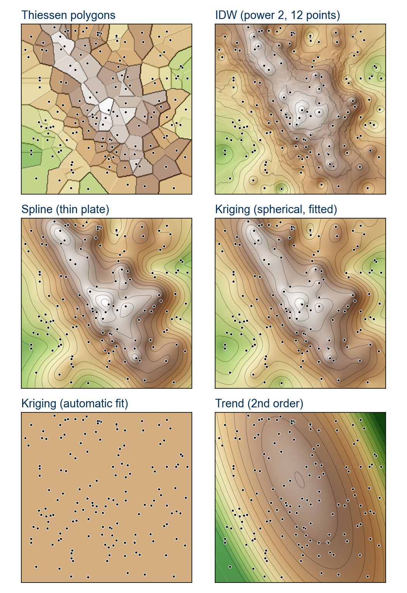
Every method uses the same <strong>150</strong> sample points

* <strong>It depends</strong> on the ground, the purpose, and the settings:
* Closest to this mountain? → <strong>spline</strong> or <strong>kriging</strong> with a fitted model
* The flat panel? → kriging with a <strong>careless setting</strong>
* A regional trend, or a category like soil? → <strong>trend</strong> or <strong>Thiessen</strong>

<!-- Give pairs two or three minutes, then take answers and the reasons for them. Click the four answers in only after the discussion; the next slides then put numbers on it. Push the class past "which is prettiest" to "which one reproduces the ridges and canyons of the truth." Honest answer: it depends. On this mountain the spline and the fitted kriging come closest (69 and 73 m at the hold-out points, next slide); IDW and Thiessen follow; the trend surface only has the regional tilt. The flat panel is the same kriging with an automatic variogram fit that came out almost all nugget, so every cell gets the mean: worth asking what went wrong before the third click. Trend is right when only the regional pattern matters, and Thiessen when the variable is a category such as soil type. Every panel uses the same 150 Timpanogos samples, so the differences are the methods, not the data. And in a real project you cannot run this comparison, because you never have the truth panel, which is why the next slide scores each method at points held back from it. Moved October 26, 2026 from after the exactness slide, where the scores had already given the answer away; formerly a class vote. -->

---

# Same Points, Six Methods

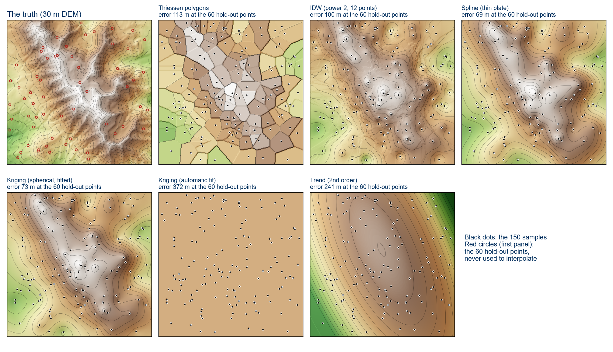

Each method is scored at <strong>60 points held back</strong> from it: the honest test when there is no true surface

* <strong>Why is one kriging panel flat?</strong>
* Its automatic fit decided no sample tells you anything about its neighbors, so every cell gets the <strong>mean</strong>. Next slide: why

<!-- It answers "how would you judge which one to trust" with a test students can run. the same 150 Mount Timpanogos samples as Tuesday (USGS 3DEP, 30 m, 7.2 km square; tools/week09_elevation_figures.py, numbers in tools/week09_elevation_numbers.json; computed with numpy, scipy and pykrige rather than ArcGIS Pro, so the figures are figures, not tool captures). Each surface is checked at 60 hold-out points the methods never saw (red circles, first panel). Root-mean-square error at the hold-out points: spline 69 m, kriging with a fitted spherical model 73, IDW 100, Thiessen 113, 2nd-order trend 241, and kriging with pykrige's automatic variogram fit 372 - exactly what you get by ignoring location and guessing the mean of the samples (372 m), because that fit came out almost all nugget with a range of a few meters, so every cell gets the mean. Two lessons: hold out some points and measure, don't eyeball; and the same method with a careless setting can do far worse than a much simpler one. Natural neighbor, in the earlier version of this test, has no scipy equivalent and was dropped. Now that RMSE is defined, the numbers can be read off directly. Exactness, if anyone asks: Thiessen, IDW, the spline and the fitted kriging (nugget 0) return every sample value; the trend misses by 163 m on average and the automatic kriging, with its huge nugget, by 96 m, so kriging is exact only when the nugget is zero. The hold-out, checkpoint-spread, exactness and methods-table slides were cut October 26, 2026 once Lab 8 dropped checkpoints. -->

---

# Why the Automatic Fit Came Out Flat

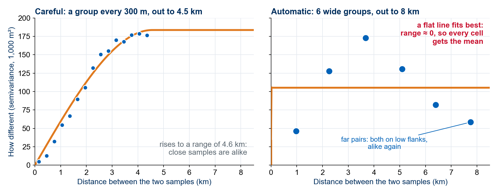

* The automatic fit used **6 wide bins** out to 8 km. The far bins are pairs on opposite **low flanks**: alike again, so the dots rise, then **fall**
* A spherical curve can only rise and level off, so the best fit was a **flat line** with a range of 0.3 m: no sample helps its neighbors
* To that model the mountain looks like the **no-pattern** test from Part 1, so every cell gets the mean. Lab 8's 2,500 points and 30 m **lag** fit fine

<!-- Three clicks. Same 150 Timpanogos samples, binned two ways (tools/week09_autofit_figure.py, which repeats the elevation script's DEM request and sample draw). Left: the careful fit behind the good kriging panel, pairs grouped every 300 m and only out to 4.5 km; the dots rise steadily and the spherical model reaches its sill at about 4.6 km. Right: pykrige's defaults, the automatic fit: 6 bins spread across every distance in the 7.2 km square, out to about 8 km. Past about 4 km the pairs are increasingly corner to corner, one low flank against the other, and those are similar heights again, so the dots come back down. No spherical curve rises and falls, so the least-squares fit settles on the average level everywhere: nugget 33,339 and partial sill 72,238 m^2 with a range of 0.29 m. A range shorter than the closest pair of samples means no sample carries any weight for its neighbor, so ordinary kriging returns the sample mean everywhere, the flat panel, and with that big nugget it does not even return the samples. The lessons for Lab 8: the lag (bin width) and how far out you look matter, and a fitted model is worth a glance before you trust it. In Lab 8 (2,500 points over 60 km2, Lag size 30 from the 30 m cell size) the fit works, as the Kriging in ArcGIS Pro notes say. Added October 28, 2026, replacing the one-line "almost all nugget" answer. -->

---

<!-- _class: lead -->

# Part 4 — Lab 8, Interpolation Explorer

<!-- NOTE FOR FALL 2027 (Dan, October 28, 2026): present this Lab 8 introduction, or at least part of it (Lab 8 at a Glance and Your Own IDW Power), in Tuesday's deck instead of here. Doing some theory and some hands-on lab demonstration on Tuesday, then more theory and more lab demonstration on Thursday, has worked well this year; this week put all of the lab on Thursday. Also recorded in tools/NEXT_STEPS.md, section 7. -->

---

# Lab 8 at a Glance

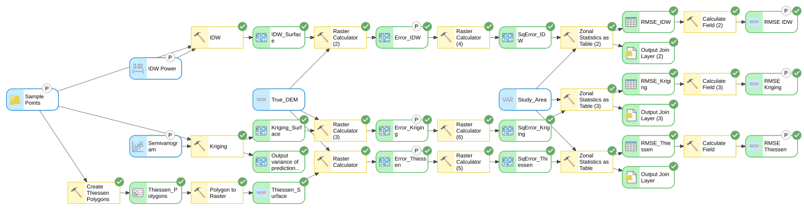

- **Ground:** Y Mountain, a **30 m** DEM, `True_DEM`
- **Points:** **250**, **2,500**, **10,000**
- **Model:** points → Thiessen, IDW, kriging → error → **RMSE**
- **Then:** five dialog runs, one at **your own** IDW power

[Lab 8 — Interpolation Explorer](https://byu-hydroinformatics.github.io/ce414-gis-applications/assignments/lab-08/)

<!-- The figure is the finished Lab 8 model, exported from ModelBuilder. Sample Points, IDW Power and the Semivariogram are its input parameters; the three error rasters and three RMSE tables are its outputs. Two things to warn about: set the Extent environment to True_DEM in Step 0, or IDW and kriging cover less ground at 250 points; and finish Map 1 before the first run from the tool dialog, because a dialog run deletes everything that is not a parameter, including the surfaces. -->

---

# Your Own IDW Power

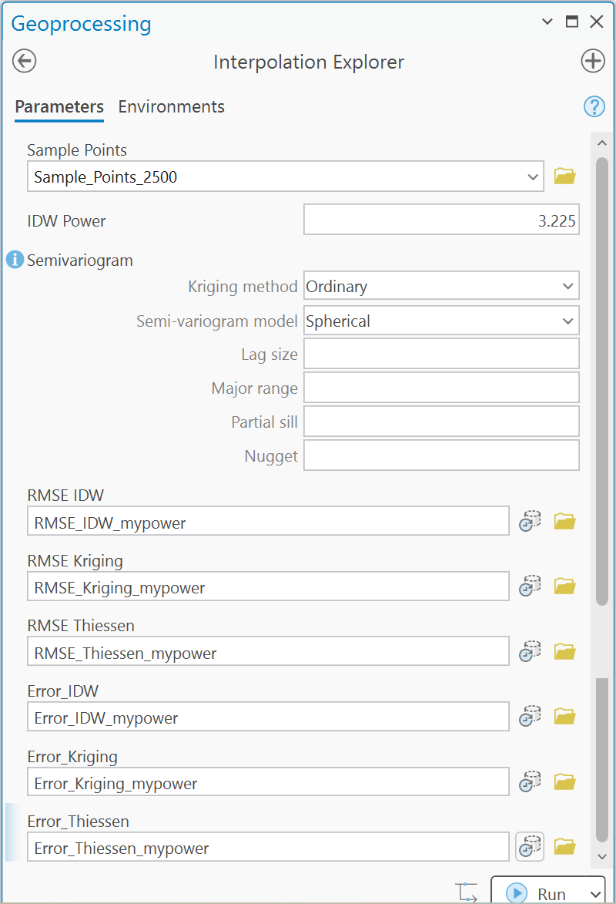

> **Power = 1 + (last two digits of your BYU ID) ÷ 40**

- BYU ID `123456789` → **89** → 1 + 89 ÷ 40 = **3.225**
- The **nine-digit number on your BYU ID card** — not your NetID
- Run 5 uses it; the grader checks your RMSE against your digits

<!-- The capture is the model as a tool, set up for run 5 with the example ID ending in 89. Everyone's other runs use the same hosted points and will match a classmate's to the centimeter; run 5 will not. The lab page gives the example's answer (IDW RMSE 20.29 m at power 3.225) so students can check their setup before they use their own digits. Every power falls between 1 and 3.475. -->

---

<!-- _class: quiz -->

# Lab 8 Step 8: Predict It

Three knobs: **points** (250, 2,500, 10,000), **IDW power** (1, 2, 3, yours), **semivariogram model** (spherical, exponential, Gaussian). Change **one**, rerun, and ask: **does the winner change?**

At **2,500** points: Thiessen **28.29 m**, IDW **20.71 m**, kriging **14.46 m**

- Go to **10,000** points. Which method **gains the most**, and which the least?
- Raise IDW's power from 2 to **3**. Better, worse, or about the same?
- Where on the error map will the error that remains be?

<!-- Votes only; no answers today. These are the Lab 8 Step 8 questions in advance, so each student goes in with a prediction to test, which is the habit the lab is built around. Write the predictions on the board: if 2,500 points gives these RMSEs, what will 10,000 give? Ten times fewer? Half? Does every method gain the same amount? Come back to the board when the labs are in. The three baseline RMSEs are on the lab page as check values, so it is fine to show them. Merged October 26, 2026 with the "Three Knobs" slide, and the Part 4 divider folded into Part 5. -->

---

# How You Will Know You Are Right

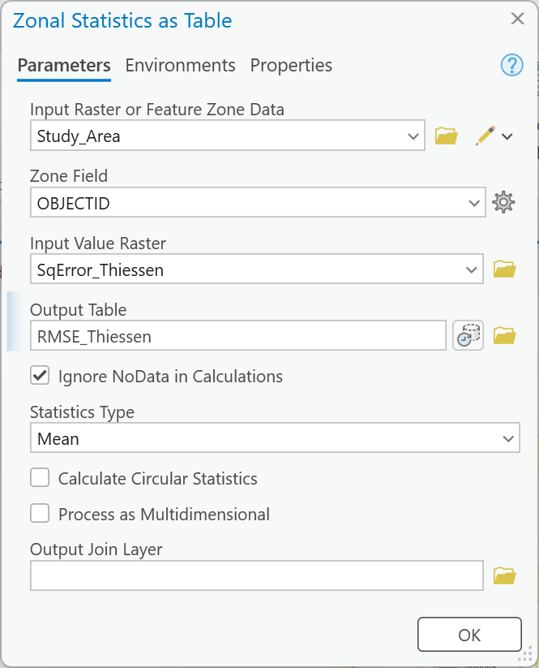

- `True_DEM`: **67,337** cells, **1,368.5 to 2,896.5 m**
- Every RMSE table: **COUNT 67,337**
- 2,500 points, defaults: **28.29 / 20.71 / 14.46 m**
- Run 5 at the example power **3.225**: IDW **20.29 m**

<!-- All four are TIP boxes on the lab page. A COUNT below 67,337 means a surface does not cover the study area; an RMSE that matches to the meter but not the centimeter usually means a different neighbor count or a missed environment setting. -->

---

# Make It Yours

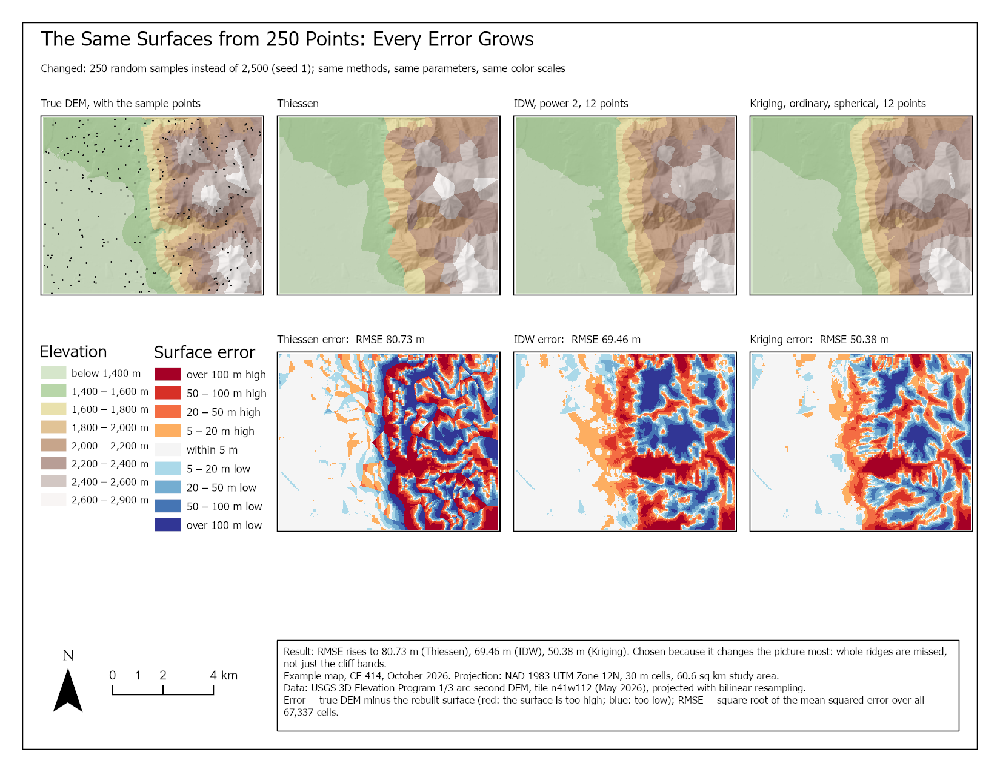

- The **numbers** will match your classmates'; the **choices** should not
- Your own **layout**, **color ramps**, **model labels**, and **words**
- Upload your **toolbox** (`Lab08.atbx`) — the grader runs it at your power
- **Peer review** before you submit, and name your reviewer

<!-- The figure is the lab page's example scenario sheet. It is one way to do Map 2, not a template to copy: submissions whose layouts, model labels or symbology match another student's too closely are flagged for follow-up. Say it plainly once, here. -->

---

<!-- _class: activity -->

# Final Thoughts

**Quiz: How Wrong Is the Surface?** Eight questions on kriging, error rasters, RMSE and where the error lives. **Scan the code**, or open the link under it.

- A quick check that today's material made sense
- Note the sign question: a wrong sign flips the whole map in Lab 8

**Before next class**

- **Quiz 7** — open book, Chapter 12, due **Saturday 11:59 pm**
- **Lab 8 — Interpolation Explorer** — due **Saturday 11:59 pm** — [Lab 8](https://byu-hydroinformatics.github.io/ce414-gis-applications/assignments/lab-08/)
- Next week: **no class meetings**; study the **cut, fill, and raster volumes** decks on your own, and **Lab 9 — Big Southern Butte**
- Office hours: [calendly.com/dan-ames/office-hours](https://calendly.com/dan-ames/office-hours)

byu-hydroinformatics.github.io/ce414-gis-applications/quizzes/rmse/

<!-- Five minutes, in pairs, then a show of hands on the Gaussian item: it is the run Lab 8 Step 8 asks them to explain. If the room has no signal, put the URL on the board; the items read aloud just as well. -->

<!-- Week 9 due items from the DUE table in tools/build_schedule.py: Lab 8, Quiz 7 and Chapter 12 this Saturday. Deck written October 8, 2026; the kriging part, the six-methods test, the exactness slide and the tool table moved here from the Tuesday deck on October 20, 2026; the checkpoint, exactness, tool-table, variogram, 3D-kriging and service slides were cut October 26, 2026 to match the simplified Lab 8. October 28, 2026: neighbor-test variants and the bin-by-bin semivariogram added, pop-up questions on the kriged result and the error maps, the map-algebra diagram on the error slide, the four-step RMSE flow, What RMSE Hides cut, and the automatic-fit explanation added. Figures: tools/week09_interpolation_figures.py (error-row crop and the checkpoint test); the ArcGIS Pro captures are from the Lab 8 GUI build (docs/assignments/lab-08/images), copied into this folder. -->
