<!-- _class: lead -->
<!-- _paginate: skip -->

# Kriging and Interpolation Error

## Which Surface to Trust — and Lab 8

CE 414 Engineering Applications of GIS
Civil & Construction Engineering
Brigham Young University
Dr. Dan Ames

<!-- Thursday of Week 9. Tuesday built surfaces with weights from a rule you choose: Thiessen and IDW. Today starts with kriging, which takes its weights from the data, then asks how you would know which surface to trust: first with the truth in hand, then without it. Then Lab 8, which does exactly this on Y Mountain with all three methods. The title image is the Lab 8 example baseline sheet: the true DEM and three rebuilds from the same 2,500 points, with their error maps underneath. -->

<!-- stamp:begin -->
<!-- _footer: 'CE 414 · Week 9 — Kriging and Interpolation ErrorLast Updated: 2026-10-25© 2026 Daniel P. Ames · <a href="https://creativecommons.org/licenses/by/4.0/">CC BY 4.0</a>' -->
<!-- stamp:end -->

---

# Today's Goals

By the end of class you should be able to:

- Read a **semivariogram** and say how **kriging** sets its weights
- Compute an **error raster** and say what its **sign** means
- Reduce the error to one number, the **RMSE**, and say what it hides
- Judge a surface **without** the truth, from **checkpoints**
- Say what **Lab 8** asks for, and how you will know you are right

<!-- The profile on the right is one row of cells across the Lab 8 study area: the truth and the three rebuilds from 250 points. Thiessen steps, IDW sags, kriging smooths the peak off. The second half of today is a way of putting a number on the gaps between those lines. Testing whether a ranking survives a change is in the lab; Part 4 previews it. -->

---
<!-- _class: lead -->

# Part 1 — Kriging

## Interpolation that estimates its own weights

<!-- Tuesday's methods weight points by a rule you choose: nearest only, or 1/d^n. Kriging first measures how similarity fades with distance, from the samples themselves, and takes its weights from that. -->

---

# Kriging

A statistically based estimator of spatial variables. It separates the data into three components:

- **Spatial trend** — an increase or decrease in a variable that depends on direction; for example, temperature may decrease toward the northwest
- **Autocorrelation** — the tendency for points near each other to have similar values
- **Random** — statistically defined by a probability function

Kriging creates a mathematical model, which is then used to estimate values across the surface.

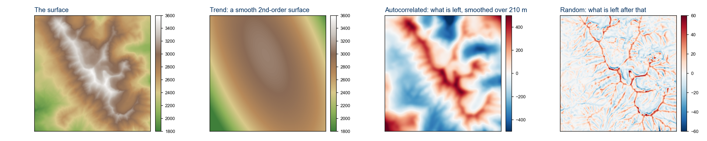

<!-- Corrected the source's run-together "dependson" to "depends on." The three-component split is what makes kriging different in kind from IDW: it models the structure of the data before it interpolates. -->

<!-- The figure splits a real surface, Tuesday's Mount Timpanogos DEM (USGS 3DEP, 30 m), the way the bullets describe: a least-squares 2nd-order trend fitted to every cell (std 297 m), what is left smoothed over 210 m - the autocorrelated part, ridges and canyons (std 201 m) - and the rest, the random part, which here is mostly channels and crests narrower than 210 m (std 11 m). The split is illustrative: a different smoothing width moves the line between 'autocorrelated' and 'random', which is exactly the judgment a variogram formalizes. tools/week09_elevation_figures.py. If the slide is crowded, drop the bullets' examples and talk to the figure. -->

---

# Kriging: Lag Distance

- $Z_i$ is a variable at a sample point
- $h_i$ is the **distance** between sample points
- Every possible pair $Z_i, Z_j$ defines a distance $h_{ij}$ and differs by the amount $Z_i - Z_j$

The distance $h_{ij}$ is known as the **lag distance** between points *i* and *j*. There is a subset of points in any sample set that are a given lag distance apart.

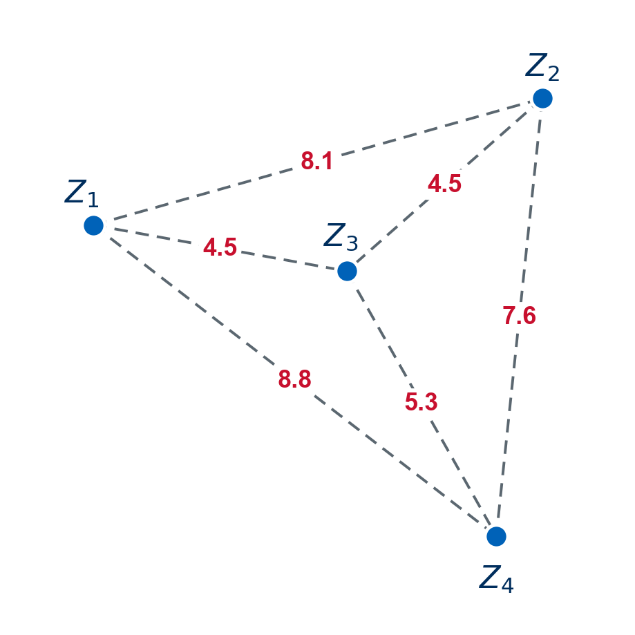

<!-- Corrected the source's "is know as" to "is known as." The red numbers on the figure are the lag distances for each pair, measured from the drawing (redrawn October 26, 2026 from the textbook's Figure 9-12; tools/week09_thursday_figures.py). With four points there are six pairs; with a hundred points there are 4,950, which is why the next step is to bin them. -->

---

# Kriging: Spatial Autocorrelation

- Higher autocorrelation means points **near each other are alike**
- That provides substantial information about nearby locations

*h* here is the width of one cell.

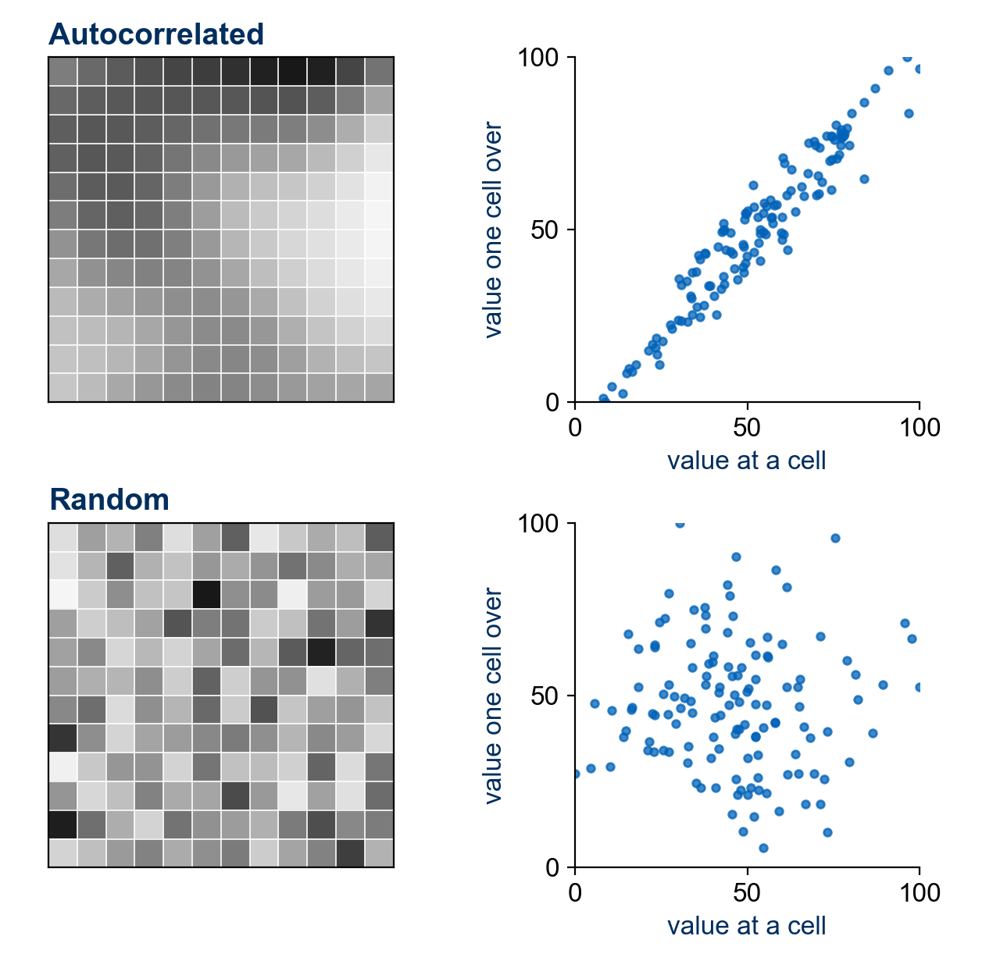

<!-- Top row: a spatially autocorrelated layer, and its scatter of each cell against the cell next to it falls on a line. (Made-up 12 x 12 layers, redrawn October 26, 2026 from the textbook's Figure 9-13; tools/week09_thursday_figures.py.) Bottom row: an uncorrelated layer, and the same scatter is a cloud. That contrast is the entire justification for interpolating at all — if the bottom panel were your data, no method in this deck would beat the global mean. Fixed the source's "Higher autocorrelations indicates" to "Higher autocorrelation means." -->

---

# Kriging: Semivariance

- $Z_i$ is the measured variable at one point
- $Z_j$ is another at distance *h* away
- *n* is the number of **pairs** that are approximately *h* distance apart

The **1/(2n)** out front averages over the *n* pairs and halves the result: that half is the "semi". Semivariance may be calculated for any *h*.

When nearby points are similar, $Z_i - Z_j$ is small, so the semivariance is **small**. High spatial autocorrelation means points near each other have similar Z values.

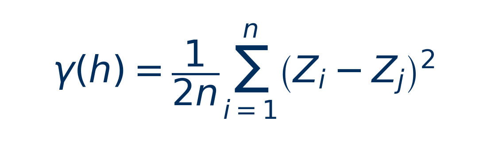

<!-- Semivariance is a dissimilarity measure: it goes up as points get less alike. The "semi" is the factor of one half in front of the sum. The textbook's typeset "1/2n" was easy to misread as n/2, so the equation is redrawn with 1/(2n) as a fraction (October 26, 2026). -->

---

# The Variogram

When calculating the semivariance for a particular *h*, a **tolerance** is used, since few *h* values will be exactly identical.

Plot the semivariance across a range of lag distances and you get a **variogram**. In ArcGIS Pro, **Lag size** is the width of those distance bins.

Semivariance is usually **small** at small lag distances and increases to a constant value as the lag distance *h* increases.

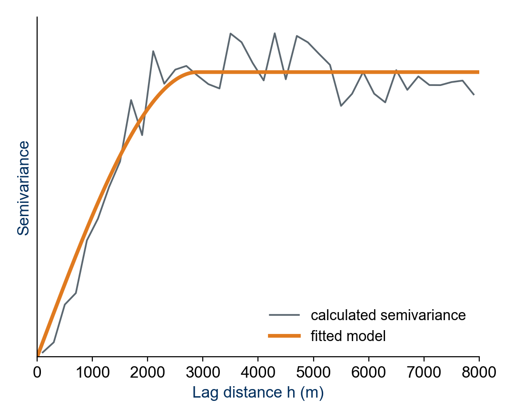

<!-- Merged the source's tolerance slide with the variogram slide that immediately followed it. The jagged line is the semivariance actually calculated from the data; the smooth line is the model fitted to it. Only the smooth line is used to interpolate. The figure replaces the textbook's Figure 9-15: 400 points on a made-up smooth surface, 200 m lag bins, a spherical model fitted (tools/week09_thursday_figures.py). The next slide does the same on Tuesday's real Timpanogos samples. -->

---

# Nugget, Sill, and Range

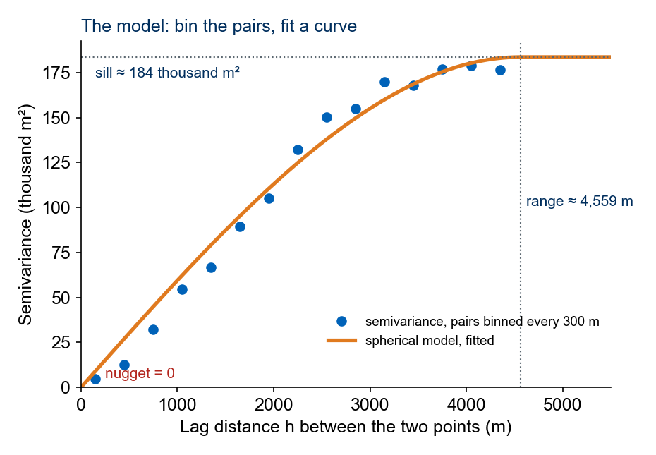

- **Range** — the distance where the model levels out; points closer than the range are autocorrelated, points farther apart are not
- **Sill** — the semivariance the model reaches at the range
- **Nugget** — the value at a distance of almost zero; above 0 when there is measurement error or variation closer than the samples
- **Partial sill** — sill minus nugget: the part that distance explains

* <strong>What would put a nugget here?</strong>
* Measurement error (GPS elevations a few meters off), or samples spaced farther apart than the gullies

<!-- Definitions follow Esri's "Understanding a semivariogram: the range, sill, and nugget" (ArcGIS Pro help, checked October 2, 2026); the partial sill is the sill minus the nugget. The figure is a real one: Tuesday's 150 Mount Timpanogos elevation samples, 11,175 pairs binned every 300 m out to 4.5 km, a spherical model fitted - range about 4,559 m, sill about 184 thousand m2, nugget 0 (elevation is measured precisely, and the samples resolve the terrain). Past about 4 km the bins fall off because few pairs in a 7.2 km square are that far apart, so the fit stops at 4.5 km. Two clicks: the question, then the answer (GPS elevations with a few meters of error, or samples much farther apart than the gullies). -->

---

# Three Semivariogram Models

Same nugget, sill and range; different shape **near zero**:

- **Spherical**: rises steadily, flat past the range
- **Exponential**: steepest at first; neighbors lose their likeness fastest
- **Gaussian**: flat at first; assumes a **very smooth** surface

Lab 8 runs all three on Y Mountain

<!-- Drawn from the formulas ArcGIS Pro's Kriging documents (tools/week09_semivariogram_models.py); the exponential and Gaussian only approach the sill, so their range is the distance where they reach 95 % of it. The shape near zero matters most, because the nearest samples carry most of the weight. Do not give the class Lab 8's results; the Gaussian run's error map is one of the lab's questions. -->

---

# From Variogram to Surface

- A set of sample points is used to estimate the shape of the variogram
- A **variogram model** is made — a line is fit through the set of semivariance points
- The variogram model is then used to interpolate the entire surface

**Kriging is similar to IDW**, but kriging uses the **minimum variance method** to calculate the weights, rather than applying an arbitrary or less precise weighting scheme.

<!-- Combined two consecutive text-only slides from the source. The comparison in the second half is the sentence worth remembering: IDW's weights come from a rule you picked, kriging's weights come from the data's own spatial structure. -->

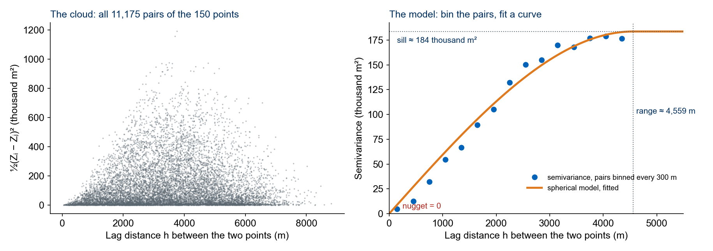

<!-- Left: the semivariogram cloud, every pair of Tuesday's 150 Timpanogos samples (11,175 pairs). Right: the pairs binned every 300 m and a spherical model fitted to the bins. The model, not the cloud, sets kriging's weights. -->

---

# Kriged Result

<!-- The true DEM on the left, the kriged surface from Tuesday's 150 samples on the right (ordinary kriging, the spherical model on the previous slides). Compare it against Tuesday's IDW panels: the bull's-eyes are gone, because the weights now reflect how quickly elevation actually decorrelates with distance instead of a fixed 1/d^n rule. Against the whole DEM it scores 86 m RMSE, IDW 110 m. -->

---

# Kriging Surface

<!-- The 3D view of the same result. Set this beside the Thiessen and IDW surfaces from earlier in the deck: stepped, kinked, and smooth. Same points, three surfaces. -->

<!-- Optional: skip if time is short. The 2-D kriged result on the previous slide carries the point. -->

---

# Kriging in ArcGIS Pro

- **Spatial Analyst ▸ Kriging**, method **Ordinary**
- Leave the model's numbers empty and the tool **fits** them to your points
- A default is not always right: Part 3 shows one that fails

<!-- The capture is the Kriging tool inside the Lab 8 model, ArcGIS Pro 3.7.1, with Lag size 30 filled in from the 30 m cell size. Ordinary kriging assumes an unknown but constant mean; Universal adds a trend, Tuesday's trend surface inside kriging. In Lab 8 the default lag works: 2,500 points over 60 km2 give many close pairs. In an earlier ArcGIS Pro test on Little Cottonwood Canyon (150 points over a canyon) the same kind of default fitted a model that was almost all nugget and lost to every method but the trend; a 300 m lag won. Today's six-methods slide shows the same failure on the Timpanogos samples with an automatic fit. After a run the dialog can show the fitted range and sill, which is why the lab says to empty them before the next run. -->

---

<!-- _class: lead -->

# Part 2 — How Wrong Is the Surface?

## When you have the truth

---

# Error = Truth − Surface

- Subtract, cell by cell, in **Raster Calculator**
- **Positive:** the surface is too **low**
- **Negative:** the surface is too **high**
- In **meters**; map it on a **diverging** scale centered on zero

* <strong>A cell reads +40 m. Too high or too low?</strong>
* Too <strong>low</strong>: the truth is 40 m above the surface there
* Try it on your worksheet: Provo's actual minus each estimate

<!-- The capture is the Lab 8 Step 6 Raster Calculator, inside ModelBuilder: "%True_DEM%" - "%Thiessen_Surface%". The order matters only for the sign, but say it out loud and keep it fixed: if one student subtracts the other way, every color on their map flips and their "too high" ridges become "too low". Lab 8 uses truth minus surface throughout. Clicks: the +40 question, its answer, then the worksheet callout: on Tuesday's Provo worksheet, each student subtracts each of their four estimates from Provo's actual temperature and reads the sign (positive means that method guessed too cold). -->

---

# Where the Error Lives

* **Why is the valley floor nearly white?**
* It is flat: any nearby sample is close when the ground does not change. The error is on the **mountain front**
* Thiessen's error is **finest-grained**: every polygon edge is a step

<!-- The three error maps from the Lab 8 example baseline (2,500 points, default parameters). Red is where the surface is too high, blue too low. Three clicks: the question (ask the room before the next click), the answer, then the Thiessen point. The valley floor is within 5 m for every method because it is flat: any method that returns a nearby sample's value is close when the ground does not change. The error is a map of where the ground changes faster than the samples are spaced. Lab 8 asks each student to find their best method's single worst cell and explain the ground there. -->

---

# One Number: RMSE

$$
\text{RMSE} = \sqrt{\frac{1}{n}\sum_{i=1}^{n}\left(z_i - \hat{z}_i\right)^2}
$$

- **Square** each error, so highs and lows both count
- Take the **mean** over every cell
- Take the **square root**, so the answer is back in **meters**

<!-- z is the truth, z-hat the surface, n the number of cells. Squaring does two things: it stops positive and negative errors canceling, and it weights big errors heavily, so a surface with a few 100 m misses scores worse than one with many 5 m misses. The capture is Lab 8's second Raster Calculator, Square. Common slip: the root of the mean, not the mean of the roots, and not the root of the sum. -->

---

# RMSE in ArcGIS Pro

1. **Square** the error raster
2. **Zonal Statistics as Table** over the study area — statistic **Mean**
3. **Calculate Field** — `math.sqrt(!MEAN!)`

- **COUNT** is the number of cells averaged: check it

<!-- The table is Lab 8 Step 7's output for one method: COUNT 67,337 cells and AREA 60,603,300 square meters, both on the lab page as check values. If COUNT comes out smaller, the surfaces did not cover the whole study area (the Extent environment is the usual cause), and the RMSE is quietly computed on fewer cells. Zonal Statistics as Table opens with the statistic set to All; Mean is the one the RMSE needs. -->

---

# What RMSE Hides

- **Where** the error is — a map shows it, a number cannot
- **Which way** — a surface can be biased high everywhere and still score well
- **The worst cell** — one 150 m miss barely moves an average over 67,337 cells
- **The truth's own error** — the "true" DEM is a measurement too

<!-- So report the RMSE, but never alone. The mean error (no squaring) shows bias: near zero means highs and lows balance. The minimum and maximum of the error raster show the worst misses. And the true DEM has its own error, from the lidar and from the 30 m resampling, which never shows up in the RMSE because it is the thing we compare against. The Lab 8 metadata step is there for that reason. -->

<!-- Keep this slide even when time is short: the closing quiz asks what two surfaces with the same RMSE could still differ in. -->

---

<!-- _class: lead -->

# Part 3 — Which One to Trust?

## When you do not have the truth

---

<!-- _class: quiz -->

# Which Method Is Best and Why?

Discuss with your neighbor

<strong>The truth</strong>, which a real project never gets to see

Every method uses the same <strong>150</strong> sample points

* <strong>It depends</strong> on the ground, the purpose, and the settings:
* Closest to this mountain? → <strong>spline</strong> or <strong>kriging</strong> with a fitted model
* The flat panel? → kriging with a <strong>careless setting</strong>
* A regional trend, or a category like soil? → <strong>trend</strong> or <strong>Thiessen</strong>

<!-- Give pairs two or three minutes, then take answers and the reasons for them. Click the four answers in only after the discussion; the next slides then put numbers on it. Push the class past "which is prettiest" to "which one reproduces the ridges and canyons of the truth." Honest answer: it depends. On this mountain the spline and the fitted kriging come closest (69 and 73 m at the hold-out points, next slide); IDW and Thiessen follow; the trend surface only has the regional tilt. The flat panel is the same kriging with an automatic variogram fit that came out almost all nugget, so every cell gets the mean: worth asking what went wrong before the third click. Trend is right when only the regional pattern matters, and Thiessen when the variable is a category such as soil type. Every panel uses the same 150 Timpanogos samples, so the differences are the methods, not the data. And in a real project you cannot run this comparison, because you never have the truth panel, which is why the next slides hold points back. Moved October 26, 2026 from after the exactness slide, where the scores had already given the answer away; formerly a class vote. -->

---

# Same Points, Six Methods

* <strong>Why is one kriging panel flat?</strong>
* Its automatic fit came out almost all nugget, so every cell gets the mean

<!-- It answers "how would you judge which one to trust" with a test students can run. the same 150 Mount Timpanogos samples as Tuesday (USGS 3DEP, 30 m, 7.2 km square; tools/week09_elevation_figures.py, numbers in tools/week09_elevation_numbers.json; computed with numpy, scipy and pykrige rather than ArcGIS Pro, so the figures are figures, not tool captures). Each surface is checked at 60 hold-out points the methods never saw (red circles, first panel). Root-mean-square error at the hold-out points: spline 69 m, kriging with a fitted spherical model 73, IDW 100, Thiessen 113, 2nd-order trend 241, and kriging with pykrige's automatic variogram fit 372 - exactly what you get by ignoring location and guessing the mean of the samples (372 m), because that fit came out almost all nugget with a range of a few meters, so every cell gets the mean. Two lessons: hold out some points and measure, don't eyeball; and the same method with a careless setting can do far worse than a much simpler one. Natural neighbor, in the earlier version of this test, has no scipy equivalent and was dropped. Now that RMSE is defined, the numbers can be read off directly. -->

---

# Hold Points Back

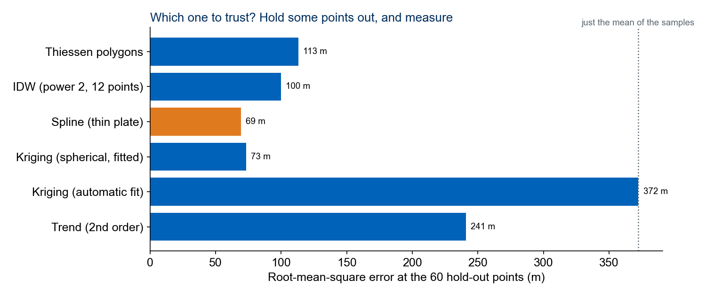

- In real work there is **no true DEM** — only the points you measured
- So set some aside: **checkpoints**, never used to interpolate
- Read each surface at the checkpoints, and compute the RMSE there
- Measure the error **where you know the answer**; do not eyeball

<!-- The bars are the six-methods test on the previous slide: 60 points held back from Tuesday's Timpanogos DEM. The orange bar is the lowest error; the dotted line is the error of ignoring location and guessing the mean of the 150 samples (372 m), which the automatically fitted kriging matches. Lab 8 does not compute checkpoints (its all-cell RMSE already uses the truth), so these two slides carry the lesson. In practice, Extract Multi Values to Points reads every surface at each checkpoint in one tool. -->

---

# Is 200 Checkpoints Enough?

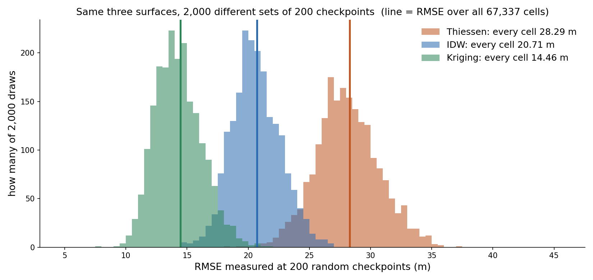

- Each number **wanders by about ±3 m** — but the **ranking** came out the same in **every** draw

<!-- The Lab 8 baseline surfaces (2,500 points, defaults), read at 2,000 different random sets of 200 cells. 90 % of the draws fall within: Thiessen 24.0 to 32.6 m, IDW 17.6 to 24.0, kriging 11.5 to 17.6, around the all-cell values 28.29, 20.71 and 14.46. Yet in all 2,000 draws kriging beat IDW and IDW beat Thiessen, because the same checkpoints judge all three surfaces: a set of points that happens to land on hard ground makes every method look worse together. Lesson: 200 checkpoints are good for choosing a method and loose for quoting its accuracy to a client. This is the class's only look at checkpoints; Lab 8 does not ask for them. Numbers: tools/week09_interpolation_numbers.json, from tools/week09_interpolation_figures.py. -->

<!-- Keep this slide even when time is short: the closing quiz asks what the 2,000 checkpoint draws showed. -->

---

# Exact and Non-exact Methods

Read each surface back at its own sample points:

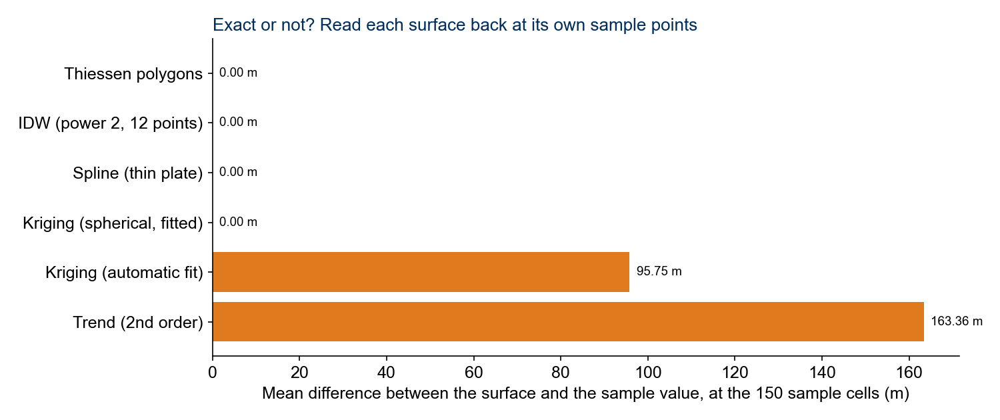

**Exact:** Thiessen, IDW, spline, kriging with no nugget · **Not exact:** trend, kriging with a large nugget

<!-- The test, on Tuesday's 150 Timpanogos samples (cell centers of the 30 m DEM): Thiessen, IDW, the thin-plate spline and kriging with the fitted spherical model (nugget 0) give every sample value back exactly; the 2nd-order trend misses by 163 m on average; and kriging with the automatic fit (nugget 33,339 m2 of a 105,577 m2 sill, range a few meters) misses by 96 m. So "is kriging exact?" has the honest answer "it depends on the nugget" - which is why this slide replaced the source deck's list that called spline and kriging non-exact. ArcGIS Pro's regularized spline (an earlier version of this test) came back within 0.01 m, so 'spline' is exact or very nearly, depending on the variant. the same 150 Mount Timpanogos samples as Tuesday (USGS 3DEP, 30 m, 7.2 km square; tools/week09_elevation_figures.py, numbers in tools/week09_elevation_numbers.json; computed with numpy, scipy and pykrige rather than ArcGIS Pro, so the figures are figures, not tool captures). -->

---

# The Methods in ArcGIS Pro

| Method | ArcGIS Pro tool — what you set |
| --- | --- |
| Thiessen polygons | **Create Thiessen Polygons**, then Polygon to Raster |
| IDW | **IDW** — power, how many neighbors |
| Spline | **Spline** — regularized or tension |
| Kriging | **Kriging** — model, lag size |
| Trend surface | **Trend** — polynomial order |

All but the first are in **Spatial Analyst ▸ Interpolation**; Create Thiessen Polygons is in Analysis.

<!-- Natural Neighbor was dropped from the table October 26, 2026: the class never meets it, so it would be a new term on the way out. Every tool in this table produced a surface in an ArcGIS Pro run, tools/week08_interpolation_figures.py (ArcGIS Pro 3.7.1, arcpy, October 2, 2026); the six-methods slide now uses numpy/scipy/pykrige equivalents on the Timpanogos samples. Geostatistical Analyst offers the same methods with more control (and cross-validation built in); not needed for Lab 8. Toolbox paths are written from the arcpy modules used (arcpy.analysis.CreateThiessenPolygons, arcpy.sa.*) - VERIFY the Geoprocessing pane grouping (Spatial Analyst Tools > Interpolation) in the GUI before class. -->

---

<!-- _class: lead -->

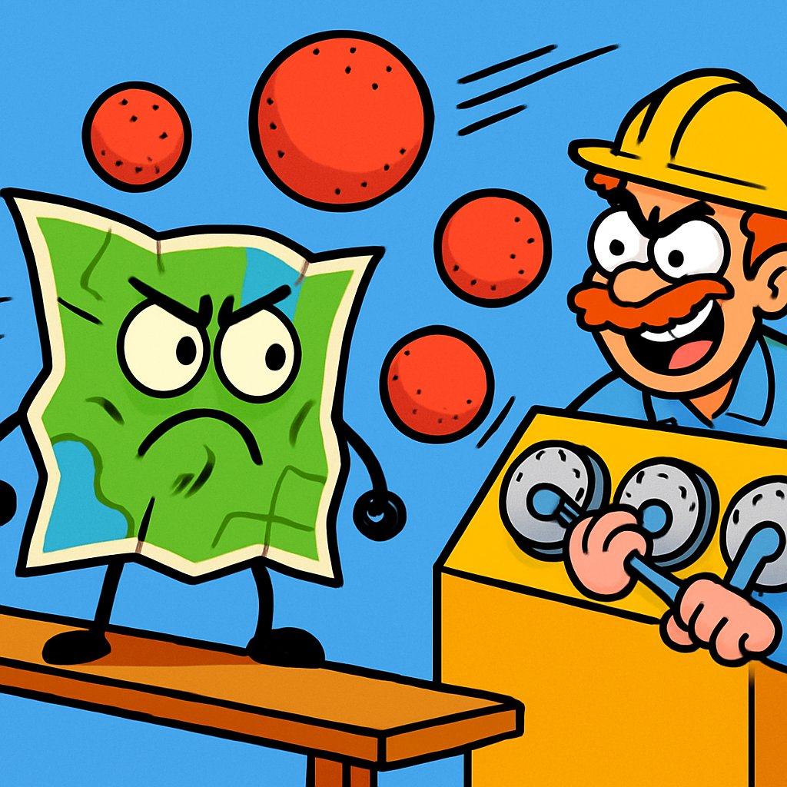

# Part 4 — Does the Answer Survive?

---

# Three Knobs

- **How many points:** 250, 2,500, 10,000
- **IDW's power:** 1 smooths, 3 sharpens toward the nearest point
- **Kriging's semivariogram model:** spherical, exponential, Gaussian
- Change **one** thing, rerun, and ask: **does the winner change?**

<!-- The capture is the IDW tool inside the Lab 8 model, with Power exposed as a model parameter. Do not give the class the sensitivity numbers: Lab 8 Step 8 is where they find them. Ask for predictions instead, and write them on the board: if 2,500 points gives these RMSEs, what will 10,000 give? Ten times fewer? Half? Does every method gain the same amount? Come back to the board when the labs are in. -->

---

<!-- _class: quiz -->

# Predict It

At **2,500** points: Thiessen **28.29 m**, IDW **20.71 m**, kriging **14.46 m**

- Go to **10,000** points. Which method **gains the most**, and which the least?
- Raise IDW's power from 2 to **3**. Better, worse, or about the same?
- Where on the error map will the error that remains be?

<!-- Votes only; no answers today. These are the Lab 8 Step 8 questions in advance, so each student goes in with a prediction to test, which is the habit the lab is built around. The three baseline RMSEs are on the lab page as check values, so it is fine to show them. -->

<!-- Optional: skip if time is short. The same questions are in Lab 8 Step 8. -->

---

<!-- _class: lead -->

# Part 5 — Lab 8, Interpolation Explorer

---

# Lab 8 at a Glance

- **Ground:** Y Mountain, a **30 m** DEM, `True_DEM`
- **Points:** **250**, **2,500**, **10,000**
- **Model:** points → Thiessen, IDW, kriging → error → **RMSE**
- **Then:** five dialog runs, one at **your own** IDW power

[Lab 8 — Interpolation Explorer](https://byu-hydroinformatics.github.io/ce414-gis-applications/assignments/lab-08/)

<!-- The figure is the finished Lab 8 model, exported from ModelBuilder. Sample Points, IDW Power and the Semivariogram are its input parameters; the three error rasters and three RMSE tables are its outputs. Two things to warn about: set the Extent environment to True_DEM in Step 0, or IDW and kriging cover less ground at 250 points; and finish Map 1 before the first run from the tool dialog, because a dialog run deletes everything that is not a parameter, including the surfaces. -->

---

# Step 1 — What Does the Service Send?

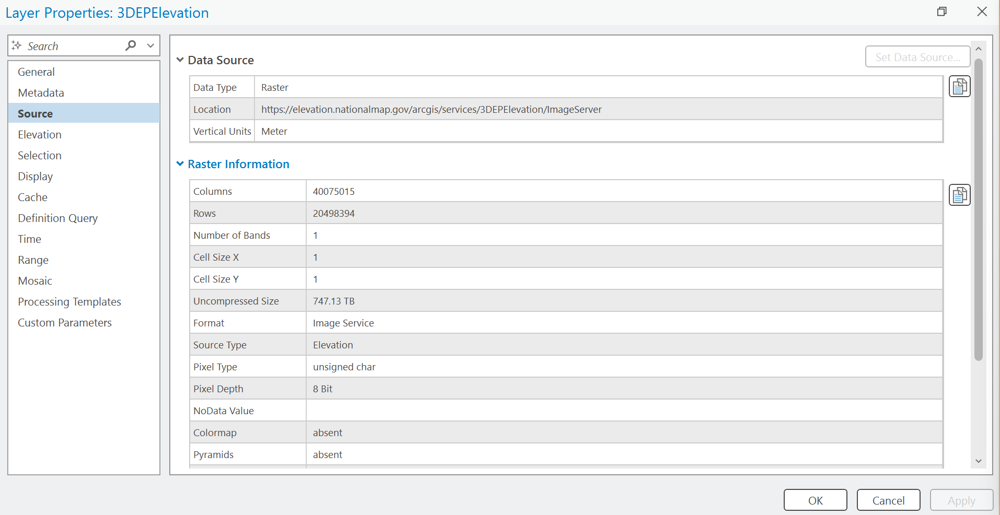

- Add the USGS 3DEP **elevation image service** with **Add Data From Path**
- Read its cell size, pixel type and coordinate system
- Click Y Mountain's summit. The answer is **not** an elevation

**Ask:** why would a server send a picture instead of the numbers?

<!-- Lab 8 Step 1, captured in ArcGIS Pro 3.7.1. The service arrives as a hillshade: 1 m cells, 8-bit unsigned pixels, Web Mercator, and the pop-up at the summit reads 154, where the DEM reads about 2,897 m. That is the service's default raster function at work: the server renders the elevations into a hillshade (its first listed function, Hillshade Gray) before sending them; the service itself stores Float32 meters. Let the class guess why first. The lab's NOTE makes the engineering point: an analysis others must check needs a fixed, dated copy, which is why the course hosts one. -->

<!-- Optional: skip if time is short. Students meet it in the lab, where its NOTE makes the point. -->

---

# Your Own IDW Power

> **Power = 1 + (last two digits of your BYU ID) ÷ 40**

- BYU ID `123456789` → **89** → 1 + 89 ÷ 40 = **3.225**
- The **nine-digit number on your BYU ID card** — not your NetID
- Run 5 uses it; the grader checks your RMSE against your digits

<!-- The capture is the model as a tool, set up for run 5 with the example ID ending in 89. Everyone's other runs use the same hosted points and will match a classmate's to the centimeter; run 5 will not. The lab page gives the example's answer (IDW RMSE 20.29 m at power 3.225) so students can check their setup before they use their own digits. Every power falls between 1 and 3.475. -->

---

# How You Will Know You Are Right

- `True_DEM`: **67,337** cells, **1,368.5 to 2,896.5 m**
- Every RMSE table: **COUNT 67,337**
- 2,500 points, defaults: **28.29 / 20.71 / 14.46 m**
- Run 5 at the example power **3.225**: IDW **20.29 m**

<!-- All four are TIP boxes on the lab page. A COUNT below 67,337 means a surface does not cover the study area; an RMSE that matches to the meter but not the centimeter usually means a different neighbor count or a missed environment setting. -->

---

# Make It Yours

- The **numbers** will match your classmates'; the **choices** should not
- Your own **layout**, **color ramps**, **model labels**, and **words**
- Upload your **toolbox** (`Lab08.atbx`) — the grader runs it at your power
- **Peer review** before you submit, and name your reviewer

<!-- The figure is the lab page's example scenario sheet. It is one way to do Map 2, not a template to copy: submissions whose layouts, model labels or symbology match another student's too closely are flagged for follow-up. Say it plainly once, here. -->

---

<!-- _class: activity -->

# Final Thoughts

**Quiz: How Wrong Is the Surface?** Seven questions on kriging, error rasters, RMSE and checkpoints. **Scan the code**, or open the link under it.

- Not graded, nothing recorded: a quick check that today's material made sense
- Note the sign question: a wrong sign flips the whole map in Lab 8

**Before next class**

- **Quiz 7** — open book, Chapter 12, due **Saturday 11:59 pm**
- **Lab 8 — Interpolation Explorer** — due **Saturday 11:59 pm** — [Lab 8](https://byu-hydroinformatics.github.io/ce414-gis-applications/assignments/lab-08/)
- Next week: **no class meetings**; study the **cut, fill, and raster volumes** decks on your own, and **Lab 9 — Big Southern Butte**
- Office hours: [calendly.com/dan-ames/office-hours](https://calendly.com/dan-ames/office-hours)

byu-hydroinformatics.github.io/ce414-gis-applications/quizzes/rmse/

<!-- Five minutes, in pairs, then a show of hands on the checkpoint item: most of the room expects 200 points to be too few to rank the methods. If the room has no signal, put the URL on the board; the items read aloud just as well. -->

<!-- Week 9 due items from the DUE table in tools/build_schedule.py: Lab 8, Quiz 7 and Chapter 12 this Saturday. Deck written October 8, 2026; the kriging part, the six-methods test, the exactness slide and the tool table moved here from the Tuesday deck on October 20, 2026. Figures: tools/week09_interpolation_figures.py (error-row crop and the checkpoint test); the ArcGIS Pro captures are from the Lab 8 GUI build (docs/assignments/lab-08/images), copied into this folder. -->
