<!-- _class: lead -->
<!-- _paginate: skip -->

# Sampling and Interpolation

## Nearest Neighbor and IDW

CE 414 Engineering Applications of GIS
Civil & Construction Engineering
Brigham Young University
Dr. Dan Ames

<!-- Tuesday of Week 9: sampling design, then the two interpolators that weight points by a rule you choose, nearest neighbor (Thiessen) and IDW. Thursday is kriging, which lets the data choose the weights, then how to measure a surface's error, and Lab 8. Slides marked optional in these notes can be skipped as time requires. The surface on the right is where Thursday ends up: a kriged surface built from a scatter of measured points. -->

<!-- stamp:begin -->
<!-- _footer: 'CE 414 · Week 9 — InterpolationLast Updated: 2026-10-20© 2026 Daniel P. Ames · <a href="https://creativecommons.org/licenses/by/4.0/">CC BY 4.0</a>' -->
<!-- stamp:end -->

---

# Today's Goals

By the end of class you should be able to:

- Explain why we **sample** instead of measuring everywhere
- Compare four **sampling designs** and say when each is appropriate
- Build a **Thiessen** (nearest neighbor) surface, by hand and in ArcGIS Pro
- Compute an **IDW** estimate and say what its **exponent** does
- Say which methods give the **measured values back**

Thursday: **kriging**, how wrong a surface is, and **Lab 8**

<!-- Everything on the right-hand figure is the whole idea in miniature: an unknown value y at position x, estimated as a weighted blend of two known values. Every method this week is a more elaborate version of that one picture. That figure comes back several times on purpose. -->

---

<!-- _class: activity -->

# Activity: Air Temperature Interpolation

- Three Utah cities: **Moab**, **American Fork**, and **Cedar City**
- Look up the current air temperature in each on weather.com or an equivalent site
- From those three, **estimate the current temperature in Provo**
- Write down your number *and* the rule you used to get it
- **Graded, 5 points:** upload a screen capture or photo of your work to Learning Suite by **9:30 am**, fifteen minutes after class

<!-- Give them three or four minutes. Collect several answers and, more importantly, several rules: nearest city, plain average, distance-weighted average, adjust for elevation. Those four answers are Thiessen, a global mean, IDW, and a trend surface. Name them now, then spend the rest of the session making each one precise. -->

<!-- Map: Utah from UGRC's state boundary, cities at the centroids of their UGRC municipal boundaries (tools/week08_interpolation_figures.py). Point out before anyone answers: American Fork is 20 km from Provo, Moab and Cedar City are over 250 km away and 1,000 m lower and higher than each other - the map is why nearest-city and distance-weighted answers win. -->

---

# Interpolation

**Interpolation** is a procedure to predict values of an attribute at unsampled points within the region that was sampled.

**Why?** You cannot measure every location:

- Time
- Money
- Physically or legally impossible

**Examples:**

- Temperature
- Acid rain deposition
- Soil characteristics
- Mining: gold deposits

Also used when **changing cell size**, when data are **missing or unsuitable**, or for a **past date** (for example, temperature).

<!-- Note the phrase "within the region sampled." Predicting outside that region is extrapolation, and every method here degrades badly when you ask it to extrapolate. Fixed the source's "Can not" to "cannot." -->

---

# Two Halves of the Same Problem

**Spatial sampling**

- Gather observations that represent the spatial distribution of a variable of interest

**Interpolation**

- Use those sample points to predict values of that variable at all other unsampled locations

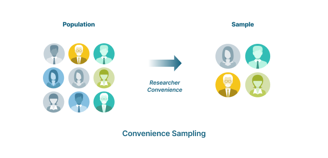

<!-- The two halves are inseparable. A brilliant interpolator cannot rescue a bad sample, and a beautiful sample is useless until you interpolate it. Spend the first part of class on the left half, the rest on the right half. -->

---

<!-- _class: lead -->

# Scenario: Distribution of a Mineral Deposit

## Gold nuggets under a landscape

<!-- The next four slides all use the same made-up scenario: gold is distributed through the subsurface, you cannot dig everywhere, so you choose where to dig. Keep the scenario fixed and change only the sampling design so the comparison is fair. -->

---

# The Scenario

The landscape on the left is the real, fully known surface. In practice you never see it — you only get the handful of points you choose to sample.

**Gold nuggets…**

<!-- Left: the true surface, drawn as contours. Right: the cartoon reason we care. The whole point of the next four slides is that you must commit to a sampling design before you know what the surface looks like. -->

---

# Systematic Sampling Pattern

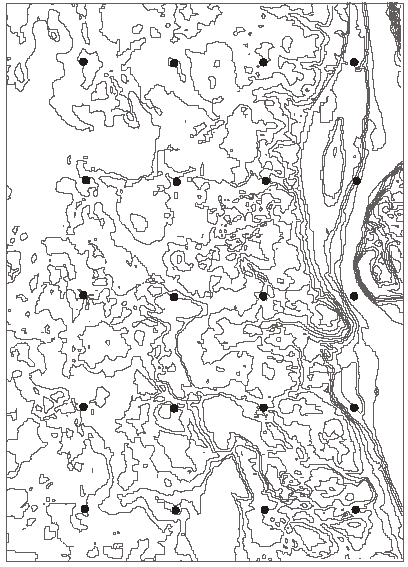

- Samples spaced uniformly at fixed X, Y intervals
- Parallel lines

**Advantages**

- Easy to understand and to plan

**Disadvantages**

- All areas receive the same attention
- Difficult to stay on the lines in the field
- May be **biased** if the landscape has a matching pattern

<!-- Systematic is the default people reach for. The bias failure mode is worth naming: if the terrain has ridges at roughly your sample spacing, a grid can land on ridge tops every time and you will never see the valleys. -->

---

# Random Sampling

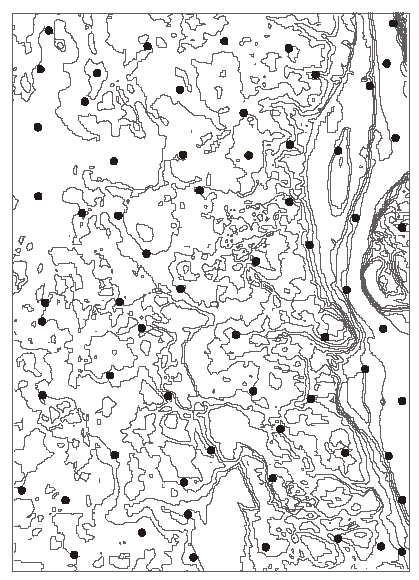

- Select random points

**Advantages**

- Less biased — unlikely to match a pattern in the landscape

**Disadvantages**

- Does nothing to distribute samples toward areas of high variation
- Difficult to explain; the locations of points may themselves be a problem

<!-- "The location of points may be a problem" is a field-work concern: random points land in rivers, on private land, and halfway up cliffs. Ask the class what they would do with a point they cannot reach — moving it quietly destroys the randomness that justified the design. -->

---

# Cluster Sampling

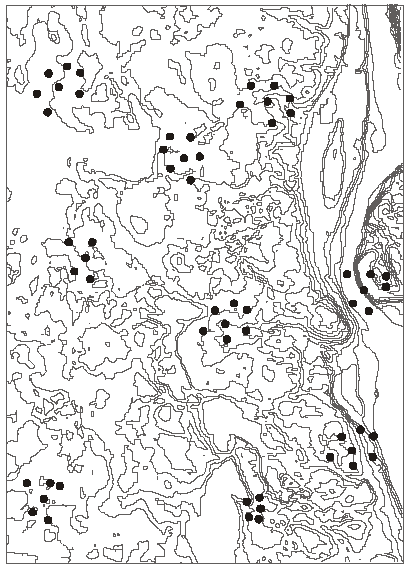

- Cluster centers are established, either randomly or systematically
- Samples are arranged around each center

**Advantages**

- Reduced travel time
- Less costly

**Disadvantages**

- Less representative sampling

<!-- Cluster sampling is the design that budgets produce. It buys many observations cheaply, but the observations are not independent: points inside one cluster tell you nearly the same thing. -->

<!-- Optional: skip if time is short. Systematic and random carry the main contrast. -->

---

# Adaptive Sampling

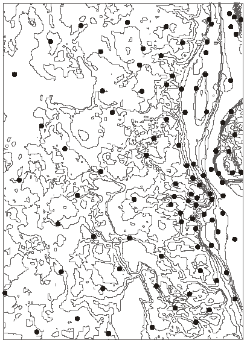

- Higher sampling density where the feature of interest is more variable
- Requires some method of estimating feature variation

**Advantages**

- Often efficient: large homogeneous areas need few samples, reserving effort for areas of higher spatial variation

**Disadvantages**

- Without a way to identify where the feature varies most, you need several visits; sample density cannot be changed on the spot

<!-- Adaptive is the best design and the hardest to execute, because it needs prior knowledge of the thing you are going out to measure. In practice it means a coarse first pass followed by targeted infill. Fixed the source's "can not" to "cannot." -->

<!-- TODO(instructor): decide how much of sampling design belongs in CE 414 versus the statistics prerequisite, and whether to add a slide on sample size and spacing. -->

<!-- Optional: skip if time is short. -->

---

<!-- _class: quiz -->

# Class Vote: Which Sampling Design Works Best Here?

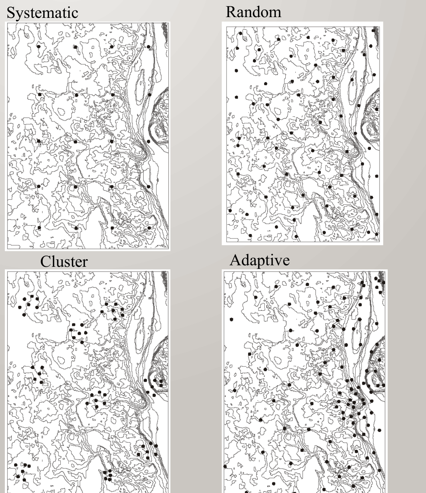

**Original surface:**

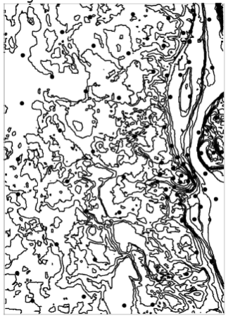

<!-- Vote now, while the four designs are fresh, and before discussing any of them. The interesting argument is between adaptive and random: adaptive puts points where the surface changes fastest, which is where interpolation errors are largest, but it needs prior knowledge that a real project usually does not have. There is no answer key here on purpose. -->

---

<!-- _class: lead -->

# From Samples to a Surface

## Gather observations that represent the spatial distribution of a variable — then predict that variable everywhere else

<!-- This repeats the framing from earlier in the session, which is exactly what the source deck did: it restated the sampling/interpolation definition slide as the transition out of sampling designs and into interpolation methods. Everything from here on is the second half. -->

---

# Interpolation: Many Methods

- There are **many different methods**
- All of them use the **location** and the **value** at sampling locations to estimate the variable of interest at unmeasured locations
- Methods differ in **weighting** and in the **number of observations** used
- Each method produces **different results**, even with the same data
- There is **no best method** for every application
- Accuracy is often judged by **withheld sample points** — the difference between the measured and the interpolated values

<!-- The last bullet is the honest one and it is where the rest of a career in this material lives: hold points back, interpolate without them, and compare. Everything else on this slide is bookkeeping. -->

<!-- Thursday makes the last bullet concrete: a six-methods test with 60 points held back, RMSE, and checkpoints. -->

---

# Interpolation: Rasters and Contours

Usually used for **point-to-raster** data. Some methods instead produce **contour lines** — vector lines of uniform value.

**Raster surface**

- Values are measured at a set of sample points
- Raster layer boundaries and cell dimensions are established
- The interpolation method estimates the value for the center of each unmeasured grid cell

**Contour lines: an iterative process**

- Estimate points of a given value (say 10 °C) and connect them into a line, then estimate the next value (say 20 °C) — lines of different values may not cross

<!-- Point out that the raster path and the contour path are two renderings of the same estimated surface, not two different analyses. In practice you interpolate to a raster and derive contours from it. -->

<!-- Optional: skip if time is short. Lab 8 works only in rasters. -->

---

# Example Base

**Elevation contours** — the true surface

**Sampled locations and values**

<!-- This pair is the reference for the rest of the session and for kriging on Thursday. Left is the truth, which in a real project you never have. Right is everything the interpolator gets to see. Every method that follows is judged by how close it comes to the left panel using only the right panel. -->

---

# Thiessen Polygons

- Assigns an interpolated value equal to the value found at the **nearest sample location**
- The conceptually simplest method
- Only **one point** is used — the nearest one
- Often called **nearest sample** or **nearest neighbor**

<!-- Thiessen is the zero-weighting case: the nearest point gets a weight of one and everything else gets zero. Worth saying out loud, because it makes the later methods feel like refinements rather than unrelated tricks. -->

---

# Building a Thiessen Polygon

1. Draw lines connecting the points to their nearest neighbors
2. Find the **perpendicular bisector** of each line
3. Connect the bisectors and assign the resulting polygon the value of the center point

<!-- Walk the four panels in order. The key geometric fact: every location inside a polygon is closer to that polygon's sample point than to any other. In ArcGIS Pro this is a single tool (two slides on); students should still be able to draw it by hand on an exam. -->

---

# Sample Points Become Polygons

**Sampled locations and values**

**Thiessen polygons**

<!-- Same points, now partitioned. Note the dense cluster on the right of the map: where samples crowd together the polygons become tiny slivers, and where samples are sparse a single polygon can cover a large area with one measured value. -->

---

# Thiessen Surface

<!-- The 3D view makes the defining property obvious: the surface is flat inside each polygon and jumps discontinuously at every boundary. That is fine for a categorical variable such as soil type, and wrong for elevation or temperature. The source slide title misspelled this as "Theissen" — corrected to "Thiessen." -->

---

# Thiessen: Trade-offs

**Advantages**

- Ease of application
- Appropriate for **discrete** (categorical) variables

**Disadvantages**

- Accuracy depends largely on **sampling density**
- Boundaries are often odd-shaped at transitions
- **Continuous** variables are often not well represented

<!-- Tie the disadvantages back to the 3D view they just saw. The odd-shaped boundaries and the step discontinuities are the same fact seen twice. -->

---

# Thiessen Polygons in ArcGIS Pro

**Create Thiessen Polygons**: Output Fields **All fields**

**Polygon to Raster**: Value field = the **sampled value**

<!-- Both captures are from the Lab 8 model in ArcGIS Pro 3.7.1, where RASTERVALU is the field holding each sample's elevation. Two defaults give a surface with no elevations in it and no error: Create Thiessen Polygons opens at Output Fields "Only feature ID", which drops the sampled value, and Polygon to Raster fills Value field with OBJECTID, which makes a surface of polygon numbers. Create Thiessen Polygons needs an Advanced license; the lab machines have it. -->

---

# Fixed-Radius Local Averaging

- More complex than nearest sample
- Cell values are estimated from the **average of nearby samples**
- Which samples are used depends on the **search radius** — any sample inside the circle is used in the average, anything outside is ignored
- Specify the output raster grid; a circle is centered over each raster cell
- The radius is typically several cell widths, so neighboring cells come out similar, and some circles contain no points

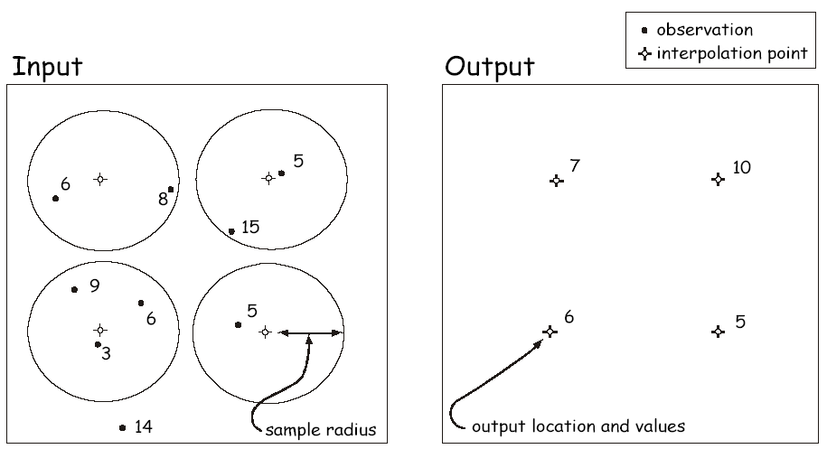

**Search radius matters** — too large and the data are smoothed away.

<!-- Combined the source's text slide with the figure that followed it. The failure mode to demonstrate: shrink the radius until empty circles appear as holes in the output, grow it until the surface flattens into the global mean. Fixed the source's "many contain no points" to "may contain no points." -->

---

# Fixed Radius: How It Works

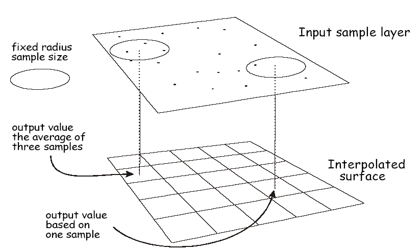

<!-- Read the diagram top to bottom. The input sample layer floats above the output raster; each output cell takes the average of whatever samples fall inside its circle. Point at the cell that got three samples and the cell that got one, and ask which value they trust more. Nothing in the method distinguishes them — the output carries no record of how many points went into each cell. -->

<!-- Optional: skip if time is short. -->

---

# Fixed Radius: The Result

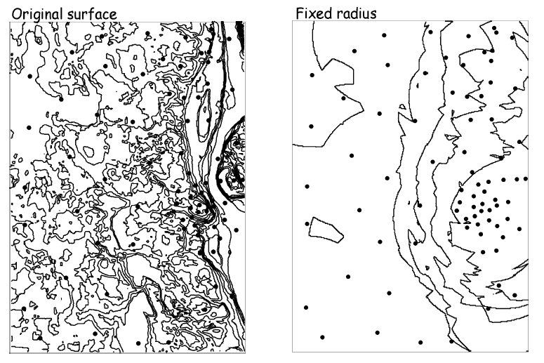

<!-- Original surface on the left, fixed-radius result on the right. The interpolated surface is visibly blockier and the fine drainage detail on the left is gone. It also does not pass through the measured values — this is a non-exact method, which comes back at the end of the session. -->

<!-- Optional: skip if time is short. -->

---

# Inverse Distance Weighted (IDW)

- Estimates the value at an unknown point using the **distances to** and **values of** nearby known points
- IDW reduces the contribution of a known point as that point gets farther away
- The weight of each sample point is in **inverse proportion to the distance**
- The farther away a point is, the less weight it carries in defining the unsampled location

<!-- IDW is the first method that uses more than one point and treats them unequally. The weights follow a rule you choose; on Thursday kriging takes them from the data. Corrected the source's "nearby know points" to "known points." -->

---

# IDW: The Equation

- $Z_i$ is the value of a known point
- $d_{ij}$ is the distance to that known point
- $Z_j$ is the unknown point
- $n$ is a user-selected exponent, often 1, 2, or 3

Any number of points may be used, up to all points in the sample; typically 3 or more.

<!-- Read the equation as a weighted average whose weights are 1/d^n, normalized by their own sum so they add to one. That normalization is the denominator. If n = 0 every weight is equal and IDW collapses to a plain local mean. -->

---

# IDW: A Worked Example

<!-- Walk the arithmetic on the figure: three known points at distances 4, 2 and 6 with values 50, 30 and 52, weights of 1/4, 1/2 and 1/6, and an estimate of 34. This is a linear IDW, exponent one. Have the class redo it with the exponent squared and watch the answer move toward the nearest point. -->

---

# What Changes the IDW Surface

Two factors dominate the interpolated surface:

- The size of the exponent **n** affects the shape of the surface — a larger *n* means the closer points are more influential
- A **larger number of sample points** results in a smoother surface

<!-- These are two of the choices Lab 8 varies: the power (2, then 1, 3 and each student's own) and the number of sample points (250, 2,500, 10,000). The lab holds the neighbor count at 12; the next two slides show what that setting does. As n grows without bound, IDW converges on the Thiessen result: the nearest point takes all the weight. -->

---

# IDW: Linear, 6 Nearest Points

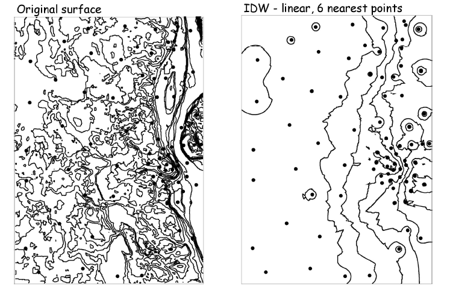

<!-- Original surface on the left, IDW with exponent one and the six nearest points on the right. Point out the small closed contour rings around isolated sample points — the "bull's-eyes" that are the signature artifact of IDW. -->

<!-- Optional: skip if time is short. One of these two IDW comparisons is enough. -->

---

# IDW: Squared, 6 vs 12 Nearest Points

<!-- Both panels use exponent two; the left uses six neighbors, the right uses twelve. More neighbors smooths the surface without removing the bull's-eyes, because the exponent, not the neighbor count, is what concentrates weight on the nearest point. -->

---

# IDW Surface

<!-- Compare this against the Thiessen surface from earlier, and keep both in mind for Thursday's kriged surface. IDW is continuous — no cliffs at polygon edges — but it is not smooth: the surface has a kink at every sample point, and each sample sits at a local peak or pit. -->

---

# IDW in ArcGIS Pro

- **Spatial Analyst ▸ IDW** (3D Analyst and Geostatistical Analyst have their own)
- **Z value field**: the sampled value
- **Power**: the exponent *n*; 2 by default
- **Search radius**: **Variable**, the **12** nearest points by default
- **Output cell size**: set it, or IDW picks one from the points

<!-- The capture is the IDW tool inside the Lab 8 model, with Power exposed as a model parameter (the IDW Power oval). Lab 8 also sets Cell Size, Snap Raster and Extent as environments so every surface lands on the same 30 m cells as the true DEM; without them nothing reports an error, but Thursday's subtraction compares cells that do not line up. -->

---

# Does the Surface Give the Points Back?

Interpolate, then read the surface **at the sample points**:

- **Thiessen**: yes — the nearest point *is* the sample
- **IDW**: yes — at distance 0 the sample takes all the weight
- **Fixed-radius averaging**: **no** — it blends the sample with its neighbors

A method that returns the samples is **exact**. Thursday: is **kriging**?

<!-- The self-check quiz has an item on exactly this, and it splits the room: IDW surfaces look averaged, so people expect IDW to be the non-exact one. At a sample location the distance is zero, the weight 1/d^n is unbounded, and the sample's own value comes back. ArcGIS Pro's IDW gave the sample values back exactly in the six-methods test that Thursday shows (tools/week08_interpolation_figures.py). -->

---

# Trend Surface Interpolation

Fits a statistical model — a **trend surface** — through the measured points, typically a polynomial.

- Where **Z** is the value at any point (*x*, *y*)
- The equation is **second order**; the figure shows a **third-order** surface
- Where the **a** terms are coefficients estimated in a regression model

<!-- Trend surface is regression, not local interpolation: every sample point influences every part of the surface. That is why the result on the right looks nothing like the original — it captures the regional slope and discards local detail on purpose. -->

<!-- Optional: skip if time is short. Trend surfaces and splines are not in Lab 8. -->

---

# Splines

- The name comes from a drafting tool — a flexible ruler used to draw smooth curves through several points
- **Spline functions** are used to interpolate along a smooth curve, much like that flexible ruler
- They force a smooth line to pass through a desired set of points
- Constructed from a set of joined polynomial functions

<!-- Combined the source's text slide with the figure that followed it. Splines give the smoothest-looking result of anything in this deck, which is not the same as the most accurate: the surface can overshoot well past the range of the measured values between widely spaced points. Corrected "are use to interpolate" to "are used to interpolate." -->

<!-- Optional: skip if time is short. Lab 9 next week uses a spline in one run. -->

---

# Thursday: Kriging

- Thiessen and IDW weight the points by a **rule you choose**
- **Kriging** measures how fast similarity fades with distance, then sets the weights **from the data**
- Then: **how wrong** is each surface, in meters?
- And **Lab 8**: rebuild Y Mountain three ways and measure the error

<!-- The surface is the kriged version of the same example points, also the title image. Set it beside the Thiessen and IDW surfaces: stepped, kinked, smooth. -->

---

<!-- _class: activity -->

# Final Thoughts

**Quiz: Points Into Surfaces.** Five items on the question we spent the session on: **what is this method actually doing with the points?** **Scan the code**, or open the link under it.

- Not graded, nothing recorded: a quick check that today's material made sense
- The **exponent** and the **number of points** are two of the choices you test in Lab 8

**Before next class**

- **Reading:** Chapter 12 of *GIS Fundamentals* (Sampling and Interpolation)
- **Quiz 7**, open book, on Learning Suite, due **Saturday 11:59 pm**
- [Lab 8 — Interpolation Explorer](https://byu-hydroinformatics.github.io/ce414-gis-applications/assignments/lab-08/) is introduced Thursday and due **Saturday 11:59 pm**
- Office hours: [calendly.com/dan-ames/office-hours](https://calendly.com/dan-ames/office-hours)

byu-hydroinformatics.github.io/ce414-gis-applications/quizzes/interpolation/

<!-- Five minutes, in pairs, then a show of hands on the one that splits the room: the item asking which method cannot return the measured values unchanged. Most of the room expects IDW to be the non-exact one because its surfaces look averaged, but at a sample location the nearest point is that sample itself, so IDW gives the measurement back; fixed-radius averaging is the one that blends it away. If the room has no signal, put the URL on the board; the items read aloud just as well. -->

<!-- Conversion notes: source "CE 414 Week 8 - Interpolation.pptx" (48 slides), converted September 3, 2026; the spelling fixes are in git history. Split October 20, 2026: kriging, the six-methods comparison, the exactness test, the method vote and the ArcGIS Pro tool table moved to Thursday (interpolation-explorer.md); sampling, Thiessen and IDW stay here, with new ArcGIS Pro slides from the Lab 8 captures. Figures: tools/week08_interpolation_figures.py. -->
