<!-- _class: lead -->
<!-- _paginate: skip -->

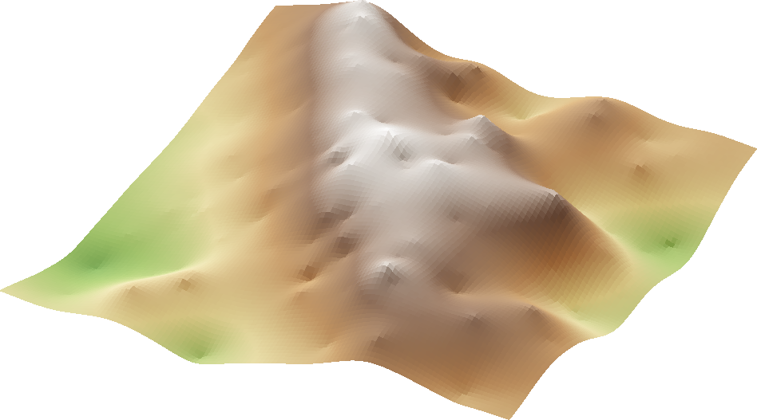

# Sampling and Interpolation

## Nearest Neighbor and IDW

CE 414 Engineering Applications of GIS
Civil & Construction Engineering
Brigham Young University
Dr. Dan Ames

<!-- Tuesday of Week 9: sampling design, then the two interpolators that weight points by a rule you choose, nearest neighbor (Thiessen) and IDW. Thursday is kriging, which lets the data choose the weights, then how to measure a surface's error, and Lab 8. Slides marked optional in these notes can be skipped as time requires. The surface on the right is where Thursday ends up: a kriged surface built from a scatter of measured points. -->

<!-- stamp:begin -->
<!-- _footer: 'CE 414 · Week 9 — InterpolationLast Updated: 2026-10-25© 2026 Daniel P. Ames · <a href="https://creativecommons.org/licenses/by/4.0/">CC BY 4.0</a>' -->
<!-- stamp:end -->

---

# Today's Goals

By the end of class you should be able to:

- Explain why we **sample** instead of measuring everywhere
- Compare four **sampling designs** and say when each is appropriate
- Build a **Thiessen** (nearest neighbor) surface, by hand and in ArcGIS Pro
- Compute an **IDW** estimate and say what its **exponent** does
- Say which methods give the **measured values back**

Thursday: **kriging**, how wrong a surface is, and **Lab 8**

<!-- Everything on the right-hand figure is the whole idea in miniature: an unknown value y at position x, estimated as a weighted blend of two known values. Every method this week is a more elaborate version of that one picture. That figure comes back several times on purpose. -->

---

<!-- _class: activity -->

On your own · paper worksheet

# In Class Activity: What Is the Temperature in Provo?

- Assume you only know the air temperature in three Utah cities: **Moab**, **American Fork**, and **Cedar City**
- Look up each one's current temperature and its straight-line **distance to Provo**
- From those three, **estimate the current temperature in Provo**, and write down how
- Keep the sheet: you will estimate Provo **three more ways** today
- At the end, **upload a photo** of your worksheet to Learning Suite by 9:30 am

* 

<!-- Hand out the worksheet (docs/handouts/provo-temperature-worksheet.pdf, built by tools/week09_provo_worksheet.py), one per student; each person works alone. Today they do Steps 1 and 2 (temperatures, distances, their own estimate). Later slides return to the same sheet: Step 3 (Thiessen polygons by hand) after Thiessen Polygons: The Method, Steps 4 and 5 (two nearest neighbors, IDW power 2) after IDW: The Method, and Step 6 (look up Provo and compare) at the end. The click shows the answer distances: use it as a check once they have measured, not before: straight-line (great-circle) distances from Provo, as the crow flies rather than by road, between the UGRC municipal-boundary centroids: American Fork 19 km, Moab 259 km, Cedar City 311 km (tools/week09_tuesday_figures.py). -->

<!-- Give them five or six minutes (measuring the distances takes a little longer). Collect several answers and, more importantly, several rules: nearest city, plain average, distance-weighted average, adjust for elevation. Those four answers are Thiessen, a global mean, IDW, and a trend surface. Name them now, then spend the rest of the session making each one precise. -->

<!-- Map: Utah from UGRC's state boundary, cities at the centroids of their UGRC municipal boundaries (tools/week08_interpolation_figures.py). Point out before anyone answers: American Fork is about 20 km from Provo, while Moab and Cedar City are each more than 250 km away. The map is why nearest-city and distance-weighted answers win. -->

---

# Interpolation

**Interpolation** is a procedure to predict values of an attribute at **unsampled points** within the region that was sampled.

**Why?** You cannot measure every location:

- Time
- Money
- Physically or legally impossible

**Examples:**

- Temperature
- Acid rain deposition
- Soil characteristics
- Mining: gold deposits

Also used when **changing cell size**, when data are **missing or unsuitable**, or for a **past date** (for example, temperature).

* Why is the geologist sad?
* To measure every spot, he'd have to dig up the whole site, and then there'd be nothing left to measure.

<!-- Two clicks: the question, then the punch line. It is the definition's "why" in one line: measuring everywhere is not just slow and expensive, it can destroy the thing being measured (a soil core, a gold deposit). -->

<!-- Note the phrase "within the region sampled." Predicting outside that region is extrapolation, and every method here degrades badly when you ask it to extrapolate. Fixed the source's "Can not" to "cannot." -->

---

# Sampling and Interpolation: Growing Up

<strong>Sampling:</strong> Mom marks her height on the wall every birthday, ages 1 to 18.

* <strong>How tall was she at 12½?</strong> Nobody marked the wall that day.
* <strong>Interpolate</strong> between her 12th and 13th birthdays: 63 + (65½ − 63) × (12½ − 12) ⁄ (13 − 12) ≈ 64¼ in
* <strong>Every month?</strong> Interpolate each one and connect them: the whole growth line.

<!-- Three clicks. A girl measured on every birthday is a sample; the wall marks are her data. Click 1: nobody measured her at 12 and a half, so we need an estimate. Click 2: the two-point equation pops up over the cartoon (the same figure as Today's Goals), its line rising left to right like her growth chart, with her 12th (5 ft 3 in) and 13th (5 ft 5.5 in) birthday heights: 63 + 2.5 x 0.5 = 64.25 in, about 5 ft 4 in. Click 3: do that for every month and join the dots and you have the whole curve. That is the entire week in one dimension: the birthdays are the sampling design, the line is the interpolated surface. Ask whether a straight line between birthdays is right during her growth spurt (11 to 13), which is the question every method today answers differently. The girl is made up: her heights follow the shape of the CDC (2000) stature-for-age median for girls, scaled to finish at 5 ft 8 in and rounded to the half inch (tools/week09_tuesday_figures.py). The cartoon was generated with OpenAI gpt-image-2, October 25, 2026. The equation figure was redrawn October 26, 2026 with a rising line and in the same y0 + (y1 - y0) form as the worked example (tools/week09_linear_interpolation_figure.py). -->

---

# From a Line to a Surface

<strong>1-D:</strong> her height on every birthday → the whole growth line
<strong>2-D:</strong> the temperature at a few stations →

* the whole grid, every cell interpolated
* <strong>Spatial sampling:</strong> gather observations that represent the spatial distribution of a variable of interest
* <strong>Interpolation:</strong> use those samples to predict that variable at every unsampled location
* What other classes have you had where you had to <strong>interpolate</strong> a value?
* <strong>Thermodynamics:</strong> a property between two rows of the steam tables <strong>Fluids:</strong> a friction factor read between curves on the Moody diagram <strong>Hydrology:</strong> a rainfall depth between durations on an IDF curve <strong>Geomatics:</strong> an elevation between two contour lines <strong>Geotechnical:</strong> the soil layers between two borings <strong>Structures:</strong> a design value between rows of a code table

<!-- The map starts empty except for the stations: a thermometer reading at each is the birthday mark on the wall. Click 1 fills every cell, which is the growth line in two dimensions. Clicks 2 and 3 are the two definitions the rest of the session hangs on. The two halves are inseparable: a brilliant interpolator cannot rescue a bad sample, and a beautiful sample is useless until you interpolate it. Click 4 asks the class, and click 5 shows answers once they have had a go. Most examples on the card are one-dimensional, like the growth chart; two are already spatial: an elevation between contours and the ground between borings. The temperatures are made up (16 stations, filled by IDW with power 2, tools/week09_tuesday_figures.py); IDW itself comes later today. -->

---

<!-- _class: lead -->

# Scenario: Distribution of a Mineral Deposit

## Gold nuggets under a landscape

<!-- The next four slides all use the same made-up scenario: gold is distributed through the subsurface, you cannot dig everywhere, so you choose where to dig. Keep the scenario fixed and change only the sampling design so the comparison is fair. -->

---

# The Gold Prospecting Scenario

The map on the left is the real, fully known gold grade, in **grams of gold per tonne of rock** (g/t). In practice you **never see it** — you only get the handful of points you choose to sample.

**Gold nuggets…**

<!-- Left: the true gold grade in grams of gold per tonne of rock (g/t, the unit assays report), made up for this scenario (tools/week09_tuesday_figures.py): a northeast-trending vein, a dozen ore pods of different sizes, and background variation. Right: the cartoon reason we care. The next four slides sample this same map. The whole point of the next four slides is that you must commit to a sampling design before you know what the surface looks like. -->

---

# Method 1: Systematic Sampling Pattern

- Samples spaced **uniformly** at fixed X, Y intervals
- Parallel lines

**Advantages**

- **Easy** to understand and to plan

**Disadvantages**

- All areas receive the same attention
- Difficult to stay on the lines in the field
- May be **biased** if the landscape has a matching pattern

<!-- Systematic is the default people reach for. The bias failure mode is worth naming: if the terrain has ridges at roughly your sample spacing, a grid can land on ridge tops every time and you will never see the valleys. -->

---

# Method 2: Random Sampling

- Select **random** points

**Advantages**

- **Less biased** — unlikely to match a pattern in the landscape

**Disadvantages**

- Does nothing to distribute samples toward areas of high variation
- Difficult to explain; the locations of points may themselves be a problem

<!-- "The location of points may be a problem" is a field-work concern: random points land in rivers, on private land, and halfway up cliffs. Ask the class what they would do with a point they cannot reach — moving it quietly destroys the randomness that justified the design. -->

---

# Method 3: Cluster Sampling

- **Cluster centers** are established, either randomly or systematically
- Samples are arranged around each center

**Advantages**

- Reduced **travel time**
- Less **costly**

**Disadvantages**

- Less representative sampling

<!-- Cluster sampling is the design that budgets produce. It buys many observations cheaply, but the observations are not independent: points inside one cluster tell you nearly the same thing. -->

<!-- Optional: skip if time is short. Systematic and random carry the main contrast. -->

---

# Method 4: Adaptive Sampling

- **Higher sampling density** where the feature of interest is more variable
- Requires some method of estimating feature variation

**Advantages**

- Often **efficient**: large homogeneous areas need few samples, reserving effort for areas of higher spatial variation

**Disadvantages**

- Without a way to identify where the feature varies most, you need several visits; sample density cannot be changed on the spot

<!-- Adaptive is the best design and the hardest to execute, because it needs prior knowledge of the thing you are going out to measure. In practice it means a coarse first pass followed by targeted infill. The figure does exactly that: 24 points scattered at random, then 72 more placed at random but weighted toward high grade, so the dots look random yet crowd on and around the richest pods. Fixed the source's "can not" to "cannot." -->

<!-- TODO(instructor): decide how much of sampling design belongs in CE 414 versus the statistics prerequisite, and whether to add a slide on sample size and spacing. -->

<!-- Optional: skip if time is short. -->

---

<!-- _class: quiz -->

# Which Sampling Design Is Best and Why?

Discuss with your neighbor

<strong>The true gold grade</strong>, which no real survey gets to see

Each design uses the same <strong>96</strong> sample points

* <strong>It depends</strong> on purpose, budget, time, and access:
* Capture the overall <strong>variability</strong>? → systematic or random
* Find the <strong>gold</strong>? → adaptive
* Short on <strong>time, money, or access</strong>? → cluster

<!-- Give pairs two or three minutes, then take answers and, more importantly, the reasons. Click the four answers in only after the discussion. The honest answer is that it depends: on the purpose of the survey, the money, the time, and how hard the ground is to reach. To describe the field as a whole (its average, its variability, a map you can trust everywhere), systematic or random spreads the effort evenly; random also guards against a landscape pattern that lines up with a grid. To find the gold, adaptive wins: it puts points where the grade is high and changing fast, which is also where interpolation errors are largest, but it needs prior knowledge or a second visit, which a real project may not have. When travel, budget, or access dominate, cluster sampling buys the most observations per day in the field, at the cost of points that repeat each other within a cluster. Point at the note under the panels: each design has the same 96 points on the same map (8 x 12 grid; 96 at random; 12 clusters of 8; 24 at random plus 72 weighted toward high grade), so every difference between panels comes from where the points went, not how many there are. -->

---

<!-- _class: lead -->

# From Samples to a Surface

## Gather observations that represent the spatial distribution of a variable — then predict that variable everywhere else

<!-- The cartoon: pins of different heights are the samples, and the stretchy sheet that rests on every pin top is the interpolated surface (regenerated October 26, 2026; prompt in tools/divider-images/week09.json). This repeats the framing from earlier in the session, which is exactly what the source deck did: it restated the sampling/interpolation definition slide as the transition out of sampling designs and into interpolation methods. Everything from here on is the second half. -->

---

# Interpolation: Many Methods

- Every method estimates unmeasured places from the **location** and **value** of the samples
- They differ in how they **weight** the samples and how many they use
- Same data, **different results**; no method is best everywhere
- To check one, **hold back** a few samples and compare

<figure>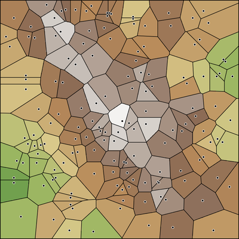Thiessen</figure>
<figure>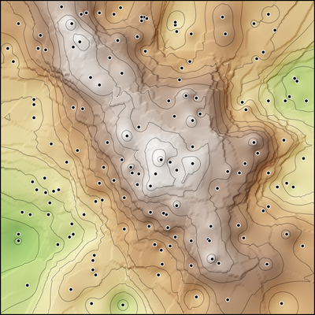IDW</figure>
<figure>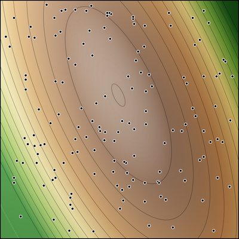Trend</figure>
<figure>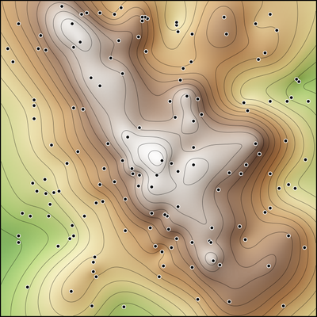Spline</figure>

<!-- The thumbnails preview the rest of today: the same 150 Timpanogos samples turned into a surface four ways (tools/week09_method_thumbnails.py crops them from the figures on the slides ahead). Same points, four visibly different maps: that is the third bullet. The last bullet is the honest one and it is where the rest of a career in this material lives: hold points back, interpolate without them, and compare. Shortened and the equation figure swapped for the thumbnails October 26, 2026. -->

<!-- Thursday makes the last bullet concrete: a six-methods test with 60 points held back, RMSE, and checkpoints. -->

---

# The Terrain Scenario

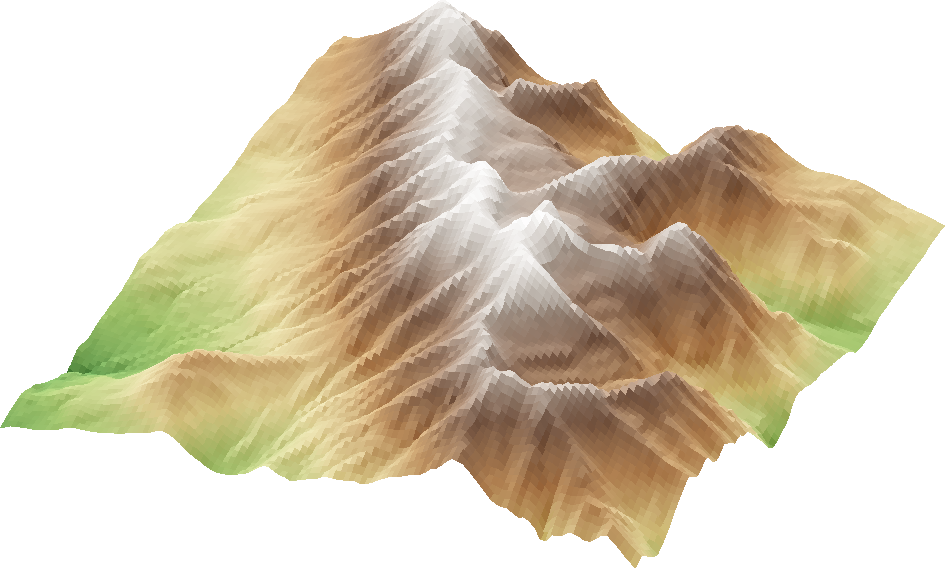

**DEM for Mount Timpanogos, Utah** — the "true" surface

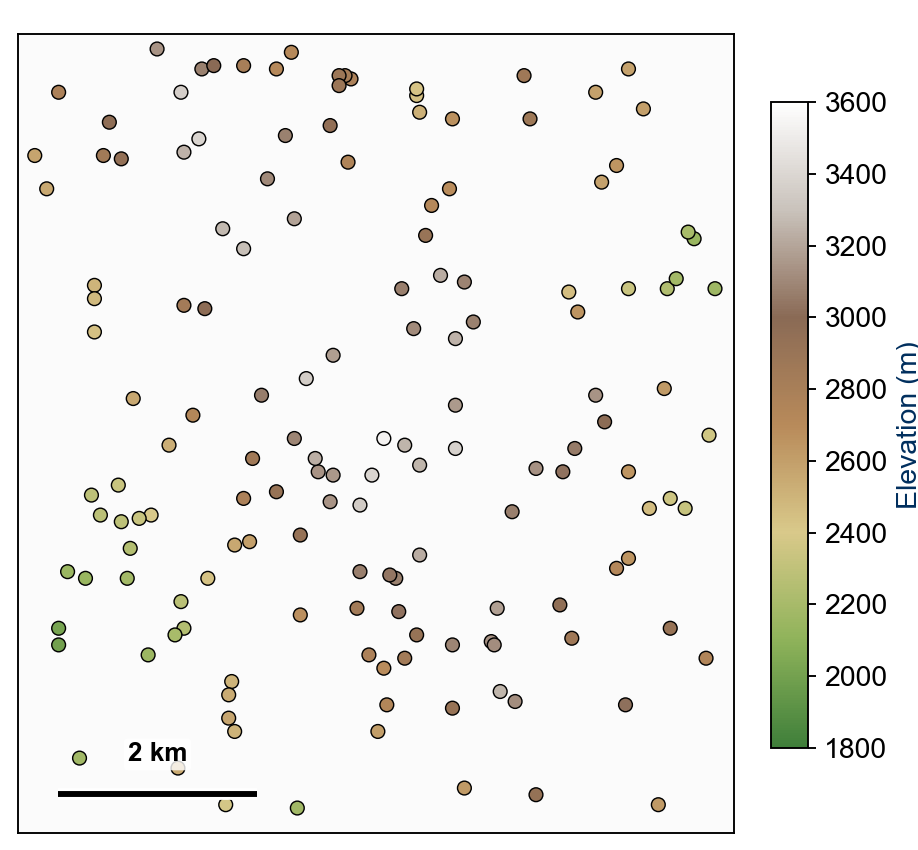

**150 sampled locations and values**

We <strong>pretend the true surface is unknown</strong>: all we have are the 150 points, and each method tries to rebuild the mountain from them. But we conveniently <strong>do have the truth</strong>, so we can test which method comes closest.

<!-- This pair is the reference for the rest of the session. Left is the truth: USGS 3DEP elevation, 30 m, a 7.2 km square around the summit of Mount Timpanogos, 1,831 to 3,569 m. In a real project you never have it. Right is everything the interpolator gets to see: 150 cells drawn at random, colored by their elevation. Every method that follows is judged by how close it comes to the left panel using only the right panel. Figures: tools/week09_elevation_figures.py (numpy, scipy and pykrige, not ArcGIS Pro; they are figures, not screenshots). Replaced the Bolstad contour figures October 25, 2026. -->

---

# Thiessen Polygons: The Method

- Each cell takes the value at the **nearest sample location**
- Only **one point** is used; also called **nearest sample** or **nearest neighbor**
- The conceptually simplest method

**Building one by hand**

1. Connect each point to its nearest neighbors
2. Draw the **perpendicular bisector** of each line
3. Join the bisectors; the polygon takes the value of its center point

<!-- Thiessen is the zero-weighting case: the nearest point gets a weight of one and everything else gets zero. Worth saying out loud, because it makes the later methods feel like refinements rather than unrelated tricks. Walk the four panels in order. Redrawn on white October 26, 2026 (tools/week09_thiessen_construction.py). Worksheet Step 3: have them do this now on their Utah map with the three cities. The key geometric fact: every location inside a polygon is closer to that polygon's sample point than to any other. In ArcGIS Pro this is a single tool (two slides on); students should still be able to draw it by hand on an exam. -->

---

# Thiessen Polygons: The Result

**Sampled locations and values**

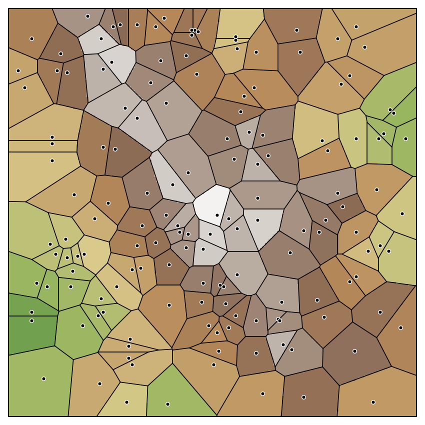

**Thiessen polygons**

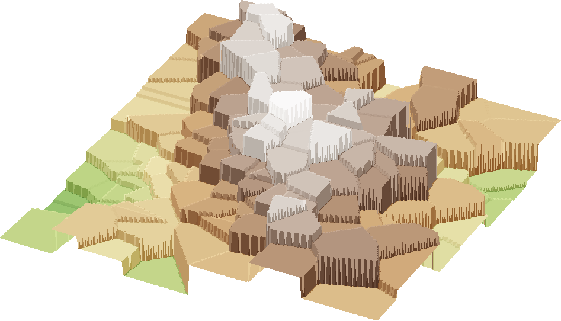

**The surface:** flat inside each polygon, a jump at every edge

**Advantages**

- Ease of application
- Appropriate for **discrete** (categorical) variables

**Disadvantages**

- Accuracy depends largely on **sampling density**
- Boundaries are often odd-shaped at transitions
- **Continuous** variables are often not well represented

<!-- Same 150 points, now partitioned, then shown in 3D. Where random samples happen to crowd together the polygons become slivers, and where they are sparse a single polygon covers a large area with one measured value. Against the DEM this surface is off by 124 m RMSE (tools/week09_elevation_numbers.json). The 3D view makes the defining property obvious: the surface is flat inside each polygon and jumps discontinuously at every boundary. That is fine for a categorical variable such as soil type, and wrong for elevation or temperature. Tie the disadvantages back to the 3D view: the odd-shaped boundaries and the step discontinuities are the same fact seen twice. Merged October 25, 2026 from five slides (concept, construction, points to polygons, 3D surface, trade-offs). -->

---

# Thiessen Polygons in ArcGIS Pro

**Create Thiessen Polygons**: Output Fields **All fields**

**Polygon to Raster**: Value field = the **sampled value**

<!-- Both captures are from the Lab 8 model in ArcGIS Pro 3.7.1, where RASTERVALU is the field holding each sample's elevation. Two defaults give a surface with no elevations in it and no error: Create Thiessen Polygons opens at Output Fields "Only feature ID", which drops the sampled value, and Polygon to Raster fills Value field with OBJECTID, which makes a surface of polygon numbers. Create Thiessen Polygons needs an Advanced license; the lab machines have it. -->

---

# Inverse Distance Weighted (IDW): The Method

- Estimates an unknown point from the **values of** and **distances to** nearby known points
- Each known point's weight is **inverse to its distance**: the farther away, the less it counts
- $Z_i$ is a known value, $d_{ij}$ the distance to it, $Z_j$ the unknown point
- $n$ is a user-selected **exponent**, often 1, 2, or 3
- Any number of points may be used, up to all of them; typically 3 or more

<!-- IDW is the first method that uses more than one point and treats them unequally. The weights follow a rule you choose; on Thursday kriging takes them from the data. Read the equation as a weighted average whose weights are 1/d^n, normalized by their own sum so they add to one. That normalization is the denominator. If n = 0 every weight is equal and IDW collapses to a plain local mean. Then walk the arithmetic on the right: three known points at distances 4, 2 and 6 with values 50, 30 and 52, weights of 1/4, 1/2 and 1/6, and an estimate of 34. This is a linear IDW, exponent one. Have the class redo it with the exponent squared and watch the answer move toward the nearest point. Then worksheet Steps 4 and 5: the two-nearest average and IDW with power 2 for Provo. With American Fork about 19 km away and the others past 250 km, IDW lands within a fraction of a degree of American Fork, which is the point. Merged October 25, 2026 from the concept, equation and worked-example slides. -->

---

# IDW: The Results

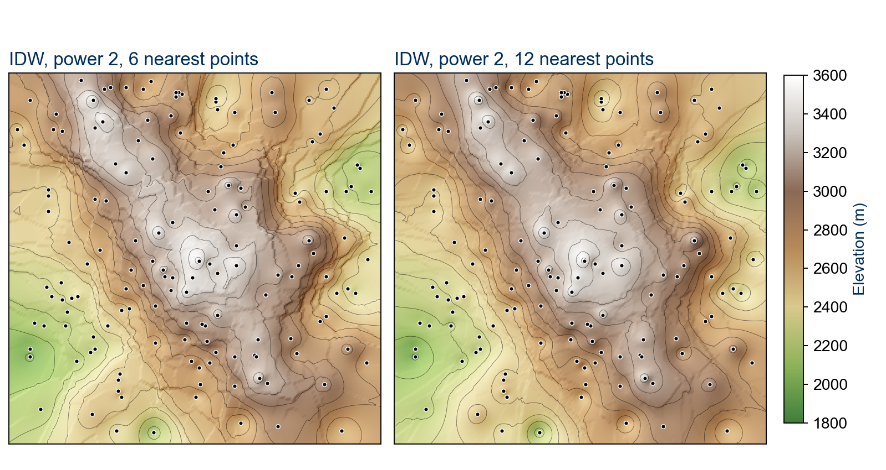

Exponent 2: **6** nearest points (left) vs **12** (right)

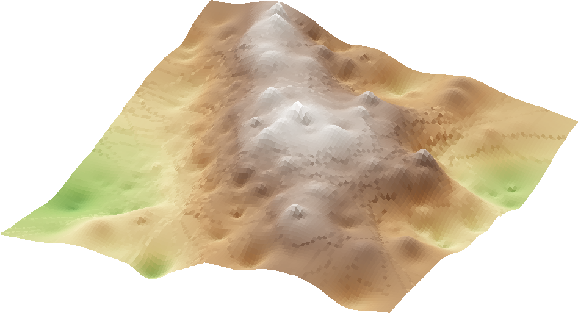

- A larger exponent **n** gives the **closer points** more influence
- **More sample points** give a **smoother** surface
- Continuous, but with **bull's-eyes** around isolated points

<!-- These are two of the choices Lab 8 varies: the power (2, then 1, 3 and each student's own) and the number of sample points (250, 2,500, 10,000). The lab holds the neighbor count at 12. Left figure: both panels use exponent two on the Timpanogos samples; more neighbors smooths the surface without removing the bull's-eyes (the closed contour rings around single points), because the exponent, not the neighbor count, is what concentrates weight on the nearest point. Against the DEM, 6 neighbors scored 103 m RMSE and 12 scored 110 m: smoother is not automatically better. As n grows without bound, IDW converges on the Thiessen result: the nearest point takes all the weight. Right: compare against the Thiessen surface and keep both in mind for Thursday's kriged surface. IDW is continuous (no cliffs at polygon edges) but not smooth: the surface has a kink at every sample point, and each sample sits at a local peak or pit. Merged October 25, 2026 from "What Changes the IDW Surface", the two IDW comparison figures (the linear 6-point one was dropped) and the 3D surface. -->

---

# IDW in ArcGIS Pro

- **Spatial Analyst ▸ IDW** (3D Analyst and Geostatistical Analyst have their own)
- **Z value field**: the sampled value
- **Power**: the exponent *n*; 2 by default
- **Search radius**: **Variable**, the **12** nearest points by default
- **Output cell size**: set it, or IDW picks one from the points

<!-- The capture is the IDW tool inside the Lab 8 model, with Power exposed as a model parameter (the IDW Power oval). Lab 8 also sets Cell Size, Snap Raster and Extent as environments so every surface lands on the same 30 m cells as the true DEM; without them nothing reports an error, but Thursday's subtraction compares cells that do not line up. -->

---

# Trend Surfaces and Splines

**Trend surface:** one polynomial fit through **all** the points by regression

$Z = a_0 + a_1x + a_2y + a_3x^2 + a_4y^2 + a_5xy$

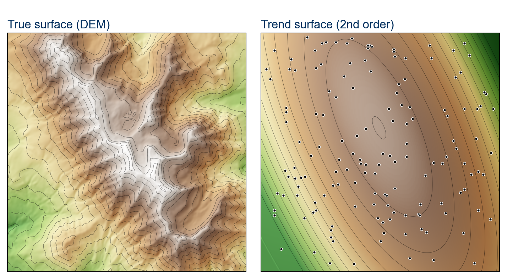

The regional slope, with the local detail gone

**Spline:** joined polynomial pieces, bent to pass **through** the points, like a drafter's flexible ruler

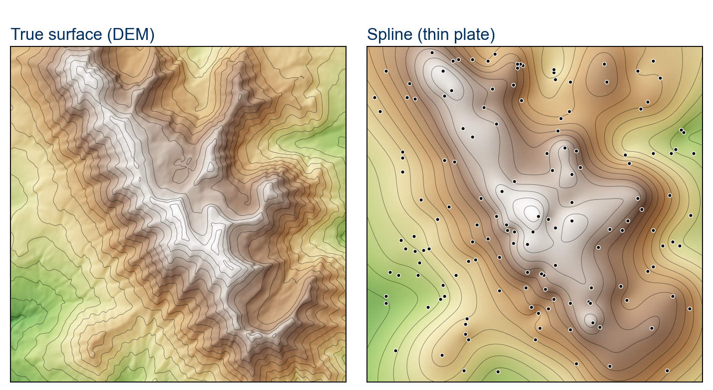

The smoothest-looking result, but it can **overshoot** between distant points

<!-- Both fit polynomials; the difference is reach. In the trend equation the a terms are regression coefficients and the equation is second order. Trend surface is regression, not local interpolation: every sample point influences every part of the surface, which is why its result looks nothing like the original: one tilted dome for a whole mountain (2nd order, the same equation as on the slide; 220 m RMSE against the DEM). A spline is built from local polynomial pieces joined smoothly, and is forced through the measured points; it gives the smoothest-looking result in this deck, which is not the same as the most accurate: the surface can overshoot well past the range of the measured values between widely spaced points. The spline in the figure is a thin-plate spline, the best of today's methods against this DEM at 76 m RMSE. Trend surfaces are not in Lab 8; Lab 9 next week uses a spline in one run. Merged October 25, 2026 from two slides. -->

---

# Does the Surface Give the Points Back?

Interpolate, then read the result **at the measured points**. Ten monthly prices of a made-up stock, **XYZ**:

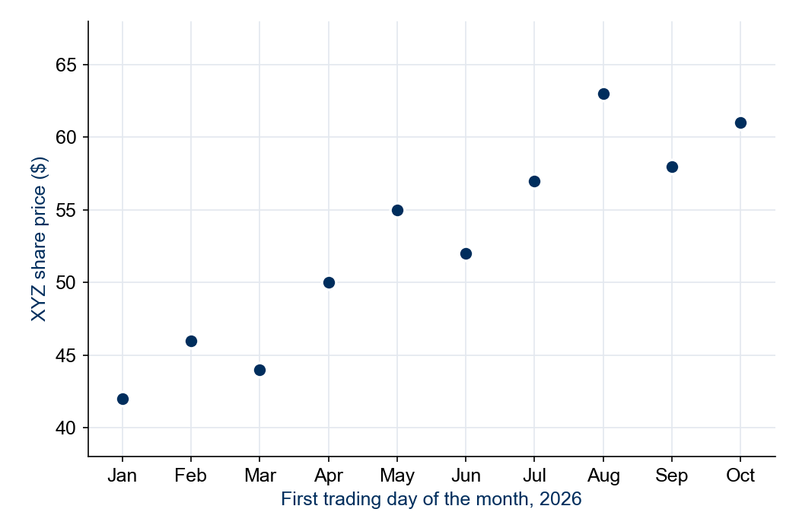

* 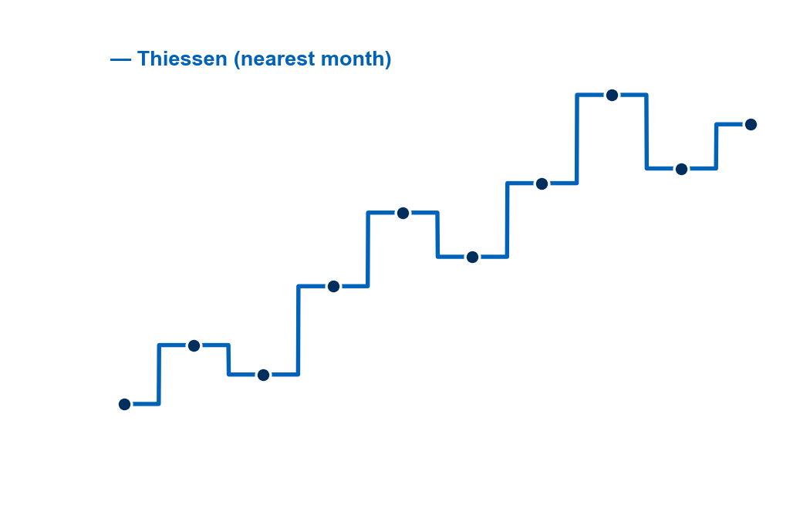 **Thiessen**: yes — a staircase, and each step *is* a price
* 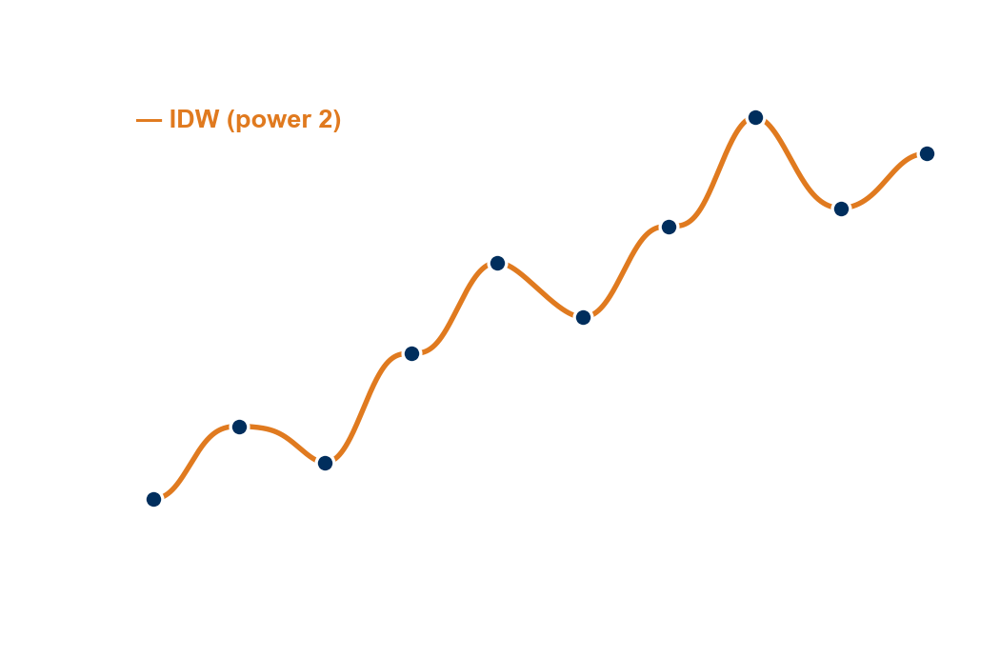 **IDW**: yes — a little bump at every price; at distance 0 the price takes all the weight
* 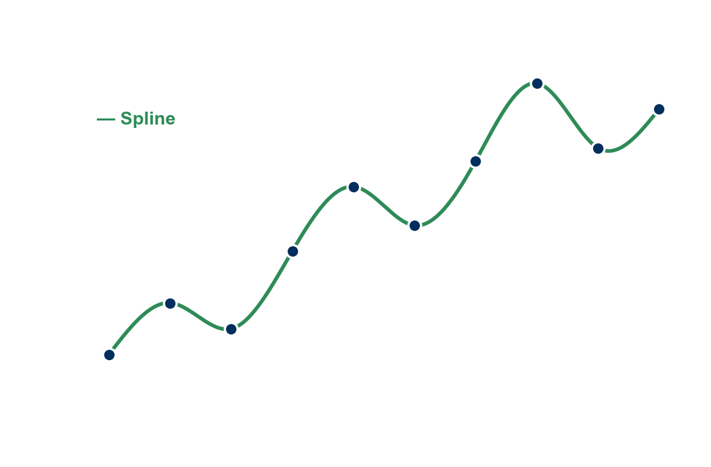 **Spline**: yes — bent to pass through every price
* 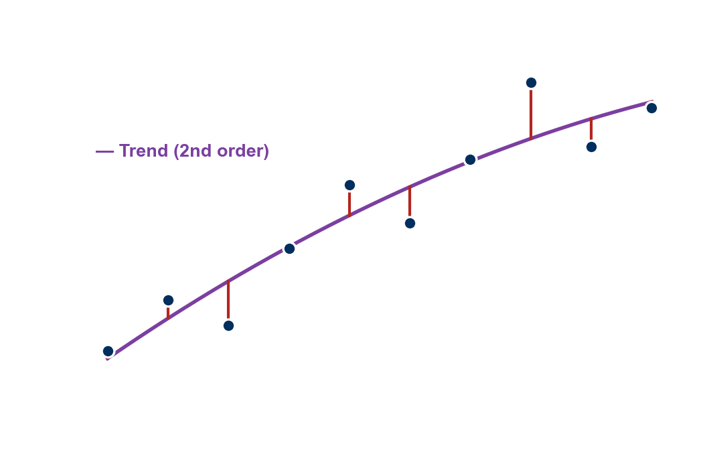 **Trend**: **no** — one curve for all ten months misses most of them (red)

A method that returns the samples is **exact**. Thursday: is **kriging**?

<!-- Four clicks, one method each, all on the same ten prices. In one dimension the shapes are easy to see, and they are the same shapes students saw in 3D: Thiessen's staircase is the stepped Thiessen surface, IDW's flat little bumps at each price are the bull's-eyes, the spline swings smoothly through every price (and overshoots between some), and the trend line is the tilted dome. The prices are made up (tools/week09_tuesday_figures.py); the 2nd-order trend misses them by up to $4.40. The self-check quiz has an item on exactly this, and it splits the room: IDW surfaces look averaged, so people expect IDW to be the non-exact one. At a sample location the distance is zero, the weight 1/d^n is unbounded, and the sample's own value comes back. In the six-methods test Thursday shows, on today's 150 Timpanogos samples: Thiessen, IDW and the thin-plate spline return every sample exactly, and the 2nd-order trend misses by 163 m on average (tools/week09_elevation_numbers.json). An earlier ArcGIS Pro run on another DEM found its regularized spline within 0.01 m. Fixed-radius averaging was removed from this deck October 25, 2026 (not used in practice or in Lab 8). -->

---

# Thursday: Kriging

- Thiessen and IDW weight the points by a **rule you choose**
- **Kriging** measures how fast similarity fades with distance, then sets the weights **from the data**
- Then: **how wrong** is each surface, in meters?
- And **Lab 8**: rebuild Y Mountain three ways and measure the error

<!-- The surface is the kriged version of the same 150 Timpanogos points, also the title image (ordinary kriging, spherical model fitted to the samples: range 4.6 km, no nugget; 86 m RMSE against the DEM). Set it beside the Thiessen and IDW surfaces: stepped, kinked, smooth. Thursday's kriging figures use the same samples. -->

---

<!-- _class: activity -->

# Final Thoughts

**Quiz: Points Into Surfaces.** Seven items, one or more on each of today's goals: why we sample, the four designs, Thiessen, the IDW exponent, and which methods give the points back. **Scan the code**, or open the link under it.

- Not graded, nothing recorded: a quick check that today's material made sense
- The **exponent** and the **number of points** are two of the choices you test in Lab 8

**Before next class**

- **Reading:** Chapter 12 of *GIS Fundamentals* (Sampling and Interpolation)
- **Quiz 7**, open book, on Learning Suite, due **Saturday 11:59 pm**
- [Lab 8 — Interpolation Explorer](https://byu-hydroinformatics.github.io/ce414-gis-applications/assignments/lab-08/) is introduced Thursday and due **Saturday 11:59 pm**
- Office hours: [calendly.com/dan-ames/office-hours](https://calendly.com/dan-ames/office-hours)

byu-hydroinformatics.github.io/ce414-gis-applications/quizzes/interpolation/

<!-- The seven items follow Today's Goals in order (the first two, on why we sample and on adaptive sampling, were added October 25, 2026 so every goal is tested). Five minutes, in pairs, then a show of hands on the one that splits the room: the item asking which method cannot return the measured values unchanged. Most of the room expects IDW to be the non-exact one because its surfaces look averaged, but at a sample location the nearest point is that sample itself, so IDW gives the measurement back; the trend surface is the one that misses, because one polynomial cannot pass through every point. If the room has no signal, put the URL on the board; the items read aloud just as well. -->

<!-- Conversion notes: source "CE 414 Week 8 - Interpolation.pptx" (48 slides), converted September 3, 2026; the spelling fixes are in git history. Split October 20, 2026: kriging, the six-methods comparison, the exactness test, the method vote and the ArcGIS Pro tool table moved to Thursday (interpolation-explorer.md); sampling, Thiessen and IDW stay here, with new ArcGIS Pro slides from the Lab 8 captures. Figures: tools/week08_interpolation_figures.py. -->
