<!-- _class: lead -->
<!-- _paginate: skip -->

# Volumes with Rasters

## How Much Rock Is in a Mountain? — and Lab 9

CE 414 Engineering Applications of GIS
Civil & Construction Engineering
Brigham Young University
Dr. Dan Ames

<!-- Thursday of Week 10, written to be studied on your own: there is no class meeting this week. Tuesday's cut and fill was a difference of two surfaces that both exist: the ground and a design. Here the bottom surface is one nobody can see: the plain under Big Southern Butte, which Lab 9 rebuilds by interpolation (Week 9's methods) before it measures the dome. The title image is a profile through the summit from the Lab 9 DEM. -->

<!-- stamp:begin -->
<!-- _footer: 'CE 414 · Week 10 — Volumes with RastersLast Updated: 2026-10-27© 2026 Daniel P. Ames · <a href="https://creativecommons.org/licenses/by/4.0/">CC BY 4.0</a>' -->
<!-- stamp:end -->

---

# Today's Goals

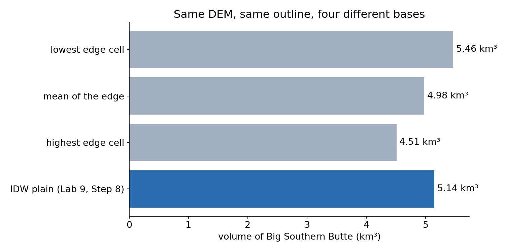

By the end of this deck (study it after Tuesday's) you should be able to:

- Write any raster volume as **height × cell area, summed**
- Compute it in ArcGIS Pro two ways: **Raster Calculator + Zonal Statistics**, and **Surface Volume**
- Explain why the **base surface** is the biggest choice in the answer
- Say what **Lab 9** asks for, and how you will know you are right

---

<!-- _class: lead -->

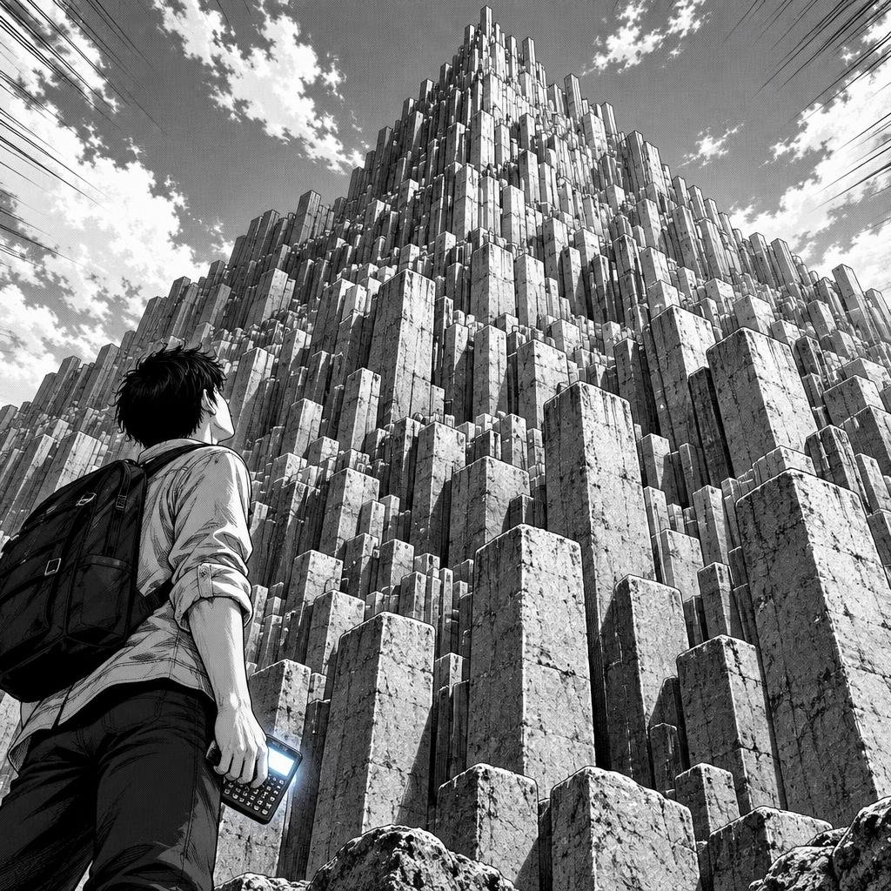

# Part 1 — A Volume Is a Sum

---

# Height × Area, Summed

- Every cell: **height above the base × cell area**
- 10 m cells: each meter of height is **100 m³**
- Sum the cells: **m³**; ÷ 1,000³ for **km³**
- Lake (Week 7), pad (Tuesday), mountain (today): **the same sum**; only the **lid** and the **bottom** change

<!-- For a lake the lid is the water level and the bottom the lake bed; for the pad, ground and design; for the butte, the DEM and a rebuilt plain. -->

---

# Units: Project First

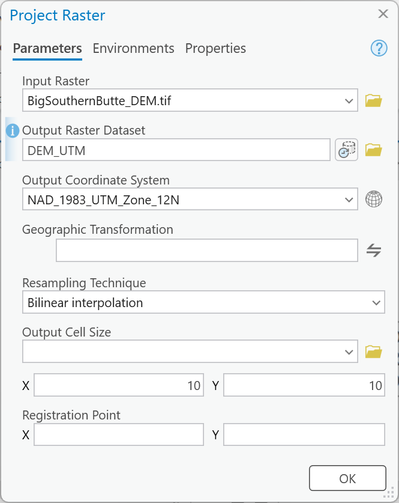

- A DEM in **latitude and longitude** has a "cell size" in **degrees**, not meters
- Height × cell area only gives m³ when **both** are in meters
- So **project** the DEM to a meter-based system first (Lab 9 uses **UTM Zone 12N**)
- Then check: does the cell size read **10**, not 0.0000926?

<!-- 1/3 arc-second is about 0.0000926 degrees, roughly 10 m north-south; Lab 9 Step 1 projects the DEM so the cell is 10 m. The Week 10 self-check quiz has an item on this. The figure is Lab 9's Figure 1, the Project Raster dialog: UTM Zone 12N, bilinear, cell size 10. -->

---

# In ArcGIS Pro, Two Ways

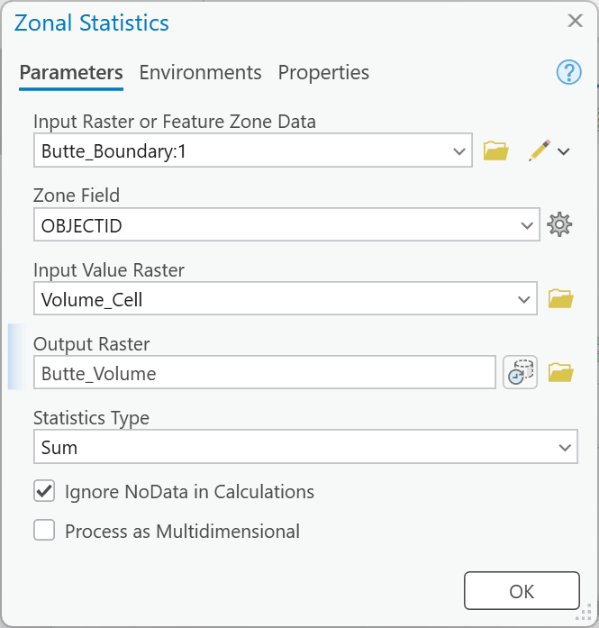

- **Raster Calculator** for height, × 100 ÷ 1,000³ per cell, then **Zonal Statistics**, statistic **Sum**: any base, even a curved one (Lab 9)
- **Surface Volume** (3D Analyst): volume **above or below a flat plane**, written to a text file
- Above **1,572.2 m**, Surface Volume gives **4.99 km³** over **26.2 km²**: it counts only the cells **above** the plane

Surface Volume only takes a **flat** plane. That is why Lab 9 uses the Raster Calculator route.

<!-- Surface Volume run in ArcGIS Pro 3.7.1's arcpy on the Lab 9 DEM (projected to UTM 12N, 10 m) clipped to the reference outline: plane 1,572.2 m (the mean of the outline's edge cells), ABOVE, 4.988 km³, 2-D area above the plane 26.17 km². The same number came from summing the cells directly. The figure is Lab 9's Figure 8a, Zonal Statistics with Statistics Type Sum. -->

---

<!-- _class: lead -->

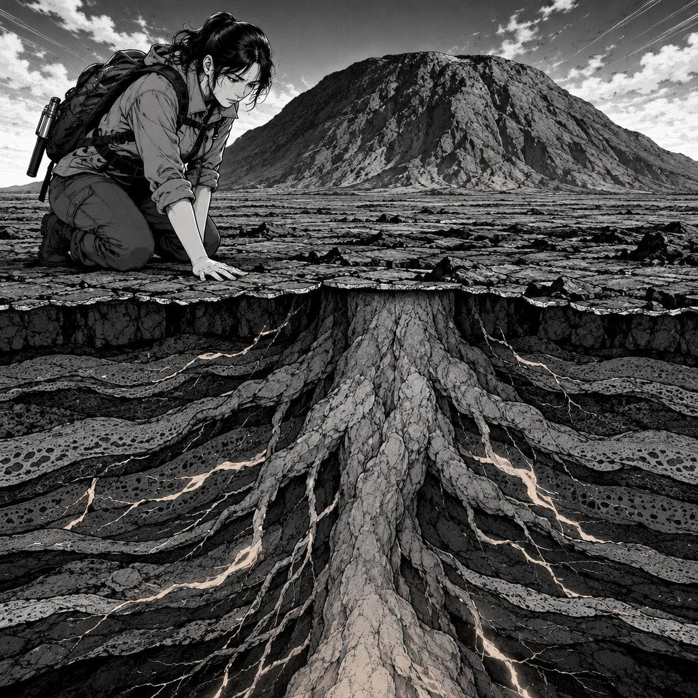

# Part 2 — The Base Is the Answer

---

# Same DEM, Four Bases

| Base | Volume |
| --- | --- |
| Flat, lowest edge cell, **1,554.8 m** | **5.46 km³** |
| Flat, mean of the edge, **1,572.2 m** | **4.98 km³** |
| Flat, highest edge cell, **1,588.9 m** | **4.51 km³** |
| Lab 9's **interpolated plain** | **5.14 km³** |

The base alone moves the answer by about **a fifth**. Which would you trust?

These sum **every** cell, plus and minus, so the mean-edge base gives **4.98**, not Surface Volume's 4.99: the few cells **below** that plane subtract.

<!-- Flat bases summed signed over the 280,311 cells of the outline (tools/week10_volume_figures.py). The interpolated value is Lab 9's published Step 8 check (5.145 km³); none of Lab 9's Step 9 sensitivity results are shown here. -->

---

# Why a Flat Base Is Wrong Here

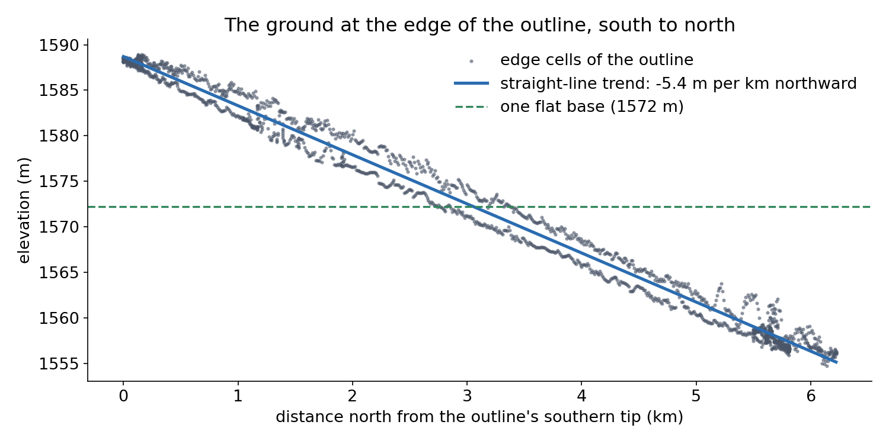

- The plain is **not level**: at the outline's edge it falls about **5 m per km** to the **north**, **34 m** from end to end
- A flat base buries the butte's **low** side and lifts its **high** side
- An **interpolated** base follows the plain, from points sampled **all around** the butte
- That is **Week 9's interpolation**, put to work

<!-- The figure plots every edge cell of the reference outline (1,554.8 to 1,588.9 m) against its distance north, with a straight-line fit of -5.4 m per km and the flat base at the mean of the edge (tools/week10_volume_figures.py). A single elevation cannot fit both ends. Lab 9 samples random points on a ring of plain around the outline and interpolates across the gap. -->

---

# IDW or Spline? A Week 9 Reminder

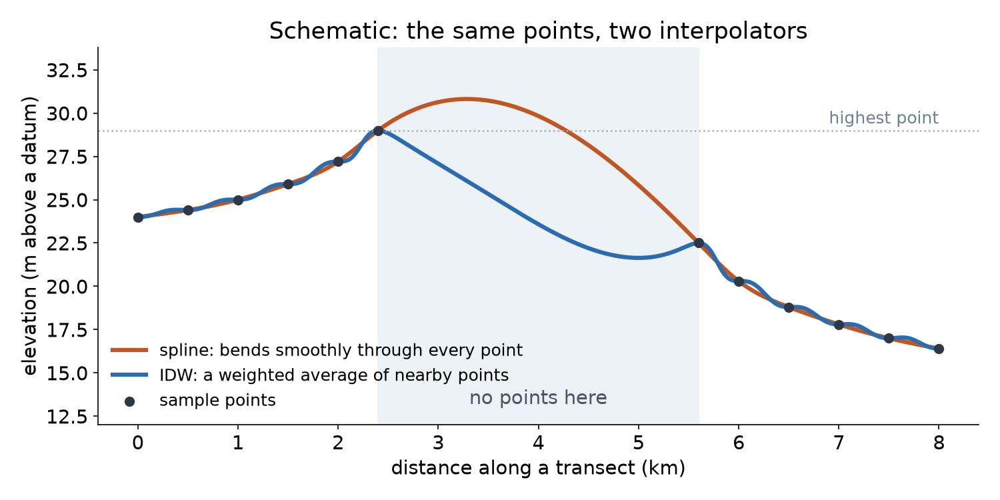

- **IDW** averages nearby points: never **above the highest** or **below the lowest**
- **Spline** bends smoothly **through** the points: where there are none, it can **overshoot**
- Under the butte there are **no points** for kilometers
- Step 9 runs both: watch where the points stop

Review: [Week 9 Tuesday deck](https://byu-hydroinformatics.github.io/ce414-gis-applications/slides/week-09/interpolation.html).

<!-- A schematic with made-up points, not Lab 9 data (tools/week10_sketch_figures.py): a natural cubic spline and 1-D IDW (power 2, all points) through the same twelve points with a 3.2 km gap. IDW and splines were taught in class in Week 9; this slide only reminds. No Step 9 result is shown. -->

---

# Where Does the Butte End?

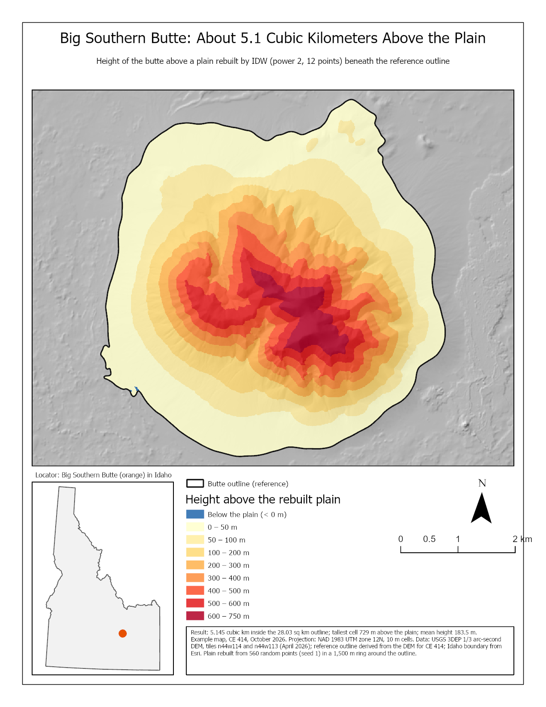

- The **outline** is a choice: Lab 9's was drawn by a rule — every cell more than **10 m above** a plane fitted to the plain
- Lava flows of the plain may **lap against** the dome: that part is **buried**
- A volume **above an interpolated surface** is what the DEM can see, not the whole dome

<!-- The example map is the Lab 9 page's baseline sheet (height above the rebuilt plain). The reference outline rule is in READ-ME-FIRST.txt in the Lab 9 package. Lab 9 Step 9 has each student digitize their own outline; the answers are theirs to find. -->

---

<!-- _class: lead -->

# Part 3 — Lab 9, Big Southern Butte

---

# Lab 9 at a Glance

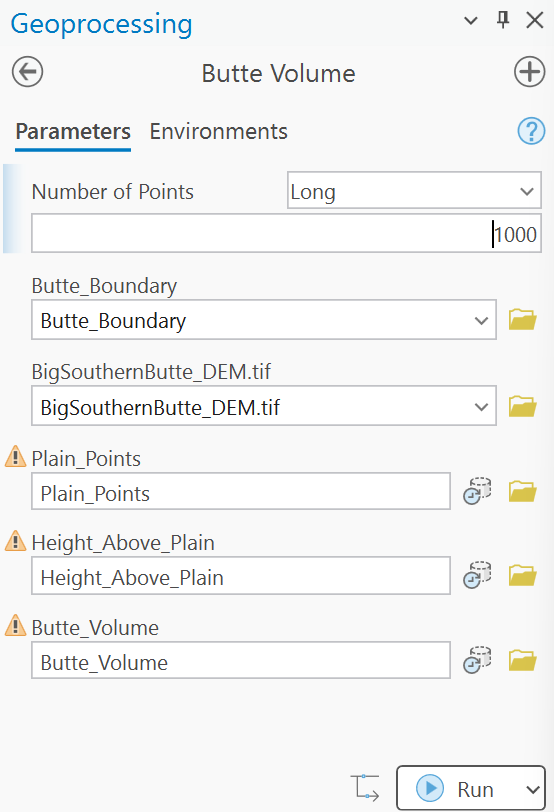

- **The data**: a 10 m DEM of the butte and a reference outline, prepared for you
- **The model**: random points on the plain → **IDW** → height above the plain → **Zonal Statistics Sum**
- **Then**: two more runs, a **wider outline** set by your BYU ID and a **spline base**, and a map of each base

[Lab 9 — Big Southern Butte](https://byu-hydroinformatics.github.io/ce414-gis-applications/assignments/lab-09/)

<!-- The figure is Lab 9's Figure 8b: the finished model as a tool, with the number of points, the outline and the DEM as inputs and Plain_Points, Height_Above_Plain and Butte_Volume as outputs. -->

---

# Two Things That Trip People Up

- **The random seed.** Set **Random Number Generator** to seed **1** in Step 0, or your points, and your volume, will not match the page
- **Runs from the tool dialog** delete everything that is **not** a model parameter: finish the baseline map **before** the Step 9 runs

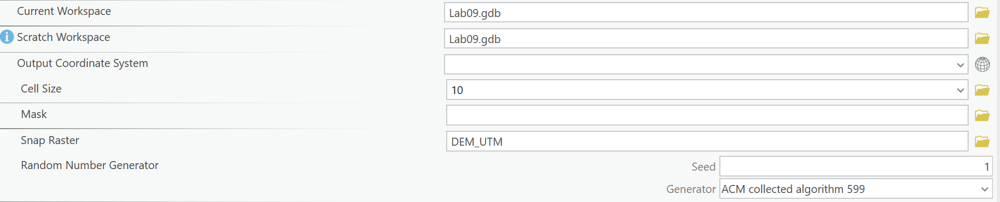

<!-- Both are on the Lab 9 page as warnings; they are the two most common reasons a Lab 9 number does not match. The figure is Lab 9's Figure 0, the model's Environments with Seed 1. -->

---

# How You Will Know You Are Right

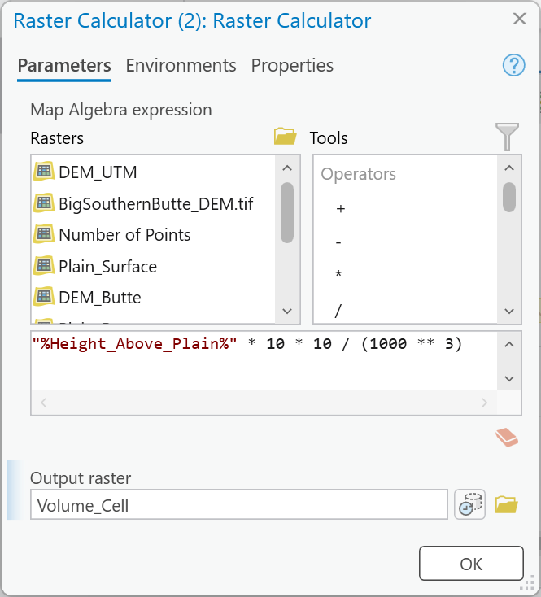

- Volume: **5.145 km³**
- Tallest cell: **729.1 m** above the plain; mean **183.5 m**
- Sanity check: **28.03 km²** × **183.5 m** ≈ **5.14 km³**

Area × mean height **must** equal the sum. If it does not, the units are wrong somewhere.

<!-- All three are TIP check values on the Lab 9 page (Steps 7 and 8). The figure is Lab 9's Figure 7b, the per-cell volume expression: height x 10 x 10 / 1000**3. -->

---

<!-- _class: activity -->

# Final Thoughts

**Self-check: The Base Is the Answer.** Five questions on raster volumes, units, Surface Volume and choosing a base. **Scan the code**, or open the link under it.

- Not graded, nothing recorded: a quick check that this deck made sense
- Note the units question; units are a common mistake in Lab 9

**Before Saturday**

- **Quiz 8**, built from this week's two decks — due **Saturday 11:59 pm**
- **Lab 9 — Big Southern Butte** — due **Saturday 11:59 pm**
- Next week, back in class: **least cost paths**, and **Lab 10 — Least Cost Path Power Line Analysis**
- Office hours: [calendly.com/dan-ames/office-hours](https://calendly.com/dan-ames/office-hours)

byu-hydroinformatics.github.io/ce414-gis-applications/quizzes/volumes/

<!-- Deck written October 9, 2026, and reworked October 20, 2026 for a self-study week: explanations moved from the notes onto the slides, a units slide and a Lab 9 pitfalls slide added. Figures: tools/week10_volume_figures.py and tools/week10_sketch_figures.py; the dialog captures and example map are copied from the Lab 9 page. Reworked again October 27, 2026: unreadable model diagram replaced by Lab 9 dialog captures, plain-tilt figure, spline reminder slide, 4.98 vs 4.99 explained. -->
