<!-- _class: lead -->
<!-- _paginate: skip -->

# Coordinate Systems and Projections

## A Refresher, and the Decisions Behind Every Layer

CE 414 Engineering Applications of GIS
Civil & Construction Engineering
Brigham Young University
Dr. Dan Ames

<!-- Tuesday of Week 11. A refresher: students met datums and projections in the introductory course, and they have been choosing coordinate systems in every lab since Week 1, mostly by accepting what a dialog proposed. Parts 1 and 2 review the concepts. Part 3 turns them into the decisions ArcGIS Pro asks for: which coordinate system, Define or Project, and which transformation, with numbers measured at BYU. Lab 10's Step 1 is the worked example. -->

<!-- stamp:begin -->
<!-- _footer: 'CE 414 · Week 11 — Coordinate Systems and ProjectionsLast Updated: 2026-10-21© 2026 Daniel P. Ames · <a href="https://creativecommons.org/licenses/by/4.0/">CC BY 4.0</a>' -->
<!-- stamp:end -->

---

# Today's Goals

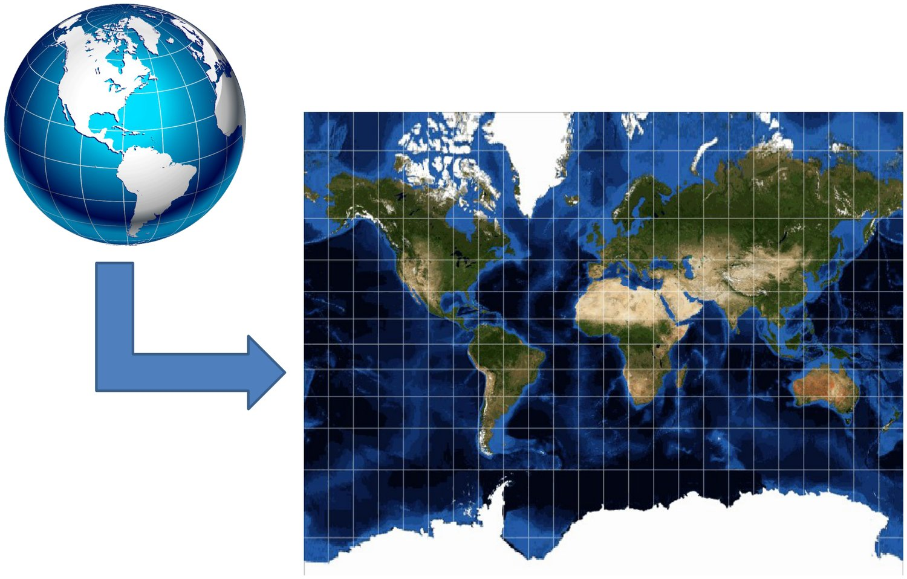

By the end of class you should be able to:

- Explain why the **distance between two points** depends on the coordinate system
- Name a projection's **surface** (cylinder, cone, plane) and **case** (tangent or secant; normal, transverse, oblique)
- Say where a **UTM zone** and a **Lambert Conformal Conic** are least distorted, and match one to a study area
- Tell a **geoid** from an **ellipsoid**, and a **datum** from a **projection**
- Choose between **Define Projection** and **Project**, and pick a **datum transformation** on purpose

<!-- The last goal is the one that costs points in labs: a layer that lands 64 m from where it belongs looks fine until somebody measures. -->

---

<!-- _class: lead -->

# Part 1 — The Shape of the Earth

## Why a flat map cannot be right everywhere

---

# What Is the Distance from BYU to the University of Utah?

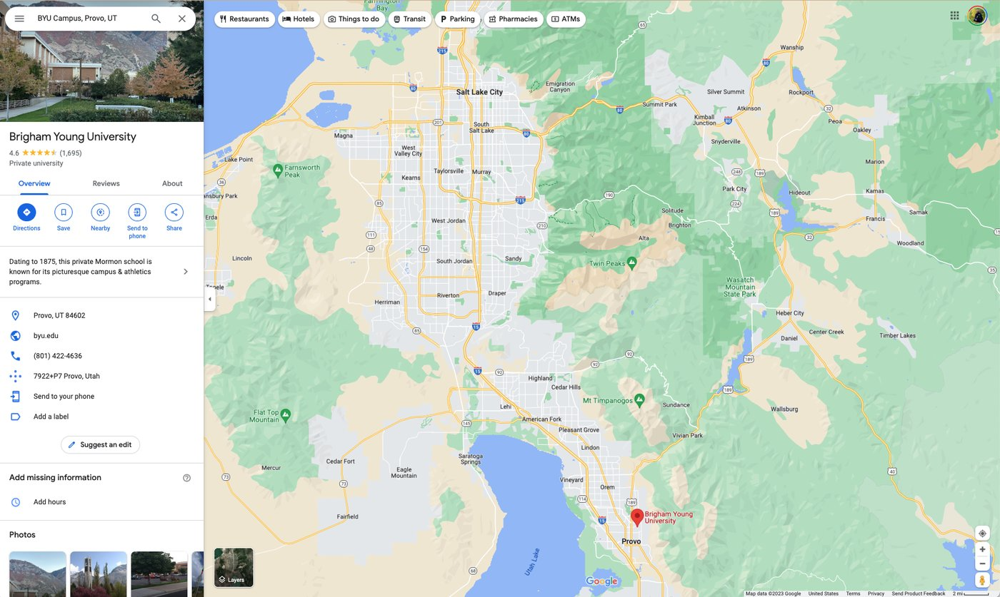

- BYU **40.2518° N, 111.6493° W**
- University of Utah **40.7649° N, 111.8421° W**

Subtract: **0.5131°** of latitude and **0.1928°** of longitude.

What are the units of the answer? Can you add them?

<!-- Degrees are angles, not lengths. A degree of latitude is about 111 km everywhere; a degree of longitude is about 111 km times the cosine of the latitude, about 85 km here, and zero at the poles. You cannot run the Pythagorean theorem on 0.5131 and 0.1928 and get anything meaningful. This is the whole reason we project. -->

---

# Now in UTM Zone 12N

NAD 1983 UTM Zone 12N, meters:

| | Easting | Northing |
| --- | ---: | ---: |
| BYU | 444,780 | 4,455,907 |
| University of Utah | 428,927 | 4,513,000 |
| Difference | −15,853 | +57,093 |

√(15,853² + 57,093²) = **59,253 m**
On the ellipsoid: **59,274 m** — UTM is 21 m (0.04 %) short here

<!-- Same two points, projected (tools/week11_crs_figures.py; pyproj, NAD 1983 to EPSG 26912). Now the coordinates are lengths and the Pythagorean distance means something. The 21 m gap is the projection's scale error: BYU and the U sit about 55 to 70 km west of Zone 12's central meridian at 111 W, inside the band where a secant UTM zone is slightly short (scale factor 0.9996 on the central meridian). For a road, 0.04 % is nothing; for a survey traverse it is the reason surveyors apply a scale factor. -->

---

# Let's Look at Some Projections

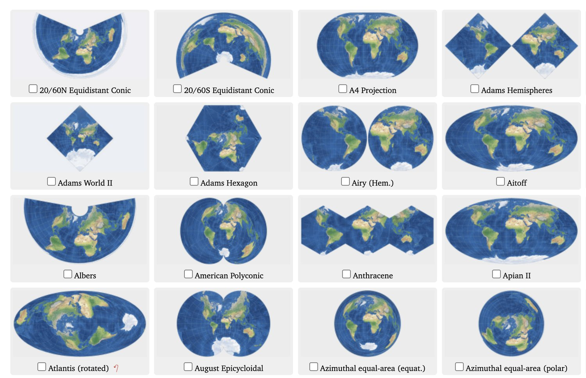

- [Map Projection Transitions](https://www.jasondavies.com/maps/transition/) — watch one projection morph into another
- [Interactive Album of Map Projections](https://projections.mgis.psu.edu/)
- [Compare Map Projections](https://map-projections.net/imglist.php)

<!-- Spend a few minutes in the transition tool. The point is that there are hundreds of projections and none of them is "the right one": each one gives something up. -->

---

<!-- _class: activity -->

# Globe Activity: The Great Circle

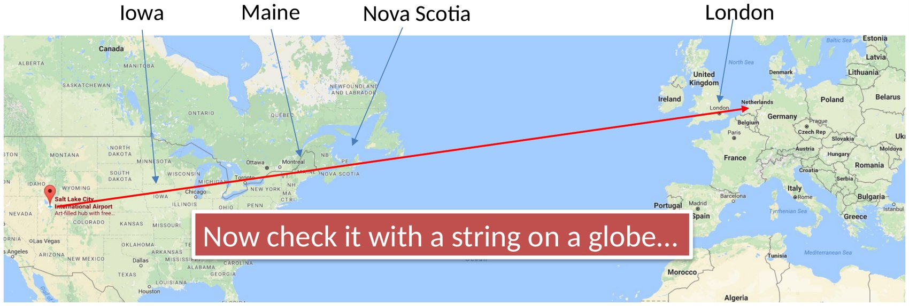

- Choose a country or city in Europe. You are flying there from Salt Lake City.
- Which states and countries will you pass over?

<!-- Do this first, before they look at the globes. Take answers from the flat map: most students will trace the straight line and say Iowa, Maine, Nova Scotia, then London. -->

---

<!-- _class: activity -->

# Globe Activity: The Great Circle

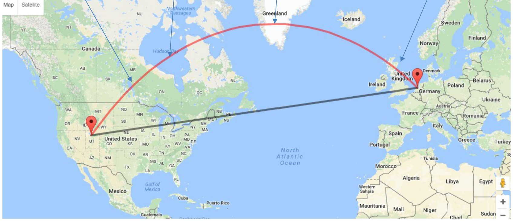

- Now check it with a string on a globe

<!-- Now look at the globes and use the string to find the shortest path. It turns out to run over Hudson Bay, Canada, and Greenland, not across the Atlantic the way the flat map suggests. Ask them to explain this. The shortest path on a sphere is a great circle, and the flat map has bent it. Optional second globe activity: in groups of three, trace the Americas off a globe onto paper so that every country keeps its area, and see what happens to the shapes. -->

---

<!-- _class: quiz -->

# What Is Geodesy?

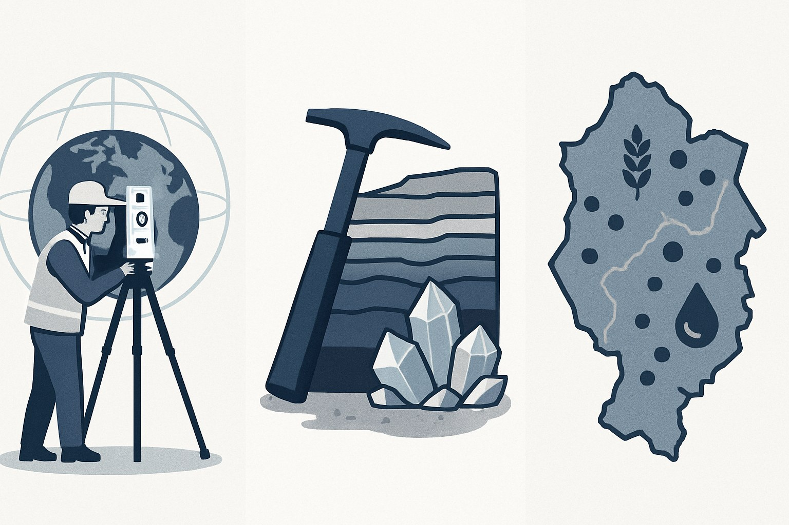

<ol type="A">
<li>The science of measuring the shape of the Earth</li>
<li>The science of studying rocks and minerals</li>
<li>The science of finding positions based on satellites</li>
<li>The science of the distributions of populations and resources on the Earth</li>
</ol>

<!-- Answer: A. Geodesy is the measurement of the Earth's shape, orientation, and gravity field. B is geology, C is roughly GNSS positioning (Thursday), D is geography. The picture is the three of them left to right: geodesy, geology, geography. -->

---

# Problem 1: We Perceive the Earth's Surface as Flat

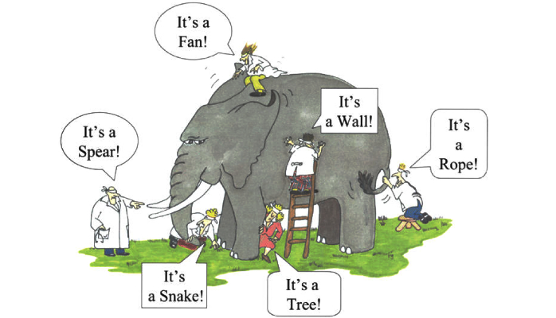

At our scale, we do not see the curve of the Earth.

<!-- The blind men and the elephant: each of them is reporting honestly about the piece they can reach. At human scale, flat is a perfectly good local model, and that is exactly why it is such a persistent error at continental scale. -->

---

# Flat Earth, 1893

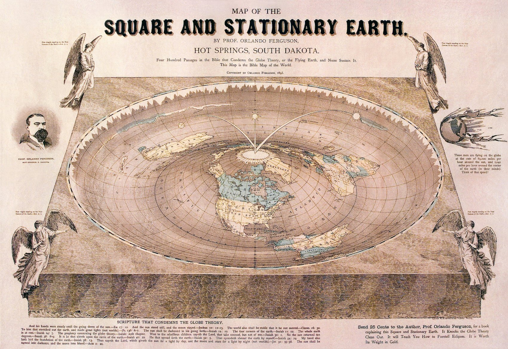

<!-- Orlando Ferguson's "Square and Stationary Earth," Hot Springs, South Dakota, 1893. Some have argued the Earth is flat in order to validate scriptural statements, for example the "four corners of the earth." -->

---

# It Is Still a Thing

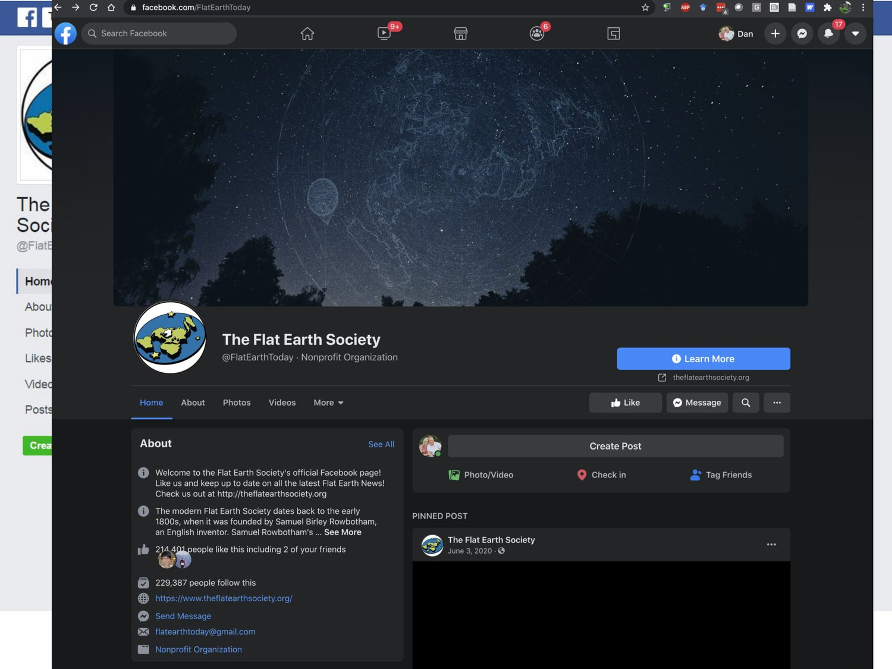

<!-- Screenshot of a Flat Earth Society page, captured around 2020. Worth ten seconds, not more; the teaching point is that a locally flat model feels right. -->

---

# From a Curved Surface to a Flat Sheet

<!-- It is difficult to represent the curved Earth on flat paper, so we get distortion. Everything in Part 2 is a strategy for deciding which distortion you are willing to accept. -->

---

# Projections

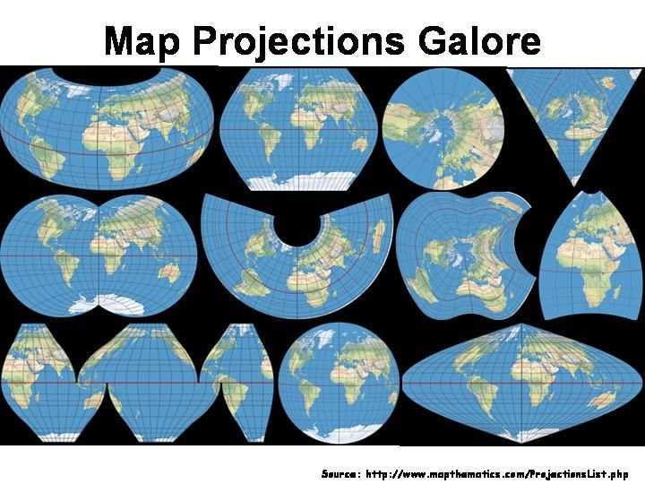

**How do you represent the curved Earth on a flat map?**

- There is no way to flatten a sphere without stretching, tearing, or shearing it
- Every projection preserves some properties and sacrifices others:
  - **Area** (equal-area)
  - **Shape / angles** (conformal)
  - **Distance** (equidistant, along some lines only)
  - **Direction** (azimuthal, from the center only)
- No projection preserves all four

<!-- The four properties are the vocabulary for the rest of the hour. Distance and direction can only ever be true from one point or along certain lines; area and shape can be true everywhere, but never both at once. -->

---

# A Typical World Map

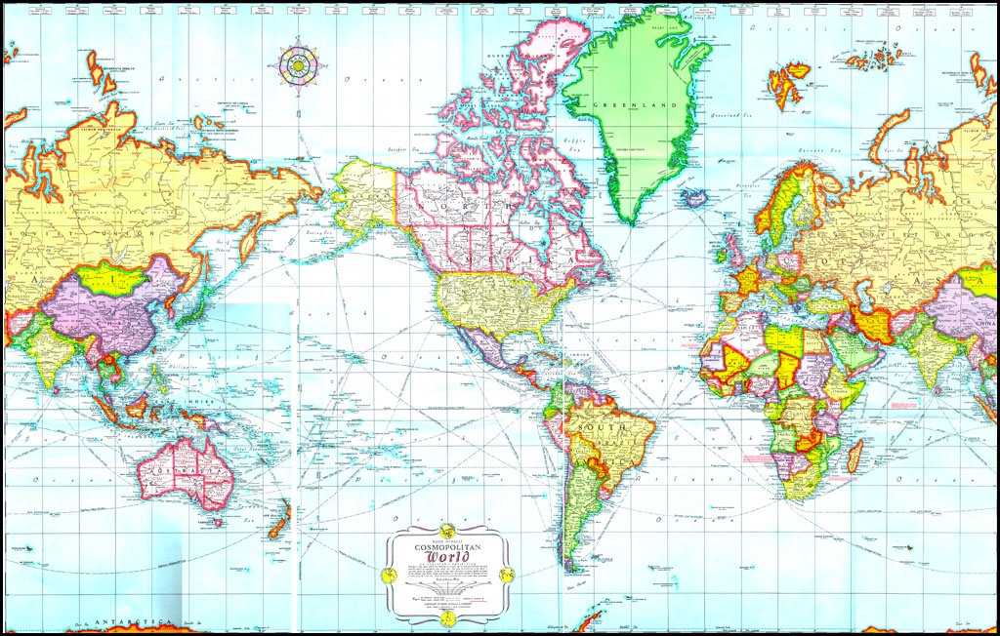

<!-- What is the dominant feature? Why is Greenland so huge? Look at the globes: Greenland is closer in size to which country in the western hemisphere? Mexico. This map makes Russia, Canada, and Greenland look like the dominant countries in the world. -->

---

<!-- _class: quiz -->

# Greenland Is Approximately the Same Size as…

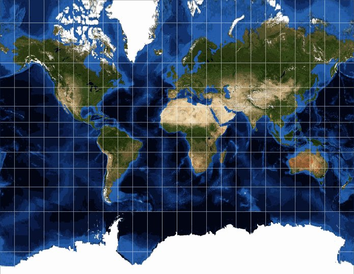

<ol type="A">
<li>Africa</li>
<li>Delaware</li>
<li>Russia</li>
<li>Mexico</li>
</ol>

Compare some places yourself: [thetruesize.com](https://thetruesize.com/)

<!-- Answer: D, Mexico. Greenland is about 2.2 million square kilometers, Mexico about 2.0 million. On a Mercator map Greenland looks like Africa (30 million). Drag Greenland down to the equator in thetruesize.com and let them watch it shrink. -->

---

# The Peters World Map

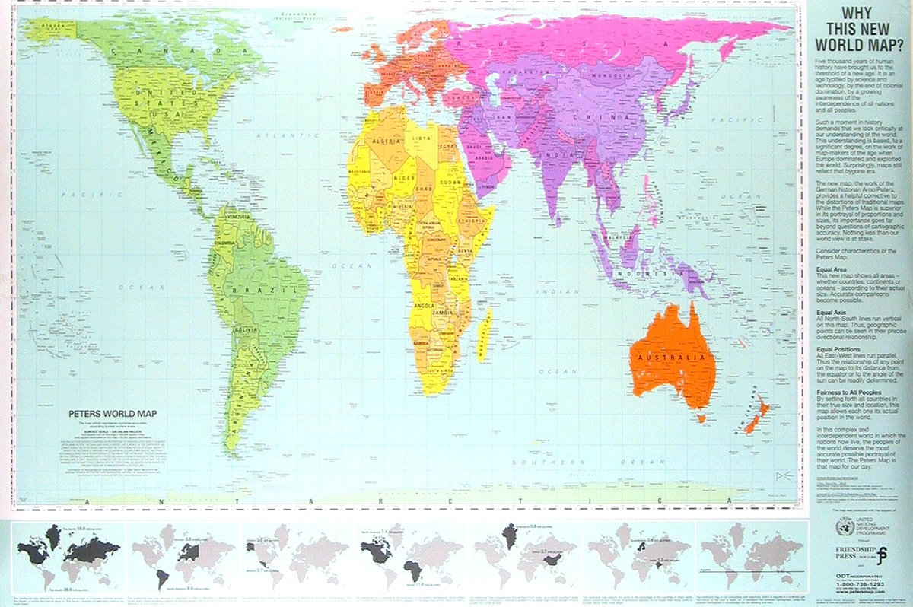

<!-- What kind of projection is it? It is cylindrical, but the parallels are spaced so that every country keeps its correct area: a cylindrical equal-area projection (Gall-Peters). Area is preserved, shape is squashed, so it is not conformal. It was promoted for political purposes, to show countries at their true relative size. -->

---

# The Mercator Projection

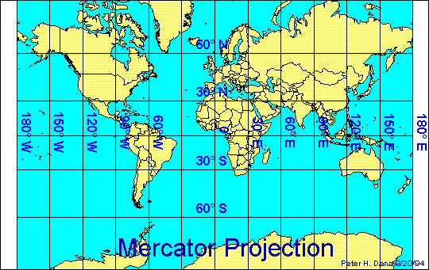

<!-- This is a Mercator projection, not a Transverse Mercator. It is conformal: every small shape is right, which is why sailors used it, and why areas grow without limit toward the poles. Picture a cylinder wrapped around the equator; the true Mercator is defined mathematically rather than by a light at the center, but the picture is the right intuition. -->

---

# How Do Projections Work?

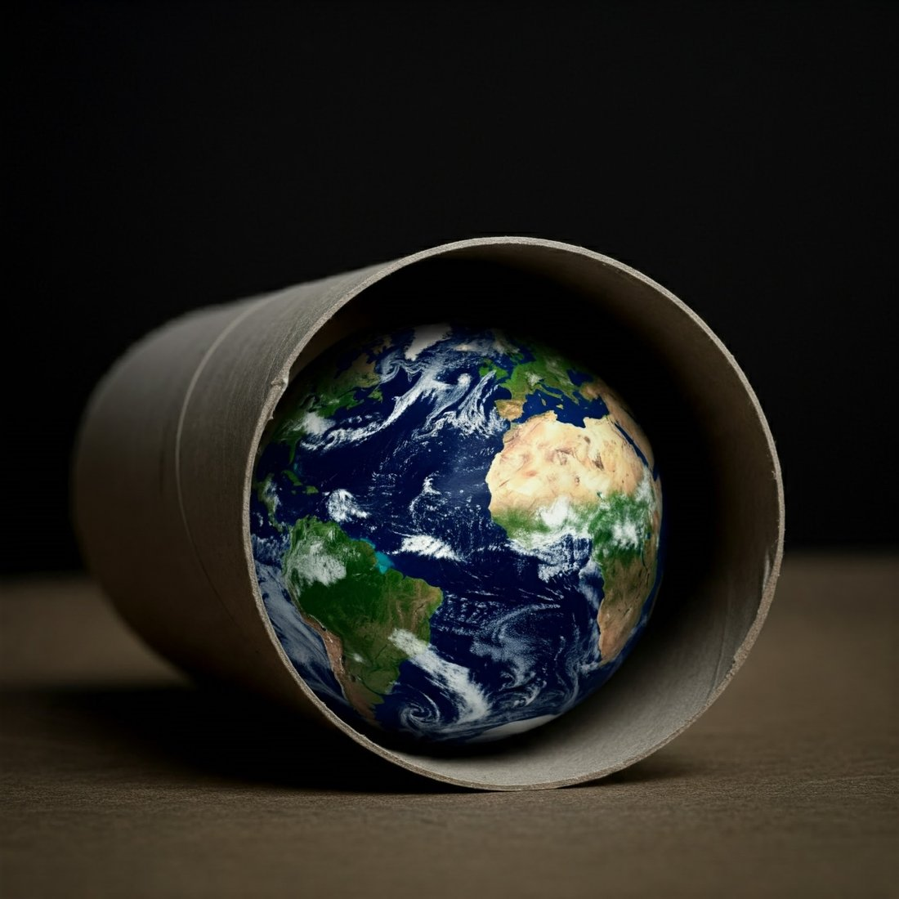

- Put a **developable surface** — a cylinder, a cone, or a plane — against the globe
- Project the features of the globe onto that surface
- Unroll it. That flat sheet is your map.

<!-- Developable means it can be unrolled flat without stretching: a cylinder, a cone, or a plane. A sphere is not developable, which is the whole problem. -->

---

# The Projection Surface

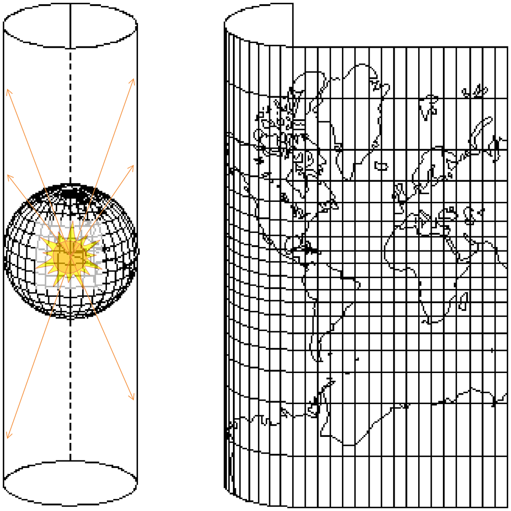

<!-- Light source at the center, rays outward through the globe's graticule onto the cylinder, then the cylinder unrolls into the rectangular grid on the right. Note how the parallels spread apart toward the poles: that spreading is the Greenland problem. -->

---

<!-- _class: lead -->

# Part 2 — Surfaces, UTM, and Lambert

## Where each one is least distorted

---

# Tangent or Secant?

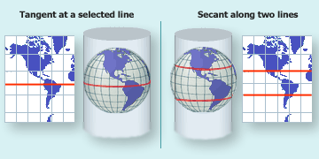

- **Tangent**: the surface touches the globe along one line. Scale is true on that line and grows away from it.
- **Secant**: the surface cuts through the globe along two lines. Scale is true on both, slightly short between them, and long outside them.
- Secant spreads the error over a wider band, which is why most working projections are secant.

<!-- The takeaway is the line (or lines) of true scale. Everything else on a map is a little too long or a little too short. -->

---

# Transverse and Oblique Mercator

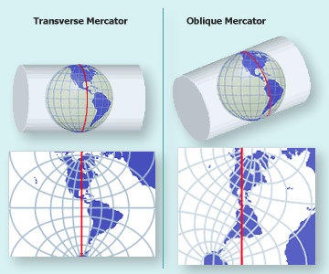

- Rotate the cylinder and the line of least distortion rotates with it
- **Transverse**: the cylinder is turned 90°, so the line of true scale runs along a **meridian**
- **Oblique**: the cylinder is tilted to any angle you like

<!-- In each case there is a ring around the globe where distortion is least. What if you could re-center that ring over your area of interest? Turn the transverse cylinder every 6 degrees around the globe and you have UTM, the next slide. -->

---

# Universal Transverse Mercator Zones

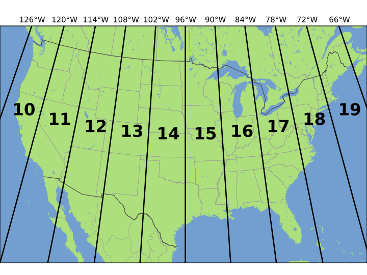

<!-- The UTM zones of the conterminous United States. Each zone is 6 degrees of longitude wide. How many around the globe? 60. Each zone is a separate secant Transverse Mercator projection with its own central meridian. Utah is Zone 12, central meridian 111 W. -->

---

# Conic Surfaces: Tangent and Secant

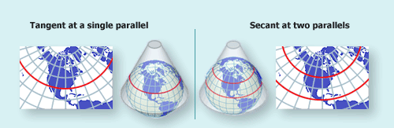

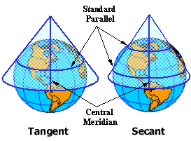

<!-- The same tangent/secant idea with a cone. Tangent at a single standard parallel, or secant at two. The line of contact is a parallel, so a conic projection is at its best across an east-west band. -->

---

# Lambert Conformal Conic

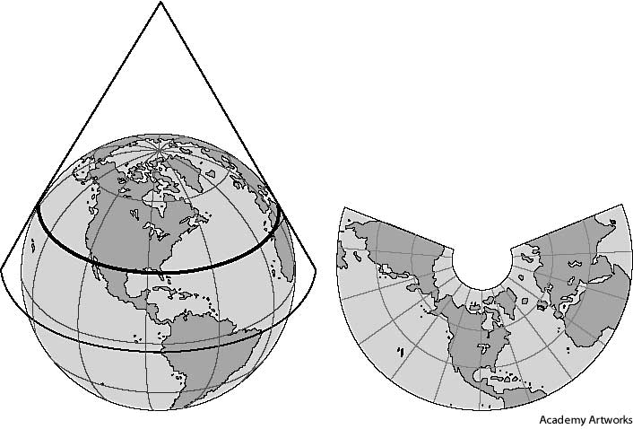

- A cone on the globe: touching along one **standard parallel** (tangent, drawn here) or cutting along two (secant)
- **Conformal**: shapes and angles are preserved locally
- Unrolls to a fan, with the parallels as arcs
- The **secant** case is what State Plane zones and national maps use

<!-- Which areas of the globe have distortion minimized here? A band along the standard parallel. The working version is almost always secant: two standard parallels, true scale on both, slightly short between them. Tennessee's State Plane zone, later in the hour, has standard parallels at 35 deg 15 min and 36 deg 25 min N (EPSG 32136). -->

---

<!-- _class: quiz -->

# What Type of Projection Surface Is This?

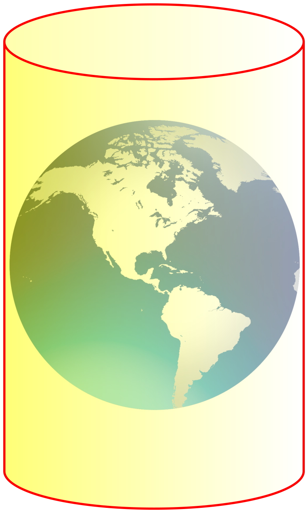

**Tangent, cylindrical**

<!-- Start of the rapid-fire drill. Cylinder, upright, touching along one line: the equator. That is the normal Mercator. -->

---

<!-- _class: quiz -->

# What Type of Projection Surface Is This?

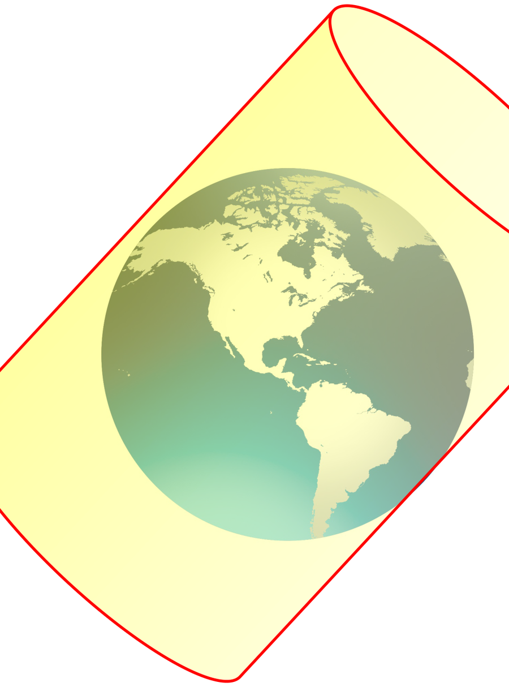

**Tangent, oblique, cylindrical**

<!-- Same cylinder, tilted, still touching along a single line. -->

---

<!-- _class: quiz -->

# What Type of Projection Surface Is This?

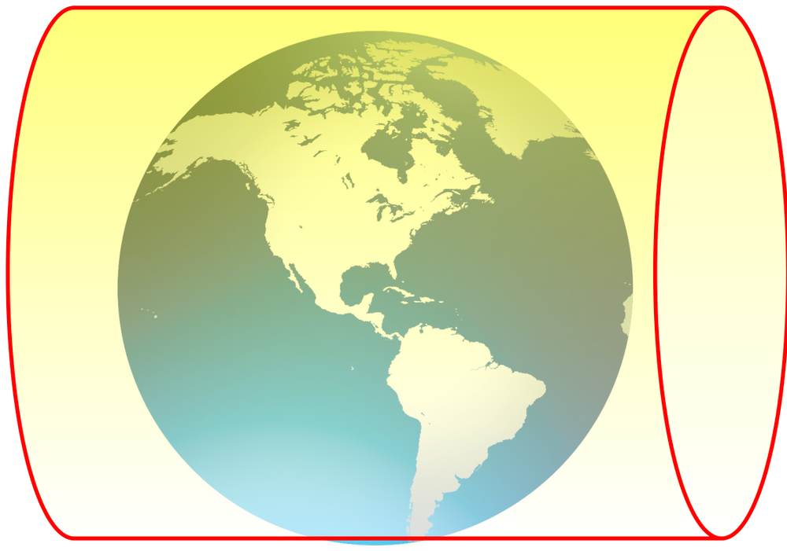

**Tangent, transverse, cylindrical — a Transverse Mercator**

<!-- The cylinder is turned 90 degrees, so it touches along a meridian instead of the equator. The plain Mercator is the normal (upright) case; turned on its side it is a Transverse Mercator, the family UTM comes from. -->

---

<!-- _class: quiz -->

# What Type of Projection Surface Is This?

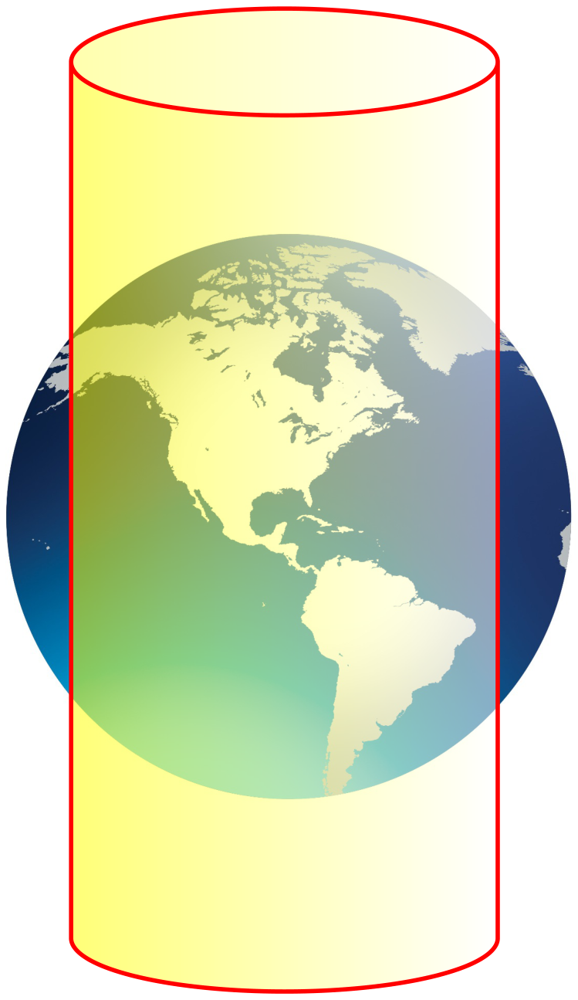

**Secant, cylindrical**

<!-- The cylinder is smaller than the globe now, so it cuts through: two lines of true scale instead of one. -->

---

<!-- _class: quiz -->

# What Type of Projection Surface Is This?

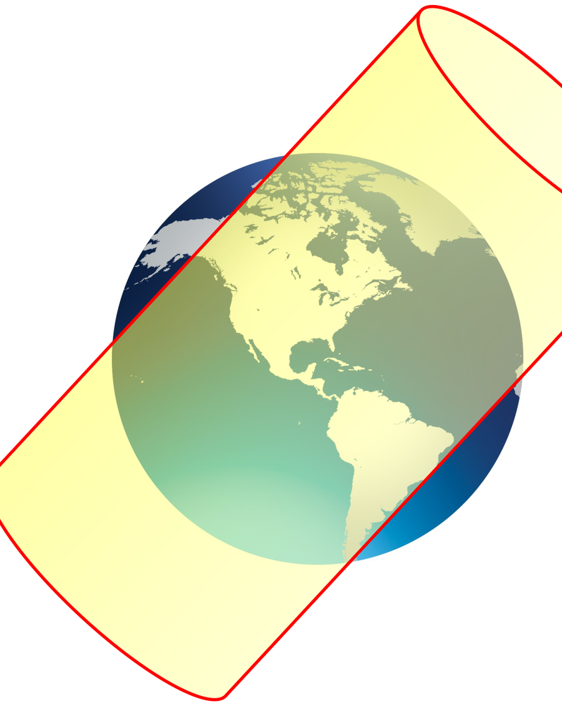

**Secant, oblique, cylindrical**

<!-- Tilted and cutting through. -->

---

<!-- _class: quiz -->

# What Type of Projection Surface Is This?

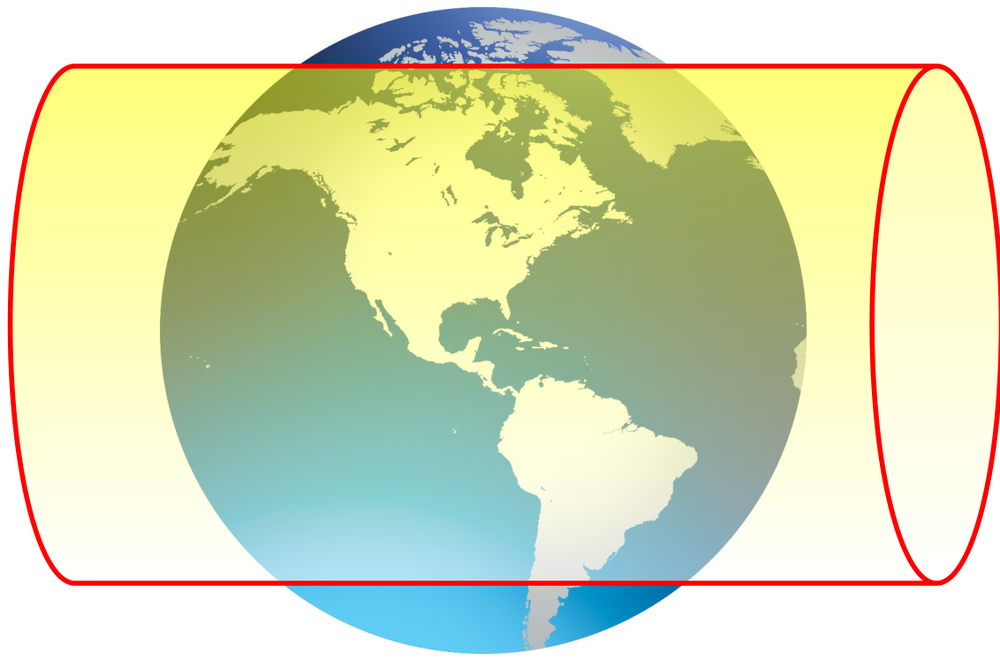

**Secant, transverse, cylindrical — the UTM case**

<!-- Turned 90 degrees and cutting through. Each UTM zone is a secant Transverse Mercator with a scale factor of 0.9996 on the central meridian, true scale on two lines about 180 km either side of it. -->

---

<!-- _class: quiz -->

# What Type of Projection Surface Is This?

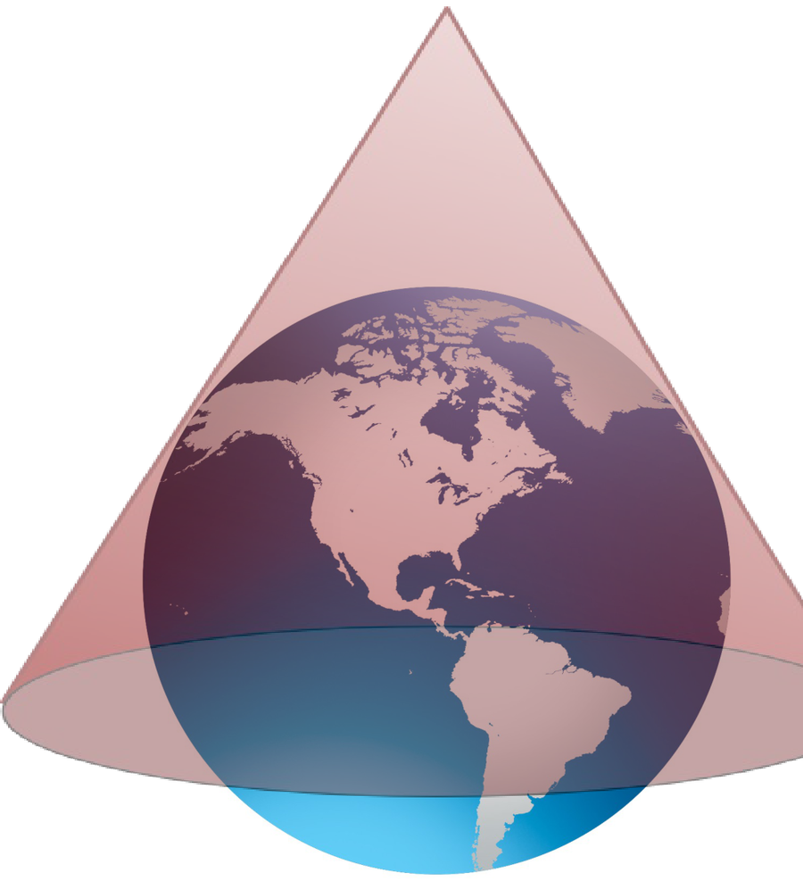

**Tangent, conic**

<!-- A cone resting on the globe, touching along one parallel. -->

---

<!-- _class: quiz -->

# What Type of Projection Surface Is This?

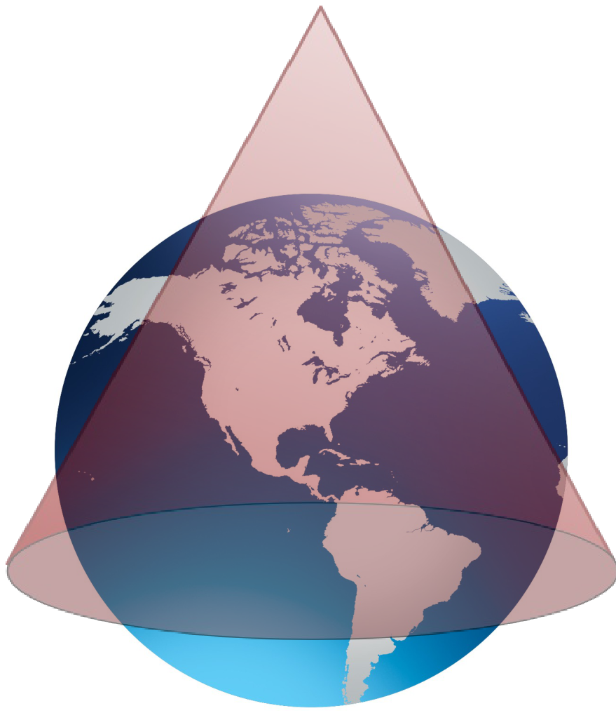

**Secant, conic — the shape of a Lambert Conformal Conic**

<!-- The cone is narrow enough to cut through the globe along two parallels: two standard parallels. The drawing can read as "oblique" because the globe is tilted toward the viewer, but the Lambert Conformal Conic used for State Plane zones and national maps is a normal secant cone, its axis along the Earth's axis. Accept "secant, conic" and use the moment to say that the name of a projection (Lambert Conformal Conic) is a different thing from the surface drawing. -->

---

# The Third Surface: A Plane

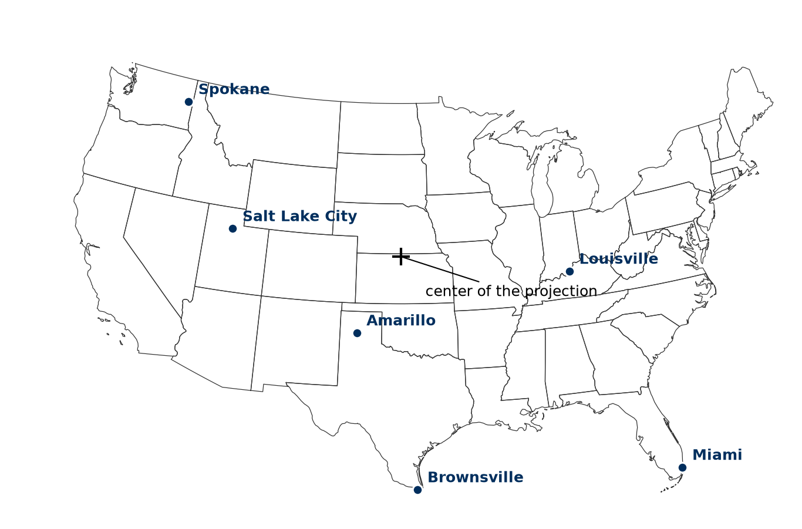

- An **azimuthal** projection puts a **plane** against the globe
- Secant: the plane cuts the globe in a **circle** of true scale
- Distortion grows the same in every direction from the center, so **equal distortion is a circle**
- This one: oblique stereographic, centered near **Lebanon, Kansas** (the center of the lower 48), 1 % short at the center

<!-- Set up the next question. The map on the right is real: a secant oblique stereographic (conformal) projection centered on 39.83 N, 98.58 W with a scale factor of 0.99 at the center, computed with pyproj (tools/week11_crs_figures.py). Ask the class to predict the shape of the lines of equal distortion before the next slide. -->

---

<!-- _class: quiz -->

# Which Pair of Cities Has About the Same Scale Error?

On this projection:

<ol type="A">
<li>Salt Lake City and Louisville, Kentucky</li>
<li>Miami and Spokane</li>
<li>Amarillo and Brownsville, Texas</li>
</ol>

<!-- Ask first, take a vote, then show the evidence. The instinct is to pair places by latitude or by state; the answer comes from distance to the center. -->

---

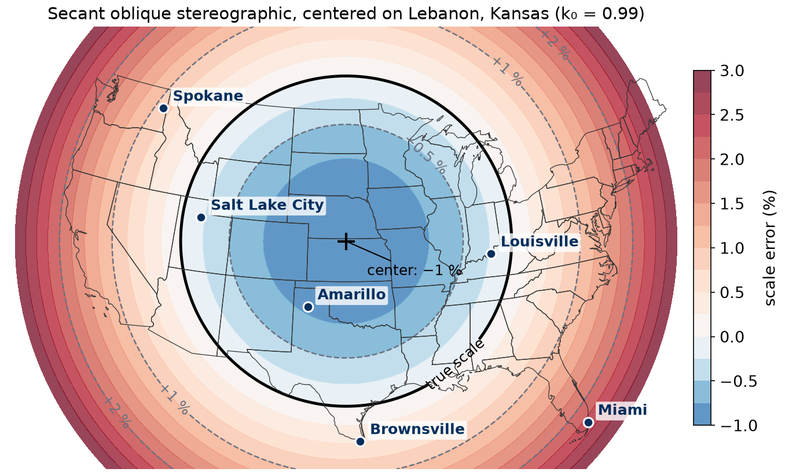

<!-- The evidence. Scale error colored by the projection's own scale factor: blue is short, red is long, the heavy black circle is true scale. Salt Lake City −0.21 %, Louisville −0.23 %: about the same, because both are about the same distance from Kansas. Miami +2.34 % against Spokane +0.87 %. Amarillo −0.79 % against Brownsville +0.48 %, in the same state. Values in tools/week11_crs_numbers.json. -->

---

<!-- _class: quiz -->

# Which Pair of Cities Has About the Same Scale Error?

<ol type="A">
<li><strong>Salt Lake City and Louisville, Kentucky</strong> (−0.21 % and −0.23 %)</li>
<li>Miami and Spokane (+2.34 % and +0.87 %)</li>
<li>Amarillo and Brownsville, Texas (−0.79 % and +0.48 %)</li>
</ol>

<!-- Answer: A. On an azimuthal projection equal distortion follows circles around the center, not state lines and not parallels. Two cities 1,500 km apart can share a scale error, and two cities in one state can differ by 1.3 %. -->

---

<!-- _class: quiz -->

# Which Statement Is Most Accurate?

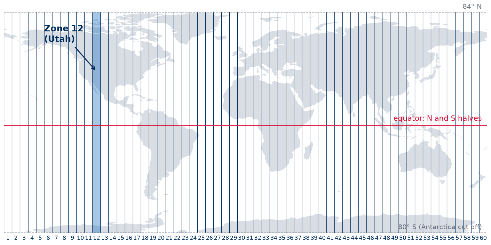

<ol type="A">
<li>A UTM zone minimizes distortion equally well everywhere inside the zone</li>
<li>A UTM zone minimizes distortion along the equator</li>
<li>A UTM zone minimizes distortion in a north-south band around its central meridian, the line of longitude at the middle of the zone</li>
<li>UTM minimizes distortion in the northern hemisphere but not the southern</li>
</ol>

<!-- Ask first, then show the zone figures. -->

---

# UTM Zones

<!-- Sixty zones, each 6 degrees of longitude wide, numbered 1 to 60 eastward from 180 degrees, each split into a north and a south half at the equator, from 80 S to 84 N (the poles use a different system). The zones are bounded by meridians, not by latitude. Drawn from Natural Earth land with tools/week11_crs_figures.py. -->

---

# UTM Zone 12

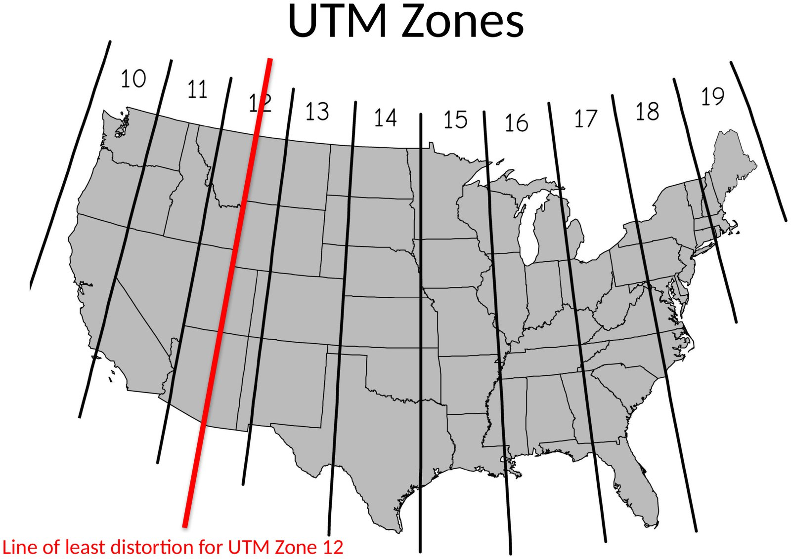

<!-- The red line is the central meridian of UTM Zone 12, 111 W. Utah sits on it. Distortion grows east and west of it, not north and south. Precisely: a secant zone is 0.9996 on the central meridian and true on two lines about 180 km either side, so the least distortion is a band, not a single line. -->

---

<!-- _class: quiz -->

# Which Statement Is Most Accurate?

<ol type="A">
<li>…equally well everywhere inside the zone</li>
<li>…along the equator</li>
<li><strong>…in a north-south band around its central meridian</strong></li>
<li>…in the northern hemisphere but not the southern</li>
</ol>

<!-- Answer: C. This is why a UTM zone suits a north-south study area and fights an east-west one. UTM is conformal, so shape is right locally everywhere; what grows away from the central meridian is scale, and with it area. -->

---

<!-- _class: quiz -->

# Which Projection Best Minimizes Distortion in Tennessee?

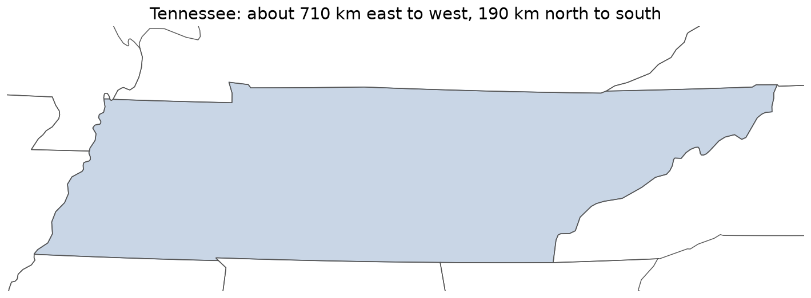

<ol type="A">
<li>Lambert Conformal Conic</li>
<li>Universal Transverse Mercator</li>
</ol>

<!-- Ask before showing the two maps. Prompt: what shape is Tennessee? Long east-west. -->

---

# Tennessee in UTM Zone 16N

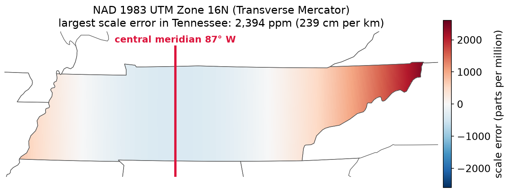

<!-- Scale error computed with pyproj across the whole state in NAD 1983 UTM Zone 16N (EPSG 26916). The central meridian runs north-south through the middle of the state; the east end is 5 degrees off it, and the scale error reaches 2,394 parts per million, 2.4 m in every kilometer. (East of 84 W Tennessee is really in Zone 17; forcing one zone on the whole state is the point.) -->

---

# Tennessee in Its State Plane Zone

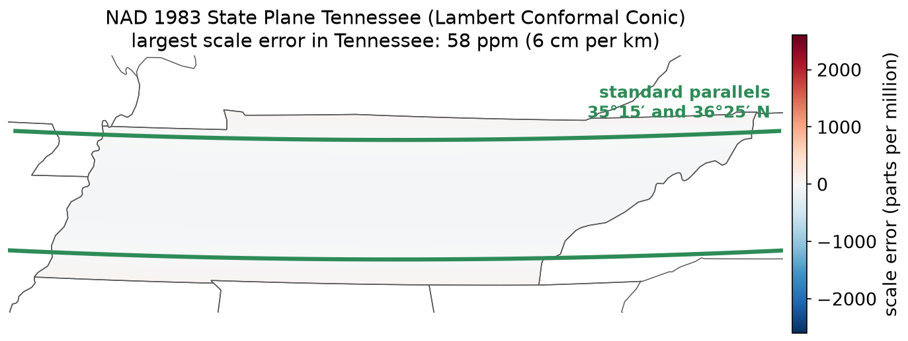

<!-- The same computation for NAD 1983 State Plane Tennessee (EPSG 32136), a secant Lambert Conformal Conic with standard parallels 35 deg 15 min and 36 deg 25 min N. The two green lines are true scale; between them the scale is slightly short, outside them slightly long, and nowhere in the state worse than 58 ppm. Same color scale as the last slide, which is why it looks white. This is the State Plane system's logic: east-west states get Lambert zones, north-south states get Transverse Mercator zones. -->

---

<!-- _class: quiz -->

# Which Projection Best Minimizes Distortion in Tennessee?

<ol type="A">
<li><strong>Lambert Conformal Conic</strong> — at most 58 ppm</li>
<li>Universal Transverse Mercator — up to 2,394 ppm</li>
</ol>

<!-- Answer: A, by a factor of 40. Match the shape of the low-distortion band to the shape of the study area: east-west extent wants a cone, north-south extent wants a transverse cylinder. Numbers in tools/week11_crs_numbers.json. -->

---

<!-- _class: lead -->

# Part 3 — The Datum Underneath

## And the decisions ArcGIS Pro asks you to make

---

# Problem 2: The Earth Has an Irregular Shape

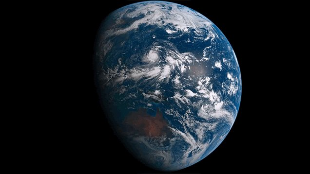

<!-- Second problem, after "humans think it is flat": the Earth is not a sphere either. It is an oblate, lumpy, changing solid. Every coordinate is reported against some agreed-on idealization of that shape. -->

---

<!-- _class: quiz -->

# Which Smooth Mathematical Surface Do Datums Use for the Shape of the Earth?

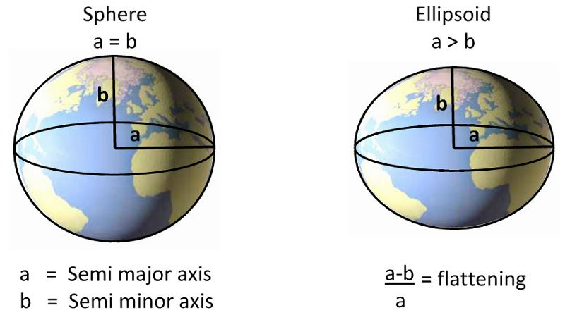

<ol type="A">
<li>Geoid</li>
<li>Ellipsoid</li>
<li>Sphere</li>
<li>Tetraploid</li>
</ol>

<!-- Answer: B, the ellipsoid: a sphere flattened at the poles, defined by its semi-major axis a and its flattening (a − b) / a. GRS 80 (NAD 83) has a = 6,378,137 m and b about 21 km shorter. ArcGIS Pro calls it a "spheroid" in its coordinate-system details; same thing. The geoid is closer to the real shape but it is not a smooth formula, which is the next slide. A sphere is good enough for a world map and not for a survey. -->

---

# So Then… What Is the Geoid?

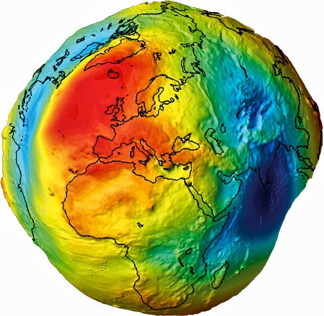

- An **equigravitational surface**
- The surface the sea would settle to, everywhere, if it could flow freely
- Sea level varies because **gravity** varies
- Gravity varies because **the density of the Earth** varies

<!-- The figure is exaggerated. Keep the three surfaces straight: the topography is what you walk on, the geoid is the gravity-defined sea level, the ellipsoid is the smooth mathematical fit. Elevations on a map (orthometric heights) are relative to the geoid; GPS heights are relative to the ellipsoid. In Utah the geoid is about 15 to 20 m below the ellipsoid, so a raw GPS height is that much lower than the elevation on a USGS map; Thursday picks this up. -->

---

# Problem 3: Our Measurements Keep Improving

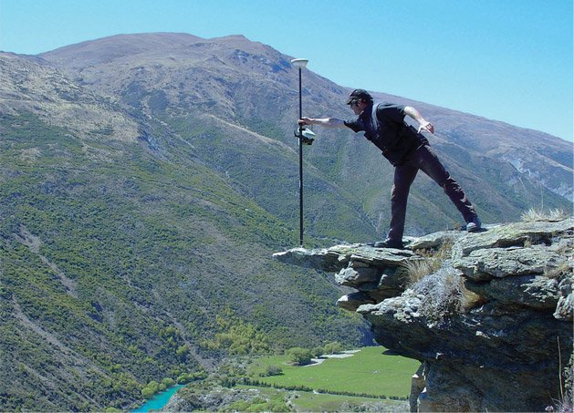

<!-- Third problem. Every ellipsoid and every datum is a best fit to the measurements available when it was defined, and the measurements keep getting better. That is why datums have names and version years: NAD 27, NAD 83, NAD 83 (2011), WGS 84 (G2139). -->

---

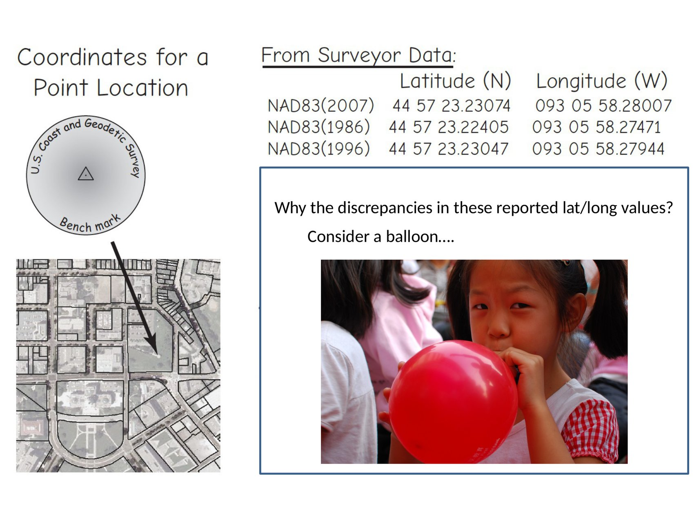

<!-- Why the discrepancies in these reported latitude and longitude values? The same bench mark, published three times under three realizations of NAD 83, moves in the fourth and fifth decimal of a second. Nothing moved on the ground: the reference frame was re-solved. -->

---

# NAD 83 (2007) Versus NAD 83 (2011)

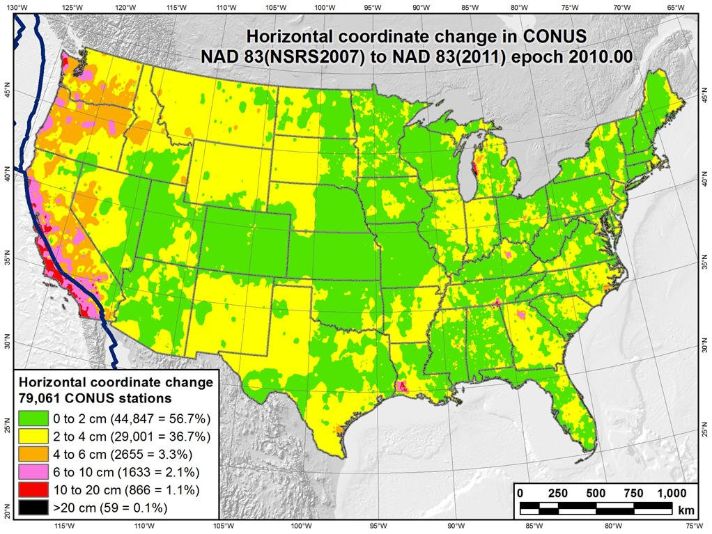

<!-- Horizontal coordinate change between the NAD 83 (NSRS2007) and NAD 83 (2011) epoch 2010.00 realizations, over 79,061 CONUS stations. Most of the country moved 0 to 4 cm; the west coast moved much more. Same datum name, different realization. -->

---

# NAD 83 (2007) Versus NAD 83 (2011)

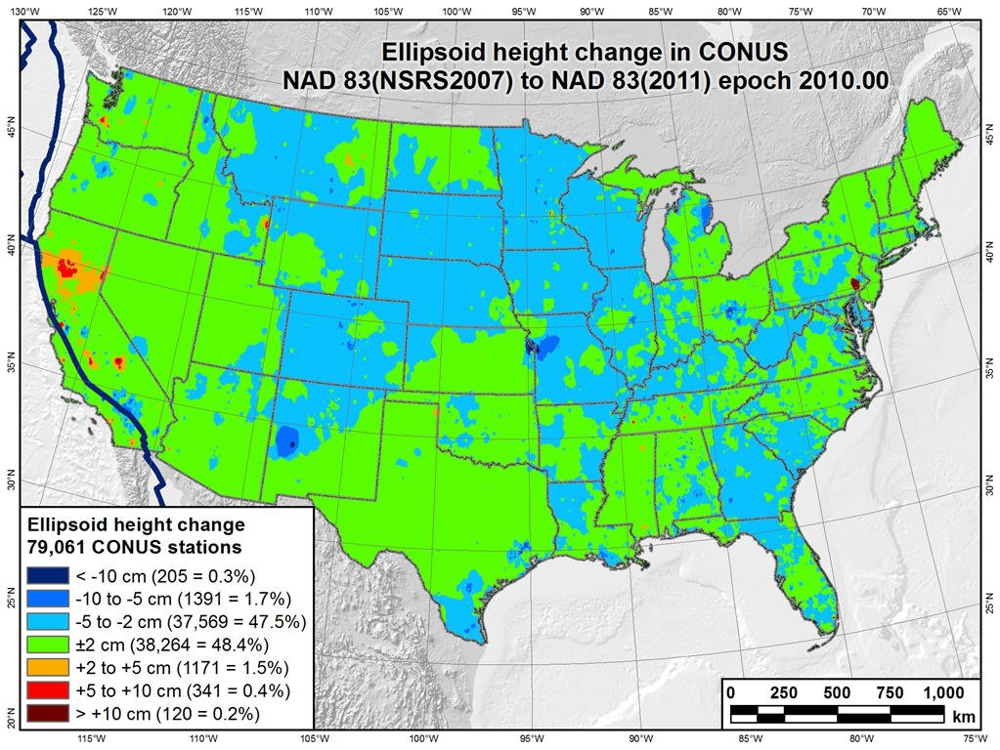

<!-- The vertical half of the same comparison: ellipsoid height change over the same stations. Does a few centimeters matter? For a watershed map, no. For a survey control point or a utility as-built, yes. -->

---

# Datum, Projection, Coordinate System

- **Datum**: an ellipsoid plus where it sits on the Earth — *NAD 1983*
- **Geographic coordinate system**: a datum + angles — *GCS NAD 1983*, degrees
- **Projected coordinate system**: a geographic one + a projection + linear units
  — *NAD 1983 UTM Zone 12N*: Transverse Mercator, 111° W, 0.9996, **meters**
- Change the projection: the map stretches differently
- Change the datum: **every coordinate moves**

<!-- The single most common confusion on the self-check quiz: reading a datum name as a projection. "NAD 83" alone is not a projection and has no meters in it. Lab 10's DEM arrives as GCS NAD 1983 (cells of 0.0000926 degrees, a 1/3 arc-second); Step 1 makes it NAD 1983 UTM Zone 12N. -->

---

# Define Projection Versus Project

**Define Projection**

- Writes the **label**: "these numbers are NAD 1983"
- Changes **no coordinates**
- For data whose coordinate system is **missing** or **wrong**

**Project / Project Raster**

- **Computes new coordinates** in another system
- Writes a **new** dataset
- Needs a **geographic transformation** when the datums differ

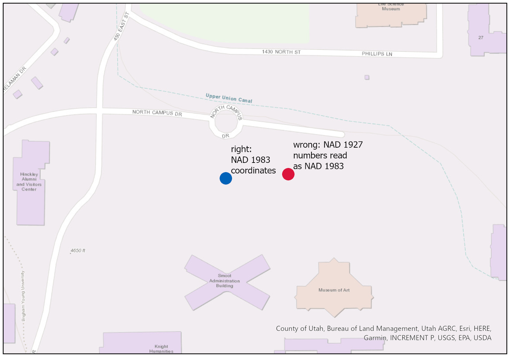

<!-- The two tools sound alike and do opposite things. Define Projection is a label: if the label is wrong, every later step trusts the wrong label. Project is arithmetic. The map underneath is what a wrong label does; the next slide is it at full size. -->

---

# A Wrong Label at BYU: 64 Meters

<!-- Rendered from ArcGIS Pro (Week11.aprx, tools/week11_arcgis_project.py and week11_arcgis_render.py). Blue: BYU from its NAD 1983 coordinates. Red: the same place's NAD 1927 coordinates (from ArcGIS Pro's NAD_1927_To_NAD_1983_NADCON transformation) stored in a layer labeled NAD 1983, which is what a Define Projection with the wrong datum does. They land 64.4 m apart, almost all of it east-west. Nothing warns you: both layers draw, both look plausible, and every measurement against the basemap is off by 64 m. This is also why transformation is called registration: bringing layers into register, the printing-press word for lining up the color plates. -->

---

<!-- _class: quiz -->

# Why Is Coordinate Transformation Also Called Registration?

<ol type="A">
<li>Because you must register your map online before it can be published</li>
<li>Because it registers the layers to a common map coordinate system</li>
<li>Because one must register to obtain coordinate information</li>
</ol>

<!-- Answer: B. "Register" in the printing-press sense: bringing separate layers into alignment on a common frame. The map is the failure case: two layers out of register by 64 m. -->

---

# Choosing a Transformation

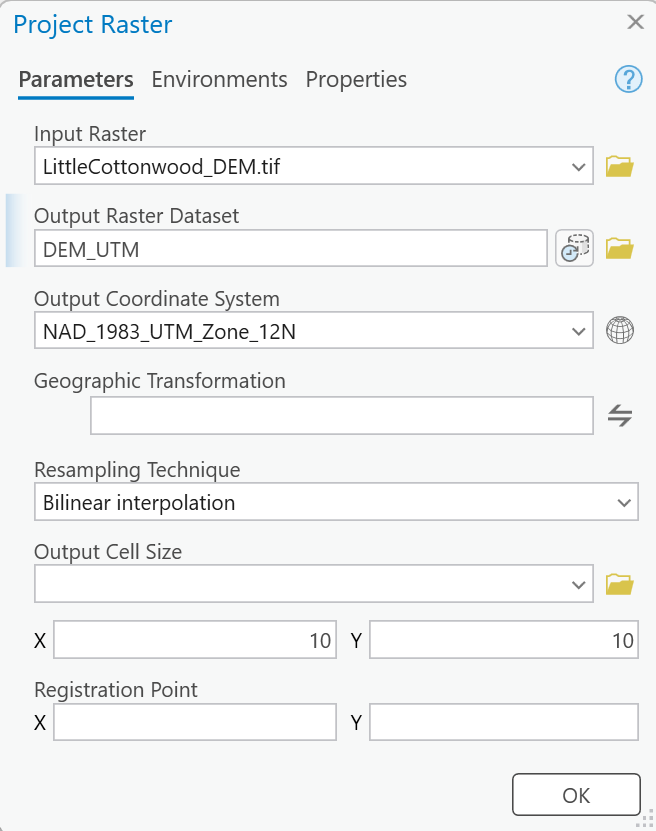

Measured at BYU with ArcGIS Pro:

| Datum change | Shift |
| --- | ---: |
| NAD 1927 → NAD 1983, skipped | **64 m** |
| NAD 1927 → NAD 1983: first one listed vs NADCON | **1.2 m** |
| WGS 1984 → NAD 1983 (2011) | **1.2 m** |
| NAD 1983 → NAD 1983 | none needed |

ArcGIS Pro lists **44** NAD 1927 → NAD 1983 transformations valid in Utah.

<!-- Numbers from tools/week11_arcgis_numbers.json (arcpy ListTransformations over Utah's extent, PointGeometry.projectAs). Skipping a needed transformation costs tens of meters; choosing a poor one costs about a meter; WGS 84 to NAD 83 (2011), the GPS case on Thursday, is about a meter at BYU. The first entry arcpy lists for NAD 27 to NAD 83 is a composite through WGS 84, not NADCON, so "the first one offered" is not automatically the best. The capture on the right is Lab 10's Project Raster: Geographic Transformation is empty because the DEM is already NAD 1983, the same datum as the output. -->

<!-- TODO(capture): an ArcGIS Pro capture of the Project tool with Campuses_NAD27 as input and NAD 1983 UTM Zone 12N as output, showing the Geographic Transformation list it proposes, and of Map Properties > Transformation. C:\Ames\Week11\Week11.aprx is built for it. Desktop control was declined on October 20, so this slide uses the Lab 10 capture instead. -->

---

# A Workflow You Can Defend

1. **Check every layer's coordinate system** before you combine anything (layer **Properties ▸ Source**)
2. **Pick the analysis system** for the study area's shape: UTM for north-south, State Plane or Lambert for east-west
3. **Project**, don't Define, unless the label itself is missing or wrong
4. Datums differ? **Choose the transformation** for your area; do not take the first one on faith
5. **Write it down**: coordinate system and transformation, in your metadata and your report

<!-- Step 1's pane path is where the spatial reference shows in ArcGIS Pro 3.7; Lab 10's rubric asks for the DEM's coordinate system as one of three metadata values. Step 5 is what lets someone else reproduce your numbers. -->

---

# Lab 10: Two Places This Shows Up

- **Step 1 — Project the DEM.** Slope needs elevation and cell size in the **same unit**. On the unprojected degrees, Slope still runs: median **24.5°** instead of **27.3°**, and no error message
- **Step 8 — Measure Snowbird.** UGRC's `Shape__Area` reads **18.7 million m²** for an area of **10.78 km²**: Web Mercator stretches areas by about **1.73** at 40.6° N

<!-- Both numbers are from Lab 10's verification run and are on the lab page. Slope on the unprojected DEM uses the Planar method by default and comes out about 3 degrees low at the median; the Geodesic method (median 27.5) copes with degrees, Planar does not. The Web Mercator factor is 1 / cos² of the latitude: 1 / cos²(40.6°) = 1.73. Neither mistake throws an error. That is the whole lesson of today: the software will compute whatever you give it. -->

---

# Public Land Survey System (PLSS)

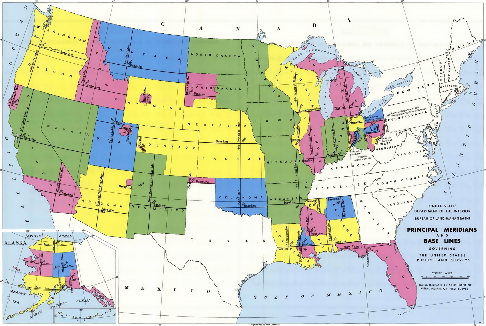

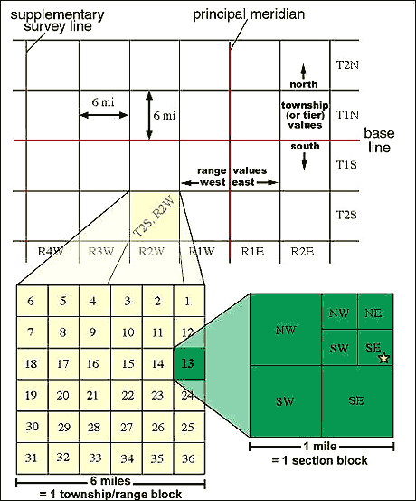

<!-- A lot of western civil engineering happens in PLSS terms: township, range, and section off a principal meridian and base line (Utah's is the Salt Lake Meridian). It is not a projected coordinate system, but you will meet it in legal descriptions and parcel data and you will need to relate it to one. -->

---

<!-- _class: activity -->

# Final Thoughts

**Quiz: Projections and Datums.** Five questions: what your coordinates **measure**, what your map **gives up**, and what both are **measured from**. **Scan the code**, or open the link under it.

- Not graded, nothing recorded: a quick check that today's material made sense
- Lab 10 needs this check before you combine layers

**Before next class**

- Read **Chapter 3** of *GIS Fundamentals* (Projections and Coordinate Systems)
- Take **Quiz 9** (Coordinate Systems and GPS, Chapters 3 and 5, open book) on **Learning Suite** — due **Saturday 11:59 pm**
- Current lab: [Lab 10 — Avalanche Hazard](https://byu-hydroinformatics.github.io/ce414-gis-applications/assignments/lab-10/), due **Saturday 11:59 pm** — check the coordinate system of every layer before you combine them
- **Thursday:** GPS — how a receiver finds you, and why it is never exactly right
- Questions? Office hours: [calendly.com/dan-ames/office-hours](https://calendly.com/dan-ames/office-hours)

byu-hydroinformatics.github.io/ce414-gis-applications/quizzes/coordinate-systems/

<!-- Five minutes, in pairs, then a show of hands on the two that split the room. The Tennessee item is the reliable one: the vote usually goes to UTM because UTM is the system they use, and the figure earlier in the hour is the argument. The NAD 83 item splits a smaller room: plenty of students read a datum name as a projection, which is exactly the confusion that makes two layers land on top of each other and look fine until someone measures. If the room has no signal, put the URL on the board. -->

<!-- Revision notes (2026-10-20): rebuilt from the September 3 conversion of "CE 414 Week 11 - Review - Coordinate Systems and Projections.pptx". Structure: the review order of Parts 1-2 is kept and a Part 3 (datum, Define vs Project, transformations, Lab 10) replaces the old ending, which resolves the restructure question without moving material to earlier weeks.

COMPUTED, NOT SOURCED: the BYU-Utah UTM coordinates (the old slide's pair did not match its own latitudes by 60 to 650 m), the CONUS scale-error map and its question (the old hand-drawn figure's answer, "southeastern Florida and northeastern Washington," does not hold on any center that fits the figure: about 2.3 % against 0.9 %), both Tennessee maps (the old Lambert map drew one "line of least distortion"; the new one shows the two standard parallels), the world UTM zone map (the old image file was missing), the registration map, and the transformation table. Scripts: tools/week11_crs_figures.py (pyproj, Natural Earth outlines), tools/week11_arcgis_project.py and tools/week11_arcgis_render.py (arcpy).

RESOLVED FLAGS: Lambert naming is "Lambert Conformal Conic" throughout; the conic drill answer is "secant, conic" with the normal-vs-oblique point in the notes; the spheroid/ellipsoid question now asks for the smooth mathematical surface and notes ArcGIS Pro's "spheroid"; the QGIS transformation screenshot is gone (file deleted) and the slide carries an ArcGIS Pro capture and measured numbers; the geodesy and registration questions have graphics; Lab 8 on the closing slide is Lab 10.

STILL OWED: the ArcGIS Pro captures of the Project tool's transformation list and of Map Properties > Transformation (TODO on "Choosing a Transformation"); desktop control was declined in this session. -->
