<!-- _class: lead -->
<!-- _paginate: skip -->

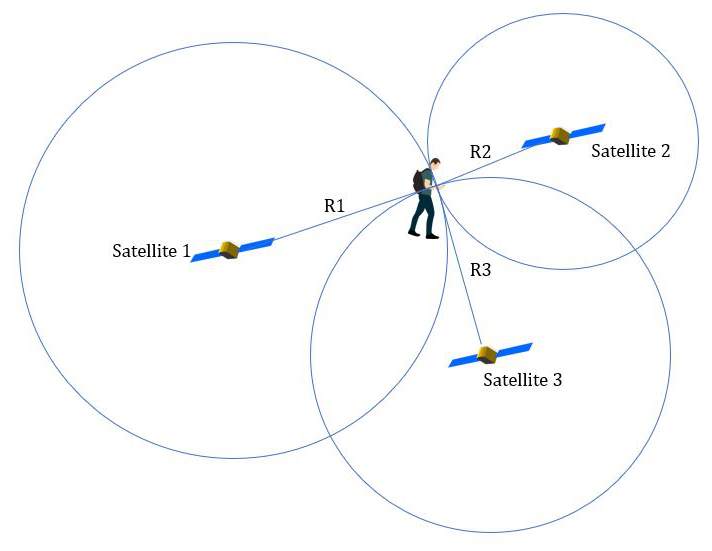

# GPS and Trilateration

## How a Receiver Finds You, and Why It Is Never Exactly Right

CE 414 Engineering Applications of GIS
Civil & Construction Engineering
Brigham Young University
Dr. Dan Ames

<!-- Thursday of Week 11. A refresher: most students met GPS in the introductory geomatics course, so move quickly through the signal material and spend the time on error, geometry, and correction, and on the one link back to Tuesday: a receiver reports coordinates in a datum, and that datum has to meet your project's. The file keeps its old name (gps-triangulation) so the published link does not change; the deck teaches trilateration, distances rather than angles, and says so. -->

<!-- stamp:begin -->
<!-- _footer: 'CE 414 · Week 11 — GPS and TrilaterationLast Updated: 2026-10-09© 2026 Daniel P. Ames · <a href="https://creativecommons.org/licenses/by/4.0/">CC BY 4.0</a>' -->
<!-- stamp:end -->

---

# Today's Goals

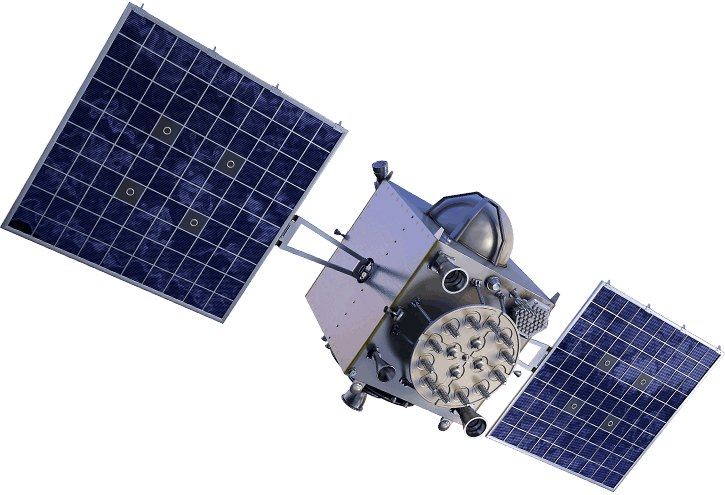

By the end of class you should be able to:

- Explain how a receiver measures **range** to a satellite from the **travel time** of a coded radio signal
- Show why ranges fix a position by **trilateration**, and why it takes **four** satellites
- Name the main **error sources** and what removes each one
- Explain **dilution of precision**: why geometry matters as much as satellite count
- Say what **differential GPS**, **RTK** and **post-processing** buy you, and which **datum** the answer comes back in

<!-- Read these out loud, then come back to them at the end. The two students most often get wrong on the quiz: geometry is not the same as signal quality, and differential correction only removes error the base and rover share. -->

---

<!-- _class: activity -->

# Activity: Where Am I?

I visited Europe and got lost. Three radio stations announced the time, but each was late. The delay is the **travel time** of the signal:

| Station | Time difference |
| --- | --- |
| Amsterdam | 0.00237 s |
| Paris | 0.00295 s |
| London | 0.00345 s |

**Where am I?**

<!-- Answer: Prague. Multiply each delay by the speed of light (299,792 km/s): 711 km from Amsterdam, 884 km from Paris, 1,034 km from London. The great-circle distances from those cities to Prague are 713, 885 and 1,038 km (checked with pyproj), so the puzzle is honest. Three distances, three circles, one intersection. This is the whole lecture in one slide; do it before any of the theory. Skip it if you run the Air Force One version instead. -->

---

# Find Air Force One

<!-- Second version of the same warm-up, done in the room. Hide the model plane (or any small object) somewhere in the room beforehand. -->

---

<!-- _class: activity -->

# Find Air Force One

The plane is:

- ___ inches from **Satellite 1**
- ___ inches from **Satellite 2**
- ___ inches from **Satellite 3**

Three distances. No angles. Find it.

<!-- Set-up, before class, in whatever room the class meets in: choose three "satellites" that everyone can see and that are spread around the room (a ceiling projector lens, a smoke detector, a light fixture on the far wall: spread out, not in a row, which is the dilution-of-precision lesson in advance). Hide the plane, measure from each satellite to it with a tape, and write the three distances on the board or into this slide's blanks. Students work in pairs with a tape measure or string; the first pair to the plane explains how they got there. -->

---

# The 3 D's of Map Data

- **Download**
  - From where? What does the metadata say?
- **Digitize**
  - Clicking on the map to create data by drawing
  - How good can it be?
- **DGPS**: differential GPS field data collection
  - Why differential?
  - Modern surveying fits in here

<!-- Three ways of acquiring vector data, from the introductory course. Today is the third. Ask which of the three they used in their labs this semester: almost all of it was downloaded, which is exactly why the metadata question matters. -->

---

# Critical Concepts of DGPS

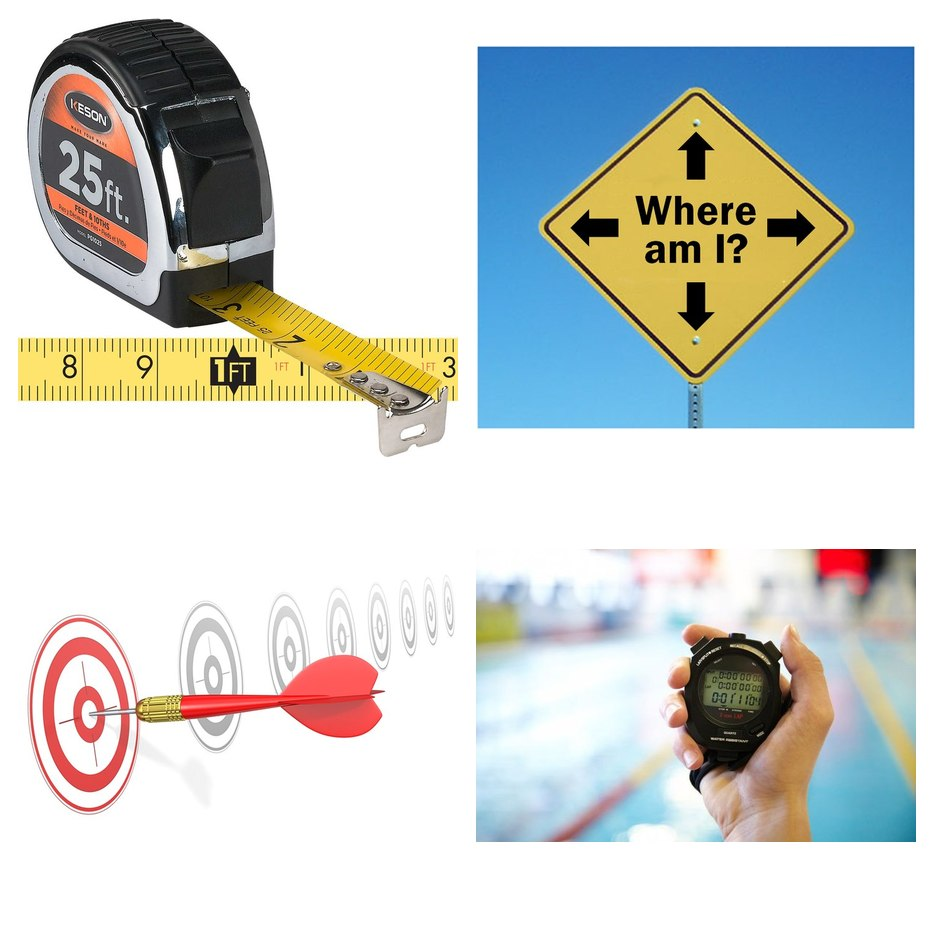

- **A. Pseudorandom noise** — *how long ago?*
- **B. Range** — *how far away?*
- **C. Trilateration** — *where am I?*
- **D. Differential GPS** — *no, really, where am I?*

<!-- The structure of the rest of the hour. Each question depends on the one before it: no range without a travel time, no position without ranges. -->

---

# A. Pseudorandom Noise (How Long Ago?)

You are the U.S. Government. You need to track military assets, so you put satellites in orbit — but that raises questions:

- How do you transmit the information? **AM? FM? PM?**
- What do you put in the radio message?
- How do you compute **distance** from a satellite that is only sending you a radio signal?

<!-- Frame the design problem before giving the answer. The answer to the third question is the whole of parts A and B: you cannot measure distance directly, so you measure time and multiply. -->

---

# Radio Wave Transmission Methods

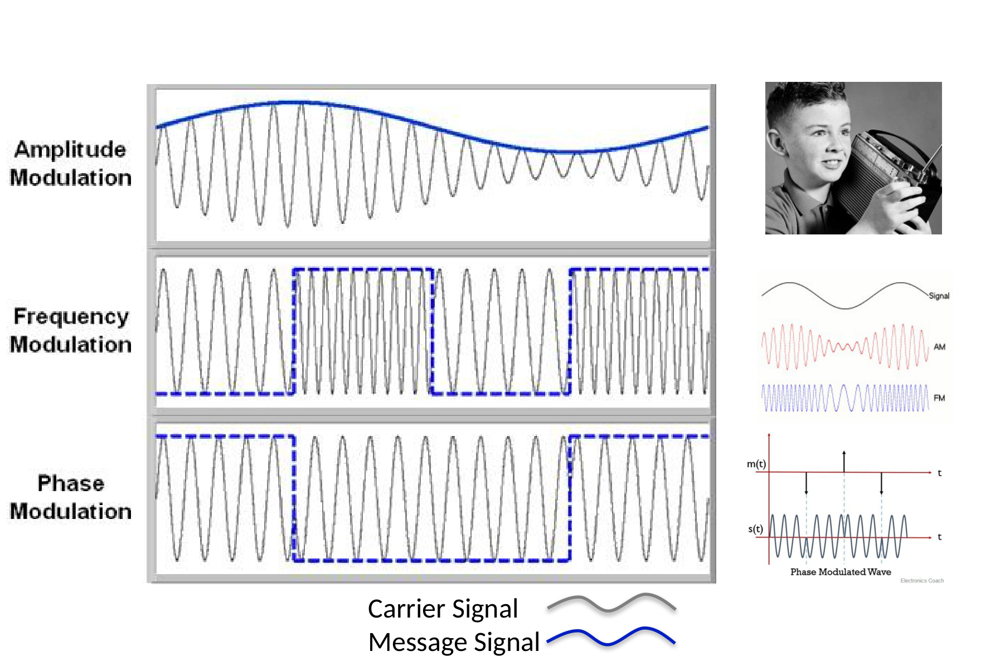

Video explanation: [youtu.be/Iyzpt3bKTTI?t=85](https://youtu.be/Iyzpt3bKTTI?t=85)

<!-- Amplitude, frequency, and phase modulation: a carrier at a fixed frequency is altered to carry a message. GPS uses phase modulation of the carrier by the code sequence. The linked video ("Understanding Modulation!") covers the three in about a minute from the 85-second mark; play it only if the class has not seen modulation. -->

---

# Computing Radio Wave Travel Time

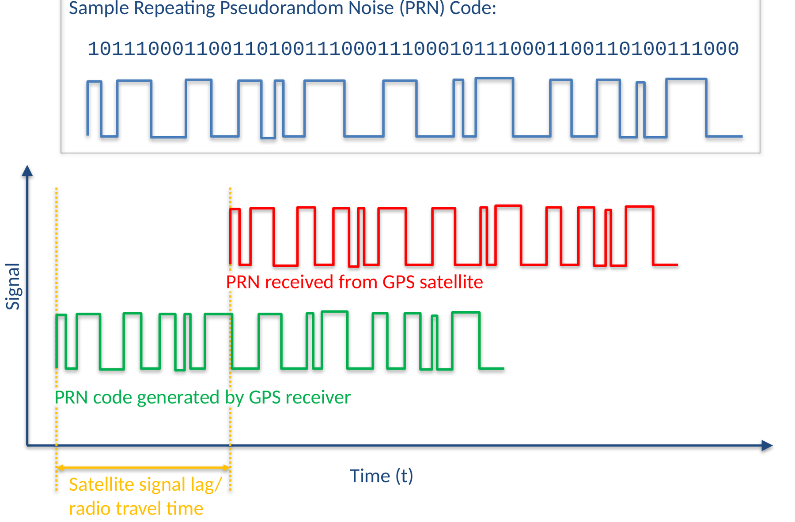

<!-- The key mechanism. The satellite and the receiver each generate the same pseudorandom code. The receiver slides its own copy along in time until it lines up with the code it received; the size of the shift is the travel time. A pseudorandom sequence, rather than a plain tone, lines up in exactly one place. -->

---

# B. Range (How Far Is It?)

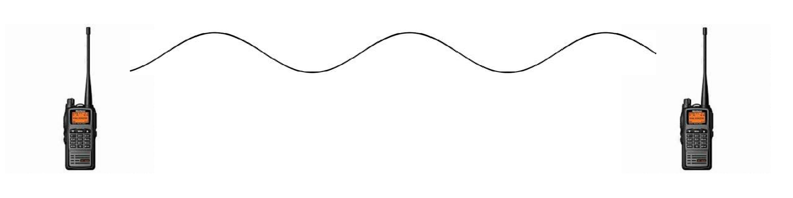

**D = R × T**

- **R** = speed of light
- **T** = time of message travel, from the code shift on the last slide
- **D** = how far away the sender is

<!-- The whole of part B in one line. Strictly this gives a pseudorange, not a true range, until the receiver's clock error is solved for, which is why a fourth satellite is needed. -->

---

# B. Range (How Far Away?)

Distance = signal travel time × speed of light

**For example, a satellite straight overhead:**

- Signal travel time = **0.0674 s**
- Speed of light = 299,792,458 m/s
- Distance = 20,206,012 m ≈ **20,200 km**

GPS satellites orbit about **20,200 km** up, so this is about right.

<!-- Work the multiplication live: 0.0674 × 299,792,458 = 20,206,012 m. gps.gov gives the orbit as about 20,200 km (gps.gov/space-segment). A satellite on the horizon is farther, about 25,800 km (sqrt(26,571² − 6,371²)), about 0.086 s. -->

---

# C. Trilateration (Where Am I?)

- Each range puts you somewhere on a **sphere** centered on that satellite
- **Distances, not angles**: this is trilateration, not triangulation

<!-- Triangulation, fixing a position from measured angles to known points, is the classical surveying method. Name the difference out loud; students will meet both terms, and the two are often confused. -->

---

# C. Trilateration: Fixing Your Position

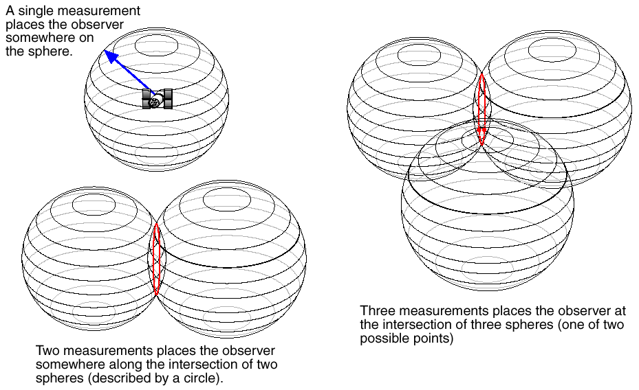

- One measurement puts you **on a sphere**
- Two narrow it to a **circle**
- Three narrow it to **two points**
- One of the two is far out in space or deep inside the Earth, so you are at the other
- A **fourth** satellite solves for the **receiver clock**

<!-- The receiver's clock is a cheap quartz clock, not an atomic one. A one-microsecond clock error is a 300 m range error, on every satellite at once. Four unknowns (x, y, z and the clock offset) need four ranges; every satellite beyond four improves the solution. -->

---

<!-- _class: lead -->

# D. Differential GPS

## No, really — where am I?

But first: why do we need differential correction?

**GPS measurements have errors in them.**

<!-- The pivot of the lecture. Everything so far has assumed the ranges are exact. They are not, and the next block of slides is a catalog of why. -->

---

# Error Sources: Signal Interference

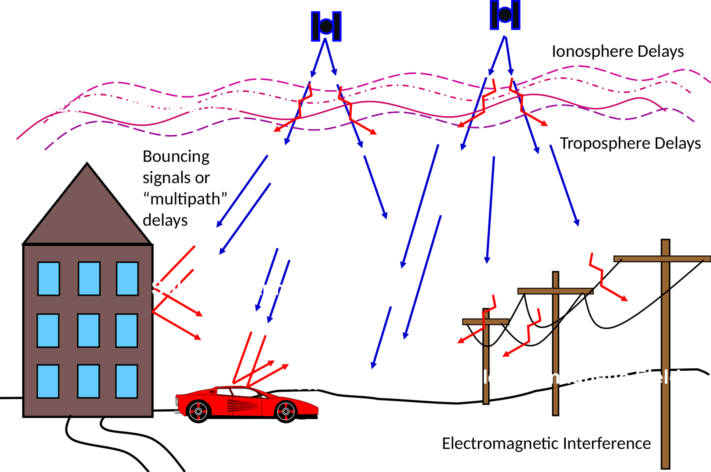

- The atmosphere: **ionosphere** and **troposphere** delays
- Solid structures, metal, and electromagnetic fields
- Bouncing signals, or **multipath**

<!-- The signal does not travel through a vacuum the whole way, and it does not always arrive by the direct route. Both effects make the measured travel time longer than the true one, so both make the range too long. -->

---

# The Ionosphere: Why Two Frequencies Help

- The ionosphere slows the signal by an amount that depends on **frequency**: delay ∝ 1 / f²
- GPS broadcasts on **L1 1575.42**, **L2 1227.60** and **L5 1176.45 MHz**
- A dual-frequency receiver compares two of them and **removes more than 99.9 %** of the ionospheric delay
- The **troposphere** (water vapor) does not depend on frequency; receivers **model** it instead

<!-- The largest single error source for a single-frequency receiver is the ionosphere, and it is the one physics hands us a fix for: because the delay scales with 1/f², measuring the same range at two frequencies lets the receiver solve for it. Frequencies and the 99.9 % figure: ESA Navipedia (GPS Signal Plan; Ionospheric Delay); gps.gov/new-civil-signals. Survey-grade receivers have done this for decades; many phones now receive L5 as well. -->

---

# Error Sources: Multipath

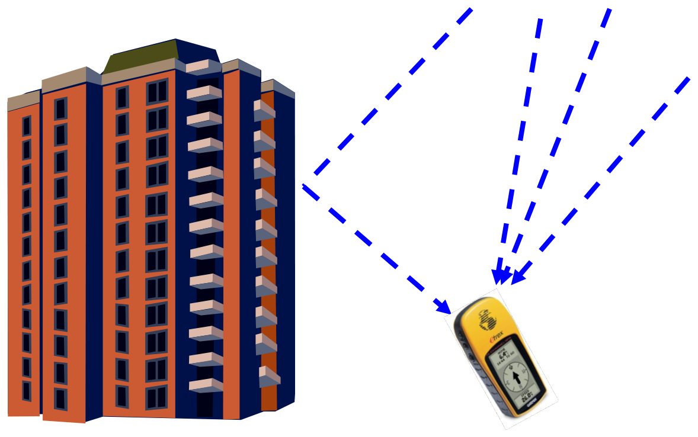

A reflected signal takes a longer path, so its range comes out **too long**.

What helps:

- **Open sky**: step away from buildings, vehicles, and metal
- An antenna that rejects low and reflected signals (a **ground plane** or **choke ring**)
- An **elevation mask**: ignore satellites low on the horizon
- **Stay longer**, or come back at another time: the satellites move, and so does the reflection

<!-- Multipath is local to the rover, so differential correction does not remove it: the base station a few kilometers away sees different reflections. That is why it gets its own list. Survey practice: occupy the point long enough to average, or re-occupy it at a different time of day. -->

---

# Error Sources: Bad Coverage

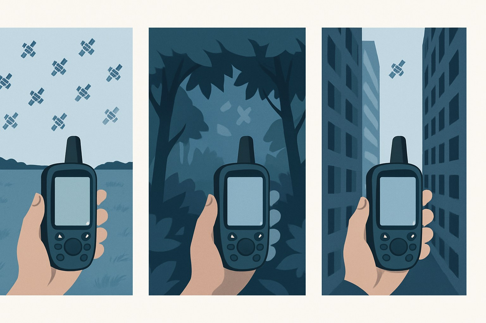

GPS has worldwide coverage — however:

- **Dense foliage** and **urban canyons** block or degrade signals
- **Deep valleys** and gorges hide most of the sky
- Fewer satellites, and the ones left are **bunched together**

<!-- Coverage is about sky view, not about the receiver. The satellites are there; the terrain and the canopy are in the way. Losing satellites low on the horizon is worse than losing the same number overhead, because it collapses the geometry: dilution of precision, in a few slides. -->

---

# Error Sources: Selective Availability

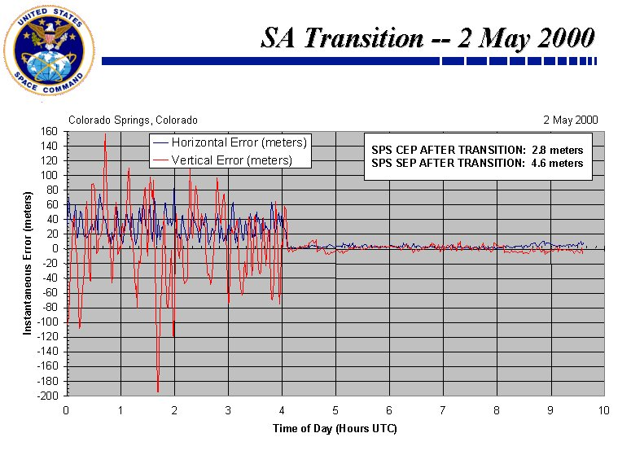

- The Defense Department **degraded** the civilian signal on purpose (Selective Availability)
- Turned off just after midnight **May 1–2, 2000**; civilian errors shrank several-fold overnight
- In **2007** the government announced that GPS III satellites would be built **without** it
- Today's concern is the opposite: **jamming and spoofing** of the real signal

<!-- The chart is the transition as recorded on May 2, 2000: horizontal and vertical error collapse partway through the record. Source: GPS Support Center chart prepared by Overlook Systems, archived at archive.gps.gov/systems/gps/modernization/sa/data/. gps.gov/selective-availability gives the turn-off time (just after midnight EDT, May 1) and the 2007 GPS III decision. Jamming and spoofing are why aviation and surveying now watch for interference rather than for SA. -->

---

# Error Sources: Summary

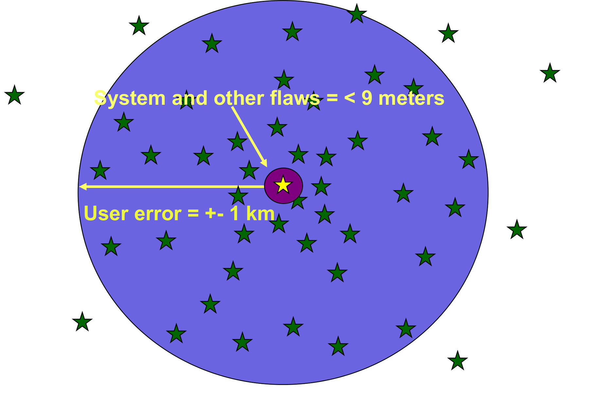

| Source | Rough size | What removes it |
| --- | --- | --- |
| Ionosphere | meters | two frequencies; DGPS |
| Troposphere | about half a meter | a model; DGPS |
| Satellite clock and orbit | ≤ 2.0 m (95 %) together | DGPS; precise orbits |
| Multipath | up to meters near reflectors | site and antenna |
| Receiver noise | decimeters | better receiver |
| **User error** | **anything** | **you** |

A phone under open sky: about **4.9 m**.

<!-- The 2.0 m is the U.S. government's signal-in-space commitment (user range error, 95 %, global average) and the 4.9 m is its statement about smartphones under open sky, both at gps.gov/gps-accuracy. The other rows are orders of magnitude, not a budget to add up: published per-source tables disagree and the one most often quoted is uncited. The point is the last row: standing in the wrong place, mistyping a point ID, or recording the wrong feature beats every satellite error. The circle diagram makes the same point. -->

---

# Every Range Carries Uncertainty

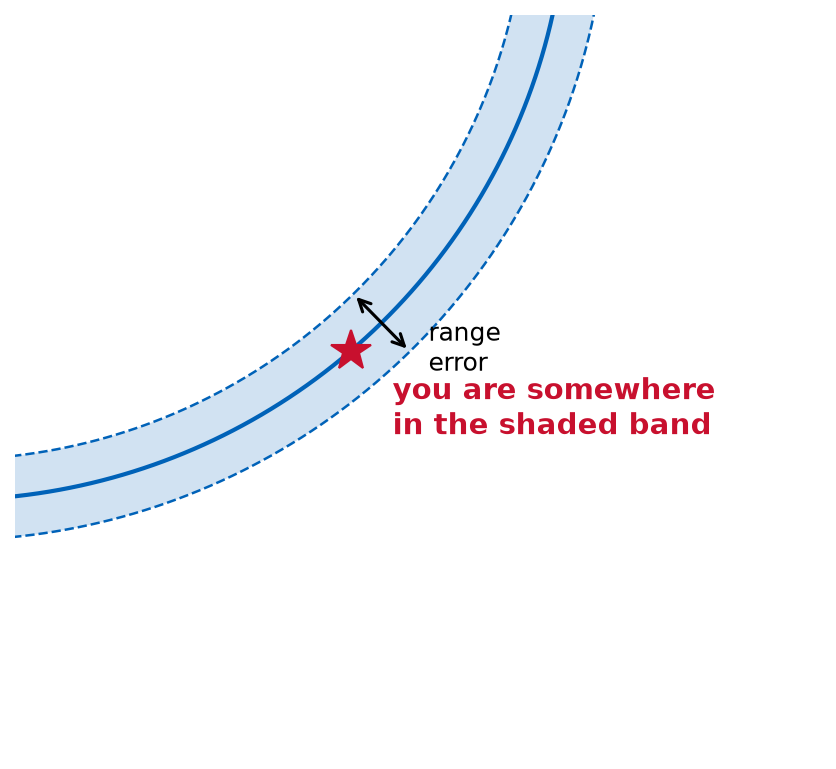

<!-- A measured range is not a line, it is a band: the true position lies somewhere inside the range uncertainty. Everything about dilution of precision follows from how those bands cross. Figure computed (tools/week11_gps_figures.py). -->

---

# Dilution of Precision

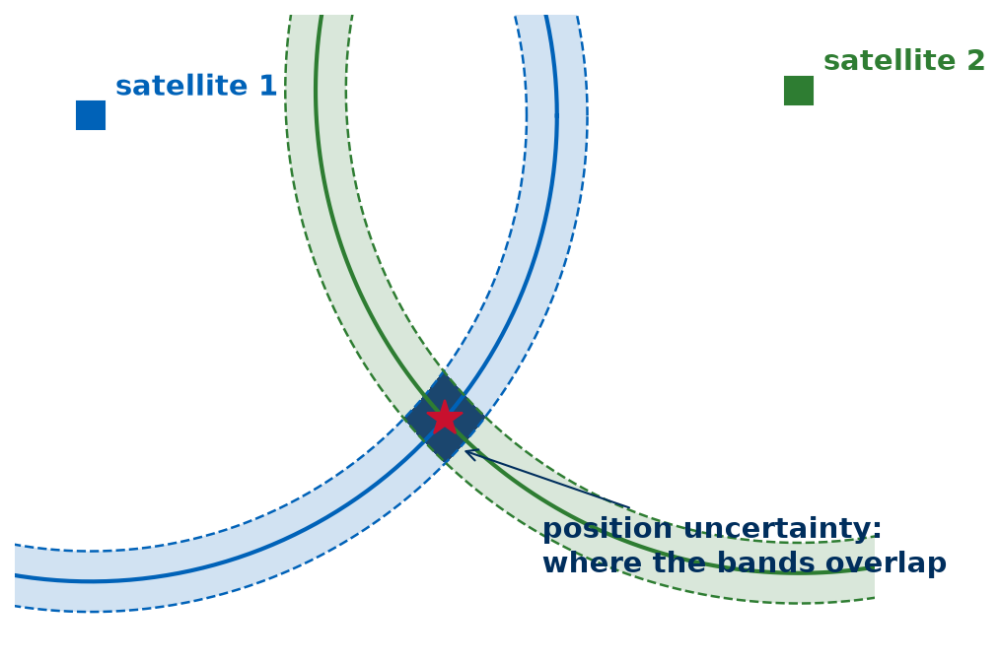

<!-- Two uncertainty bands crossing. The dark area in the middle is where the receiver could be; its size depends on the angle at which the bands cross. Cross at right angles and it is small; cross at a shallow angle and it stretches. -->

---

# Same Error, Different Geometry

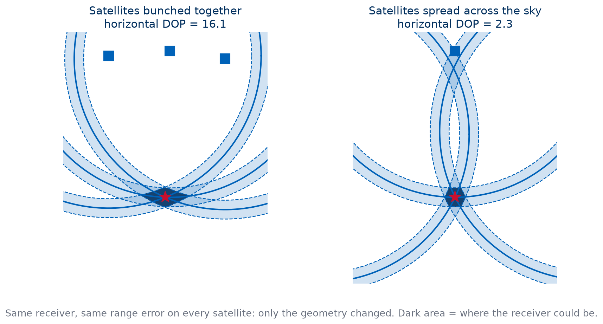

<!-- Same receiver, same range error on every satellite: only the geometry changed. The DOP numbers are computed from the satellite directions (a 2-D version with the receiver clock as the third unknown): 16.1 bunched, 2.3 spread. Ask which they would get under a canopy or in a canyon: the bunched one, which ties back to the coverage slide. -->

---

# Reading a DOP Value in the Field

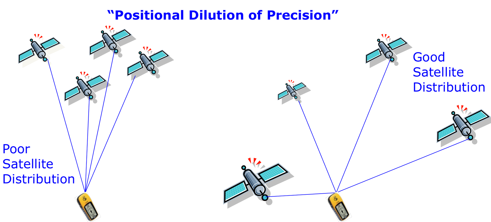

**Position error ≈ DOP × range error**

| DOP | Rating |
| --- | --- |
| < 1 | ideal |
| 1–2 | excellent |
| 2–5 | good |
| 5–10 | moderate |
| 10–20 | fair |
| > 20 | poor |

The family: **PDOP** (3-D position), **HDOP** (horizontal), **VDOP** (vertical), **GDOP** (all, with time)

<!-- DOP multiplies whatever range error you have. A 2 m range error at PDOP 2 is about 4 m; at PDOP 8 it is about 16 m. Rating table: Isik et al. 2020, Robotics 9(3):66, as summarized in the Wikipedia article on dilution of precision. VDOP is usually worse than HDOP because every satellite is above you, never below: one reason GPS heights are less certain than GPS positions. In the field: watch the receiver's PDOP, and when it climbs, wait for the satellites to move rather than logging a bad point. -->

---

<!-- _class: lead -->

# Differential GPS Helps Us Deal with These Errors

<!-- Two receivers near each other see almost the same errors, so if one of them already knows where it is, it can tell the other one how far off the satellites are right now. -->

---

# D. Differential GPS: Post-Processing

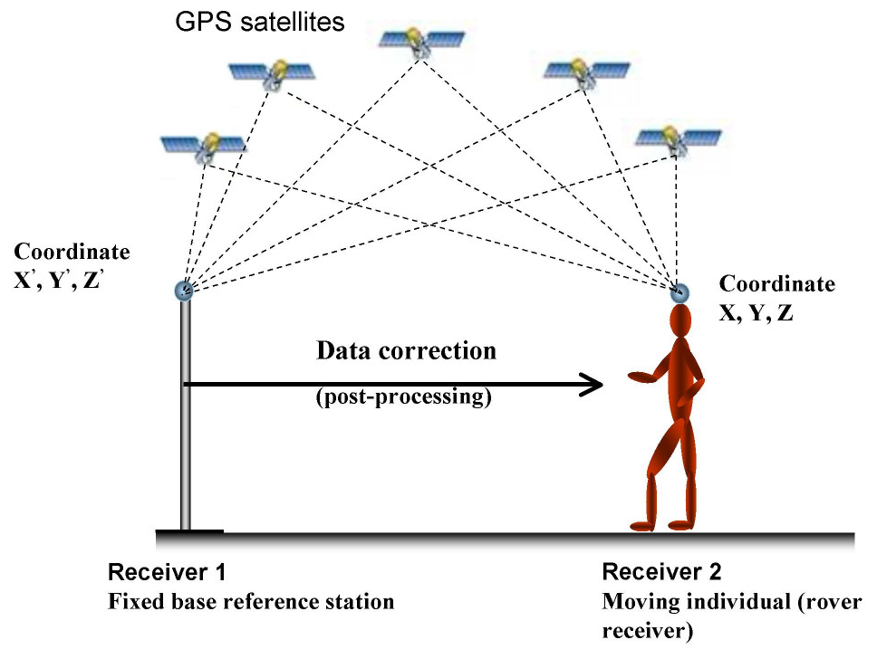

- **Receiver 1** is a fixed base reference station at a known coordinate
- **Receiver 2** is the moving rover, carried by the person collecting data
- The base's error is applied as a **data correction** to the rover's positions

<!-- The correction can be applied after the fact (post-processing, as drawn here) or streamed to the rover in real time. -->

---

# D. Differential GPS: How the Correction Works

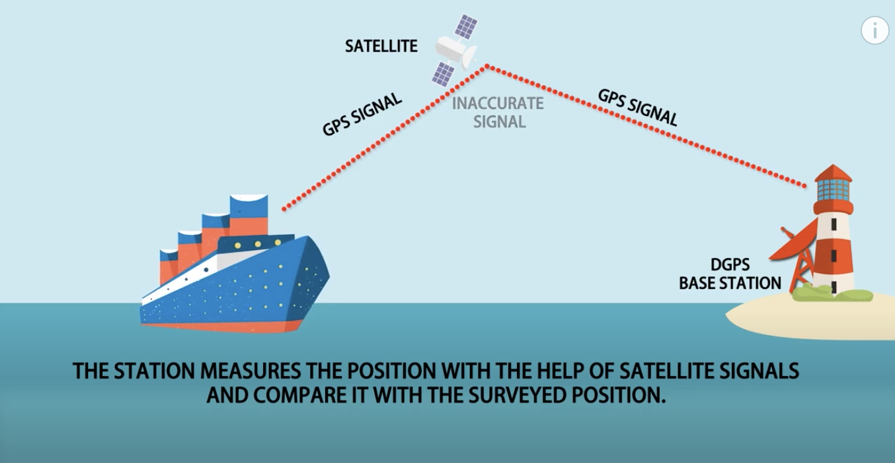

1. The **exact position is known** at the base station
2. Take readings there and compute the **errors** in x and y
3. Apply the same corrections to the moving receiver

[Watch: how DGPS correction works](https://www.youtube.com/watch?v=Xj3LBNBecnM)

<!-- The assumption that makes this work is that base and rover see the same errors: same satellites, same atmosphere. That holds while they are close together and degrades as the baseline grows. Errors that are not shared, like the rover's own multipath, are not removed at all. -->

---

# A Worked Example

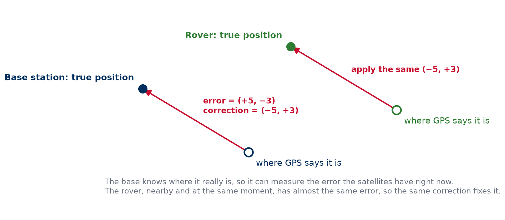

<!-- The base station's true position is known. The satellites put it 5 units east and 3 south of that: the error is (+5, −3), so the correction is (−5, +3). The rover, nearby and at the same moment, gets the same correction. The correction is an offset, not a coordinate (figure: tools/week11_gps_figures.py). -->

---

# Beyond DGPS: Four More Ways

- **SBAS / WAAS**: corrections broadcast from satellites, free in any WAAS receiver
- **RTK**: a base streams corrections; the rover uses the carrier phase, not just the code
- **Network RTK**: a network of bases replaces your own, Utah's is **TURN**
- **PPP**: precise orbits and clocks, no base; tens of minutes to converge
- **OPUS**: upload a static file to NGS, get a position back

<!-- Each of these is the differential idea again: someone who knows where they are tells you how wrong the satellites are. SBAS sends it from a satellite, RTK from your own base, network RTK from a state network, PPP from global orbit and clock products, OPUS after the fact. The next slide puts numbers on them. -->

---

# How Good Can It Get?

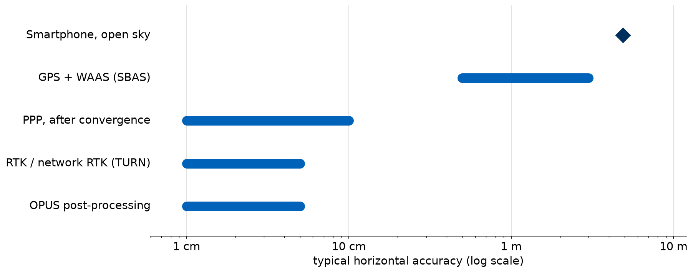

<!-- Sources for the ladder: gps.gov/gps-accuracy (smartphones, 4.9 m); FAA WAAS "How It Works" ("a few meters"; FAA's measured 95 % values run about 0.5 to 2 m); ESA Navipedia RTK Fundamentals ("a few centimetres" within 10 to 20 km of the base) and Precise Point Positioning (centimeter to decimeter, many tens of minutes to converge); NGS OPUS ("most positions ... within a few centimeters", 2 to 48 hours of data for OPUS-S, 15 minutes to 2 hours for OPUS-RS). TURN, The Utah Reference Network, is run by UGRC: 100+ stations in Utah and nearby, real-time corrections by subscription, results in NAD 83 (2011) epoch 2010.0 (gis.utah.gov/products/turn). -->

---

# Not Just GPS: GNSS

GPS is one of several **Global Navigation Satellite Systems**:

- **GPS** (United States): about 31 operational satellites
- **GLONASS** (Russia)
- **Galileo** (European Union)
- **BeiDou** (China)
- **QZSS** (Japan, a regional system)

A modern receiver uses **all of them at once**: more satellites, better geometry, lower DOP.

<!-- gps.gov/other-global-navigation-satellite-systems-gnss lists the others; the GPS count is from gps.gov/space-segment (31 as of 2023; the Coast Guard's NAVCEN status page has the day's count). TURN, for example, now uses GPS, GLONASS, Galileo, BeiDou and QZSS. India's NavIC is left off on purpose: as of mid-2026 too few of its satellites work for standalone positioning. -->

---

# Which Datum Does Your Receiver Report?

- A plain GPS fix is in **WGS 1984**; a TURN or OPUS solution comes back in **NAD 1983 (2011)**
- At BYU the two differ by about **1.2 m**: nothing for a trail map, everything for a survey
- Heights from GPS are **ellipsoid heights**, not the elevation on a USGS map; the **geoid** separates them
- Bringing points into ArcGIS Pro: **XY Table To Point** — set the coordinate system **the receiver used**, then **Project**

<!-- This is Tuesday's lesson arriving from the field. The 1.2 m is ArcGIS Pro's WGS_1984_(ITRF08)_To_NAD_1983_2011 at BYU (tools/week11_arcgis_numbers.json); Esri's own support note puts the WGS 84 / NAD 83 gap at about a meter, and it grows a little every year because NAD 83 is fixed to the North American plate and WGS 84 is not. The map is Tuesday's: a wrong datum label puts BYU 64 m off for NAD 27; for WGS 84 against NAD 83 the same mistake costs about a meter. -->

<!-- TODO(capture): an ArcGIS Pro capture of XY Table To Point with C:\Ames\Week11\gps_points.csv as input and GCS WGS 1984 as the coordinate system. Desktop control was declined on October 20, so the slide uses Tuesday's registration map. -->

---

<!-- _class: activity -->

# Final Thoughts

**Quiz: Where Am I?** Five questions on what a receiver actually measures, and on why the position it reports is never exactly where you are. **Scan the code**, or open the link under it.

- Not graded, nothing recorded: a quick check that today's material made sense
- Quiz 9 on Learning Suite is the graded one this week; this is the rehearsal for it

**Before next class**

- Read **Chapter 5** of *GIS Fundamentals* (GNSS)
- Take **Quiz 9** (Coordinate Systems and GPS, Chapters 3 and 5, open book) on **Learning Suite** — due **Saturday 11:59 pm**
- Finish [**Lab 10 — Avalanche Hazard**](https://byu-hydroinformatics.github.io/ce414-gis-applications/assignments/lab-10/), due **Saturday 11:59 pm**
- Next week: **least cost paths**, and **Lab 11 — Least Cost Path Power Line Analysis**
- Questions? Office hours: [calendly.com/dan-ames/office-hours](https://calendly.com/dan-ames/office-hours)

byu-hydroinformatics.github.io/ce414-gis-applications/quizzes/gps/

<!-- Four or five minutes, individually, then a show of hands on the last two items. The one that reliably splits the room is the differential-correction question: most of the class expects the base station to fix everything, and the point worth saying out loud is that it only removes what the two receivers share. The canyon item is the other one to argue: "enough satellites for a fix" is not the same as a good fix. -->

<!-- Revision notes (2026-10-20): rebuilt from the September 3 conversion of "CE 414 Week 12 - Review - GPS and Triangulation.pptx".

RESOLVED: title is "GPS and Trilateration" (file name kept so the link survives); the "CCE 214 Geomatics" subtitle is gone; the travel time is 0.0674 s (20,206 km), not 0.674 s; the Air Force One activity is a set-up procedure for any room instead of one classroom's measurements; the scanned DOP drawings of unknown origin and the DGPS diagram with the mislabeled correction are replaced by computed figures (tools/week11_gps_figures.py); the error table is rewritten around the two numbers gps.gov publishes, since the per-source table circulating online is uncited; new slides cover dual-frequency ionospheric correction, multipath mitigation, reading DOP, SBAS/RTK/network RTK (TURN)/PPP/OPUS, the other GNSS, and which datum a receiver reports; selective availability is updated (2000 turn-off, 2007 GPS III decision, jamming and spoofing today). Facts and URLs were checked on October 20, 2026; gps.gov moved its pages in 2026 and the old /systems/gps/ URLs are 404.

STILL OWED: an ArcGIS Pro capture of XY Table To Point (TODO on the datum slide). The selective-availability chart was prepared by a government contractor (Overlook Systems) for the GPS Support Center; it is credited in the notes, but its public-domain status is not stated on the archive page. -->
