<!-- _class: lead -->
<!-- _paginate: skip -->

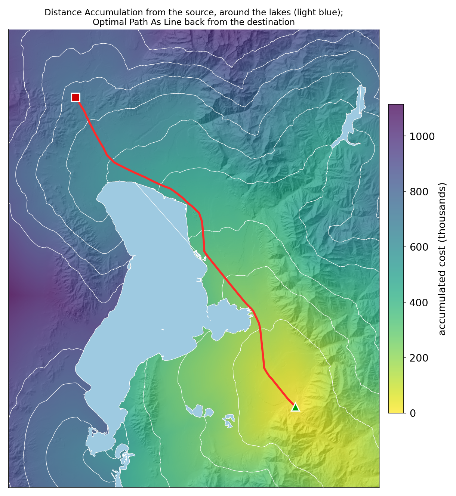

# Least Cost Path Analysis

## Part B — The Tools, the Route, and What Moved It

CE 414 Engineering Applications of GIS
Civil & Construction Engineering
Brigham Young University
Dr. Dan Ames

<!-- Thursday of Week 11. Tuesday built the idea: a cost surface, the accumulated cost and back direction rasters, a path walked home from the destination. Today: Tuesday's grid again, then the ArcGIS Pro tools that compute it, Lab 10's own route computed from the lab's own model and data, and the question that matters to an engineer, which of its decisions actually moved the line. Every Lab 10 map and number comes from the lab's reference run (tools/lab10/run_model.py, check_values.json), drawn by tools/week11_lcp_figures.py; the Distance Accumulation and Optimal Path As Line captures are the lab's own Figures 7a and 7b, from the October 9, 2026 build of the lab in ArcGIS Pro 3.7.1 (C:\Ames\Lab10GUI\Lab10.aprx, ready for a live demo). -->

<!-- stamp:begin -->
<!-- _footer: 'CE 414 · Week 11 — Least Cost Path Analysis, Part BLast Updated: 2026-11-09© 2026 Daniel P. Ames · <a href="https://creativecommons.org/licenses/by/4.0/">CC BY 4.0</a>' -->
<!-- stamp:end -->

---

# Today's Goals

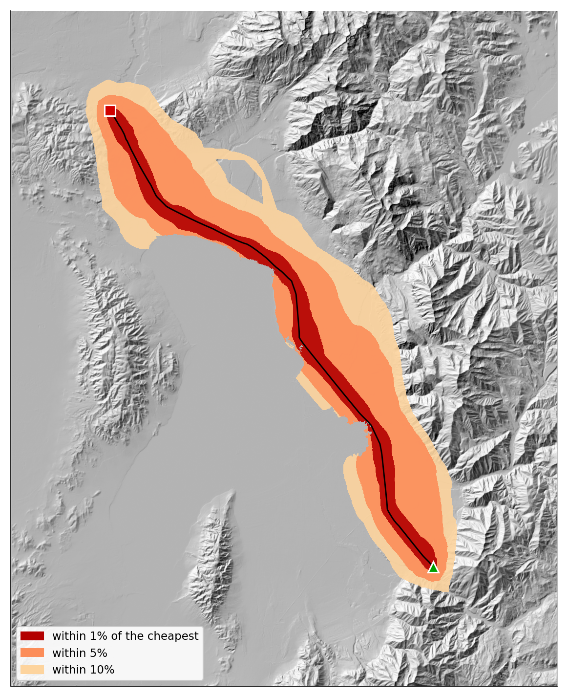

By the end of class you should be able to:

- Run a least cost path in ArcGIS Pro with **Distance Accumulation** and **Optimal Path As Line**
- Read a **back direction** raster as a compass angle
- Say which parts of a cost surface **move a route** and which only change its total
- Map a **corridor** of nearly-as-good routes, not just one line

<!-- The right-hand figure is where the hour ends: not one route but a corridor of nearly-as-good ones, between Lab 10's two endpoints. -->

---

# Tuesday's Grid

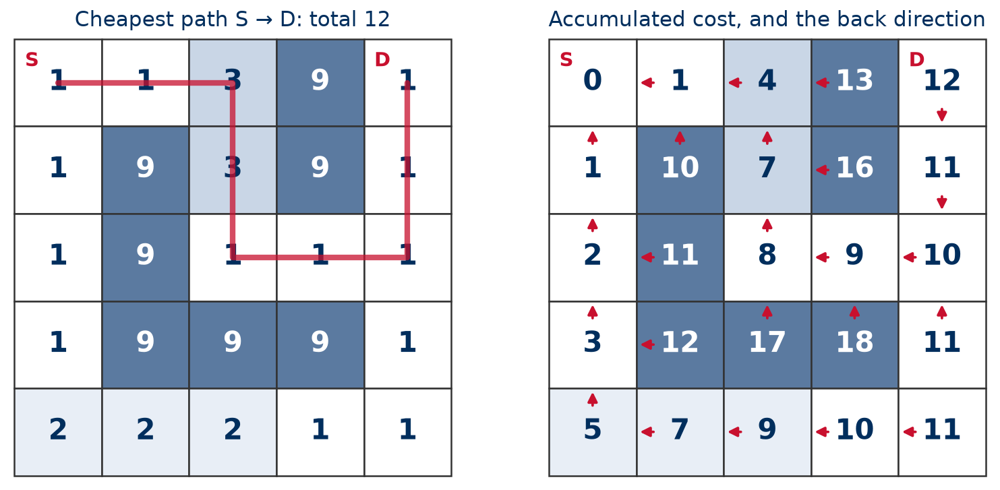

- Left: the **cost surface**, and the cheapest path from S to D, total **12**
- Right: the **accumulated cost** of every cell, and an arrow back toward S: the **back direction**
- Start at D and **follow the arrows**: that walk is the route

<!-- Tuesday's hand exercise, solved: four neighbors, and a move costs the cell you enter. Read the walk aloud from D: 12, 11, 10, 9, 8, 7, 4, 1, 0. Everything today is this picture again: the next slide lets ArcGIS Pro step diagonally, and Part 2 runs it on Lab 10's million cells. The figure is Tuesday's (tools/week11_parta_figures.py). -->

---

# From Four Directions to Eight

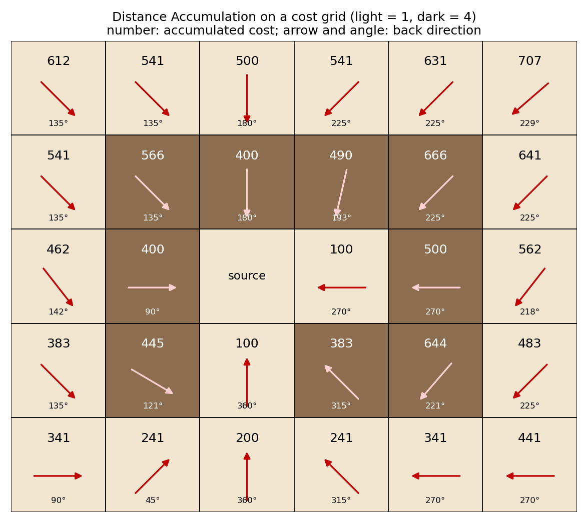

- By hand on Tuesday: **four neighbors** only, to keep the arithmetic simple
- ArcGIS Pro also steps **diagonally**: a diagonal is **1.414 times** as long, so it costs 1.414 × the cell it enters
- The **back direction** is a **compass angle**: 90 = east, 180 south, 270 west, 360 north; **0** is the source
- Some arrows point **between** neighbors (193°, 121°, 229°), so paths come out **straighter** than a staircase

<!-- Same idea as Tuesday's grid, computed by Distance Accumulation in ArcGIS Pro on a 6 x 5 grid of 100 m cells: light cells cost 1, dark cells cost 4. Each number is the accumulated cost; each arrow and angle is the back direction raster's value. Check two cells aloud. Straight: the dark cell left of the source is 4 x 100 = 400, and it points east (90 degrees), straight home. Diagonal: the light cell up and to the left of that dark cell above the source is 400 + 1.414 x 100 = 541. The angles that are not multiples of 45 degrees are Distance Accumulation looking past its eight immediate neighbors; students do not need the mechanics, only that the route is not forced into 45-degree steps. -->

---

<!-- _class: lead -->

# Part 1 — The Tools in ArcGIS Pro

---

# Distance Accumulation

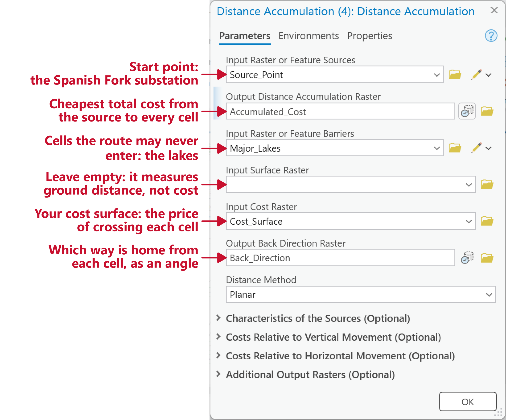

- One run makes **both** of Tuesday's rasters: the **accumulated cost** and the **back direction**
- The **cost raster** decides where the route goes; the other inputs say where it **starts** and what it must **avoid**

<!-- The red callouts are drawn beside the untouched capture by tools/week11_dialog_callouts.py. Lab 10's own Figure 6a: the routing step of the lab's model, filled in as the page tells students to. Source_Point and Destination_Point come from two Select tools on Endpoints. The barrier input takes the lakes as features. Leave Input Surface Raster empty: that measures distance over the terrain's actual surface, a different question from cost. In Lab 10 the same tool, with only a source, also makes the three straight-line distance rasters. -->

---

# Optimal Path As Line

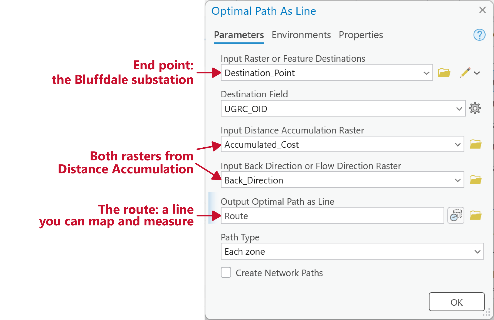

- It **follows the arrows** home from the destination, as we did by hand on Tuesday
- Its sibling, **Optimal Path As Raster**, gives a one-cell-wide raster instead

<!-- The red callouts are drawn beside the untouched capture by tools/week11_dialog_callouts.py. Lab 10's own Figure 6b. Destination Field fills in with UGRC_OID; with one destination it does not matter, nor does Path Type. The route it draws in the lab is 55.72 km. -->

---

<!-- _class: lead -->

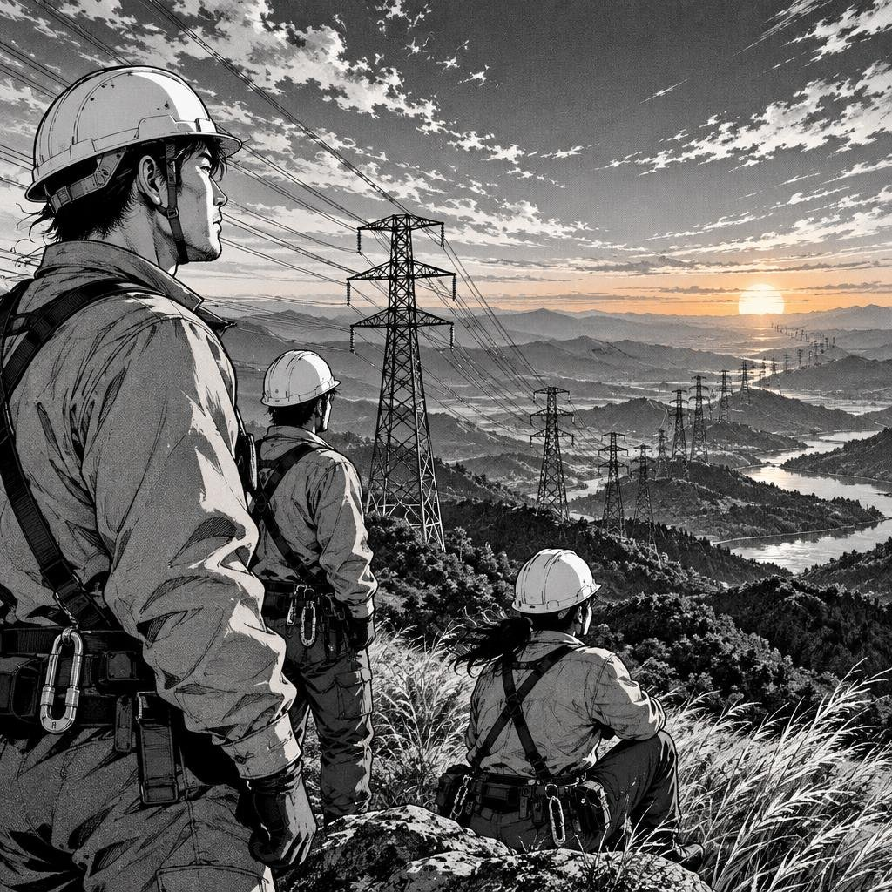

# Part 2 — Lab 10's Route, Computed

---

# Lab 10's Cost Surface, Layer by Layer

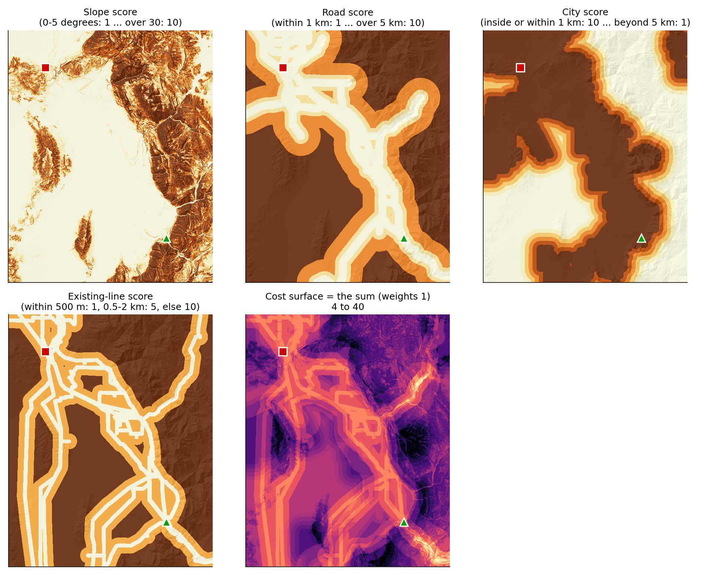

<!-- Lab 10's model, from the hosted package at 30 m (tools/lab10/run_model.py): four scores from 1 (cheap) to 10 (expensive), slope in degrees, straight-line distance to a major road, to a city (0 inside one) and to an existing 46-345 kV line, added with both weights at 1. The sum runs from 4 to 40, mean 23.66. Streams are not in the cost: the valley's are narrow enough to span. Score tables are on the lab page's Analysis Considerations. -->

---

# Accumulated Cost, and the Route Home

- The source: the mouth of **Spanish Fork Canyon** (green); the destination: **Bluffdale** (red)
- Straight line: **52.79 km**; cheapest route: **55.72 km**, **6%** longer
- It follows **existing transmission lines** almost the whole way: **99.7%** of it within 500 m of one
- The **lakes** (light blue) are barriers: the accumulation flows around them

<!-- The colors are Distance Accumulation's raster, the white lines its contours; the red line is Optimal Path As Line. The accumulated cost at the destination is 742,670 (cost x meters). 89.0% of it lies within 1 km of a major road. Numbers: tools/lab10/check_values.json, the same values the lab page publishes. -->

---

# Reading the Back Direction Raster

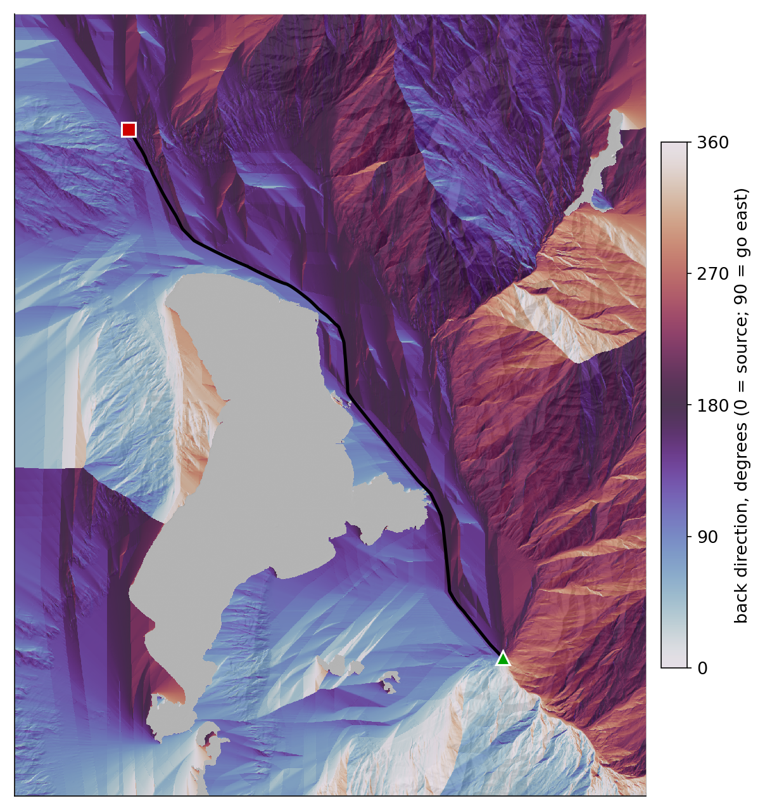

- Every cell knows **which way is home**
- The colors are **compass bearings**: 0 to 360
- Sharp seams are where two routes home **split**
- Optimal Path As Line just **follows the arrows** from Bluffdale

<!-- The twilight color ramp wraps around, so 0 and 360 (both "north") look alike. The seams are the boundaries between regions whose cheapest way home goes different ways around an obstacle; a destination on a seam has two nearly equal routes, which is the corridor slide's point. Skip if time is short. -->

---

<!-- _class: lead -->

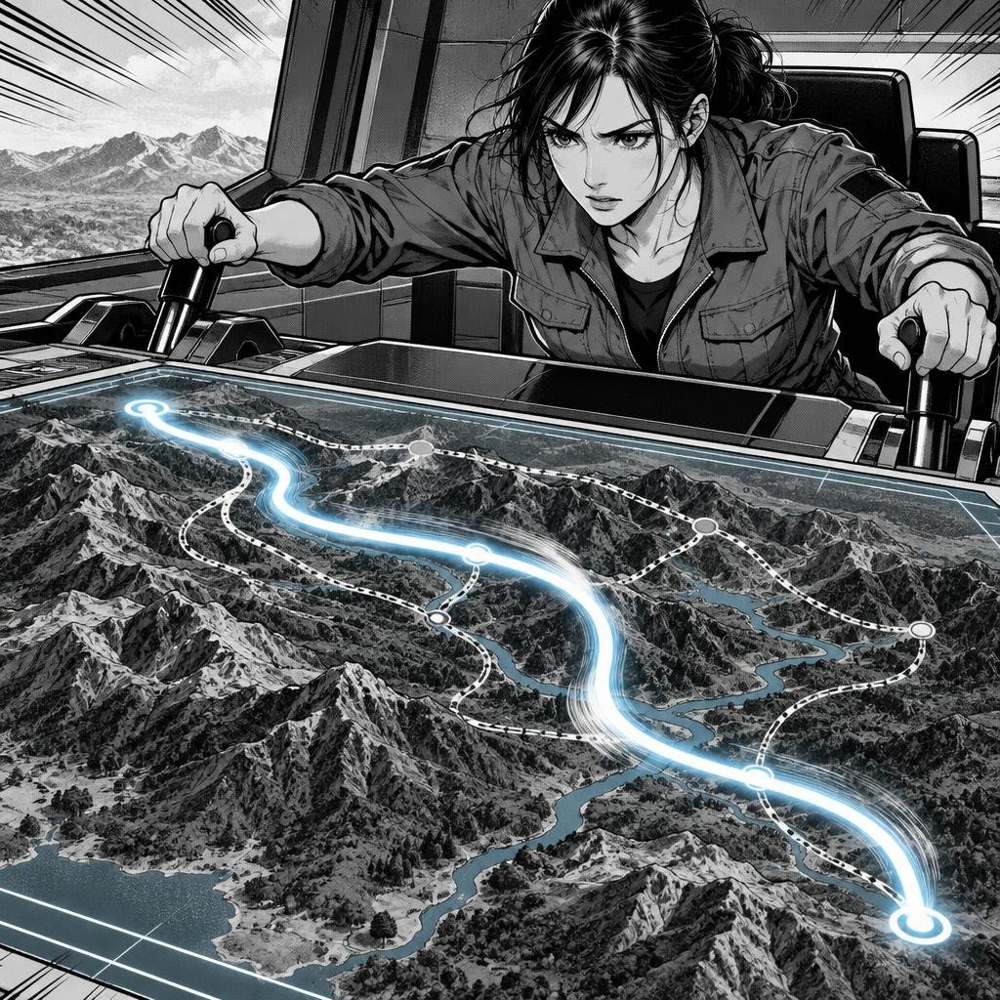

# Part 3 — Which Decisions Moved the Line?

---

<!-- _class: quiz -->

# Predict First

Change **one** decision in Lab 10's model. Which one moves the route **farthest**?

<ol type="A">
<li>Make slope five times as important (Slope_Weight 5)</li>
<li>Drop the city score</li>
<li>Drop the existing-line score (Line_Weight 0)</li>
<li>Take away the lake barrier</li>
</ol>

<!-- Ninety seconds, a show of hands for each letter. Expect A, B or D: terrain, cities and barriers feel like the big constraints. The answer is C. The next three slides are the answer, and the why. -->

---

# The Answer: Existing Lines

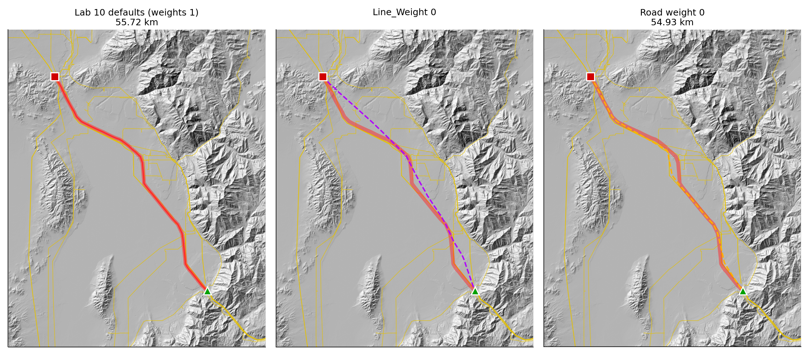

- **Line_Weight 0** (purple): the route **leaves the existing lines** and cuts across the valley, **kilometers** from the baseline: the **biggest** change of any. You measure it in Step 8
- **No road score** (orange): a **smaller** shift, up to **1.6 km** in one stretch, and most of the route stays put

<!-- The thick pale red line in each panel is the baseline, for comparison; thin yellow lines are the existing transmission lines. Point at the middle panel first: with no line score the route straightens out across the valley floor. Then the right panel: dropping roads moves it some, but 61% of it stays within 300 m of the baseline (road weight 0 is changed in the expression, not a Lab 10 parameter; 54.93 km). Line_Weight 0 is a Step 8 run, so its numbers are not in this deck. Do not let the 1.6 km be the number students remember: it is the only number on the slide because the bigger one is theirs to measure. -->

---

# Three Decisions That Barely Mattered

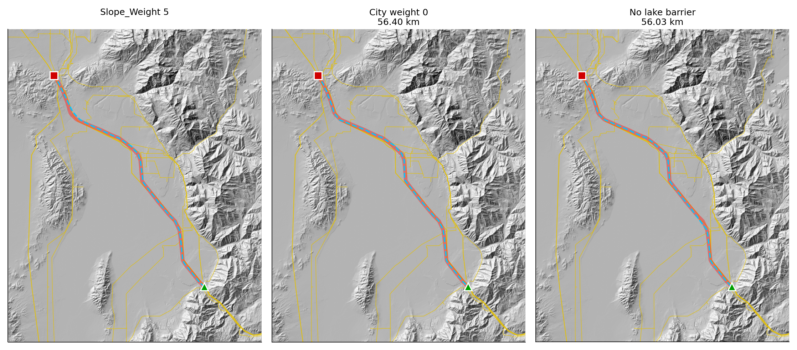

- **No city score**: at most **752 m** from the baseline · **no lake barrier**: **404 m** · **Slope_Weight 5**: you measure it in Step 8
- Flat valley floor, **in cities** the whole way, **away from the lakes**: the same along every candidate route, so they cannot choose between them

<!-- Measured on Lab 10 (tools/lab10/check_values.json and explore_weights.json; the farthest distance is from the baseline route, sampled every 100 m): city weight 0 (changed in the expression, not a Lab 10 parameter) 56.38 km, 91% within 300 m, every cell of the baseline route has city score 10; no barrier 55.66 km, 98% within 300 m. Lab 10's Step 8 asks students to find the slope result themselves, so the slope numbers are not in this deck. Each would matter in another place, or with other scores: that is the lesson, not that slope and cities never matter. -->

---

# Why the Existing Lines Win

- A weight moves the route only where its factor **differs** from one candidate route to the next
- **Existing lines**: score **1** within 500 m of a line, **5** out to 2 km, **10** beyond. Step off a line and every cell costs **more**, so the baseline stays within 500 m of one for **99.7%** of its length
- **Roads**: a major road runs near nearly every route the line could take, so the road score **barely tells them apart**
- The **existing lines** routed this line; **Line_Weight** is the dial on them

<!-- Score tables are on the Lab 10 page (Step 4 and Analysis Considerations). 89.0% of the baseline lies within 1 km of a major road, and the Line_Weight 0 route, which leaves the lines, is even closer to roads; the road score is 1 out to 1 km, 3 to 2 km, so along the valley floor it barely separates one route from another. The line score's jump from 1 to 5 at 500 m is the steepest step any score takes close to where the route can go. This is why Lab 10's personal number is a Line_Weight between 0 and 0.495: it is the factor that moves the route, and below about 0.5 is where it does. The rubric's question "what would you change to make the model more realistic?" starts here. -->

---

# A Corridor, Not a Line

- Run Distance Accumulation **from both ends** and **add** the two rasters
- Each cell gets the cost of the **best route forced through it**
- Within **1%** of the cheapest: **89.9 km²**; within **5%**: **310 km²**; within **10%**: **457 km²**
- Where the band is **wide**, the exact line is **arbitrary**; where it pinches, it is **not**

<!-- The sum was computed with Raster Calculator on the two accumulation rasters; ArcGIS Pro also has a Corridor tool in Spatial Analyst that does the same sum (seen in the Geoprocessing search on October 9, 2026; not run for this deck). On Lab 10's cost surface the band is narrow near both endpoints and wide along the valley floor, where several nearly equally cheap routes exist; the lake barrier bounds it on the west. An engineer presents the corridor to a siting board, then picks a line inside it for reasons the cost surface never saw: land ownership, a tower foundation, a landowner's objection. -->

---

<!-- _class: activity -->

# Next: Lab 10, Power Line Routing

- Today's **two substations**, **four scores** and **lake barrier**, at 30 m
- Build it as **one ModelBuilder model**, with **Slope_Weight** and **Line_Weight** as parameters
- **Your own Line_Weight** = 0.005 × the last two digits of your BYU ID
- Run it again with the weights changed, and explain **which moved the route and why**

[Lab 10 — Least Cost Path Power Line Analysis](https://byu-hydroinformatics.github.io/ce414-gis-applications/assignments/lab-10/)

---

<!-- _class: activity -->

# Final Thoughts

**Quiz: What Moved the Line?** Five questions on the tools, the back direction raster, which factors move a route, and corridors. **Scan the code**, or open the link under it.

- A quick check that today's material made sense
- The line-weight question comes back in Lab 10 Step 8

**Before next class**

- **Lab 10 — Least Cost Path Power Line Analysis** — due **Saturday 11:59 pm**: [assignments/lab-10](https://byu-hydroinformatics.github.io/ce414-gis-applications/assignments/lab-10/)
- Take **Quiz 9** (Least Cost Paths, open book) on **Learning Suite** — due **Saturday 11:59 pm**
- Next week: **network analysis**, distance along the roads, and Lab 11
- Office hours: [calendly.com/dan-ames/office-hours](https://calendly.com/dan-ames/office-hours)

byu-hydroinformatics.github.io/ce414-gis-applications/quizzes/cost-paths/

<!-- Four minutes, in pairs. If the room has no signal, put the URL on the board. -->

<!-- Deck written October 9, 2026, as the second least cost path lecture, building on Tuesday's deck, and aligned with Lab 10. Figures and numbers: tools/week11_lcp_figures.py (toy grids, and Lab 10's reference run from tools/lab10/run_model.py; numbers in tools/week11_lcp_numbers.json). The two tool captures are Lab 10's Figures 7a and 7b. -->
