<!-- _class: lead -->
<!-- _paginate: skip -->

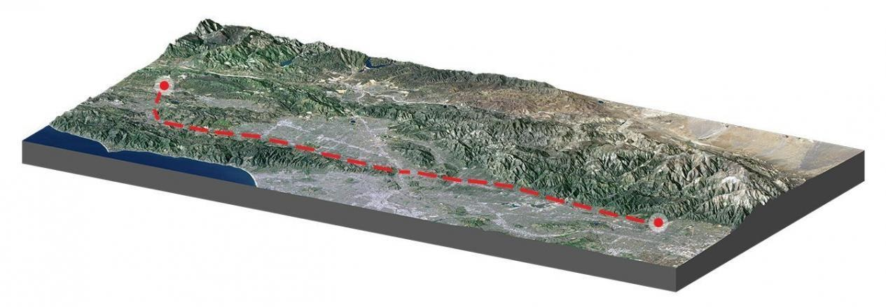

# Least Cost Path Analysis

## Part A — Cost Surfaces and the Cheapest Route

CE 414 Engineering Applications of GIS
Civil & Construction Engineering
Brigham Young University
Dr. Dan Ames

<!-- Tuesday of Week 11. This deck sets up Lab 10, the power line routing model, so keep pointing forward to it: everything here is a piece of that model. The middle of the hour is a hand calculation on a 5 by 5 grid; it is the algorithm, done once by people, before ArcGIS Pro does it on a million cells. -->

<!-- stamp:begin -->
<!-- _footer: 'CE 414 · Week 11 — Least Cost Path Analysis, Part ALast Updated: 2026-10-28© 2026 Daniel P. Ames · <a href="https://creativecommons.org/licenses/by/4.0/">CC BY 4.0</a>' -->
<!-- stamp:end -->

---

# Today's Goals

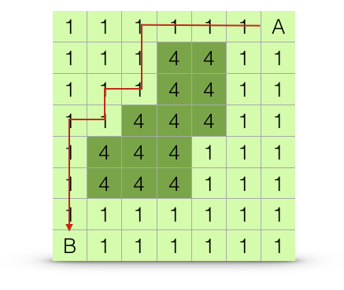

- By the end of class you should be able to:
  - Say what a **cost surface** is, and why it is not a map of distance
  - Build one by reclassifying and combining rasters with **map algebra**
  - Explain what the **accumulated cost** and **back direction** rasters each store
  - Compute an accumulated cost by hand, and trace the cheapest path from a destination back to its source
  - Name the ArcGIS Pro tools that do each step, and their current replacements

<!-- Frame the hour. The whole lecture is one idea repeated at three scales: a cell has a cost, a path is the sum of cell costs, and the cheapest path is not usually the shortest one. -->

---

# What is the shortest path?

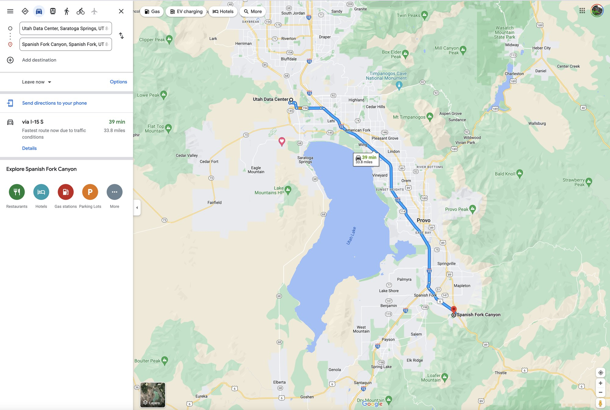

- What is the **"cost"** Google Maps is minimizing here? Distance? Travel time? Traffic?
- This route runs from the **NSA Utah Data Center** in Bluffdale south toward **Spanish Fork Canyon** — the two endpoints of Lab 10
- More on the [Utah Data Center](https://en.wikipedia.org/wiki/Utah_Data_Center) in Bluffdale

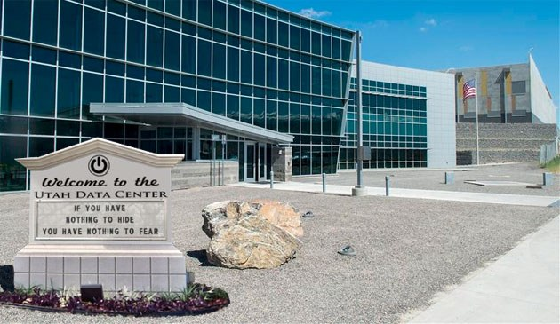

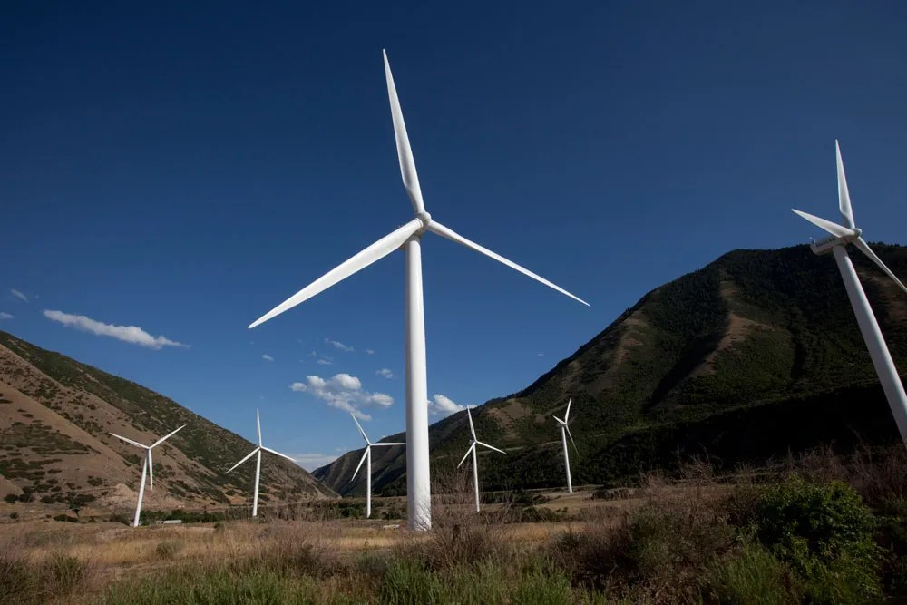

<!-- Open with the question, not the answer. Google Maps is already doing least-cost path analysis; it just hides the cost function. Ask what it is minimizing, and get students to notice that the fastest route and the shortest route are different lines. Then say that in Lab 10 they write the cost function themselves. The two photos are the endpoints of that lab: the data center in Bluffdale and the wind farm at the mouth of Spanish Fork Canyon. -->

---

# Why Least-Cost Path?

- From Esri's documentation (arcgis.com): the least-cost path is **"one cell wide"**, runs **from the destination back to the source**, and is **"guaranteed to be the cheapest route"** in the cost units of the input cost raster
- Three things to hold onto:
  - the answer is a **raster path**, one cell wide, until you convert it
  - it is computed **backward**, destination → source
  - "cheapest" only means anything **relative to the cost raster you built**

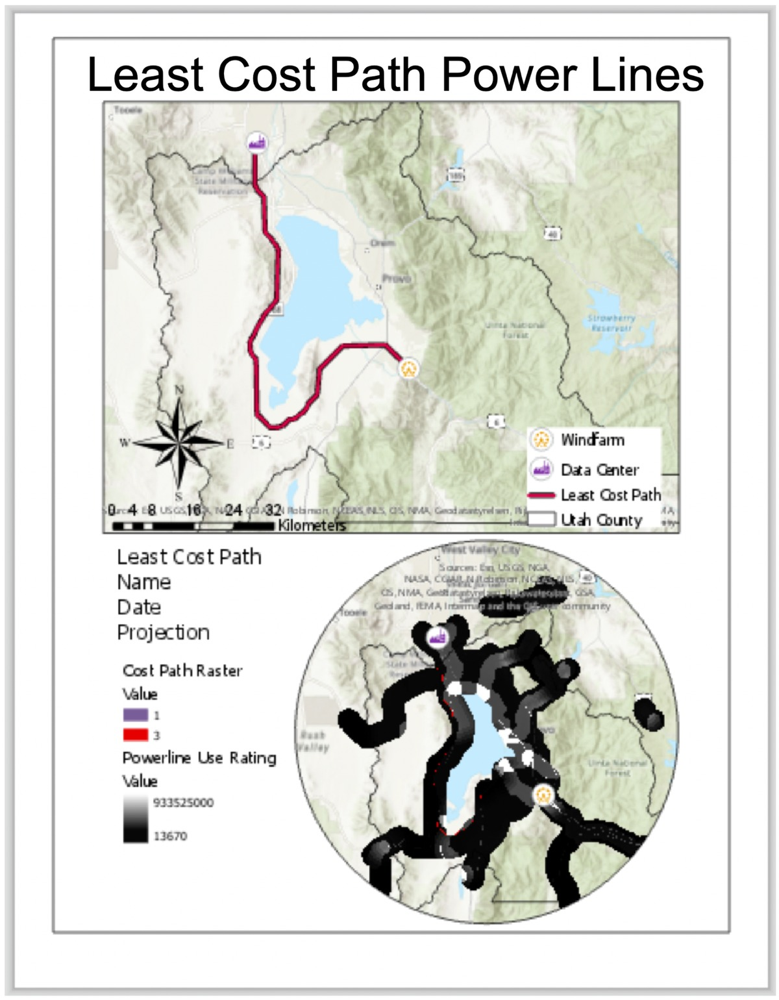

<!-- The quotation is condensed from the arcgis.com wording on the original slide. Emphasize the last bullet: the algorithm is exact, but it is exact about the cost surface you gave it. Garbage weights, confident wrong answer. The map on the right is a student example layout from a previous semester; its text block is still placeholder ("Name / Date / Projection"), which is a good chance to point out that the rubric wants those filled in. -->

---

# General Workflow

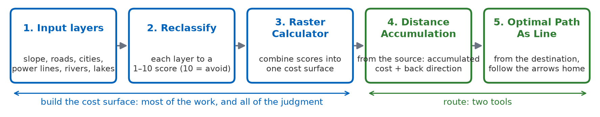

1. Combine your raster data sets into a **"virtual terrain"**, where **high values are undesirable** paths and **low values are desirable** paths
2. Identify a **start point** (source) and an **end point** (destination) for the path of interest
3. Run **Distance Accumulation** to create the **accumulated cost raster** and the **back direction raster**
4. Run **Optimal Path As Line** with those two rasters and the destination: the path, already a **line**

<!-- These are the steps as Lab 10 runs them, with ArcGIS Pro's current tools. The source slide named Cost Distance, Cost Path and a final Raster to Polyline; Optimal Path As Line makes the polyline itself. The legacy names come back on the deprecation slide. The next slide shows the whole Lab 10 model, so students can see how much of it is step 1. -->

<!-- The figure (tools/week11_parta_figures.py) draws the same steps as Lab 10 runs them: three boxes build the cost surface, two route across it. -->

---

# The whole model, end to end

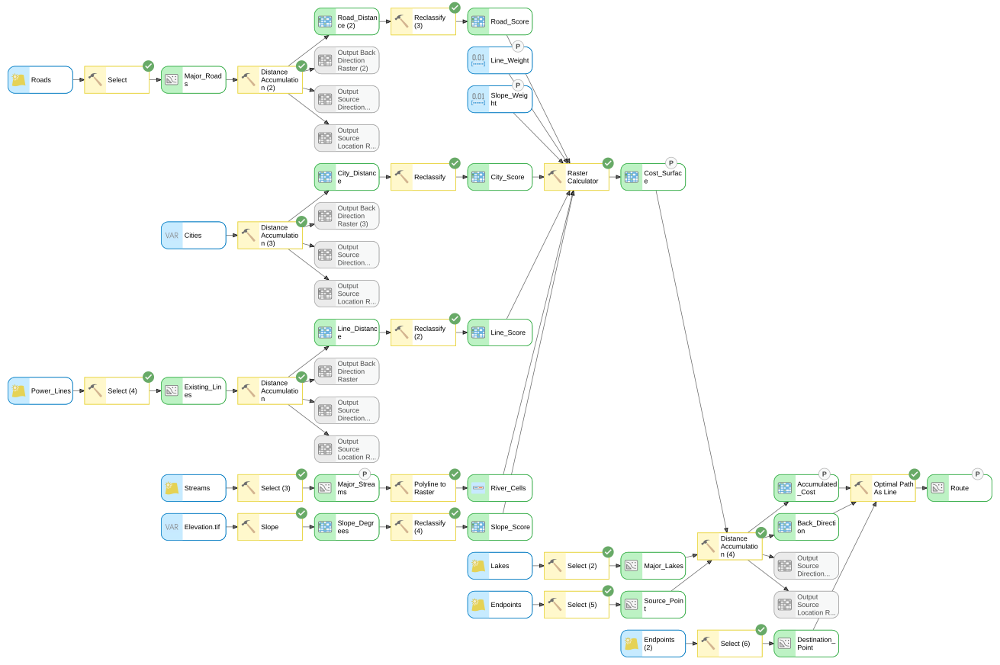

Every green oval is a data set, every yellow box a tool. The routing happens in the last boxes at the bottom right.

<!-- Do not read this diagram. The point is scale: about thirty tools, and only the last two are the least-cost path itself. Everything else prepares the cost surface. Say plainly that this is what Lab 10 asks them to build. The image is Lab 10's Figure C, the model exported from ModelBuilder in the October 9, 2026 build of the lab. -->

---

# Current tool names in ArcGIS Pro

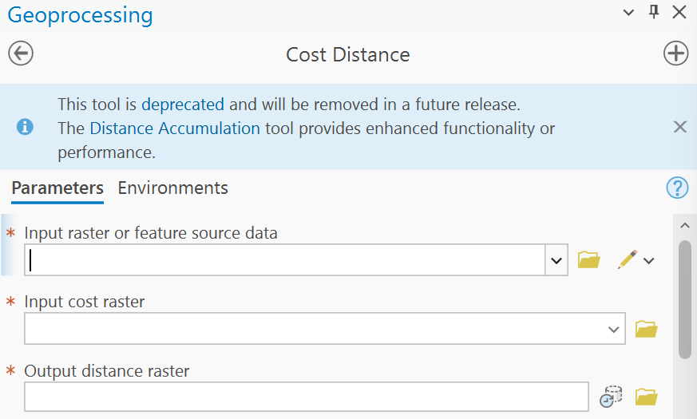

- **Cost Distance**, **Cost Back Link** and **Cost Path** still run, but are **deprecated**
- **Distance Accumulation**: the accumulated cost *and* the back direction raster, in one run
- **Optimal Path As Line**: replaces Cost Path, and draws the line itself
- Lab 10 uses the **current** tools; Thursday compares the two sets on its data

<!-- Lab 10 is built on Distance Accumulation and Optimal Path As Line. On its cost surface the legacy chain gives 58.49 km against 56.09 km, within 788 m everywhere (Thursday's deck). Say this out loud rather than leaving students to discover the deprecation warning in the tool's help. The concepts are identical: accumulated cost plus a back-direction raster, then walk the back-direction raster home. Only the tool names and a few parameter names moved. -->

<!-- The capture is Cost Distance opened in ArcGIS Pro 3.7.1's Geoprocessing pane (October 9, 2026), showing the tool's own deprecation notice; the Thursday deck, least-cost-path-b, shows Distance Accumulation and Optimal Path As Line, and the two tool sets' routes on Lab 10's data (56.09 km and 58.49 km). -->

---

<!-- _class: lead -->

# Step 1: building the cost surface

---

# Combine Rasters into a "Virtual Terrain"

- Every data set has to be **converted to raster** first
- **Reclassify** so that **high values represent the least desirable** cells to cross
- Combine them with **map algebra** in the **Raster Calculator** — add, multiply, or weight and add
- This "virtual terrain" is properly called a **cost surface**

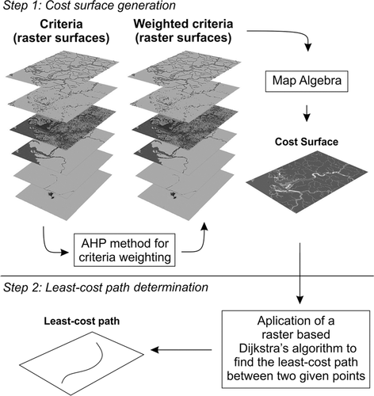

de Lima et al. (2016), <i>IET Generation, Transmission &amp; Distribution</i>, <a href="https://doi.org/10.1049/iet-gtd.2016.1119">doi:10.1049/iet-gtd.2016.1119</a>

<!-- Two steps in the figure: cost surface generation on top, least-cost path determination below. The AHP box is one way to pick criteria weights; students are not required to use it in Lab 10, but it answers the question "where do the weights come from?" Stress that all the inputs must share a projected coordinate system, cell size, and extent before the Raster Calculator will give a sensible answer. -->

---

# Why "Virtual Terrain"?

- The simplest cost raster you could use is a **DEM**
- The result then follows the **lowest and flattest** route from start to end

<a href="https://gisgeography.com/least-cost-path-analysis/">gisgeography.com/least-cost-path-analysis/</a>

<!-- Start with the case where the metaphor is literal: the cost surface is real terrain, and the path is what water or a road would do. This is why the cost surface gets called a virtual terrain even when the values are not elevation. -->

---

# The values do not have to be elevation

- Any number that represents the **cost of crossing a cell** will do
- Here the dark cells cost **4** and the light cells cost **1**
- The straight line from **A** to **B** is short but expensive; the stepped red path is longer and **cheaper**
- That is the whole idea: **shortest ≠ cheapest**

dyerlab.github.io/applied_population_genetics

<!-- Walk one path by hand. Count the cells along the straight line and multiply by their costs, then count the cells along the red path. It is worth doing the arithmetic on the board once; after that the algorithm is obvious. Also point out that diagonal moves cost more than orthogonal ones, by a factor of about the square root of 2, which is why the red path is stepped. -->

---

<!-- _class: activity -->

# Your Turn: The Cheapest Path by Hand

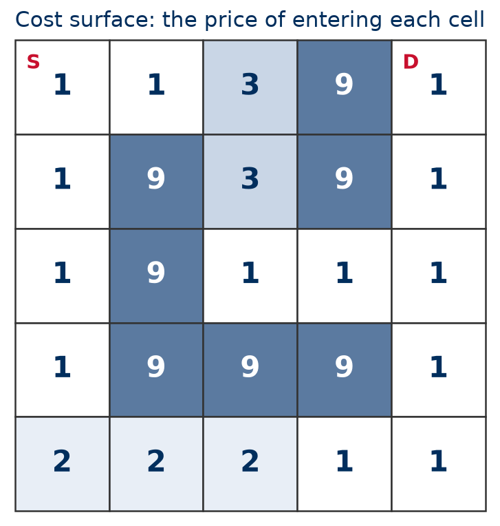

Each number is the **cost of entering** that cell. Start at **S**.

1. Moves go **up, down, left or right** only
2. For each cell, write the **cheapest total** to reach it from S
3. Then find the cheapest path to **D**, and its total

Is it the straight line across the top?

<!-- Pairs, five to eight minutes, on paper. The rule they need: a cell's total is the smallest (neighbor's total + this cell's cost) over its four neighbors; work outward from S and keep updating until nothing changes. The straight line across the top costs 1 + 3 + 9 + 1 = 14. Do not give the answer away: the next slide has it. Four neighbors and cost-of-entering is a simplification for hand work; ArcGIS Pro also moves diagonally (about 1.414 times the cost), and Thursday shows exactly how it charges a move. -->

---

# Check Your Work

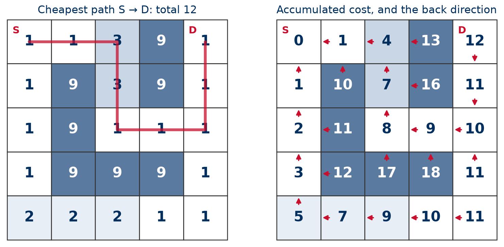

The cheapest path costs **12**, through the 3s and the middle row; the straight line across the top costs **14**.

<!-- Left: the path. Right: every cell's accumulated cost, and an arrow pointing to the neighbor its cheapest total came from. Start at D (12) and follow the arrows: 12, 11, 10, 9, 8, 7, 4, 1, 0. That walk is exactly what Optimal Path As Line does. The path is unique (the script checks), and it takes eight moves against the straight line's four, and is still cheaper. Solved exactly in tools/week11_parta_figures.py; numbers in tools/week11_parta_numbers.json. -->

---

# What You Just Built

- The right-hand grid is the **accumulated cost raster**: the cheapest total from S to every cell
- The arrows are the **back direction raster**: which neighbor that total came from
- ArcGIS Pro's **Distance Accumulation** makes both, from the source
- **Optimal Path As Line** starts at D and follows the arrows home
- You needed **every** cell's total to be sure of D's

<!-- The point of the exercise: the algorithm is not clever, it is thorough. It prices every cell in the raster from the source, which is why Distance Accumulation is the slowest step in Lab 10's model. -->

---

<!-- _class: lead -->

# Step 2: accumulated cost, back direction, and the path

---

# Accumulated Cost and Back Direction, on Lab 10

- **Accumulated cost**: for every cell, the **cheapest total cost of reaching it from the source**
- **Back direction**: for every cell, **which way to step** on the way home to the source; Distance Accumulation stores it as a compass angle (Thursday)
- **Optimal Path As Line** starts at the destination and follows the back direction until it reaches the source
- That is why the path is computed **backward**

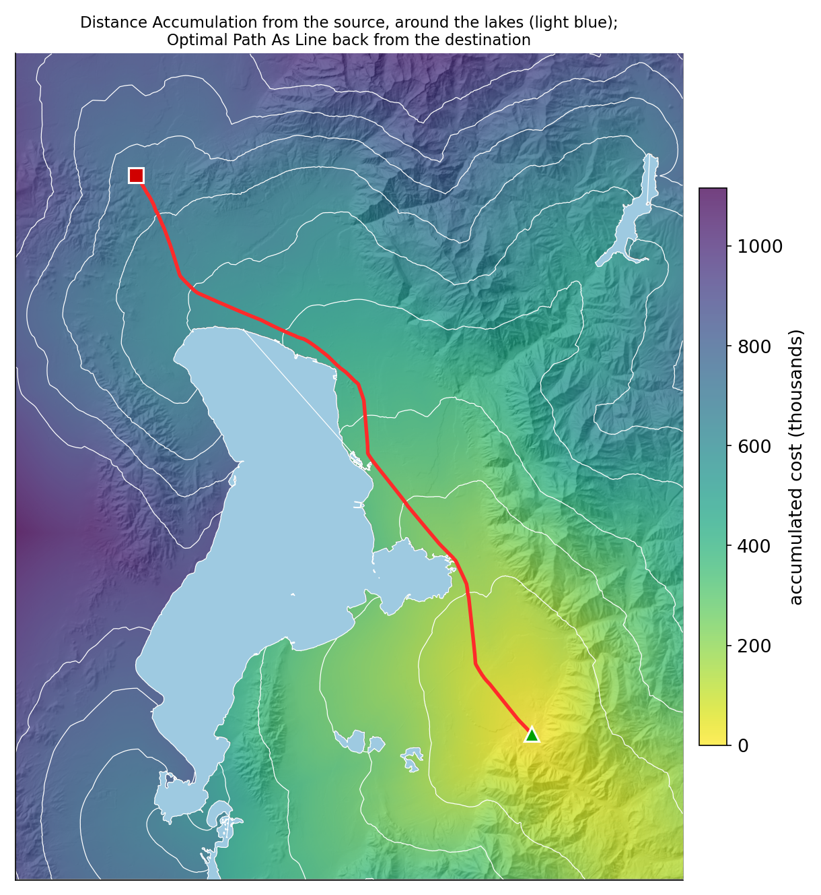

<!-- The same two rasters as the hand grid, on Lab 10's real cost surface (the figure is Thursday's, computed from the lab's reference run). Note the shape: the accumulated cost spreads out from the source like a ripple and runs ahead where crossing is cheap. The legacy tools called the second raster "back link" and coded it 0 to 8 by neighbor; Distance Accumulation codes it as an angle. Same idea. -->

---

# Some real-world examples

- **Power lines** — Bagli, Geneletti and Orsi (2011), "Routeing of power lines through least-cost path analysis and multicriteria evaluation to minimise environmental impacts," *Environmental Impact Assessment Review* — [doi:10.1016/j.eiar.2010.10.003](https://doi.org/10.1016/j.eiar.2010.10.003)
- **Ecology** — Balbi et al. (2019), "Ecological relevance of least cost path analysis: An easy implementation method for landscape urban planning," *Journal of Environmental Management* — [doi:10.1016/j.jenvman.2019.04.124](https://doi.org/10.1016/j.jenvman.2019.04.124)
- **Roads** — Atkinson et al. (2005), "Multi-criteria evaluation and least cost path analysis for an arctic all-weather road," *Applied Geography* — [doi:10.1016/j.apgeog.2005.08.001](https://doi.org/10.1016/j.apgeog.2005.08.001)
- In every one of them, the hard part is **not the algorithm** — it is deciding what a cell should cost

<!-- Three published applications, all using the same two rasters. Use them to make the point that the engineering judgment lives entirely in the cost surface. Ask what a cell should cost near a school, a wetland, or a scenic corridor, and let the disagreement stand. -->

---

<!-- _class: activity -->

# Next: Lab 10, power line routing

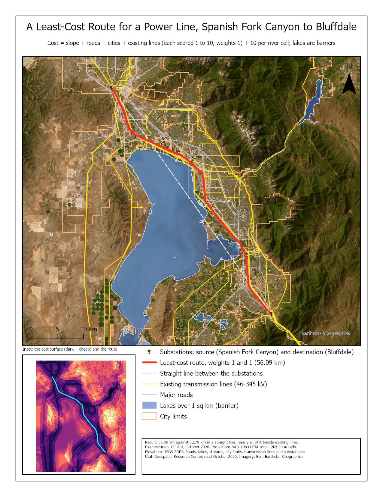

- Route a high-voltage line between two **existing substations**: Spanish Fork Canyon to Bluffdale
- You build the cost surface yourself from **slope, roads, cities, existing power lines and rivers**, each scored 1 to 10, with **lakes** as barriers
- Then the two-tool routing you just saw: **Distance Accumulation** and **Optimal Path As Line**
- The whole thing lives in **one ModelBuilder model** so you can change a weight and re-run it

<!-- Preview the lab; the map is Lab 10's example baseline layout. The reason it is a model and not a sequence of clicks is that the weights are arguable, and a model lets them re-run the analysis after changing one. Encourage students to run at least one alternative weighting and look at how far the path moves. -->

---

<!-- _class: activity -->

# Final Thoughts

**Quiz: Cheapest or Shortest?** Five questions on what a **cost surface** stores, and why the cheapest line is not the shortest. **Scan the code**, or open the link under it.

- A quick check that today's material made sense
- Watch the reclassification sign in Lab 10: **high means undesirable**

**Before next class**

- **Lab 10 — Least Cost Path Power Line Analysis** uses today's tools, due **Saturday 11:59 pm**: [assignments/lab-10](https://byu-hydroinformatics.github.io/ce414-gis-applications/assignments/lab-10/)
- Take **Quiz 9** (Least Cost Paths, open book) on **Learning Suite** — due **Saturday 11:59 pm**
- Questions? Office hours: [calendly.com/dan-ames/office-hours](https://calendly.com/dan-ames/office-hours)

byu-hydroinformatics.github.io/ce414-gis-applications/quizzes/least-cost-path/

<!-- Four to five minutes, in pairs, then a show of hands on the item that splits the room every
     time: what a single cell of the cost surface actually stores. Half the class picks "the total
     cost of the cheapest route to that cell", because that is the raster they just watched get
     built - so name the difference out loud. A cell of the cost surface is a price for crossing
     that one cell; the accumulated cost raster is the running total of the cheapest way to reach
     it. Everything else in the hour hangs off that distinction. If the room has no signal, put the URL on the board; the items read aloud just as
     well. -->

<!-- Revision notes (2026-10-21): built from the September 3 conversion of "CE 414 Week 11 - Least Cost Path Analysis.pptx" and its October 9 realignment with Lab 10. Added a hand calculation (a 5 x 5 grid solved exactly, with a unique cheapest path of 12 against 14 for the straight line) and a slide tying it to Distance Accumulation and Optimal Path As Line; the workflow slide has a computed schematic; the ArcMap-era scanned figure is replaced by Lab 10's accumulated cost raster (file deleted); the three application papers have full citations checked against Crossref; the Utah Data Center link went to a parody site and now goes to Wikipedia; "back link" is "back direction" except where the legacy tools are meant. Figures: tools/week11_parta_figures.py. -->
