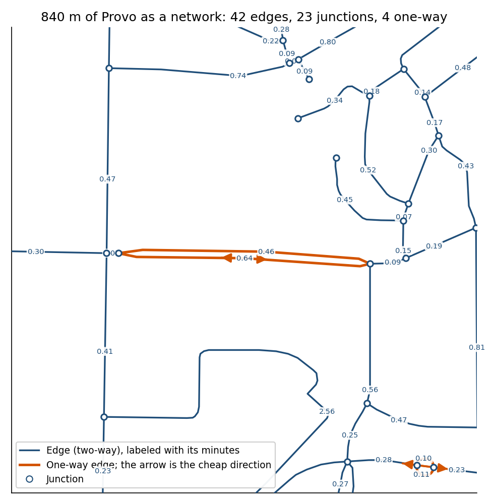
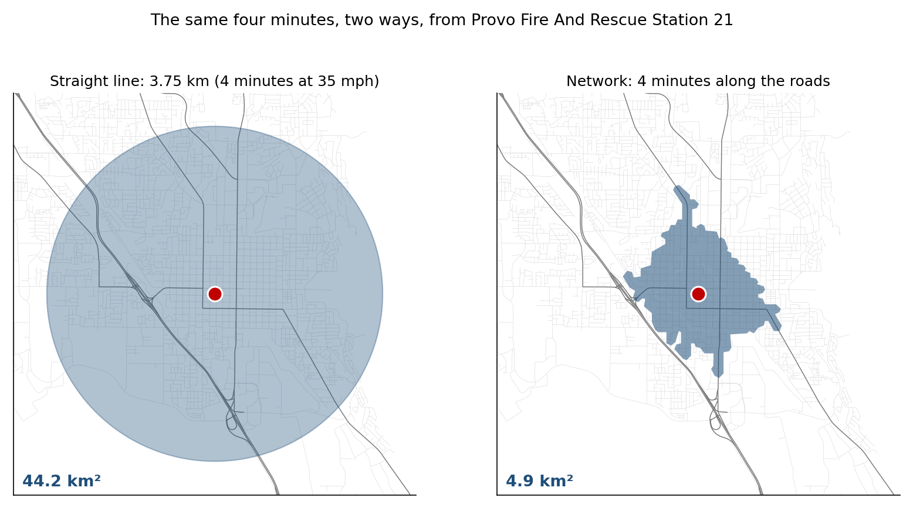
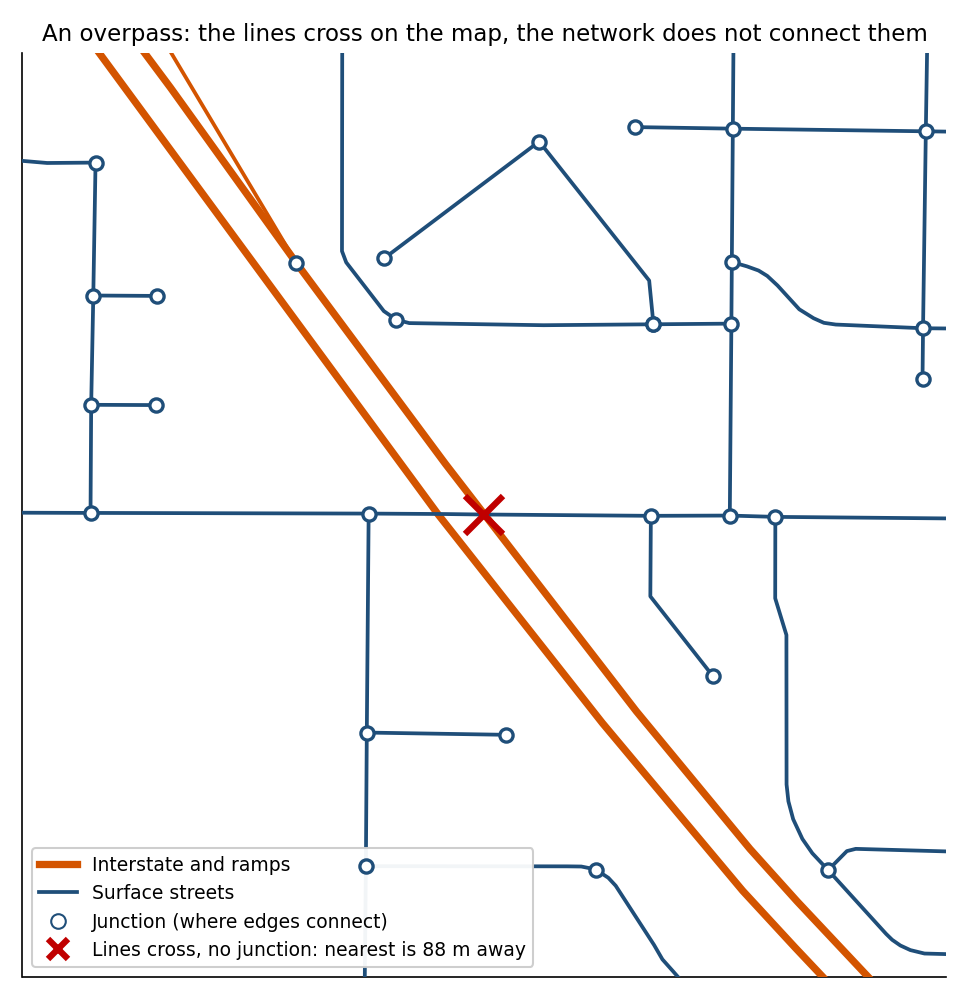
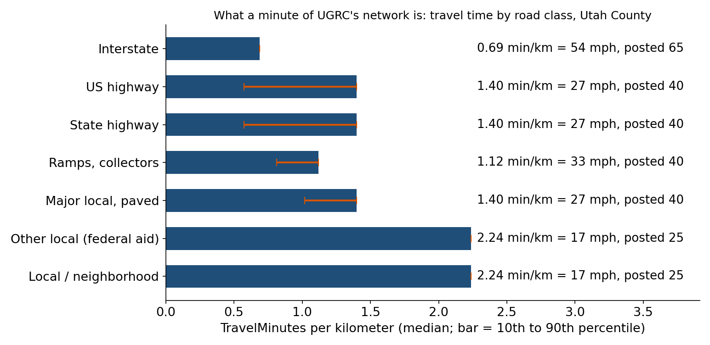
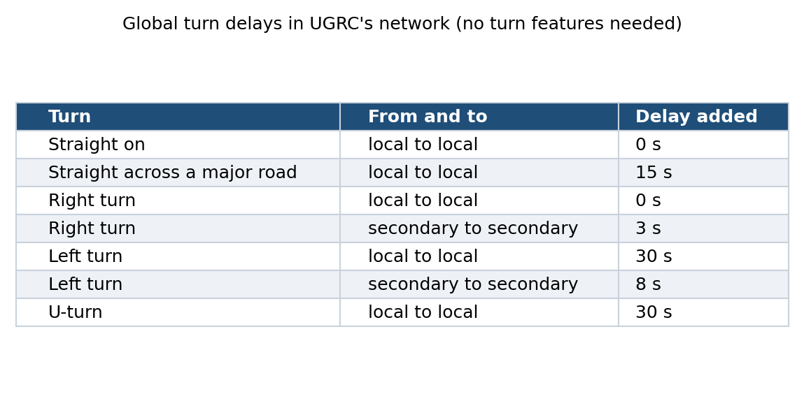
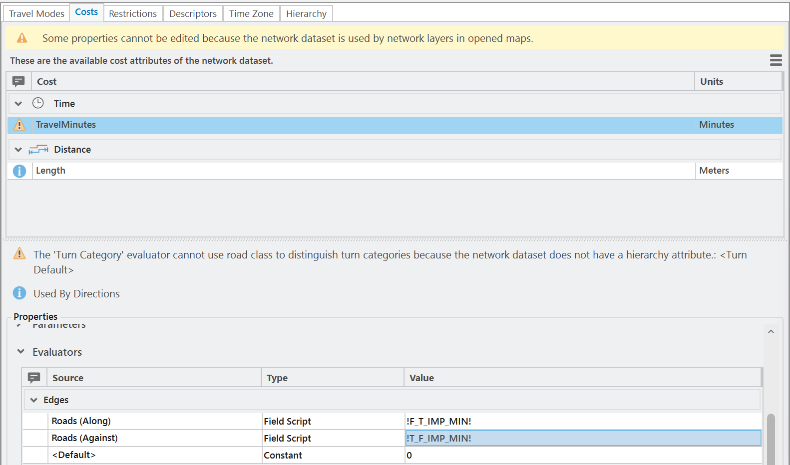

<!-- _class: lead -->
<!-- _paginate: skip -->

# Network Analysis

## Part A — Distance Along the Roads

CE 414 Engineering Applications of GIS
Civil & Construction Engineering
Brigham Young University
Dr. Dan Ames

<!-- Tuesday of Week 12, the last new topic of the course, two weeks before Midterm 2. The course has measured distance twice: as a buffer in Lab 1 and as accumulated cost across a raster in Lab 10. Today is the third way, along a road network, and it sets up Thursday's three solvers and Lab 11. Every map and number here comes from Lab 11's own data (UGRC's prebuilt Utah Street Network clipped to Utah County, the 42 fire stations, the 2020 Census blocks) and reference run, drawn by tools/week12_network_figures.py; the numbers are in tools/week12_network_numbers.json. No tool captures yet: the Network Dataset Properties capture is owed to the Lab 11 GUI build. -->

<!-- stamp:begin -->
<!-- _footer: 'CE 414 · Week 12 — Network Analysis, Part ALast Updated: 2026-10-28© 2026 Daniel P. Ames · <a href="https://creativecommons.org/licenses/by/4.0/">CC BY 4.0</a>' -->
<!-- stamp:end -->

---

# Today's Goals

By the end of class you should be able to:

- Say what a **network dataset** is made of: **edges**, **junctions**, **connectivity**
- Explain what an **impedance** is, and why minutes and meters give **different routes**
- Describe how **one-way streets** and **turns** enter a network, as costs or as walls
- Place network distance beside **straight-line** and **cost distance**, and say which fits a fire engine

<!-- The right-hand figure is 840 m of Provo as the network sees it: every edge labeled with its minutes, every junction a circle, the one-way edges in orange. By the end of the hour every element of it should mean something. -->

---

# Three Ways to Measure Distance

| Lab | Distance | Moves |
| --- | --- | --- |
| **1** | **Straight-line** | any direction, all at once |
| **10** | **Cost distance** | cell to cell, at a price |
| **11** | **Network distance** | along the roads only |

- The **same four minutes** from one Provo station: a 3.75 km circle covers **44 km²**; the roads reach **4.9 km²**
- Each fits its mover: a power line crosses country, an engine does not

<!-- The circle is four minutes at 35 mph in every direction, which is what a Lab 1 buffer would say. The blue shape is four minutes of driving along UGRC's network, at its typical-traffic minutes, from Provo Fire and Rescue Station 21. Nine times the area. Thursday puts a number on that for the whole county. The point to make now: none of the three is "the" distance; each models a different way of moving, and the question picks the model. -->

---

<!-- _class: lead -->

# Part 1 — What a Network Dataset Is Made Of

---

# Edges and Junctions

- An **edge** is a road segment with a **cost** to travel it
- A **junction** is where edges **meet**; a route can only turn at a junction
- The edge's cost here is **minutes**: 0.10 for a short block, 0.55 for a long one
- A network is a **graph**: the geometry draws the map, the graph does the routing

<!-- Lab 11's network, zoomed to about 840 m of Provo streets. Each label is the segment's TravelMinutes (the cheaper direction where they differ). The white circles are the junctions ArcGIS Pro built where segment endpoints coincide. The orange edges are one-way; the arrow shows the direction that costs the normal minutes. Ask: how many ways can you leave the junction in the middle? As many as it has edges, and only those. -->

---

# Connectivity Lives in the Junctions

- Two lines **cross on the map**: an interstate over a street
- No **junction** where they cross, so the network **does not connect them**
- Right for an overpass; a disaster at a real intersection that was digitized without a junction
- UGRC's rule: local streets connect only at their **endpoints**; freeways and ramps connect at **any vertex**, in one group

<!-- The red X is a place west of Provo where I-15 crosses a surface street; the nearest junction is 88 m away, at the ramp. Connectivity is set per subtype of the Roads class in UGRC's template: subtype 1 (limited access and ramps) any-vertex, subtype 2 (everything else) end-vertex, both in one connectivity group. There is no elevation field in this network, so an overpass is "connected" only because its endpoints do not touch the street's. The lesson for any network you build: the junctions are the model; a segment that stops 2 m short of the one it should meet is a wall. -->

---

# Impedance: the Cost of an Edge

- An **impedance** is whatever you choose to **minimize**: meters, minutes, dollars, calories
- UGRC's **TravelMinutes**: the segment's length over its posted speed, with surface streets **× 1.5** for signals and congestion
- A local street at a posted 25 mph comes out at **17 mph**; an interstate posted 65 at **54**
- The network carries a second cost, **Length**, in meters

<!-- Medians of TravelMinutes per kilometer by CARTOCODE class over Utah County's 41,460 edges (tools/week12_network_numbers.json, "impedance"). Local and neighborhood streets: 2.24 min/km, which is 27 km/h or 17 mph, against a posted 25: the 1.5 factor. Interstates: 0.69 min/km, 54 mph against 65. UGRC's page calls the method "relatively crude, though effective." That is the right spirit: an impedance is a model, and it is only as good as the decision behind it. The 1.5 factor is the thing to argue about on Thursday, when a fire engine's own speed comes up. -->

---

# One-Way Streets: a Wall or a Price

- Every edge has a cost **in each direction**: `F_T_IMP_MIN` along the way it was digitized, `T_F_IMP_MIN` against
- A **restriction** attribute makes the wrong direction **impassable**
- UGRC chose a **cost** instead: the wrong direction is **100 times** the right one
- On Lab 11's longest one-way I-15 segment: **3.04** minutes northbound, **304** the other way

<!-- The two directional fields are the evaluators of TravelMinutes in UGRC's template. 590 of Utah County's edges are one-way (ONEWAY = 1 or 2). A hundredfold cost means a solver goes the wrong way only when nothing else reaches at all, which is a defensible model of an engine with its lights on. A restriction would make it impossible. Both are modeling decisions, and Lab 11's Step 1 has students read the two numbers off I-15 themselves. -->

---

# Turns Cost Time Too

<!-- UGRC's network has no turn features, but it carries global turn delays, read from the network template: a left turn from a local street onto a local street adds 30 seconds, a right turn nothing, crossing a major road straight ahead 15 seconds. This is why a fastest route avoids left turns across arterials, and it is one more reason the network's four minutes reach less than a circle's. A network built from raw roads without these has every turn free. Skip if time is short. -->

---

<!-- _class: quiz -->

# Predict First

Lab 11's network carries two costs, **TravelMinutes** and **Length**. You route an engine from a Provo station to a Census block **8 km** away, once minimizing each. What happens?

<ol type="A">
<li>The two routes are the same roads, since the roads are the roads</li>
<li>The fewest-meters route is shorter and slower; the fewest-minutes route is longer and faster</li>
<li>The fewest-minutes route is also the shortest, since fast roads are straight</li>
<li>Neither can be solved: a network has one cost</li>
</ol>

<!-- Ninety seconds, a show of hands. A is the common answer: people picture one road to a place. The answer is B, and the next slide is the measurement. D is the misconception that a network dataset carries one cost; this one carries two, and a travel mode picks which one the solver minimizes. -->

---

# Shortest Is Not Fastest

- Same two points, same network, two impedances
- **Fewest meters**: **9.9 km** through the city grid, **23.4 minutes** at local speeds and turns
- **Fewest minutes**: **15.3 km** down I-15, **15.1 minutes**
- The fast route is **55 % longer** and **8 minutes quicker**
- A fire engine's standard is written in **minutes**, so Lab 11 minimizes minutes

<!-- Solved with Make Route Analysis Layer on Lab 11's network (tools/week12_network_numbers.json, "route"): from Provo Fire and Rescue Station 21 to a populated block 8.1 km away in a straight line. The green route minimizes Length: 9,878 m, and at TravelMinutes it would take 23.37 minutes. The orange route minimizes TravelMinutes: 15,315 m in 15.14 minutes. Nothing about the roads changed; only the question. This is the whole idea of an impedance in one picture. -->

---

<!-- _class: lead -->

# Part 2 — Where Lab 11's Network Came From

---

# How UGRC Built It

1. **Sources**: the Roads feature class, one subtype for freeways and ramps, one for everything else
2. **Connectivity**: end-vertex for streets, any-vertex for ramps, one group
3. **Elevation**: none, so overpasses rely on endpoints not touching
4. **Attributes**: `TravelMinutes` (default) and `Length`, each with an **evaluator** per direction reading a field
5. **Turns**: global delays by turn type and road class
6. **Build**: ArcGIS Pro walks every segment and writes the junctions

<!-- This is the Catalog pane's network dataset wizard, as UGRC filled it in; it is why Lab 11 ships the network already built. Lab 11's package was made by exporting UGRC's definition as a template, clipping the roads to Utah County, creating the network from the template and building it, so the costs are UGRC's, unchanged. Students see the result in Network Dataset Properties in Step 1. If a student asks "could I build one from a shapefile of roads": yes, and the deck's six steps are the six decisions they would have to make. -->

---

# What Lab 11 Hands You

- **Network Dataset Properties** ▸ **Travel Attributes** ▸ **Costs**: `TravelMinutes` in minutes, `Length` in meters
- Each cost is read from a field **along** and **against** the digitized direction

<!-- Lab 11's Figure 1b, from the GUI build (ArcGIS Pro 3.7.1): the clipped network's properties, which Step 1 of the lab has students open. Two costs, no travel modes, no hierarchy (hence the yellow note about turn categories). The evaluators are the point: a one-way street costs its normal minutes along and 100 times that against, which is how UGRC encodes one-way without a restriction. Skippable if time is short; it is on the lab page. -->

---

# What This Network Does Not Know

- The **time of day**: TravelMinutes is one number, for typical traffic
- That a fire engine drives with **lights and siren**: UGRC says its times are "not the expedited travel of emergency response vehicles"
- **Turnout**: the clock in NFPA 1710 starts when the engine moves, not when the call comes in
- Anything **newer than its sources**: the stations layer says September 2022

<!-- Every one of these is a decision a student can defend or attack in Lab 11's Step 9. The travel-time quote is from UGRC's Fire Station Travel Times service description; NFPA 1710's 240-second first-engine travel time is the standard Lab 11 uses as its baseline cutoff. The deck does not quote the lab's hidden sensitivity numbers; the students find them. -->

---

<!-- _class: activity -->

# Next: Lab 11, Fire Response Coverage

- Utah County's **42 fire stations**, UGRC's **network**, the **2020 Census blocks**
- **Who lives more than four minutes' drive from a station?** Along the roads, at UGRC's minutes
- One ModelBuilder model: a **service area**, a count of people outside, and the same four minutes as a **buffer** for comparison
- **Your own cutoff** = 4 + 0.04 × the last two digits of your BYU ID

[Lab 11 — Fire Response Coverage](https://byu-hydroinformatics.github.io/ce414-gis-applications/assignments/lab-11/)

<!-- The example map is the lab's own Figure 9. Thursday walks through the three solvers and then the lab's model live. The lab is due Saturday, and everything that takes preparation is hosted. -->

---

<!-- _class: activity -->

# Final Thoughts

**Quiz: Along the Roads.** Five questions on junctions and connectivity, one-way streets as a cost, two impedances, UGRC's 1.5 factor, and which distance belongs to a fire engine. **Scan the code**, or open the link under it.

- A quick check that today's material made sense
- Thursday builds on the two-impedance question

**Before next class**

- **Lab 11 — Fire Response Coverage** — due **Saturday 11:59 pm**: [assignments/lab-11](https://byu-hydroinformatics.github.io/ce414-gis-applications/assignments/lab-11/)
- Thursday: service areas, closest facility, location-allocation, and Lab 11's model in ArcGIS Pro
- Office hours: [calendly.com/dan-ames/office-hours](https://calendly.com/dan-ames/office-hours)

byu-hydroinformatics.github.io/ce414-gis-applications/quizzes/networks/

<!-- Four minutes, in pairs. If the room has no signal, put the URL on the board. -->

<!-- Deck written October 10, 2026, new for the course (no source PowerPoint). Figures and numbers: tools/week12_network_figures.py from Lab 11's package and reference run (tools/lab11/). Network facts (connectivity by subtype, evaluators, global turn delays, no elevation model) are read from UGRC's network template, tools/lab11/ugrc_network_template.xml. Owed: a real capture of Network Dataset Properties from the Lab 11 GUI build. -->
