<!-- _class: lead -->
<!-- _paginate: skip -->

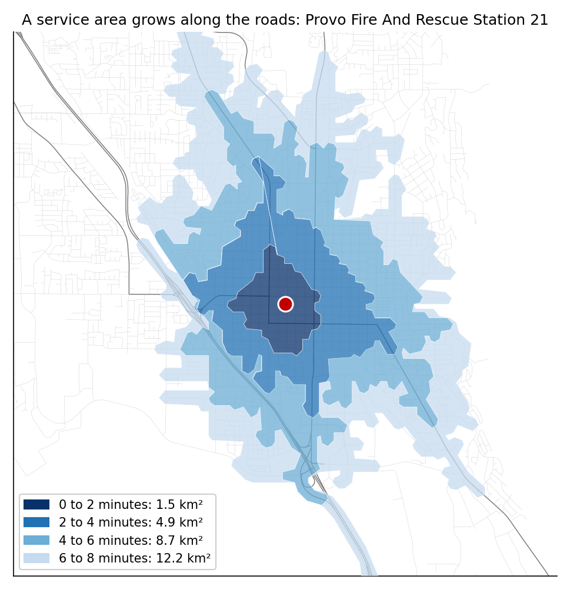

# Network Analysis

## Part A — Distance Along the Roads, and the Service Area

CE 414 Engineering Applications of GIS
Civil & Construction Engineering
Brigham Young University
Dr. Dan Ames

<!-- Tuesday of Week 12, the last new topic of the course, two weeks before Midterm 2. The course has measured distance twice: as a buffer in Lab 1 and as accumulated cost across a raster in Lab 10. Today is the third way, along a road network: what a network is made of, how its costs work, and the first solver, the service area, with its three tools. Thursday adds closest facility and location-allocation and then builds Lab 11's model. Every map and number here comes from Lab 11's own data (UGRC's prebuilt Utah Street Network clipped to Utah County, the 42 fire stations, the 2020 Census blocks) and reference run, drawn by tools/week12_network_figures.py; the numbers are in tools/week12_network_numbers.json. Redivided November 16, 2026: service areas and their tools moved here from Thursday, and "What This Network Does Not Know" moved to Thursday. -->

<!-- stamp:begin -->
<!-- _footer: 'CE 414 · Week 12 — Network Analysis, Part ALast Updated: 2026-10-28© 2026 Daniel P. Ames · <a href="https://creativecommons.org/licenses/by/4.0/">CC BY 4.0</a>' -->
<!-- stamp:end -->

---

# One More Lab After This One

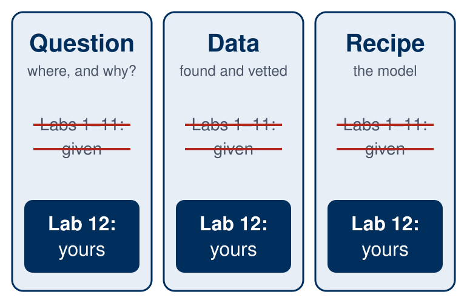

- **Lab 11** this week is the **last lab with a recipe**: the question, the data and the steps are handed to you
- After it, one more: **Lab 12, Choose Your Own Adventure**
- **Your** question, **your** data, **your** ModelBuilder model, and a five-minute **training video** that teaches it
- Due **Thursday of Week 15**, the last day of classes
- Full details **next Tuesday, November 24**. Until then, notice the questions you would like a map to answer

<!-- Set the stage for the finish line: one lab with a recipe, then one where the students write the recipe. The figure is the Week 13 deck's own: every lab so far handed over the question, the data and the recipe, and Lab 12 takes all three away. Keep it short; the Week 13 deck carries the requirements and the scoring (individual, 100 points, an unlisted YouTube video, a PDF report and an ArcGIS Pro project package). The lab page is live now for anyone who wants to read ahead: assignments/lab-12. Thursday of Week 13 is Thanksgiving. -->

---

# This Week's Lab Goal

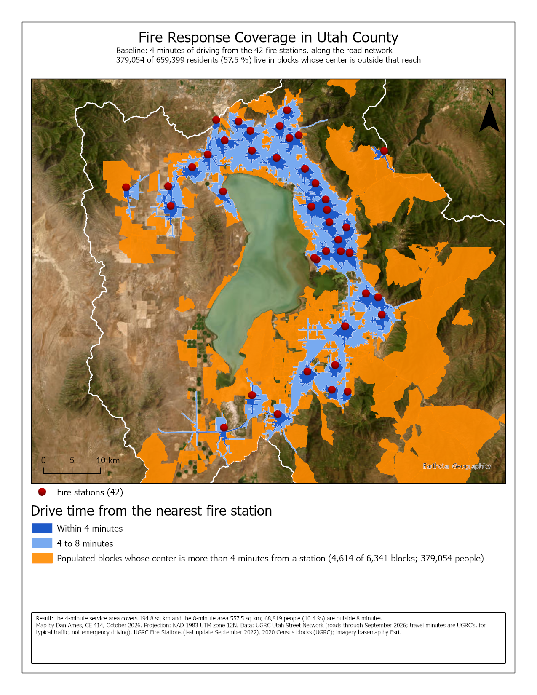

**Lab 11, Fire Response Coverage:** *who in Utah County lives more than **four minutes' drive** from a fire station?*

- Build **one ModelBuilder model**: a **service area** around all 42 stations, then a **count of the people** outside it
- Measure the same four minutes as a **buffer**, and compare the answers
- Run it again at **your own cutoff**
- Due **Saturday**: two maps, one table, the report and `Lab11.atbx` · [the lab page](https://byu-hydroinformatics.github.io/ce414-gis-applications/assignments/lab-11/)

<!-- Say the goal before any of the theory, so every slide today has somewhere to land. The map is the lab's own Figure 9. Everything today is a piece of this model: the network (Part 1), its costs (Part 2), and the service area and its three tools (Part 3). Thursday finishes the model: from polygons to people, the buffer comparison, and the cutoff. Each student's cutoff is 4 + 0.04 x the last two digits of their BYU ID. -->

---

# Today's Goals

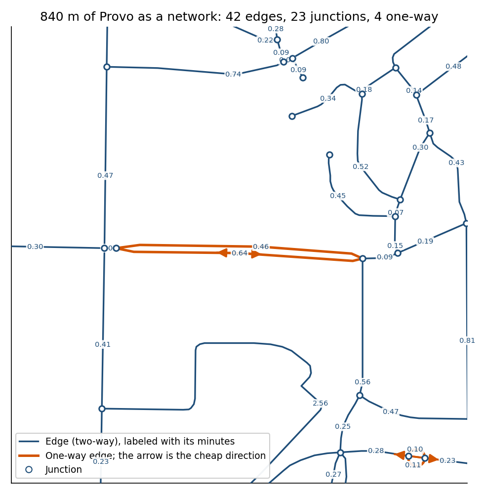

By the end of class you should be able to:

- Say what a **network dataset** is made of: **edges**, **junctions**, **connectivity**
- Explain what an **impedance** is, and why minutes and meters give **different routes**
- Describe how **one-way streets** and **turns** enter a network, as costs or as walls
- Run a **service area** in ArcGIS Pro: the analysis layer, **Add Locations**, **Solve**

<!-- The right-hand figure is 840 m of Provo as the network sees it: every edge labeled with its minutes, every junction a circle, the one-way edges in orange. By the end of the hour every element of it should mean something, and the last part of the hour spreads four minutes outward through it from a station. -->

---

# Three Ways to Measure Distance

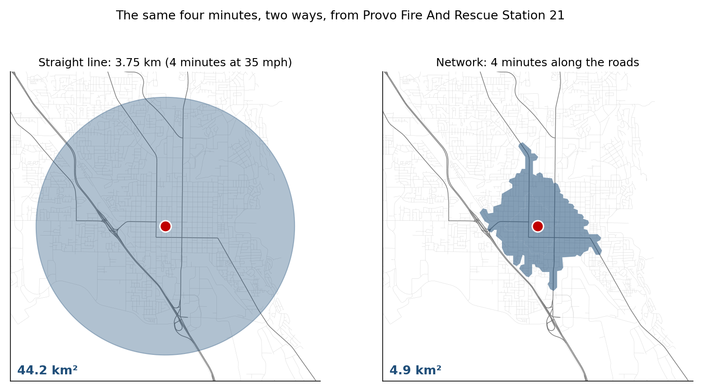

| Lab | Distance | Moves |
| --- | --- | --- |
| **1** | **Straight-line** | any direction, all at once |
| **10** | **Cost distance** | cell to cell, at a price |
| **11** | **Network distance** | along the roads only |

- The **same four minutes** from one Provo station: a 3.75 km circle covers **44 km²**; the roads reach **4.9 km²**
- Each fits its mover: a power line crosses country, an engine does not

<!-- The circle is four minutes at 35 mph in every direction, which is what a Lab 1 buffer would say. The blue shape is four minutes of driving along UGRC's network, at its typical-traffic minutes, from Provo Fire and Rescue Station 21. Nine times the area. Thursday puts a number on that for the whole county. The point to make now: none of the three is "the" distance; each models a different way of moving, and the question picks the model. -->

---

<!-- _class: lead -->

# Part 1 — What a Network Dataset Is Made Of

---

# Edges and Junctions

- An **edge** is a road segment with a **cost** to travel it
- A **junction** is where edges **meet**; a route can only turn at a junction
- The edge's cost here is **minutes**: 0.10 for a short block, 0.55 for a long one
- A network is a **graph**: the geometry draws the map, the graph does the routing

<!-- Lab 11's network, zoomed to about 840 m of Provo streets. Each label is the segment's TravelMinutes (the cheaper direction where they differ). The white circles are the junctions ArcGIS Pro built where segment endpoints coincide. The orange edges are one-way; the arrow shows the direction that costs the normal minutes. Ask: how many ways can you leave the junction in the middle? As many as it has edges, and only those. -->

---

# Connectivity Lives in the Junctions

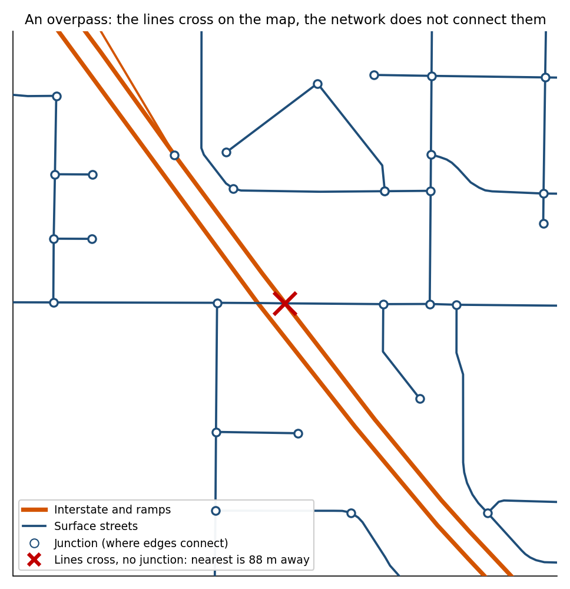

- Two lines **cross on the map**: an interstate over a street
- No **junction** where they cross, so the network **does not connect them**
- Right for an overpass; a disaster at a real intersection that was digitized without a junction
- UGRC's rule: freeways and ramps connect only at their **endpoints**; other streets connect at **any vertex** they share, in one group

<!-- The red X is a place west of Provo where I-15 crosses a surface street; the nearest junction is 88 m away, at the ramp. Connectivity is set per subtype of the Roads class in UGRC's template: subtype 1 (limited access and ramps) end-vertex, subtype 2 (everything else) any-vertex, both in one connectivity group (ConnPolicy 1 and 0 in tools/lab11/ugrc_network_template.xml; Esri's enum is 0 = any vertex, 1 = end vertex). There is no elevation field in this network, so I-15 stays off the street below only because a freeway segment connects at its own ends, and it has no end there. The lesson for any network you build: the junctions are the model; a segment that stops 2 m short of the one it should meet is a wall. -->

---

# Impedance: the Cost of an Edge

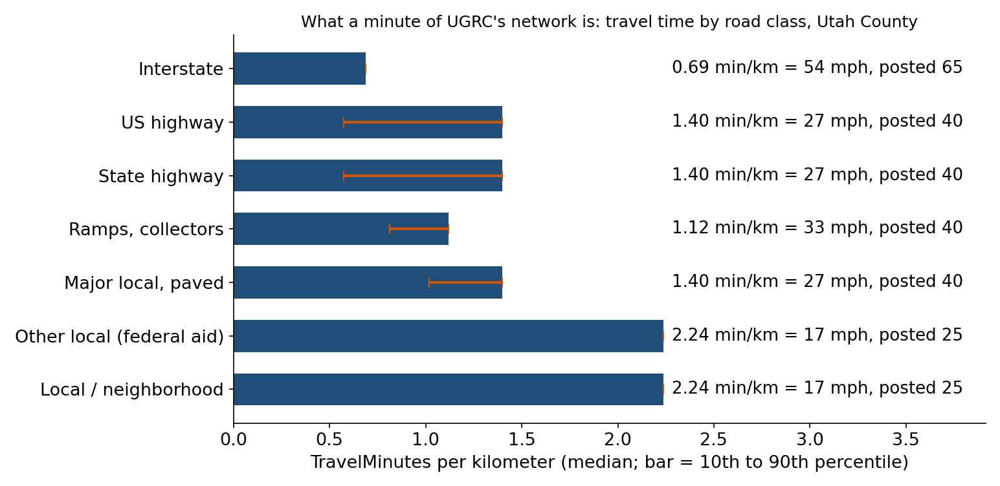

- An **impedance** is whatever you choose to **minimize**: meters, minutes, dollars, calories
- UGRC's **TravelMinutes**: the segment length divided by the posted speed and converted to minutes, with surface streets **× 1.5** for signals and congestion
- A local street at a posted 25 mph comes out at **17 mph**; an interstate posted 65 at **54**
- The network carries a second cost, **Length**, in meters

<!-- Medians of TravelMinutes per kilometer by CARTOCODE class over Utah County's 41,460 edges (tools/week12_network_numbers.json, "impedance"). Local and neighborhood streets: 2.24 min/km, which is 27 km/h or 17 mph, against a posted 25: the 1.5 factor. Interstates: 0.69 min/km, 54 mph against 65. UGRC's page calls the method "relatively crude, though effective." That is the right spirit: an impedance is a model, and it is only as good as the decision behind it. The 1.5 factor is the thing to argue about on Thursday, when a fire engine's own speed comes up. -->

---

<!-- _class: quiz -->

# Talk to Your Neighbor

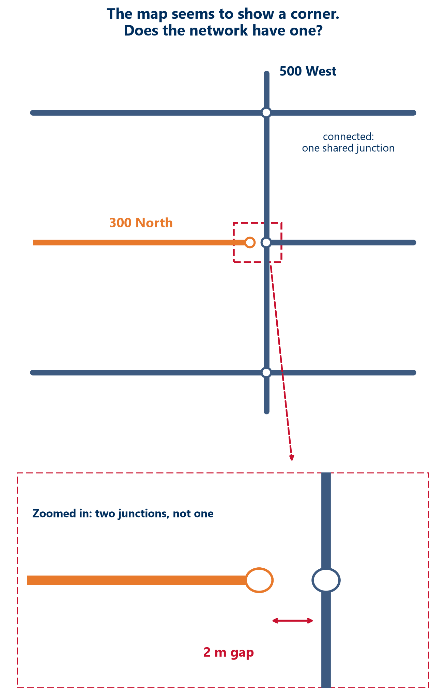

A street segment on 300 North stops **2 m short** of the 500 West segment it should meet. Nothing else touches it there. What does the network do at that corner?

<ol type="A">
<li>Snaps the two together, since 2 m is close enough</li>
<li class="correct">Treats it as a dead end: no route can turn from one street onto the other there</li>
<li>Lets routes cross, but charges a turn delay</li>
<li>Connects them, because they look connected on the map</li>
</ol>

* 

<!-- Two minutes: talk to your neighbor, then a show of hands, then one key press circles the answer. B. Connectivity lives in the junctions, and a junction exists only where the geometry actually meets (an endpoint, or a shared vertex for UGRC's surface streets). A gap of 2 m is a gap; the map draws the corner, the graph does not have it. A and D are the map-reader's intuition; C confuses turns with connectivity. The streets are made up for the question; the figure is drawn by tools/week12_tuesday_figures.py. -->

---

<!-- _class: lead -->

# Part 2 — Direction, Turns, and Lab 11's Network

---

# One-Way Streets: a Wall or a Price

- Each segment stores its minutes **twice**: along (`F_T`) and against (`T_F`) the digitized direction
- The wrong way on a one-way street costs **100 times** the right way: a **price**, not a wall

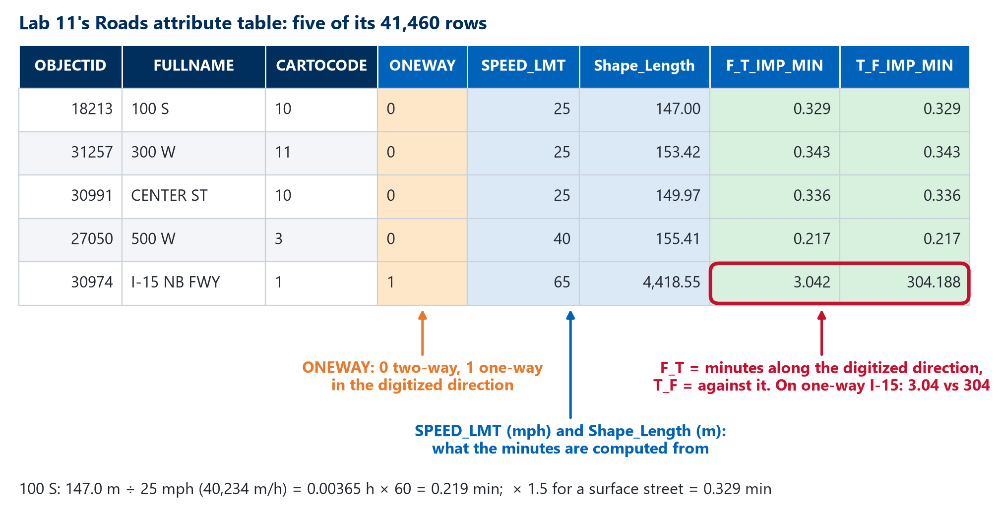

<!-- The table is five real rows of Lab 11's Roads feature class (FireResponse.gdb, Network/Roads), the segments nearest Provo Station 21 plus the longest one-way I-15 segment, drawn by tools/week12_tuesday_figures.py; it is a figure, not a screenshot. Walk it left to right. ONEWAY 0 is two-way, 1 is one-way in the digitized direction (138 segments use 2, one-way against it; 590 of the county's segments are one-way). SPEED_LMT and Shape_Length are what the minutes come from: the bottom line works 100 S through, 147.0 m divided by 25 mph and converted to minutes is 0.219, and the 1.5 surface-street factor makes it 0.329, exactly the stored value. Then the I-15 row: 3.04 minutes northbound, 304 against the arrow. A restriction attribute would have made the wrong way impossible; UGRC chose a price, so a solver goes the wrong way only when nothing else reaches at all. Lab 11's Step 1 has students read the two I-15 numbers off the network themselves. -->

---

# Turns Cost Time Too

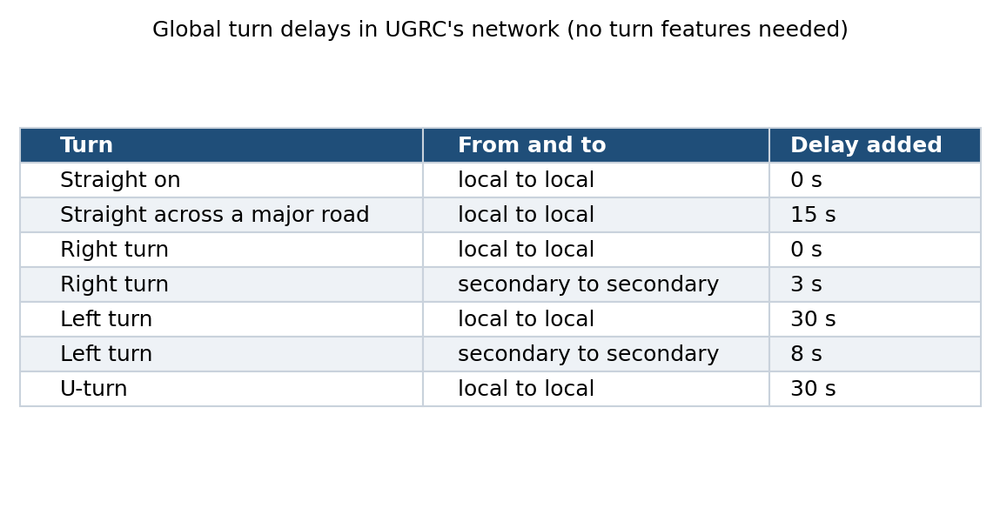

- The table is part of the **network dataset's definition**, set by UGRC in its [Utah Street Network](https://gis.utah.gov/data/transportation/street-network-analysis/), and Lab 11's copy kept it
- Does the solver use it? **Yes**: every solve adds a delay for each **turn** to the route's minutes
- A test route from Station 21 in Lab 11's network: **8.57 min** of road + three turns at **30 s** = **10.07 min**
- You never open this table in Lab 11; it works **inside** every solve

<!-- Where it lives: Network Dataset Properties > Travel Attributes > TravelMinutes > Evaluators > Default Values > Turns, a global turn delay evaluator, read from UGRC's network template (tools/lab11/ugrc_network_template.xml). There are no turn features in the network; the delays apply at every junction by turn angle. The test (November 16, 2026): Make Route Analysis Layer on Lab 11's network from Station 21 to a point 2.5 km east and 1.8 km north; Copy Traversed Source Features returned 41 edges summing to 8.571 minutes and three turns of 0.5 minutes each, total 10.07 = the route's Total_TravelMinutes. Lab 11's network has no road-class hierarchy (Network Dataset Properties shows a yellow warning that turn categories cannot use road class), so the major and secondary rows do not distinguish anything here; the three turns charged were all 30 seconds, the local left-turn and U-turn value. This is one more reason a fastest route avoids left turns, and the network's four minutes reach less than a circle's. -->

---

<!-- _class: quiz -->

# Discuss with Your Neighbor

Every segment has two costs: **TravelMinutes** and **Length** (meters). You route an engine to a house **8 km** away twice: once for the **fewest minutes**, once for the **fewest meters**. What do you get?

<ol type="A">
<li>The same route both times</li>
<li class="correct">Two routes: the fewest-meters one is shorter in distance but takes more minutes</li>
<li>Two routes: the fewest-minutes one is also shorter in distance</li>
<li>One route: a network has only one cost</li>
</ol>

* 

<!-- Ninety seconds in pairs, a show of hands, then the key press circles the answer. The chart is the hint: a kilometer of interstate costs 0.69 minutes, a kilometer of local street 2.24, so a longer route on fast roads can take fewer minutes. A is the common answer: people picture one road to a place. B is right, and the next slide is the measurement. D is the misconception that a network dataset carries one cost; this one carries two, and the analysis picks which one the solver minimizes. -->

---

# Shortest Is Not Fastest

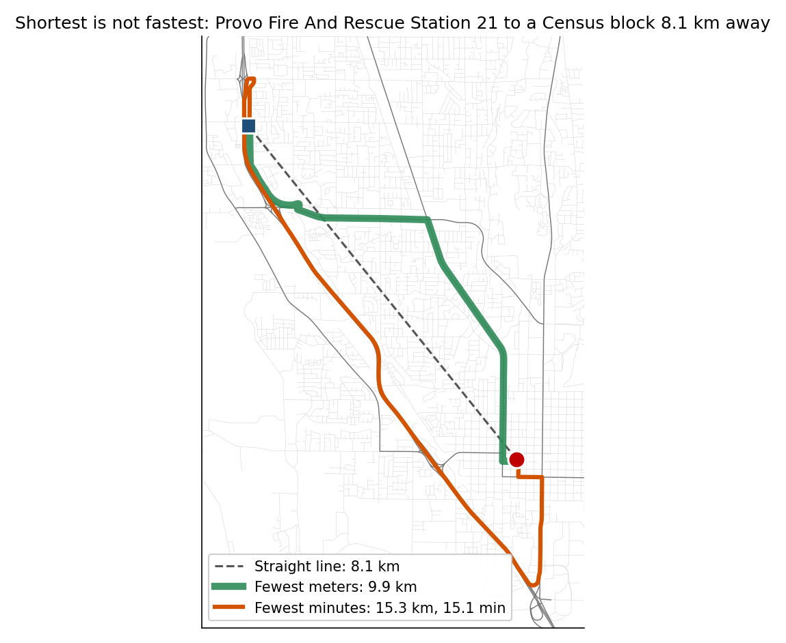

- Same two points, same network
- **Fewest meters**: **9.9 km** through the city grid, **23.4 min**
- **Fewest minutes**: **15.3 km** down I-15, **15.1 min**
- 55 % **longer** in distance, 8 minutes **faster**
- An engine's standard is in **minutes**, so Lab 11 minimizes minutes

<!-- Solved with Make Route Analysis Layer on Lab 11's network (tools/week12_network_numbers.json, "route"): from Provo Fire and Rescue Station 21 to a populated block 8.1 km away in a straight line. The green route minimizes Length: 9,878 m, and at TravelMinutes it would take 23.37 minutes. The orange route minimizes TravelMinutes: 15,315 m in 15.14 minutes. Nothing about the roads changed; only the question. This is the whole idea of an impedance in one picture. -->

---

# How a Road Layer Becomes a Network

- Nobody connects the segments by hand: **Build Network** does it, **by rule**
- **Create Network Dataset** records the decisions: the lines, the **connectivity rule**, the cost **fields**, the **turn delays**
- **Build Network** writes a **junction** wherever the rule says lines meet; a 2 m gap stays a gap
- UGRC built it once for the state; Lab 11 reused UGRC's settings for **Utah County**

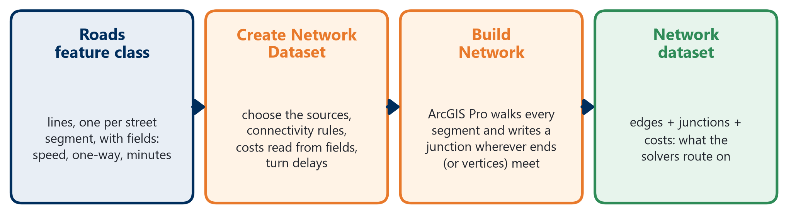

<!-- This is the answer to "how did they build it". UGRC starts from its statewide Roads feature class, whose fields already hold each segment's minutes (length divided by the posted speed and converted to minutes, times 1.5 on surface streets, times 100 against a one-way). The network dataset is a second object that points at those lines and records the decisions: one subtype for freeways and ramps, connected only at their ends, one for everything else, connected at any shared vertex, all in one connectivity group; no elevation fields; TravelMinutes (default) and Length as costs, each read from a field per direction; global turn delays. Build Network then makes the junctions and the graph the solvers use. Lab 11's package was made with Create Template From Network Dataset on UGRC's network, the roads clipped to Utah County, then Create Network Dataset From Template and Build Network (tools/lab11/make_package.py), so the costs and rules are UGRC's, unchanged. Students can see the result in Network Dataset Properties in Lab 11's Step 1. Flow figure: tools/week12_tuesday_figures.py. -->

---

<!-- _class: quiz -->

# Talk to Your Neighbor

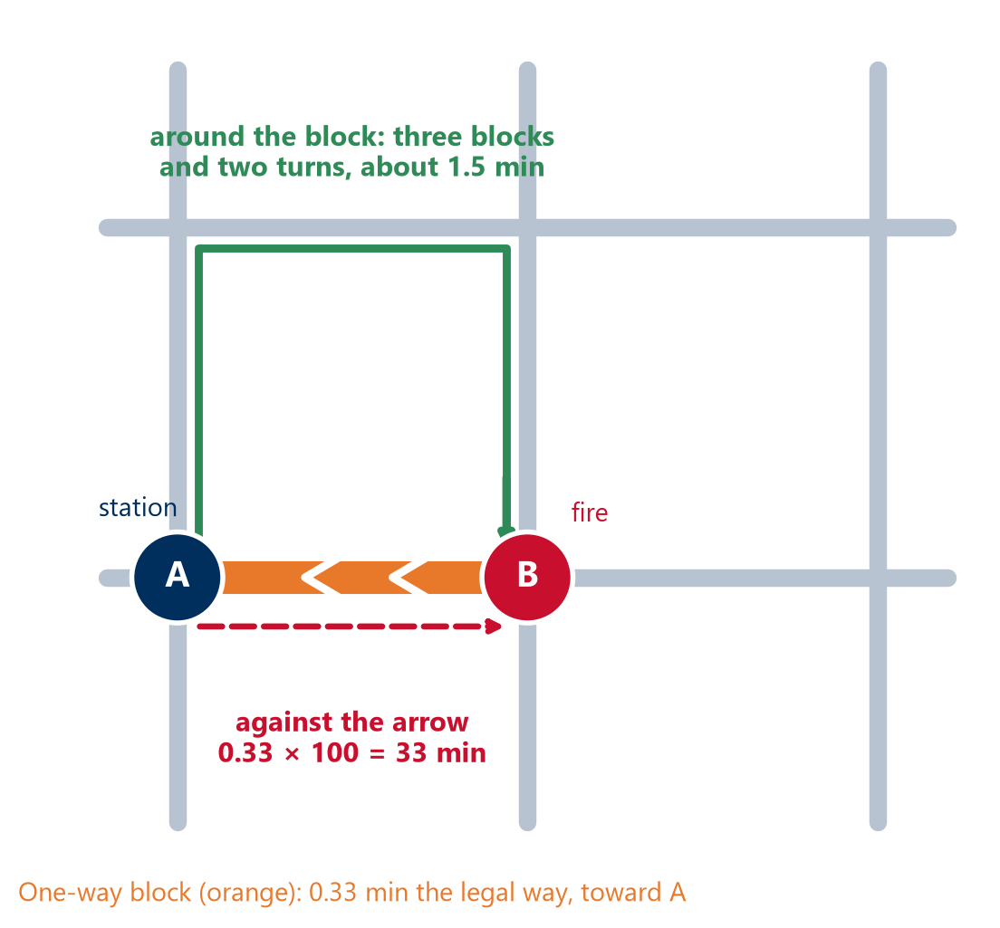

The engine is at **A**; the fire is at **B**, one block away on a street that is **one-way toward A**. Against the arrow costs 100 × 0.33 = **33 min**; around the block, about **1.5 min**. Which route does the solver choose?

<ol type="A">
<li>Against the arrow: it is the shortest distance</li>
<li class="correct">Around the block, about 1.5 minutes</li>
<li>No route: a one-way street is a wall</li>
<li>Against the arrow: fire engines are exempt</li>
</ol>

* 

<!-- Two minutes in pairs, then the key press. B. The solver minimizes minutes, and 1.5 beats 33, so it goes around. UGRC encodes one-way as a price, not a wall: the wrong direction costs 100 times the right one, so the solver drives against the arrow only when every legal way takes even longer, which in a city almost never happens. A is the distance trap from the shortest-versus-fastest slide. C is what a restriction attribute would do, the other choice UGRC could have made. D is a fair real-world point, but the network knows nothing about who is driving. The block and its minutes are illustrative (a 0.33-minute block is a typical Provo block in the attribute table), drawn by tools/week12_tuesday_figures.py. -->

---

<!-- _class: lead -->

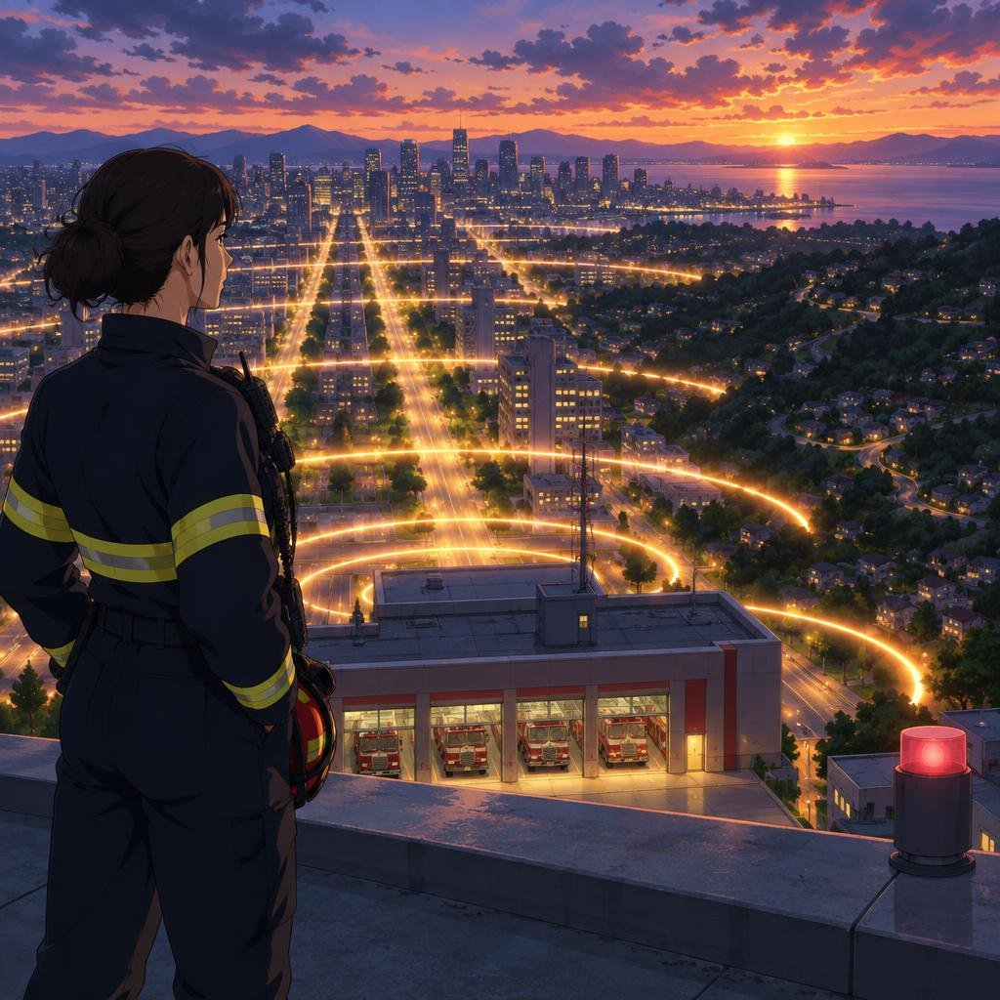

# Part 3 — The First Solver: Service Areas

---

# Service Area: What One Station Can Reach

- Spread minutes outward from a **facility** along the edges; stop at the **cutoff**
- Draw a polygon around the reached edges, one per cutoff: **rings**
- From Provo Station 21: **1.5 km²** inside two minutes, **4.9 km²** inside four, **15 km²** inside six
- It is not a circle, because the roads are not

<!-- Solved with Make Service Area Analysis Layer on Lab 11's network from one station, cutoffs 2, 4, 6, 8, rings (tools/week12_network_numbers.json, "one_station"). Within six minutes is the sum of the first three rings, 1.5 + 4.9 + 8.7. Point at the shape: it reaches far along the arterials and barely at all into the neighborhoods with one way in. -->

---

# Service Areas from All 42 Stations

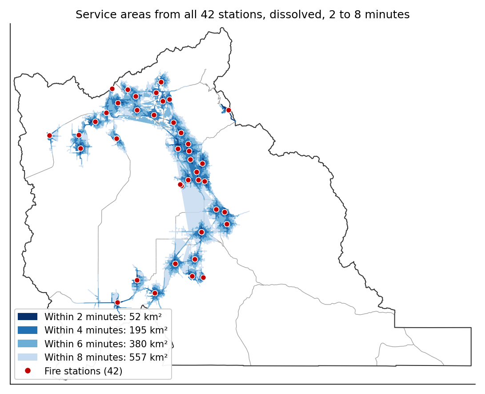

- Load all **42 stations** as facilities and solve once
- **Dissolve** the overlaps so a block near two stations is counted once
- Within two minutes: **52 km²**; four: **195 km²**; six: **380 km²**; eight: **557 km²**
- The four-minute area is a **string of small shapes** around the stations, which are in the cities

<!-- Lab 11's reference run, cutoffs 2, 4, 6 and 8 solved separately, each dissolved (tools/lab11/check_values.json, "sensitivity"). Students get the four-minute area in Step 4 and their own cutoff's in Step 8; the 2, 6 and 8 minute areas are here for comparison, and the deck does not give the populations outside them. Utah Lake in the middle is the gap. -->

---

# Three Tools, Always Together

<b>1 · Make Service Area Analysis Layer</b>Sets up the question: network, cutoff, direction. Makes an <b style="display:inline">empty</b> analysis layer

➜

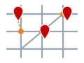<b>2 · Add Locations</b>Loads the stations into the layer's <b style="display:inline">Facilities</b>, snapped to the streets

➜

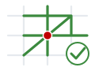<b>3 · Solve</b>Spreads the minutes along the network and fills in the answer

Run all three, in this order, on the <strong>same analysis layer</strong>: steps 1 and 2 only set up the question; <strong>nothing is computed until Solve</strong>

| After Solve, the analysis layer's sublayers hold | |
| --- | --- |
| **Polygons** | the service areas: what Lab 11 counts people in |
| **Facilities** | the stations, each with a status (located or not) |
| **Lines** | the reached streets, only if Output Type asks for lines |
| **Point**, **Line**, **Polygon Barriers** | optional inputs: places a route may not go |

<!-- The icons are Lab 11's own. The one mistake everyone makes once: run the first two and look for polygons. Nothing exists until Solve. The sublayer names are what ArcGIS Pro 3.7 lists for a service area layer on Lab 11's network (checked with arcpy, November 16, 2026): Facilities, Point Barriers, Lines, Line Barriers, Polygons, Polygon Barriers. The result is an analysis layer in the map, not a feature class: in a model, Select Data pulls the Polygons out and Copy Features keeps them (Thursday). Closest Facility and Location-Allocation follow the same three steps with their own sublayers. In ArcGIS Pro 3.7.1 the network ships without named travel modes, so Travel Mode is empty and the layer uses TravelMinutes, the default cost. -->

---

# Make Service Area Analysis Layer

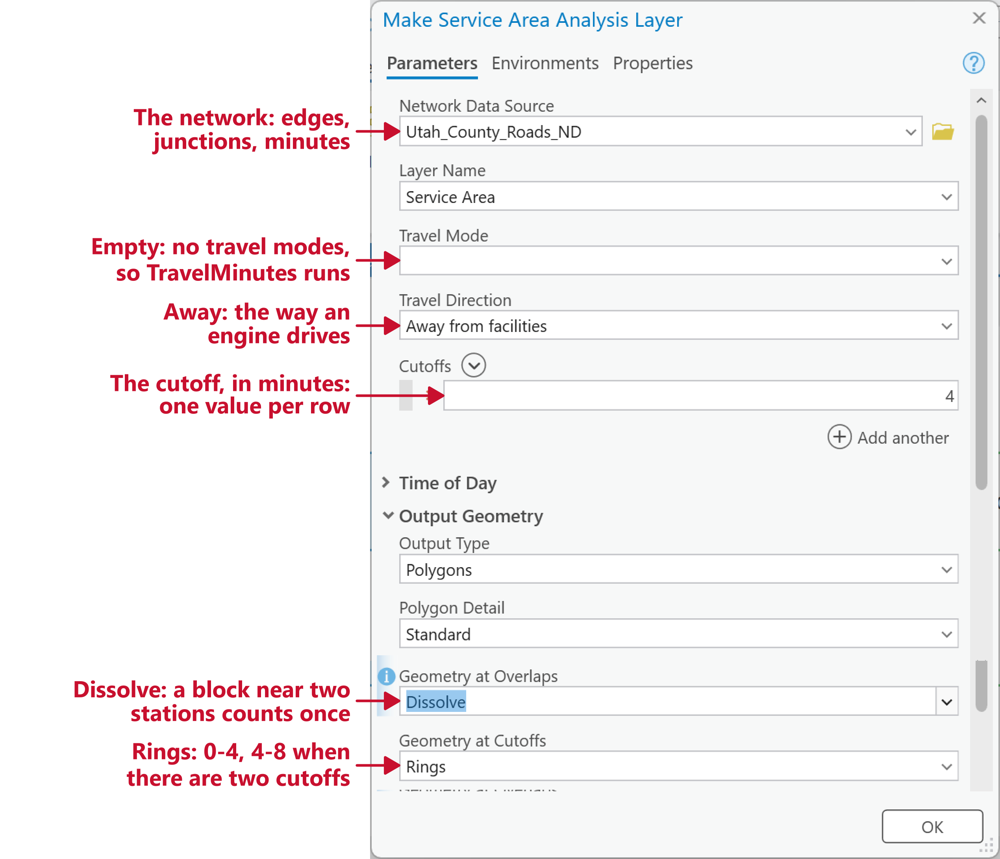

- Sets up the question: **which network**, **which way**, **how many minutes**
- How the answer is **drawn**: polygons, dissolved, in rings
- It computes **nothing** yet

<!-- The red callouts are drawn beside the untouched capture by tools/week12_dialog_callouts.py. Lab 11's own Figure 2 from the GUI build (ArcGIS Pro 3.7.1), filled in as Step 2 of the lab says. Travel Mode is empty because the network ships without named travel modes, so the layer uses the default cost, TravelMinutes. Cutoffs is a list, one value per row: add a row with 8 and you get two rings. Dissolve matters for counting: without it, overlapping station areas stack and a block near two stations sits inside two polygons. -->

---

# Add Locations

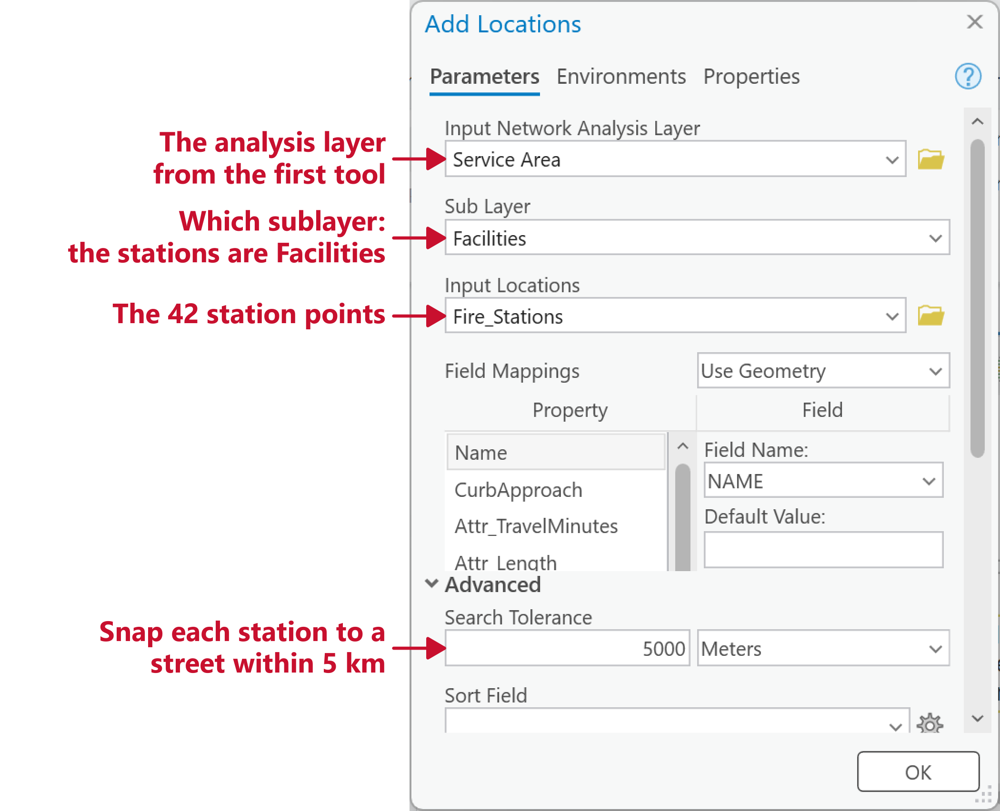

- Loads points into **one sublayer** of the analysis layer
- For a service area, the stations are the **Facilities**
- Each station is **snapped** to the nearest street within the search tolerance
- Then **Solve**, and the Polygons sublayer fills in

<!-- The red callouts are drawn beside the untouched capture by tools/week12_dialog_callouts.py. Lab 11's own Figure 3. The search tolerance (5000 m, the default) is under Advanced. The check in the lab: the Facilities table has 42 rows, every Status OK. Solve has almost no parameters (the analysis layer in, the same layer out, solved), so it has no dialog slide of its own. -->

---

<!-- _class: quiz -->

# Talk to Your Neighbor

You run **Make Service Area Analysis Layer** and **Add Locations**. All 42 stations are located. The **Polygons** sublayer is **empty**. Why?

<ol type="A">
<li>A cutoff of 4 minutes is too small to draw</li>
<li>Travel Mode was left empty</li>
<li class="correct">Solve has not run yet</li>
<li>The stations had to go into Barriers, not Facilities</li>
</ol>

* 

<!-- Two minutes in pairs, then the key press. C: the first two tools set up the question and load the stations; nothing is computed until Solve. Everyone makes this mistake once. B is a fair worry, but an empty Travel Mode on this network just means the default cost, TravelMinutes, runs. D is backwards: barriers are places a route may not go. -->

---

<!-- _class: activity -->

# Final Thoughts

**Quiz: Along the Roads.** Five questions on junctions and connectivity, one-way streets as a cost, two impedances, UGRC's 1.5 factor, and which distance belongs to a fire engine. **Scan the code**, or open the link under it.

- A quick check that today's material made sense
- Thursday builds on the two-impedance question

**Before next class**

- **Lab 11 — Fire Response Coverage** — due **Saturday 11:59 pm**: [assignments/lab-11](https://byu-hydroinformatics.github.io/ce414-gis-applications/assignments/lab-11/)
- Thursday: closest facility, location-allocation, and the rest of Lab 11's model in ArcGIS Pro
- Office hours: [calendly.com/dan-ames/office-hours](https://calendly.com/dan-ames/office-hours)

byu-hydroinformatics.github.io/ce414-gis-applications/quizzes/networks/

<!-- Four minutes, in pairs. If the room has no signal, put the URL on the board. -->

<!-- Deck written October 10, 2026, new for the course (no source PowerPoint). Figures and numbers: tools/week12_network_figures.py from Lab 11's package and reference run (tools/lab11/). Network facts (connectivity by subtype, evaluators, global turn delays, no elevation model) are read from UGRC's network template, tools/lab11/ugrc_network_template.xml. Owed: a real capture of Network Dataset Properties from the Lab 11 GUI build. -->
