<!-- _class: lead -->
<!-- _paginate: skip -->

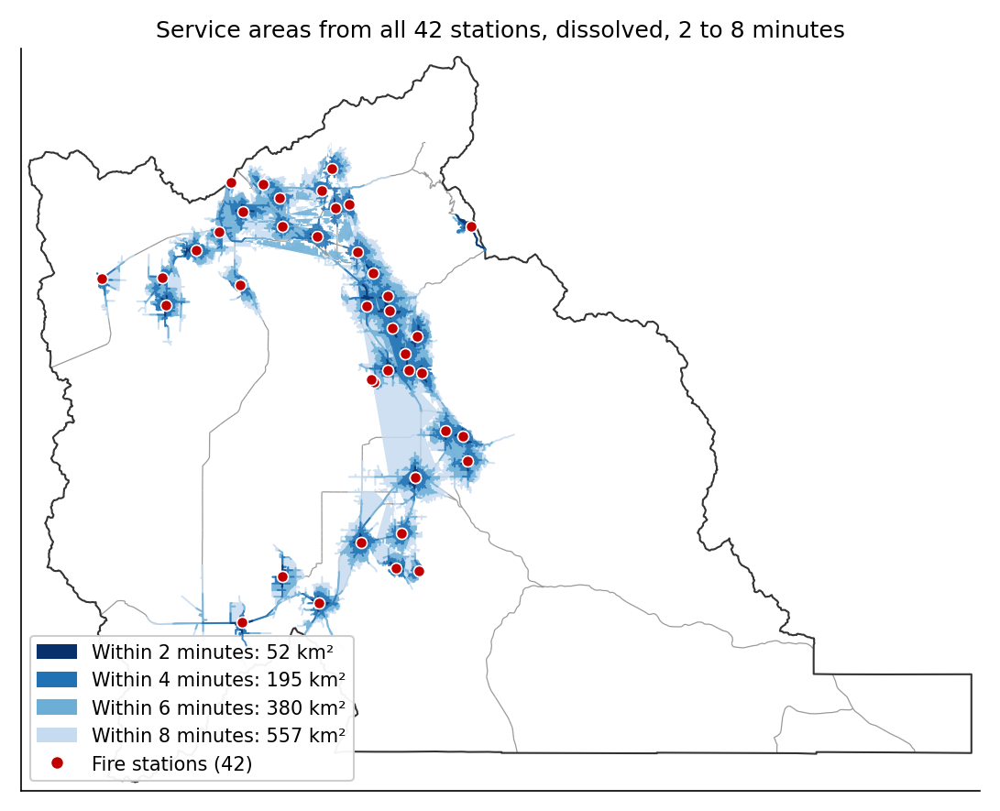

# Network Analysis

## Part B — Closest Facility, Location-Allocation, and Lab 11

CE 414 Engineering Applications of GIS
Civil & Construction Engineering
Brigham Young University
Dr. Dan Ames

<!-- Thursday of Week 12. Tuesday built the network (edges, junctions, connectivity, impedance) and ran the first solver, the service area, with its three tools. Today the other two solvers, then the rest of Lab 11's model from its own data (from polygons to people, the buffer comparison), and last what the answer depends on: the cutoff and what the network does not know. Every map and number is from Lab 11's package and reference run (tools/lab11/, tools/week12_network_figures.py, tools/week12_network_numbers.json). Redivided November 16, 2026. -->

<!-- stamp:begin -->
<!-- _footer: 'CE 414 · Week 12 — Network Analysis, Part BLast Updated: 2026-11-17© 2026 Daniel P. Ames · <a href="https://creativecommons.org/licenses/by/4.0/">CC BY 4.0</a>' -->
<!-- stamp:end -->

---

# Today's Goals

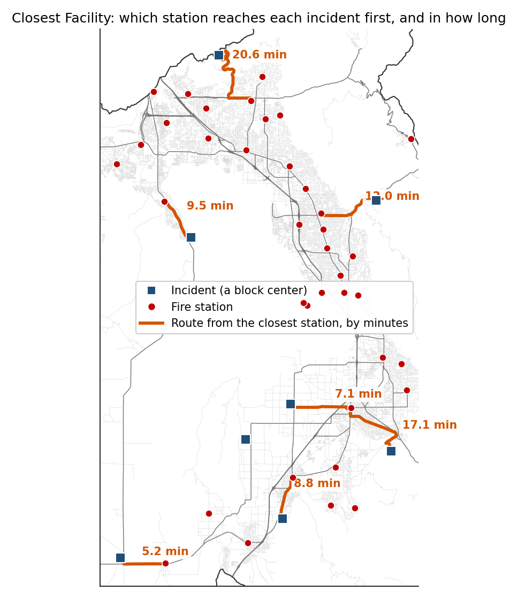

By the end of class you should be able to:

- Say which solver answers which question: **Service Area**, **Closest Facility**, **Location-Allocation**
- Turn a service area into a **count of people** with **Select Data**, **Select Layer By Location** and **Summary Statistics**
- Explain why a **buffer** and a **service area** disagree about the same four minutes
- Say what Lab 11's **cutoff** decides, and what the network **leaves out**

<!-- The right-hand figure is the closest-facility solve: eight incidents, each routed from the station that reaches it first. By the end of the hour the three solvers should feel like three questions, not three tools, and Lab 11's model should be one chain from the network to a number of people. -->

---

# Tuesday in One Picture

- A network is **edges** with a **cost**, meeting at **junctions**
- The **impedance** is the cost you minimize; minutes and meters pick **different roads**
- A **service area** spreads minutes outward from a station and stops at the **cutoff**
- Three tools: **Make Service Area Analysis Layer**, **Add Locations**, **Solve**

<!-- Tuesday's service areas from all 42 stations, dissolved: 195 km2 inside four minutes. Every solver today is the same spreading from a point along the edges (Dijkstra's); what differs is where it starts, where it stops, and what it reports. -->

---

<!-- _class: lead -->

# Part 1 — Two More Solvers

---

# Closest Facility: Which Station Gets There First?

- Start at the **incidents** and spread toward the **facilities**; keep the first one reached
- Reports the route and its minutes for each incident
- Eight block centers away from the stations: the closest engine is **5 to 21 minutes** out
- The dispatcher's question; the service area is the planner's

<!-- Make Closest Facility Analysis Layer, travel direction toward facilities, one facility to find, on Lab 11's network and stations (tools/week12_network_numbers.json, "closest_facility"). Incidents were chosen 2.5 to 7 km from any station and at least 6 km apart, so the routes are visible. Note the direction: a service area spreads away from the facility, closest facility spreads from the incident toward them; on a network with one-way streets the two can differ. -->

---

# Location-Allocation: Where Should the Next Station Go?

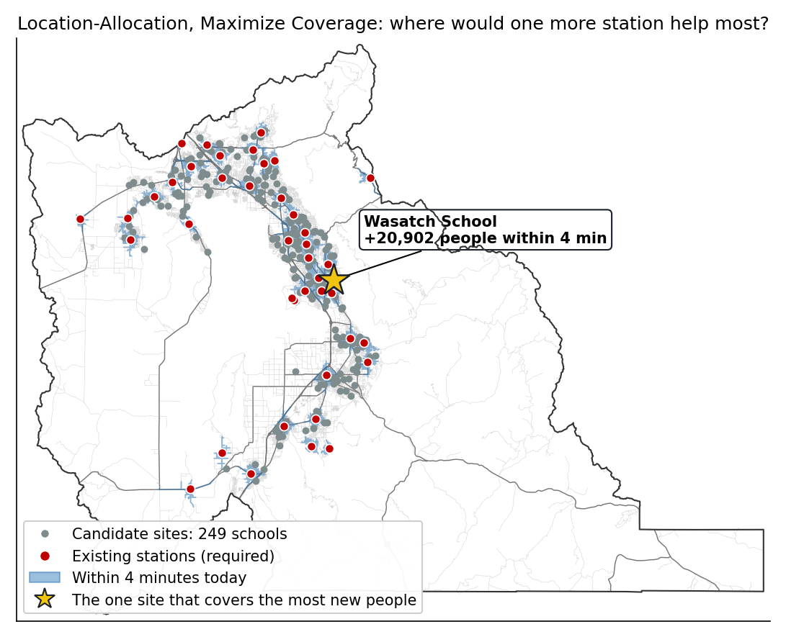

- **Demand**: the blocks, weighted by people; **candidates**: the county's **249 schools**
- **Maximize Coverage** within four minutes; the 42 stations **required**, add **one**
- The winner covers about **21,000** more people: Lab 1's site selection, solved on the network

<!-- Make Location-Allocation Analysis Layer, problem type Maximize Coverage, cutoff 4 minutes, 43 facilities to find with the 42 stations loaded as required and UGRC's Schools_PreKto12 points as candidates, demand = populated block centers weighted by PP_TOTAL (tools/week12_network_numbers.json, "location_allocation"; the chosen site and its count are printed there). Schools are candidates because they are public land spread through the neighborhoods, not a recommendation. Solve time about 50 seconds. This is deck material only; Lab 11 stops at the service area and the buffer. -->

---

<!-- _class: activity -->

# In-Class Activity: Solve It by Hand

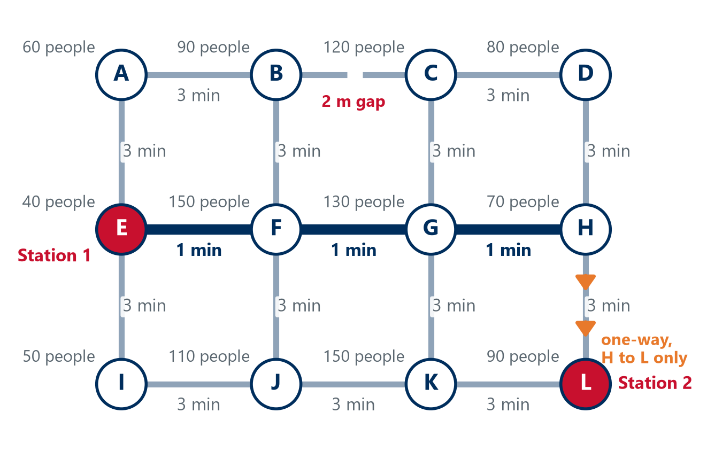

- One [worksheet](https://byu-hydroinformatics.github.io/ce414-gis-applications/handouts/network-worksheet.pdf) each; work **alone**, about **15 minutes**
- A twelve-junction neighborhood with minutes on every street, a **one-way** street and a **2 m gap**
- Five questions, the three solvers by hand: **fewest minutes**, **service area**, a **circle** for comparison, **closest facility**, **location-allocation**
- **Upload a photo** of your sheet to Learning Suite by **9:30 am**

<!-- Hand out the printed worksheet (docs/handouts/network-worksheet.pdf, one page, drawn by tools/week12_network_worksheet.py), one per student. Graded 5 points, Attendance and Participation: a completed, legible sheet with an honest attempt at all five. Give them fifteen minutes, then walk through the answers; the key is in the private repository (ce414-private/activities/week12-network-worksheet-key.md). The two questions worth the time: Question 4, where Station 2 looks two blocks from the fire but the one-way street sends it the long way, so Station 1 wins; and Question 5, where the best new site is on the arterial, not in the uncovered corner. Question 1 is Dijkstra's algorithm by hand, which is all Solve does. -->

---

<!-- _class: quiz -->

# Discuss with a Neighbor

A city council asks four questions. Which one is a **Service Area** question?

<ol type="A">
<li>For this address, which station's engine arrives first, and how long does it take?</li>
<li class="correct">How many residents live more than four minutes' drive from any station?</li>
<li>Where should the next station go to bring the most people inside four minutes?</li>
<li>What is the fastest route from Station 21 to the hospital?</li>
</ol>

* 

<!-- Two minutes in pairs, then the key press circles B. B is the service area (spread from the facilities, count what is inside); A is closest facility; C is location-allocation; D is a route. Have the room name all four. -->

---

<!-- _class: lead -->

# Part 2 — Lab 11's Model

---

# The Question and the Data

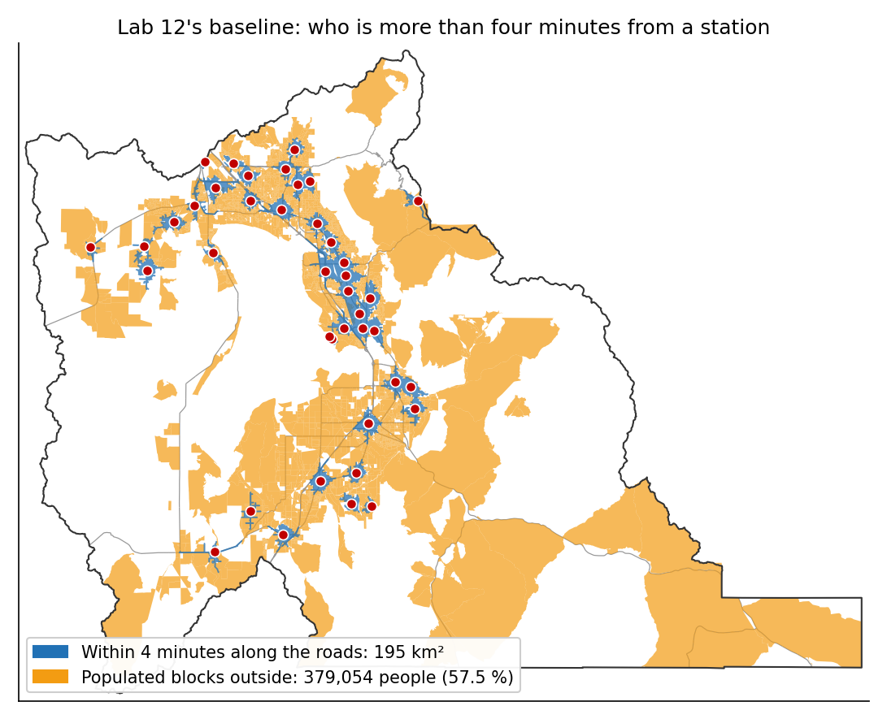

- **NFPA 1710**: the first engine should arrive within **240 seconds** of travel, four minutes
- Utah County: **42 stations**, **10,092** Census blocks, **659,399** people, UGRC's network at its typical-traffic minutes
- A block counts as covered when its **center** is inside the four-minute area
- At four minutes: **379,054** people outside, **57.5 %** of the county

<!-- Lab 11's baseline (tools/lab11/check_values.json): the dissolved four-minute service area, 194.85 km², and the populated blocks whose center falls outside it. The number is big because UGRC's minutes are for typical driving, not an engine running code, and because four minutes along local streets is not far; both are things Step 9 asks about. NFPA 1710's 240-second travel time is from the standard as quoted by fire departments; the lab page carries a verify note for the current edition. -->

---

# From Solve to a Feature Class

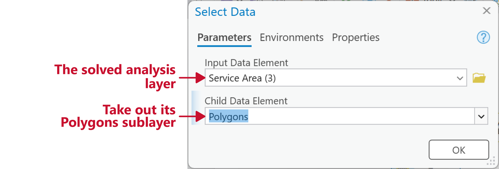

- The solved layer lives **only in the map**
- **Select Data** takes out its **Polygons** sublayer; **Copy Features** keeps them as `Served_Area`
- Select Data is a **ModelBuilder-only** tool: **Insert** ▸ **Utilities** ▸ **Select Data**

<!-- The red callouts are drawn beside the untouched capture by tools/week12_dialog_callouts.py. Lab 11's own Figure 4. Select Data does not come up in a Geoprocessing search, which is why the lab gives the ribbon path. The check value after Copy Features: one feature, 194.85 km2. -->

---

# Select Layer By Location

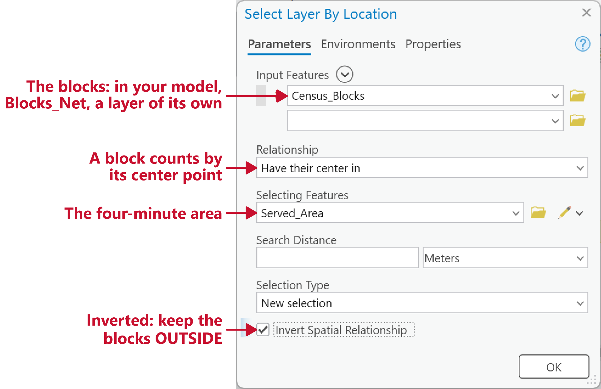

- **Center in**, **inverted**: the blocks **outside**
- A **selection on a layer**, not a dataset; **Copy Features** keeps it
- The model selects on its **own layer** (Make Feature Layer)

<!-- The red callouts are drawn beside the untouched capture by tools/week12_dialog_callouts.py. Lab 11's own Figure 5b; in the capture the input box reads Census_Blocks, and in the students' finished model it is Blocks_Net, the layer from Step 5's Make Feature Layer. "Center in" is the counting rule: a block is covered or not by where its center point falls, which is fair in the cities where blocks are small. -->

---

# Summary Statistics

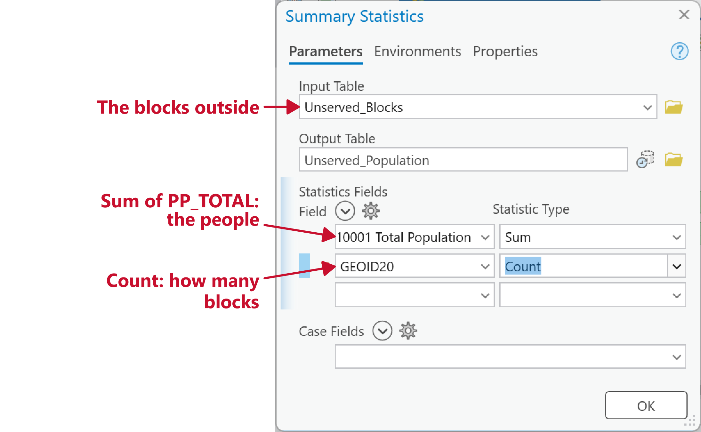

- One row out: the **sum of the people** and the **count of the blocks** outside
- `PP_TOTAL` appears by its alias, **Total Population**
- Step 6 uses it again, **outside the model**, for the buffer's count

<!-- The red callouts are drawn beside the untouched capture by tools/week12_dialog_callouts.py. Lab 11's own Figure 5c. The lab's check: SUM_PP_TOTAL 379,054 and COUNT_GEOID20 6,341 at four minutes. -->

---

# A Buffer and a Network Disagree

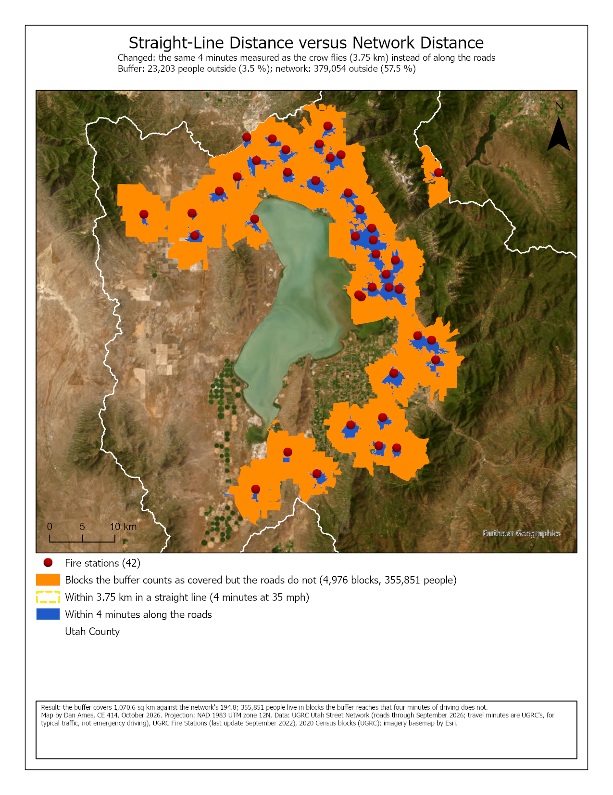

- The same four minutes as a **buffer**: 35 mph × 4 min = **3.75 km** around each station
- The buffer leaves **23,203** people outside, **3.5 %**; the network, **57.5 %**
- **355,851** people live in blocks the buffer counts and the roads do not reach
- Both are "four minutes". Only one of them drives

<!-- Lab 11's Map 2 (its Figure 10): the yellow dashed buffer, the blue network area, and in orange the blocks inside the buffer whose center is outside the service area. The buffer assumes the engine drives 35 mph in every direction at once, across the lake. Lab 11's Step 6 has every student make this comparison; Map 2 is this picture with their name on it. -->

---

# The Model

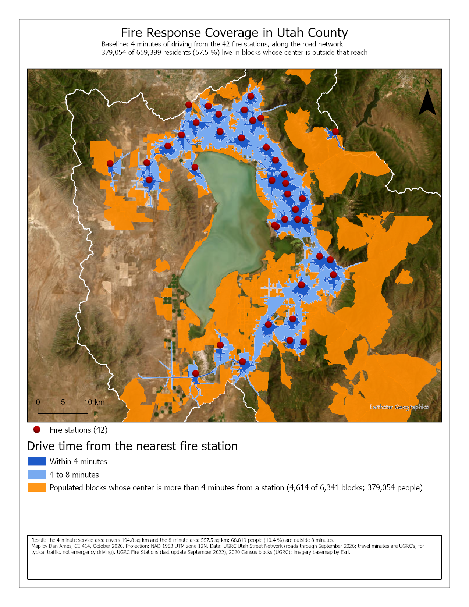

1. **Make Service Area Analysis Layer**: cutoff **4**, away from facilities, dissolve, rings
2. **Add Locations** (the stations) ▸ **Solve** ▸ **Select Data** ▸ **Copy Features**: `Served_Area`
3. **Make Feature Layer** from the blocks ▸ **Select Layer By Location**: blocks whose **center** is in it, **inverted** ▸ **Summary Statistics**: sum of `PP_TOTAL`
4. Parameters: **Cutoff_Minutes** and the three outputs
5. **Outside the model** (Step 6): Buffer 3.75 km ▸ the same selection and sum, once

<!-- Lab 11's model, step for step; the example map is its Figure 9. Two things to say before they build it: a run from the tool dialog deletes every dataset that is not a parameter, so the three outputs are parameters too; and the model's Select Layer By Location works on its own Make Feature Layer from the Census_Blocks dataset, because a selection belongs to the layer, and Step 6 selects on the map's Census_Blocks layer. The buffer comparison runs once, in the Geoprocessing pane, because it never changes with the cutoff. Figure C, the model exported from ModelBuilder, is on the lab page. -->

---

# The Model, Exported

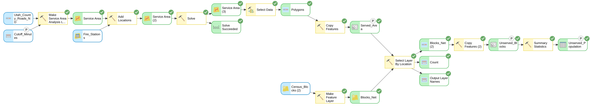

- Top: the network and the cutoff into the **service-area chain**; **Served_Area** out
- Bottom: the blocks through **Make Feature Layer**, the inverted selection, the **count**
- Four **P** badges: the cutoff in, three datasets out; the buffer (Step 6) runs **outside** the model

<!-- Lab 11's Figure C, re-exported from ModelBuilder on November 16, 2026 after the straight-line branch moved out of the model into Step 6. Point at the chain students build: the network and cutoff through Solve, Select Data and Copy Features to Served_Area, then Blocks_Net, the inverted selection and the two outputs. -->

---

<!-- _class: quiz -->

# What Do You Think?

Your model runs, but `Unserved_Population` says about **280,000** people, not the lab's **379,054**. Which setting did you most likely miss?

<ol type="A">
<li>Geometry at Overlaps: Dissolve</li>
<li class="correct">Invert Spatial Relationship</li>
<li>Search Tolerance of 5000 meters</li>
<li>The Count statistic on GEOID20</li>
</ol>

* 

<!-- Two minutes in pairs, then the key press. B: without the invert box the selection keeps the blocks whose center is inside the four minutes, so the sum is the people covered, about 659,399 - 379,054 = 280,345, the number the lab page itself names as the sign of this mistake. A would not change a "center in" selection; C would only matter if a station failed to locate; D changes a column, not the sum. -->

---

<!-- _class: lead -->

# Part 3 — What the Answer Depends On

---

# What the Cutoff Decides

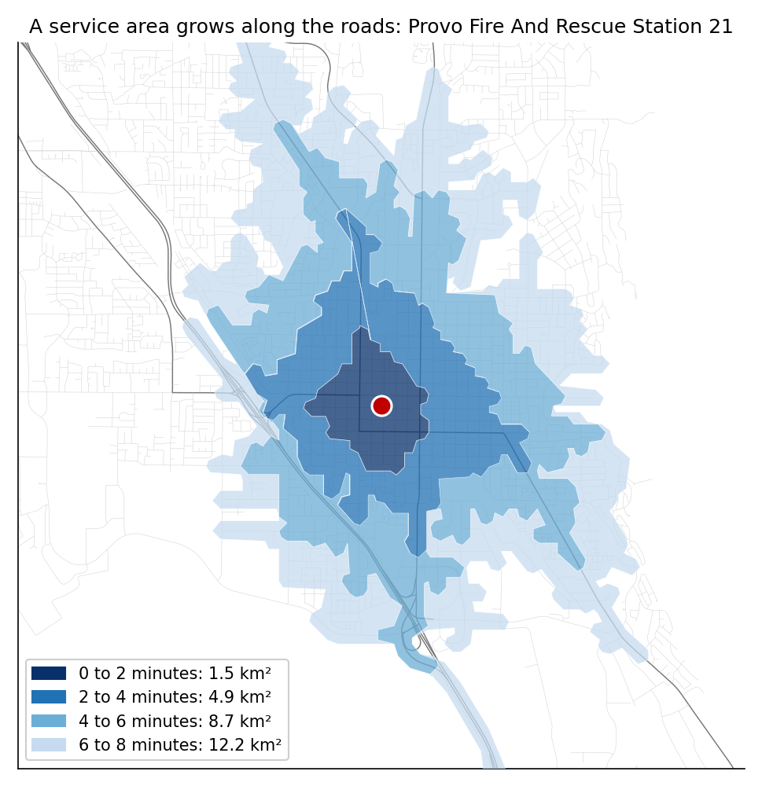

- Four minutes is **a** standard, not **the** answer
- Your **own cutoff** (4.00 to 7.96 minutes) is a second standard; Step 9 sets it beside four minutes and the buffer
- The area grows fast: **195 km²** at four minutes, **380** at six, **557** at eight
- Where does the extra area go? Along the **arterials**, into whole **cities**, and then into places almost nobody lives
- Then say what the model leaves out, which way each would move your share, and what data would fix the one that matters most

<!-- Do not give populations beyond the lab's own: the four-minute baseline and the two personal examples. The areas are Tuesday's dissolved service areas from all 42 stations. The shape to let them discover: a few minutes more takes in whole cities, and after that the share stops falling because almost nobody is left. Each student's cutoff is 4 + 0.04 x the last two digits of their BYU ID, 4.00 to 7.96 minutes, and the grader reproduces their numbers from it. -->

---

# What This Network Does Not Know

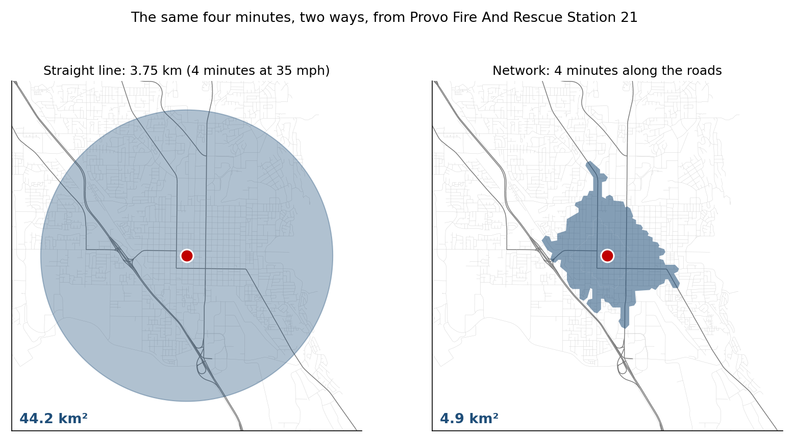

- The **time of day**: TravelMinutes is one number, for typical traffic
- That a fire engine drives with **lights and siren**: UGRC says its times are "not the expedited travel of emergency response vehicles"
- **Turnout**: the clock in NFPA 1710 starts when the engine moves, not when the call comes in
- Anything **newer than its sources**: the stations layer says September 2022

<!-- Every one of these is a decision a student can defend or attack in Lab 11's Step 9. The travel-time quote is from UGRC's Fire Station Travel Times service description; NFPA 1710's 240-second first-engine travel time is the standard Lab 11 uses as its baseline cutoff. The deck does not quote the lab's hidden sensitivity numbers; the students find them. -->

---

<!-- _class: quiz -->

# Key Concept

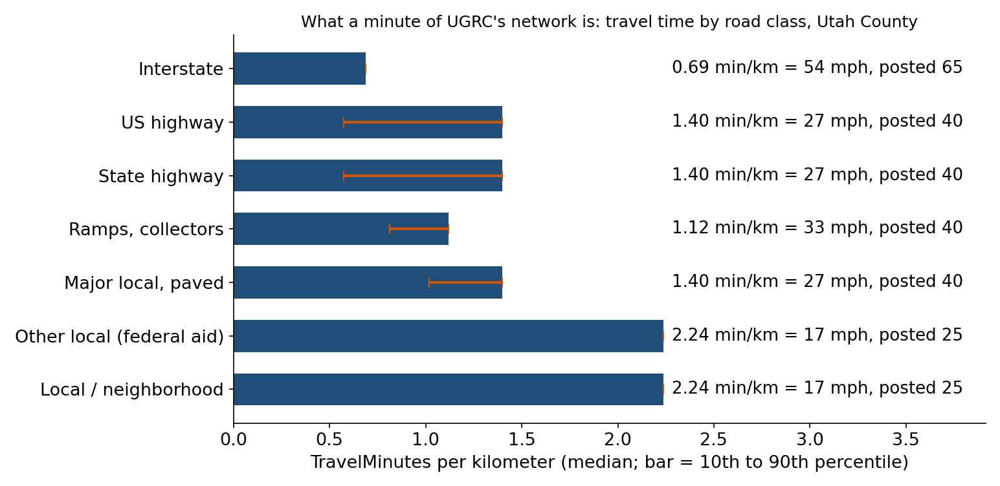

UGRC's minutes are for **typical traffic**. An engine running **lights and siren** drives faster. If the model used the engine's real speed, the share of the county **outside** four minutes would:

<ol type="A">
<li>Go up</li>
<li class="correct">Go down</li>
<li>Stay the same, because the cutoff is still four minutes</li>
<li>Be impossible to say without running it</li>
</ol>

* 

<!-- Two minutes in pairs, then the key press. B: faster edges mean every edge costs fewer minutes, so four minutes reaches farther and covers more blocks, and fewer people are outside. C is the trap: the cutoff is the same, but what four minutes reaches is not. Direction only; do not give a number, since Step 9 asks students to argue which way each missing factor moves their share and how much. -->

---

<!-- _class: activity -->

# Next: Build It

- Download the package, read `READ-ME-FIRST.txt`, fetch the county boundary from UGRC yourself
- Step 1 first: open the network's **properties** and read the two one-way minutes off I-15
- Build the model as the page says and run it at **4** and at **your cutoff**; do the buffer once, outside the model
- Two maps, one comparison table, and `Lab11.atbx` with the report

[Lab 11 — Fire Response Coverage](https://byu-hydroinformatics.github.io/ce414-gis-applications/assignments/lab-11/)

<!-- If there is time, build Steps 2 to 5 live in ArcGIS Pro on the Lab 11 package (C:\Ames\Lab11GUI\Lab11.aprx is set up for it) and let the room watch Solve fill the polygons. The check value to show: 194.85 km2 and 379,054 people. -->

---

<!-- _class: activity -->

# Final Thoughts

**Quiz: Four Minutes Away.** Five questions on Solve, which solver answers which question, why a buffer and a service area disagree, and what Lab 11's cutoff decides. **Scan the code**, or open the link under it.

- A quick check that today's material made sense
- The buffer question comes back in Lab 11's Map 2

**Before next class**

- **Today's worksheet**: upload a photo to Learning Suite by **9:30 am**
- **Lab 11 — Fire Response Coverage** — due **Saturday 11:59 pm**: [assignments/lab-11](https://byu-hydroinformatics.github.io/ce414-gis-applications/assignments/lab-11/)
- Take **Quiz 10** (Network Analysis, open book) on **Learning Suite** — due **Saturday 11:59 pm**
- Next week: **Lab 12, Choose Your Own Adventure** (Tuesday), and Thanksgiving
- Office hours: [calendly.com/dan-ames/office-hours](https://calendly.com/dan-ames/office-hours)

byu-hydroinformatics.github.io/ce414-gis-applications/quizzes/service-areas/

<!-- Four minutes, in pairs. If the room has no signal, put the URL on the board. -->

<!-- Deck written October 10, 2026, new for the course (no source PowerPoint). Figures and numbers: tools/week12_network_figures.py from Lab 11's package and reference run (tools/lab11/); the two example maps are Lab 11's Figures 9 and 10 (tools/lab11/build_figures.py). Redivided November 16, 2026: the service area and its three tools moved to Tuesday, "What This Network Does Not Know" moved here, the dialog slides carry red callouts (tools/week12_dialog_callouts.py), and every section ends with a talk-to-your-neighbor question whose answer is circled on the next key press. -->
