<!-- _class: lead -->
<!-- _paginate: skip -->

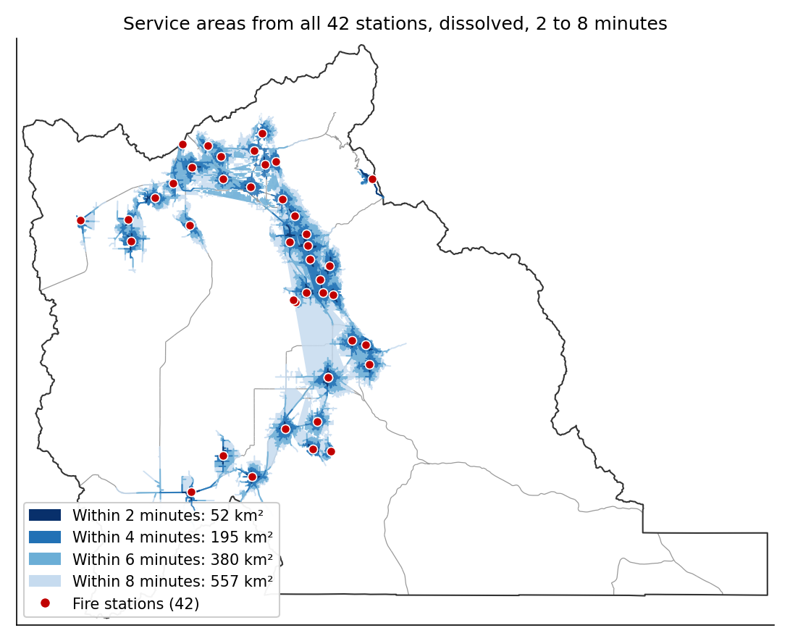

# Network Analysis

## Part B — Service Areas, Closest Facility, and Lab 11

CE 414 Engineering Applications of GIS
Civil & Construction Engineering
Brigham Young University
Dr. Dan Ames

<!-- Thursday of Week 12. Tuesday built the network: edges, junctions, connectivity, impedance. Today the three solvers that use one, in ArcGIS Pro's Network Analyst, and then Lab 11's model from its own data. Every map and number is from Lab 11's package and reference run (tools/lab11/, tools/week12_network_figures.py, tools/week12_network_numbers.json). The tool dialog captures are the lab's own Figures 2 to 4, owed to the Lab 11 GUI build; until then the icons stand in. -->

<!-- stamp:begin -->
<!-- _footer: 'CE 414 · Week 12 — Network Analysis, Part BLast Updated: 2026-10-27© 2026 Daniel P. Ames · <a href="https://creativecommons.org/licenses/by/4.0/">CC BY 4.0</a>' -->
<!-- stamp:end -->

---

# Today's Goals

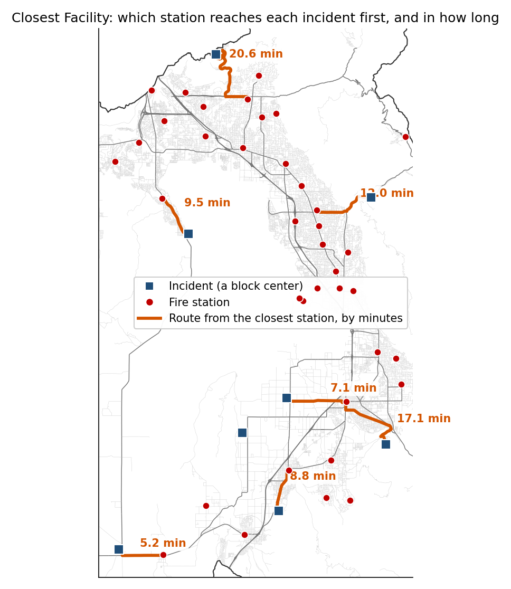

By the end of class you should be able to:

- Run a **service area** in ArcGIS Pro: the analysis layer, **Add Locations**, **Solve**
- Say which solver answers which question: **Service Area**, **Closest Facility**, **Location-Allocation**
- Explain why a **buffer** and a **service area** disagree about the same four minutes
- Build Lab 11's model and know what its **cutoff** decides

<!-- The right-hand figure is the closest-facility solve: eight incidents, each routed from the station that reaches it first. By the end of the hour the three solvers should feel like three questions, not three tools. -->

---

# Tuesday in One Picture

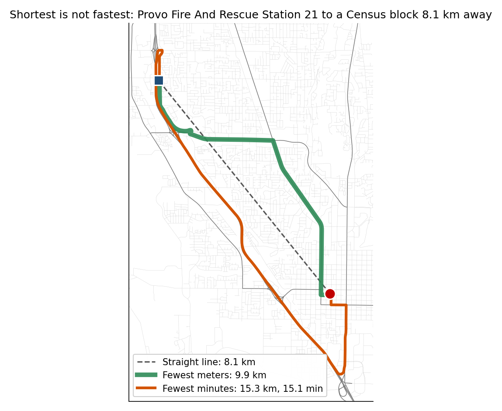

- A network is **edges** with a **cost**, meeting at **junctions**
- The **impedance** is the cost you minimize; minutes and meters pick **different roads**
- Today's solvers all do one thing: **spread cost outward** through the network from a point, and stop at a **cutoff** or a **destination**

<!-- The same figure as Tuesday's slide 11: fewest meters 9.9 km in 23.4 minutes, fewest minutes 15.3 km in 15.1 minutes. Every solver today is Dijkstra's spreading from a point along the edges; what differs is where it stops and what it reports. -->

---

<!-- _class: lead -->

# Part 1 — Three Solvers

---

# Service Area: What One Station Can Reach

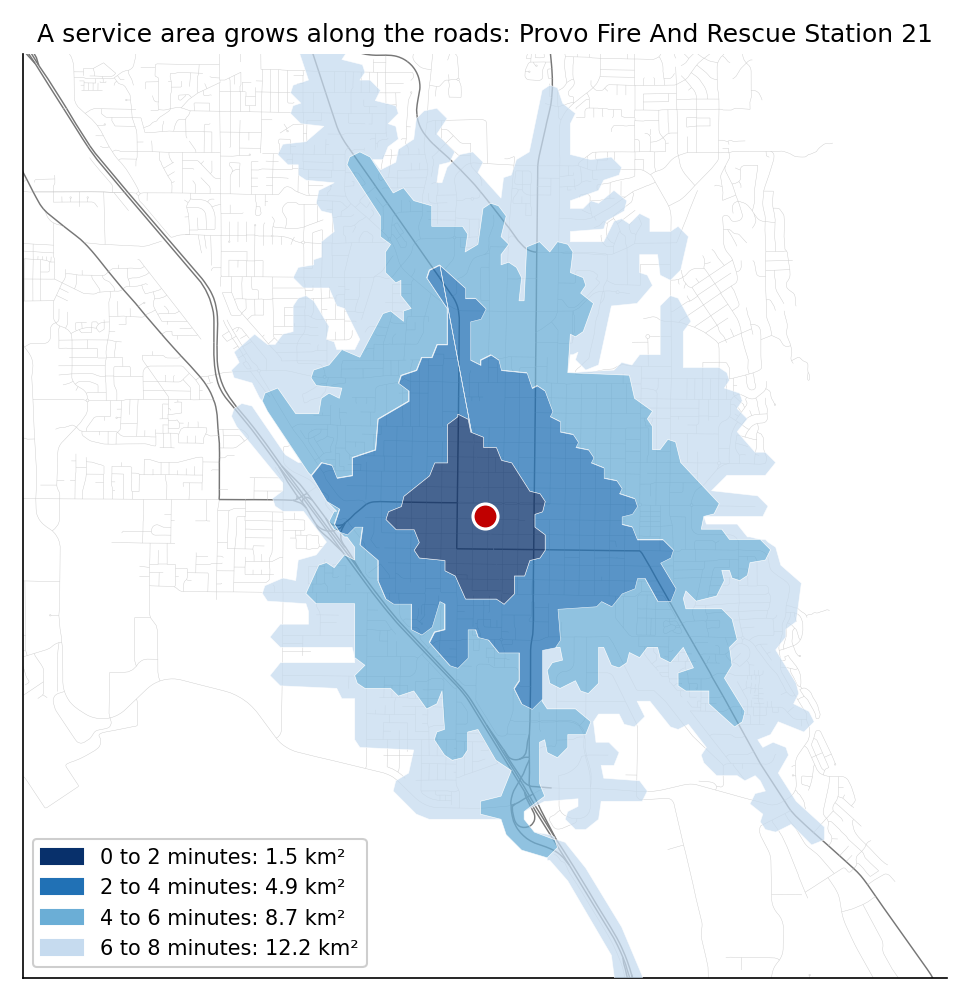

- Spread minutes outward from a **facility** along the edges; stop at the **cutoff**
- Draw a polygon around the reached edges, one per cutoff: **rings**
- From Provo Station 21: **1.5 km²** inside two minutes, **4.9 km²** inside four, **15 km²** inside six
- It is not a circle, because the roads are not

<!-- Solved with Make Service Area Analysis Layer on Lab 11's network from one station, cutoffs 2, 4, 6, 8, rings (tools/week12_network_numbers.json, "one_station"). Within six minutes is the sum of the first three rings, 1.5 + 4.9 + 8.7. Point at the shape: it reaches far along the arterials and barely at all into the neighborhoods with one way in. -->

---

# Service Areas from All 42 Stations

- Load all **42 stations** as facilities and solve once
- **Dissolve** the overlaps so a block near two stations is counted once
- Within two minutes: **52 km²**; four: **195 km²**; six: **380 km²**; eight: **557 km²**
- The four-minute area is a **string of small shapes** around the stations, which are in the cities

<!-- Lab 11's reference run, cutoffs 2, 4, 6 and 8 solved separately, each dissolved (tools/lab11/check_values.json, "sensitivity"). The areas are what students get in Step 4 for four minutes, and in Step 9 for the others; the deck gives the areas but not the populations outside each, which is what Step 9 asks them to find. Utah Lake in the middle is the gap. -->

---

# The Tools in ArcGIS Pro

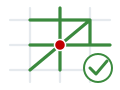

1. **Make Service Area Analysis Layer**: the network, the **cutoffs**, the travel direction, how the polygons are drawn. It computes **nothing**
2. **Add Locations**: the stations into the **Facilities** sublayer, each snapped to the nearest edge within the search tolerance
3. **Solve**: fills in the **Polygons** sublayer

- The result is an **analysis layer** in the map, not a feature class
- In a model, **Select Data** pulls the Polygons out and **Copy Features** keeps them
- The same three steps run every solver: a Closest Facility or Location-Allocation layer has its own sublayers

<!-- The icons are Lab 11's own. The one mistake everyone makes once: run the first two and look for polygons. Nothing exists until Solve. In ArcGIS Pro 3.7.1 the first tool's parameters are Network Data Source and Layer Name; the network ships without named travel modes, so Travel Mode shows Custom and the layer uses TravelMinutes, the default cost. -->

---

# The Same Three, as Dialogs

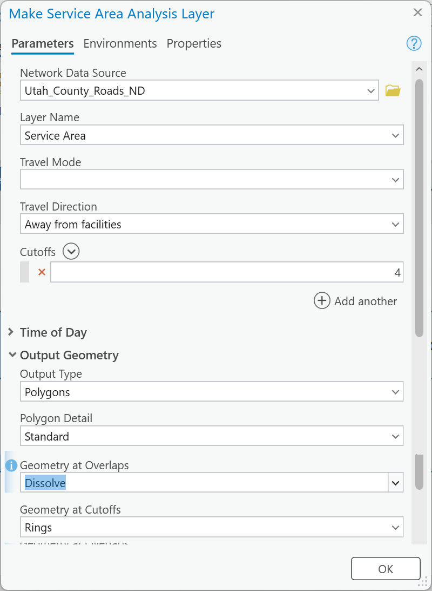

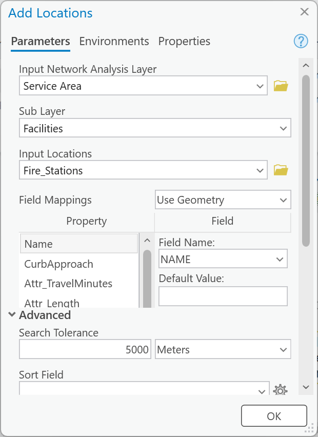

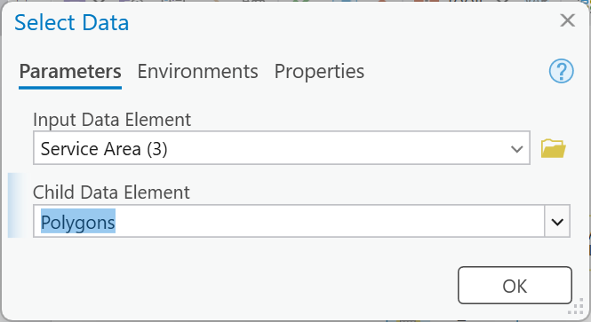

<!-- Lab 11's Figures 2, 3 and 4 from the GUI build (ArcGIS Pro 3.7.1), left to right: Make Service Area Analysis Layer with one cutoff row of 4, away from facilities, dissolve, rings; Add Locations with the stations into Facilities and a 5000 m search tolerance under Advanced; Select Data, the ModelBuilder-only tool that pulls the Polygons sublayer out of the solved layer. Point out the empty Travel Mode box: the network ships without travel modes, so the default cost, TravelMinutes, is what runs. -->

---

# Closest Facility: Which Station Gets There First?

- Start at the **incidents** and spread toward the **facilities**; keep the first one reached
- Reports the route and its minutes for each incident
- Eight block centers away from the stations: the closest engine is **5 to 21 minutes** out
- The dispatcher's question; the service area is the planner's

<!-- Make Closest Facility Analysis Layer, travel direction toward facilities, one facility to find, on Lab 11's network and stations (tools/week12_network_numbers.json, "closest_facility"). Incidents were chosen 2.5 to 7 km from any station and at least 6 km apart, so the routes are visible. Note the direction: a service area spreads away from the facility, closest facility spreads from the incident toward them; on a network with one-way streets the two can differ. -->

---

# Location-Allocation: Where Should the Next Station Go?

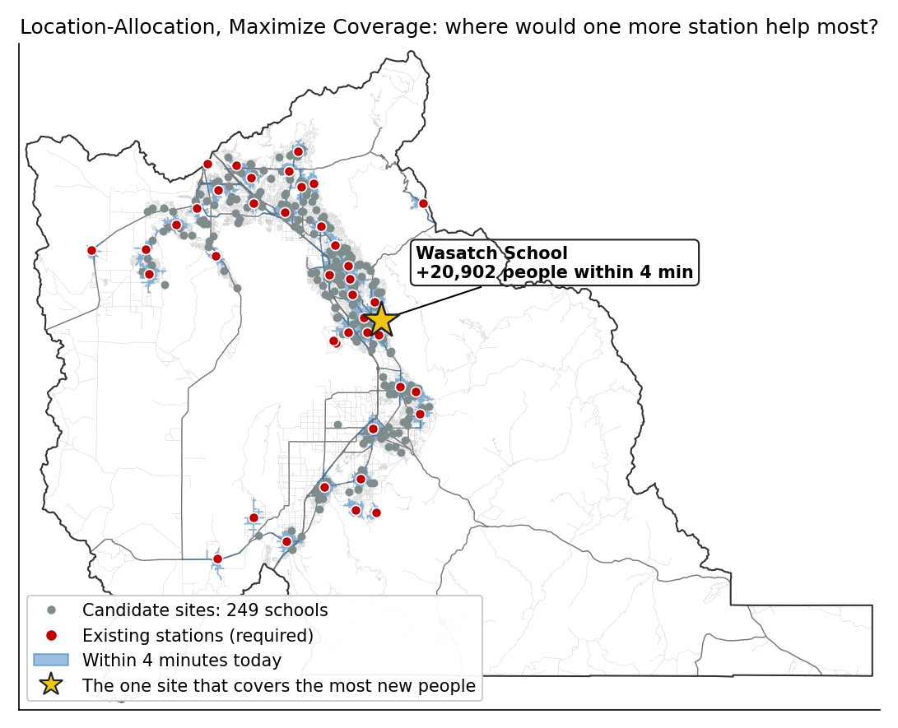

- **Demand**: the blocks, weighted by people; **candidates**: the county's **249 schools**
- **Maximize Coverage** within four minutes; the 42 stations **required**, add **one**
- The winner covers about **21,000** more people: Lab 1's site selection, solved on the network

<!-- Make Location-Allocation Analysis Layer, problem type Maximize Coverage, cutoff 4 minutes, 43 facilities to find with the 42 stations loaded as required and UGRC's Schools_PreKto12 points as candidates, demand = populated block centers weighted by PP_TOTAL (tools/week12_network_numbers.json, "location_allocation"; the chosen site and its count are printed there). Schools are candidates because they are public land spread through the neighborhoods, not a recommendation. Solve time about 50 seconds. This is deck material only; Lab 11 stops at the service area and the buffer. -->

---

<!-- _class: quiz -->

# Which Solver?

A city council asks four questions. Which one is a **Service Area** question?

<ol type="A">
<li>For this address, which station's engine arrives first, and how long does it take?</li>
<li>How many residents live more than four minutes' drive from any station?</li>
<li>Where should the next station go to bring the most people inside four minutes?</li>
<li>What is the fastest route from Station 21 to the hospital?</li>
</ol>

<!-- Ninety seconds. B is the service area (spread from the facilities, count what is inside); A is closest facility; C is location-allocation; D is a route. Have the room name all four. -->

---

<!-- _class: lead -->

# Part 2 — Lab 11, Fire Response Coverage

---

# The Question and the Data

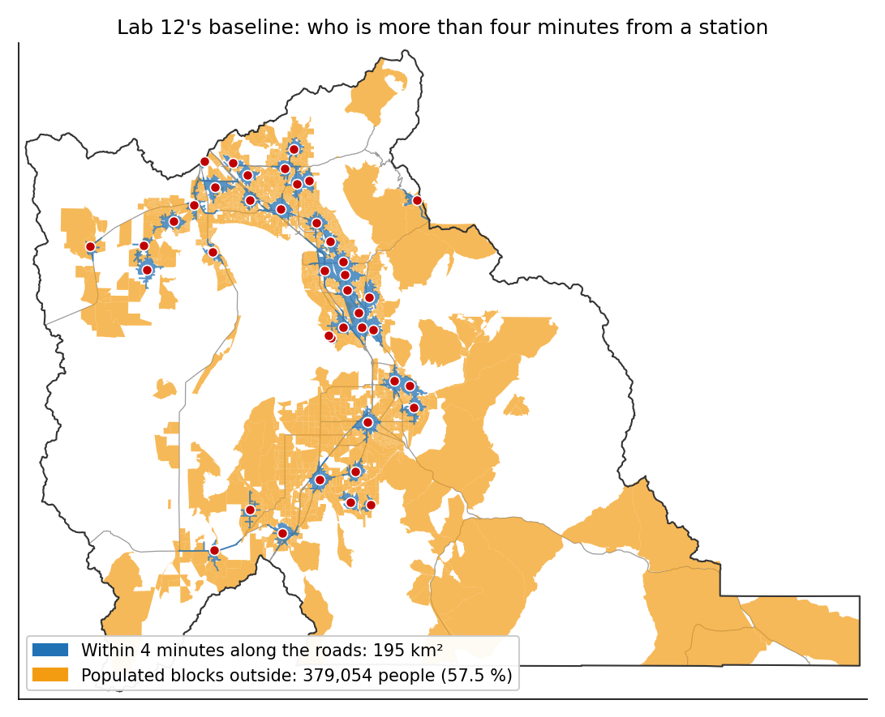

- **NFPA 1710**: the first engine should arrive within **240 seconds** of travel, four minutes
- Utah County: **42 stations**, **10,092** Census blocks, **659,399** people, UGRC's network at its typical-traffic minutes
- A block counts as covered when its **center** is inside the four-minute area
- At four minutes: **379,054** people outside, **57.5 %** of the county

<!-- Lab 11's baseline (tools/lab11/check_values.json): the dissolved four-minute service area, 194.85 km², and the populated blocks whose center falls outside it. The number is big because UGRC's minutes are for typical driving, not an engine running code, and because four minutes along local streets is not far; both are things Step 9 asks about. NFPA 1710's 240-second travel time is from the standard as quoted by fire departments; the lab page carries a verify note for the current edition. -->

---

# A Buffer and a Network Disagree

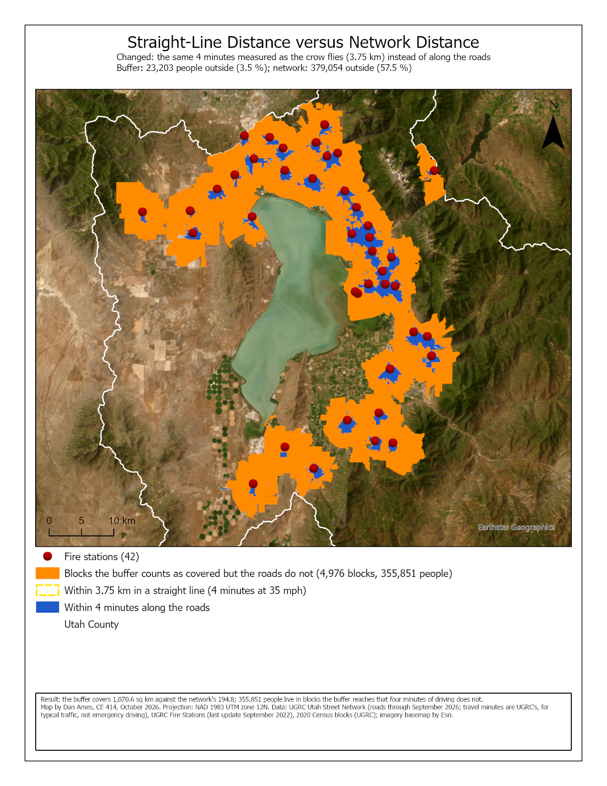

- The same four minutes as a **buffer**: 35 mph × 4 min = **3.75 km** around each station
- The buffer leaves **23,203** people outside, **3.5 %**; the network, **57.5 %**
- **355,851** people live in blocks the buffer counts and the roads do not reach
- Both are "four minutes". Only one of them drives

<!-- Lab 11's Map 2 (its Figure 10): the yellow dashed buffer, the blue network area, and in orange the blocks inside the buffer whose center is outside the service area. The buffer assumes the engine drives 35 mph in every direction at once, across the lake. Lab 11's Step 6 has every student make this comparison; Map 2 is this picture with their name on it. -->

---

# The Model

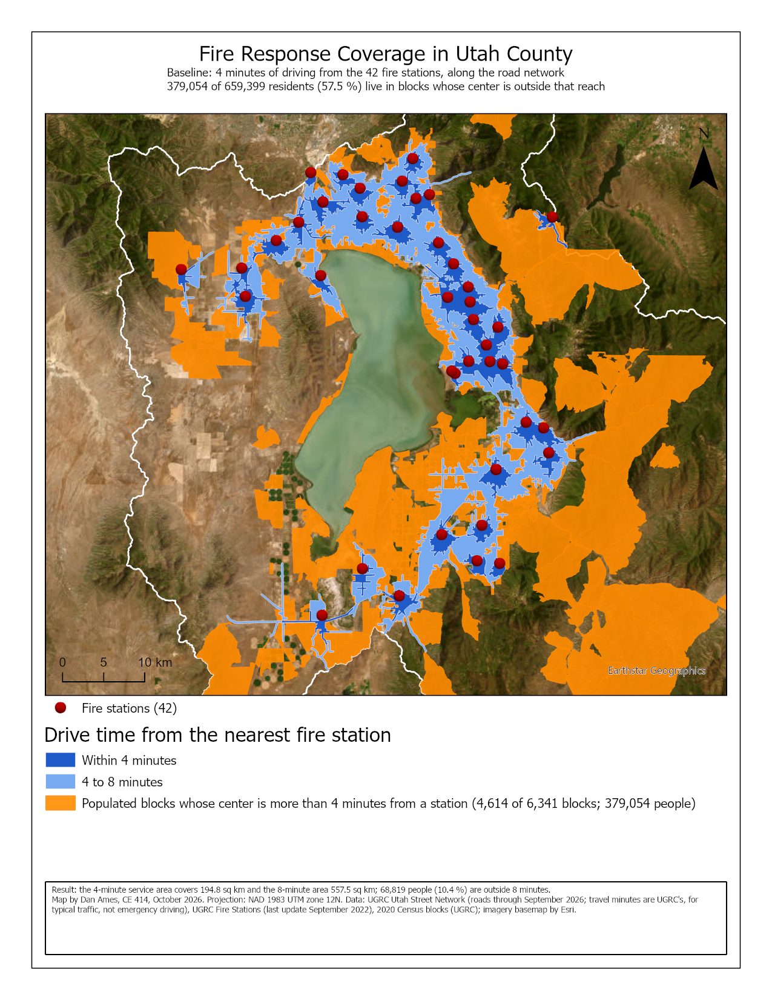

1. **Make Service Area Analysis Layer**: cutoff **4**, away from facilities, dissolve, rings
2. **Add Locations** (the stations) ▸ **Solve** ▸ **Select Data** ▸ **Copy Features**: `Served_Area`
3. **Make Feature Layer** from the blocks ▸ **Select Layer By Location**: blocks whose **center** is in it, **inverted** ▸ **Summary Statistics**: sum of `PP_TOTAL`
4. **Buffer** the stations 3.75 km; its own layer of blocks, the same selection and sum
5. Parameters: **Cutoff_Minutes**, **Buffer_Distance**

<!-- Lab 11's model, step for step; the example map is its Figure 9. Two things to say before they build it: a run from the tool dialog deletes every dataset that is not a parameter, so the six outputs are parameters too; and each branch's Select Layer By Location gets its own Make Feature Layer from the Census_Blocks dataset, because a selection belongs to the layer: two selections on one layer give both branches the same blocks (the GUI build's first dialog run put the buffer's 1,365 blocks in both counts). Figure C, the model exported from ModelBuilder, is on the lab page. -->

---

# The Model, Exported

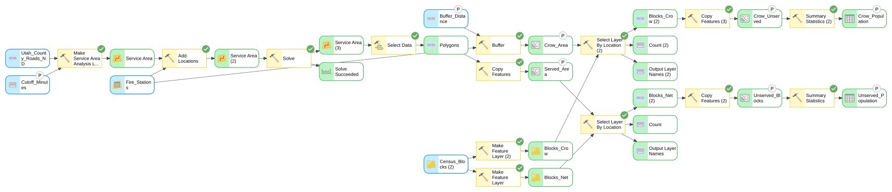

- Top: the network and the cutoff into the service-area chain; **Served_Area** out
- Bottom: the blocks, once per branch, through **Make Feature Layer** before each selection
- Eight **P** badges: two numbers in, six datasets out

<!-- Lab 11's Figure C, exported from ModelBuilder after the GUI build. The two Make Feature Layer tools at the lower left are the thing to point at: both read the Census_Blocks dataset, and each gives its branch a layer of its own to select on. The green checks are from a completed run; the dashed-free connectors mean no preconditions are needed once the branches share nothing but the dataset. -->

---

# What the Cutoff Decides

- Four minutes is **a** standard, not **the** answer
- Step 9 runs the model at **2, 6 and 8 minutes**, at your **own cutoff**, and with a smaller buffer
- Watch the share outside: between which two cutoffs does it **fall fastest**, and why does it **stop falling**?
- Then say what the model leaves out, which way each would move your share, and what data would fix the one that matters most

<!-- Do not give the Step 9 populations; the lab publishes only the four-minute baseline and the two personal examples. The shape to let them discover: a few minutes more takes in whole cities, and after that the share stops falling because almost nobody is left. Each student's cutoff is 4 + 0.04 x the last two digits of their BYU ID, 4.00 to 7.96 minutes, and the grader reproduces their numbers from it. -->

---

<!-- _class: activity -->

# Next: Build It

- Download the package, read `READ-ME-FIRST.txt`, fetch the county boundary from UGRC yourself
- Step 1 first: open the network's **properties** and read the two one-way minutes off I-15
- Build the model as the page says, run it at **4** and at **your cutoff**, then the Step 9 runs
- Two maps, a sensitivity table, and `Lab11.atbx` with the report

[Lab 11 — Fire Response Coverage](https://byu-hydroinformatics.github.io/ce414-gis-applications/assignments/lab-11/)

<!-- If there is time, build Steps 2 to 5 live in ArcGIS Pro on the Lab 11 package (C:\Ames\Lab11GUI\Lab11.aprx is set up for it) and let the room watch Solve fill the polygons. The check value to show: 194.85 km2 and 379,054 people. -->

---

<!-- _class: activity -->

# Final Thoughts

**Quiz: Four Minutes Away.** Five questions on Solve, which solver answers which question, why a buffer and a service area disagree, and what Lab 11's cutoff decides. **Scan the code**, or open the link under it.

- A quick check that today's material made sense
- The buffer question comes back in Lab 11's Map 2

**Before next class**

- **Lab 11 — Fire Response Coverage** — due **Saturday 11:59 pm**: [assignments/lab-11](https://byu-hydroinformatics.github.io/ce414-gis-applications/assignments/lab-11/)
- Take **Quiz 10** (Network Analysis, open book) on **Learning Suite** — due **Saturday 11:59 pm**
- Next week: the **final project** (Tuesday), and Thanksgiving
- Office hours: [calendly.com/dan-ames/office-hours](https://calendly.com/dan-ames/office-hours)

byu-hydroinformatics.github.io/ce414-gis-applications/quizzes/service-areas/

<!-- Four minutes, in pairs. If the room has no signal, put the URL on the board. -->

<!-- Deck written October 10, 2026, new for the course (no source PowerPoint). Figures and numbers: tools/week12_network_figures.py from Lab 11's package and reference run (tools/lab11/); the two example maps are Lab 11's Figures 9 and 10 (tools/lab11/build_figures.py). Owed: Lab 11's dialog captures (Figures 2 to 4) and Figure C from the GUI build, to replace the icons on slide 7 and the map on slide 13. -->
