<!-- _class: lead -->
<!-- _paginate: false -->

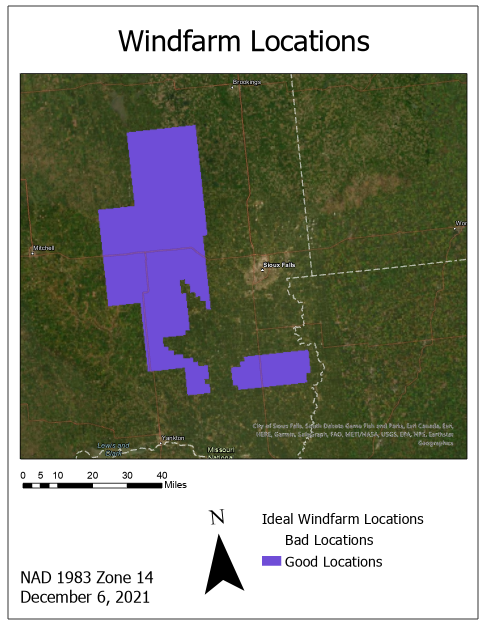

# Lab 12: Choose Your Own Adventure

**CE 414 Engineering Applications of GIS**
Dr. Dan Ames

<!-- Rewritten 2026-11-14 when the final project became Lab 12 (individual, 100 points: a five-minute
ArcGIS Pro training video on YouTube, a report, and a project package, due Thursday of Week 15). The
lab page is the authority: https://byu-hydroinformatics.github.io/ce414-gis-applications/assignments/lab-12/ -->

<!-- stamp:begin -->
<!-- _footer: 'CE 414 · Week 13 — Lab 12: Choose Your Own AdventureLast Updated: 2026-11-14© 2026 Daniel P. Ames · <a href="https://creativecommons.org/licenses/by/4.0/">CC BY 4.0</a>' -->
<!-- stamp:end -->

---

# Today's Goals

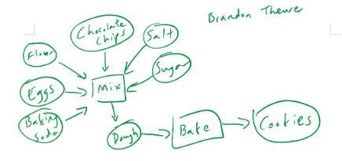

- By the end of class you should be able to:
  - Say what Lab 12 asks of you, and how it differs from Labs 1 to 11
  - Judge whether an idea is the right **size** for two and a half weeks
  - List the four requirements every project must meet
  - Plan a five-minute **training video** of your own model
  - Say what is graded from the video, the report and the package

<!-- Frame it as the last lab: every lab so far handed students a question and a recipe. Now they
write the recipe, and then teach it. The cookie model from Week 2 is a deliberate callback. -->

---

<!-- _class: lead -->

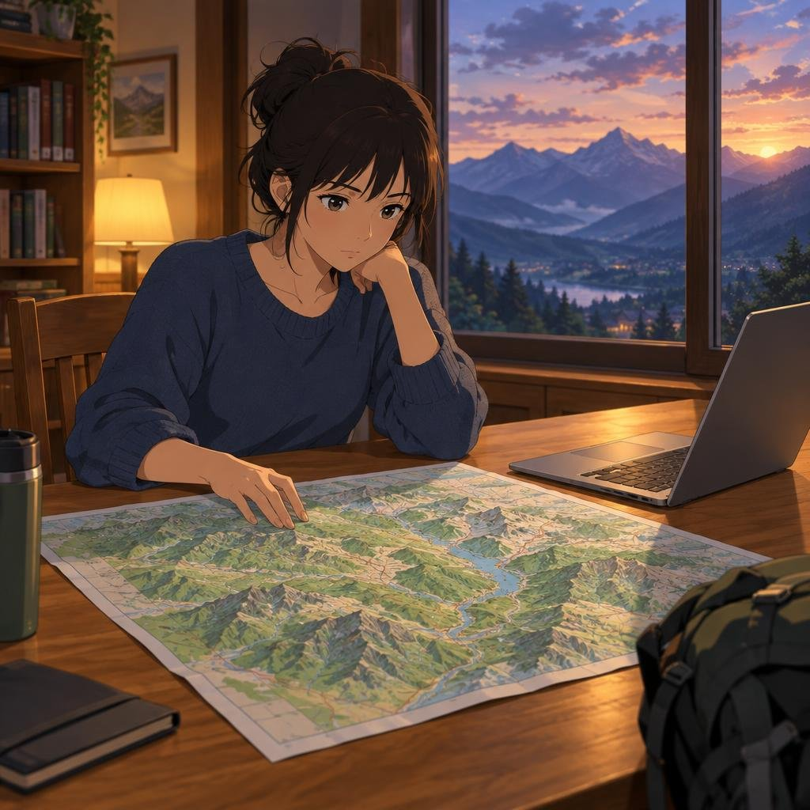

# Part 1 — What Lab 12 Is

<!-- Part 1: why this lab, what past students built, the requirements, and what lab-sized means. -->

---

# Why choose your own?

Every lab this semester gave you a **question**, the **data**, and a **recipe**.

Lab 12 takes all three away.

- **You** pick the question — something you actually want to know
- **You** find and vet the data
- **You** build the recipe in ModelBuilder — and then **teach it** to someone else

This is the closest thing in the course to what a client asks for: *here is a problem, show me
where, and show me why I should believe you.*

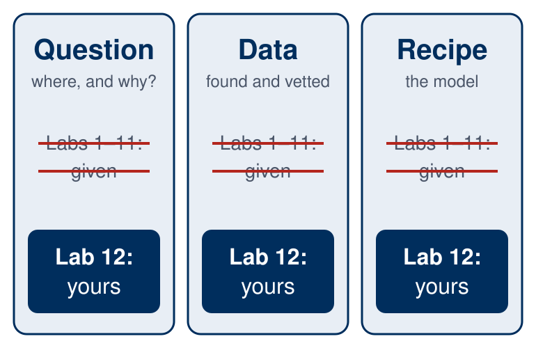

<!-- Figure: tools/week13_figures.py. -->

---

# What past students built

Questions from earlier years:

- Where are the safe **sledding hills**, and how thrilling is each?
- Which trails have broad **views** that include water?
- Where should **rain gardens** go in a county?
- Where are the gaps between **EV fast chargers** on a road trip?
- How many **craters** does a Martian volcano have?

Seventy more, with the decks from 2018 to 2025, are on the **Lab 12 page**.

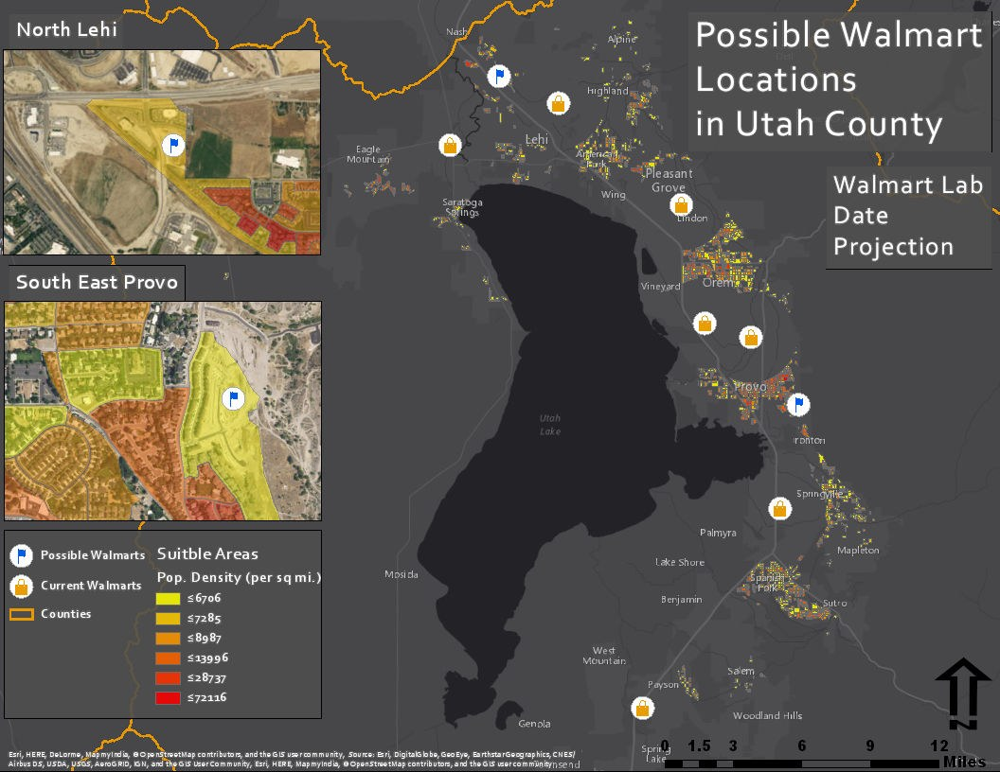

<!-- The ideas table on the lab page has 70 rows drawn from 126 projects in the 2018-2025 decks; each
row links its year's deck. Tell them to page through two or three decks tonight. -->

---

# The requirements

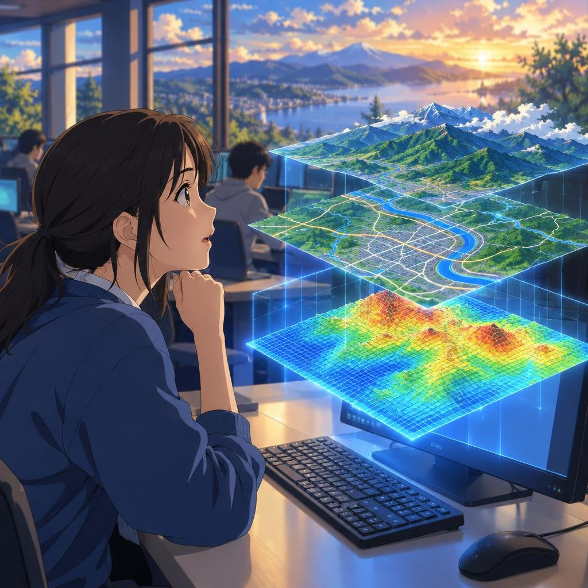

Your project must have all four:

1. **Raster and vector data, both analyzed** — not a raster only as a backdrop
2. **A ModelBuilder model** that runs from its tool dialog and makes your result
3. **A finished map** that answers your question
4. **Your own work, done individually** — help finding data or fixing an error is fine, as in any lab

Pick something other than Labs 1 to 11. Lab 12 is a stretch past them, not a rerun.

<!-- There is no proposal meeting and no team this year. The project is individual so the grade
measures each student's own work. -->

---

# What "lab-sized" actually means

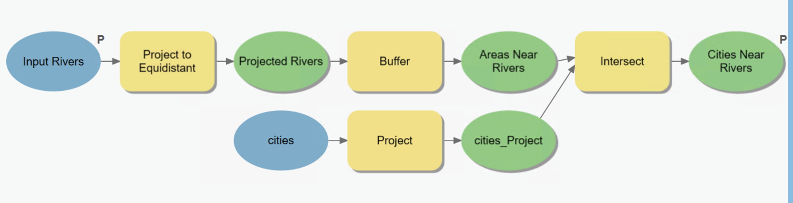

A project the size of a lab has:

- **One** question, with explicit criteria and thresholds
- **One** study area, in a projected coordinate system you chose on purpose
- A model of roughly **6 to 12 tools** that reruns from its inputs without hand repair
- **Documented data**: source, URL, date, coordinate system
- **One** professional map

<!-- Say it out loud: three study areas, a web app, or a month of data cleaning is a thesis, not a
lab. The 6-12 tool range is a guideline, not a rule. -->

---

<!-- _class: quiz -->

# Is this project the right size?

For each idea, decide: **too small**, **about right**, or **too big**.

<ol type="A">
<li>Map every Walmart in Utah</li>
<li>Find the best three sites for an EV charging hub in Utah County, given traffic, grid access, and land use</li>
<li>Model wildfire risk for the entire western United States at 10 m resolution</li>
<li>Estimate how many people live within a 10-minute walk of a TRAX station, and which stations are underserved</li>
</ol>

<!-- A: too small — no analysis, just a display. B: about right. C: too big — data volume and
validation are out of reach in two and a half weeks. D: about right, and a good example of a
network question that is still doable with buffers and raster density. -->

---

<!-- _class: lead -->

# Part 2 — Choosing a Problem

<!-- Part 2: the three questions for choosing a problem and the data check. -->

---

# Choosing a problem — three questions

**1. Can I say the question in one sentence?**
"Where in Utah County should a new fire station go so that the most homes are within 5 minutes?"

**2. Does the data exist, and can I get it this week?**
Check UGRC, the USGS National Map, and Living Atlas *before* you commit. If a layer would need to be digitized by hand, that is your whole project.

**3. What would a wrong answer look like?**
If you cannot describe a way to check the result, the model is a picture, not an analysis.

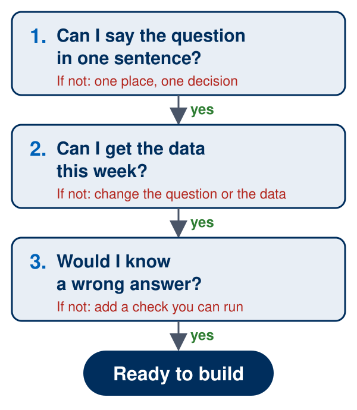

<!-- Figure: tools/week13_figures.py. -->

---

# The data check

Before you build anything, fill this in for **every** layer — it becomes the data table in your report:

| Layer | Raster or vector | Source and URL | Date downloaded | Coordinate system |
| --- | --- | --- | --- | --- |
| e.g. Roads | Vector | UGRC Road Centerlines | Nov 24, 2026 | NAD 1983 UTM 12N |

If any row is blank, you are not ready to build.

<!-- Most failed projects failed on a data row, not on the analysis. This week is for finding out. -->

---

<!-- _class: lead -->

# Part 3 — What You Submit

<!-- Part 3: the training video, the report and the package, the timeline, and how it is scored. -->

---

# The training video — five minutes

A voiceover on **your ArcGIS Pro screen**, for the next person to do this analysis.

| About | What you show |
| --- | --- |
| 30 s | The question, and who would use it |
| 1 min | Each dataset and where it came from |
| 2½ min | Each tool, then the dataset it made |
| 1 min | The map, the answer, one limitation |

- **Show results**: run the model before you record
- **Record in pieces** with Snipping Tool
- Post it **unlisted on YouTube**; submit the link

<!-- Tips in full on the Lab 12 page, Step 5. TODO(capture): a real Snipping Tool video-mode capture
over ArcGIS Pro on a lab machine (and confirm the microphone button is there); the illustration at
right stands in until then. -->

---

# The report and the package

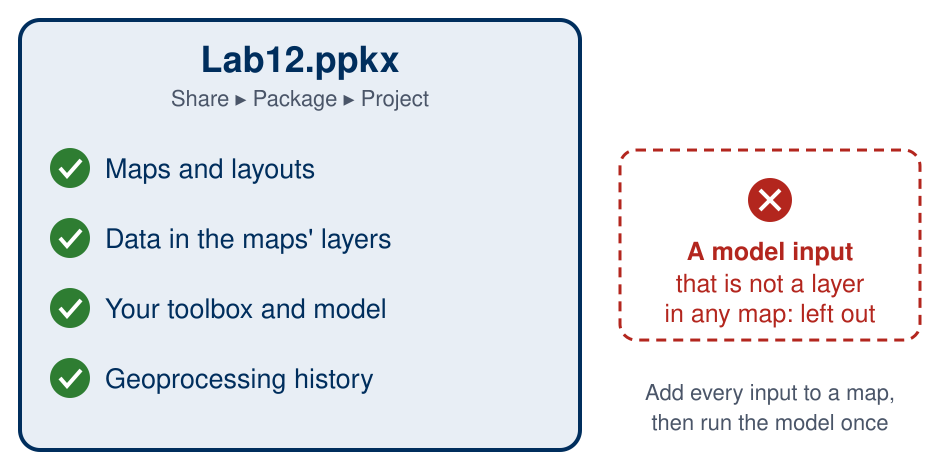

**The report**: a page or two of text (question, video link, data table, tools and settings, the answer), then the **model** and the **map**, each on a full page.

**The package**: **Share** ▸ **Package** ▸ **Project**, a `.ppkx`.

- Keep **every input as a layer in a map**
- Run the model once from its tool dialog, then package

<!-- From Esri's "Share a project package" help, read 2026-11-14: for toolboxes, input data is not
copied; map layers and geoprocessing history are. -->

---

# The tool interface

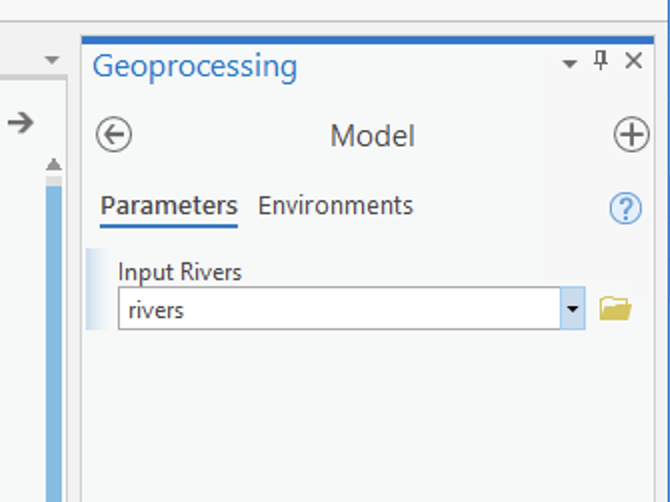

Your model opens like any other geoprocessing tool.

- Inputs and outputs marked as **parameters** — the "P"
- Sensible **labels**, not `rivers_Project_Buffer_2`
- Key thresholds exposed as parameters: distance, density, class breaks

**The test:** the grader opens your package and runs it from the tool dialog without opening the model.

<!-- Callback to ModelBuilder Part B (parameters, metadata, "Going forward: build a tool
interface"). -->

---

# The timeline

| Week | Where you should be |
| --- | --- |
| 13 | Question chosen; every layer downloaded and checked |
| 14 | Midterm 2, and open lab Tuesday and Thursday: the model runs and the map is drafted |
| 15 | No class: record the video, write the report, package the project; **due Thursday 11:59 pm** |

Data problems should surface in Week 13, not Week 15. I am away in Week 15: email questions early.

<!-- Week 15 is the last week of classes; Thursday is the last day. The instructor is traveling
December 6-10 and answers email in the evening. -->

---

# How Lab 12 is scored

| Part | Points | Graded from |
| --- | ---: | --- |
| Question and data | 20 | Report and package |
| ModelBuilder model | 20 | Package and report |
| Map | 20 | Report |
| Training video | 30 | Video |
| Report and package | 10 | Both |
| **Total** | **100** | |

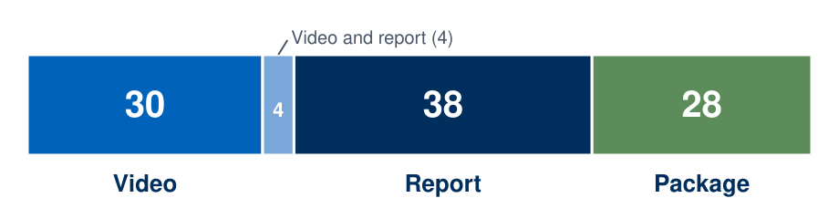

The full rubric is on the Lab 12 page.

<!-- 100 points, twice a regular lab. The bullets on the page say which deliverable each item is
graded from. -->

---

# Extra credit — a reel

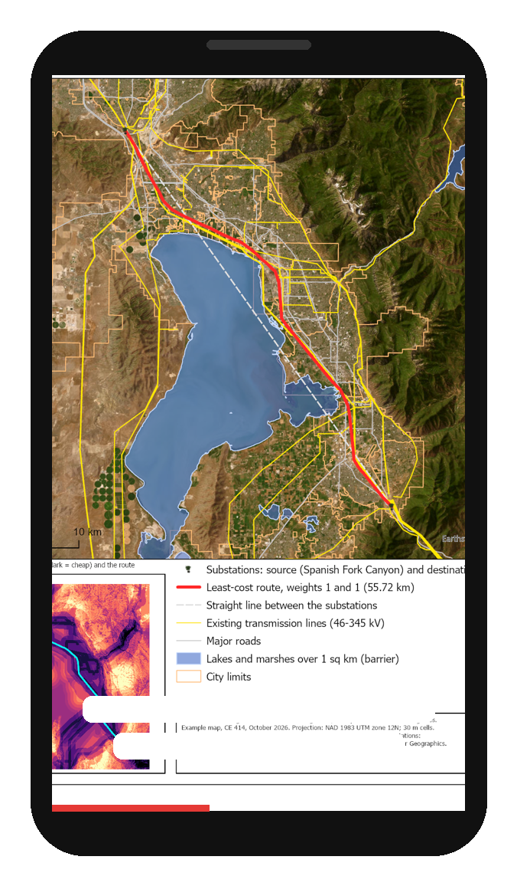

**Up to 10 points:** a **30 to 90 second vertical video** cut from your own footage.

- Hooks a viewer in the first three seconds
- Tells the story **without the sound on** — captions
- The question, one striking result, the map, the answer

With your permission I may post it on [@dr.danames](https://www.instagram.com/dr.danames/), so you do not have to post it yourself. Posting is never required.

<!-- Figure: Lab 10's example baseline map in a 9:16 phone frame (tools/week13_figures.py). The white
bars stand for captions; there are no words in the image. -->

---

# What separates a good project from a great one

**Good**: the model runs, the map is clean, the video walks through every tool.

**Great**:

- Criteria are **justified** — a source, a standard, or an argument
- The video shows the **intermediate results**, not just the final map
- It says what the analysis **cannot** tell you
- The map answers the question in **five seconds**

That is the difference between a result and a recommendation.

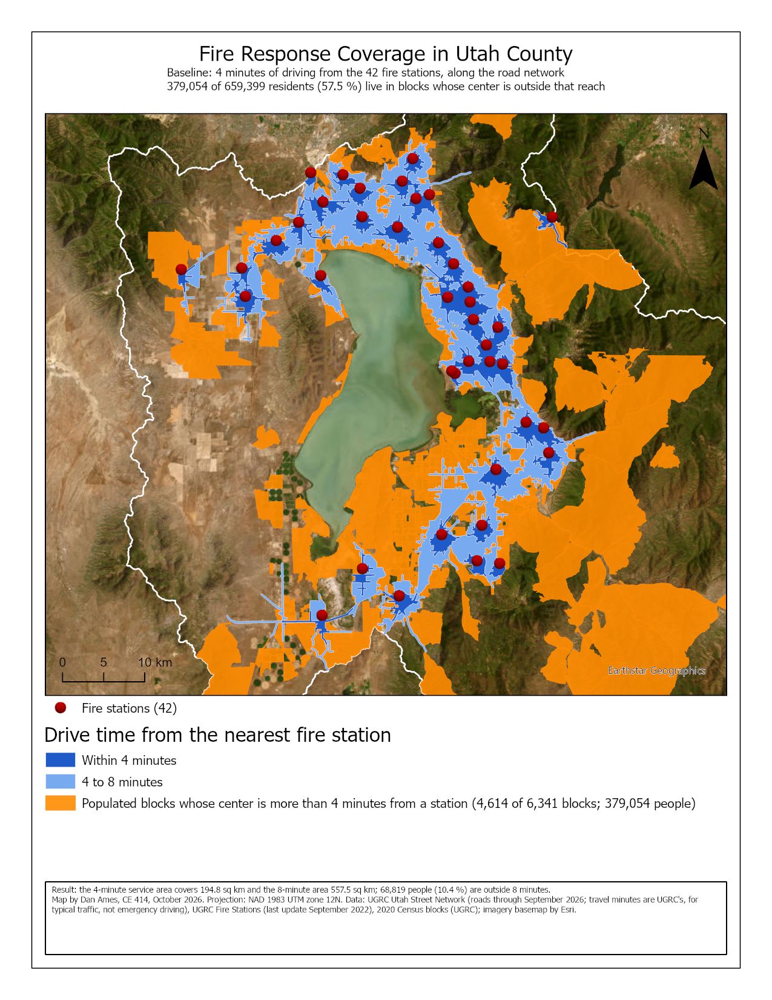

<!-- Figure: Lab 11's example baseline map, as a model of a map that answers its question at a glance. -->

---

# Common ways projects go wrong

- **The data was not there.** Chose a dataset that turned out to be a PDF, a paywall, or a 2009 snapshot
- **Geographic coordinates.** Buffers in degrees; areas in "square degrees"
- **The model only runs once.** Hard-coded paths, intermediate layers deleted by hand
- **The package is empty.** The inputs were not layers in a map, so the package left them out
- **The video was recorded last.** Five minutes of narration at midnight sounds like it

<!-- Every one of these has happened. Say so. -->

---

<!-- _class: activity -->

# Final Thoughts

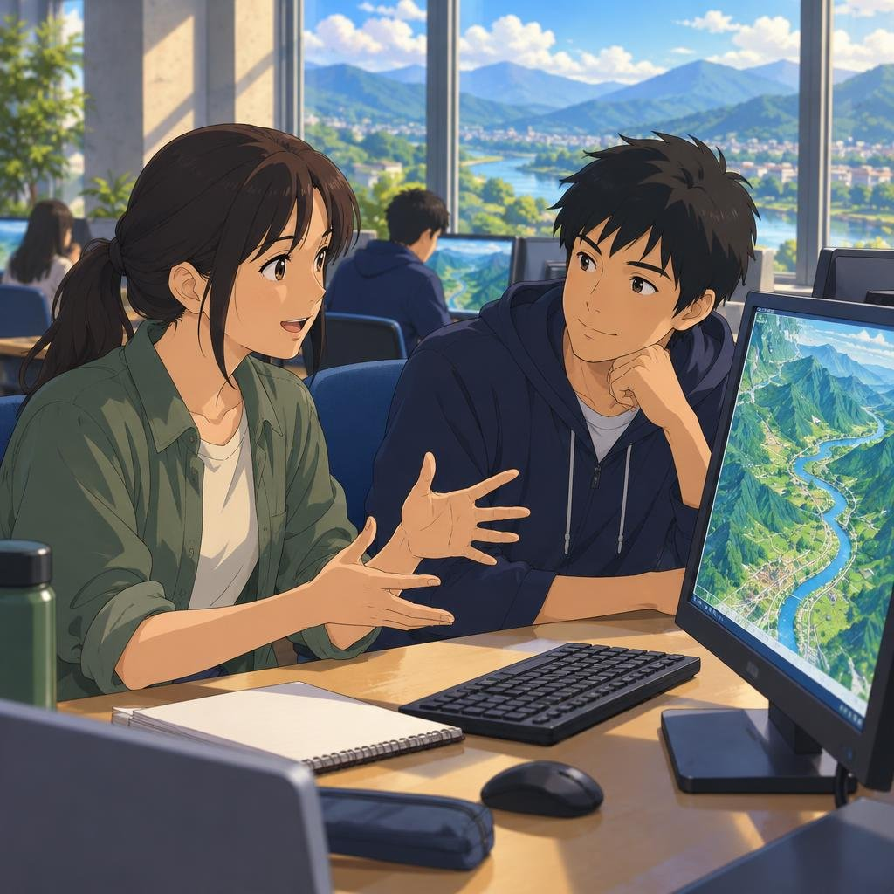

**Before next class** — Thursday is Thanksgiving, so this is before Tuesday of Week 14:

- **Read** the [Lab 12 page](https://byu-hydroinformatics.github.io/ce414-gis-applications/assignments/lab-12/) on the course site
- **Page through** two or three of the past decks linked there
- **Choose** your question and fill in the data check — one row per layer
- **Midterm 2** opens Tuesday at 8:00 am in the Testing Center; the [study guide](https://byu-hydroinformatics.github.io/ce414-gis-applications/study-guides/midterm-2/) is on the site

<!-- Five minutes at the end: have each student say their question in one sentence to a neighbor.
If the neighbor cannot repeat it back, it is not one sentence yet. -->
