<!-- _class: lead -->
<!-- _paginate: skip -->

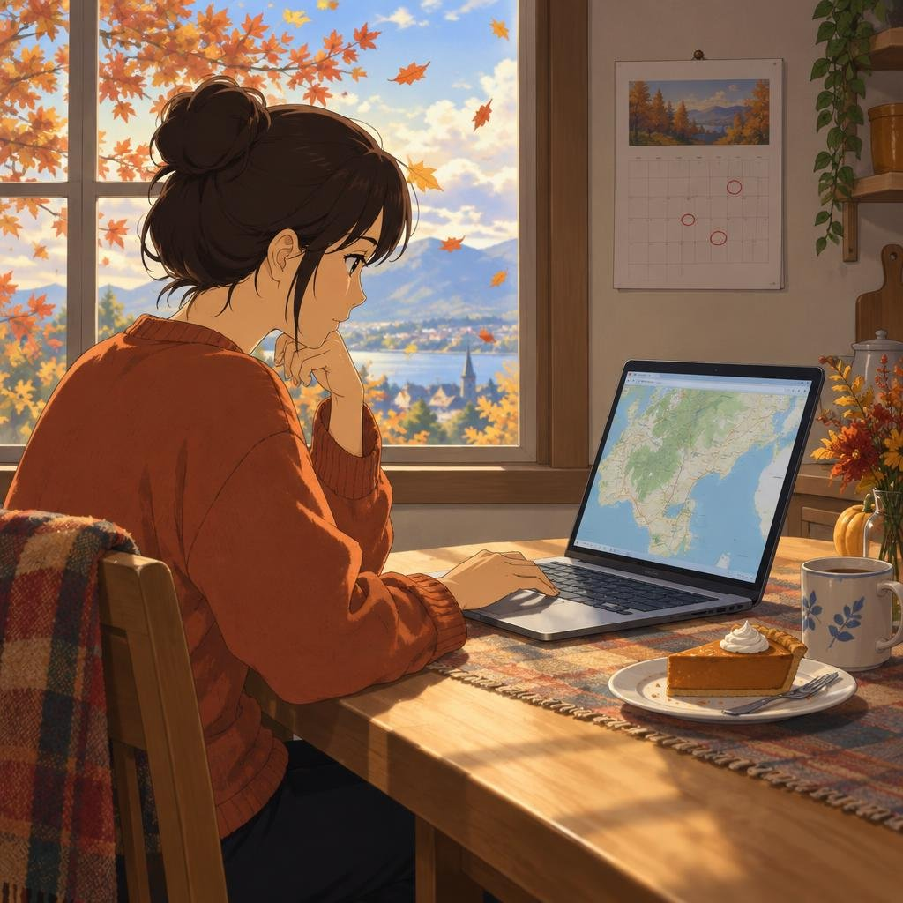

# Lab 12 Studio

## Record, Post, Package, Check

CE 414 Engineering Applications of GIS
Civil & Construction Engineering
Brigham Young University
Dr. Dan Ames

<!-- Week 14 has no new lecture. Midterm 2 is open in the Testing Center Tuesday 8:00 am to Thursday 9:00 pm (late fee from Thursday 2:00 pm), and both class meetings are a Lab 12 studio: about fifteen minutes of teaching at the start, then open lab with the instructor circulating. Tuesday: is the project real, then how to record the screen and voice and post the video unlisted on YouTube, with a 20-second test. Thursday: package the project and swap packages with a classmate. Thursday is the last in-person meeting before Lab 12 is due (Thursday of Week 15); the instructor is away that week. -->

<!-- stamp:begin -->
<!-- _footer: 'CE 414 · Week 14 — Lab 12 StudioLast Updated: 2026-11-17© 2026 Daniel P. Ames · <a href="https://creativecommons.org/licenses/by/4.0/">CC BY 4.0</a>' -->
<!-- stamp:end -->

---

# This Week

- **No lecture.** Both days are a **studio**: a short start, then work time with me in the room
- **Tuesday:** is your project real, then **record** your screen and voice and **post** it unlisted on YouTube
- **Thursday:** **package** your project and test it on a classmate's machine
- **Midterm 2** is open in the Testing Center, Tuesday 8:00 am to Thursday 9:00 pm
- **Lab 12** is due **Thursday of Week 15** at 11:59 pm. I am away that week, so Thursday is your **last** chance to ask in person

<!-- Say the last line twice. Everything that fails late (data, recording, packaging) is cheap to fix this week and expensive next week. -->

---

<!-- _class: lead -->

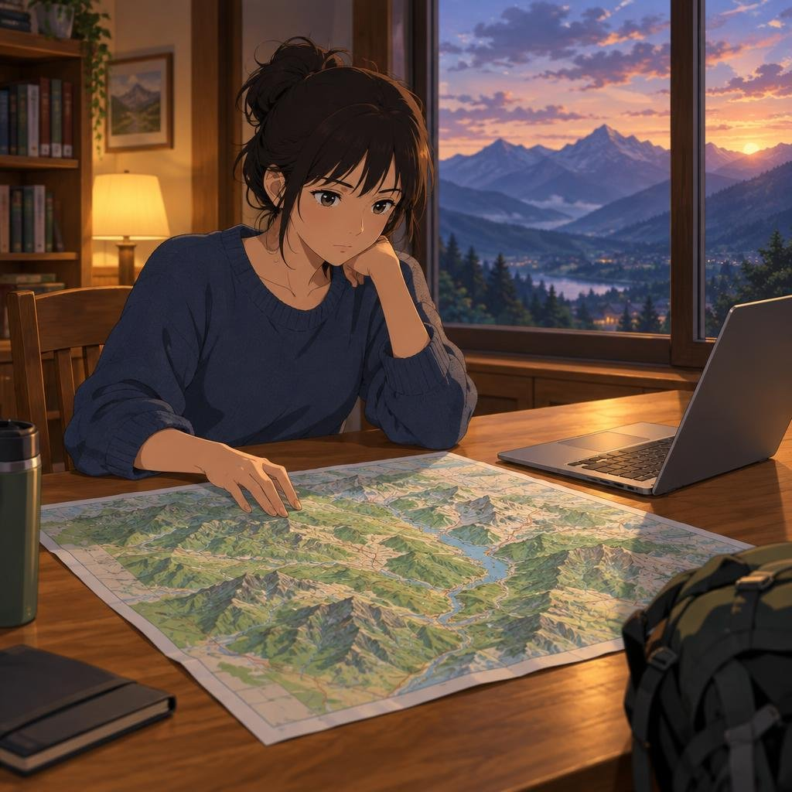

# Tuesday — Real Project, Real Video

---

# Is Your Project Real?

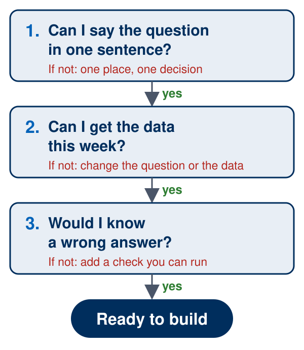

Two minutes each, with a neighbor:

- Say your **question** in one sentence. Your neighbor repeats it back; if they cannot, it is not one sentence yet
- Show your **data table**: every layer, raster or vector, source and URL, date, coordinate system. **No blank cells**
- **Goal for today:** your model runs once, end to end, from its **tool dialog**

<!-- Circulate to anyone whose question or data table is not settled; that student's project is at risk, not the one whose model has a bug. The tool-dialog run matters twice: it is the rubric's 8-point "runs without a hand repair", and it puts the run in the geoprocessing history that Thursday's package needs. -->

---

# Record Your Screen and Voice

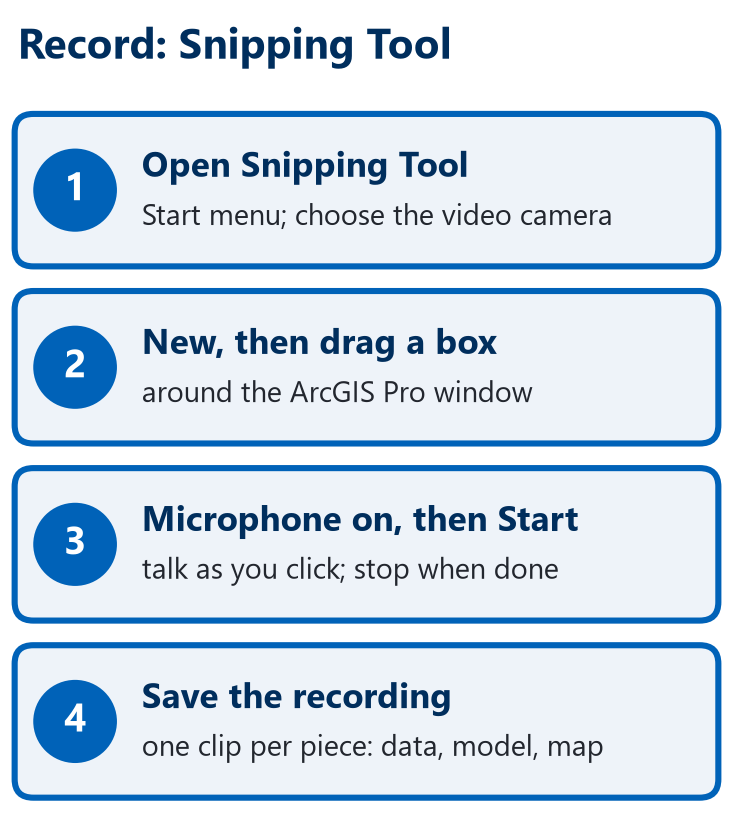

- Windows' **Snipping Tool** records a box on the screen, with your **microphone**
- Turn the **microphone on** before you start; the button is easy to miss
- Record in **pieces**: the data, the model, the map. Retake any piece you stumble on
- Run the model **before** you record: on camera, open each tool, then show the layer it made
- A **headset** helps; a quiet corner helps more

<!-- Demonstrate live on the lab machine at the front, and confirm out loud that its Snipping Tool shows the microphone button (the Lab 12 page still carries a to-do for this). If it does not, say what to use instead before anyone records. The steps follow Lab 12 Step 5 and Microsoft's Snipping Tool help (linked from the lab page). -->

---

# Post It Unlisted on YouTube

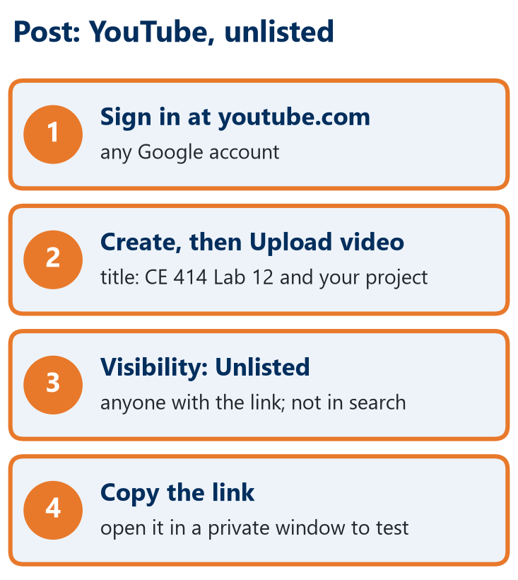

- **Unlisted**: anyone with the **link** can watch; nobody finds it by searching
- Not **Private**: then the grader cannot watch it
- Not **Public** unless you want it to be: it shows up in search and on your channel
- Join the pieces in any editor, or upload them in order and submit each link
- Before you submit, open the link in a **private window**: if it plays there, it plays for the grader

<!-- The labels follow Lab 12 Step 5 (Create, Upload video, Visibility, Unlisted); walk it live in a browser so students see the current screens, which YouTube changes from time to time. A student without a Google account can make one in a minute; a BYU account works if YouTube is enabled for it. -->

---

<!-- _class: activity -->

# Try It: 20 Seconds

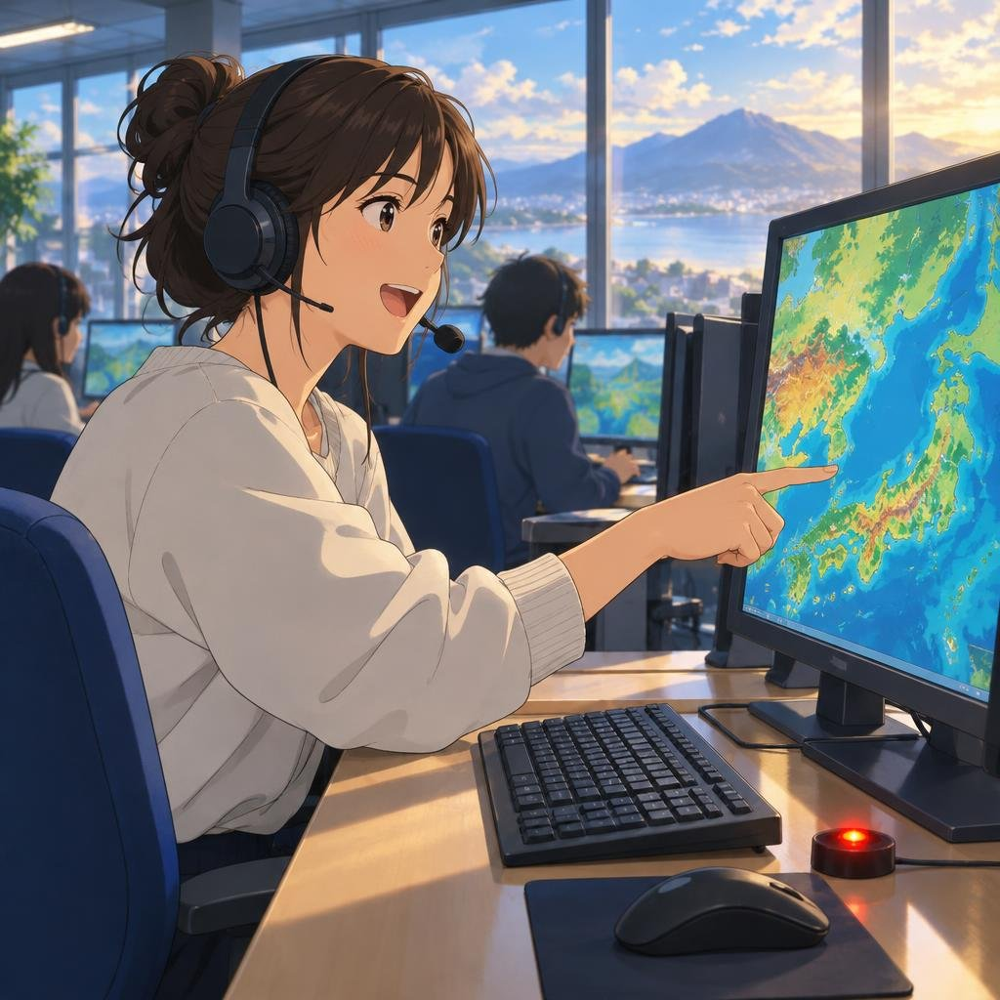

- Record **20 seconds** of your ArcGIS Pro screen, **talking** about any one layer
- Play it back: can you **hear** yourself? Can you **read** the screen?
- Upload it **unlisted** and open the link in a **private window**
- Delete the test, or keep it as your first piece

<!-- Ten minutes. The point is to find the broken microphone, the missing Google account and the wrong visibility today, not at midnight on the due date. Walk the room and listen for silent recordings. -->

---

<!-- _class: quiz -->

# Talk to Your Neighbor

You want the grader to watch your video from a **link**, but you do not want strangers to **find** it. Which YouTube visibility?

<ol type="A">
<li>Public, with a title that nobody would ever search for</li>
<li>Private, shared only with your own account</li>
<li class="correct">Unlisted, so the link works but search does not</li>
<li>Scheduled, so it goes live on the due date</li>
</ol>

* 

<!-- One minute in pairs, then the key press circles C. A still shows up in search and on the channel. B is the common mistake: a private video will not play for the grader, and the link looks fine to the student who is signed in. That is why the private-window test matters. D is not public until the date, so the grader cannot watch it before then. -->

---

<!-- _class: lead -->

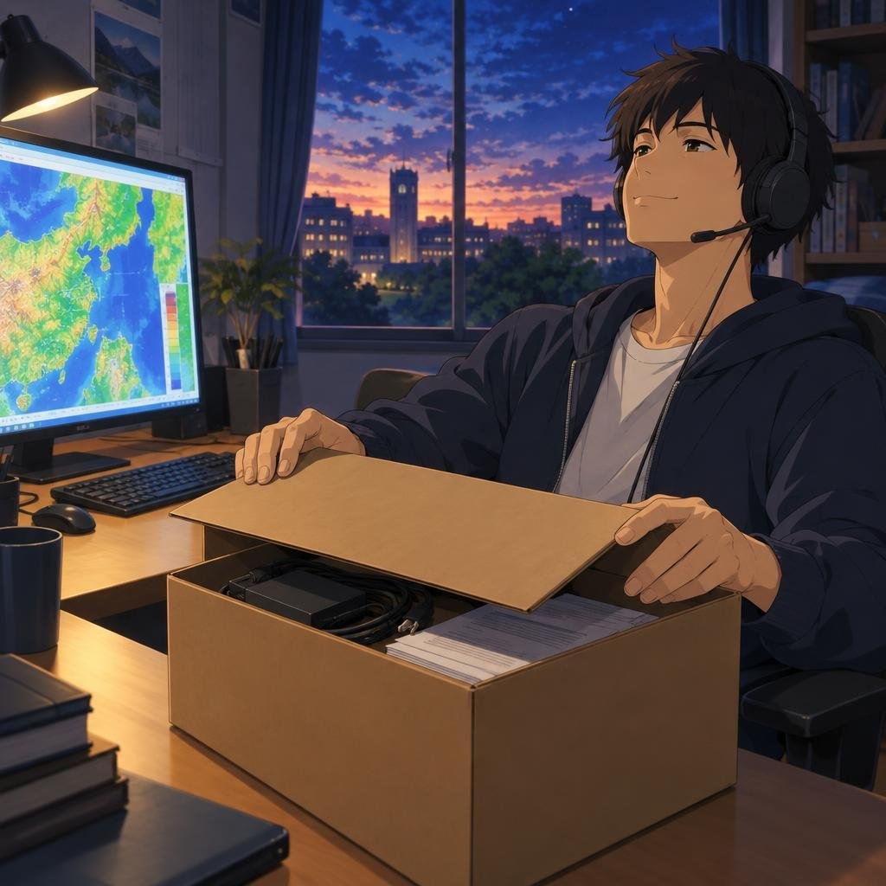

# Thursday — Package and Check

---

# Package the Project

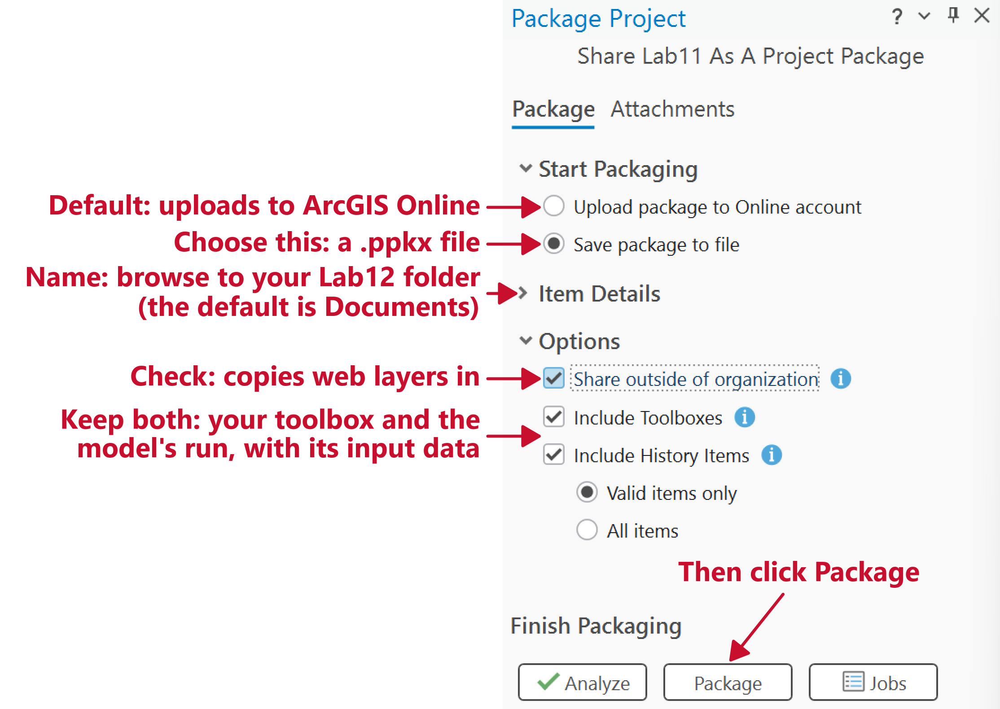

- **Share** ▸ **Package** ▸ **Project**
- Before you package: every input is a **layer in a map**, and the model has run once from its **tool dialog**
- Afterward, **double-click** the `.ppkx`: the maps draw and the model is there

<!-- The capture is ArcGIS Pro 3.7.1's Package Project pane, set as Lab 12 Step 7 says (taken on the Lab 11 GUI project, so the title reads Lab11; Item Details collapsed). The two traps: Start Packaging defaults to Upload package to Online account, and the file name under Item Details defaults to the Documents folder; on the lab machines the C: drive is locked, so browse to D:\YourName\Lab12. A package copies the data in map layers and in the geoprocessing history, but not a model's input data on its own (Esri's "Share a project package" help). Red callouts drawn by tools/week14_studio_figures.py. -->

---

<!-- _class: activity -->

# Swap Packages

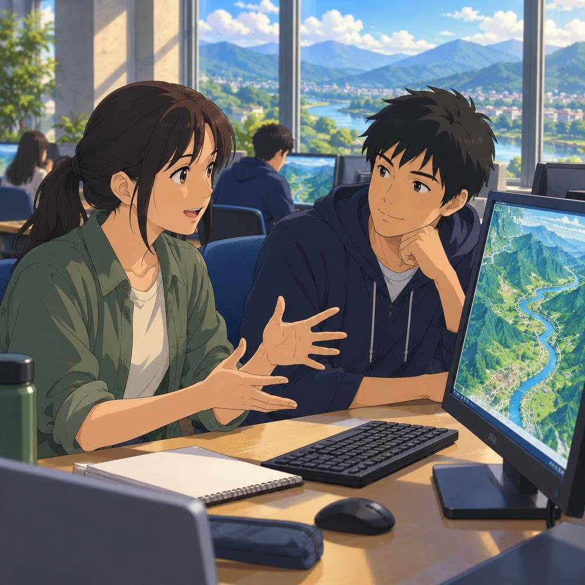

- Trade `.ppkx` files with a neighbor (a USB stick, Drive or Box)
- Open theirs on **your** machine. Do the maps draw?
- Open their model from the **toolbox** and **run it from its tool dialog**. Does it finish?
- If anything is missing, write down **which input**, and tell them

<!-- This is the grader's test, done by a classmate while there is still time to fix it. A package that opens on its author's machine can still fail on another, because the author's machine has the data in its original folders. Fifteen minutes; then back to work. CHECK BEFORE CLASS on a lab machine: double-clicking a .ppkx unpacks it under Documents\ArcGIS\Packages on C:, which is locked there. If it will not open, change the unpack folder to D: in ArcGIS Pro's options (Options, Share and Download; verify the exact setting name) and walk the class through it before the swap. -->

---

<!-- _class: quiz -->

# Talk to Your Neighbor

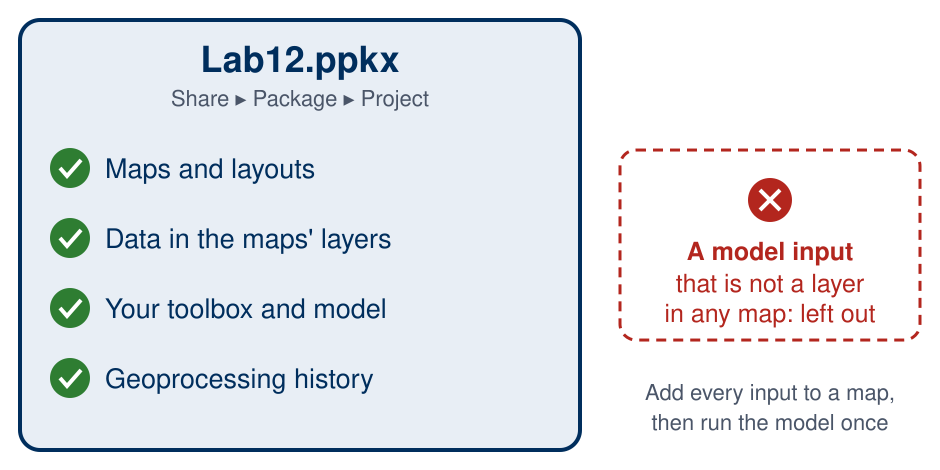

Your classmate's package opens and its maps draw, but the model stops: one **input raster** is missing. What most likely happened?

<ol type="A">
<li>The raster was too large for a package to carry, so it was dropped</li>
<li>Include Toolboxes was left checked in Package Project</li>
<li>The package was opened on a computer in a different time zone</li>
<li class="correct">It was in no map, and no tool-dialog run put it in the history</li>
</ol>

* 

<!-- One minute in pairs, then the key press circles D. A package copies map layers and the geoprocessing history's data, but not a model's inputs on their own (Lab 12 Step 7), so a raster goes missing only when both rules were broken: it was in no map, and the model never ran from its tool dialog. A is wrong: a package has no size cap of its own, though a large one may need a Drive or Box link. The fix: add the raster to a map, run the model once from its tool dialog, and package again. B is backwards: Include Toolboxes is what brings the model along. -->

---

<!-- _class: activity -->

# Deadlines

- **Midterm 2** closes **today, Thursday, December 3, at 9:00 pm**; the Testing Center's **late fee** starts at 2:00 pm
- **Lab 12** is due **Thursday, December 10, at 11:59 pm** on Learning Suite: the **YouTube link** (unlisted, tested in a private window), the **report** as a PDF, and the **package** (`.ppkx`, or a Drive or Box link). The reel is optional
- **No class the week of December 6.** I am away: **email** questions, and expect an answer in the evening
- Today is the **last class** before the final: ask now

[Lab 12 page](https://byu-hydroinformatics.github.io/ce414-gis-applications/assignments/lab-12/)

<!-- End Tuesday at the Deadlines slide too, minus the "today" line. Dates: Midterm 2's window is Tuesday December 1, 8:00 am, to Thursday December 3, 9:00 pm (Testing Center); Lab 12 is due Thursday of Week 15, December 10, the last day of classes; the instructor is away December 6-10. -->

---

<!-- _class: activity -->

# The Final Exam: In Person

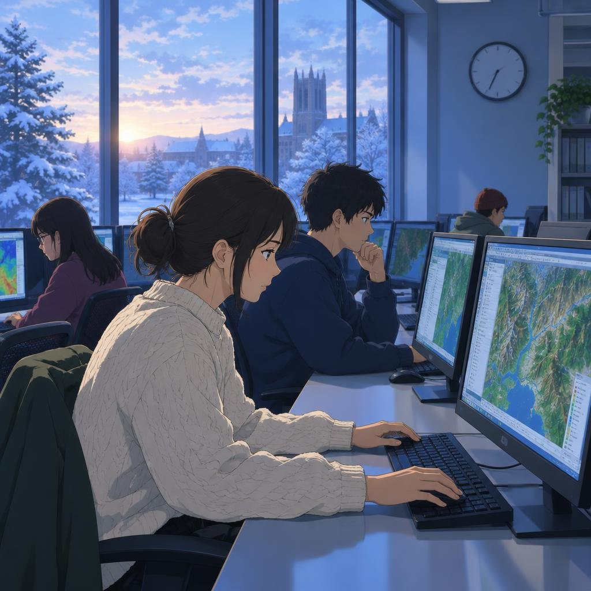

- **Thursday, December 17, 7:00 to 10:00 am**, at a **lab computer** in the room on BYU's final exam schedule; I will post it on Learning Suite
- You must **come in person** at that time: there is no take-home or online version
- **One question**, done in **ArcGIS Pro**: open book and open computer, AI permitted and disclosed
- Plan on about **two hours**; the third hour is for software trouble and for exporting and uploading **one PDF**
- A **conflict**? Tell me **now**, by email, not the week of the exam

<!-- The time is the Learning Suite exam entry (Final Exam, 12/17/2026, 7:00-10:00 am); confirm the room against BYU's final exam schedule and post it on Learning Suite before class. The format follows the course schedule page (one question in ArcGIS Pro at a lab computer, open book and open computer, a three-hour block, one PDF) and the AI policy's final-exam section (AI permitted, and disclosed). The image was generated in the deck-wide anime style (tools/divider-images/week14-anime.json). -->
